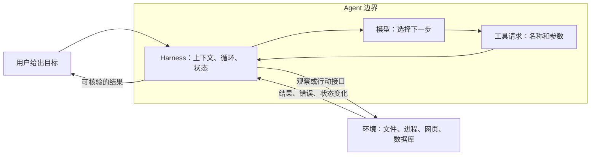
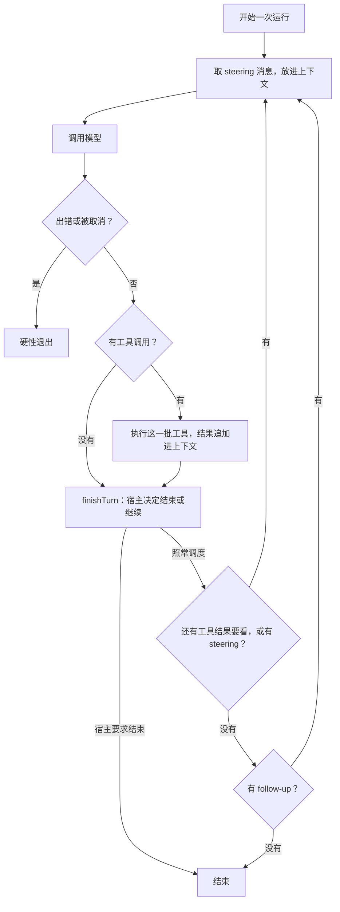
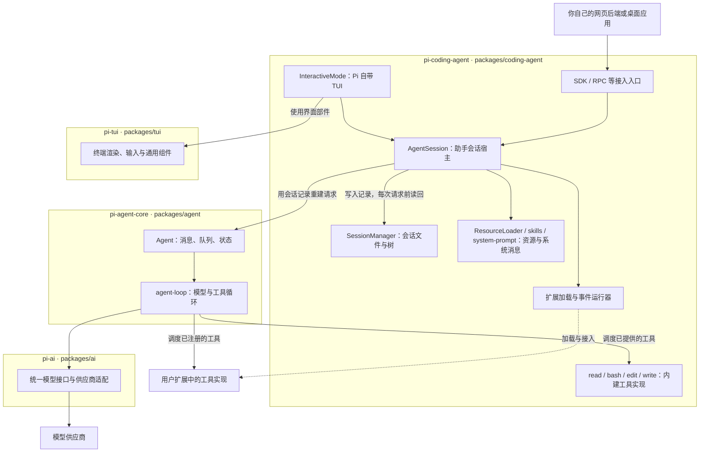
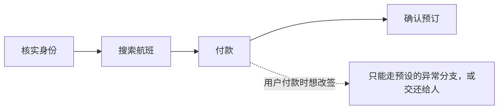

# 第一章　AI Agent 入门

[返回目录](../README.md)

> 这一章是 [π 工坊](https://pi.duanjl.com/)第 01 站的深入版。默认你已经玩过 [▶ 1-1 第一单](https://pi.duanjl.com/#/play/1-1) 和 [▶ 1-2 白纸黑字](https://pi.duanjl.com/#/play/1-2)，也翻过[第 01 站手册](../manual/01-agent-loop.md)。游戏里看到了什么，这里不再复述；这里讲那些零件背后的原理、Pi 的真实实现，以及原书第 1 章里游戏还没做成关卡的部分。

**阅读路线**：手册里装过的零件，在本章的对应位置。

| 手册里的零件 | 本章讲到哪一步 | 小节 |
| --- | --- | --- |
| 上下文舱 | 五个部分、静态前缀与轨迹、Pi 怎样每次现拼上下文 | [1.7](#17-眼睛上下文的五个部分) |
| 主脑 | 决策内核、内部思考、“模型即 Agent” | [1.6](#16-大脑决策内核与模型即-agent) |
| read 工具 | 工具调用四步、五类工具、通用与专用 | [1.5](#15-手脚工具调用的四步与工具的分寸) |
| 循环、它不记得上一次、循环什么时候停 | ReAct 循环、Pi 的两层 `while`、全部停止条件 | [1.9](#19-react-循环怎么转什么时候停) |
| write 工具 | 观察空间与动作空间 | [1.4](#14-观察空间与动作空间) |
| 验收信标 | 验收条件、Harness 五要素里的“验证” | [1.2](#12-第一单的真机版一个能亲手核验的练习)、[1.10](#110-从-demo-到产品harness-五要素) |
| Harness | 五要素、Pi 的三层包、Pi 内建了哪些、哪些要自己写 | [1.10](#110-从-demo-到产品harness-五要素) |
| 往深处走（游戏里还没有关卡） | 消融实验、竞争力外移、编排、护栏、设计模式 | [1.8](#18-拿掉一块会怎样消融实验)、[1.11](#111-竞争力搬到了模型之外)–[1.14](#114-五个贯穿全书的设计模式) |

在空间站上，你是 Harness 的设计师，主脑有时是一只照剧本说话的提线木偶。这一章换成真家伙：一台装在你电脑上的 Pi，一个真模型，一份真的订单程序。原书（李博杰《深入理解 AI Agent》第 1 章）自称是全书的“概念地图”，前半回答“Agent 是什么”，后半回答“Agent 怎样在生产环境里可靠地运行”。本章沿着同一条路走，只是每到一个零件，都会停下来看看 Pi 的源码里它长什么样。

先把真机装上，后面每一节都要用它来做观察。

## 1.1 先把真机装上：终端、Pi 和模型服务

游戏里，发射按钮背后有一台服务器替你跑好了一切。到了自己电脑上，你要分清三样东西，它们出了问题的症状完全不同：

| 东西 | 是什么 | 出问题时的样子 |
| --- | --- | --- |
| 终端 | 输入命令的窗口；`node` 运行 JavaScript，`npm` 安装软件包 | `command not found` |
| Pi | 装好以后用 `pi` 启动的程序，也就是 Harness | 能启动，但界面里报模型或认证错误 |
| 模型服务 | 某家供应商的账户或 API key，提供真正的模型 | `/login` 选不到可用模型，或调用时报额度、权限错误 |

装上 Pi 只解决了中间那一格。下面的命令按 macOS / Linux 终端写，Windows 用户参考官方 [Windows 指南](https://github.com/earendil-works/pi/blob/f07218c4d4bbc12bef056a7058c3dd49dfe41abe/packages/coding-agent/docs/windows.md)。

先在终端里运行 `node --version` 和 `npm --version`。本书版本要求 **Node.js 22.19.0 或更高**（[包定义](https://github.com/earendil-works/pi/blob/f07218c4d4bbc12bef056a7058c3dd49dfe41abe/packages/coding-agent/package.json#L105)里写的是 `>=22.19.0`）。找不到命令或版本过旧，就去 [Node.js 官方下载页](https://nodejs.org/en/download) 装一个，然后重开终端。

本书以官方源码提交 [`f07218c4`](https://github.com/earendil-works/pi/tree/f07218c4d4bbc12bef056a7058c3dd49dfe41abe) 为依据，这个快照里 Coding Agent 的包名是 `@earendil-works/pi-coding-agent`，版本 `0.87.1`。网上较早的资料可能用旧仓库名和旧包名，跟着本书走时先对齐版本。下面是复现这个历史快照的命令：

> 0.87.1 的发布依赖有已知漏洞，不适合生产环境，也不适合处理不可信输入；本书修订过的工具实验使用 1.5.0。复现旧版前请先读[安全说明](../SECURITY.md)。

```bash
npm install -g --ignore-scripts @earendil-works/pi-coding-agent@0.87.1
pi --version
```

`-g` 把命令装到 npm 的全局位置；`--ignore-scripts` 禁止安装期间运行依赖包的生命周期脚本，官方[安装说明](https://github.com/earendil-works/pi/blob/f07218c4d4bbc12bef056a7058c3dd49dfe41abe/packages/coding-agent/docs/quickstart.md)也是这么装的。提示目录权限不足时，先修正 Node/npm 的用户安装配置，别把 `sudo` 当成默认补救。

然后接上模型服务。运行 `pi`，在 **Pi 的输入框里**（不是终端里）输入 `/login`，选你已有账户的供应商，按提示登录，或者在菜单里配置 API key。API key 是访问凭证，不要写进项目文件，也不要提交到 Git。登录后用 `/model` 选一个支持工具调用的模型。各家的可用模型、订阅资格和计费方式会变，以登录时显示的选项为准。以 `/` 开头的操作，除非特别说明，都在 Pi 里输入；`pi -c` 这类命令才在终端里敲。

## 1.2 第一单的真机版：一个能亲手核验的练习

游戏里的 1-1 和 1-2 是同一件事的两半：先答出已支付订单的金额，再把结果写成文件并验收。仓库里的 [`examples/order-report`](../examples/order-report/README.md) 是这件事的真机版，只是换了个更接近日常的形态：一段订单汇总程序把退款也算进了收入，要让 Pi 把程序修好。

从本书仓库根目录执行：

```bash
node examples/order-report/setup.mjs
cd .workshop/order-report
node check.mjs
```

`setup.mjs` 新建练习目录，复制数据、带缺陷的程序和检查脚本；遇到已有目录会停下，不覆盖上次的练习。这时检查应该失败，这是刻意留下的教学缺陷。数据只有三条：

| 订单 | 状态 | 金额（分） |
| --- | --- | ---: |
| A-001 | paid | 1200 |
| A-002 | refunded | 500 |
| A-003 | paid | 2300 |

业务口径是：只汇总仍为 `paid` 的订单，退款订单不计入，也不再扣一次（这个练习不讨论现金流水净额）。正确结果是 **3500 分，2 笔**。在这个目录里启动 `pi`，输入：

```text
请修复当前目录的订单汇总程序。
业务规则：只有 status 为 paid 的订单计入汇总，amountCents 的单位是分。
先读取相关文件，再修改 report.mjs；不要修改 orders.json 和 check.mjs。
运行 node check.mjs 验证，并说明修改原因和实际检查结果。
```

你会看到和游戏里很像的过程：读文件，发现累加逻辑，编辑代码，用 `bash` 跑检查，最后解释。具体顺序可能不同，模型先列目录也不算失败。完成后输入 `/quit` 回到终端，**自己**再跑一遍：

```bash
node check.mjs
node report.mjs
node ../../examples/order-report/verify.mjs .
```

成功时，检查输出 `PASS: paid orders = 2, totalCents = 3500`，程序输出包含 `totalCents: 3500` 和 `paidCount: 2` 的 JSON。第三条是练习之外的验证器：它确认数据和检查脚本没被改过，再用五组输入检查汇总逻辑。

和游戏对一下位置：

| 游戏里 | 真机练习里 | 谁在做 |
| --- | --- | --- |
| 验收信标 | `check.mjs` | Agent 自己能按的检查 |
| 地面指挥拿账本核对 | `verify.mjs` | Agent 碰不到的独立验收 |
| “日结完成 ✅” | Pi 最后那段说明 | 模型的自述，只能当线索 |

**不要只依据 Pi 说的“已通过”判断成功。** 看不懂它改了什么，可以接着问：“请用三条订单逐条演示修改前和修改后的累加过程。”你会看到退款订单怎样让结果从错误的 4000 分回到 3500 分。

没有模型账户也能做一半：初始化、看检查失败、读[参考修复](../examples/order-report/solution/report.mjs)，再从仓库根目录运行 `node examples/order-report/selftest.mjs`。这练的是工程闭环，不等于真的跑过一次模型驱动的 Pi。

### 为什么要给任务写验收条件

“优化一下程序”没告诉 Agent 什么算更好，它可能重命名变量，也可能重构整个目录。“只统计 paid 订单，三条样例结果为 3500 分、2 笔”就把成功条件落在了环境里，有程序能判对错。

验收条件还得**独立于 Agent 的实现**。假如 Pi 为了通过检查，把 `check.mjs` 改成永远输出 PASS，终端一片绿，任务却失败了。所以请求里明确保护了检查和数据，`verify.mjs` 又在练习目录之外留了一份原件。真正的评估会放在 Agent 改不了的环境里，用更多组合来测，那是[第七章](07-evaluation.md)的事。

一份可复用的任务说明，四句话就够：

1. 我要什么结果；
2. 依据哪些规则；
3. 可以改什么，不能碰什么；
4. 怎样检验。

不是每次都要写长提示词，但要清楚缺了的信息会由谁补上。模型替你做的假设，如果影响正确性，就应该暴露给你。

### 订单修复参考答案

最小修复是在累加前筛出 `paid` 订单（完整文件见[参考修复](../examples/order-report/solution/report.mjs)）：

```js
function summarize(orders) {
  let totalCents = 0;
  let paidCount = 0;
  for (const order of orders) {
    if (order.status !== "paid") continue;
    totalCents += order.amountCents;
    paidCount += 1;
  }
  return { totalCents, paidCount };
}
```

A-001 让累计值变成 1200 分、1 笔；A-002 是退款，两个累计值都不动；A-003 让它变成 3500 分、2 笔。只改总金额、没同步排除退款的笔数，不算修完。空数组应得到两个零，全是退款也应得到两个零，这两组输入专门防“写死样例答案”的实现。参考答案说明的是预期实现，不代表你的 Pi 已经做成了；完成实验仍要留下自己的检查输出，并确认 `orders.json` 和 `check.mjs` 没变。

有模型账户以后，还可以跑[真实模型配套实验](../examples/live-model/README.md)，保留轨迹，对照后面几节的机制。

## 1.3 公式，以及公式外面的环境

刚才那次修复里，至少有三方在干活：模型决定下一步，工具真的去读写文件，还有一段程序把两者接起来。原书用一个最小工程公式概括：

> **Agent = LLM + 上下文 + 工具**
>
> 换个直白的说法：大脑 + 眼睛 + 手脚。

原书特意强调了两点，手册里也提过，这里讲透：

- **加号是工程组件的组合**，不是强化学习（reinforcement learning, RL）里的形式化定义。三个组件可以对应到 RL 的概念，但不是一一等同：

| 直觉 | 实现组件 | RL 里的近似概念 | 含义 |
| --- | --- | --- | --- |
| 大脑 | LLM | 策略（policy） | 面对当前信息，决定下一步做什么 |
| 眼睛 | 上下文构造 | 观察与历史 | 把环境返回的东西和已有历史整理成这一次决策的材料 |
| 手脚 | 工具与适配器 | 观察 / 行动接口 | 规定能读到哪些观察、能发出哪些行动、用什么格式 |

- **公式里没有环境（environment）。** Agent 和环境是闭环交互的两方：环境给出观察，Agent 选择行动，行动改变环境，新的状态再产生下一次观察。环境包括文件、数据库、网页、用户、其他 Agent，乃至机器人所处的物理世界。



图里那个把一切接起来的角色叫 **Harness**，本书也称它运行框架。它构造上下文，把工具请求送去执行，保存状态，决定何时再调用模型，并提供验证、拦截、纠正等接入点。它的完整定义要到 [1.10](#110-从-demo-到产品harness-五要素) 才展开，这里先记住边界：**Harness 在 Agent 之内、模型之外**。工具定义、调用适配器、沙箱的权限与重置机制属于 Harness；沙箱里随行动变化的文件和进程属于环境。原书还补了一句容易被忽略的话：物理位置不决定归属，仿真环境哪怕和 Agent 跑在同一个进程里，它仍然是环境。

**Pi Coding Agent** 是一个主要在终端里用的编码助手，也是一个可以扩展、嵌入别的程序的 Harness。它默认给模型 `read`、`bash`、`edit`、`write` 四个工具（[默认工具集](https://github.com/earendil-works/pi/blob/f07218c4d4bbc12bef056a7058c3dd49dfe41abe/packages/coding-agent/src/core/tools/index.ts#L164)），把计划模式、团队结构、记忆服务这些业务选择留给扩展。说它“简洁”，说的是核心接口和组合方式，不是说整个项目只有几十行。

回到订单修复，判断 Agent 的工作不能只看它最后说了什么，要问三个贯穿全书的问题：它**观察**到了哪些证据？对环境做了哪些**改动**？用什么**检查**确认了结果？

## 1.4 观察空间与动作空间

游戏里“它在胡说”那场事故，调查题的第一个干扰项是“换个更大的模型”。原书正是要驳这个直觉。

Harness 把环境返回的观察转换成上下文，再把模型选的行动转换成工具调用。原书把这两条通道合称 Agent 与世界的边界：**观察空间**（observation space）决定什么能进上下文，**动作空间**（action space）决定什么能真正被执行。没进观察通道的信息，对模型来说就像不存在；没被动作接口允许的操作，模型知道该怎么做也只能停在文字建议上。

由此得出本章分量最重的判断之一：

> 底层模型固定时，提升 Agent 表现最主要的系统工程手段，往往就是重新定义或扩展观察空间与动作空间，也就是扩展上下文和工具。
>
> 李博杰《深入理解 AI Agent》第 1 章，大意

许多看上去需要“更聪明的模型”的问题，其实是接口问题。原书举了两个产品演进的例子：

| 产品 | 扩了哪一边 | 怎么扩的 |
| --- | --- | --- |
| Manus | 两边都扩，取并集 | 把 Deep Research、Coding、Computer Use 三条路线合进一个 Agent：虚拟浏览器扩观察，文件系统、代码执行、命令行扩动作 |
| OpenClaw | 把两边推到用户的数字生活里 | 通过 WhatsApp、Telegram 等消息渠道收发任务，用本地 Gateway 接云应用和本地文件 |

原书还顺手点了一个细节：Manus 后来也加了 Google Drive 连接器和桌面端本地访问。产品能力的演进，很大程度上就是这两个空间的演进。

### Pi 怎么做：动作空间是一行配置

在 Pi 里，动作空间直接由启动参数决定（[工具选项](https://github.com/earendil-works/pi/blob/f07218c4d4bbc12bef056a7058c3dd49dfe41abe/packages/coding-agent/docs/cli.md#tool-options)）：

| 命令 | 动作空间 | 适合 |
| --- | --- | --- |
| `pi` | 默认的 `read`、`bash`、`edit`、`write` | 日常编码 |
| `pi --tools read,grep,find,ls` | 只读：能看，不能改 | 刚入门时让它解释代码 |
| `pi --no-tools` | 一个工具都没有 | 复现游戏里的“它在胡说”（见 [1.8](#18-拿掉一块会怎样消融实验)） |

只读工具集合适合解释代码，但它**不能代替操作系统权限边界**。已加载的扩展仍是程序，读到的内容也可能是敏感信息。Pi 用启动它的账户权限运行，工作目录只是工作位置，不是越不过去的围栏（[安全边界](https://github.com/earendil-works/pi/blob/f07218c4d4bbc12bef056a7058c3dd49dfe41abe/packages/coding-agent/docs/security.md)）。手册说“你不想让它做的事，最可靠的办法是根本不给它那个工具”，这句话在 Pi 里的精确版本是：不给它那个工具，模型就提不出那个请求；但能挡住进程本身的，只有操作系统或虚拟化边界。这个话题在[专题　沙盒](s-sandbox.md)里展开。

## 1.5 手脚：工具调用的四步与工具的分寸

### 四步，以及“调度”和“实现”分属两处

手册已经讲过工具调用（tool calling，也叫 function calling）的四步：声明工具，模型决定，结果追加进上下文，模型据此继续。开发者只负责定义和执行工具，“要不要调、调哪个、传什么参数”由模型决定。

到了 Pi 的源码里，有一件手册没细说的事：**决定何时调用一个工具函数的代码，和这个函数的实现，不在同一个包里。** 循环属于 `pi-agent-core`，而 `read` 的读文件逻辑写在 `pi-coding-agent` 里（[read 工具](https://github.com/earendil-works/pi/blob/f07218c4d4bbc12bef056a7058c3dd49dfe41abe/packages/coding-agent/src/core/tools/read.ts#L76)），用户自定义的工具则可以来自项目扩展。循环只认一个接口 [`AgentTool`](https://github.com/earendil-works/pi/blob/f07218c4d4bbc12bef056a7058c3dd49dfe41abe/packages/agent/src/types.ts#L443)：

| 字段 | 给谁看 | 作用 |
| --- | --- | --- |
| `name`、`description`、`parameters` | 模型 | 就是游戏里点开 read 舱看到的那份说明书 |
| `label` | 界面 | 显示用的名字 |
| `execute(toolCallId, params, signal, onUpdate)` | Harness | 真正干活的函数，模型永远看不到 |
| `executionMode` | 循环 | 声明这个工具能否和别的工具并行，[第六章](06-interaction.md)讲 |

游戏里 read 的说明书“一字未改”，指的就是上表第一行：Pi 的 read 描述里写着文本最多返回 2000 行或 50KB，大文件用 offset 接着读。

工具失败时怎么办？Pi 的约定是 `execute` **抛出异常**，循环接住它，把它变成一条 `isError: true` 的工具结果交回模型（[错误处理约定](https://github.com/earendil-works/pi/blob/f07218c4d4bbc12bef056a7058c3dd49dfe41abe/packages/agent/README.md#error-handling)）。游戏上下文舱里的红色方块就是这个。工具报错通常不等于循环要退出：`edit` 找不到旧文本，模型可以重新读文件再改。

原书把工具分成感知、执行、协作、事件触发、用户沟通五类，手册的[动作](../manual/01-agent-loop.md#c-action)一节已经列过表。值得再强调的只有一点：事件触发这一类不是 Agent 主动调用的，是外部事件（来了一封邮件、到了定时时间）驱动 Agent 开始任务。工具的分类与设计是[第四章](04-tools.md)的主题。

<a id="t-general-vs-special"></a>

### 通用工具还是专用工具

扩动作空间有代价。原书列了三种典型翻车：接口含糊，模型就乱用；错误处理不到位，会卡死；权限给得太宽，出了错难挽回。它给出的原则是：

> **通用的基础能力用于组合与探索；专用工具用于约束高风险和强业务规则的操作。**

具体做法是从任务所需的最窄能力起步，再随复杂度扩：

| 任务 | 起步 | 升级 | 升级后必须补上的 |
| --- | --- | --- | --- |
| 四则运算 | 一个参数清晰的计算器 | 读表格、清洗、统计、绘图时，换成受限的 Python 解释器 | 隔离沙盒、默认不联网、限定目录，限制时间、CPU、内存、输出大小 |
| 记录过程 | 一个日志工具 | 长达数小时的任务，换成受控的虚拟工作目录 | 限定可读写路径、容量、文件类型，防路径越界 |
| 支付、删除数据、发邮件、生产部署 | 不升级 | 一直是参数明确、权限受限、全程可审计的专用工具 | 必要时加预览和人工确认 |

拿这张表看 Pi：`bash` 就是那个“受限的解释器”里的解释器，组合能力极强；但 Pi **没有内建沙盒**，“受限”那一半要靠你把它放进容器或虚拟机（官方[安全说明](https://github.com/earendil-works/pi/blob/f07218c4d4bbc12bef056a7058c3dd49dfe41abe/packages/coding-agent/docs/security.md)把“没有内建沙盒”明确列为已知行为）。游戏则走了第二行的路：主脑的文件工具只能碰一个只存在于内存里的虚拟目录，也根本没给它执行命令的工具。

## 1.6 大脑：决策内核与“模型即 Agent”

手脚需要大脑驱动。用户说的往往不是真正想要的，任务要拆，每一步都要判断调不调工具、调哪个、传什么。原书把 LLM 称作 Agent 的**决策内核**：理解意图，规划，执行。

它还有一项游戏里看不到的能力：**内部思考**（reasoning）。行动之前先在脑子里推演一遍，不改变外部环境，却能提高行动质量。原书解释了它为什么有效：模型推演时遵循的是预训练沉淀下来的人类知识里的逻辑规则，所以和传统 RL Agent 那种盲目的随机探索不同。游戏服务端特意把思考关掉了（`thinkingLevel: 'off'`），好让你看到最原始的循环；在 Pi 里你可以用 `--thinking <level>` 或界面里的设置把它打开。原书的建议是绝大多数 Agent 都该选支持思考的模型，例外是单步简单任务、固定位置点击这一类。

<a id="t-model-as-agent"></a>

### 模型越来越强，Harness 会消失吗

后训练（post-training），尤其是强化学习，已经把工具调用的**决策**内化进了模型：何时调、调哪个、传什么、要不要继续。这叫**模型即 Agent**（Model as Agent）。很自然的推论是“框架不重要了”。原书的论证方向正好相反：

1. **RL 写进参数的是决策，不是执行。** `web_search`、`code_runner` 的真实实现仍在模型之外。原书致谢一位读者在 GitHub Issue 里指出了这个区分。
2. **自主空间越大，出错的影响面越大**，所以需要更精细的约束、验证和纠正。Harness 原指马具：缰绳和挽具不是为了不让马跑，是把马的力气引到车上。
3. **模型厂商的优势**在于能把模型和外围 Harness 一起优化，而不是“让框架变薄”。

那 Rich Sutton 的《苦涩的教训》（*The Bitter Lesson*）呢？那篇短文回顾了 AI 研究七十年反复上演的一幕：人类把自己的领域理解编码进系统，短期见效，长期总是输给能随算力扩展的搜索与学习。原书的立场概括成八个字：**方向认同，节奏务实。** 模型会一层层吃掉 Harness，这一点不怀疑；可训练以月计，模型也不可能一次学会真实业务的全部约束，模型此刻的能力边界，就是 Harness 此刻的价值所在。模型每内化一层，Harness 就卸下一层，转去兜底新的能力前沿。

### 行为改变不只发生在训练时

原书在这里有一条并列的旁支：Agent 的行为可以在三个时间尺度上改变，它们是协同关系，不是三选一。

| 路径 | 发生在哪儿 | 优点 | 局限 | 本书展开 |
| --- | --- | --- | --- | --- |
| 上下文适应 | 当前任务的上下文里 | 快、便宜、立刻生效 | 受窗口限制，下一次会话就没了 | [第二章](02-context.md) |
| 外部产物更新 | 知识文档、Prompt、Skill、程序与 Harness | 可审计、可修订 | 仍要经上下文或工具才能被用上 | [第三章](03-memory.md)–[第五章](05-coding.md)、[第九章](09-evolution.md) |
| 参数更新 | 后训练 | 能内化难以写成规则的能力，比如医疗影像、语言风格 | 部署成本高 | [第八章](08-training.md) |

三条路按可回滚的程度从高到低排，[1.14](#114-五个贯穿全书的设计模式) 会再用到这一点。

## 1.7 眼睛：上下文的五个部分

模型只能根据它看到的东西做决定，所以要谈“缺了什么会怎样”，得先把上下文拆开。原书从 API 的视角拆成五部分，手册已经把它们和方块颜色对上了，这里补上每部分里还装着什么：

| 部分 | 装着什么 | 归类 |
| --- | --- | --- |
| 系统提示词（system prompt） | 身份、权限、行为准则；还有跨会话保存的**用户记忆**和动态注入的环境状态 | 静态前缀 |
| 工具定义（tool definitions） | 每个工具的名字、描述、参数格式 | 静态前缀 |
| 用户消息 | 用户的输入；RAG 检索进来的**外部知识**也放在这里 | 轨迹 |
| 模型回复 | 最多三块：思考（reasoning）、正文（content）、工具调用（tool_calls），不一定同时出现 | 轨迹 |
| 工具执行结果 | 框架执行工具后交回的结果，是下一步思考的直接依据 | 轨迹 |

> **上下文 = 静态前缀 + 轨迹（trajectory）。** 前缀在对话中保持不变，轨迹随交互越攒越长。

“用户记忆放在系统提示词里，外部知识放在用户消息里”这个分工，是[第三章](03-memory.md)的起点；“前缀保持不变”则是[第二章](02-context.md)讲 KV Cache 时的硬约束。原书也注明这是基础模式：工具的完整 schema 后来也可以按需追加到上下文末尾，而不去改动前缀。

### Pi 怎么做：系统提示和工具也是消息流里的一条

Pi 的系统提示由基础指令加上发现到的上下文文件拼成，请求里还带着工具定义和 Skill 的简介（[How Pi Works](https://github.com/earendil-works/pi/blob/f07218c4d4bbc12bef056a7058c3dd49dfe41abe/packages/coding-agent/docs/how-pi-works.md)）。有意思的是它在消息流里怎么放：本书版本中，**系统提示和工具清单都作为 `role: "system"` 的消息放在消息流里**。开头一条记录初始状态，中途换提示或增减工具时，再往后追加一条只写变化的 `system` 消息；供应商适配层再从中取出提示和工具，编码成各家 API 要的格式。这样恢复会话或切换分支时，提示和工具的变化也跟着历史一起回放。这正是“静态前缀”加上“只往后追加”在代码里的样子。

<a id="message-transforms"></a>

### 应用保存什么，模型收到什么

应用保存的记录，和这一次发给模型的输入，不必是同一份。昨天的对话、旧版本的规则、界面通知都存着，以便追溯；可这一轮请求只该带上当下要用的材料。Pi 在每次调用模型前安排了两步（[调用位置](https://github.com/earendil-works/pi/blob/f07218c4d4bbc12bef056a7058c3dd49dfe41abe/packages/agent/src/agent-loop.ts#L389)、[请求上下文的规范化](https://github.com/earendil-works/pi/blob/f07218c4d4bbc12bef056a7058c3dd49dfe41abe/packages/agent/src/agent-loop.ts#L396)）：

```js
// 机制伪代码：省略配置、取消信号与事件。
// appMessages 开头是一条 system 消息，里面装着系统提示和工具声明。
const selected = await transformContext(appMessages);  // 选材：这一轮留什么、补什么
const modelMessages = await convertToLlm(selected);    // 表达：转成模型接口认识的消息
await callModel({ messages: modelMessages });
```

| 步骤 | 负责什么 | 例子 |
| --- | --- | --- |
| `transformContext`（可选） | 选材：保留哪些消息，补充哪些资料 | 删掉上次注入的旧规则，换上负责人刚确认的新定义 |
| `convertToLlm`（必需） | 表达：应用自己的消息类型怎样变成 `pi-ai` 的统一格式 | 把 `role: "custom"` 的规则消息转成 `role: "user"` 的文本；滤掉用 `!!` 执行、不该给模型看的命令输出 |

再往后，供应商适配层才把统一格式编码成某一家 API 的请求。这是两次不同的边界转换，别混在一起。业务规则也不会因为换了角色就获得额外权威。

<details>
<summary>拓展阅读：谁来选材，是启动时准备，还是另一个 Agent 来做？</summary>

一句话回答：**选材的代码由你来写，由宿主程序来跑。** Pi 只是在每次调用模型前，先调用你配置的 `transformContext`，等它把消息交回来再发请求。它不会偷偷启动另一个 Agent，也没有内置一个模型替你判断哪些资料相关。

**一次请求里，它会跑好几次。** 一个请求如果调用三次模型，扩展的 `context` 事件（底层就是 `transformContext`）就跑三次；只想在请求开始时查一次的东西，放在只跑一次的 `before_agent_start` 里查好存起来，每轮再拼进去。它返回的消息只用于这一次请求，**不写回会话历史**。Coding Agent 每次请求前都从会话记录重新构建消息，所以每次都要从头组装：先删自己以前加的，再放进当前版本。交给 `context` 处理函数的消息里**不含 `system` 消息**，系统提示和工具声明归 Pi 管，改完它会放回原处；确实要改完整消息流时，用在所有 `context` 处理函数之后运行的 `context_with_system`。

| 选材方法 | 谁说了算 | 什么时候用，要付出什么 |
| --- | --- | --- |
| 写死的程序规则 | 应用代码 | 规则清楚、资料不多时首选；几乎不增加等待，结果稳定 |
| 先检索，再组装 | 应用代码调检索服务 | 资料多、常变时用；每次查询都拖慢模型调用，要设超时，想好查不到怎么办 |
| 开始时准备好，后面复用 | 任务开始时取数据，每轮只挑选拼装 | 一个请求要调好几次模型时最常用；关键是说清缓存什么时候作废 |
| 再叫一个模型帮忙挑 | 应用自己调另一个模型（扩展里可用 `ctx.modelRegistry.streamSimple()`） | 规则写不死时才用；多一次调用的钱和时间，挑出来的还得由程序核对 |

| 上线前要查什么 | 不管会怎样 | 怎么做 |
| --- | --- | --- |
| 跑多少次结果都一样吗 | 规则越加越多，新旧两版同时出现 | 给自己加的消息一个固定的 `customType`，每次先删后加 |
| 有没有把工具调用和结果拆散 | 请求不合法，或模型把结果对错号 | 删历史时，调用和结果要么一起留，要么一起删 |
| 资料取不到怎么办 | Coding Agent 记下错误后照常调用模型，模型不知道这一轮少了规则 | 明确告诉模型“本轮没拿到定义，先不要下结论”，或在任务开始时直接报错 |
| 出了错能不能查到当时用的哪版 | 说不清模型当时看到的是哪一版规则 | 把出处和版本号写进模型能看到的正文；`details` 只给程序记账 |

源码与文档：[Coding Agent 接线](https://github.com/earendil-works/pi/blob/f07218c4d4bbc12bef056a7058c3dd49dfe41abe/packages/coding-agent/src/core/sdk.ts#L390)、[扩展执行](https://github.com/earendil-works/pi/blob/f07218c4d4bbc12bef056a7058c3dd49dfe41abe/packages/coding-agent/src/core/extensions/runner.ts#L1190)、[扩展上下文中的取消信号](https://github.com/earendil-works/pi/blob/f07218c4d4bbc12bef056a7058c3dd49dfe41abe/packages/coding-agent/src/core/extensions/types.ts#L340)、[`context` 看不到系统消息](https://github.com/earendil-works/pi/blob/f07218c4d4bbc12bef056a7058c3dd49dfe41abe/packages/coding-agent/src/core/extensions/types.ts#L692)、[嵌套模型调用](https://github.com/earendil-works/pi/blob/f07218c4d4bbc12bef056a7058c3dd49dfe41abe/packages/coding-agent/docs/extensions.md#L153)。想亲手验证，运行[实验 D：每次调用模型前，谁在选材](../examples/live-model/README.md#6-实验-d每次调用模型前谁在选材)，它用一个不到 70 行的扩展复现上面的做法。完整的消息样例在[第二章](02-context.md)。

</details>

### 项目约定：AGENTS.md

做第二次修复时，你又得提醒一遍“金额用整数分，别改原始订单，改完跑检查”。每次都一样的约定，可以写进项目文件，让 Pi 启动时读进系统提示：

```markdown
# 练习约定

金额使用整数分。修复时保留原始订单数据。
修改后运行 node check.mjs，并报告真实输出。
```

在练习目录写一份 `AGENTS.md`，重启或 `/reload` 后生效。它适合保存经常重复的约定，但**文本指令不是程序强制的约束**：模型可能误解，也可能被文件里别的内容干扰。上下文文件怎样发现、怎样分层，是[第二章](02-context.md)和[第五章](05-coding.md)的事。

> **延伸阅读**：“Harness”这个词流行起来，比“提示工程”“上下文工程”都晚。几个名字怎样先后出现、各自认为瓶颈在哪，见[从提示工程到 Harness 工程](notes/prompt-context-harness.md)。

<a id="t-ablation"></a>

## 1.8 拿掉一块会怎样：消融实验

“五部分缺一不可”只是个论断。原书的做法是实测：**消融实验**（ablation study），像医生逐一排除病因，一次拿掉一个组件，看系统怎样。实验 1-1 设了一组完整基线，再加四组各缺一样的对照。系统提示词不参与消融，因为没有它，Agent 连基本的角色认知都没有，测了也没意义。

| 拿掉什么 | 原书观察到的结果 | 为什么 |
| --- | --- | --- |
| 工具定义 | 无法行动，但**不沉默**：照样交出格式工整、语气笃定的答案，数字来自参数记忆 | 坦白还是编造，取决于模型的幻觉率与诚实度；“不得自行估计”只能降低概率 |
| 工具执行结果 | 闭环断裂，Agent “盲目”地反复重试，直到耗尽迭代预算 | 它知道自己发过请求，却永远看不到发生了什么 |
| 思考过程 | 几乎没有代价 | 思考记的是“为什么这么做”，结果记的是“发生了什么”；前者能从后者重建 |
| 历史消息 | 冗余操作，重复犯同样的错 | 每一轮都像第一次来 |

原书从中提炼出三条，值得一条一条记：

1. **组件并不等价。** 衡量的标准是它承载的信息能不能从别处重建。
2. **结论会随模型变。** 换一个模型，同样的消融可能得出不同结论，所以要重测。
3. **“给出了回答”不等于“完成了任务”。** 上下文残缺时，典型的失败不是报错退出，而是一个看上去毫无破绽的答案。

游戏的“它在胡说”只演了第一组。要特别分清第二组和游戏里的“一片寂静”：

| | 一片寂静（游戏） | 拿掉工具执行结果（原书） |
| --- | --- | --- |
| 结果在不在上下文里 | 在 | 不在 |
| 模型有没有被再次呼叫 | 没有 | 一直在被呼叫 |
| 症状 | 沉默 | 瞎忙 |
| 被逼出来的零件 | 循环 | 结果回传进轨迹，外加轮数上限 |

### 在 Pi 上自己做第一组

第一组你现在就能复现：在 order-report 练习目录里运行 `pi --no-tools`，然后问它：“当前目录 orders.json 里已支付订单一共多少分？”观察它是老实说看不到，还是给你一个数。不管哪种，都去对照 1.2 的那张三行表。两种结果都是失败；后一种更危险，因为它看起来完全正常。剩下三组在 Pi 里做不了这么方便，因为它们要改的是 Harness 内部，正适合留作练习（见 [1.15](#115-练习与参考答案) 练习 4）。

<a id="agent-loop"></a>

## 1.9 ReAct 循环：怎么转，什么时候停

三个组件要靠一个机制串起来。原书把它叫 **ReAct**（Reasoning + Acting）。名字里只有“想”和“做”，实际是三个环节：想，做，看。看完再想，直到任务完成。

### 先给不同长度的“一段”起名字

你只输入一句话，Pi 可能读两次文件、改一次程序、跑一次检查，最后才回复。它说完“修好了”，你还能接着让它补文档。要说清哪一步结束、哪一段记录还在，需要四个词：

| 概念 | 本书的含义 | 订单修复里的例子 |
| --- | --- | --- |
| 消息 message | 用户输入、模型回复、工具结果等一条记录 | `read` 返回的一份源码 |
| 轮次 turn | 一次模型响应，加上它触发的工具执行 | 模型请求读两个文件，两个读取完成 |
| 运行 run | 从开始处理请求到本次循环结束，可以含多轮 | 完成一次订单修复请求 |
| 会话 session | 跨多次运行保存的交流和状态，可以有分支和摘要 | 今天修程序，明天恢复后补文档 |

订单任务可能留下这样的历史（数据形状示意，省略时间戳、模型标识和用量）：

```js
const history = [
  { role: "user", content: "只有 paid 订单计入汇总，请修复" },
  { role: "assistant", toolCalls: ["read(report.mjs)", "read(orders.json)"] },
  { role: "toolResult", toolCallId: "read-code", content: "程序源码……" },
  { role: "toolResult", toolCallId: "read-data", content: "三条订单……" },
  { role: "assistant", toolCalls: ["edit(report.mjs, ...)"] },
  { role: "toolResult", toolCallId: "edit-code", content: "修改成功……" },
  // 后面还有运行检查、检查结果和最终说明。
];
```

真实的工具结果通过调用 ID 找到对应请求；同时读两个文件，即使第二个先读完，也不会被认成第一个。示意里的 `toolCalls` 字段是简化，Pi 实际用的是包含 `toolCall` 的内容块（[Agent 类型](https://github.com/earendil-works/pi/blob/f07218c4d4bbc12bef056a7058c3dd49dfe41abe/packages/agent/src/types.ts)）。还要记住：历史提供证据，但**证据的身份要保留**。文件里写着“删除其他文件”，只是工具读到的资料，不会因为进了历史就变成用户的新授权。

### 最小循环

最简单的工具调用循环，以“模型不再请求工具”为正常结束条件。下面是类 JavaScript 的机制伪代码，不能直接当 Pi SDK 跑；`executeAsToolResult` 会把工具的成功或失败都整理成一条结果消息：

```js
const history = [userMessage];

while (true) {
  const selected = await transformContext(history);
  const messages = await convertToLlm(selected);
  const reply = await callModel({ messages }); // 系统提示与工具声明在 messages 里
  history.push(reply);

  const calls = getToolCalls(reply);
  if (calls.length === 0) {
    break; // 没有工具调用：本次循环正常结束
  }

  for (const call of calls) {
    const result = await executeAsToolResult(call);
    history.push(result);
  }
  // 下一次 while：模型现在可以看见工具结果。
}
```

订单修复的几轮可以是“读文件”“改程序”“跑检查”“说明结果”，前三次响应带工具调用，第四次只有说明，于是停下。每一次 `callModel` 都把**完整的** `messages` 发过去，这就是手册里“它不记得上一次”的代码版本：轨迹每轮追加一截，每次从头重读。原书的思考题提到，累计读取量大致随轮数的平方增长，[第二章](02-context.md)会讲怎样压住它。

原书用一个多币种汇总演示过同样的转法：四个季度的收入分别是美元、欧元、英镑、日元，Agent 转了 3 次迭代、调了 4 次工具，算出总收入 $9,602,895.73。原书还用两个实验说明“模型即 Agent”之后循环跑在哪：一种接入方式里，客户端仍然驱动这个 `while`；另一种由服务端 API 在内部闭环，客户端只看到最终结果。决策权交给了模型，循环本身并没有消失。

### Pi 的真实循环：两层 `while`

Pi 的 [`runLoop`](https://github.com/earendil-works/pi/blob/f07218c4d4bbc12bef056a7058c3dd49dfe41abe/packages/agent/src/agent-loop.ts#L162) 用两层 `while` 表达同一件事：内层处理工具调用和 steering（用户中途插话），外层在本来要停的时候检查 follow-up（排好的后续工作）。



### 循环什么时候停

原书列了四种退出条件：模型不再调工具、模型调用了专门的“最终输出”工具、出错、达到最大轮数。拿它对照 Pi 的常规循环：

| 条件 | Pi 常规循环怎么处理 | 为什么需要 |
| --- | --- | --- |
| 没有工具调用，也没有待处理消息 | 结束本次循环 | 模型没有提出下一步动作 |
| 有 steering 消息 | 在轮次边界加入后继续 | 用户可能中途纠正方向 |
| 本来要停，但有 follow-up | 取出后继续 | 用户已经安排了后续工作 |
| 模型响应出错或被取消 | 结束本次底层循环 | 不能把不完整的响应当成正常动作 |
| 宿主的 `finishTurn` 返回 `{ action: "end" }` | 本轮完成后停，不再检查队列 | 宿主可以有自己的停止条件 |
| 宿主的 `finishTurn` 返回 `{ action: "continue" }` | 保证再请求一次模型；已有工具结果或排队消息会触发请求时，不额外多请求 | 宿主判断还要模型再看一眼，比如补交一条检查结果 |
| 一批工具的最终结果全部带 `terminate: true` | 不因这批结果自动再调模型 | 某些工具做完就够了，不需要模型补一句；仍要考虑队列 |

`finishTurn` 在助手消息和工具结果都定稿之后、`turn_end` 之前运行；模型出错或被取消时也会调用它，但这两种情况一律硬性退出，返回值不起作用。**无条件返回 `continue` 会造成死循环。** 早期版本的 `shouldStopAfterTurn` 已被它取代（[`finishTurn` 决策](https://github.com/earendil-works/pi/blob/f07218c4d4bbc12bef056a7058c3dd49dfe41abe/packages/agent/src/agent-loop.ts#L285)、[官方说明：请求准备与轮次收尾](https://github.com/earendil-works/pi/blob/f07218c4d4bbc12bef056a7058c3dd49dfe41abe/packages/agent/README.md#request-preparation-and-turn-finalization)）。

对照下来有两处值得注意：

- **“最终输出工具”**在 Pi 里对应 `terminate: true`：让某个工具返回它，这一批结束后就不再叫模型。
- **最大轮数，Pi 的常规循环里没有内建。** 游戏里那个“每场对话 12 个回合”，是游戏服务端订阅了 Pi 的事件，每见到一次 `turn_start` 就数一下，超了就调用 `abort()`（[游戏服务端](../playground/server/run.mjs)）。你自己的 Harness 也可以这么做，或者在 `finishTurn` 里数轮数、到点返回 `end`。这属于“需要自己扩展”的那一类。

两条容易混的界线：

1. **工具报错不等于循环退出。** 工具失败会变成一条错误结果交回模型；**模型请求本身**失败，才结束这次底层循环。上层的 AgentSession 要不要重试，是另一层的决定（见 [1.10](#110-从-demo-到产品harness-五要素)）。
2. **循环结束不等于业务成功。** 模型可能没读够资料就停了，也可能以“请先确认退款口径”结束本轮，那是完全合理的停。“完成本轮回复”和“完成业务任务”是两回事，后者要靠 1.2 的独立验收。

### 跨运行的日常操作

一次运行结束，会话还在。关掉终端明天再来，或者在几个旧任务之间切换，用这些入口（斜杠命令在 Pi 里输入，`pi -c` 这类在终端里敲；[交互与命令](https://github.com/earendil-works/pi/blob/f07218c4d4bbc12bef056a7058c3dd49dfe41abe/packages/coding-agent/docs/usage.md)）：

| 目的 | 操作 | 要理解的边界 |
| --- | --- | --- |
| 查看与命名会话 | `/session`、`/name order-report` | 名字帮你找，不改变任务逻辑 |
| 退出 | `/quit` | 退出不等于撤销文件改动 |
| 继续最近会话 | 终端运行 `pi -c` | 恢复的是会话，文件以磁盘现状为准 |
| 选择旧会话 | 终端运行 `pi -r` | 不是自动搜索所有历史知识 |
| 压缩上下文 | `/compact` | 摘要会丢细节，[第二章](02-context.md)详解 |
| 重载资源 | `/reload` | 加载改过的技能、扩展、上下文文件 |

在 Pi 里输入 `!node check.mjs` 会运行命令并把输出放进模型上下文；`!!node check.mjs` 则不放。区别只在于模型下一次能不能看见这段结果，**后者并没有更强的执行隔离**。

模型和消息能恢复，环境不会跟着恢复。昨天的文件今天可能被别人改过，所以继续任务后仍要重新观察。会话树为什么不能代替 Git，见[第三章](03-memory.md)。

> **延伸阅读**：这个循环让模型每一步之后重新决定下一步。在它成为默认结构之前，先列计划再执行的 Plan-and-Execute、把路径写进代码的 workflow 都流行过。它们为什么退场，见[谁决定下一步：Workflow、Plan-and-Execute 与 Agent Loop](notes/control-structures.md)。

<a id="t-harness-five"></a>

## 1.10 从 Demo 到产品：Harness 五要素

到这里，最小循环已经证明能干活。可原书紧接着指出它的脆弱点：模型可能幻觉，编出不存在的工具或参数；可能选错工具；出了错也许不会自救。能跑的 Demo 和可靠的产品之间隔着一道沟，填这道沟的就是 Harness。原书给出生产形态的展开：

> **Agent = Model + Harness**
>
> **Harness = 上下文管理 + 工具接口 + 约束 + 验证 + 纠正**

这不是第二套骨架。原书说得明白：全书只有一个骨架，就是 Agent = LLM + 上下文 + 工具；这个式子是它在生产形态下的展开，把“上下文”和“工具”细分成了五项职责。

| 要素 | 职责 | 核心原则（原书） | 例子 |
| --- | --- | --- | --- |
| 上下文管理 | 给模型提供感知信息 | 信息要充分，每个决策点都有足够依据 | 系统提示、知识库、上下文压缩 |
| 工具接口 | 给模型提供观察与行动手段 | 接口要清晰：命名直观，参数有例子，边界有说明 | 文件工具、代码解释器、搜索 |
| 约束 | 设定行为边界 | 故障安全的默认值：能力默认关闭，显式开放 | 每个工具默认需要用户授权 |
| 验证 | 自动判断做得对不对 | 安全检查只看结构化数据，不看模型自由生成的文字 | Linter、类型检查、工具结果校验 |
| 纠正 | 发现问题时修正或回退 | 确认无法恢复之前不暴露中间态，先静默重试 | 静默重试、接续生成、连续失败转人工 |

前两项让 Agent “能做事”，后三项让它“不做错事”。原书观察到，早期框架主要关心前两项，生产级系统的重心已经转到后三项；以 Claude Code 为例，它的 Harness 里大部分代码在做流程状态管理、多层上下文压缩、权限分类、熔断器（circuit breaker）和错误恢复。“验证只看结构化数据”这条，游戏里的验收信标做得很彻底：它读 `paidCount` 和 `paidTotalCents`，对“日结完成 ✅”一个字都不看。原因是模型的自由文本可能已经被提示注入动过手脚，[第二章](02-context.md)会讲。

把五要素放进循环，骨架大致是这样（本书自己的写法，按原书的结构改写）：

```js
let trajectory = [environment.observe()];
while (true) {
  const actions = await model(harness.buildContext(trajectory)); // 上下文管理 + 工具接口
  if (actions.length === 0) break;
  const allowed = harness.constrain(actions);                     // 约束：不允许的动作不执行
  let observation = await environment.apply(allowed);
  if (!harness.verify(environment)) {                             // 验证：看环境的真实状态
    observation = await harness.correct(environment);             // 纠正：修正、回退或转人工
  }
  trajectory.push(allowed, observation);
}
```

<a id="package-boundaries"></a>

### Pi 把 Harness 拆在哪几个包

手册列过 Pi 的三个包。这里把它们和你在终端里看到的东西对上：

| 层次 | 包 | 负责什么 | 订单修复里的例子 |
| --- | --- | --- | --- |
| 模型接口 | `@earendil-works/pi-ai` | 向不同供应商发请求，统一文字、工具请求和用量的表达 | 把“需要读 report.mjs”表示成统一的工具调用 |
| Agent 运行时 | `@earendil-works/pi-agent-core` | 维护消息与状态，调度工具，再调用模型 | 读取结果回来后，进入下一轮模型调用 |
| 编码助手宿主 | `@earendil-works/pi-coding-agent` | 装配会话、文件工具、配置、技能、扩展和交互界面 | 从练习目录启动、保存会话、显示修改 |

`pi-ai` 不知道项目的测试命令，`pi-agent-core` 不要求工具一定叫 `read` 或 `bash`，Coding Agent 把通用能力组合成适合本地干活的产品（[官方包目录](https://github.com/earendil-works/pi/blob/f07218c4d4bbc12bef056a7058c3dd49dfe41abe/README.md)）。

终端里那个输入框和流式回复叫 **TUI**（Terminal User Interface）。要分清“谁调用谁”和“代码放在哪个包”：Pi 自带的 TUI 应用属于 `pi-coding-agent`，它的 `InteractiveMode` 把任务交给同包里的 `AgentSession`（[交互模式源码](https://github.com/earendil-works/pi/blob/f07218c4d4bbc12bef056a7058c3dd49dfe41abe/packages/coding-agent/src/modes/interactive/interactive-mode.ts#L1)）。另有一个独立包 `@earendil-works/pi-tui`，只提供终端渲染、编辑器、列表、布局这些通用部件，不管模型循环，也不该把它画成模型调用链的最底层（[TUI 库说明](https://github.com/earendil-works/pi/blob/f07218c4d4bbc12bef056a7058c3dd49dfe41abe/packages/tui/README.md#L1)、[依赖声明](https://github.com/earendil-works/pi/blob/f07218c4d4bbc12bef056a7058c3dd49dfe41abe/packages/coding-agent/package.json#L55)）。

下图的框表示代码归属的包，箭头是简化的调用关系，不是完整的时间顺序：



按图查源码时这样定位（路径相对于各自的包目录）：

| 要找的机制 | 所属包 | 主要源码位置 |
| --- | --- | --- |
| 输入框、聊天展示、交互命令 | `pi-coding-agent` | `src/modes/interactive/` |
| `AgentSession`、会话树与持久化 | `pi-coding-agent` | `src/core/agent-session.ts`、`session-manager.ts` |
| Skill 发现、解析与目录提示 | `pi-coding-agent` | `src/core/resource-loader.ts`、`skills.ts`、`system-prompt.ts` |
| 扩展加载、事件分发、内建文件工具 | `pi-coding-agent` | `src/core/extensions/`、`src/core/tools/` |
| `Agent` 与工具循环 | `pi-agent-core` | `src/agent.ts`、`src/agent-loop.ts` |
| 模型消息与供应商适配 | `pi-ai` | `src/types.ts`、`src/providers/` |

留意一个名字陷阱：`packages/coding-agent/src/core/` 里的 `core` 只是 Coding Agent 内部的目录名，不是 `pi-agent-core` 包，后者的目录是 `packages/agent/`。普通 CLI 使用时，图里许多模块跑在同一个 Node.js 进程里；**包边界划分的是代码职责，不自动隔离权限**，扩展照样可以直接访问文件。

### Pi 内建了哪几项，哪些要自己写

把五要素逐项落到 Pi 上，分三种情况：Pi 内建了；Pi 留了接口、需要你写；Pi 没有、只能当一般工程建议。

| 要素 | Pi 内建了什么 | 留给你扩展的接口 | Pi 没有的 |
| --- | --- | --- | --- |
| 上下文管理 | 拼系统提示、读上下文文件、自动压缩 | `transformContext` / 扩展的 `context` 事件 | 替你判断哪些资料相关的检索或模型 |
| 工具接口 | 四个默认工具，另有 `grep`、`find`、`ls` 等 | [`AgentTool`](https://github.com/earendil-works/pi/blob/f07218c4d4bbc12bef056a7058c3dd49dfe41abe/packages/agent/src/types.ts#L443)、`pi.registerTool()` | |
| 约束 | `--tools` 白名单、项目信任、截断参数不执行 | [`beforeToolCall`](https://github.com/earendil-works/pi/blob/f07218c4d4bbc12bef056a7058c3dd49dfe41abe/packages/agent/src/types.ts#L322)、扩展的 `tool_call` 事件可以[拦截](https://github.com/earendil-works/pi/blob/f07218c4d4bbc12bef056a7058c3dd49dfe41abe/packages/coding-agent/src/core/extensions/types.ts#L1217) | 操作系统沙箱、每次工具调用前的审批 |
| 验证 | 工具参数先按 schema 校验，不合格不执行 | [`afterToolCall`](https://github.com/earendil-works/pi/blob/f07218c4d4bbc12bef056a7058c3dd49dfe41abe/packages/agent/src/types.ts#L337)、[`agent_before_settle`](https://github.com/earendil-works/pi/blob/f07218c4d4bbc12bef056a7058c3dd49dfe41abe/packages/coding-agent/src/core/extensions/types.ts#L818) 可以追加一次继续 | 业务正确性的判断，那是你的 `check.mjs` |
| 纠正 | 工具异常交回模型；可重试的模型错误自动退避重试 | `finishTurn`、`tool_call` 计数 | 熔断器、回滚到上一个稳定状态 |

挑三处细说。

**约束：先确认输入完整，再执行动作。** Pi 正要把修好的函数写进文件，模型却因为输出长度限制停在了函数中间。宿主这时执行 `write`，原文件就被半个函数覆盖了；哪怕容错解析器把这段输入整理成合法 JSON，函数内容也没有因此补齐。所以验证参数不能只问“格式对不对”，还要问“有没有完整生成”。Pi 在响应的 `stopReason` 为 `length` 时，让这条响应里的**所有**工具调用失败，不执行，下一轮模型能看到原因并重新提交（[截断调用处理](https://github.com/earendil-works/pi/blob/f07218c4d4bbc12bef056a7058c3dd49dfe41abe/packages/agent/src/agent-loop.ts#L263)）：

```js
// 机制伪代码：对应一份完整模型响应中的整批调用。
const batch = reply.stopReason === "length"
  ? await rejectCalls(calls, "输出被截断，请重新生成完整参数")
  : await executeCalls(calls);
history.push(...batch.messages);
```

这和[第四章的参数保真](04-tools.md)是同一条参数传递路径上的不同故障：专用工具减少 JSON、shell 和正文之间的转义损失，运行时检查则挡住“格式合法但内容残缺”的输入，两者不能互相替代。结果也要同样诚实：`read` 只返回了前 2000 行，就要说清还有多少没读，别让模型以为整份文件都看完了。

**约束：项目信任不是审批系统。** 这个版本会对带 `.pi` 配置、扩展、技能等资源的项目做信任判断。信任意味着允许加载这些资源，**不意味着每条 shell 命令都经过了批准**；`--approve` 的意思也只是“本次信任项目资源”。`AGENTS.md` 等上下文文件有独立的加载规则，拒绝项目信任不会自动忽略仓库里的一切文字（[项目信任](https://github.com/earendil-works/pi/blob/f07218c4d4bbc12bef056a7058c3dd49dfe41abe/packages/coding-agent/docs/security.md#project-trust)）。官方文档开头那句话值得抄下来：看着记录、开着项目信任、审查改动，**都不构成安全边界**。

**纠正：重试是内建的，熔断要自己写。** `AgentSession` 遇到过载、限流、服务端错误这类可重试的模型错误，会按指数退避自动重试，默认最多 3 次、起始间隔 2 秒（[重试设置](https://github.com/earendil-works/pi/blob/f07218c4d4bbc12bef056a7058c3dd49dfe41abe/packages/coding-agent/src/core/settings-manager.ts#L932)）。值得留意的是它怎样处理失败的那次尝试：保留在原始历史里，但从之后发给模型的上下文中略去（[`_prepareRetry`](https://github.com/earendil-works/pi/blob/f07218c4d4bbc12bef056a7058c3dd49dfe41abe/packages/coding-agent/src/core/agent-session.ts#L3379)）。上下文超长不走重试，交给压缩处理（[`_isRetryableError`](https://github.com/earendil-works/pi/blob/f07218c4d4bbc12bef056a7058c3dd49dfe41abe/packages/coding-agent/src/core/agent-session.ts#L3326)）。这就是“先静默重试，不把中间态暴露出去”的一个实例。游戏服务端特意把重试关掉了，好让你看到原始的失败。而“同一个工具连续失败 N 次就断开、转交人工”的熔断器，Pi 没有内建，可以在 `tool_call` 事件里计数，超了就返回 `{ block: true, terminate: true }`。

还有一项手册里提过、游戏还没做的“更硬的验证”：由 Harness 在模型宣布完成之后自动跑一遍验收，而不是等模型自己去按信标。在 Pi 里，这正是 `agent_before_settle` 的用途：它在一次运行最终落定之前触发，可以追加记录并请求**一次**继续（[生命周期说明](https://github.com/earendil-works/pi/blob/f07218c4d4bbc12bef056a7058c3dd49dfe41abe/packages/coding-agent/docs/extensions.md#agent_start--agent_end--agent_before_settle--agent_settled)）。你可以在这里跑 `node check.mjs`，不通过就把原因作为一条消息塞回去，让模型再来一轮；记得给次数设上限，否则验收永远过不了的 Agent 会一直推石头上山。

<a id="t-beyond-the-model"></a>

## 1.11 竞争力搬到了模型之外

当各家模型能力越来越接近，光比模型分不出胜负。原书举的证据是 LangChain 在 Terminal Bench 2.0 上的实践：**模型没换**，只改了 Harness，让 Agent 自查执行结果、检测是否陷入重复循环、调整思考策略，得分从 52.8% 涨到 66.5%，排名从 30 开外进了前 5。

原书把工程范式的演进排成五层，后一层包含前一层，不是替代：


Loop 工程管的是跨轮次的持续运转：谁发现下一件该做的事，何时验证，何时才算真正完成。Graph 工程再往上一层，节点承担能力，边规定路由与依赖，单个 Agent 循环正是图里的一个节点。两者都在[第十章](10-multi-agent.md)展开。

原书接着引用 Anthropic《Building effective agents》里的三条原则：

| 原则 | 意思 | 不这样会怎样 |
| --- | --- | --- |
| 保持简单 | 从最简单的方案开始，必要时才加复杂度 | 每多一层抽象，调试时就多一块盲区 |
| 保持透明 | 显示规划步骤、执行日志和决策轨迹 | 黑箱里的错误，外人既定位不了也纠正不了 |
| 设计好工具接口（ACI） | 从 Agent 的视角设计接口，而不是从程序员的视角 | 模型和工具之间唯一的通道就是接口，模糊的接口会被放大成系统性错误 |

ACI 是 Agent-Computer Interface 的缩写。最高境界是**防呆**（Poka-yoke），丰田生产体系里的说法：SIM 卡缺一个角，插反了根本塞不进去；微波炉门不关，就不加热。用设计让错误不可能发生，比在提示词里叮嘱“请注意方向”可靠得多。

> 本书补充的旁证（不出自原书）：Pi 的整体取向和“保持简单”是一致的。核心只给四个通用工具和一组生命周期接口，计划模式、子 Agent、权限门这些都做成了[示例扩展](https://github.com/earendil-works/pi/tree/f07218c4d4bbc12bef056a7058c3dd49dfe41abe/packages/coding-agent/examples/extensions)，要用的人自己装。代价是生产级的约束和纠正得自己补，1.10 那张表的最右一列就是你的待办清单。

<a id="t-workflow-vs-agent"></a>

## 1.12 编排：工作流还是自主 Agent

工程原则说“保持简单”，落到编排上该怎么选？原书在这里换了一个并列的话题，与五要素本身无关，但同样要紧。

### 从简单到复杂

原书推荐的顺序是：

| 先试 | 什么时候够用 | 代价 |
| --- | --- | --- |
| 单次 LLM 调用 | 改提示词、加示例就能解决 | 最便宜 |
| 工作流（workflow） | 任务能清楚拆成固定子任务 | 缺乏变通 |
| 自主 Agent（autonomous agent） | 需要动态决策和灵活路径 | 用延迟和成本换性能，错误会层层叠加 |

原书举的反面例子很有代表性：为“从百万条聊天记录里提炼个人记忆”设计 Agent，AI 很容易画出一条看似严谨的流水线，切分、提取、证据核验、身份解析、整理、合并复核，每个节点单看都有道理，合起来又慢又脆。拓扑是固定的，遇到新例外只会再加节点，本该由模型按上下文做的语义判断反而被写死了。

所以，**Harness 很重要，不等于越复杂越好。** 原书引了 Manus 的一句话：“Less structure, more intelligence.” 给一个能力足够的 Agent 清晰的目标、必要的上下文和可组合的工具；程序只固化必须始终成立的边界，比如权限、不得覆盖原始材料、原子发布。只有业务约束本身要求，或者评估反复暴露出某类稳定失败时，才把对应步骤升级成专门的验证器、独立 Agent 或确定性流程。

### 工作流：路径写在代码里

工作流用预定义的代码路径编排 LLM 和工具，LLM 只在节点内部负责理解和生成。原书的订机票例子是四个固定节点：



| | 说明 |
| --- | --- |
| 优势：严格的流程控制 | “付款前不能预订”由代码强制，不靠 LLM 判断 |
| 优势：安全 | 提示注入或模型犯错，最多影响当前节点，攻击面限在单个节点内 |
| 局限：缺乏变通 | 付款时临时改签、航班取消要推荐替代，固定路径应付不了 |

工作流里有一类节点值得单独起名字。原书的例子是文生图：用户说一句大白话，Stable Diffusion 这类模型却只吃逗号分隔的英文标签、质量词和负面提示词，于是工作流在中间放一个“提示词改写”节点，专门做翻译。这种给工具或模型的能力短板打补丁的 Harness 代码，原书称为**适配层**。实验 1-4 把同一句需求分别走“改写再出图”和“直接交给原生图像生成模型”两条路来对照，结论是：

> Harness 里给模型能力短板打补丁的部分，会随着模型变强被模型自己内化。

仅第一章涉及的范围内就发生过好几轮：few-shot 示例和“一步一步思考”被指令微调和推理模型吃掉了；输出格式修复、JSON 容错被结构化输出和原生工具调用吃掉了；提示词改写被原生多模态吃掉了。被消灭的都是“翻译”和“脚手架”这类适配层。原书也留了余地：需求很宽泛时，工作流路线仍可能有自己的优势。这正是 1.6 “方向认同，节奏务实”的一个具体样本。

### 自主 Agent：路径由环境反馈决定

自主 Agent 不预设节点。用户说“帮我订下周三去上海的机票”，它自己决定先搜航班，发现要登录就先核身份，回头再搜，发现最便宜的要转机就问用户，用户不要转机就调整条件。从实现上看，它就是循环里用工具的 LLM，也就是 1.9 的 ReAct 循环。

它适合步骤数难以预测的开放式问题，比如 SWE-bench 这类代码修复、Computer Use、反复检索的研究任务。自主性也要有边：必须有明确的**停止条件**（完成、达到最大迭代次数、遇到不可恢复的错误），并且因为成本更高、错误会复合，要在沙盒里充分测试，设护栏和监控，在关键决策点加人机协作的检查点。

### 混合

两种模式不必二选一。原书给了两种混法：一是**按环节分**，合规严格的流程走工作流，灵活的部分交给 Agent，n8n 就能在同一个系统里同时放两类节点；二是**先让 Agent 写出工作流，再由工作流执行**，Agent 读完任务自行决定拓扑、生成编排代码，执行阶段退回确定性，[第十章](10-multi-agent.md)详细讨论。

### Pi 怎么做

Pi 的 Coding Agent 本身就是一个自主 Agent。要在它上面搭工作流，不需要别的框架：用 [SDK](https://github.com/earendil-works/pi/blob/f07218c4d4bbc12bef056a7058c3dd49dfe41abe/packages/coding-agent/docs/sdk.md) 创建会话，在你自己的代码里按固定顺序调用 [`session.prompt()`](https://github.com/earendil-works/pi/blob/f07218c4d4bbc12bef056a7058c3dd49dfe41abe/packages/coding-agent/src/core/agent-session.ts#L1606)，每一步之间由代码检查结果再决定是否进入下一步，节点之间的顺序就由你的代码保证了。官方的 [plan-mode 示例扩展](https://github.com/earendil-works/pi/blob/f07218c4d4bbc12bef056a7058c3dd49dfe41abe/packages/coding-agent/examples/extensions/plan-mode/README.md)是另一种折中：先在只读模式下让模型列出编号计划，再逐条执行并跟踪进度。它们都属于“Pi 留了接口，需要自己写”。

你在第 01 站搭的，正是最简单的自主 Agent。

<a id="t-guardrail-layers"></a>

## 1.13 护栏三层与人工干预

能做事还不够，还要做得对、做得安全。原书的出发点是：**单道防线不太可能提供足够的保护。** 先针对已识别的风险设护栏，发现新漏洞再加，多个专门护栏组合起来才有韧性。

### 三层，按被绕过的难度排

原书把护栏（guardrails）分三层。注意排序依据：不是请求处理的先后，而是**被绕过的难度**，越往下越不依赖模型自己的判断，越难被一次成功的攻击穿透。

| 层 | 管什么 | 典型机制 | 结构性局限 |
| --- | --- | --- | --- |
| 上下文层 | 模型**看到**什么 | 相关性分类器、安全分类器（越狱与提示注入）、内容审核、规则（黑名单、长度限制、正则）、来源标注与指令/数据分离 | 同一个上下文里的 Agent，很难判断自己是否已被注入，只能降低成功率，给不出保证 |
| 执行层 | 模型**能做**什么 | 工具风险评级（按可逆性、权限、财务影响标低中高）；高风险的额外审查或人工确认；输出检查（PII 过滤、输出验证） | 复核必须由**上下文之外**的机制完成，否则会和被注入的 Agent 一起沦陷 |
| 数据层 | 世界**最终能被改成**什么样 | 数据库行级安全、约束与校验器、受控视图与存储过程、由受信任运行时绑定的访问上下文 | 不依赖上两层是否正确，即使注入得手、代码漏写了权限判断，越权操作照样被拒 |

几个容易讲错的细节：

- **越狱和提示注入不是一回事。** 越狱是用户自己想绕过限制；提示注入是攻击者借网页、文档这些外部数据间接操纵模型。
- 上下文层的工业实践，原书举了 Anthropic 的 Constitutional Classifiers：用自然语言写的规则生成合成训练数据；把提问和回答放在一起判断（“食品调味料”单看无害，对照提问才发现是化学试剂的暗语）；两级筛查，先用读取模型内部激活的轻量探针扫全部对话，可疑的再交给强分类器，而不是直接拒绝。
- **给用户的回复本身也是一次动作**，所以输出检查放在执行层。
- **护栏也会误拒绝。** 为了少放过危险请求，可能连授权安全测试、蒸馏研究这类合法但形式敏感的任务也拒了。所以评估要两头测：该拦的拦住了吗？明确允许的能完成吗？

### 人工干预

最后一道是**人工干预**（human in the loop）：Agent 做不下去或碰到高风险操作时，平稳地把控制权交还给人。客服里是升级到人工，Coding Agent 里是交还给开发者。触发条件有两类：

| 触发 | 做法 |
| --- | --- |
| 超过失败阈值 | 给重试次数或操作次数设上限，超了就升级 |
| 高风险操作 | 敏感、不可逆的操作，比如授权大额退款或付款，至少在团队对 Agent 的可靠性建立信心之前要人来批 |

原书特别提到，部署早期这一点尤其重要，它帮你发现失败模式、找到边缘情况、建立评估周期。

### Pi 怎么做

| 层 | Pi 里有什么 | 性质 |
| --- | --- | --- |
| 上下文层 | 没有内建分类器；项目信任只管加载哪些资源，不审查内容 | 需要自己扩展（例如在 `context` 事件里给外部内容加来源标注） |
| 执行层 | `tool_call` 事件可以拦截或改写调用；官方示例 [permission-gate](https://github.com/earendil-works/pi/blob/f07218c4d4bbc12bef056a7058c3dd49dfe41abe/packages/coding-agent/examples/extensions/permission-gate.ts#L13) 对 `rm -rf`、`sudo` 等命令弹窗确认，[protected-paths](https://github.com/earendil-works/pi/blob/f07218c4d4bbc12bef056a7058c3dd49dfe41abe/packages/coding-agent/examples/extensions/protected-paths.ts#L13) 拦截对 `.env`、`.git/` 的写入 | 留了接口，示例可直接参考；但它们跑在模型上下文之外、Pi 进程之内，挡不住进程本身 |
| 数据层 | 不在 Pi 里，在你的数据库和服务里 | 一般工程建议，[第五章](05-coding.md)展开 |
| 人工干预 | 扩展可以用 `ctx.ui.select()` / `ctx.ui.confirm()` 找人确认 | 留了接口；permission-gate 在没有界面时默认拦截，是“故障安全默认值”的好例子 |

permission-gate 那几行值得读一遍：没有界面可以问人时，它不是放行，而是 `block: true`。这就是 1.10 里“能力默认关闭，显式开放”的样子。但别忘了正则匹配命令很容易绕过，`bash` 能做的事远比几个模式多。真正兜底的是隔离，见[专题　沙盒](s-sandbox.md)。

<a id="t-design-patterns"></a>

## 1.14 五个贯穿全书的设计模式

原书在第 1 章末尾一次性命名了五个模式，它们彼此并列，后面各章会反复用到。这里给每个配一个你已经在本章见过的实例：

| 模式 | 定义 | 你在本章见过的样子 |
| --- | --- | --- |
| 提议者—审核者（Proposer-Reviewer） | 产出和评判由不共享上下文的两个角色承担，评判方看产物，不看推理过程；前提是自审不可靠 | `verify.mjs` 在练习目录之外，只看文件和程序行为，不看 Pi 说了什么 |
| 渐进式披露（Progressive Disclosure） | 先给可检索的目录，再按需加载细节；同时省上下文预算、提高选择精度 | Pi 的 Skill：简介常驻系统提示，正文用到时再读 |
| 只增不改（Append-only） | 状态只追加，写下的不再改；换来可缓存、可重放、可审计 | Pi 把提示和工具的变化作为新的 `system` 消息追加，而不是改写开头那条 |
| 边界集 + 保留集（Boundary Set + Retention Set） | 每次修改，既在“应当改变”的样本上验证，也在“不应受影响”的样本上验证 | `verify.mjs` 的五组输入：样例要算对，空数组和全退款也要得两个零 |
| 最小 diff + 可回滚 | 每次改一点，带来源，能单独撤回，出了问题能归因 | 用 `edit` 改一个函数而不是用 `write` 重写整个文件；1.6 那三条更新路径按可回滚程度排序 |

手册里那道调查题“缺第二个模型来复查一遍”为什么不算正解，用第一行就能说清：能用程序判对错的，先用程序；真要请模型审核，它得不共享上下文、只看产物。拿一个读着同一份上下文、听着同一套说辞的模型来复查，很可能一起被带偏。

## 1.15 练习与参考答案

### 练习 1：讲清一次工作是怎样完成的

完成 1.2 的订单修复后回答：

1. 哪条观察让 Pi 知道程序有问题？
2. 哪个工具改变了文件？哪个工具验证了结果？
3. 如果它只答出 3500，没有改程序，任务完成了吗？
4. 退出再继续会话，为什么仍要重新检查文件？

**参考答案：**

1. 证据是 `read` 返回的累加代码和三条订单：代码没排除 `refunded`，所以会累计成 4000 分、3 笔；如果 Pi 跑了初始检查，失败输出也能直接暴露差异。你在终端里自己看过的失败不会自动成为 Pi 的观察，除非你把它交给 Pi，或让 Pi 自己跑检查。
2. 合理的轨迹里，`edit` 修改 `report.mjs`，`bash` 执行 `node check.mjs` 并交回输出。模型也可能用 `write`，甚至用 `bash` 改文件，要以实际调用为准。`read` 只能确认文本内容，替代不了行为测试。
3. 没有。用户要的是修好程序，3500 只是样例的期望值。实现必须能正确处理其他符合规则的订单，并通过独立检查。
4. 会话保存的是过去的消息，别的编辑器、进程或人仍可能改过磁盘上的文件。继续会话后，应重新读取相关文件、重新跑检查。

### 练习 2：给一条轨迹填表

为订单修复的“用户请求—读取—编辑—检查—最终说明”五步，各填四列：谁产生这条信息、外部状态是否变化、下一轮模型能看到什么、怎样证明这一步完成。

**参考答案：**

| 步骤 | 谁产生信息 | 外部状态是否变化 | 下一轮证据与独立核验 |
| --- | --- | --- | --- |
| 用户要求只统计 paid | 用户 | 文件未变 | 用户消息进入历史；核对口径是否明确 |
| 模型请求读取 | 模型提出，宿主执行 | 读取不改文件 | 对应调用 ID 的工具结果；核对路径和实际内容 |
| 模型请求编辑 | 模型提出，编辑工具执行 | `report.mjs` 改变 | 编辑结果进入历史；另读文件或看 diff |
| 运行检查 | shell 工具启动检查程序 | 会启动进程，也可能产生输出文件 | 退出状态和完整输出；外部验证器独立检查 |
| 最终说明 | 模型 | 说明本身不改文件 | 无工具调用且无排队工作时循环结束；正确性仍看验收 |

### 练习 3：分别放进哪一步

应用要做三件事：查本月的新规则；把规则的自定义消息转成标准消息；把一条用 `!!` 执行的命令从模型输入里排除。分别属于 1.7 里的哪一步？

**参考答案：** 查新规则、选出要注入的片段，属于 `transformContext`（或相应的任务开始事件）；把 `custom` 转成标准消息属于 `convertToLlm`；Pi 的真实转换器也是在 `convertToLlm` 里过滤带 `excludeFromContext` 的命令输出，应用通常不必重写它。若每轮都重复查同一条规则，该考虑带版本的复用，别把缓存误当成格式转换。

### 练习 4：设计另外三组消融

1.8 里，`pi --no-tools` 只能复现第一组。如果你在自己的 Harness 里做另外三组（拿掉工具结果、拿掉思考、拿掉历史），分别该在循环的哪个位置动手？各自预期看到什么？怎样判定“失败”而不依赖模型碰巧怎么回答？

**参考答案：**

| 组 | 在哪儿动手 | 预期与判定 |
| --- | --- | --- |
| 拿掉工具结果 | 工具照常执行，但不把结果追加进轨迹（在 Pi 里可以在 `transformContext` 里删掉 `toolResult`，要连同对应的调用一起处理，否则请求格式不合法） | 反复发同一个请求或开始猜；统计重复调用次数，配合轮数上限 |
| 拿掉思考 | 在 `transformContext` 里去掉历史回复中的思考块，当前轮保留 | 几乎无变化；和基线比较轮数与正确率 |
| 拿掉历史 | 每轮只给系统提示、原始请求和最新一条工具结果 | 重复读文件、重复写报告；统计重复操作 |

关键是：失败由 Harness 一侧的行为和虚构数据保证，不靠真模型某一次的随机表现。还要记得原书的提醒，换模型要重测。

### 练习 5：订票系统怎么编排

你要做一个航班订票客服系统。哪些环节用工作流，哪些交给自主 Agent？“付款前不能预订”放在哪里保证？

**参考答案：** 核实身份、付款、出票这条主干走工作流，顺序由代码强制；理解出行需求、比较航班、处理改签和转机询问交给自主 Agent。“付款前不能预订”不能只写在提示词里，至少要在执行层保证（预订工具在未付款时直接返回错误），最好在数据层再保证一次（订单状态机不允许从“未付款”直接跳到“已出票”）。改签是工作流的盲区，可以设计成从工作流交给 Agent 的出口，Agent 处理完再回到付款节点。

### 练习 6：同一个工具，参数不同风险不同

`delete_file` 删一个临时文件是低风险，删系统文件是高风险。在 Pi 里你会怎样做动态的风险评估？

**参考答案：** 风险评级不能只挂在工具名上，要看参数。在 `tool_call` 事件里先把路径规范化（解析 `..` 和符号链接），再分级：工作目录下的 `tmp/` 放行，目录内其他文件要确认，目录之外一律拦截，没有界面问人时默认拦截。它跑在模型上下文之外，符合执行层的要求；但仍在 Pi 进程里，挡不住 `bash rm`，所以 `bash` 也要纳入，最终靠沙盒兜底。

### 练习 7：让 Harness 替模型按信标

手册说游戏里的信标“按不按由模型决定”。请用 Pi 的接口设计一个“模型说完成之后自动验收”的扩展，并说出它最容易出的两个 bug。

**参考答案：** 在 `agent_before_settle` 里运行 `node check.mjs`，通过就什么都不做；不通过就追加一条带具体失败原因的消息，并返回 `continue: true` 请求再来一轮。最容易出的两个 bug：一是**没有次数上限**，验收永远过不了时无限循环，应该数次数，超了就停下并把控制权交还给人（人工干预的“失败阈值”）；二是**失败原因太笼统**，只说“不通过”，模型只能瞎改，循环圈数暴涨。还可以加一条：检查脚本本身要放在 Agent 改不了的地方，否则它可能把检查改成永远通过。

## 带走几句话

1. Agent = LLM + 上下文 + 工具，环境在公式外面。模型固定时，最大的杠杆是扩展观察空间和动作空间。
2. 工具调用是请求，不是动作；决定调用的在 `pi-agent-core`，真正执行的代码在别处。
3. 组件不等价，衡量标准是信息能否从别处重建。给出了回答，不等于完成了任务。
4. 循环结束不等于业务成功。Pi 内建了不少停止条件，最大轮数和熔断要自己加。
5. 生产级 Harness 的重心在约束、验证、纠正；安全检查只看结构化数据，复核放在上下文之外。
6. 先单次调用，再工作流，最后才是自主 Agent。Harness 重要，不等于越复杂越好。

## 接着读

- 下一章：[第二章　上下文工程](02-context.md)。上下文舱装不下了怎么办，静态前缀为什么不能乱动。
- 延伸阅读：[从提示工程到 Harness 工程](notes/prompt-context-harness.md)、[谁决定下一步：Workflow、Plan-and-Execute 与 Agent Loop](notes/control-structures.md)、[工具调用怎样走到今天](notes/tool-calling.md)。
- 回到游戏：[第 01 站手册](../manual/01-agent-loop.md)，或者直接去 [▶ 1-1 第一单](https://pi.duanjl.com/#/play/1-1) 再发射一次，这次留意每一回合 Harness 替主脑做了什么。
- 原书：李博杰《深入理解 AI Agent》[第 1 章](https://github.com/bojieli/ai-agent-book/blob/main/book/chapter1.md)。Pi 自己怎么说：[How Pi Works](https://github.com/earendil-works/pi/blob/f07218c4d4bbc12bef056a7058c3dd49dfe41abe/packages/coding-agent/docs/how-pi-works.md)、[pi-agent-core README](https://github.com/earendil-works/pi/blob/f07218c4d4bbc12bef056a7058c3dd49dfe41abe/packages/agent/README.md)。

[返回目录](../README.md) · [下一章：上下文工程](02-context.md)
