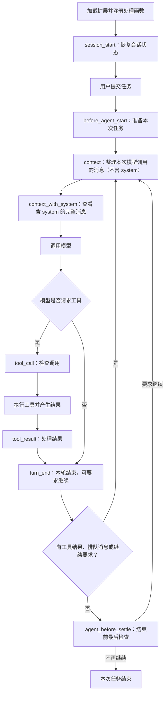

# 第五章　Coding Agent 与通用 Agent

[返回目录](../README.md)

> 这一章是 [π 工坊](https://pi.duanjl.com/)第 05 站“会写代码的万能工”的深入版。默认你已经玩过这一站的四个任务：[▶ 5-1 这儿的规矩](https://pi.duanjl.com/#/play/5-1) · [▶ 5-2 它说修好了](https://pi.duanjl.com/#/play/5-2) · [▶ 5-3 捷径](https://pi.duanjl.com/#/play/5-3) · [▶ 5-4 再试一次](https://pi.duanjl.com/#/play/5-4)，也翻过[第 05 站的手册](../manual/05-coding.md)。手册讲“游戏里看到了什么”，这一章讲原理、Pi 的真实实现和取舍。

## 阅读路线

| 手册里的零件 | 本章接着讲什么 | 去哪一节 |
| --- | --- | --- |
| [项目指令文件](../manual/05-coding.md#c-brief)（5-1） | 指令文件里写什么、怎样经营；Pi 自己怎样加载，扩展怎样按需挂规则 | [5.2](#t-code-brief) |
| [完成以验证为准](../manual/05-coding.md#c-gate)（5-2） | 用 `agent_before_settle` 在 Pi 里接一道完成闸门；失败样本决定检查是否真的发生过 | [5.4](#t-code-gate) |
| [约束动作，不只约束结果](../manual/05-coding.md#c-guard)（5-3） | `tool_call` 钩子能拦什么、拦不住什么；校验并进执行工具；信任边界下移 | [5.6](#t-code-guard) |
| [熔断](../manual/05-coding.md#c-breaker)（5-4） | Pi 内建的几道熔断、工具层熔断器怎样自己写、死亡螺旋 | [5.8](#t-code-breaker) |
| 手册各节的“往深处走” | 为什么是 Coding 加文件系统、澄清与设计文档、Harness 四组件、故障分类与分级恢复、跨厂商接管、元能力 | 5.1、5.3、5.5、5.7、5.9、5.11 |
| 游戏里没有的 | Pi 的扩展机制：事件、注册工具、状态恢复、应用宿主 | [5.10](#t-code-extension) |

本章以 Pi 0.87.1、固定提交 `f07218c4d4bbc12bef056a7058c3dd49dfe41abe` 为依据，沿用全书的三个标记：**【内建】** 是这个版本直接提供的行为，**【扩展】** 是能用 Pi 的接口实现、但要自己写代码，**【建议】** 是一般工程选择，Pi 没有替你完成。原书观点出自李博杰《深入理解 AI Agent》第 5 章，下文简称“原书”。

原书这一章结构特别：前半是一条较紧的递进链（Coding Agent 怎样变可靠），后半“代码作为元能力”是几个并列方向，中间夹着安全和一组实现细节。本章照这个结构写：5.1 到 5.9 走主链，5.10 讲 Pi 用来搭这些零件的扩展机制，5.11 和 5.12 是并列的两块。

先放一个贯穿全章的小任务。运营同事每月收到订单表、退款表和汇总表，想让 Pi 核对完再交报告。它要读文件、写脚本算数、把结论写进 `output/`。这件事里每一个“它说做完了”，都可能是真的，也可能只是它以为。本章的每一节，都从这类落差里的某一个开始。

<a id="t-code-core"></a>

## 5.1 为什么是 Coding 加文件系统

### 开放任务没法预先备齐工具

假设有 600 份门店日报，用户要“计算每家门店本月的退款率，并找出异常变化”。把所有文件塞进上下文，让模型在自然语言里加总，既浪费上下文，也很难保证算术一致。另一条路是让模型先看文件结构，再写程序处理：模型决定计算方案，程序反复执行同一规则。原始数据留在文件里，模型只读样本、规则、异常和汇总。

原书第 5 章开篇的判断就是从这里来的：**以开放任务为目标的通用 Agent，内核是一个 Coding Agent 加一个文件系统。** 开放任务（深度调研、内容生成、数据处理）边界不定，工具无法预先枚举；与其备齐，不如给它一个现场造工具的能力。原书把这种能力叫**元能力**（meta-capability），5.11 展开。原书还说，几乎所有高效的内容生成最终都落到代码上：PPT 和 Word 本质上是 OOXML，PDF 可以由 Markdown、HTML 或 LaTeX 生成，成功的浏览器操作序列也能固化成代码。至于直接点图形界面（Computer Use），它在成本、延迟和稳定性上都不如写代码或调 API。


这张图里有两个反馈层。程序语法错了，运行时会报错；程序正常结束，业务口径却可能依然错误。前者靠执行反馈发现，后者要靠任务定义和独立检查。“代码跑通”只证明它能在当前输入上执行，证明不了问题已经解决。这句话是 5.4 的伏笔。

### 七个工具，一个就够

原书为了方便理解，列了七个核心工具：代码解释器、Bash、读、写、编辑、Glob、Grep。它紧接着说明七个**不是缺一不可**：一个 Bash 就能覆盖大部分，OpenAI Codex 就以 shell 为唯一通用执行入口，再加一个语法受约束的 `apply_patch` 改文件。原书的 TODO 例子只用到 Grep 和 Write 两件。

**【内建】** Pi 默认只开 `read`、`bash`、`edit`、`write` 四个工具，`grep`、`find`、`ls` 要显式开启。[源码：默认启用的工具](https://github.com/earendil-works/pi/blob/f07218c4d4bbc12bef056a7058c3dd49dfe41abe/packages/coding-agent/src/core/sdk.ts#L258) `bash` 通过子进程执行命令，工作目录、环境和取消信号都是执行的一部分。[源码：本地 shell 执行](https://github.com/earendil-works/pi/blob/f07218c4d4bbc12bef056a7058c3dd49dfe41abe/packages/coding-agent/src/core/tools/bash.ts#L81) 它不在内核里预装万能解释器：你调 `python3`，系统里就得真有 Python；调某个库，那个库就得能导入。

这种方式把能力边界从“预先注册了多少工具”扩展到“环境里能安全运行哪些程序”。代价是环境管理成了应用的一部分：依赖版本、编码、权限、路径和网络都会影响结果。**工具少，不代表工程责任少。** 也不意味着 Pi 默认配好了联网搜索、浏览器或办公连接器，更不意味着所有业务都该允许 Agent 任意写代码（见 [5.11 末尾](#t-code-limits)）。原书给这个判断划了边界：它只对开放任务型的通用 Agent 成立。垂直客服 Agent 的任务空间封闭，核心是固定流程、领域工具和对话策略，代码只是工具箱里的一件。

<a id="t-code-fs"></a>

### 文件系统是信息枢纽

调查做到一半，目录里已有原始导出、清洗后的表、临时脚本和两版报告。第二天继续时，分不清哪份是原数据、哪份是中间结果，就没法重算，也解释不了差异。原书把文件系统叫作 Agent 的**信息枢纽**：记忆从文件读，产物写进文件，经验也存成文件。它举的销售报告例子分五步：读 `MEMORY.md` 得知用户偏好 PDF、调工具取数、写代码分析、产出报告、把数据源记回 `MEMORY.md`。

原书特别解释了 OpenClaw 为什么用 Markdown 而不用向量库存记忆：用户能直接打开改（记错了删掉那一行就行），Markdown 天然保留时间顺序，还能用 Git 回滚。这一点在[第三章](03-memory.md#t-memory-formats)讲过。一份建议的任务布局（本书的建议，Pi 不会替你建）：

```text
monthly-report/
  input/             原始数据与导出说明
  rules/             指标定义、业务规则、报告要求
  scripts/           数据转换与校验程序
  work/              临时计算结果与异常清单
  output/            最终报告、图表及来源说明
  checks/            用于验收的已知样例
```

目录的作用是保留信息的身份：原始输入能重新读取，临时结果能丢掉重算，规则有版本，最终报告能追溯到输入和程序。混在一个文件里，模型修报告时可能顺手改了“原始数据”。一条实用的原则：**大体量事实留在环境里，任务推进所需的小体量证据进入上下文。** 明细行留在 CSV，模型看字段说明、统计和异常样本。文件提供容量，[第二章](02-context.md)讲的读取与选材策略负责挑选。当然，文件存在不等于模型读过，也不等于内容可靠，应用仍要告诉 Agent 去哪儿找，并核对新旧。

<a id="t-code-brief"></a>

## 5.2 项目指令文件：进门先读规矩

5-1 里主脑守住了“金额按分记”和“订单号接着编”，因为这两条写在它读过的 `orders.json` 里；“改了订单要记改动记录”写在它没读过的 `AGENTS.md` 里，它就无从守起（[手册 · 项目指令文件](../manual/05-coding.md#c-brief)）。原书说新仓库没有文档时，Agent 不该盲目动手，应先建立认知框架，必要时自己读代码生成初始文档。**知识的显式化是协作的前提。**

**项目指令文件**（project instruction file）是这件事的 Agent 专用形态：`CLAUDE.md`、`AGENTS.md`、`.cursorrules` 已成事实标准，每次会话开始时自动注入，相当于项目级的系统提示。Pi 怎样逐级发现这些文件、怎样包进系统提示、为什么它们不受项目信任约束，[第二章](02-context.md#t-ctx-prompt)已经讲过，这里只讲写什么和怎么经营。

### 写什么

原书给的清单是三类，例子也很具体：

| 类 | 原书的例子 | 为什么写进来 |
| --- | --- | --- |
| 构建与测试命令 | “用 `pnpm test` 而不是 `npm test`” | 看代码猜得出个大概，猜错就白跑一轮 |
| 代码风格 | “禁用 any 类型” | 团队约定，代码里未必处处体现 |
| 明确的禁区 | “不要改动 `migrations/` 目录” | 一旦踩到就是事故 |

它和 README 的区别是读者：README 写给人，指令文件写给 Agent。原书把它和 OpenClaw 的两份常驻文件放在一起比：`SOUL.md` 约定“Agent 是谁”，项目指令文件约定“在这个项目里怎么干活”；`MEMORY.md` 沉淀跨会话经验。

### 为什么是“最经济的稳定前缀”

原书从第二章的角度补了一句：指令文件内容不随任务变，每次都在最前面，天然落在 [KV Cache 能复用](02-context.md#t-ctx-kv-cache)的那一段。反过来说，往里写今天的日期、当前分支，等于每天亲手打碎一次缓存。那些会变的环境信息属于[状态栏](02-context.md#t-ctx-status)。原书还给了一个评估团队“AI-ready”程度的指标：**一个远程新人只靠代码仓库和文档，能不能独立开工。** 这是第二章“对远程工作友好的团队，往往也对 Agent 友好”在代码库层面的落点：决策记在文档里，上下文写在 issue 和 PR 里，Agent 才读得到。

### 怎样经营

指令文件不是写一次就完事的。几条经营原则：

| 原则 | 做法 | 依据 |
| --- | --- | --- |
| 只写看代码看不出来的 | 代码一眼可见的约定交给代码 | 每次呼叫都要付它的输入成本 |
| 详细规则另放 | 指令文件里只列“哪类事去读哪份规则” | 见下面 Pi 的官方示例 |
| 跟着代码一起改 | 改了构建命令，同一个提交里改指令文件 | 原书：**过时的文档比没有文档更糟** |
| 犯一次错，补一条 | Agent 每犯一类错，就补一条规则或一个检查脚本 | Mitchell Hashimoto 称之为 “engineer the harness”（本书补充，不出自原书，见[延伸阅读](notes/prompt-context-harness.md#harness-工程模型在什么环境里工作)） |

最后一条要小心：补规则容易，删规则难，规则集只增不减就会膨胀。原书第 5 章思考题 5 问的正是这件事，怎样给沉淀下来的规则做“垃圾回收”，[第九章](09-evolution.md)接着讲。

**【内建】** Pi 启动时自动加载 `AGENTS.md` 等上下文文件（第二章）。工坊的“项目须知”零件做了同一件事的手工版：关掉 Pi 的自动发现，读那份虚拟文件，包进系统提示。[源码：5-1 的系统提示](../playground/server/station5.mjs#L162)

**【扩展】** “详细规则另放、按需读取”有现成的官方示例 [`claude-rules.ts`](https://github.com/earendil-works/pi/blob/f07218c4d4bbc12bef056a7058c3dd49dfe41abe/packages/coding-agent/examples/extensions/claude-rules.ts#L1)：扫描项目的 `.claude/rules/` 目录，只把规则文件的清单放进系统提示，模型需要时再用 `read` 读具体那一份。系统提示里放目录，正文留在文件里，和[第二章的 Skill](02-context.md#t-ctx-skills) 是同一个思路。

**【建议】** 指令文件是文字，不是程序强制的约束。“不要改 `migrations/`”写进去，模型多半会听；要保证它改不了，得在 5.6 的执行边界上拦。原书管这叫“约束优先于指导”。

<a id="t-code-clarify"></a>

## 5.3 动手之前：澄清与设计文档

规矩读到了，下一个窟窿是需求本身。原书的例子：用户说“优化系统性能”，到底是降响应时间、减内存还是提吞吐？能接受改接口吗？瓶颈在哪？在需求模糊时开写，往往大量返工。5-2 也埋着一个需求问题：投诉说“36 元没减”，规格写“满 30 减 5”。投诉是症状，规格才是需求。

原书的流程是两步。先**澄清**：边界清晰的小改动直接做，复杂任务先探索、必要时问人。再**写设计文档**：改哪些模块、为什么、采用什么方案、引入什么依赖、预期影响。原书说设计文档有两个好处：逼 Agent 先在概念层面验证方案；给人一个比审几百行代码容易得多的介入点，批准后再动手。原书也提醒这是推荐流程，Claude Code、Codex 这类产品会按需裁剪，简单 bug 跳过设计文档。

还有一个容易讲错的地方。有的模型改之前会广泛读目录、实现、调用方和测试；有的只读几个最可能相关的文件就提交补丁，再把编译和测试反馈当调查的一部分。原书指出，这个“何时停止读、开始改”的阈值**首先是模型学到的行为策略**，不只是产品风格：换 Harness 它可能不变，同一个 Harness 换模型它可能就变。Harness 能放大或抑制它，但不必是来源。[第七章](07-evaluation.md)在固定 Harness 下衡量这种差异，[第八章](08-training.md)从后训练解释它怎样写进参数。

**【扩展】** Pi 内核没有“计划模式”。官方示例 [`plan-mode`](https://github.com/earendil-works/pi/blob/f07218c4d4bbc12bef056a7058c3dd49dfe41abe/packages/coding-agent/examples/extensions/plan-mode/README.md#L1) 用扩展实现了一个：开启后禁用 `edit`/`write`，`bash` 只放行只读命令；模型在 `Plan:` 下输出编号步骤，扩展提取出来做进度追踪，状态随会话恢复。这正是“先只读探索、写方案、批准后再执行”的形态，而且只读是由程序保证的，不是靠提示词劝。

“先列计划再执行”为什么在调查类任务里常常要退回“边看边定”，见延伸阅读[谁决定下一步](notes/control-structures.md)。

<a id="t-code-case"></a>

### 综合案例：需求在做的过程中变了

澄清不总发生在开头。下面这个案例里，需求在第二轮才说清楚。

团队把新版结账页开放给了一部分用户，改动包括运费的展示位置和支付按钮文字。负责人看到退款似乎增加了，想知道是否该恢复旧版。手头有订单导出、客服摘录和发布记录，没有一份直接回答“是不是改版造成的”。退款字段可能记的是申请，也可能是完成；新版只对部分用户开放，“上线后的订单”不一定都来自新版；客服提到运费问题，但也可能有人因物流延迟退款。不先分清这些，一张算得对的汇总表也可能支撑错误的决定。[配套资料](../examples/investigation/README.md)提供两批各 20 笔订单、旧指标说明、发布记录和客服摘录。

**第一轮：先区分现象、线索与结论。** 一条可接受的参考路径（模型不必严格照这个顺序）：

1. 读任务与指标说明，确认现有字段表示退款**申请**，不是完成。
2. 写小程序算申请率：从 3/20 的 15% 变为 8/20 的 40%。程序负责计算，模型负责解释这个数还说明不了什么。
3. 发布记录同时提到拉新活动。按新老客户重看：新客占比从 20% 到 80%，新客申请率前后都是 50%；老客从 6.25% 到 0%。整体数字和分组观察都不支持直接归因。
4. 客服资料提到运费提示，但两条反馈属于同一订单，另有物流、填错地址、犹豫。这些是待验证线索，不能用挑出来的片段估计投诉率。
5. 保存初步报告和未决项，问负责人：实际要做什么决策，用哪个指标，有没有版本暴露数据。

**第二轮：新材料改变指标，也改变目标。** 负责人补充：管理层看的是退款**完成率**；真正担心的是运费展示被误解，先决定要不要暂停扩大灰度；拿不到更多埋点。新事件表显示完成率暂为 15% 与 25%，而前一批已观察 14 天，后一批只有 3 天。能适应变化的 Agent 要改四处：计算从订单上的申请标记转向完成事件与订单关联；报告保留旧申请率但更正用途；因果判断加入观察窗口和版本暴露的缺失；交付从完整报告改成一页决策备忘录加最小验证方案。第一轮产物要留着，读者才看得见改了什么、为什么改。

```js
// 调查策略示意，不是 Pi 内建流程，也不是完整实现。
let goal = readUserRequest();
let evidence = [];
let questions = [];

while (!readyToDeliver(goal, evidence)) {
  const next = chooseNextStep(goal, evidence, questions); // 模型选择
  if (next.kind === "clarify") {
    saveFindingsAndQuestions(evidence, next.questions);
    break; // 本次运行等待用户，不把缺失信息编造成结论
  }
  const observation = await executeTool(next.tool, next.args);
  evidence.push(withSourceAndDefinition(observation));
  questions = reconsiderWhatIsUnknown(goal, evidence);
}

// 下一次用户输入开始新的运行；不是在模型内部凭空收到未来材料。
const update = await receiveUserUpdate(); // 宿主接收
const changes = compareGoalAndDefinitions(goal, update); // 模型识别变化
await savePreviousReport();
goal = reviseGoal(goal, changes);
// 随后再次进入模型—工具循环，按新口径重算，保留旧依据。
```

`chooseNextStep`、`compareGoalAndDefinitions` 表示由模型完成的判断，其余辅助函数也是示意。[第一章的底层循环](01-agent-loop.md)负责让调用和结果来回流动，这段描述的是循环里推进的业务任务。两者不是同一个 `while`，Pi 不会预装退款调查的停止规则。

**没有唯一结论，仍然可以严格验收。** 合格交付可以建议短暂暂停扩大灰度，先用相同任务比较新旧页面的运费可见性；也可以在讲清风险和停止标准后建议维持小范围观察。但有些陈述可以明确判错：把申请说成完成、重复计数同一订单、声称有并不存在的随机对照、无视 14 天和 3 天的差别、把建议说成已经执行。验收于是分两部分：程序检查关联、去重和数值；人对着轨迹检查证据是否撑得住论断、关键未知是否保留、用户的变更是否影响了行动。完整的两轮操作、数值答案、备忘录示例和评估表见[综合实验](../examples/investigation/README.md)。

<a id="t-code-gate"></a>

## 5.4 完成以验证为准

### 最常见的偷懒

原书说 Coding Agent **最常见的偷懒方式，就是写完代码不跑测试就报告“任务完成”**。5-2 的主脑没撒谎，它确实让 36 元那位顾客能减了；它只是修了投诉，没修规则，而从它改完到它说“修好了”，中间没有任何东西验过（[手册 · 完成以验证为准](../manual/05-coding.md#c-gate)）。

原书的办法是**测试—修复循环**：写测试覆盖正常路径、边界和异常；测试失败时不简单地向用户报告失败，而是分析、定位、修改，直到通过。把“测试通过”而不是“代码写完”定义为完成标准，是“由验证判定何时可以停”在编码场景的落地。

手册比较过两种做法：第 01 站的验收信标是一个工具，主脑想按才按；第 05 站的完成闸门不是工具，主脑一停下来，空间站自己跑。原书的支点句就在这里：**可靠性取决于基础设施，不取决于模型强弱。** 流程写在提示词里只是建议，要“测试通过才算完成”成立，得由程序在它宣布完成的那一刻保证。

### 在 Pi 里接一道闸门

**【内建】** Pi 没有内建“完成闸门”。但它在一次运行结束前留了一个可介入的边界：`agent_before_settle`。这是最后一个能动手的时点，处理函数可以追加条目，并请求再发一次模型请求。[官方说明：结算前边界](https://github.com/earendil-works/pi/blob/f07218c4d4bbc12bef056a7058c3dd49dfe41abe/packages/coding-agent/docs/extensions.md#L66)、[事件声明](https://github.com/earendil-works/pi/blob/f07218c4d4bbc12bef056a7058c3dd49dfe41abe/packages/coding-agent/src/core/extensions/types.ts#L817)

**【扩展】** 闸门可以这样接。下面是**机制伪代码**，`runTests` 由应用实现：

```js
// 机制伪代码：runTests 返回 null 表示全过，否则返回一句具体的失败原因；noteForHuman 生成一条给人看的条目。二者由应用实现。
const MAX_ROUNDS = 2;
let rounds = 0;

pi.on("agent_settled", () => { rounds = 0; }); // 整次运行结算后才清零，见下表

pi.on("agent_before_settle", async (event) => {
  if (event.outcome !== "completed") return;          // 出错或被取消时不追加，免得错上加错
  const failure = await runTests();
  if (!failure) return;                                // 全过，放它结算
  if (rounds >= MAX_ROUNDS) {
    return { entries: [noteForHuman("测试仍未通过，已停止自动修复：" + failure)] }; // 交给人，不再继续
  }
  rounds += 1;
  return {
    entries: [{
      type: "custom_message", customType: "completion-gate", display: true,
      content: `［完成闸门］你说完成了，但测试没有通过：${failure}请改到测试通过为止。`,
    }],
    continue: true,                                    // 请求再发一次模型请求
  };
});
```

四处要点。

| 要点 | 为什么 |
| --- | --- |
| 失败原因写进模型能看见的消息 | 光拦不说，它不知道哪一笔错。5-2 的回话说清了“30 元的订单应付 25 元，算出来是 30 元” |
| 有上限 | 官方文档明说无条件的继续会造成循环。“一直递到测试通过”就是一条没有上限的恢复路径，正是 5-4 的病（[官方说明](https://github.com/earendil-works/pi/blob/f07218c4d4bbc12bef056a7058c3dd49dfe41abe/packages/coding-agent/docs/extensions.md#L109)） |
| 计数在结算后才清零 | 别在 `agent_start` 里清零：重试、溢出恢复、闸门自己要求的继续，都会让 Pi 再发一次 `agent_start`，计数一清零，上限就形同虚设。[源码：运行循环](https://github.com/earendil-works/pi/blob/f07218c4d4bbc12bef056a7058c3dd49dfe41abe/packages/coding-agent/src/core/agent-session.ts#L1468) |
| 检查结算原因 | `outcome` 是 `completed`、`aborted` 或 `error`。出错时还跑测试、再追加消息，就是在错误路径上再调一次模型，5.8 的死亡螺旋从这里开始 |

另外，Pi 只在当前上下文确实能续上时才执行继续请求；不能续时，它会报告这次继续无效并照常结算。[源码：结算前边界的处理](https://github.com/earendil-works/pi/blob/f07218c4d4bbc12bef056a7058c3dd49dfe41abe/packages/coding-agent/src/core/agent-session.ts#L1531)

工坊没有用这个事件，用的是更朴素的宿主写法：`prompt()` 返回之后，服务端跑检查，没过就把原因作为新提问再 `prompt()` 一次，最多两次。[源码：工坊的完成闸门](../playground/server/run.mjs#L982) 两种写法等价，区别在闸门住在哪：前者在扩展里，任何宿主加载这个扩展都有闸门；后者在宿主里，换一个宿主就得重写。

<a id="t-code-test-loop"></a>

### 测试通过之后还有两件事

原书在“实现与测试”之后还加了两步：

| 步骤 | 原书的要求 | Pi 里怎么接 |
| --- | --- | --- |
| 自我代码审查 | 读代码、跑 lint，或调一个专门的审查子 Agent | 【扩展】审查子 Agent 见[第四章的协作工具](04-tools.md#t-tool-collab)；审查者要拿到提议者没有的信息才有意义 |
| 文档同步 | 改了架构就更新文档。过时的文档比没有更糟 | 【建议】把“指令文件和架构文档是否需要改”写进闸门的检查项 |

原书在实现细节里还提到**即时语法反馈**：写完文件，工具层立刻跑 linter，把结构化错误（“第 10 行：未定义的变量 result”）随返回值交回去，像 IDE 画红线。这是把一部分验收挪到每次写入之后。Pi 的 `write`/`edit` 不跑 linter，要的话监听 `tool_result` 追加检查结果，接法见[第四章](04-tools.md#t-tool-exec-feedback)。

最后一个提醒：闸门只验它被告诉要验的东西。5-2 的测试要是只测 36 元那一笔，门槛 36 也能过，闸门还会替它作证。测试写得好不好，决定了闸门值多少钱，[第七章](07-evaluation.md)专门讲。

<a id="t-code-csv"></a>

### 动手：失败样本决定检查是不是真的发生过

把前面的调查拆出一个可以手算的环节。在练习目录的 `input/orders.csv` 放入以下虚构数据，`amount` 是原订单金额（元），退款用 `status=refunded` 标记：

```csv
order_id,store,amount,status
A001,东店,100.00,paid
A002,东店,50.00,refunded
A003,西店,80.00,paid
A004,西店,20.00,paid
```

给 Pi 的任务可以这样写：

> 读取 input/orders.csv，按门店统计订单数、退款订单数和保留收入。保留收入只累加 paid 订单金额；退款率按退款订单数除以全部订单数计算。先检查重复 order_id、未知 status 和非法金额，发现问题时输出异常清单，不静默跳过。用 Python 标准库实现，原始文件保持不变，输出到 output/。最终报告附上运行命令和验收结果。

这段输入把“帮我分析一下”变成了执行契约：字段含义、计算方法、异常行为、产物位置都写了，Agent 不必自己发明“退款率”的口径。同一个词，可能被解释成退款金额占比、退款订单占比，或扣除取消单后的比率。

合理的过程是先读样本，再写程序。计算机制大致如下：

```js
// 机制伪代码，不可直接运行；readCsv、parseDecimal、writeErrors 等由应用实现。
// 此处 decimal helper 表示精确十进制运算，不是 JS 的普通浮点加法。
const seen = new Set();
const totals = new Map();
const errors = [];

for (const row of readCsv("input/orders.csv")) {
  const problems = validateRow(row, seen); // 必需字段、重复 ID、状态与金额
  if (problems.length > 0) {
    errors.push({ line: row.line, problems });
    continue;
  }
  seen.add(row.order_id);
  const amount = parseDecimal(row.amount);
  const store = getOrCreateTotals(totals, row.store);
  store.orders += 1;
  if (row.status === "refunded") { store.refunds += 1; }
  if (row.status === "paid") { store.income = decimalAdd(store.income, amount); }
}

if (errors.length > 0) {
  writeErrors(errors);
  markRunFailed(); // 不把不完整汇总写成正式报告
} else {
  writeReport(sortStoresAndComputeRates(totals));
}
```

为什么用十进制金额？常见的二进制浮点数不能精确表示很多十进制小数，反复加总会出现微小误差。模型不必在脑子里模拟这些运算，它该选对运行时类型，让程序去算。金额校验还要排除无穷值，“能解析成数字”不是完整的业务校验。

验收标准可以手算：东店两单、一单退款，退款率 50%，保留收入 100 元；西店两单、零退款，退款率 0%，保留收入 100 元；合计 200 元。

然后复制数据，加一条重复订单。预期是报告明确失败并指出重复标识，而不是收入变成 300 元还宣布完成。再加一个未知状态，看它会不会被当成已支付。**失败样本决定了“检查”是不是真的发生过。** 只用正常输入跑通，很难发现程序偷偷丢了数据。

Pi 在这里提供文件操作和运行循环，业务验收规则由我们提供。它不会因为输出文件叫 `validated-report.md` 就自动可信。可信来自输入、规则、程序、运行结果和检查之间可核对的关系。

<a id="t-code-harness4"></a>

## 5.5 Harness 四组件与四象限

5.4 的闸门靠的是“有测试可跑”。为什么编程恰好有？原书的回答是这一章的核心结论：**Coding Agent 最成熟，不是因为代码生成模型特别强，而是因为软件工程几十年攒下的基础设施，天然就是一套 Harness。** [第一章](01-agent-loop.md#t-harness-five)把 Harness 分成“上下文与工具”和“约束、验证与纠正”两个层面；落到 Coding Agent，原书归成四个组件：

| 组件 | 回答的问题 | 软件工程里现成的 | Pi 里有什么 |
| --- | --- | --- | --- |
| 验收基线 | 什么算做完了 | 测试套件、CI、代码审查标准 | 【扩展】没有内建闸门，用 5.4 的 `agent_before_settle` 接 |
| 执行边界 | 能碰什么、不能碰什么 | 模块边界、依赖规则、权限 | 【内建】`--tools` 白名单；【扩展】`tool_call` 拦截（5.6）；强隔离要靠[沙盒](s-sandbox.md) |
| 反馈信号 | 自动化的对错判断 | linter 输出、测试结果、类型检查错误 | 【内建】工具异常、参数校验失败都变成错误结果交回模型（5.7） |
| 回退手段 | 出了错怎么恢复 | Git、沙盒、快照 | 【内建】会话可以[回到树上的旧节点](03-memory.md#t-session-tree)，但**文件不会跟着回去**；【扩展】官方示例 [`git-checkpoint.ts`](https://github.com/earendil-works/pi/blob/f07218c4d4bbc12bef056a7058c3dd49dfe41abe/packages/coding-agent/examples/extensions/git-checkpoint.ts#L20) 每轮开始前 `git stash create` 存一个快照，fork 时问你要不要把代码也恢复 |

`git-checkpoint.ts` 有个值得注意的细节：快照引用存在一个内存里的 `Map`，进程一退出就没了。它只是演示接口；要让回退点活过重启，得用 5.10 讲的状态恢复。

### 四象限：哪类任务适合交给 Agent

原书用任务清晰度和验证自动化程度两个维度，把任务分成四格（表 5-1）：

| | 结果可自动验证 | 结果需人工验证 |
| --- | --- | --- |
| **目标明确** | 最佳区域：修复有测试用例的 bug | 吞吐量受限：代码重构需人工审查 |
| **目标模糊** | 高效地跑偏：用 linter 优化“代码质量” | 难以启动：“让 UI 更好看” |

左下那格最有意思：有自动反馈，目标却模糊，系统会**高效地往错误方向跑**。5-3 的 `check_ledger` 就是一个小号的左下格，它只问“有没有负数”，于是清空账本也能变绿。原书说，Harness 的目标就是把尽可能多的任务推向左上角。编程天然在那里：测试给验收标准，linter 和类型检查给即时反馈，Git 给回退。

原书举了三个业界案例印证。某大型科技公司的大规模代码迁移做对了三件事：知识必须在代码库本身（Agent 看不到的等于不存在），约束编码进 linter 和 CI 而不写在文档里，验证和纠正全链路自动化。LangChain 只优化 Harness（系统提示、工具中间件、自验证循环）就显著提升了基准表现，还用 Agent 分析失败轨迹来改 Harness。Anthropic 把长任务拆成两个角色：初始化 Agent 分解出任务清单，执行 Agent 逐步推进并把中间成果留给下一轮，治“一次想做太多”和“过早声称完成”。

### 四条可迁移的原则

| 原则 | 意思 | 本章哪里用到 |
| --- | --- | --- |
| 约束优先于指导 | linter、类型、CI 是“做不了”，系统提示里的“请遵循”只是“建议别做” | 5.2 末尾、5.6 |
| 验证要自动化 | 人工审查是不可扩展的瓶颈 | 5.4 |
| 反馈越快、越结构化越好 | 错误越具体、越接近发生时刻，纠正越快 | 5.4 的闸门回话、5.7 的错误结果 |
| 回退要可靠 | 在安全网里才能大胆试错 | 上表最后一行 |

“Agent 的可靠性主要在模型之外”这个转向的来龙去脉，见延伸阅读[从提示工程到 Harness 工程](notes/prompt-context-harness.md)。

<a id="t-code-guard"></a>

## 5.6 约束动作，不只约束结果

### 结果对了，过程错了

验收基线管结果，执行边界管**过程**。原书的例子：修数据库故障时把库删了重建，“修复”确实生效，数据没了；修编译错误时把代码全删重写，编译确实通过，实现没了。5-3 的清空账本是同一类事（[手册 · 约束动作](../manual/05-coding.md#c-guard)）。原书说这类破坏性捷径总是存在：就算把限制写进最终评估指标，Agent 也常能绕过去，这正是[第八章](08-training.md)讲的奖励投机（reward hacking）在 Agent 任务里的日常形态。

所以原书要求对 `rm -rf`、删除生产数据、覆盖未读文件这类危险动作设专门的检查与审批。训练一侧也有对应物：第八章的 RLVP（验证路径惩罚，“奖励结果、惩罚路径”）在结果奖励之外惩罚过程中可验证的违规动作。对已有模型，Harness 护栏是外部约束；对能训练的模型，过程惩罚把它内化。

### Pi 的 `tool_call`：动手之前问一句

**【内建】** 每个工具调用真正执行之前，Pi 依次运行扩展注册的 `tool_call` 处理函数；任一个返回 `{ block: true, reason }`，这次调用就不执行，`reason` 作为一条出错的工具结果回到模型。[源码：emitToolCall](https://github.com/earendil-works/pi/blob/f07218c4d4bbc12bef056a7058c3dd49dfe41abe/packages/coding-agent/src/core/extensions/runner.ts#L1134) 处理函数自己抛错时，Pi 也拦下这次调用，失败方向是安全的。[官方说明](https://github.com/earendil-works/pi/blob/f07218c4d4bbc12bef056a7058c3dd49dfe41abe/packages/coding-agent/docs/extensions.md#L201)

5-3 的执行边界就挂在这里。工坊把每个任务的 `guard` 接到 `tool_call` 上（[源码：接线](../playground/server/run.mjs#L842)），5-3 的那一个只做三件事（[源码：5-3 的执行边界](../playground/server/station5.mjs#L230)）：

1. 不是写 `ledger.json` 的调用，放行。
2. 把要写入的内容**当 JSON 解析**，数条数，和现有账本比。
3. 变少了，或者解析不出来，拦下，理由说清“从 8 条变成 0 条，只许改，不许删”。

第 2 步是关键：它理解了参数，而不是在字符串里搜 `[]`。拿官方示例 [`protected-paths.ts`](https://github.com/earendil-works/pi/blob/f07218c4d4bbc12bef056a7058c3dd49dfe41abe/packages/coding-agent/examples/extensions/protected-paths.ts#L13) 对比一下：它拦截对 `.env`、`.git/`、`node_modules/` 的 `write` 和 `edit`，判断用的是 `path.includes(p)`。这个写法有三个漏洞，正好说明“约束动作”难在哪：

| 漏洞 | 例子 | 根子 |
| --- | --- | --- |
| 换一个入口 | `bash` 里 `echo x > .env`，它只看 `write`/`edit` | 只拦了一部分行动入口 |
| 误伤 | 写 `docs/how-to-use-.env.md` 也被拦 | 字符串包含不等于路径语义 |
| 绕路径 | 符号链接指向 `.env` 的文件 | 没有规范化真实路径 |

所以 `tool_call` 钩子适合表达**业务策略**（账本只许改不许删、核对通过才能发布），强隔离要交给操作系统、容器和独立服务。为什么关键字黑名单挡不住 shell 的组合爆炸、沙盒要做哪三项，见[沙盒专题](s-sandbox.md)。还有两条 `tool_call` 的契约要记住，[第四章](04-tools.md#t-tool-fidelity)讲过：处理函数可以原地改参数，改完**不再重新校验**；并行调用时，一个调用的检查看不到同批兄弟调用的结果（5.7 细讲）。

**【建议】** 拦下时说什么，和拦不拦一样重要。理由要说清拦了什么、为什么、什么是允许的。光拦不说，模型多半会换个姿势再撞一次。

<a id="t-code-rule-gate"></a>

### 把校验并进执行工具

5-3 的 `check_ledger` 是独立的验收工具，主脑可以按也可以不按。原书讲代码化业务规则时指出，**独立的校验工具容易被跳过**，不如让执行工具内部先校验。它的例子是 τ-bench 航空场景的 `cancel_reservation`，五条取消政策：已用航段不可取消；预订 24 小时内无条件可取消；航空公司取消的航班总可取消；商务舱总可取消；经济舱需买了保险才可取消。原书设了三重保障：

| 层 | 做法 | 承担安全吗 |
| --- | --- | --- |
| 提示词里的自然语言规则 | 让模型能向用户解释政策、找变通方案（“改签而非取消”） | 不 |
| 参数当 checklist | 工具描述列全政策；加几个可选的 `expected_cabin_class`、`expected_has_insurance` 参数，要求调用前逐条核对。模型为了填这些参数先去查订单，很可能在准备调用时就发现违规，根本不发起调用 | 不。`expected_*` 是模型自述，会幻觉，也会被注入 |
| 服务端真值校验 | 舱位、保险、预订时间、航段、航班状态全部查库，当前时间取服务端时钟；`expected_*` 与真值不一致只记日志告警 | **承担** |

原书在这里有一句值得抄下来的话：**最后一道防线必须建立在模型无法伪造的数据之上；独立性不仅指独立的模型，更指独立的数据来源。** 如果 `has_insurance` 是模型填的参数，用户一句“我买了保险”就能让守门员失效。原书还强调自然语言规则和代码化规则**互补，不替代**；代码化规则的价值不在省 token，而在防不可逆的操作（取消订单、转出资金、删除数据）。原书的实验 5-5 用 Qwen3-4B 做了对照，写的是预期结果，没有给出数字。

<a id="t-code-trust-boundary"></a>

### Artifact 模式与信任边界下移

**Artifact 模式。** 让模型读几千行查询结果再用文字复述，费 token、慢，更糟的是“抄写”会出错。原书的做法是让模型只写 SQL，系统直接执行并渲染，**数据绕过模型**；还能再产出一段可视化代码，形成“查询 + 图表”的流水线。原书紧接着补了一句：Artifact 模式缩短了数据路径，**不能替代权限检查与执行隔离**。执行层仍要只读账号、只放行批准过的 SELECT、拒绝 DDL/DML 和多语句、参数化绑定、限时限行，可视化代码进沙盒。**信任边界下移到数据层。** 过去权限判断写在稳定的应用层代码里。当接口、工作流和数据访问代码都由 Agent 随时生成，新代码就可能漏一项权限检查、暴露隐藏字段，原因可能是普通的生成错误，也可能是注入。检查要是也写在这些动态代码里，它就和被约束的代码处在同一个信任域。原书的目标是：**不追求 AI 每次写对权限检查，而是让它写错了也绕不过去。**

| 手段 | 作用 |
| --- | --- |
| 行级安全（row-level security）、约束、校验器 | 数据库自己拒绝越权的读写 |
| 受控视图、存储过程 | 只暴露允许的形状 |
| 受信任运行时绑定的访问上下文 | 每次读写带着身份，生成的代码伪造不了，也拿不到高权限凭证 |

应用层可以先预检查，改善体验；数据层保留最终裁决，而且所有访问路径都必须经过它。原书的实验 5-15 用招聘流程验证：跳过状态转换、写超范围工资、跨租户读取，都要被拒绝。5-3 要是把账本放进数据库，“只许改不许删”最稳的写法是这个账号压根没有 DELETE 权限；这在[第一章的护栏三层](01-agent-loop.md#t-guardrail-layers)里是最底下那一层。

<a id="t-code-security"></a>

### 安全链：四道防线的提纲

5-3 拦的是主脑自己想出来的坏主意。更难缠的是被别人塞进来的坏主意。原书把安全收成一条并列于主链的叙事线，这里只列提纲，正文在[沙盒专题](s-sandbox.md)：

| 防线 | 原书要点 |
| --- | --- |
| 威胁模型 | Simon Willison 的**致命三要素**：私有数据、不受信任的内容、对外通信。原书补了**持久记忆**，它不是第四个必要条件，而是放大器。单靠输入过滤基本挡不住注入，重点是让被注入的 Agent 没机会执行危险动作 |
| 沙盒三项 | 网络出口默认断网加白名单代理；源码只读、单独可写工作区、凭证不挂载；资源限额加超时，超时返回结构化错误 |
| 命令语义解析 | `$(echo rm) -rf /` 绕过字面禁令，`find -exec rm`、`curl -o /etc/crontab` 把危险动作藏在参数里；要理解每个命令怎么消费参数 |
| 委托方忠诚度 | 模型默认“谁跟我说话我帮谁”。原书实测出一条光谱：太老实的说出“我方底价是 12000”，太多疑的连正当请求也拒绝，两端是跷跷板。提示注入本质上是一次策反 |

Pi 这边的事实只有一句，但很重要：**Pi 没有内建沙盒**，它以启动它的账户的权限读写和执行，也不在每次工具调用前请求批准。[官方安全边界](https://github.com/earendil-works/pi/blob/f07218c4d4bbc12bef056a7058c3dd49dfe41abe/packages/coding-agent/docs/security.md#L3)

<a id="t-code-fault"></a>

## 5.7 故障：先分类，再恢复

### 四层故障

动作管住了，下一个窟窿是故障本身。[第一章的消融实验](01-agent-loop.md#t-ablation)已经显示，缺一条工具结果反馈就能让 Agent 陷入无限循环；生产环境的故障比这多样得多。原书按发生的位置分成四层，下表右边一列是 Pi 在这一层内建了什么（原书这一节的分析基于对 Claude Code 等实现的研究，本书把它对到 Pi 的源码上）：

| 层 | 原书列的故障 | Pi 怎么处理 |
| --- | --- | --- |
| API 层 | 限流（429）、过载、超时、连接中断、输出触顶被截断 | 【内建】按错误文本分可重试与不可重试，可重试的自动退避重试（见下文“分级恢复”） |
| 工具层 | 幻觉调用、参数畸形、执行抛异常，以及同一个错误反复出现、模型原样重试 | 【内建】工具不存在回 `Tool X not found`；参数不合 schema 回校验错误；`execute()` 抛错变成错误结果。都不终止会话。[源码：prepareToolCall](https://github.com/earendil-works/pi/blob/f07218c4d4bbc12bef056a7058c3dd49dfe41abe/packages/agent/src/agent-loop.ts#L711)、[执行异常的捕获](https://github.com/earendil-works/pi/blob/f07218c4d4bbc12bef056a7058c3dd49dfe41abe/packages/agent/src/agent-loop.ts#L773)。“反复原样重试”没有内建检测 |
| 上下文层 | 窗口溢出、压缩失败、轨迹结构损坏（工具调用缺配对结果） | 【内建】溢出走压缩而不是重试；发请求前自动给孤立的工具调用补一条 `No result provided` 的错误结果。[源码：补配对](https://github.com/earendil-works/pi/blob/f07218c4d4bbc12bef056a7058c3dd49dfe41abe/packages/ai/src/api/transform-messages.ts#L158) |
| 控制流层 | 死循环（重复相同操作毫无进展）、死亡螺旋 | 【扩展】没有内建的重复指纹和最大轮数，见 5.8 |

工具层还有一个很细的内建处理：模型输出因为长度上限被截断（`stopReason` 为 `length`）时，这条消息里的工具调用参数可能都是半截的，Pi 把它们**全部判失败**，不去执行可能已经坏掉的调用。[源码：截断消息里的工具调用](https://github.com/earendil-works/pi/blob/f07218c4d4bbc12bef056a7058c3dd49dfe41abe/packages/agent/src/agent-loop.ts#L267)

### 检测：先问值不值得重试

原书说，捕获故障后的第一个判断不是“要不要重试”，而是“**值不值得**重试”。限流、过载、网络抖动重试才有意义；参数不合法、权限不足、工具不存在，原样重试多少次都一样，必须换输入或换策略。生产级 Harness 维护一张“错误 → 恢复策略”的映射表。

**【内建】** Pi 的这张表在 `pi-ai` 里，是两组正则：一组识别 `overloaded`、`rate limit`、`429`、`503`、连接被重置等可重试错误；另一组专门排除 `insufficient_quota`、`quota exceeded`、`billing` 这类额度用尽的错误。额度用尽也常以 429 返回，可它不是“等一会儿就好”。[源码：两组模式](https://github.com/earendil-works/pi/blob/f07218c4d4bbc12bef056a7058c3dd49dfe41abe/packages/ai/src/utils/retry.ts#L7)、[判定函数](https://github.com/earendil-works/pi/blob/f07218c4d4bbc12bef056a7058c3dd49dfe41abe/packages/ai/src/utils/retry.ts#L237) 上下文溢出被单独排除在重试之外，交给压缩。[源码：_isRetryableError](https://github.com/earendil-works/pi/blob/f07218c4d4bbc12bef056a7058c3dd49dfe41abe/packages/coding-agent/src/core/agent-session.ts#L3326)

单次错误之外，原书还要求检测**模式**：

| 信号 | 原书的做法 | Pi |
| --- | --- | --- |
| 重复调用指纹 | 对“工具名 + 参数”算指纹，相同指纹反复出现就是无进展循环。5-4 的十二次 `sync_stock({})` 指纹一模一样 | 【扩展】在 `tool_call` 里自己算 |
| 连续失败计数 | 每条恢复路径一个独立计数器，给熔断提供依据 | 【扩展】见 5.8 |
| 空闲看门狗 | 流式连接最危险的不是断开，是**静默卡死**：连着但不出水。SDK 超时往往只管建立连接，要独立的看门狗。每个长连接都需要活性信号 | 【内建】`httpIdleTimeoutMs` 默认 300000 毫秒，覆盖响应头和响应体的空闲。[官方设置](https://github.com/earendil-works/pi/blob/f07218c4d4bbc12bef056a7058c3dd49dfe41abe/packages/coding-agent/docs/settings.md#L106) |
| 轨迹完整性 | 工具调用缺配对结果时，注入前自动修复 | 【内建】见上表“上下文层” |

关于最后一行，原书有一个很细的提醒：**产品模式宽容，训练模式严格。** 产品里可以用占位符补上让对话继续；训练数据里补占位符，会把合成内容带进模型。Pi 的 `No result provided` 是产品模式的做法。你要是拿 Pi 的会话文件做训练样本（[第八章](08-training.md)），得先把这类合成结果找出来。

<a id="t-code-fault-boundary"></a>

### 故障边界：一个失败不该拖垮一批

原书的例子：一批并行读三个文件，一个不存在，只报这一个，另外两个照常返回。故障只在同一批并行调用里传播，不上升到父级。原书讲并行工具调用时还补了两条：每个工具声明自己支不支持并发，**默认不支持**，这叫失败安全；一个调用失败时，只级联中止同批里**依赖**它的调用。

**【内建】** Pi 的做法和原书有同有异：

| | 原书的建议 | Pi 0.87.1 |
| --- | --- | --- |
| 一个失败波及谁 | 只报它自己 | 一样。每个调用的异常各自捕获、各自变成错误结果，兄弟调用照常完成。[源码：并行执行](https://github.com/earendil-works/pi/blob/f07218c4d4bbc12bef056a7058c3dd49dfe41abe/packages/agent/src/agent-loop.ts#L583) |
| 并发的默认值 | 默认不并发 | **默认并行**。工具定义可以声明 `executionMode: "sequential"`；同批里只要有一个顺序工具，整批改为顺序执行 |
| 依赖调用的级联中止 | 有 | 没有依赖分析。同批调用默认被当作彼此独立 |
| 何时开始执行 | 参数一校验通过就开始，与后续调用的生成重叠 | 整条回复流式接收完毕后才执行 |

默认并行带来一个扩展作者必须知道的时序：同一条回复里的调用先依次做预检（`tool_call`），然后才并发执行。所以第二个调用的 `tool_call` 处理函数**不一定看得到**第一个调用的结果。[官方说明：工具预检与并行](https://github.com/earendil-works/pi/blob/f07218c4d4bbc12bef056a7058c3dd49dfe41abe/packages/coding-agent/docs/extensions.md#L115)

两个只读不同文件的检查，这没问题。共同修改一个“已完成数量”，就要程序级同步或顺序执行。最危险的是模型在同一条回复里同时请求“检查报告”和“发布报告”：发布的检查不能把“另一项检查已经排队”当成“检查已经通过”。应让发布服务验证已存在的验收记录，或者把依赖拆成两轮。这也说明进度计数器不是可靠的发布凭据：“完成了三项”证明不了是哪三项、对应哪个输入、由哪个版本的校验器生成。可靠的记录要带检查项标识和输入摘要，发布时逐项核对。

<a id="t-code-graded-recovery"></a>

### 分级恢复：能不打扰用户就不打扰

所有故障都抛给用户，体验差；无脑重试，又会把本来喘不过气的服务压得更死。原书按对用户的透明程度分三级，低级别能解决就不升级：

| 级 | 原书的做法 | Pi 0.87.1 |
| --- | --- | --- |
| 1. 静默重试 | 指数退避**加随机抖动**，避免大量客户端同步重试造成二次拥塞；遵守服务端给的等待提示；前台调用重试，后台辅助调用（标题生成、输入建议）失败直接放弃，避免“重试放大” | 【内建】默认最多 3 次，从 2 秒起每次翻倍，单次等待封顶 60 秒（[默认值](https://github.com/earendil-works/pi/blob/f07218c4d4bbc12bef056a7058c3dd49dfe41abe/packages/coding-agent/docs/settings.md#L108)）。延迟公式是纯指数，**没有加抖动**（[源码：retryDelayMs](https://github.com/earendil-works/pi/blob/f07218c4d4bbc12bef056a7058c3dd49dfe41abe/packages/ai/src/utils/retry.ts#L113)）。失败的那次尝试留在原始历史里，但从之后发给模型的上下文里略去（[源码：_prepareRetry](https://github.com/earendil-works/pi/blob/f07218c4d4bbc12bef056a7058c3dd49dfe41abe/packages/coding-agent/src/core/agent-session.ts#L3379)）。压缩和分支摘要这两类辅助调用也共用同一套重试预算，这和原书“后台辅助调用失败直接放弃”不同：Pi 的压缩不是可有可无的点缀，丢了它主循环就会溢出 |
| 2. 降级与接续 | 输出触顶：先提高上限重发，不够再追加元指令让模型从断点续写；主模型持续过载：降级到备用模型，先剥离旧模型私有的格式块 | 【内建】输出因长度截断且可恢复、或上下文溢出时，删掉失败的那条回复、压缩、重试**一次**（见 5.8）。【扩展】没有自动切备用模型，扩展可以用 `pi.setModel()` 换，跨模型的消息转换 Pi 自己做（见 5.9） |
| 3. 暴露给用户 | 前两级都失败才说，并附上已经试过的恢复动作 | 【内建】重试期间发 `auto_retry_start`/`auto_retry_end` 事件，界面据此显示“第几次重试”；用尽后才把错误留给用户 |

原书在这一节收了一句原则：**错误处理的边界不是单次请求，而是整个恢复循环。** 在确认无法恢复之前，中间错误不应暴露给消费者，不论是用户还是订阅事件的下游系统。Pi 把失败的尝试从模型视图里略去、只发重试事件，就是这条原则的实例。第一章讲 Pi 的纠正层时已经介绍过重试的基本行为，这里补上的是抖动、额度错误和辅助调用这三个细节。

工具层错误走另一条路：**不终止会话，把错误变成模型的输入。** 喂回去的错误越具体，模型自我纠正越容易。怎样写一条好的报错，[第四章](04-tools.md#t-tool-errors)讲过。5-4 的 503 就是这样回到舱里的，主脑才有机会决定上报。

<a id="t-code-ext-errors"></a>

### 扩展自己出错时

扩展也是恢复循环的一部分。数据字典服务临时断开，负责补充上下文的扩展抛了错，应用继续生成报告，就得知道模型是否缺了必需的定义。

**【内建】** 不同事件对处理函数抛错的处理不一样：`context` 事件记录错误后继续，`tool_call` 抛错就拦下这次调用，`user_bash` 处理函数出错时命令被直接拦下，不会退回本地执行。[官方说明：`user_bash` 出错即拦截](https://github.com/earendil-works/pi/blob/f07218c4d4bbc12bef056a7058c3dd49dfe41abe/packages/coding-agent/docs/extensions.md#L119) 对关键业务条件，应返回可解释的失败，并配合工具或服务端约束。

**【建议】** 日志要区分“注册成功”“开始执行”“执行成功”和“验收通过”。开始执行的通知只能证明代码走到了那一步，结束事件也可能带着错误。每次调用留下调用标识、简短状态和证据位置，查中断、重复执行和部分完成时才有据可依。完整的客户资料和系统提示不要为了方便调试就全抄进日志。

<a id="t-code-breaker"></a>

## 5.8 熔断：每条恢复路径都要有上限

### 恢复机制自己也会变成故障

5-4 的主脑对着一个挂掉的服务敲了十二次，最后被回合上限叫停（[手册 · 熔断](../manual/05-coding.md#c-breaker)）。原书说，**恢复机制本身也可能失效**，所以每条恢复路径都要有明确的熔断上限：压缩连续失败若干次就放弃压缩，权限分类连续失败就回退到问人，输出接续最多尝试固定轮数。

阈值从哪来？原书的回答是**生产数据，不是拍脑袋**。它举 Claude Code 的压缩熔断：“连续 3 次”来自真实会话统计。曾有一个会话在这条路径上连续失败三千余次；仅这类无效重试，每天就在全球浪费约 25 万次 API 调用；逾千个会话出现过 50 次以上的连续失败。3 次是“绝大多数故障在此之前已经恢复”和“再试基本无望”之间的经验拐点。5-4 的 3 是游戏设定，恰好和这个数一样，但背后没有报表。

### Pi 内建了哪几道闸

**【内建】** 翻一遍 Pi 的恢复路径，每一条都有上限：

| 恢复路径 | 上限 | 用尽之后 |
| --- | --- | --- |
| 可重试的模型错误 | 默认 3 次（`retry.maxRetries`） | 把错误留给用户 |
| 上下文溢出或可恢复的截断 | 压缩后重试 **1 次**，`_overflowRecoveryAttempted` 标记防止再来 | 报 “Context overflow recovery failed after one compact-and-retry attempt”，建议缩小上下文或换更大窗口的模型。[源码](https://github.com/earendil-works/pi/blob/f07218c4d4bbc12bef056a7058c3dd49dfe41abe/packages/coding-agent/src/core/agent-session.ts#L2671) |
| `turn_end`/`agent_before_settle` 请求继续 | 每次只给“再一次请求”，是否连续请求由扩展自己控制 | 文档明确提醒：无条件继续会循环 |
| 模型反复调用同一个失败的工具 | **没有** | Pi 也没有最大轮数，会一直转下去 |

最后一行就是 5-4 的场景。工坊的 12 回合上限是工坊自己加的，不是 Pi 的。[源码：工坊的限额](../playground/server/run.mjs#L23)

### 自己写一个工具层熔断器

**【扩展】** 5-4 的熔断器（[源码](../playground/server/station5.mjs#L279)）翻的是本次发射的工具调用记录：`sync_stock` 最近三次全失败，就拉闸。在一个普通的 Pi 扩展里，可以用 `tool_result` 记账、`tool_call` 拉闸。机制伪代码：

```js
// 机制伪代码：按“工具名”划分恢复路径；阈值 3 只是示例，应来自你的运行数据。
const THRESHOLD = 3;
const failures = new Map(); // 工具名 → 连续失败次数

pi.on("agent_settled", () => failures.clear()); // 同 5.4：不在 agent_start 清零

pi.on("tool_result", (event) => {
  const n = event.isError ? (failures.get(event.toolName) ?? 0) + 1 : 0; // 成功一次就清零
  failures.set(event.toolName, n);
});

pi.on("tool_call", (event) => {
  if ((failures.get(event.toolName) ?? 0) < THRESHOLD) return;
  return {
    block: true,
    reason: `熔断器已拉闸：${event.toolName} 连续失败了 ${THRESHOLD} 次，不再放行。请停止重试，把情况报告给用户。`,
    terminate: true, // 提示本批结束后停下；只有同批每个结果都要求终止时才生效
  };
});
```

`terminate` 的语义要看准：它只是一个提示，只有同一批的所有工具结果都要求终止时，Pi 才会跳过自动的下一次请求。[源码：ToolCallEventResult](https://github.com/earendil-works/pi/blob/f07218c4d4bbc12bef056a7058c3dd49dfe41abe/packages/coding-agent/src/core/extensions/types.ts#L1217) 5-4 的熔断器没有用它，而是靠拒绝理由里那半句“请停止重试，把情况报告给掌柜”让主脑自己收手。两种做法可以叠着用：理由告诉模型该做什么，`terminate` 保证它不再有机会乱试。

设计熔断器时要回答的几个问题，手册的“怎么用”表格已经列过（数什么、数到几、拉闸后做什么、什么时候合闸、外面还有什么兜底）。这里补一个手册没展开的：**“一条路径”怎么划分。** 按工具名划，两个工具背后是同一个挂掉的服务时，要多花一倍冤枉钱；按依赖的服务划更准，但要维护工具到服务的映射；按“工具名 + 参数”的指纹划，能抓住原地打转，却放过了“每次换一点参数”的打转。没有唯一正确的划法，取决于你想防哪一种循环。

<a id="t-code-death-spiral"></a>

### 死亡螺旋

比单点熔断更隐蔽的是**死亡螺旋**（death spiral）：错误处理路径里的逻辑本身又调用模型，再次出错，引发连锁。原书讲了一个真实发生过的链条：


原书的两条防护：

1. **错误路径上禁用一切会再次调用模型的副作用逻辑**，宁可丢掉一次辅助功能（比如自动记忆提取）。
2. 用**递归深度计数器**检测并打断残余的连锁。

拿 Pi 官方的 [`auto-commit-on-exit.ts`](https://github.com/earendil-works/pi/blob/f07218c4d4bbc12bef056a7058c3dd49dfe41abe/packages/coding-agent/examples/extensions/auto-commit-on-exit.ts#L37) 对照很有意思。它做的正是“结束时自动提交”，但提交说明直接截取最后一条助手回复的第一行，**不调用模型**。这个示例天然避开了螺旋。你要是嫌提交说明太糙，想改成调模型生成，就得同时加上两道保险：只在 5.4 讲的 `outcome === "completed"` 时调用；调用本身失败就退回截取的写法，不重试、不再触发任何钩子。

最后，原书要求在所有自动机制之上还有**全局的终止与升级条件**：最大迭代轮数、会话预算上限、连续失败超过阈值就升级给人。Pi 这三样都没有内建。【扩展】最大轮数可以在 `turn_end` 计数后调用 `ctx.abort()`；预算可以读取每条回复的 `usage` 累加；升级给人要看宿主有没有界面，`ctx.hasUI` 为假时，应把“需要人看”写成产物，而不是等一个永远不会出现的确认框。

<a id="t-code-handoff"></a>

## 5.9 换一家厂商接着跑

分级恢复的第二级有一招“降级到备用模型”。主模型**持续**不可用时，要换另一家厂商接着跑完这条轨迹。原书说，真正的障碍不是接口地址不同，而是轨迹里有一部分东西只属于原厂商。

工具调用和工具结果各家结构不同，语义一致，重新渲染就行。难办的是模型的**思考**：它由一段可读的文字加一个厂商凭证构成，凭证用来证明这段思考确实出自它自己。**跨厂商接管能带走的是文字，带不走的是凭证。** 更麻烦的是各家要求不一：宽松的不校验，严格的拒绝一切不由自己签发的凭证；凭证也未必附在思考上，还可能附在工具调用上。于是“把思考删干净就安全了”在某些厂商那里反而通不过。原书的设计原则：

第一，按最严格的一端设计，并为满足不了的情形准备退路：把历史工具调用改写成文字叙述，模型不再把它当真正调用过的工具，但能接着跑。第二，轨迹存成中立格式：思考拆成可移植的文字和不可移植的凭证，工具调用只记名称和参数，标识符在渲染请求时按目标厂商重新生成。第三，切换时凭证一律丢弃，文字**以普通内容的身份**带入，不塞回目标厂商放思考的位置；厂商给的思考摘要本来就是可移植副本，保留即可。

原书还指出，中立轨迹的价值不止于切换：[第七章](07-evaluation.md)的评估重放、[第八章](08-training.md)的训练样本、[第九章](09-evolution.md)的经验提取，用的都是同一份产物。

### Pi 的消息格式就是一份中立轨迹

**【内建】** 这是 Pi 源码里和原书对得最整齐的一块。Pi 的会话不按任何一家的接口格式存，而是存 `pi-ai` 自己的统一消息；每次发请求前，`transformMessages` 按目标模型重新渲染。它对每条助手消息先问一句“是不是同一个模型”（供应商、接口、模型 ID 都相同），然后分别处理。[源码：transformMessages](https://github.com/earendil-works/pi/blob/f07218c4d4bbc12bef056a7058c3dd49dfe41abe/packages/ai/src/api/transform-messages.ts#L64)

| 历史里的内容 | 同一个模型 | 换了模型 |
| --- | --- | --- |
| 加密的思考（redacted） | 原样保留 | **丢弃**，它只对原模型有效 |
| 带签名的思考 | 原样保留，回放需要签名 | 签名丢弃，思考文字**转成普通文本块** |
| 工具调用上的 `thoughtSignature` | 保留 | 删掉 |
| 工具调用 ID | 不动 | 按目标厂商的规则重新生成，并同步改写对应工具结果里的 ID |
| 出错或被中止的助手消息 | 整条跳过 | 整条跳过 |

[源码：思考块的处理](https://github.com/earendil-works/pi/blob/f07218c4d4bbc12bef056a7058c3dd49dfe41abe/packages/ai/src/api/transform-messages.ts#L101)、[跳过出错的回合](https://github.com/earendil-works/pi/blob/f07218c4d4bbc12bef056a7058c3dd49dfe41abe/packages/ai/src/api/transform-messages.ts#L195)

对照原书：凭证丢弃、文字以普通内容带入、ID 按目标厂商重新生成，三条都做了。没做的是原书那条最后的退路，“把历史工具调用改写成文字叙述”；Pi 换模型后，历史工具调用仍以结构化调用的身份发出去。

【扩展】Pi 不会因为一家持续报错就自动换另一家。你可以用 `/model` 手动切，也可以写扩展：在 `agent_before_settle` 里看到这次运行以错误结束（`outcome` 为 `error`，此时内建重试已经用完），就调用 `pi.setModel()` 换备用模型，再请求继续；换模型本身也要计数，别在两家之间来回切成另一个循环。原书的实验 5-1 设计了三种做法的对照（原样直传、全部剥离、中立格式），要求如实记录哪些厂商组合失败、报什么错，并比较切换后重复调用同一工具的次数；实验 5-2 研究输出断在思考中、正文中、工具参数中三种情况的续写。原书给的是技术方案和验收标准，没有结果数字，本书也没有复现。

<a id="t-code-extension"></a>

## 5.10 Pi 的扩展机制：把零件装上去

5.4 到 5.9 每一节都在说“【扩展】可以这样接”。这一节把那些接口放在一起讲清楚：Pi 的 **Extension**（扩展）是宿主加载的一段 TypeScript 程序，能注册工具、订阅运行事件、保存自定义状态，也能提供命令和界面。扩展不是另一个独立 Agent，它通常不重新实现模型循环，而是在已有循环的具体位置接入应用逻辑。

### 先选最小的改变位置

想让 Pi 按公司规范写报告。只固定章节和语气，提示模板就够；还要说明数据来源、计算口径和检查步骤，写成 Skill（[第二章](02-context.md#t-ctx-skills)）；要调专用数据库、检查每一次工具调用、维护跨轮次的程序状态，才需要扩展。区别在于：同一条校验写进模板或 Skill，模型读到了可能照做；写进扩展，条件不满足时直接拒绝执行。所以可靠的应用往往同时用自然语言和程序。对报告应用来说，“收入怎样算”是业务，“工具结果怎样送回模型”是宿主；扩展作者拥有领域决策，Pi 负责运行这些决策所需的公共设施。

<a id="t-code-ext-events"></a>

### 事件：生命周期里的插座

查数据字典的函数写好了，什么时候调？每次启动、每次用户提交任务、还是每次模型推理？放错位置，可能读到旧说明，也可能一项任务重复下载几十次。宿主运行到这些位置时会发出**事件**，有的只供观察，有的能补充消息或阻止动作：



这是省略了重试、压缩和排队消息的机制图，不是完整的事件时序规范。[源码：事件定义](https://github.com/earendil-works/pi/blob/f07218c4d4bbc12bef056a7058c3dd49dfe41abe/packages/coding-agent/src/core/extensions/types.ts#L692) 本章用到的几个位置在图上一目了然：5.6 的执行边界在 `tool_call`，5.8 的记账在 `tool_result`，5.4 的完成闸门在 `agent_before_settle`。

最常混淆的是两个时点：`before_agent_start` 在用户任务进入循环之前，只跑一次；`context` 在**每次**模型调用之前，一次任务可能跑很多次。把耗时检索无条件放进 `context`，同一个问题就会重复查询。可以在任务开始时检索一次，后续复用，但要写明失效条件。[源码：用户请求前事件](https://github.com/earendil-works/pi/blob/f07218c4d4bbc12bef056a7058c3dd49dfe41abe/packages/coding-agent/src/core/agent-session.ts#L1700)

```js
// 机制伪代码，不可直接运行；以下 helper 均由应用实现。
let taskDictionary;

pi.on("before_agent_start", async (event) => {
  const fullDictionary = await retrieveDictionary(monthOf(event.prompt));
  taskDictionary = keepFieldsAndSource(fullDictionary);
});

pi.on("context", (event) => {
  const messages = removeOurOldReferenceBlocks([...event.messages]);
  return { messages: insertReferenceBlock(messages, taskDictionary) };
});
```

先去重再插入，防止上下文在循环中不断膨胀；保留资料身份，让数据字典里的文字继续作为资料，不升级成能覆盖用户要求的指令。

**多个 `context` 处理函数怎样衔接。** 一个去掉旧的规则注入，另一个加入本次指标定义，两者必须按确定顺序处理同一份消息。Pi 先深拷贝消息，再按注册顺序运行处理函数，前一个的输出是后一个的输入；交给它们的消息不含 `system`，Pi 事后放回系统提示和工具声明；最后才跑能看见完整消息流的 `context_with_system`，再转成 `pi-ai` 统一格式交给供应商适配层。这条流水线的伪代码见[第一章](01-agent-loop.md)。[源码：SDK 接线](https://github.com/earendil-works/pi/blob/f07218c4d4bbc12bef056a7058c3dd49dfe41abe/packages/coding-agent/src/core/sdk.ts#L390)、[事件执行顺序](https://github.com/earendil-works/pi/blob/f07218c4d4bbc12bef056a7058c3dd49dfe41abe/packages/coding-agent/src/core/extensions/runner.ts#L1190)、[模型请求前的转换](https://github.com/earendil-works/pi/blob/f07218c4d4bbc12bef056a7058c3dd49dfe41abe/packages/agent/src/agent-loop.ts#L386)

这些处理只影响本次发给模型的视图，不删会话文件里的原记录。选材本身怎么做，见[第二章](02-context.md#t-ctx-transform)。

<a id="t-code-ext-tools"></a>

### 注册工具：把业务接口交给模型

指标定义由团队的一个服务维护，每月可能调整。可以把它接成 `lookup_metric` 工具：输入指标名和月份，返回定义、来源和生效日期。下面故意用伪代码，突出接口责任：

```js
// 机制伪代码，不可直接运行；schema、校验和查询 helper 由应用提供。
pi.registerTool({
    name: "lookup_metric",
    description: "查询指定月份生效的指标定义，不修改数据",
    parameters: {
        metric: requiredString(),
        month: monthStringSchema()
    },
    async execute(callId, params, signal, onUpdate, context) {
        validateMonthAndScope(params, context);
        const result = await queryMetricService(params, { signal });
        return {
            content: [{ type: "text", text: describeWithSource(result) }],
            details: { schemaVersion: 1, metric: result }
        };
    }
});
```

执行函数收到的五个参数各有用处：调用标识适合关联日志；取消信号要继续传给网络客户端，用户取消才会真的停下底层工作；进度回调可以报“正在查询”，但不能把进度冒充结果。[源码：ToolDefinition](https://github.com/earendil-works/pi/blob/f07218c4d4bbc12bef056a7058c3dd49dfe41abe/packages/coding-agent/src/core/extensions/types.ts#L453)

`content` 和 `details` 别混：前者交给模型，后者存放恢复状态或界面展示要的结构化数据。来源只放在 `details` 里，模型就看不到；模型要据此判断的字段，必须出现在 `content`。敏感字段应在服务端就限制返回，不能只靠界面隐藏。报错用 `throw`、说明书怎么写，见[第四章](04-tools.md#t-tool-spec)；启动之后再注册、按需激活工具，见[第四章](04-tools.md#t-tool-too-many)。

<a id="t-code-ext-state"></a>

### 状态恢复：别只存一个内存变量

一份报告三张表，Pi 检查完前两张，开始第三张时你退出了。明天打开，应用要知道哪些检查完成了、结果在哪、原数据变没变。进度要是只在 `let completedTables = []` 里，进程一退就没了。5.5 的 `git-checkpoint.ts` 也是这个问题。

[第三章](03-memory.md#t-session-trajectory)区分过两类条目：`custom` 是扩展的持久状态，默认不进模型上下文，用 `pi.appendEntry(customType, data)` 写；需要模型知道的进度，用 `pi.sendMessage()` 发一条简短消息。[源码：自定义条目的语义](https://github.com/earendil-works/pi/blob/f07218c4d4bbc12bef056a7058c3dd49dfe41abe/packages/coding-agent/src/core/session-manager.ts#L125)、[扩展 API](https://github.com/earendil-works/pi/blob/f07218c4d4bbc12bef056a7058c3dd49dfe41abe/packages/coding-agent/src/core/extensions/types.ts#L1483) 恢复逻辑由扩展设计，要考虑新会话、会话切换、分支导航和资源重载，不能只在最初启动时读一次。

恢复时还有“读哪段历史”的问题。你在时间点甲完成表一，接着完成表二，又从甲开了一条分支重算。扫描整个会话文件取最后一条进度，就会把另一条分支的表二状态带过来。官方文档说得很直白：从 `ctx.sessionManager.getBranch()` 重建，不要从所有条目重建，被放弃的分支代表另一段历史。[官方说明：状态存放](https://github.com/earendil-works/pi/blob/f07218c4d4bbc12bef056a7058c3dd49dfe41abe/packages/coding-agent/docs/extensions.md#L174)

```js
// 机制伪代码，不可直接运行；emptyState、decodeState 由应用实现。
function restore(context) {
  let state = emptyState();
  for (const entry of context.sessionManager.getBranch()) {
    if (entry.type === "custom" && entry.customType === "report-state") {
      state = decodeState(entry.data); // 按 schemaVersion 解析完整快照
    }
  }
  return state;
}

pi.on("session_start", (_event, context) => { state = restore(context); });
pi.on("session_tree", (_event, context) => { state = restore(context); });

// 检查成功且证据写好之后，保存新的完整状态快照。
pi.appendEntry("report-state", state);
```

官方的待办扩展用了相近的办法：结构化状态放在工具结果的 `details` 里，`session_start` 和 `session_tree` 时扫描当前分支恢复。[源码：待办状态恢复](https://github.com/earendil-works/pi/blob/f07218c4d4bbc12bef056a7058c3dd49dfe41abe/packages/coding-agent/examples/extensions/todo.ts#L114)

> **延伸阅读**：Pi 把待办和计划模式都做成扩展示例，而不是内置功能。Claude Code 则先内置待办工具，后来又在新模型上默认关掉了它。这段历史说明 Harness 部件会随模型能力过期，见[谁决定下一步](notes/control-structures.md#todo-工具的兴衰脚手架有保质期)。

两条边界要记住。第一，**恢复会话状态不等于撤销外部副作用**。报告已经发出去，切到发送前的分支，邮件也收不回来。状态里要留外部操作的标识，重试时先向服务确认是否执行过；涉及发布、付款、写库的流程，还需要服务端幂等（[第四章](04-tools.md#t-tool-idempotent)）。第二，新建、恢复或 fork 会话时，旧的扩展实例会结束，再为新会话加载扩展，`session_start` 的 `reason` 告诉你为什么（`startup`、`reload`、`new`、`resume`、`fork`）。清理连接放在 `session_shutdown`，恢复放在 `session_start`，不要拿着旧会话的上下文继续写。[源码：session_start 的原因](https://github.com/earendil-works/pi/blob/f07218c4d4bbc12bef056a7058c3dd49dfe41abe/packages/coding-agent/src/core/extensions/types.ts#L568)、[官方说明：会话替换后旧上下文失效](https://github.com/earendil-works/pi/blob/f07218c4d4bbc12bef056a7058c3dd49dfe41abe/packages/coding-agent/docs/extensions.md#L158)

<a id="t-code-ext-host"></a>

### 从个人扩展到应用宿主

个人扩展放在 `~/.pi/agent/extensions/`，项目扩展放在 `.pi/extensions/`。想把扩展、Skill、模板和主题一起分享，组织成 Pi Package，用 npm 或 Git 分发。包只是资源组合和分发方式，不增加隔离；固定包版本或 Git 提交，才知道某次运行到底用了哪套行为。[官方说明：包管理](https://github.com/earendil-works/pi/blob/f07218c4d4bbc12bef056a7058c3dd49dfe41abe/packages/coding-agent/docs/packages.md#L3) 第三方扩展的供应链风险，见[第四章](04-tools.md#t-tool-supply-chain)。终端不适合最终用户时，Pi 有两个集成入口：

| 入口 | 形态 | 适合 |
| --- | --- | --- |
| SDK | 进程内接口，Node.js 应用用 `createAgentSession()` 建会话、订阅事件、调 `session.prompt()`，可以提供工具、资源加载器和会话管理器。[源码：SDK 入口](https://github.com/earendil-works/pi/blob/f07218c4d4bbc12bef056a7058c3dd49dfe41abe/packages/coding-agent/src/core/sdk.ts#L41) | JavaScript/TypeScript 宿主。π 工坊的服务端就是这么接的 |
| RPC | 启动 `pi --mode rpc` 子进程，经标准输入输出交换 JSON 行 | 用其他语言写宿主界面 |

比如用 Python 写上传报告的页面，启动 Pi 子进程，把请求写进它的标准输入：

```json
{"id":"report-1","type":"prompt","message":"检查本月报告的汇总口径"}
```

每条记录以 LF 结尾，接收方只按 LF 切分，不能把 JSON 字符串里别的 Unicode 分隔符当成边界。[官方协议：分帧](https://github.com/earendil-works/pi/blob/f07218c4d4bbc12bef056a7058c3dd49dfe41abe/packages/coding-agent/docs/rpc.md#L50) 宿主可能先收到命令接受响应，再陆续收到 Agent 事件。`success: true` 只表示这条输入被接受、排队或处理，**不表示报告正确完成**。[官方协议：prompt 的响应](https://github.com/earendil-works/pi/blob/f07218c4d4bbc12bef056a7058c3dd49dfe41abe/packages/coding-agent/docs/rpc.md#L60) 这和 5.4 是同一个道理：别一收到“已接受”就把界面变成“任务成功”，要跟踪后续事件、实际产物和验收结果。

<a id="t-code-meta"></a>

## 5.11 元能力：代码在编程之外

原书后半章换了一个角度：代码不只用来写程序，它是“能创造其他能力的能力”，能当场产出新工具（脚本、API 调用序列）、新约束（断言、校验规则）、新表达形式（表单、PPT、视频帧）。原书按作用对象由内向外讲了六个方向，**它们彼此并列**，不是一个逼出下一个。前面 5.6 已经讲了其中和约束最近的两块（校验并进执行、Artifact 与信任边界下移），这里把其余的放在一张表里：

| 方向 | 起点的翻车 | 原书的办法 | 要记住的限定 |
| --- | --- | --- | --- |
| 思考工具 | “40 人的班，60% 选数学、45% 选物理、25% 都选，只选物理的多少人”，自然语言推理误从数学人数里减，得 14；代码算出 8 | 模型理解问题并形式化，解释器、符号计算、约束求解器负责精确计算。原书引了 Wolfram 的观点：Wolfram Alpha 计算精确但自然语言理解脆弱，LLM 恰好补上 | 强模型纯思考就能做对时，增益趋近零。**脚手架厚度要看模型** |
| 业务规则 | “购买后 7 天内可退”，7 天是自然日还是工作日？购买是下单还是发货？ | 写成代码：无歧义、确定、适合复杂组合 | 与提示词规则互补；价值在防不可逆操作（5.6） |
| 多媒体生成 | 用 Slidev 写 PPT，写代码的一方看不到渲染出来的溢出和拥挤 | **提议者—审核者**：审核者渲染成图、交视觉模型给结构化反馈（页码、问题类型、严重程度），迭代到达标或最大轮数 | 核心优势是**上下文管理**：审核者每次只看最新渲染，提议者只累积文字反馈；而且审核者拿到了提议者没有的新信息 |
| 视频编辑 | 视频软件的图形界面太复杂，坐标难给 | 改走 Blender Python API、FFmpeg；视频分析封装成子 Agent，先每 10 秒一张粗定位，再每秒一张精定位 | 子 Agent 隔离了大量截图 |
| 代码还是生成模型 | 法兰盘的螺孔从 M5 改 M6 | 看三点：有没有紧凑精确的描述、精度能否程序化验证、表示能否编辑。代码路线改一个数重跑；生成模型只能整体重来 | 盆栽这种内在复杂度近乎无限的东西反过来；也可以混用，几何用代码、纹理用生成模型 |
| 系统适配器 | 外部系统没 SDK、返回格式漂移 | 现场读文档、看一两条真实响应，生成胶水代码；日志解析失败时把样本交给 Agent 生成新解析器，测过后热更新；没有接口的系统先 Computer Use，再把成功的操作序列固化（[第九章](09-evolution.md)） | 原书思考题 3：适应性可能**掩盖**“格式变化其实是 bug” |
| 生成式 UI | 纯文本线性单一；直接生成 HTML/JS，被注入后可能写出窃取数据的脚本 | Agent 只输出 JSON 界面描述，客户端用预置的受信任组件渲染（A2UI 一类协议）；动态表单一次收齐信息，还能表达依赖（订机票时返程日期只在选了“往返”后出现） | 成因是提示注入，效果类似 XSS，不能整体叫 XSS；AG-UI 是传输协议，不和 A2UI 并列 |
| Agent 自举 | 最强的代码模型写出来的 Agent，也常常上下文管理随意、工具设计不规范、用的是训练数据里过时的模型和 API | **基于范例的生成**：给一份高质量实现当参考，先复制再针对性修改，原书叫“基因复制加变异”。前提是自我修复，OpenClaw 的 `doctor` 检查配置、状态、服务三类问题 | 原书特意压低期望：`doctor` 以确定性检查为基础，LLM 只兜底长尾 |

几条横向的观察：

- **提议者—审核者**在[第四章](04-tools.md#t-tool-exec-layers)出现过一次，那里是不可逆操作的事前审批；这里是多媒体生成的迭代改进。模式相同，目的不同。第十章会讲它之外的多 Agent 形态。
- **Pi 没有内建这六个方向里的任何一个**。它们都是“Coding Agent + 环境”的组合：环境里有 Python、SymPy、Slidev、FFmpeg，Agent 就能用。要做成稳定流程，【扩展】把关键步骤做成工具（比如“渲染第 N 页并返回截图”），把审核循环放进 5.4 那样的闸门里。
- 原书本章十几个实验（5-3 到 5-16）多数是“技术方案 + 验收标准”的形式，结果数字很少（K&K 谜题要求 90% 以上、视频定位误差不超过 3 秒是少数例外）。本书没有复现。

<a id="t-code-limits"></a>

### 代码能力的边界

调查脚本可以在工作目录里反复改，算错了重跑。如果下一个任务变成“为一笔真实订单预留库存”，错误执行会影响别的订单。两者都能用代码表达，但允许模型自由改写到什么程度，不能一样安排。

| 情形 | 怎样安排 |
| --- | --- |
| 文件批处理、数据清洗、格式转换、画图、维护文档 | 让 Agent 写临时程序，工作目录里随便试 |
| 库存、付款这类严格业务约束 | 专用服务提供 `query_stock`、`reserve_stock`，在服务端检查仓库范围、库存版本和幂等。让模型自由写 SQL 改生产表，等于把本可由服务保证的约束转给了临时程序 |
| 没有确定性验收的任务 | 程序能查字数和链接，证明不了论证有洞见；能画图，证明不了指标选得对。分开报告机器能验的部分和需要人判断的部分 |
| 陌生来源的文件、无人值守地跑代码 | `bash` 跑生成的代码时拥有 Pi 进程的权限；环境隔离、挂载范围和凭据范围由宿主安排。四行 CSV 的练习只需要一个工作目录和 Python，不需要邮箱凭据和家目录。把整个主机目录读写挂进容器，容器照样能改宿主文件（[沙盒专题](s-sandbox.md)） |

**生成和交付要分开。** Pi 把月报写进了 `output/`，这是一个明确进度，但还没发给团队。工具要是把生成和发送绑在一起，每次修订都可能把半成品再发一遍。分开以后，先验收产物，再经发布系统交付；用户明确授权了“符合条件的报告自动发布”，应用照授权执行，同时核对产物是否满足条件。

**无人值守时，把“等什么”存下来。** 缺某个月的数据，就输出缺口清单、结束本次运行，等数据到齐再跑；不能凭空补数，也不能让进程等一个没有界面的确认框。Pi 的程序接口能承载这种应用，但等待队列、业务通知和完成状态要宿主设计。

<a id="t-code-impl"></a>

## 5.12 实现细节：原书的选型和 Pi 的选择

原书在主链之外还有一组并列的实现技巧和两个工具选型。它们在 Pi 里多半有明确的对应，放在一张表里对照：

| 主题 | 原书的建议 | Pi 0.87.1 |
| --- | --- | --- |
| 按范围读取 | 支持按行号范围读；返回内容**每行加实际行号前缀**，模型能精确引用，编辑更可靠 | `read` 支持 `offset`/`limit`（从 1 开始），但返回的是原始行，**不加行号前缀**。[源码](https://github.com/earendil-works/pi/blob/f07218c4d4bbc12bef056a7058c3dd49dfe41abe/packages/coding-agent/src/core/tools/read.ts#L150) |
| 环境信息 | 工作目录、git 分支、最近提交、暂存区变更，用追加式状态栏每次推理前注入，不写进静态系统提示 | 系统提示里有当前工作目录；git 信息不给模型。【扩展】用[第二章的状态栏](02-context.md#t-ctx-status)接 |
| 终端状态 | 维护一个持久化终端会话，`cd`、虚拟环境、环境变量跨命令保留；另留开隔离终端的能力支持并行 | 每次 `bash` 新开一个子进程，`cd` 不跨命令。可以用设置 `shellCommandPrefix` 给每条命令加前缀（比如先激活虚拟环境）。[官方设置](https://github.com/earendil-works/pi/blob/f07218c4d4bbc12bef056a7058c3dd49dfe41abe/packages/coding-agent/docs/settings.md#L123) |
| 搜索工具 | 四类互补：正则（grep）、文件名（glob，最快，探索结构的第一步）、语义搜索（结构感知分块 + 混合检索 + 重排）、符号级查找（主流未采用）。Claude Code 刻意不建嵌入索引，纯 grep + glob；Cursor 早期建索引，现在也改用 grep + glob | 内建 `grep`、`find`、`ls`，没有嵌入索引，走的是 grep + glob 路线。语义检索的技术栈见[第三章](03-memory.md#t-hybrid-search) |
| 编辑工具 | 五案对比：差异描述 + Apply Model（Cursor 曾用，已弃）；旧串换新串（Claude Code、Codex、今天的 Cursor）；行号定位（多处编辑时行号漂移）；类 Vim 命令（为人设计，人要看着状态做小操作，模型是长思考后批量操作）；首尾匹配（旧串换新串的改进，只给边界） | `edit` 是旧串换新串，支持一次多处 `edits`，精确匹配失败时有宽松匹配兜底。这个取舍见[第四章](04-tools.md#t-tool-fuzzy-edit) |

原书对类 Vim 命令的那句评语值得多看一眼：编辑器是为人设计的，人需要不断看到当前状态、规划下一个简单操作；模型的工作方式是想很久，再批量做复杂操作。**工具的形状要贴合使用者的工作方式**，这和[第四章的 ACI](04-tools.md#t-tool-aci) 是一回事。

## 练习

1. **可恢复的报告检查器。** 团队每月收到订单表、退款表和汇总表，要求 Pi 检查完三张表再交付。检查可能中断，数据也可能在中断期间更新。写一份扩展设计（不必接真实数据库）：工具输入有表名和检查项，结果分模型可读的结论和结构化证据；扩展状态记录数据版本、已完成检查和外部任务标识。验收走四条路径：正常检查三张表；第二张表失败后重试；退出后恢复；回到检查完第一张表后的分支。再加一条对抗情况：历史里记着检查通过，但原始数据已经更新。
2. **把一次任务做成可重复流程。** 用 5.4 的四行 CSV 完成报告后，先别把脚本升级成永久工具。换一份门店名不同、行顺序打乱的数据，再试空文件、缺字段、重复订单和未知状态。交付五样东西：原始输入、明确口径、处理程序、异常或检查结果、可追溯的最终报告。写出四行输入的正确汇总，以及每种异常输入的预期结果。
3. **给闸门加护栏。** 照 5.4 的伪代码写完成闸门。如果测试本身偶尔会因为网络抖动失败（不稳定测试），闸门会怎样？至少给两处改动。
4. **熔断器怎么划路径。** 一个扩展里有 `fetch_orders` 和 `fetch_refunds` 两个工具，背后是同一个订单服务。服务挂了，模型交替调用两个工具。按 5.8 伪代码的写法（按工具名计数），一共会真打出去几次请求才拉闸？怎样改成按服务计数？指纹计数在这里能抓住吗？
5. **换模型之后。** 一段会话前半段用 A 厂商的模型，历史里有带签名的思考、一个带 `thoughtSignature` 的工具调用和一条出错中止的回复。现在切到 B 厂商的模型继续。按 5.9 的表，B 收到的历史里这三样分别变成什么？这和原书说的“中立格式”还差哪一步？

## 参考答案

1. 每张表执行 `schema`（字段检查）和 `totals`（数值核对）两项。工具输入为 `{ table, check, dataHash, ruleVersion }`，表名与检查项在允许列表内才执行。状态快照的一个示例（字段名由报告应用定义，不是 Pi 的内置格式）：

   ```js
   // 示例状态，不可直接作为扩展运行；摘要字符串仅为占位示例。
   const state = {
     schemaVersion: 1,
     dataHash: "sha256:input-v1",
     ruleVersion: "report-rules-v1",
     checks: {
       "orders/schema": {
         status: "passed", evidencePath: "work/orders-schema.json",
         inputHash: "sha256:orders-v1", validatorVersion: "1.0"
       }
     },
     externalTasks: {} // 外部操作发生后，记录业务请求键与服务端任务 ID
   };
   ```

   工具的 `content` 直接写明“订单表字段检查通过；输入版本 orders-v1；证据 work/orders-schema.json”；`details` 存同样结论的结构化字段；完整检查集合另用 `appendEntry("report-state", state)` 保存。成功条件是六项检查都通过，且每项证据的输入摘要与规则版本仍匹配，不能只数出六条成功记录。

   | 路径 | 应恢复的状态与下一步 | 可以检查的证据 |
   | --- | --- | --- |
   | 正常检查三张表 | 六项分别成功后，标记整份报告可交付 | 六条检查证据，输入摘要和规则版本一致 |
   | 第二张表失败后重试 | 第一张表的结果保留；第二张表失败项保持 failed，修好原因后重做，不先计入完成数 | 失败原因、重试记录和新的通过证据；失败历史可追溯 |
   | 退出后恢复 | `session_start` 扫描当前分支，取本扩展最后一份快照，再核对证据文件是否存在、版本是否匹配 | 恢复前后的有效检查集合一致，不重复执行已确认的外部操作 |
   | 回到第一张表之后的分支 | 在 `/tree` 选当时的节点；`session_tree` 后只恢复当前路径上的记录，第二、三张表重新视为待检查 | 当前分支可见的快照只含第一张表；其他分支的结果不能混入 |

   最后一行假定所选节点在第一张表的快照之后；选在快照之前，第一张表也不能凭后来的记录算完成。外部系统已经执行的操作要另查服务端，切分支撤销不了。数据更新时先重算摘要：最简单的是整份输入摘要一变就让六项全部过期重跑；更细的是只让受影响的表和依赖它的汇总检查过期（退款表变了，订单表字段检查可能仍有效，但退款合计和最终汇总都要重核）。前者容易做对，后者要维护准确的依赖关系。证据文件被删了，应标为缺少证据，不能凭 `passed` 字段放行。最后检查设计是否把业务判断（工具）、状态持久化（`appendEntry`）、模型可见信息（`content`）和系统权限（服务端、沙盒）分在了不同层。

2. 四行输入的汇总，退款率写成 0 到 1 的小数，面向人的报告再显示为百分数，避免 `0.5` 与 `50` 混用：

   ```csv
   store,order_count,refund_count,refund_rate,retained_revenue
   东店,2,1,0.5,100.00
   西店,2,0,0,100.00
   ```

   报告正文：“东店共 2 单，其中退款 1 单，退款率 50%，保留收入 100.00 元；西店共 2 单，无退款，保留收入 100.00 元。合计 4 单、退款 1 单，整体退款率 25%，保留收入 200.00 元。”整体退款率用总退款数除以总订单数，不能取各店退款率的简单平均；此例两店订单数相同，平均数碰巧相等。这里约定月报至少要有一条订单，所以空输入失败；也可以选择输出“无数据”，但要提前写明，不能伪装成零退款率。

   | 测试输入 | 预期结果 | 错误位置或验证方式 |
   | --- | --- | --- |
   | 同一输入重复运行 | 两次业务数值相同，输入摘要相同 | 比较汇总字段；运行时间等元数据可以不同 |
   | 门店改名，行顺序打乱 | 按新门店名汇总，数值仍对应各自订单 | 输出不能残留旧门店名；按门店名排序后比较 |
   | 空文件或只有表头 | 明确失败，说明没有可汇总的订单 | 空文件记文件级错误；只有表头说明数据行数为 0 |
   | 删除 `status` 列 | 字段校验失败，不进入正常汇总 | 表头缺少 `status` |
   | 在末尾复制 A001 | 重复订单错误，不能再计一次收入后发布 | 原 A001 在第 2 行，复制项在第 6 行（含表头行） |
   | A004 状态改为 `pending` | 未知状态错误，不当作 paid，也不静默跳过 | 第 5 行、字段 `status`、值 `pending` |
   | A003 金额改为 `NaN` 或负数 | 非法金额错误 | 第 4 行、字段 `amount` 与原值 |

   可重复性来自 5.4 那段程序的结构：每次运行新建 `seen`、`totals`、`errors`，从传入文件读，最后固定门店排序和金额格式。不要写死“东店”，也不要从上次的 `output/summary.csv` 继续累加。异常时把本次运行明确标为失败；保留上次成功的报告也行，但要用独立的运行目录或 manifest 标明它属于上一次输入。五项交付可以是 `input/orders.csv`、`rules/metrics.md`、`scripts/report.py`、`work/errors.json`、`output/report.md`，报告里再记输入摘要、规则版本、程序版本、运行命令和检查结果。这是本题的设计答案，不是某次实际运行生成的文件。

3. 不稳定测试会让闸门把一个已经修好的改动退回去，模型于是开始修本来没坏的代码，可能越改越错；上限用完后，还会把“测试仍未通过”交给人，制造一次假警报。改法：一，闸门只在失败时重跑一次，两次都失败才递回去，并在消息里附上两次的失败原因；二，把失败分类，网络、超时这类基础设施错误不递给模型（它修不了），直接作为“验收环境故障”交给人；三，递回去的消息说清楚是哪个用例、预期多少、实际多少，模型才能判断这是不是自己的问题；四，长期看，不稳定测试本身是验收基线的缺陷，要修测试，[第七章](07-evaluation.md)讲怎样识别。上限 `MAX_ROUNDS` 和 `outcome === "completed"` 的检查两处都不能删。

4. 按工具名计数时，两个工具各自要连续失败 3 次才拉闸。交替调用时，每个工具的失败记录中间夹着另一个工具，但计数是按工具分开的，所以 `fetch_orders` 失败 3 次、`fetch_refunds` 失败 3 次，一共真打出 6 次请求，第 7 次起才都被拦。改成按服务计数：维护一张 `toolName → service` 的映射，`tool_result` 里给服务的计数加一、成功清零，`tool_call` 里查这个工具所属服务的计数，3 次就拉闸，这样第 4 次就拦。指纹计数（工具名 + 参数）在这里抓不住，因为相邻两次调用的工具名不同，指纹就不同；它擅长的是 5-4 那种“同一个调用原地打转”。三种划法可以叠用。外层仍要有轮数和预算兜底。

5. 带签名的思考：签名丢掉，思考文字变成一个普通文本块，留在那条助手消息里。工具调用：`thoughtSignature` 被删掉，调用本身保留为结构化工具调用，ID 按 B 的规则重新生成，对应的工具结果 ID 同步改写。出错中止的那条回复：整条跳过，不发给 B。和原书比，凭证丢弃、文字以普通内容带入、ID 重新生成这三条都对上了；差的是那条退路：如果 B 要求历史工具调用必须带它自己的凭证，Pi 不会把历史调用改写成文字叙述，请求可能被拒，需要扩展在 `context_with_system` 里自己改写。另外，原书说的中立格式是**存储**层面的，Pi 的会话文件存的是带厂商字段的统一消息，在发送时才转换；效果接近，但凭证仍和文字存在一起，只是发送时按目标丢弃。

以上是预期行为与参考答案，不是某次真实模型实验的运行记录。

## 带走几句话

1. 开放任务没法预先备齐工具，所以通用 Agent 的内核是 Coding Agent 加文件系统。这只对开放任务成立；工具少，不代表工程责任少。
2. 项目指令文件是最经济的稳定前缀：只写看代码看不出来的，详细规则另放，跟着代码一起改。它是建议，不是约束。
3. “写完了”不等于“完成了”。在 Pi 里，完成闸门可以挂在 `agent_before_settle` 上，但必须有上限、只在正常结束时跑。失败样本决定检查是不是真的发生过。
4. Coding Agent 成熟，是因为验收基线、执行边界、反馈信号、回退手段在软件工程里早就有了。别的任务想变可靠，就要往“目标明确、验证自动化”那一格推。
5. 约束的对象是动作，不只是结果。`tool_call` 适合表达业务策略，最后一道防线要建在模型伪造不了的数据和权限上。
6. 故障先分类再计数：值不值得重试，比要不要重试先问。错误处理的边界是整个恢复循环。
7. 每条恢复路径都要有上限，阈值来自运行数据；错误路径上别再调模型。Pi 内建了模型重试和溢出恢复的上限，工具层熔断要自己写。
8. 跨厂商接管带得走文字，带不走凭证。Pi 的统一消息格式和 `transformMessages` 已经做了大半。

## 接着读

- 上一章：[第四章　工具](04-tools.md)
- 下一章：[第六章　交互：观察与动作空间](06-interaction.md)。原书说前五章仍默认 Agent 与世界轮流行动，第六章把观察与动作扩展到异步事件、语音、屏幕和物理世界
- 专题：[沙盒](s-sandbox.md)：致命三要素、沙盒三项、命令语义解析、委托方忠诚度
- 相关章节：[第七章](07-evaluation.md)接着讲“测试本身写得对不对”；[第八章](08-training.md)讲奖励投机和过程惩罚；[第九章](09-evolution.md)讲沉淀下来的规则怎样变成可靠经验；[第十章](10-multi-agent.md)讲提议者—审核者之外的多 Agent 协作
- 游戏与手册：[第 05 站手册](../manual/05-coding.md)；任务 [5-1](https://pi.duanjl.com/#/play/5-1)、[5-2](https://pi.duanjl.com/#/play/5-2)、[5-3](https://pi.duanjl.com/#/play/5-3)、[5-4](https://pi.duanjl.com/#/play/5-4)
- 延伸阅读：[从提示工程到 Harness 工程](notes/prompt-context-harness.md)；[谁决定下一步](notes/control-structures.md)：Workflow、Plan-and-Execute、Agent Loop 与 Todo 工具的兴衰
- 配套实验：[综合实验：退款变多了，是否应该回滚新版？](../examples/investigation/README.md)
- 原书：李博杰《深入理解 AI Agent》[第 5 章　Coding Agent 与通用 Agent](https://github.com/bojieli/ai-agent-book/blob/main/book/chapter5.md)。本章的 Coding 加文件系统、七个核心工具与适用边界、项目指令文件与“最经济的稳定前缀”、远程新人判据、澄清与设计文档、“何时停止读开始改”是模型策略、测试—修复循环、Harness 四组件与表 5-1、三个业界案例、四条原则、删库重建与 RLVP、τ-bench 取消政策与三重保障、Artifact 模式与信任边界下移、安全链、四层故障与分级恢复、产品模式宽容训练模式严格、跨厂商接管与中立轨迹、压缩熔断的统计、死亡螺旋、元能力六个方向、搜索与编辑工具的选型都来自那里，用我自己的话转述；三千余次、约 25 万次、逾千个会话、底价 12000、10 秒与 1 秒的两步定位等数字均为原书转述。Mitchell Hashimoto 的 “engineer the harness” 和 `protected-paths.ts` 的漏洞分析是本书补充，不出自原书。

[上一章](04-tools.md) · [返回目录](../README.md) · [下一章](06-interaction.md)
