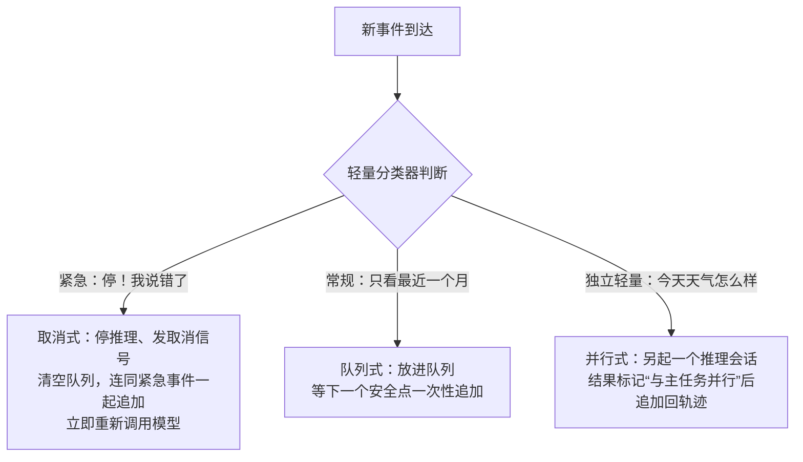
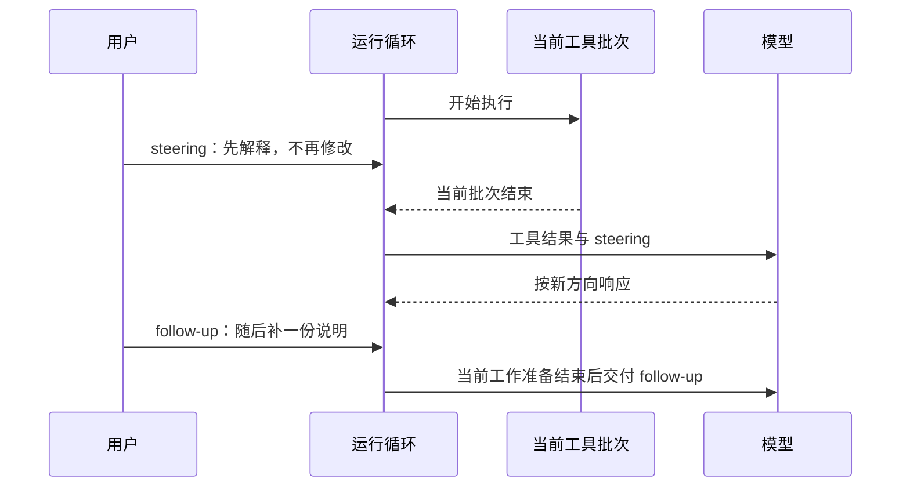
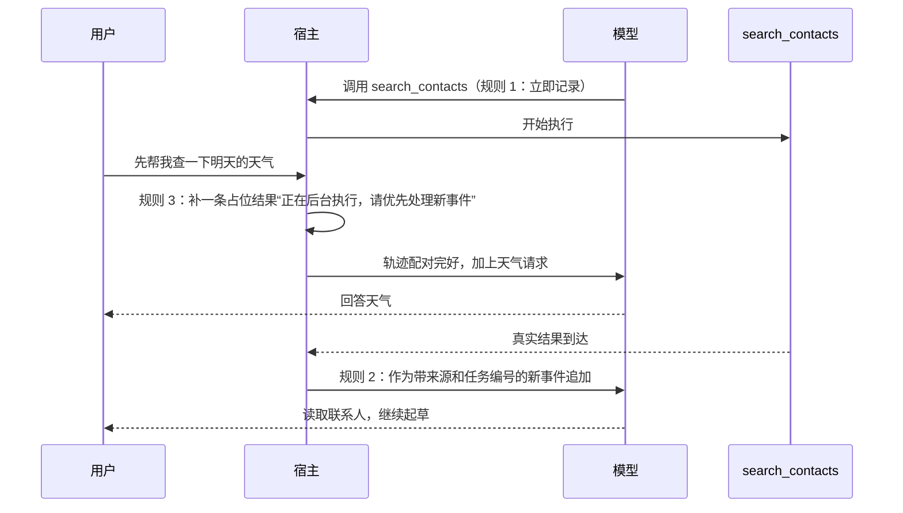
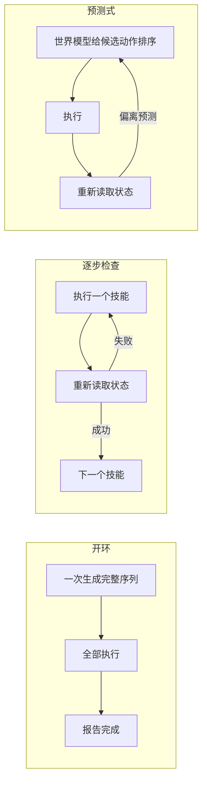

# 第六章　交互：观察与动作空间

[返回目录](../README.md)

> 这一章是 [π 工坊](https://pi.duanjl.com/)第 06 站“耳目与手脚”的深入版。默认你已经玩过这一站的三个任务：[▶ 6-1 点哪儿](https://pi.duanjl.com/#/play/6-1) · [▶ 6-2 一闪而过](https://pi.duanjl.com/#/play/6-2) · [▶ 6-3 抓住了吗](https://pi.duanjl.com/#/play/6-3)，也翻过[第 06 站的手册](../manual/06-interaction.md)。手册讲“游戏里看到了什么”，这一章讲原理、Pi 的真实实现和取舍。

## 阅读路线

| 手册里的零件 | 本章接着讲什么 | 去哪一节 |
| --- | --- | --- |
| [坐标换算](../manual/06-interaction.md#c-coords)（6-1） | 按宽高比选目标分辨率的算法；Pi 的 `read` 缩小图片后怎样告诉模型比例，以及为什么点击工具不该照抄这种做法 | [6.9](#t-ia-coords) |
| [画面变了才看](../manual/06-interaction.md#c-keyframe)（6-2） | 固定间隔采样为什么注定漏帧；盯梢程序和截图工具怎样分工；在 Pi 里用扩展实现 | [6.9](#t-ia-keyframe) |
| [每一步都要看结果](../manual/06-interaction.md#c-closed-loop)（6-3） | 开环、逐步检查、预测式三种闭环；在 Pi 里把观察焊进工具回报 | [6.10](#t-ia-closed-loop) |
| [还没有关卡的两条线](../manual/06-interaction.md#c-async) | 异步与事件驱动：事件来源、安全点、三种处理策略、占位符、任务句柄；Pi 的 steering、follow-up、abort 是怎样实现的 | 6.2 到 6.7 |
| [语音](../manual/06-interaction.md#c-voice) | 级联、Omni、全双工三种范式；快慢路径分离 | [6.8](#t-ia-voice) |
| 手册各节的“往深处走” | 视觉定位、动作空间、Computer Use 世界模型、分层控制、动作分块、共用原语 | 6.9 到 6.11 |

本章以 Pi 0.87.1、固定提交 `f07218c4d4bbc12bef056a7058c3dd49dfe41abe` 为依据，沿用全书的三个标记：**【内建】** 是这个版本直接提供的行为，**【扩展】** 是能用 Pi 的接口实现、但要自己写代码，**【建议】** 是一般工程选择，Pi 没有替你完成。

原书观点出自李博杰《深入理解 AI Agent》第 6 章，下文简称“原书”。

先交代一个和前几章都不一样的地方：这一章有四条线，Pi 只在其中一条上有真东西。异步与事件驱动这条线，Pi 的 steering、follow-up、abort 和事件流正好是一份能逐行读的实现，所以 6.2 到 6.7 会写得很细。语音、Computer Use、机器人三条线，Pi 没有内建实现，本章照实讲原书的思路，再指出哪些部分能用 Pi 的扩展接口搭起来。

---

<a id="t-ia-turns"></a>

## 6.1 回合制是一种约定

前五章的世界很体贴：用户说完一句，Agent 想一段、调几个工具、回一句；它思考的时候，世界停下来等。这个前提自然到很少有人把它写出来。原书这一章的第一句话就是把它写出来，然后推翻：**回合制是模型与接口的一种交互约定，不是环境的性质。** 邮件会在 Agent 思考时到达，用户会在它说到一半时插话，页面会在两次截图之间变样，杯子会在机械臂伸手途中被碰倒。

原书把观察空间和动作空间各拆出两个可以扩展的方向：

| | 观察空间 | 动作空间 |
| --- | --- | --- |
| **内容**（第二至五章） | 上下文、记忆、知识库 | 工具、代码 |
| **模态**（本章） | 声音、屏幕、物理传感器 | 说话、点击、关节运动 |
| **时机**（本章） | 世界主动推来，连续的流 | 跨回合，可打断，可抢占 |

**模态**（modality）管形式：读文字，还是也听声音、看屏幕、感受力矩。**触发时机**管节奏：观察是 Agent 去取还是世界推来；动作是一个回合内做完，还是可以跨回合、被打断、被更急的事抢先。

顺着两根轴，原书摆出四条线，各占一个时间尺度：

| 线 | 时间尺度 | 观察侧变了什么 | 动作侧变了什么 | 本章 |
| --- | --- | --- | --- | --- |
| 异步与事件驱动 | 秒到天 | 外部事件主动唤醒 Agent | 先发起，后面靠事件收尾 | 6.2–6.7 |
| 语音 | 10 毫秒到 1 秒 | 边听边说，不等一句说完 | 边想边说，可被打断 | 6.8 |
| Computer Use | 亚秒到秒 | 屏幕在两帧之间持续变化 | 动作后要重新确认现实是否还符合计划 | 6.9 |
| 机器人 | 毫秒 | 传感器连续回流 | 一次规划一小段动作，可被抢占 | 6.10 |

**这四条线是并列的。** 它们不是一级一级的梯子，后一条没有去修前一条留下的毛病。原书在异步转语音、语音转 Computer Use 两处写了过渡句，意思都是“时间尺度再压缩一点”，那是叙述顺序；Computer Use 和机器人之间连过渡句都没有。真正把它们串起来的，是一条共用的控制骨架和一组共用的原语（唤醒、安全点、取消、抢占、快慢分离），放在 [6.11](#t-ia-primitives) 收束。

记住一句后面会反复兑现的话：模态和时机一扩展，**“我发出了动作”和“世界变成了我想要的样子”之间的距离就拉开了**。

---

<a id="t-ia-parallel"></a>

## 6.2 先分清“同时”：串行、并行与异步

原书讲异步的第一个比喻是柜台。同步的 Agent 像只会排队的柜台，叫一个号办一个人，办完才叫下一个；好的秘书桌上摊着好几件事，按轻重缓急挑着办，办到一半来了急事还能先放下。同步 Agent 要么等后台任务跑完才能说话，要么说完话才去看新到的事件。

不过“同时做几件事”这句话至少有三种意思，先把它们拆开，否则后面每一节都会混。

修程序之前，Pi 想同时看源码和订单样例。两份文件都在，读哪一份不依赖另一份。假设读源码要一秒、读订单要三秒：一份读完再读另一份需要四秒；一起开始，约三秒拿到两份。

```js
// 串行：第一项结束，才开始第二项。
const results = [];
for (const call of calls) {
  results.push(await executeAsToolResult(call));
}

// 并行：先启动各项，再一起等待。
const resultsInOrder = await Promise.all(
  calls.map(call => executeAsToolResult(call))
);
```

两段是替代方案。`Promise` 是一份尚未完成的结果，`await` 让当前流程等它，`Promise.all` 等一组结果全部完成并按输入顺序返回。四秒和三秒是假设，不是测量值。

| 方式 | 好处 | 代价与边界 |
| --- | --- | --- |
| 串行 | 顺序明确，适合有先后要求的操作 | 互不依赖的慢操作也要排队 |
| 同批并行 | 独立的读取和查询缩短总等待 | 要处理共享状态、结果归属，慢任务拖住整批 |

同批调用的参数在模型响应里已经定死。串行调度不会拿第一项的结果去改第二项的参数；必须先搜索出路径再决定读哪个文件，就得等搜索结果回来，让模型在下一轮生成读取请求。

**【内建】** 本书版本的 Pi Agent Core 默认 [`parallel`](https://github.com/earendil-works/pi/blob/f07218c4d4bbc12bef056a7058c3dd49dfe41abe/packages/agent/src/agent.ts#L250)。它先按顺序做调用前检查，再并发执行获准的调用；工具完成事件按实际完成顺序出现，写进消息历史的结果保持模型发出的顺序。同一批里只要有一个工具声明 `executionMode: "sequential"`，整批改为串行（[模式选择](https://github.com/earendil-works/pi/blob/f07218c4d4bbc12bef056a7058c3dd49dfe41abe/packages/agent/src/agent-loop.ts#L514)、[并行调度](https://github.com/earendil-works/pi/blob/f07218c4d4bbc12bef056a7058c3dd49dfe41abe/packages/agent/src/agent-loop.ts#L583)）。

这里最容易混的一点：**工具在并行，下一次模型调用仍在等这一批工具全部完成。** 界面先显示“源码已读完”，不代表模型已经拿着源码开始下一轮推理。Pi 这条常规路径在 [`Promise.all`](https://github.com/earendil-works/pi/blob/f07218c4d4bbc12bef056a7058c3dd49dfe41abe/packages/agent/src/agent-loop.ts#L643) 之后才把整批结果交回去。同一路径的 `edit/write` 另有修改排队，它不是全局依赖分析器，见[第四章](04-tools.md#t-tool-readonly)。

### 从并行到异步

再换一个场景：调查要从数据库导出一批订单，同时读一页报告格式说明。查询三十秒，说明一秒。两项一起启动，说明很快到手，可在整批等待的循环里，模型还得等查询结束才能继续。想让它先根据说明搭好报告结构、等数据回来再填数字，就得让“查询还在跑”和“模型可以干别的”同时成立。这才是异步。

三个层次不能都叫“异步”：

| 层次 | 同时推进的是什么 | 主模型一定不用等吗 |
| --- | --- | --- |
| 工具并行 | 同一轮中的多个工具函数 | 不一定；Pi 常规循环仍等整批 |
| 子 Agent 并行 | 多个 Agent 各自的模型—工具循环 | 不一定；主 Agent 可以选择等所有子任务 |
| 模型协议支持异步工具 | 工具结果未返回时，模型继续处理独立工作 | 还要宿主接入相应的协议与结果交付 |

创建一个子 Agent 然后立刻 `await` 它，只是换了个执行者，主流程照样被挡住。子 Agent 启动后返回句柄、主 Agent 去做独立工作，才是另一种编排。[第十章](10-multi-agent.md)会把这个区别落到拓扑上。

同步工具接口也能承载后台任务：把慢查询拆成 `start/status/cancel` 三个短调用，`start` 立即返回 `jobId`，这次工具调用就结束了，查询却还在后台跑。任务 ID、终态、去重和取消的设计已经在[第四章](04-tools.md#t-tool-async)讲过，本章不重复，只记住一个区分：**工具调用结束，不等于后台任务结束。**

原书在这里提了一个前提，后面几节都建立在它上面：**先查模型和 API 支持哪种消息时序。** 有的接口要求每个工具调用先补齐结果才能继续；有的已经允许工具挂起、模型接着干活。前者要靠事件队列、任务句柄和兼容层，后者能直接用原生协议。代码里用了 `asyncio`，不等于模型会异步。

**【内建边界】** 本书固定版本的常规 `agent-loop` 按整批等待执行。`AgentTool` 的 [`onUpdate` 进度回调](https://github.com/earendil-works/pi/blob/f07218c4d4bbc12bef056a7058c3dd49dfe41abe/packages/agent/src/types.ts#L440) 只是工具执行中的更新接口，不能等同于模型能在等待时继续推理。

> **延伸阅读**：子 Agent 并行曾经以“多个角色组成虚拟公司”的形式流行，后来大多收敛为“主 Agent 加隔离的子任务”。这段历史见[多 Agent 的兴衰](notes/multi-agent.md)。

---

<a id="t-ia-event-sources"></a>

## 6.3 让世界唤醒 Agent：事件从哪儿来

把“同时”分清楚以后，第一个真问题是：没人跟 Agent 说话的时候，它怎样知道该干活了？

原书拿开源框架 OpenClaw 做解剖。它的 Gateway 把多个渠道的消息路由给 Agent，另有三种内置机制：

| 机制 | 什么时候触发 | 事件从哪儿来 |
| --- | --- | --- |
| Hooks（事件钩子） | 会话创建、重置这类生命周期事件 | 框架内部 |
| Cron（定时调度） | 按 cron 表达式，比如 `0 9 * * 5` 是每周五上午 9 点 | 时钟 |
| Heartbeat（心跳） | 每隔 N 分钟唤醒一次，看看有没有要处理的 | 时钟 |

内置渠道的消息本身是推送的，一到就路由。可让 Agent 在没有用户消息时“自己动起来”的只有 Cron 和 Heartbeat，**两个都是时间驱动的**。原书指出真正的短板在于：内置渠道之外的第三方事件（一封新邮件、一次 API 回调、一条紧急通知）没有即时通道，只能等下一个周期才可能被看见。

原书的例子是 PineClaw，Pine AI 给 OpenClaw 做的插件。Pine AI 替用户打真实电话：协商账单、取消订阅、处理理赔。通话中客服随时可能要用户介入：报一个一次性验证码、几秒内接三方通话、确认对方给的降价方案。靠心跳轮询，客服等验证码的时候用户还没收到通知，电话就挂了。PineClaw 的办法是 **Channel**：在 Gateway 和 Pine API 之间开一条实时通道，电话接通、需要输入、通话结束时，事件立刻推给 Agent。

原书的结论是：**真正的主动服务，既要 Agent 能定时检查，也要事件能主动通知 Agent。**

### 两类与事件直接相关的工具

第一章列过五类工具，[第四章](04-tools.md#t-tool-perception)讲了感知、执行、协作三类，剩下两类依赖异步运行时，放在这里。

**事件触发工具**是世界进入 Agent 的入口：

| 工具 | 管什么 | 原书的例子与要点 |
| --- | --- | --- |
| `set_timer` | 依赖物理时间的事 | 周六要给银行房贷部门打电话，就设“下周一上午 10:00 致电”；循环定时器做周期检查，也用来轮询不支持推送的外部服务。Heartbeat 是它的系统化实现 |
| `monitor_shell` | 后台命令的输出 | 一直盯着看太费 token，等跑完再看又发现不了卡死。原书提到 Claude Code 的 monitor 工具只看新增输出或含关键词的输出 |
| `connect_channel` | 外部推送：新邮件、API 回调、IM 消息 | PineClaw 的 Channel 是典型 |

设计上两条：**触发条件和过滤规则要清楚**，别让无关事件把 Agent 叫醒烧算力；**事件载荷要带够上下文**，省得 Agent 醒来还得再查一圈。

**用户沟通工具**解决反方向的问题。原生 ReAct 循环里，assistant 消息直接显示给用户，用户必须打开那个会话才能对话。OpenClaw 改成用专门的工具给用户发消息，可以带图片和文件、按紧急程度加推送，用户和 Agent 都能随时给对方发消息。原书说很多人评价它有“活人感”，来源就在这里。渠道可以扩到即时通讯、短信、邮件、电话、推送，Agent 按紧急程度、用户状态、内容性质和偏好挑渠道。原书特别点出：**通知同时也是召回机制**，长任务做完主动叫用户回来。

**以谁的身份行动？** Agent 要在这些渠道上替用户出面，就有一个身份问题。原书的取舍是：直接管理用户的个人账号看着方便，一旦出错或被攻破，用户全部的数字身份都暴露；更稳的是给 Agent **一套自己的虚拟身份**（专属的通讯账号、存储和计算环境，像秘书有自己的办公电话和邮箱），部署在**隔离的执行环境**里：虚拟电脑（VM 或容器）、虚拟手机（Android 模拟器）。配套的现实问题有两个：网站的反机器人机制会识别数据中心 IP，实践中常要住宅代理；必须用用户本人身份登录时，用 VNC/RDP 让用户在可视化环境里亲自登录，令牌在有效期内复用。Agent 和虚拟环境之间通过共享文件系统传**路径**而非内容，免得占上下文。隔离的层级和代价见[沙盒专题](s-sandbox.md)。

### Pi 怎么做

Pi 内核没有定时器、外部通道这类工具，但留了把事件送进会话的口子。

**【内建】** 扩展可以调 [`pi.sendMessage()`](https://github.com/earendil-works/pi/blob/f07218c4d4bbc12bef056a7058c3dd49dfe41abe/packages/coding-agent/src/core/extensions/types.ts#L1483) 往会话里塞一条自定义消息，两个选项决定它怎样进入循环（[会话里的分支](https://github.com/earendil-works/pi/blob/f07218c4d4bbc12bef056a7058c3dd49dfe41abe/packages/coding-agent/src/core/agent-session.ts#L1936)）：

| 此刻 Agent 的状态 | 选项 | 结果 |
| --- | --- | --- |
| 空闲 | `triggerTurn: true` | 立即开始一次运行，模型来处理这条消息 |
| 空闲 | 不触发 | 只记进会话，不叫模型 |
| 正在运行 | `deliverAs: "steer"`（默认） | 进 steering 队列，下一个轮次边界交给模型 |
| 正在运行 | `deliverAs: "followUp"` | 进 follow-up 队列，本来要停时再处理 |
| 任意 | `deliverAs: "nextTurn"` | 留到下一次用户发起的运行 |

**【内建】** 官方示例 [`file-trigger.ts`](https://github.com/earendil-works/pi/blob/f07218c4d4bbc12bef056a7058c3dd49dfe41abe/packages/coding-agent/examples/extensions/file-trigger.ts#L14) 就是一个最小的 `connect_channel`：在 `session_start` 里 `fs.watch` 一个文件，有内容就 `sendMessage(..., { triggerTurn: true })`，读完清空。外部系统 `echo "Run the tests" > /tmp/agent-trigger.txt`，Pi 就醒了。另一条路是 RPC 模式：外部进程通过标准输入发 [`steer`、`follow_up`、`abort` 命令](https://github.com/earendil-works/pi/blob/f07218c4d4bbc12bef056a7058c3dd49dfe41abe/packages/coding-agent/src/modes/rpc/rpc-types.ts#L22)。

**【内建】** 用户沟通的最小版本是 [`notify.ts`](https://github.com/earendil-works/pi/blob/f07218c4d4bbc12bef056a7058c3dd49dfe41abe/packages/coding-agent/examples/extensions/notify.ts#L54)：运行彻底落定（`agent_settled`）时发一条终端原生通知。注释里那句话值得抄下来：`agent_end` 之后 Pi 还可能重试、压缩或接着跑排队的 follow-up，所以要等 `agent_settled` 再通知。这就是原书说的“召回”，只是渠道只有一个终端。

**【扩展】** 把 webhook 接成事件通道，大致是这样。`sendMessage`、`session_start`、`session_shutdown`、`ctx.abort()` 是 Pi 的真实接口，`startWebhookServer`、`passesFilter`、`classify`、`waitUntilIdle` 是你自己写的：

```js
// 示意：外部事件 → Pi 会话。只演示接线方式，不能直接运行。
export default function (pi) {
  let server;
  pi.on("session_start", async (_event, ctx) => {
    server = await startWebhookServer(async (event) => {
      if (!passesFilter(event)) return;                    // 触发条件与过滤
      const text = [
        `[外部事件 · 不是用户指令]`,
        `来源：${event.source}　渠道：${event.channel}`,
        `内容：${event.summary}`,
        `关联：${event.relatedTask ?? "无"}`,
      ].join("\n");
      const message = { customType: "external-event", content: text, display: true, details: event };
      if (classify(event) === "urgent" && !ctx.isIdle()) {
        ctx.abort();                                       // 取消式：提前制造安全点
        await waitUntilIdle(ctx);
        pi.sendMessage(message, { triggerTurn: true });
      } else {
        pi.sendMessage(message, { triggerTurn: true, deliverAs: "followUp" });
      }
    });
  });
  pi.on("session_shutdown", async () => { await server?.close(); server = undefined; });
}
```

三处细节都是 Pi 的扩展规矩逼出来的：

- **监听器在 `session_start` 里启动，在 `session_shutdown` 里关掉。** 扩展文档明确说[不要在工厂函数里启动进程、套接字、监听器或定时器](https://github.com/earendil-works/pi/blob/f07218c4d4bbc12bef056a7058c3dd49dfe41abe/packages/coding-agent/docs/extensions.md#L58)，因为有些场合加载扩展并不开会话；清理要幂等。官方的 `file-trigger.ts` 没写关闭，练习 8 会回来挑它。
- **来源写进 `content`。** 模型看得见的只有 `content`，`details` 只给界面和日志（[第四章](04-tools.md#t-tool-contract)讲过这条界线）。外部事件里可能藏着指令，标清“这是外部事件，不是用户指令”是[第二章提示注入防线](02-context.md#t-ctx-injection-defense)的一部分。
- **紧急事件靠 `abort` 加重新触发。** Pi 的 steering 会等到轮次边界，算不上抢占；要真打断，只能先取消。下一节细讲。

---

<a id="t-ia-safe-point"></a>

## 6.4 事件循环、安全点与三种处理策略

事件进来了，几件事同时到怎么办？用户的新消息、工具结果、定时器到期、另一个 Agent 的协作请求，可能挤在同一秒。

原书给的骨架是并发编程里的**事件循环**（event loop）：异步 Agent 是一个长期运行的循环，每一轮从输入队列取出若干事件，追加进轨迹，调一次模型，执行它决定的工具，再回到开头等下一批。原书类比 Go 里 `for { select { ... } }` 从 channel 读消息。

关键概念是**安全点**（safe point）。同步接口下，事件只在一轮的边界被消费：模型在推理、工具在执行时，新事件先在队列里等，等到一段推理结束或一次工具返回再处理。原生异步也有边界，只是换了一层来管。还有一句原书反复强调的话：**一条“停止”消息不会撤销已经发生的动作**，取消要执行器自己响应取消信号，就像 Go 里检查 `ctx.Done()`。

### 先让事件说清自己是谁

处理之前要先理解。通用 Agent 的输入不只来自用户：第三方发来的消息不是对 Agent 说的，但 Agent 得理解它、评估它。原书主张把每个输入建模成**结构化事件**，四个维度：

| 维度 | 回答什么 | 例子 |
| --- | --- | --- |
| 来源 | 谁 | 用户本人、联系人、陌生人、系统通知 |
| 渠道 | 怎么来的 | 电话、短信、IM、邮件、定时器、异步工具结果、命令行监控 |
| 内容 | 说了什么 | 正文、情绪、紧急程度、要不要回复 |
| 上下文 | 和什么有关 | 回复哪段旧对话，和当前任务的关联 |

原书的退款邮件示例：

```json
{
  "source": {"type": "email", "sender": "client@example.com"},
  "channel": "gmail_webhook",
  "content": {"subject": "退款请求", "body": "订单 #12345 希望退款..."},
  "context": {"priority": "high", "customer_tier": "vip", "related_orders": ["#12345"]}
}
```

建模清楚，Agent 才不会把用户输入当成工具结果，也不会把藏着指令的工具结果当成用户指令。原书还拿 n8n 这类工作流平台的触发器生态打比方：Webhook、定时器、邮件、数据库变更、文件监听，每一种触发器都是 Agent 的一个“感官”。

### 三种处理策略

人处理多件事会看轻重缓急。原书按紧急度给了三种策略，用安全点一说就清楚：



| 策略 | 和安全点的关系 | 原书的例子 |
| --- | --- | --- |
| **取消式**（cancellation-based） | 为紧急事件**提前制造**一个安全点 | 用户在 Agent 要执行错误操作时说“停！我说错了” |
| **队列式**（queued） | 等**下一个自然出现**的安全点 | 搜索途中用户补一句“只看最近一个月的结果”，和搜索结果一起交给模型，省一次往返 |
| **并行式**（parallel） | **不等**主循环的安全点，另起一个循环 | 分析大量数据时用户问“今天天气怎么样”：和主任务无关、要快、成本低 |

原书给的紧急度划分：`user.interrupt`、`supervisor.instruction`、`agent.interrupt` 和标为紧急的外部告警算紧急；`user.input`、`agent.input`、`tool.result`、`timer.trigger` 算非紧急。可它马上又说硬编码规则有局限，“马上停下来”“今天天气怎么样”“报告用中文发给我”是靠语义区分的，**建议用一个轻量的分类模型做事件路由**。最后一条约束：取消点必须是工具或推理能安全收尾的位置，没完成的工具结果用显式占位符，**不能伪造成功**。

<a id="t-ia-steering"></a>

### Pi 怎么做：steering、follow-up 与 abort

Pi Agent Core 的队列是这条线上最值得读的一段真实代码。先看用户这一侧：

**【内建】** 在 Pi 的交互界面里，Agent 正在干活时你还能继续输入（[操作说明](https://github.com/earendil-works/pi/blob/f07218c4d4bbc12bef056a7058c3dd49dfe41abe/packages/coding-agent/docs/usage.md#change-direction)）：

| 你想要 | 操作 | 进哪个队列 |
| --- | --- | --- |
| 调整当前任务 | 输入后按 `Enter` | steering：等当前回复和它的工具调用做完，引导下一次回复 |
| 当前任务做完再加活 | 输入后按 `Alt+Enter` | follow-up：等 Pi 把当前任务做完 |
| 把排队的消息拿回编辑器 | `Alt+Up` | |
| 停止当前任务 | `Escape` | abort：取消，排队的消息退回编辑器 |

SDK 里同样三个动作：[`AgentSession.prompt()`](https://github.com/earendil-works/pi/blob/f07218c4d4bbc12bef056a7058c3dd49dfe41abe/packages/coding-agent/src/core/agent-session.ts#L1655) 在运行中必须指定 `streamingBehavior: "steer" | "followUp"`，不指定就报错；底层 `Agent` 有 [`steer()`](https://github.com/earendil-works/pi/blob/f07218c4d4bbc12bef056a7058c3dd49dfe41abe/packages/agent/src/agent.ts#L296)、[`followUp()`](https://github.com/earendil-works/pi/blob/f07218c4d4bbc12bef056a7058c3dd49dfe41abe/packages/agent/src/agent.ts#L301)、[`abort()`](https://github.com/earendil-works/pi/blob/f07218c4d4bbc12bef056a7058c3dd49dfe41abe/packages/agent/src/agent.ts#L338)，运行中再调 `prompt()` 会直接抛错，提示你改用前两个（[`prompt` 的守卫](https://github.com/earendil-works/pi/blob/f07218c4d4bbc12bef056a7058c3dd49dfe41abe/packages/agent/src/agent.ts#L370)）。



再看循环那一侧。[第一章](01-agent-loop.md#agent-loop)画过 `runLoop` 的两层 `while`，这里只看**它在哪几个地方去翻队列**，这几个地方就是 Pi 的安全点：

| 位置 | 做什么 | 源码 |
| --- | --- | --- |
| 运行刚开始 | 取一次 steering（用户可能在等待期间已经打了字） | [L175](https://github.com/earendil-works/pi/blob/f07218c4d4bbc12bef056a7058c3dd49dfe41abe/packages/agent/src/agent-loop.ts#L175) |
| 下一轮准备完成后 | 准备可能很久（比如压缩），期间来的 steering 补取 | [L204](https://github.com/earendil-works/pi/blob/f07218c4d4bbc12bef056a7058c3dd49dfe41abe/packages/agent/src/agent-loop.ts#L204) |
| 一轮结束（`turn_end` 之后） | 再取 steering；有就继续内层循环 | [L294](https://github.com/earendil-works/pi/blob/f07218c4d4bbc12bef056a7058c3dd49dfe41abe/packages/agent/src/agent-loop.ts#L294) |
| 内层循环要退出时 | 取 follow-up；有就回到内层 | [L301](https://github.com/earendil-works/pi/blob/f07218c4d4bbc12bef056a7058c3dd49dfe41abe/packages/agent/src/agent-loop.ts#L301) |

浓缩成伪代码：

```js
// 机制伪代码：只保留队列相关的部分。
let pending = drainSteering();                  // 安全点 ①
while (true) {
  let more = true;
  while (more || pending.length > 0) {
    history.push(...pending); pending = [];
    const reply = await callModel(history);
    if (reply.stopReason === "error" || reply.stopReason === "aborted") return;
    more = await runToolBatch(reply);           // 整批工具跑完才回来
    pending = drainSteering();                  // 安全点 ②：轮次边界
  }
  const followUps = drainFollowUp();            // 安全点 ③：本来要停
  if (followUps.length === 0) break;
  pending = followUps;
}
```

拿原书的三种策略对照：

| 原书的策略 | Pi 里对应什么 | 标记 |
| --- | --- | --- |
| 队列式 | **steering**。它等的是下一个自然出现的安全点（本批工具做完），不撤销已执行的工具。[官方说明](https://github.com/earendil-works/pi/blob/f07218c4d4bbc12bef056a7058c3dd49dfe41abe/packages/agent/README.md#steering-and-follow-up)写得明白：注入 steering 时，当前 assistant 消息的所有工具调用都已经完成 | 【内建】 |
| 更“懒”的队列式 | **follow-up**。只在没有工具调用、也没有 steering 时才检查 | 【内建】 |
| 取消式 | **abort** 加重新发起。`abort()` 只发取消信号；模型那条被打断的消息以 `stopReason: "aborted"` 结束，循环硬性退出。它不会自动把紧急消息追加进去再调模型，交互界面的做法是把排队消息退回编辑器，由你决定怎么重发 | 【内建】取消，【扩展】重新发起 |
| 并行式 | 没有内建。可以用扩展里的嵌套模型调用或 [subagent 扩展示例](https://github.com/earendil-works/pi/blob/f07218c4d4bbc12bef056a7058c3dd49dfe41abe/packages/coding-agent/examples/extensions/subagent/README.md#L1) 另起一路 | 【扩展】 |
| 用分类模型做路由 | 没有内建。6.3 的 webhook 示意里那个 `classify` 就是它该待的位置 | 【扩展】 |

有两处名字容易让人误会，要单独说：

1. **Pi 的 steering 不是抢占。** README 示例里写的是 `"Stop! Do this instead."`，读起来像急刹车，实际仍要等本批工具跑完。一个要跑十分钟的 `bash` 正在执行，steering 消息就得等十分钟。真要立刻停，只能 `abort`。
2. **Pi 的 steering 也不是原书说的 Mid-turn steering。** 后者是模型在思考或输出的**中途**接收新要求（6.6）；Pi 是在**轮次边界**把消息塞进下一次请求。名字相同，时机不同。

**【内建】** `steeringMode` 和 `followUpMode` 默认都是 [`"one-at-a-time"`](https://github.com/earendil-works/pi/blob/f07218c4d4bbc12bef056a7058c3dd49dfe41abe/packages/agent/src/agent.ts#L244)：每个安全点只取一条，剩下的留到下一轮；改成 `"all"` 则一次全取（[队列实现](https://github.com/earendil-works/pi/blob/f07218c4d4bbc12bef056a7058c3dd49dfe41abe/packages/agent/src/agent.ts#L158)）。Coding Agent 里这两项是[设置项](https://github.com/earendil-works/pi/blob/f07218c4d4bbc12bef056a7058c3dd49dfe41abe/packages/coding-agent/docs/settings.md#L29)，由 [`createAgentSession` 传进 Agent](https://github.com/earendil-works/pi/blob/f07218c4d4bbc12bef056a7058c3dd49dfe41abe/packages/coding-agent/src/core/sdk.ts#L395)。这个选择和 6.5 末尾的“注意力分散”是同一个问题的两种答案。

---

<a id="t-ia-placeholder"></a>

## 6.5 悬空的工具调用：占位符与任务句柄

原书的实验 6-1 用一个邮件 Agent 演示了最简单的事件队列：三封邮件依次进队列、依次处理。真正的难题出在工具还没返回、用户就插话的那一刻。

原书的例子：Agent 在帮用户起草邮件，调了 `search_contacts` 查联系人，结果还没回来，用户说“等一下，先帮我查一下明天的天气”。如果接口要求**每个工具调用都先配上结果**才能继续，轨迹里就挂着一个没有结果的调用，Agent 没法带着它去处理新消息。原书特意说明，这个限制来自**所选协议和模型的组合**，不是所有模型都必须遵守的规律。

### 兼容同步格式的五条规则

原书的核心思想是：**没有打断时，让模型看到标准的同步轨迹；只在打断时插入占位符，把格式补齐。**

| 规则 | 内容 |
| --- | --- |
| 1 | 及时记录 API 已完成的 assistant 消息和工具调用；服务端管理的推理状态按提供商的续接协议保留，不自己拼接看不见的思考文本 |
| 2 | 工具真正完成才记录 tool result；执行中的轨迹处于“部分完成”状态 |
| 3 | 工具执行中被打断，给未完成的工具生成占位符结果（如“工具正在后台执行，请优先处理新事件”），追加打断事件，重新调用模型 |
| 4 | 没有原生 steering 或中途续接接口时，取消未完成的生成，保留已确认完成的消息和工具状态，追加新事件后重新请求。不能把半截输出或隐藏推理当成合法前缀回灌 |
| 5 | 非打断事件进队列，等当前周期完成后一次性追加 |

套到起草邮件的例子上：



### 占位符的语义风险，与任务句柄

占位符补齐了格式，也埋了一个雷：模型可能把“任务已启动”当成“任务已完成”，在真实结果回来之前就作出依赖它的判断。原书的防法是明确的任务状态和结果校验，并在评估里专门检查**是否编造了尚未到达的数据**；它还提醒，不能凭一次失败就把原因归到某个未公开的训练过程。

更根本的办法是在**工具接口的设计层面**表达异步。`phone_call` 这个名字暗示“打完电话、返回通话记录”；改成 `initiate_phone_call`，立即返回任务编号和初始状态（“呼叫已发起，正在拨号”），接通、挂断用 `phone_call_connected`、`phone_call_ended` 事件通知。**名字和描述本身就要传达“这只是发起”**，原书给的描述示例是：“此工具将启动由子 Agent 处理的电话任务。任务成功发起后立即返回任务 ID，你可以继续处理其他事项。通话结束后会收到单独的通知事件。”查状态和取消的配套工具，见[第四章的 `start/status/cancel`](04-tools.md#t-tool-async)。

原书的实验 6-2 把这些拼在一起：三个模拟脚本分别以每秒 3%、2%、1% 的速度推进，用户要求“哪个先完成，就看看剩下的进度，没超过 50% 就取消”。练习 6 会让你算这道题。

### Pi 怎么做

Pi 没有实现“打断后让工具继续在后台跑”的那套占位符，但规则 3 和规则 4 的**格式修补**它做了，而且做得很克制。

**【内建】** 供应商适配层在发请求前会过一遍消息（[`transform-messages.ts`](https://github.com/earendil-works/pi/blob/f07218c4d4bbc12bef056a7058c3dd49dfe41abe/packages/ai/src/api/transform-messages.ts#L158)）：

- **被中断或出错的 assistant 消息整条跳过，不回放**（[跳过逻辑](https://github.com/earendil-works/pi/blob/f07218c4d4bbc12bef056a7058c3dd49dfe41abe/packages/ai/src/api/transform-messages.ts#L201)）。源码注释给的理由正是规则 4 的担心：这类消息可能只有推理没有正文、带着不完整的工具调用，回放会让某些供应商报错，模型应当从最后一个有效状态重来。
- **没有结果的工具调用，补一条合成结果**，内容是 `No result provided`，并且标成 `isError: true`（[合成结果](https://github.com/earendil-works/pi/blob/f07218c4d4bbc12bef056a7058c3dd49dfe41abe/packages/ai/src/api/transform-messages.ts#L167)）。遇到新的用户消息或新的 assistant 消息时补，轨迹末尾还悬着也补。它说的是“没有结果”，并且标成错误，没有伪造成功。

**【内建】** 运行中按了 `abort`，并行批次里还没开始的工具拿到 [`Operation aborted`](https://github.com/earendil-works/pi/blob/f07218c4d4bbc12bef056a7058c3dd49dfe41abe/packages/agent/src/agent-loop.ts#L617) 的错误结果；正在跑的 `bash` 会[杀掉整个进程树](https://github.com/earendil-works/pi/blob/f07218c4d4bbc12bef056a7058c3dd49dfe41abe/packages/coding-agent/src/core/tools/bash.ts#L125)，返回已有输出加一句 `Command aborted`；`edit` 只在每个 `await` 之后检查取消（[第四章](04-tools.md#t-tool-idempotent)讲过这段注释）。三者合起来就是原书那句“取消要执行器响应取消信号”的真实样子：**取消发生在等待点，已经写下去的字节、已经跑过的命令，不会因此撤回。** 工具要接取消，就得在 [`execute` 的第三个参数 `signal`](https://github.com/earendil-works/pi/blob/f07218c4d4bbc12bef056a7058c3dd49dfe41abe/packages/agent/src/types.ts#L452) 上做文章。

所以 Pi 和原书兼容方案的差别在于：原书的占位符说“还在跑，等会儿给你”，后面真有结果来；Pi 的合成结果说“没有结果”，后面不会再来。想要前一种，就用任务句柄：工具立即返回 `jobId`，结果到了再用 `pi.sendMessage` 当成一条带任务编号的事件送进来，这正好接上 6.3 的事件通道。**【扩展】**

<a id="t-ia-batch"></a>

### 批量事件：模型只回应了最后一条

队列式一次追加好几个事件，原书观察到模型可能**只回应最后一个**，前面的要求被漏掉。它给了两层干预：

- 提示词层：告诉模型“收到多个连续事件时，请全面考虑所有信息”。
- 状态栏层：每个事件前加显式标记，末尾加一句汇总。

```text
[未处理事件 1/4] Tool result from database_query：...
[未处理事件 2/4] User 补充说明：只看北京地区的数据
[未处理事件 3/4] 系统提醒：报告截止时间还有 30 分钟
[未处理事件 4/4] User 询问：进度如何？
上面有 4 个未处理事件，包括 1 个工具结果、2 条用户消息、1 个系统提醒。请确保回应涵盖所有信息。
```

这和[第二章的状态栏](02-context.md#t-ctx-status)是同一个思路：把模型容易忽略的结构，用一行字摆到它眼前。

Pi 默认的 `"one-at-a-time"` 走的是另一条路：每个安全点只交一条，模型每次只面对一件事，自然谈不上漏；代价是多出几次模型调用，而且后面的消息要多等几轮。改成 `"all"` 就回到原书的场景，这时可以用 `context` 事件在发请求前给末尾连续的几条消息加上 `[k/N]` 标记。**【扩展】** 两种做法谁好，取决于事件之间是否相关：“只看北京”和“截止还有 30 分钟”要一起考虑才对，一条一条喂反而可能让前一轮按旧条件跑了一遍。这一段是本书的分析，原书没有讨论 Pi 的队列模式。

---

<a id="t-ia-native"></a>

## 6.6 原生异步：消息能到，不等于能用好

前面的兼容方案由运行时安排事件的接入顺序，模型本身仍是同步的。另一条路是让模型自己理解这种节奏。

原书写到，截至 2026 年 9 月，GPT-6 Astra 提供了两项能力：

| 能力 | 做什么 | 原书的例子 |
| --- | --- | --- |
| **异步工具调用**（async tool calling） | 发起行动和获得结果分开；结果没回来时，继续做不依赖它的工作 | 查会议场地的同时先整理议程和准备清单，场地信息回来再比较方案 |
| **回合中途引导**（mid-turn steering） | 模型还在思考或组织回答时，用户追加要求 | 中途补一句“预算减少了”“参会人数变了”，已完成的工作保留，新约束带进后续 |

据 OpenAI 的 Responses API 文档（本书核对于 2026-09-14），Astra 支持在函数或自定义工具上设置 `async: true`；工具仍由应用执行，后续输出按原 `call_id` 交回。这是模型与接口共同支持的消息时序，不是把执行托管给模型（[官方异步工具说明](https://developers.openai.com/api/docs/guides/async-tool-calling)）。也不能写成“除了 Astra 都只能同步等待”，OpenAI 在 [gpt-realtime 的发布说明](https://openai.com/index/introducing-gpt-realtime/)里也介绍过异步函数调用。判断的单位是**模型、API 和宿主实现的组合**。

原书紧接着泼了冷水：原生异步解决的是**消息能不能在运行中到达**，复杂任务里可靠不可靠，还得看模型怎么用这些消息。它列了三项检查：

| 检查 | 问什么 | 失败长什么样 |
| --- | --- | --- |
| 结果归属与未完成状态 | 迟到的结果有没有归对任务？结果缺席时有没有编数据？ | 场地还没查回来，就报了一个价格 |
| 任务恢复与动作控制 | 处理完插话还记不记得原任务？分不分得清“改计划”和“停下来”？ | 回答完预算问题，忘了原来在比场地 |
| 多条更新综合使用 | 预算和人数两条约束是不是都遵守了？ | 只记住最后一条 |

还有一条边界：**修改计划不等于停止正在运行的工具，更不会撤销已经发生的动作**，执行、取消和状态仍归运行时管。改进可以走训练（异步环境里训模型，[第八章](08-training.md)），也可以走系统（清楚的任务状态、事件来源和执行反馈）。评估要分两层：模型是否理解了变化，系统是否按变化执行了，见[第七章](07-evaluation.md)。

**【内建边界】** 本书固定版本的常规 `agent-loop` 仍按 6.2 的整批等待执行；把模型名换成 Astra，不能证明这条路径用上了原生异步协议。

即使应用已经实现了后台任务，本次模型回复没有工具调用，也只说明当前这段推理可以停；还有 `running` 的任务，业务就没完。协调者得把这些待完成的任务存着，结果到了再决定要不要启动下一次运行。这是从最小 `while` 循环走向异步应用时，必须多出来的那份状态。

---

<a id="t-ia-run-events"></a>

## 6.7 外面的人怎么知道它进行到哪：运行事件与宿主

异步 Agent 的另一半是让**外面**看得见里面。界面要显示进度，外部程序要知道什么时候可以收尾，[第七章](07-evaluation.md)和[第九章](09-evolution.md)要靠轨迹分析失败。

**【内建】** Pi Agent Core 会发出这些事件（[事件说明](https://github.com/earendil-works/pi/blob/f07218c4d4bbc12bef056a7058c3dd49dfe41abe/packages/agent/README.md#event-types)）：

| 事件 | 含义 |
| --- | --- |
| `agent_start` / `agent_end` | 一次运行开始；底层循环不会再发事件 |
| `turn_start` / `turn_end` | 一轮（一次模型调用加它触发的工具）开始与结束 |
| `message_start` / `message_update` / `message_end` | 任意消息开始、流式增量（仅 assistant）、结束 |
| `tool_execution_start` / `update` / `end` | 工具开始、进度、完成 |

结束事件要读准：

| 你看到的 | 它说明了什么 | 它**没**说明什么 |
| --- | --- | --- |
| `message_end` | 这一条消息定稿了 | 后面可能马上要执行工具 |
| `turn_end` | 这一轮的模型回复和工具结果定稿了 | 下一轮可能因为 steering 或工具结果马上开始 |
| `agent_end` | 底层循环不再发事件 | 被等待的订阅者可能还在做收尾 |
| `agent.prompt(...)` 或 [`waitForIdle()`](https://github.com/earendil-works/pi/blob/f07218c4d4bbc12bef056a7058c3dd49dfe41abe/packages/agent/src/agent.ts#L347) 返回 | 运行和所有被等待的 `agent_end` 订阅者都结束了 | Coding Agent 上层可能还要重试、压缩或接着跑 follow-up |
| Coding Agent 的 [`agent_settled`](https://github.com/earendil-works/pi/blob/f07218c4d4bbc12bef056a7058c3dd49dfe41abe/packages/coding-agent/src/core/agent-session.ts#L875) | Pi 不会再自动继续了 | 业务任务完成了 |

例子：某个订阅者在结束时写审计记录，宿主一见事件名里带 `end` 就杀进程，日志可能还没写完。低层 `agentLoop()` 的事件流主要用来观察，不保证等消费侧的异步处理；要“消息处理完才做工具预检”这种屏障，用 `Agent` 层，它把 assistant 的 `message_end` 处理当成工具预检前的屏障。最后一行的 `agent_settled` 和它前面那个可以追加一次继续的 `agent_before_settle`，[第一章](01-agent-loop.md#t-harness-five)讲过怎样用来做自动验收。

### 接进自己的应用：`createAgentSession`

假如团队想把退款调查接到自己的页面上：用户点按钮开始，关掉页面还能接着来，中途能插话、能停。只用 Agent Core，你得自己安排会话存储、资源加载和进度恢复。Coding Agent 的 [`createAgentSession()`](https://github.com/earendil-works/pi/blob/f07218c4d4bbc12bef056a7058c3dd49dfe41abe/packages/coding-agent/src/core/sdk.ts#L175) 把常用部件装好：

1. 确定工作目录、配置目录和模型运行时。
2. 装载资源与设置，准备 SessionManager。
3. 从已有会话恢复消息、模型和思考设置；原模型不可用时处理替代选择。
4. 创建 Agent，把模型调用、消息变换和队列（包括上面的 `steeringMode`）接起来。
5. 创建 AgentSession，继续管理会话生命周期与工具资源。

页面上的“补充一句”按钮调 `session.prompt(text, { streamingBehavior: "steer" })`，“做完再说”调 `followUp`，“停”调 `session.abort()`；进度条订阅事件，“可以关页面了”等 `agent_settled`。这不预先规定订单业务的流程，订单算不算进汇总仍由业务规则和程序验证决定。包的分层见[第一章](01-agent-loop.md#package-boundaries)。

模型和消息能恢复，环境不会跟着恢复。昨天的文件今天可能被人改过，所以接着做之前仍要重新观察，这句话到了 6.9 和 6.10 会变得更硬。

---

<a id="t-ia-voice"></a>

## 6.8 语音：把时间尺度压到毫秒

**Pi 没有语音能力**，没有语音输入、语音合成或实时音频接口。这一节讲原书的思路，供你理解这条线的取舍。

原书给语音的理由很实在：正常说话的速度约为打字的四倍，而且不占手和眼睛，天然适合放进持续工作、随时可能被打断的回路。它把问题分成两半：**语音模型决定“能回答什么”，交互架构决定“能不能听清、及时回应、自然换手”**。

### 三种范式是取舍

原书借用 OpenAI 介绍 GPT-Live 时的三分法，并强调三者**不是新旧替代**，是不同延迟、成本和可观测性约束下的取舍：

| 范式 | 结构 | 长处 | 短处 |
| --- | --- | --- | --- |
| 级联（cascading） | VAD → ASR → LLM → TTS | 模块清楚，好替换，好调试 | 延迟一段段累加；语气、情绪在接口处丢失 |
| 端到端 Omni | 原生音频进出，按轮次交互 | 延迟较低，保留语气、情绪和环境声 | 仍靠轮次，训练和调试更贵 |
| 全双工（full-duplex） | 原生音频进出，持续听、说、决策 | 允许重叠说话、自然打断 | 训练、控制、评估都更复杂 |

贯穿三者的主线是：怎样摆脱“轮流说话”，以及 VAD（语音活动检测）对发言权的猜测。

### 级联的账，以及流式感知

级联的四段各有瓶颈：VAD 要等一段静音才敢确认用户说完；ASR（语音识别）有识别延迟，还会把邮箱、人名、专有名词切碎认错；LLM 有首 token 延迟，开了推理更久；TTS（语音合成）有首包延迟。串着走，等待一段段叠起来。原书指出三个毛病：延迟累积；有声/无声的二值信号表达不了犹豫、情绪、附和和环境声；上下文被切断。

保留模块分工，让每一段**尽早吐出增量**，这叫流式感知：

| 环节 | 怎么提前 |
| --- | --- |
| ASR 边听边转 | 用户一开口就按间隔识别，生成临时转录；说完再确认终稿 |
| LLM 推测执行 | 临时转录先送给模型跑；终稿和临时稿一样就省一次调用，不一样就取消重来 |
| LLM 分段输出 | 第一段能念的文字一出来就交给 TTS |
| TTS 增量合成 | 一块一块返回音频，生成、合成、播放重叠进行 |

“推测执行”这个词值得留意，CPU 里的分支预测就是这个套路：先按最可能的情况往下算，猜错了丢掉重来。原书还有两处提醒：Whisper 的编码器需要完整音频段，不能直接当流式模型用；把“说没说完”的轮次判断做进流式识别器时，**训练标签只能用决策那一刻看得到的信息**，否则带着“上帝视角”训出来的判断，上线后复现不了。识别器还可以输出 `speak_start/end`、`interrupt`、`emotion`、`laugh`、`sigh`、`noise` 这类声学事件标记，和文字 token 排在同一条事件流里。

### Omni 与全双工

Omni 用同一个模型直接听音频、生成回复、输出语音，能感知停顿，也能唱歌、用特别的语调说话。可它**仍然假设轮流说话**，靠 VAD 划分发言权：用户报一串数字时中间停顿一下，就可能被当成说完了。原书的实验 6-6 比较 MiniCPM-o 4.5 直接从音频作答和自级联（先转录再作答），测的是音频信息有没有保留，不是“边想边说”。

全双工不再预设轮次，持续听、持续说，不断决定继续、停顿、打断还是调工具。原书列了三处代表：Kyutai 的 Moshi（2024）并行建模双方音频流；Thinking Machines Lab 的交互模型用短音频块的“微轮次”推进，静音、重叠、打断都留在上下文里，并能把完整对话委派给后台推理模型；GPT-Live 把全双工带到生产规模，同样把复杂任务交给后台。

### 快慢路径分离

“交互表现”和“智能上限”是两个维度：前台要在用户还在线时回应，后台可以多想一会儿。原书给了三个方案，并说明它们**是设计取舍，不是线性迭代**：

| 方案 | 做法 | 毛病 |
| --- | --- | --- |
| 一：快思考回应，慢思考回答 | 快模型几百毫秒内先答，慢模型后台推导 | 两个实例各想了一遍：快的建议购买，慢的几秒后发现套餐缺关键功能，用户听到两个冲突的答案 |
| 二：快思考交互，慢思考提醒 | 慢模型通过状态栏或专门接口给前台递建议，前台维持话头、决定怎么说 | 通信间接，前台可能误解建议，看不到后台中间思考；能“等结果”，不能真正边想边说 |
| 三：思考与表达统一 | Step-Audio R1：MGRD 筛选真正引用声学特征的思考来训练，并用强化学习防止跳过思考直接猜；MPS 双脑让构思脑持续产出片段、表达脑接着就说 | 思考和表达绑在同一个训练周期里 |

原书对快慢分离的评价值得记一笔：它不只是延迟上的妥协。前后台解耦以后，**更强的后台模型发布了，只换后台，不用重训实时语音系统**，能直接吃到模型进步的红利。它举的证据是，截至 2026 年 8 月，采用快慢分离的 Pine AI 语音 Agent 在 τ³-Voice 排行榜排第一，超过 Grok Voice、GPT-Realtime-2。原书还澄清了“端到端”的两层意思：**语音通路**的端到端（直接听音频、出音频）和**认知架构**的端到端（交互和深度思考共享一个模型），两根轴互相独立。一个系统可以语音通路端到端，同时认知上快慢分离。

最后是一个独立的小话题：传统 TTS 太流畅、零停顿，反而暴露机器身份。原书的办法是让主模型在文字外输出控制标记，如 `THINKING`、`EMO:happy`、`SPEED:0.8x`，由 TTS 映射成停顿、韵律、语速或笑声、叹气。

快慢分离这个模式不止属于语音。6.9 的“便宜程序盯屏、主脑做判断”，6.10 的“高层规划慢、底层控制快”，都是它在别的时间尺度上的样子。

---

<a id="t-ia-cu"></a>

## 6.9 Computer Use：屏幕上的闭环

语音的观察是一维的声音流。Computer Use 把问题搬到二维屏幕上：观察是持续变化的像素，动作是坐标上的点击和输入，还多出一个语音里没有的问题：**动作做完以后，现实还符合计划吗？**

**Pi 没有内建的 Computer Use 工具**，没有截图、点击、键盘这类工具。`read` 能读图片文件，扩展能注册任意工具，所以能搭，但要自己搭。

原书的循环四步：截图；多模态模型接收截图和任务，输出一段思考和一个动作；执行层在真实环境执行；等界面响应后再截图。

原书先划了一条界线：**看懂界面**和**完成任务**是两回事。前者一次截图问答就能测；后者要在闭环里处理加载、状态变化、误操作和不可逆后果。6-1 的主脑“看懂”了截图，任务照样砸了。

动作空间，原书介绍的是 Anthropic 参考实现的三类工具：`computer`（鼠标、键盘、截图、等待；打字每个字符间隔 12 毫秒）、`bash`（持久会话，120 秒超时，用哨兵字符串判断命令结束）、`str_replace_editor`（按字符串匹配编辑）。原书强调这是参考设计，不是哪家供应商的私有协议，Harness 能转格式，开放权重的视觉模型也能驱动同一个循环。手册的[动作空间一节](../manual/06-interaction.md#c-action-space)有细节。

<a id="t-ia-grounding"></a>

### 视觉定位：选择题还是填空题

每一轮，模型都得在截图里找到目标，这叫**视觉定位**（grounding）。原书分成两大思路：一是把定位变成**选择题**，先给界面元素编好号，模型只报编号；二是**纯坐标预测**，模型像人一样看图报坐标。选择题又有两种出题方式：

| 路线 | 怎么出题 | 适合 |
| --- | --- | --- |
| Set-of-Mark（SoM） | 微软 2023 年提出：分割模型（SAM、SEEM）把画面切成候选区域，叠上编号 | 纯视觉，原生桌面、游戏都能用；分割会漏检、误检 |
| 结构化元素索引 | browser-use：经 CDP 拿 DOM 或无障碍树，挑出可交互元素，编号画框，列成文字清单 | 拿得到结构的界面。**不省 token**，但稳定 |
| 纯坐标预测 | SeeClick、Claude computer use：海量截图与位置配对训练 | 不用标注，要专门训练，对分辨率敏感 |

原书的选法：**拿得到结构化信息就优先 DOM 或无障碍树；拿不到**（Photoshop、Canvas 或 WebGL 画的界面、游戏）**就在 SoM 和坐标预测里二选一**，两者在小元素和密集界面上都还有精度差距。用原书的比喻，选择题比填空题好答，模型说“点击 [123]”比说“点击 (350, 464)”容易对。

<a id="t-ia-coords"></a>

### 坐标换算：看的时候缩多少，点的时候放多少

坐标预测这条路有一个系统性的坑。原书以 Claude computer use 为例：它训练时的截图是 XGA（1024×768）、WXGA（1280×800）、FWXGA（1366×768）三档，截图分辨率对不上，坐标就会**系统性偏移**。所以要在工具层做**双向坐标缩放**，而且先按宽高比选目标分辨率。手册里讲了“为什么”，这里把算法写全：

```js
// 示意：截图工具和点击工具共用一个比例。TARGETS 是模型训练时用的分辨率。
const TARGETS = [[1024, 768], [1280, 800], [1366, 768]];

function pickTarget([w, h]) {
  // 选宽高比最接近的一档，不拉伸
  return TARGETS.reduce((best, t) =>
    Math.abs(t[0] / t[1] - w / h) < Math.abs(best[0] / best[1] - w / h) ? t : best);
}

function makeScaler(screen) {
  const [tw, th] = pickTarget(screen);
  const s = Math.min(tw / screen[0], th / screen[1]);       // 等比；比例对不上的那一边留黑边
  return {
    shotSize: [Math.round(screen[0] * s), Math.round(screen[1] * s)],
    toScreen: ([x, y]) => {
      const p = [Math.round(x / s), Math.round(y / s)];
      if (p[0] < 0 || p[1] < 0 || p[0] >= screen[0] || p[1] >= screen[1]) {
        throw new Error(`截图坐标 (${x}, ${y}) 换算后落在屏幕外，未点击。`);
      }
      return p;
    },
  };
}
```

代入原书的算例：屏幕 2560×1440（16:9）；三档的宽高比分别约 1.33、1.60、1.78，选 FWXGA 1366×768；缩放比例取两边较小的 768/1440 ≈ 0.533，截图约 1365×768；模型点 (683, 384)，反算约 (1281, 720)，原书按两边分别换算写作 ≈ (1280, 720)，差的一个像素是 1366 与 16:9 并不严格相等带来的舍入。要是硬塞进 4:3 的 1024×768，横向被压扁，两个方向就得各用一个比例，画面里的圆按钮也成了扁的。6-1 的游戏把这件事简化成了“恰好 2.5 倍”。

**【内建】** Pi 在这里有一处很有意思的真实代码。`read` 读图片时默认自动缩放，[按宽高比等比缩](https://github.com/earendil-works/pi/blob/f07218c4d4bbc12bef056a7058c3dd49dfe41abe/packages/coding-agent/src/utils/image-resize-core.ts#L99)；缩过的图会[附一行说明](https://github.com/earendil-works/pi/blob/f07218c4d4bbc12bef056a7058c3dd49dfe41abe/packages/coding-agent/src/utils/image-process.ts#L98)，由 [`formatDimensionNote`](https://github.com/earendil-works/pi/blob/f07218c4d4bbc12bef056a7058c3dd49dfe41abe/packages/coding-agent/src/utils/image-resize.ts#L116) 生成：

```text
[Image: original 2560x1440, displayed at 2000x1125. Multiply coordinates by 1.28 to map to original image.]
```

源码注释说它的用途是“帮模型理解坐标映射”。这对 `read` 是合适的：`read` 只是给模型看图，后面没有一个点击工具等着用坐标，把比例告诉模型、让它在讨论图片位置时心里有数，就够了。可要是你在 Pi 上搭 Computer Use，**别照抄这个做法让模型自己乘**。点击是动作，乘错一次可能就是 6-1 的“删除草稿”；手册说得对，确定的算术交给程序。正确的分工是截图工具缩小、点击工具放大，模型只活在截图坐标系里。**【扩展】** 用 `pi.registerTool` 注册这两个工具，共用上面的 `makeScaler`；点击工具的回报同时写出截图坐标和真实坐标，出事时一眼能看出哪一步算错。

<a id="t-ia-keyframe"></a>

### 关键帧：两帧之间发生了什么

到这里，所有感知方法都藏着一个假设：**屏幕是静止的**。截一张、想一步、点一下。现实的屏幕会放视频、弹出一闪而过的通知、播放会议里的人声。原书形容这样的 Agent“每 3 到 5 秒才睁一次眼，而且完全没有耳朵”。它的判断是：该重新设计的是**观察接口**，动作接口不用动。

固定间隔采样为什么注定会漏？这是个老问题。信号处理里有个奈奎斯特采样定理（Nyquist），大意是采样频率至少要是信号最高频率的两倍，才不丢信息（这个旁证是本书加的，不出自原书）。屏幕上的弹窗没有“最高频率”可言，它可以只停 0.3 秒，也可以只停 0.05 秒。间隔取多短都有更短的东西漏过去，而且看得越勤越贵，大部分截图拍的还是没变的画面。

原书引的是 Li 与 Noah Shi 提出的 **Agent–电脑观察接口**（Agent–Computer Observation Interface，AOI），把连续的环境变化转成模型好处理的离散事件，三项技术：

| 技术 | 做什么 |
| --- | --- |
| 屏幕关键帧截图 | 小模型判断画面有没有**有意义的**变化，有才截。原书说变化频繁时每秒 1 张就有不错的效果 |
| 音量门控的语音转写 | 有声音才调语音识别，文字放进上下文，Agent 就“听得见” |
| 用文字描述画面 | 截图描述成一句话。原图以后被清出上下文，这句话还留着，相当于多模态历史的压缩 |

这又是一次快慢分离：一个便宜的程序一直盯着，主脑只在需要判断时出场。拆成两个部件：

```js
// 示意：盯梢程序与截图工具。grab、differs、describeCheap 是你自己的实现。
const missed = []; let last = null;   // missed：上次截图以来攒下的关键帧
function watch() {                    // 便宜：像素差或小模型，不用主脑
  setInterval(async () => {
    const frame = await grab();
    if (last && differs(last, frame)) missed.push({ at: Date.now(), text: await describeCheap(frame) });
    if (missed.length > 5) missed.shift();          // 有上限，别撑爆上下文
    last = frame;
  }, 200);
}
async function screenshot() {         // 主脑调用的工具
  const now = await describeCheap(await grab());
  const lines = [`现在的屏幕：${now}`];
  for (const f of missed.splice(0)) lines.push(`［关键帧：${f.at} 屏幕变成过］${f.text}`);
  return lines.join("\n");          // 当前画面在前，过去的帧在后，都标时间
}
```

**【扩展】** 在 Pi 里，`watch()` 要放在 `session_start` 里启动、`session_shutdown` 里停掉（6.3 那条规矩），`screenshot` 用 `pi.registerTool` 注册。6-2 的游戏零件是更简化的版本：它不真的一直盯，而是在截图时翻查时间线，把上次以来出现过的画面补上，效果相同。

<a id="t-ia-cu-world"></a>

### 世界模型：动手之前先猜后果

关键帧解决“看不全”，没解决“想得慢”。原书说观察接口**不消除规划延迟**，循环还是串行的“截图—思考—点击”。它引 OSWorld-Human 的效率研究：即使任务做成了，Agent 用的步数明显多于人，等得也更久；准确率追上人，不等于好用。

原书给的下一步是**世界模型**（world model）：动手之前预测桌面的下一个状态，符合预期就沿计划继续，偏离了才停下重新观察。人用电脑就是这样，不会每点一下都停下来想。两点要求：

- **桌面状态不只是像素**，还有窗口、焦点、滚动位置、输入框内容、加载状态、权限、网络返回。
- **要预测的是任务需要、可以检查的状态差异**，不必画出逼真的未来截图。例：在 VS Code 新建 Python 文件，先预测成功后文件树和编辑器的关键状态；删除文件之前，在隔离的虚拟桌面里预测会不会弹出不可逆的确认框，必要时请用户确认。

这一点和 6-1 是连着的：不可逆的动作，最好在动手前就知道后果。原书提到 Induction Labs 2026 年 7 月公布的 Photon-1：每帧压成离散的潜在 token，自回归预测动作之后的下一状态表示，预训练用了 3 万 H200 GPU 小时；数字和比较都是公司自报。

原书另有一小节讲移动端，和前面的技术链条是并列的。技术差异确实有（Android 的无障碍服务 AccessibilityService，触摸手势让同一个坐标有不同含义），可作者的观点是真正卡住手机 Agent 的是**生态**：Agent 绕过了广告、流量、冲动消费这条变现链，平台和 Agent 之间是结构性的利益冲突，短期难调和。

---

<a id="t-ia-robot"></a>

## 6.10 机器人：物理世界的闭环

**Pi 没有机器人控制能力。** 原书这一节用同一个任务贯穿始终：**把红色杯子放进托盘，把黄色废纸放进垃圾盒，最后重新观察并确认桌面状态。** 6-3 是它的缩小版。

原书说，机器人操作比看图回答难在：要在真实世界里连续动作，每个动作都改变下一刻的状况。一个能用的系统要回答四个问题：想完成什么，先做哪个子任务，当前技能输出哪些动作，动作之后现实是否还符合计划。缺任何一环的反馈，高层模型的知识和规划再好也可能做不完。

自主整理桌面失败了，是机械臂做不到，还是算法没用好？原书的诊断法是**固定硬件、换掉操作者**：几百美元的 XLeRobot 通过人遥控，已经能连续完成多步桌面任务，所以在这个任务上“硬件不是瓶颈，算法才是”。原书特意限定只适用于这个任务，不推广到开放环境。人遥控时会自然地做很多算法必须显式写出来的事：靠近杯子时减速，杯子滑了就修正抓取点，没夹住就重新看，放下后检查一眼。最后两条就是 6-3 的“逐步核对”。遥操作同时也是收集数据。

原书的实验在这里分了真机和模拟：6-10（真机遥操作）、6-12（真机自主）是真机，6-11、6-13、6-14 是模拟，结果必须分开报告。

<a id="t-ia-control-layers"></a>

### 分层控制

高层推理太慢，直接拿来控制关节会拖垮整台机器；底层控制频率太高，让高层管会被无关细节淹没。原书的分层：

| 层 | 管什么 | 大致节奏 |
| --- | --- | --- |
| 任务目标 | “把桌面整理干净” | 分钟级 |
| 长程规划 | 先处理哪个物体、每一步的完成条件 | 秒到分钟 |
| 基本技能 | `pick`、`place` | 约 1 到 3 秒 |
| VLA / 技能策略 | 当前画面加技能指令，输出动作 | 每秒推理约 1 到 10 次 |
| 底层控制与安全层 | 限速、急停 | 每秒 50 到 1000 次 |

原书的主张是：**模型不直接输出任意关节角**，只在 `pick`、`place`、`verify_state`、`stop` 这些有边界的技能里选，由经过标定、限速、带超时的执行器去做。这和第五章给主脑划执行边界是同一个道理（[第五章](05-coding.md)），只是这里撞坏的是真东西。

长程规划把一句“整理干净”拆成 `pick(red_cup) → place(red_cup, tray) → verify_state()`，每完成一个技能就得到一个可检查的节点：抓取失败只重试当前这一步；物体被人挪了或目标变了，只重新规划受影响的后续步骤。原书给 Agent 工具定的规矩是：一次只做一件事，范围固定，有超时，**执行后立即重新观察**。实验 6-12 用 Gemini Robotics-ER 1.5 加五个工具（`observe_scene`、`pick`、`place`、`verify_state`、`stop`），人只能启动、急停、监护，不能中途代做，也不能凭“我说过已完成”跳过真实检查。

<a id="t-ia-closed-loop"></a>

### 开环、逐步检查、预测式

6-3 的事故用控制工程的老词说就是**开环**（open-loop）：整串动作一口气做完再汇报，“做完了”由指令本身确认。原书的实验 6-13 把同一张桌子、同样的任务和五个工具搬进模拟器，让抓取偶尔出现可恢复的瞬时失败，比较三种做法：



原书要验证的关系是：开环会把一次局部失败带到任务末尾；逐步检查能恢复；预测还能进一步帮规划器排序；**最终成功必须由 `verify_state` 的新观察确认**。原书同时提醒，这个实验不证明小小的模拟世界模型等同真实的物理模型。

**【扩展】** 在 Pi 上，把观察“焊进”动作回报最直接的办法是 `tool_result` 事件：它能改写工具结果里给模型看的 `content`，多个处理函数按顺序接力（[第四章](04-tools.md#t-tool-exec-feedback)用同一个口子给 `edit` 接 linter）。

```js
// 示意：每次 arm 调用之后读一次传感器，附在回报后面。readSensors 是你自己的实现。
pi.on("tool_result", async (event) => {
  if (event.toolName !== "arm") return;
  const obs = await readSensors();
  if (!obs.confident) {
    return { content: [...event.content, { type: "text", text: "［传感器观察］状态无法确认。请调用 stop 并上报。" }] };
  }
  return { content: [...event.content, { type: "text", text: `［传感器观察］${obs.text}` }] };
});
```

这正是 6-3 “逐步核对”零件的做法。和原书给 Agent 单独一个 `verify_state` 工具相比，它更霸道：主脑想跳过观察都跳不过，代价是每一步都多读一次传感器。观察本身也可能出错或被遮挡，确认不了就停下来上报，别当它成功了。重试要有上限，否则就是第五章的熔断问题。

<a id="t-ia-action-chunk"></a>

### VLA 与动作分块

规划只定义了“想要什么状态变化”，没决定连续动作怎么做出来。**VLA**（Vision-Language-Action，视觉-语言-动作模型）负责这一步：当前观察加技能指令，输出动作。RT-2、OpenVLA 把连续动作切成离散 token，好和语言模型接上；π₀ 直接生成平滑的连续轨迹。原书说两者没有简单的高下。

速度差是硬约束：大模型每秒只能推理 1 到 10 次，控制器每秒要更新几十到上千次。工程办法是**动作分块**（action chunking）：模型一次生成一小段未来动作，控制线程高频执行，模型在后台准备下一段。代价和 6-2 是一回事：**块越长越平滑，可这段时间里看到的新画面越少**。机械臂伸手途中杯子被碰动了，它可能还在执行根据旧画面生成的动作。原书的原意是：动作分块是平滑性和反应速度之间的取舍，不是免费的加速。

原书接着列了 VLA 的四处局限：训练数据有限（见过“杯子”这个词，不等于见过各种材质的摩擦）；行为克隆只学“下一步怎么做”，不懂后果；每台机器人的自由度、坐标系、夹爪、执行器延迟都不一样；观察可能已经过时。

于是又轮到**世界模型**，这次是“动作结果预测器”：当前状态加候选动作，预测下一状态，再比较、选动作、重规划或安全停止。原书说，只会描述视频的 VLM、只会生成画面的模型，都不自动是可靠的世界模型，它得知道动作并预测动作对环境的影响。V-JEPA 2 在内部状态空间预测未来；World-Action Model 显式学习“动作—未来观察”。三种用法：

| 用法 | 做什么 |
| --- | --- |
| 动手前 | 比较候选。例：废纸被杯子挡住一半，是先抓纸、先挪杯子，还是换个方向抓 |
| 执行时 | 拿预测和真实观察对照，偏差大了就缩短动作块、停下或重规划 |
| 训练时 | 少在真机上试错 |

最要紧的一句：**预测只能帮着选，不能代替验收，真实的观察才是最终的事实。** 预测越远误差越大，会生成视频也不等于能指导动作，仍需短期预测、实时观察、不确定性估计和独立的硬件安全控制器。

**从仿真到真机。** 模拟器里稳定，不等于真机能成：背景、光照、相机位置、遮挡、摩擦、传感器噪声、执行器延迟都不一样（sim2real 问题）。原书的实验 6-14 训练四种结构相同的 RGB 视觉策略，训练画面的变化范围依次扩大（固定画面、改背景、改物体外观、同时改背景外观光照噪声），在原环境和新环境测试，看扩大训练变化是否有助于适应新的摄像头画面。即使有改善，真机上仍要做相机标定、执行器测试和完整的安全闭环。

---

<a id="t-ia-primitives"></a>

## 6.11 四条线共用的骨架和原语

原书在小结里把四条线收进同一条控制骨架：

```text
持续感知
  → 判断当前状态与时机
  → 选择回复或动作
  → 让输出进入环境
  → 观察反馈
  → 继续、修正、重试、停止或重新规划
```

游戏的三关各补了骨架上的一环：6-1 补“让输出进入环境”时的换算，6-2 补“持续感知”，6-3 补“观察反馈”之后的“重试”。

原书还列了五个共用的原语：唤醒、安全点、取消、抢占、快慢分离，并在思考题里点出它们在不同时间尺度上实现各不相同。下表的具体填法是本书按原书思路排的，最后一列是 Pi 里能找到的对应物：

| 原语 | 异步事件 | 语音 | Computer Use | 机器人 | Pi 里 |
| --- | --- | --- | --- | --- | --- |
| **唤醒** | 事件通道把 Agent 叫醒 | 听到用户开口 | 画面变了留一帧 | 传感器发现偏差 | `sendMessage({ triggerTurn: true })`，RPC 命令【内建接口，来源要扩展】 |
| **安全点** | 推理结束、工具返回 | 一句话说到能停的地方 | 一步动作做完 | 一个技能做完 | 轮次边界取 steering，要停时取 follow-up【内建】 |
| **取消** | 执行器响应取消信号 | 推测执行失配就丢掉 | 放弃这一步，重新截图 | `stop`、急停 | `abort()` 加 `AbortSignal`，只在等待点生效【内建】 |
| **抢占** | 紧急事件插队 | 用户插话打断 | 弹窗打断计划 | 杯子被碰动，旧动作块作废 | 没有；steering 要等本批工具做完，抢占只能“取消再发起”【扩展】 |
| **快慢分离** | 轻量问题另起会话 | 前台快模型、后台慢模型 | 便宜程序盯屏、主脑判断 | 高层规划慢、底层控制快 | 没有内建；嵌套模型调用、子 Agent 扩展可以搭【扩展】 |

读这张表的一个角度是原书第 12 道思考题问的：同一个原语在不同尺度上为什么长得不一样？以“取消”为例，事件驱动里取消一个后台任务，晚一两秒问题不大，多数动作还能补偿；机器人里取消一个动作块，晚 50 毫秒杯子可能已经被碰倒。决定实现方式的，主要是**环境变化的速度**和**动作的可逆性**，观察成本决定的是“多久看一次”。练习 7 让你自己选一个原语再走一遍。

---

## 练习与参考答案

### 练习 1：哪种“并行”解决了等待

慢查询要三十秒，格式说明读取要一秒。比较串行、Pi 同批并行，以及返回任务句柄的后台工具：主模型分别什么时候有机会继续？

**参考答案：** 在这个假设下，串行约三十一秒后拿到两份结果；Pi 同批并行约三十秒后进入下一轮。后台工具如果迅速返回任务句柄，读取也完成了，主模型可以在查询完成前先做独立工作；真实查询结果没到时不能编金额。把查询交给子 Agent 后立刻等它，仍要等三十秒左右；主流程有没有改善取决于编排，不取决于“子 Agent”这个名字。

### 练习 2：两个状态都叫“完成”吗

模型没有继续请求工具，但应用里还有一个报表查询任务处于 `running`。现在能关闭这个任务、对用户宣布报表完成吗？

**参考答案：** 不能。当前模型循环可以暂时结束，业务任务还有未满足的依赖。应用应保存查询 ID 和状态，结果到了恢复处理，取得实际产物并验收。如果用户只要求启动查询，可以准确地说“查询已启动”，不能说报表已经生成。

### 练习 3：四条消息各走哪条路

Pi 正在跑一个要五分钟的测试命令。这期间先后来了四条消息，分别该用 steering、follow-up、abort 后重新发起，还是另起一路？

1. “测完把失败的用例整理成表格。”
2. “别跑了，你连的是生产库！”
3. “顺便问一下，这个仓库用的是什么许可证？”
4. “只看 `payments/` 目录下的失败就行。”

**参考答案：**

| 消息 | 走哪条路 | 为什么 |
| --- | --- | --- |
| 1 | follow-up（`Alt+Enter`） | 当前任务做完再加的活，不该影响测试本身 |
| 2 | abort（`Escape`）后重新发起 | 紧急，不能等五分钟。steering 要等这批工具结束，等不起。注意 abort 只能杀掉测试进程，已经写进生产库的数据不会回滚，接下来要查清楚写了什么 |
| 3 | 另起一路（Pi 没内建并行式，可以开另一个会话或用子 Agent 扩展） | 和主任务无关、轻量；塞进 steering 会让主任务多一轮，塞进 follow-up 用户要等五分钟 |
| 4 | steering（`Enter`） | 常规补充，等测试跑完和结果一起交给模型，正好用上；它改变的是怎么读结果，不需要停掉测试 |

### 练习 4：插话时 Pi 会发出什么

模型发出 `search_contacts` 调用，工具还在跑，用户按了 `Escape`，然后输入“先查一下明天的天气”并发送。下一次请求里，模型会看到什么？和原书的兼容方案比，少了什么？

**参考答案：** 按了 `Escape`，如果模型那条消息已经定稿、工具正在执行，正在跑的工具收到取消信号，以错误结果结束（`bash` 会是带已有输出的 `Command aborted`；没开始的工具是 `Operation aborted`）；如果模型还在流式输出就被打断，那条 assistant 消息以 `aborted` 结束，发请求时整条跳过，其中的半截工具调用也就不会出现。万一历史里留下没有配对结果的调用，适配层会补一条 `No result provided` 的错误结果。所以下一次请求里，模型看到的是“联系人查询失败或没有结果”，加上天气问题。和原书相比，少的是“工具还在后台跑、结果稍后作为新事件送来”这一半：Pi 的取消真的停掉了工具，天气答完后联系人结果不会自己回来，得重新查。想要原书那种效果，就把 `search_contacts` 做成任务句柄，结果到了用 `sendMessage` 送回来。

### 练习 5：换一块屏幕算坐标

屏幕是 2880×1800。目标分辨率只有 XGA 1024×768、WXGA 1280×800、FWXGA 1366×768 三档。该选哪一档？截图多大？模型点 (640, 400)，真实屏幕上是哪一点？如果硬缩成 1366×768 会怎样？

**参考答案：** 2880×1800 的宽高比是 1.6（16:10），WXGA 正好是 1.6，选它。比例 1280/2880 = 800/1800 ≈ 0.444，截图 1280×800，没有黑边。(640, 400) 是截图正中，反算为 (640×2.25, 400×2.25) = (1440, 900)，也是屏幕正中。硬缩成 1366×768，横向比例 2880/1366 ≈ 2.108，纵向 1800/768 ≈ 2.344，两个方向不一样，画面被纵向压扁；如果工具只用一个比例反算，纵坐标就会系统性地偏，越靠下偏得越多。

### 练习 6：三个脚本赛跑

原书实验 6-2：三个脚本分别以每秒 3%、2%、1% 推进。用户说“同时跑这三个脚本，哪个先完成，就看看剩下的进度，没超过 50% 就取消”。什么时候第一个完成？那一刻另两个在多少？该取消哪个？需要哪些工具？在 Pi 的常规循环里，如果三个脚本是同一批的三个普通 `bash` 调用，会怎样？

**参考答案：** 3% 的脚本约 33 秒完成；那时 2% 的约 66%，1% 的约 33%，取消后者。需要的工具：能立即返回任务 ID 的启动工具、按 ID 查进度的状态工具、按 ID 取消的工具，外加完成时的通知（事件或定时查询）。如果写成同一批三个普通 `bash` 调用，Pi 会并行执行，但要等**三个都结束**才进入下一轮，模型在第 33 秒根本没有机会看进度，“没超过 50% 就取消”无从执行，1% 的脚本会一直跑到 100 秒。用户中途发的 steering 也要等到那时才进得来。这就是“工具并行”和“异步 Agent”的区别。

### 练习 7：同一个原语，两个尺度

任选一个原语（唤醒、安全点、取消、抢占、快慢分离），说明它在事件驱动（秒到天）和机器人动作分块（毫秒）两处的实现差异，并判断差异主要由什么决定：环境变化的速度、动作的可逆性，还是观察的获取成本。（原书思考题 12）

**参考答案（以“安全点”为例）：** 事件驱动里，安全点是一段推理结束或一次工具返回，Pi 的轮次边界就是它，间隔可以是几秒到几分钟，事件在队列里等一等通常无妨。动作分块里，安全点是一个动作块执行完，块长决定了多久才能接受新观察；块长到几百毫秒，杯子被碰动后机械臂就会按旧画面继续伸手。决定差异的主要是**环境变化的速度**：环境变得越快，安全点就得越密，密到一定程度只能靠更底层的安全层（急停）兜底。**动作可逆性**决定安全点之前要不要先预测或审批：可逆的动作可以“先做再看”，不可逆的要“先看再做”。观察成本决定能把安全点排多密：每次观察都要一次昂贵的模型调用时，就得请便宜的程序来盯，这又回到了快慢分离。

### 练习 8：给 `file-trigger.ts` 挑毛病

把官方示例 [`file-trigger.ts`](https://github.com/earendil-works/pi/blob/f07218c4d4bbc12bef056a7058c3dd49dfe41abe/packages/coding-agent/examples/extensions/file-trigger.ts#L14) 当成生产用的外部事件通道，至少找出三处要改的地方。

**参考答案：**

1. **监听器没关。** 它在 `session_start` 里 `fs.watch`，却没有在 `session_shutdown` 里关掉。切换会话、重载时会叠出多个监听器，同一条触发被处理多次。扩展文档要求清理放在幂等的 `session_shutdown` 处理里。
2. **来源不清。** 内容只加了 `External trigger:` 前缀。谁写的文件、什么时候写的、和哪个任务有关，模型都不知道。任何能写 `/tmp` 的进程都能给 Agent 下指令，这是一条现成的提示注入通道。至少要标明“外部事件，不是用户指令”，最好按 6.4 的四个维度写清来源、渠道、内容、上下文，并限制谁能写这个文件。
3. **没有过滤和紧急度。** 每次文件变化都 `triggerTurn: true`，运行中则默认进 steering。该过滤的不过滤；紧急的也只能等轮次边界。可以加过滤规则，并按紧急度选择 follow-up、steering 或 abort 后重新发起。

---

## 带走几句话

1. 回合制是模型和接口的约定，不是环境的性质。模态和时机一扩展，“我发出了动作”和“世界变成了我要的样子”之间的距离就拉开了。
2. 四条线是并列的，同一个问题在四个时间尺度上的四种样子，共用一条闭环骨架和五个原语。
3. 工具并行不是异步：Pi 的常规循环要等整批工具做完才问模型。工具调用结束，也不等于后台任务结束。
4. 主动服务要两样都有：Agent 能定时检查，事件也能主动叫醒 Agent。事件进来时要说清来源，别让外部内容冒充用户。
5. Pi 的 steering 是轮次边界上的队列，follow-up 是要停时才看的队列，abort 是取消；都不是抢占。取消只在等待点生效，撤回不了已经发生的事。
6. 悬空的工具调用要显式补上“没有结果”或“还在跑”，不能伪造成功；想表达“只是发起”，用任务句柄，让名字和描述替你说话。
7. 确定的算术交给程序：看的时候缩多少，点的时候放多少，按宽高比选目标尺寸。
8. 隔一会儿看一眼，看不到中间发生的事。让便宜的程序盯着，变了才留帧。
9. “做完了”要由一次新的观察来确认。预测只能帮着选，真实观察才是最终的事实。

## 接着读

- 上一章：[第五章　Coding Agent 与通用 Agent](05-coding.md)。完成闸门管的是“写完了不等于做完了”，本章的逐步检查是它在物理世界里的样子。
- 下一章：[第七章　Agent 的评估](07-evaluation.md)。原书在本章结尾留下的问题是：这些 Agent 构建得对不对，怎么判断？6.6 的“模型是否理解变化、系统是否按变化执行”两层评估在那里展开。
- 相关章节：[第一章 1.9 ReAct 循环](01-agent-loop.md#agent-loop)（`runLoop` 的两层 `while`）；[第四章 长任务怎样让出等待时间](04-tools.md#t-tool-async)（`start/status/cancel`）；[第二章 状态栏](02-context.md#t-ctx-status)；[沙盒专题](s-sandbox.md)（虚拟身份背后的隔离层级）；[第十章](10-multi-agent.md)（子 Agent 的编排）。
- 游戏与手册：[第 06 站手册](../manual/06-interaction.md)；任务 [6-1](https://pi.duanjl.com/#/play/6-1)、[6-2](https://pi.duanjl.com/#/play/6-2)、[6-3](https://pi.duanjl.com/#/play/6-3)
- 延伸阅读：[多 Agent 的兴衰](notes/multi-agent.md)；[谁决定下一步](notes/control-structures.md)
- 原书：李博杰《深入理解 AI Agent》[第 6 章　交互：观察与动作空间的扩展](https://github.com/bojieli/ai-agent-book/blob/main/book/chapter6.md)。本章的“回合制是约定”、模态与时机两根轴、四条线和共用的骨架与原语、OpenClaw 与 PineClaw、三类事件触发工具、用户沟通工具、虚拟身份、事件循环与安全点、结构化事件、三种处理策略、五条兼容规则、任务句柄、未处理事件标记、原生异步与三项检查、语音三范式与快慢分离、Computer Use 的动作空间与视觉定位、双向坐标缩放、AOI、两处世界模型、移动端生态、机器人的分层控制、长程规划、VLA 与动作分块、三种闭环对照、sim2real，都来自那一章，是用自己的话转述的。12 毫秒、120 秒、三档分辨率与 (683, 384) → (1280, 720)、3 到 5 秒、每秒 1 张、各级控制频率、3%/2%/1%、3 万 GPU 小时，以及 2026 年 7 月、8 月、9 月的时间注记，都是原书的数字。奈奎斯特采样定理的旁证、原语表的具体填法、Pi 队列模式与原书批量问题的对照，是本书加的。原书本章还有十几个动手实验（事件队列、异步打断、原生异步对照、级联语音与流式感知、Omni 对照、控制标记 TTS、Computer Use Demo 与 browser-use、XLeRobot 遥操作与自主整理、跨环境视觉策略），这里没有复现。

[上一章](05-coding.md) · [返回目录](../README.md) · [下一章](07-evaluation.md)
