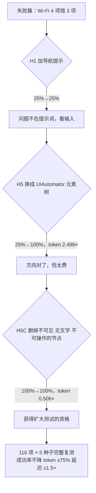

# 第七章　Agent 的评估

[返回目录](../README.md)

> 这一章是 [π 工坊](https://pi.duanjl.com/)第 07 站“拉出来遛遛”的深入版。默认你已经玩过这一站的四个任务：[▶ 7-1 它说退了](https://pi.duanjl.com/#/play/7-1) · [▶ 7-2 回回都对](https://pi.duanjl.com/#/play/7-2) · [▶ 7-3 背过的题](https://pi.duanjl.com/#/play/7-3) · [▶ 7-4 高了三分](https://pi.duanjl.com/#/play/7-4)，也翻过[第 07 站的手册](../manual/07-evaluation.md)。手册讲“游戏里看到了什么”，这一章讲原理、怎样在 Pi 周围真正搭起一套评估，以及各处的取舍。

## 阅读路线

| 手册里的零件 | 本章接着讲什么 | 去哪一节 |
| --- | --- | --- |
| [评估报告](../manual/07-evaluation.md#c-report)（四关共用） | 结论为什么要结构化；一次运行要留下哪些字段；Pi 的会话文件和事件流各记了什么 | [7.4](#t-eval-env)、[7.9](#t-eval-trace) |
| [验证器](../manual/07-evaluation.md#c-verifier)（7-1） | 双重验证的逻辑；本书配套的 `verify.mjs` 拆解；为什么 Pi 的退出码不能当验证器 | [7.5](#t-eval-verifier) |
| [成功的两种口径](../manual/07-evaluation.md#c-passk)（7-2） | 从 n 次采样估 Pass@k 和 Pass^k；Pi 的自动重试算不算一次尝试 | [7.3](#t-eval-passk) |
| [防止背答案](../manual/07-evaluation.md#c-leak)（7-3） | 三种防泄漏手法各防哪一路；难度分层与评估集维护 | [7.6](#t-eval-leak) |
| [分差是不是噪声](../manual/07-evaluation.md#c-significance)（7-4） | 配对 bootstrap、需要多少题、多重比较；Pi 没有种子参数时怎么办 | [7.12](#t-eval-significance) |
| 手册各节的“往深处走” | 对比、消融与模型替换；任务解剖；评估环境；Rubric 与评委偏差；失败归因；回归；选型与成本；可观测性；闭环改进；内部评估；仿真环境 | 7.1、7.2、7.4、7.6–7.8、7.10、7.11、7.13–7.16 |

本章以 Pi 0.87.1、固定提交 `f07218c4d4bbc12bef056a7058c3dd49dfe41abe` 为依据，沿用全书的三个标记：**【内建】** 是这个版本直接提供的行为，**【扩展】** 是能用 Pi 的接口实现、但要自己写代码，**【建议】** 是一般工程选择，Pi 没有替你完成。

先把话说在前头：**Pi 没有内建评估框架。** 它没有“跑一遍评估集”的命令，没有评分器，也没有排行榜。它能提供的是评估的原料：可脚本化的运行模式、结构化的事件流、带用量的会话文件，以及能在关键时点插手的扩展事件。这一章的“Pi 怎么做”，讲的都是怎样拿这些原料搭评估台。

原书观点出自李博杰《深入理解 AI Agent》第 7 章，下文简称“原书”。

先讲一个不出自原书的故事。1990 年哈勃空间望远镜上天，传回的第一批图像是糊的。查下来，主镜磨得极其精确，只是精确地磨成了错误的形状。毛病出在检测主镜用的那台仪器（零位校正器）：里面一块镜片装偏了约 1.3 毫米。主镜每一次检测都“合格”，因为尺子本身是歪的。更让人难受的是，当年另一台检测仪器其实显示过偏差，被当成那台仪器自己的误差放过去了。直到 1993 年航天员上去装了一套矫正光学，哈勃才看清东西。

这一章所有的麻烦，都是哈勃主镜的翻版：Agent 改得再勤，尺子歪了，改进就朝着错的方向走。

---

<a id="t-eval-swap"></a>

## 7.1 评估的对象：模型加 Harness

前六章一直在造 Agent：上下文、记忆、工具、代码能力、观察与动作空间。每一步都有一堆没有标准答案的选择：用哪个模型、给哪些工具、知识库存什么、记忆怎么做、提示词和 Skill 怎么组织、Harness 里加哪些约束。原书的判断是：没有可重复的评估，这些选择只能靠直觉。

原书这一章开头有一句话，决定了后面所有方法的设计：**评估的对象是模型与 Harness 的组合体。** 同一个模型放进不同的 Harness，表现可以差得很远；所以分数低的时候，要先分清是“模型能力不足”还是“Harness 设计缺陷”。这两类问题的修法完全不同，一个要换模型或训练，一个要改提示词、工具和反馈循环。

原书列了三种实验，常被混为一谈：

| 实验 | 动什么 | 不动什么 | 回答什么 |
| --- | --- | --- | --- |
| 对比实验 | 改一个变量 | 其余全部 | 这个改动有没有用 |
| 消融实验（ablation） | 关掉 Harness 的某个组件 | 模型 | 哪个组件真正有贡献 |
| 模型替换（model swap） | 只换更强或更弱的模型 | Harness | 瓶颈在模型还是在 Harness |

模型替换的读法有讲究。换强模型分数不涨，瓶颈在 Harness；换弱模型分数大跌，只能说明当前表现主要由模型决定，至于是任务本身就难，还是 Harness 太依赖模型的先验知识，原书说还得进一步分析。消融实验在[第一章 1.8](01-agent-loop.md#t-ablation) 已经做过一次，这里不重复。

评估还有一个更现实的用处：**防退化**（regression）。新模型在公开基准上更强，不等于在你的任务上更强，可能某些方面反而变差。原书由此推出一个策略，叫“为未来的模型开发产品”：现在的模型还不够用，也先把产品和评估集做好，每出一个新模型就跑一遍，一过门槛就上线。

原书把一套评估体系拆成四个环节，本章大体按这个顺序展开：什么算成功（7.3），任务从何而来（7.2、7.4、7.6），由谁验证（7.5、7.7、7.8），分数如何变成决策（7.10–7.12）；新的失败再回流成任务。

### Pi 怎么做：哪些东西能当实验变量

**【内建】** 做对比和消融，第一个要求是“只改一样”。Pi 的命令行选项正好把 Harness 的大部分零件做成了可以单独开关的旋钮：

| 想控制的变量 | Pi 的选项 | 说明 |
| --- | --- | --- |
| 模型 | `--provider`、`--model` | 模型替换就是只改这一项。[CLI：模型](https://github.com/earendil-works/pi/blob/f07218c4d4bbc12bef056a7058c3dd49dfe41abe/packages/coding-agent/docs/cli.md#L62) |
| 思考强度 | `--thinking off…max` | 会被夹到模型支持的范围内，所以要记录实际生效的值 |
| 工具集 | `--tools`、`--exclude-tools`、`--no-tools` | 工具消融。[CLI：工具](https://github.com/earendil-works/pi/blob/f07218c4d4bbc12bef056a7058c3dd49dfe41abe/packages/coding-agent/docs/cli.md#L118) |
| 扩展、Skill、提示模板 | `-ne`、`-ns`、`-np`，配合显式的 `-e`、`--skill` | 关掉自动发现的，只加载这次要测的。[CLI：资源](https://github.com/earendil-works/pi/blob/f07218c4d4bbc12bef056a7058c3dd49dfe41abe/packages/coding-agent/docs/cli.md#L150) |
| 项目说明文件 | `-nc` | 不读 `AGENTS.md`、`CLAUDE.md` |
| 系统提示 | `--system-prompt`、`--append-system-prompt` | 提示词的对比实验 |

**【建议】** 这些旋钮之外，还有几样东西不在命令行上，同样会改变结果：全局设置（比如自动重试，见 7.3）、Pi 自身的版本、你装的包的版本、模型供应商那一侧的悄悄更新。原书说的“改一个变量”，前提是其他变量至少被**记录**下来。7.9 会给出一份记录清单。

---

<a id="t-eval-task"></a>

## 7.2 一条评估任务的解剖

抽象地谈评估容易说空话。原书的做法是先拿一条真实任务开刀：τ²-bench（Sierra 的开源基准）电信领域里的一条。手册已经列过它的四处设计（[一条评估任务的解剖](../manual/07-evaluation.md#c-task-anatomy)），这里把骨架摆出来，看每个字段在评估里管什么。

下面是本书压缩过的示意，字段名是真实的，取值改成了中文概述：

```jsonc
{ "ticket": "手机上不了网，状态栏 No Service……测速 excellent 才算解决",                  // 给 Agent
  "user_scenario": { "instructions": { "known_info": "姓名、号码、人在法国",              // 故障原因不在这里
                     "task_instructions": "没修好要不耐烦；测速 excellent 才认；设备状态以工具返回为准" } },
  "initial_state": { "initialization_actions": ["用户侧开飞行模式", "用户侧关漫游", "运营商侧开漫游"] },
  "evaluation_criteria": { "actions": ["用户切飞行模式", "用户切漫游"],
                           "env_assertions": ["移动数据可用", "测速 excellent"],
                           "reward_basis": ["ENV_ASSERTION"] } }                          // 只按终态断言给分
```

四个字段对应原书的四个问题：

| 字段 | 它回答的问题 | 设计要点 |
| --- | --- | --- |
| `ticket` + `user_scenario` | 任务从何而来、用户知道什么 | 用户的认知边界写成独立字段 `known_info`，这就是**渐进式信息透露**（Progressive Information Disclosure）的实现方式，用不着一句“别一次说完”的提示词 |
| `task_instructions` 里的事实锚定 | 模拟用户会不会被 Agent 带偏 | 没有**事实锚定**（Grounding），模拟用户会顺着 Agent 说“好了”，评估退化成两个模型互相确认 |
| `initial_state` | 每次能不能回到同一起点 | 故障一半在用户侧（飞行模式、漫游开关），一半在运营商侧；Agent 查库只看得到“配置正常”，这叫**双控**（Dual-Control） |
| `evaluation_criteria` | 由谁验证、怎么聚合 | 四类校验（终态、关键动作、必要告知、自然语言断言）可以挑着用；`reward_basis` 决定最后算哪几类 |

### 两条轨迹，两个教训

原书分析了这条任务的两次运行。

**拿了满分的那次。** 前十几轮在认账户：Agent 查到客户 C1001，逐一查三条线路的流量。第 17 条消息里它下了一个错结论，说号码不在活跃线路里，依据只是一条线路的查询结果；用户坚持号码没错，它才继续查第二条。转折在第 30 条：**用户**调用了查状态栏的工具，看到飞行模式开着、漫游关着。之后一路顺利，测速 275 Mbps，评级 Excellent，`reward = 1.0`。

可这条满分轨迹里藏着一处违规：这个领域的政策第一句就规定一次只能调用一个工具，Agent 在第 4 条消息里一口气发了两个查询。验证器没判错，因为 `reward_basis` 只看终态。原书特意说这**不是疏漏**，是二元奖励的固有代价：拿过程的颗粒度，换一个能跨模型比较的单一数字。

**失败的那次。** Agent 选错了线路 L1001，工具明明返回了“这条线路的号码是 555-123-2001”，它读到了却没有改判，此后在无关排查上耗了几十条消息，最后转人工。它其实做对了一半：引导用户关掉了省流模式，这个动作真实发生、也被环境验证了；可流量充值没做，三条终态断言全挂，得 0 分。

两条放在一起，评估的两个盲区就出来了：满分没说出过程违规和第 17 条那个没依据的结论，要靠更细的校验补（7.5、7.7）；0 分没说出错在哪、做对了哪一半，要靠失败归因补（7.10）。原书点名说，“证据已在上下文、Agent 没有回溯”这个形态，和后面 AndroidWorld 的案例高度相似。

---

<a id="t-eval-passk"></a>

## 7.3 成功的两种口径

上一节那组任务五条过四条，0.8。原书问：这个数能说明系统可用吗？放在退款客服身上，意味着每五个顾客有一个拿不到该退的钱；放在挖漏洞的安全 Agent 身上，五次命中四次已经很可观。**数本身不说话，要看业务对“成功”的要求。**

手册已经把两种口径讲清楚了（[成功的两种口径](../manual/07-evaluation.md#c-passk)）：Pass@k 量能力上限，原书叫它“技术奇观”；Pass^k 量交付的可靠性，还要求 k 次里不触发安全、合规、幻觉这类一票否决。原书的算例是 p = 0.6、k = 5 时，Pass@5 约 99.0%，Pass^5 约 7.8%。

原书举的“技术奇观”是让 Agent 自主工作一周写出 C 编译器、挖出存在几十年的漏洞这类事：有一条轨迹成功就够了。这一节往下走三步：公式从哪来，实测时怎么估，Pi 里有个容易被忽略的计数问题。

### 公式的来历与前提

两条公式都只用了一个假设：**每次运行相互独立，单次成功率都是 p。**

- k 次全错的概率是 (1 − p)^k，所以至少对一次是 1 − (1 − p)^k。
- k 次全对，概率连乘，是 p^k。

独立性是个强假设。原书只说公式“仅在每次运行独立时成立”，手册补了一句直觉：Agent 的失败往往成片出现，同一个误解每次都犯。可以推一下这会把数推向哪边：假如一道题上 Agent 要么“懂了”（每次都对）、要么“没懂”（每次都错），那么无论 k 多大，Pass^k 都等于“懂了”的比例，Pass@k 也一样，两个数会重合。现实落在独立和完全相关之间。所以原书的告诫可以落成一句操作：**能实测就实测，公式用来估量级。**

### 从 n 次采样估计（本节这一段是本书补充）

实测时你不会恰好跑 k 次，更常见的是每道题跑 n 次（n ≥ k），对了 c 次。这时有两个现成的估计式，都不出自原书：

| 口径 | 估计式 | 直觉 | 出处 |
| --- | --- | --- | --- |
| Pass@k | 1 − C(n − c, k) ÷ C(n, k) | 从 n 次里不放回地抽 k 次，一次都没抽到成功，再拿 1 减 | OpenAI 2021 年 Codex 论文 |
| Pass^k | C(c, k) ÷ C(n, k) | 从 n 次里不放回地抽 k 次，全抽到成功 | 2024 年 τ-bench 论文 |

为什么不直接把 c/n 代进 p^k？举个数：n = 10，c = 7，k = 5。代公式是 0.7⁵ ≈ 16.8%；组合数估计是 C(7, 5) ÷ C(10, 5) = 21 ÷ 252 ≈ 8.3%。差了一倍：代公式的做法把只有 10 次样本估出的 0.7 当成了确定值。整个评估集的 Pass^k 按题算完再平均，手册在 7-2 里演示过。

原书另有两条采样要求：报告写清 k 次是什么口径（同一任务独立采样，还是流水线上连续 k 个任务）；**有副作用的操作不能“重试直到成功”**，要在沙盒或可回滚环境里采样，每次失败都计入（为什么，见[第四章的幂等](04-tools.md#t-tool-idempotent)和[沙盒专题](s-sandbox.md)）。

### Pi 怎么做：自动重试算不算一次尝试

**【内建】** Pi 默认会对瞬时错误（过载、限流、5xx）自动重试：`retry.enabled` 默认开，`retry.maxRetries` 默认 3 次。[设置：重试](https://github.com/earendil-works/pi/blob/f07218c4d4bbc12bef056a7058c3dd49dfe41abe/packages/coding-agent/docs/settings.md#L108)。重试发生时事件流里会出现 `auto_retry_start` 和 `auto_retry_end`。[事件：重试](https://github.com/earendil-works/pi/blob/f07218c4d4bbc12bef056a7058c3dd49dfe41abe/packages/coding-agent/docs/json.md#L163)

这对 Pass^k 是个口径问题：一次运行里供应商报了两次 529、第三次成功，算一次成功还是两次失败加一次成功？

**【建议】** 两种口径都说得通，但要分开记：

| 你想量的 | 怎么数 |
| --- | --- |
| Agent 自己的可靠性 | 把供应商层面的重试当成基础设施噪声，一次运行算一次尝试；同时把重试次数记下来 |
| 用户实际感受到的可靠性 | 重试带来的延迟、最终仍失败的那些（`auto_retry_end` 的 `success: false`）都要计入 |

不管选哪个，报告里写明。重试次数本身也是指标：高峰时段频繁 529 进不了成功率，却会进延迟和账单（7.13）。

---

<a id="t-eval-env"></a>

## 7.4 评估环境：一套能反复运行的装置

口径定了，下一个问题是在哪儿测。原书的定义很朴素：给定同一个初始状态，同一个 Agent 应当得到可比较的结果。它以电信任务为参照数出五个要素，手册列过对照表（[评估环境的五个要素](../manual/07-evaluation.md#c-eval-env)）。这里换个角度：**每个要素缺了，评估会怎样坏掉。**

| 要素 | 缺了会怎样 | 电信任务里的做法 |
| --- | --- | --- |
| 数据集（Dataset） | 没有可重复的题，每次考的不一样 | 一条记录一个用例 |
| 环境状态（Environment State） | 上一轮的残留污染下一轮，分数随运行顺序漂移 | `initialization_actions` 就是重置脚本 |
| 工具接口（Tools） | 工具太高层，规划和推理被工具吞掉，评估退化成考一次函数调用 | 两侧都是原子操作，没有“解决上网问题”这种大工具 |
| 评分标准（Rubric） | 没法自动判对错 | 四类校验加 `reward_basis` |
| 执行协议（Interaction Protocol） | 不知道什么时候算结束，跑飞了也没人停 | 模拟用户输出 `###STOP###`、轮数上限、模拟用户耐心耗尽主动结束 |

最后一条有个细节值得记住：模拟用户因为沟通效率太低而挂断，**本身就计为失败**。把“效率”写进协议，比事后打一个效率分更直接。

### 两类环境

电信任务是**人机交互型**，要有用户模拟器，验证的是引导；代码生成、数据分析这类是**工具调用型**，Agent 只和工具打交道，验证的是行动。原书介绍了 Verifiers 框架对后者按“跨轮状态”和“隔离”两个维度分的四类：单轮问答用 `SingleTurnEnv`，搜索加综合用 `ToolEnv`，改数据库记录用 `StatefulToolEnv`，在沙盒里跑代码用 `SandboxEnv`。这类框架保存每次的完整轨迹便于回放；工具失败要返回清晰的错误信息，和[第四章的报错写法](04-tools.md#t-tool-errors)是一件事。

### Pi 怎么做：五个要素各从哪来

Pi 是被测的那个 Agent，不是评估环境。可它的几个接口刚好能填进五要素里：

| 要素 | Pi 提供什么 | 标记 |
| --- | --- | --- |
| 数据集 | 没有。题目文件、标准答案归你管 | 【建议】 |
| 环境状态与重置 | 没有重置命令。最简单的做法是每次运行复制一份干净的工作目录，在里面启动 `pi`；会话要么不落盘（`--no-session`），要么每次单独一个目录（`--session-dir`）。[CLI：会话](https://github.com/earendil-works/pi/blob/f07218c4d4bbc12bef056a7058c3dd49dfe41abe/packages/coding-agent/docs/cli.md#L95) | 【建议】 |
| 工具接口 | `--tools` 白名单固定工具集；自定义工具用扩展注册 | 【内建】 |
| 评分标准 | 没有。验证器在 Pi 之外跑（7.5） | 【建议】 |
| 执行协议 | 一次性运行有 `--print` 和 `--mode json`，跑完就退出；`agent_settled` 标志 Pi 不会再自动继续。[CLI 集成](https://github.com/earendil-works/pi/blob/f07218c4d4bbc12bef056a7058c3dd49dfe41abe/packages/coding-agent/docs/cli-integration.md#L11)、[事件：结束](https://github.com/earendil-works/pi/blob/f07218c4d4bbc12bef056a7058c3dd49dfe41abe/packages/coding-agent/docs/json.md#L48) | 【内建】 |

有两样东西 Pi 没有，要自己补。**轮数上限。** 这个版本的 Pi 没有“最多跑多少轮”的选项。两种补法：外层进程加墙钟超时，到点杀掉（简单粗暴，杀掉的那次记为失败）；或者写一个扩展数 `turn_end`，到数就调用上下文里的 `abort()`。[源码：`abort()`](https://github.com/earendil-works/pi/blob/f07218c4d4bbc12bef056a7058c3dd49dfe41abe/packages/coding-agent/src/core/extensions/types.ts#L342)

```ts
// 设计草图：事件名和 abort() 来自 Pi 扩展接口；上限多少、超限怎么记分由评估方决定。
export default function turnLimit(pi: ExtensionAPI) {
  let turns = 0;
  pi.on("turn_end", async (_event, ctx) => {
    if (++turns < 30) return;
    pi.appendEntry("eval-protocol", { stoppedBy: "turn-limit", turns }); // 留痕：是协议停的，不是 Agent 自己停的
    ctx.abort();
  });
}
```

**用户模拟器。** 人机交互型评估需要一个会接话的“用户”。Pi 的 RPC 模式是一个长期运行的进程，外部程序可以等到 `agent_settled` 之后读最后一条回复，交给模拟用户（另一个模型，带着 `known_info` 和事实锚定的规则）生成下一句，再用 `prompt` 发回去。[CLI 集成：RPC](https://github.com/earendil-works/pi/blob/f07218c4d4bbc12bef056a7058c3dd49dfe41abe/packages/coding-agent/docs/cli-integration.md#L66) 这是【扩展】，要注意的是：RPC 里 `prompt` 的成功响应只代表“收到了”，不代表这一轮跑完，必须继续读事件直到 `agent_settled`。

**【建议】** 用 `-ne -ns -nc` 关掉自动发现的扩展、Skill 和项目说明文件，再显式加载这次要测的那几样。否则你机器上某个全局 Skill 会悄悄参与每一次评估，换一台机器分数就变了。全局设置和凭证仍然来自你的配置目录，这部分要记进运行记录。

---

<a id="t-eval-verifier"></a>

## 7.5 验证器：查世界，不听汇报

原书这一节开头只有两句：Agent 很容易写一篇洋洋洒洒的报告说任务全部完成，事实上根本没完成；评估框架必须核实**机器可独立复核的事实**，而不是 Agent 的自我陈述。手册的 7-1 把这件事演了一遍（[验证器](../manual/07-evaluation.md#c-verifier)）。

先看原书横向对照的六个基准，最后一列是重点：

| 基准 | 被测能力 | 任务来源 | 环境扮演者 | 验证器 |
| --- | --- | --- | --- | --- |
| τ²-bench | 客服场景的人机交互和工具调用 | 人工编写加组合生成 | 用户模拟器加业务数据库 | 四层检查按 `reward_basis` 聚合为二元 |
| SWE-bench Verified | 软件开发 | GitHub 真实 issue，人工筛选 | 代码仓库加测试套件 | FAIL_TO_PASS 与 PASS_TO_PASS 双重验证 |
| AndroidWorld | 操作安卓手机界面 | 参数化模板实例化 | 真实安卓模拟器 | 最终界面状态断言 |
| OSWorld | 操作 Linux 桌面 | 从预置的中间状态启动 | 真实虚拟机 | 134 个独立评估函数 |
| Terminal-Bench | 操作 Linux 终端 | 人工编写 | Docker 容器 | 文件系统检查加真实执行 |
| GAIA | 搜集信息的通用助手 | 人工编写加专有附件 | 开放互联网 | 精确字符串匹配 |

### 双重验证的逻辑

SWE-bench Verified 的做法值得拆开想。它把“修复完成”拆成两个命题，各配一组测试：

| 测试组 | 修复前 | 修复后 | 只验这一组会怎样 |
| --- | --- | --- | --- |
| FAIL_TO_PASS | 失败 | 必须通过 | Agent 可以删掉、改掉妨碍通过的断言，测试一样变绿 |
| PASS_TO_PASS | 通过 | 必须还通过 | 什么都不改也能过，等于没验 |

两组合起来，才分别证明了“已修复”和“未破坏”；它还排除了时灵时不灵的 flaky 测试，否则验证器自己就在掷骰子。OSWorld 走另一个方向，**查得深**：连上数据库核实 SQL 真的执行了，查 DOM、cookie、localStorage 确认表单真的生效。Terminal-Bench 让伪造无从下手：编译内核、加一句自定义 printk、在 QEMU 里启动，日志里出现那句话才算过（手册有[对照表](../manual/07-evaluation.md#c-verifier)）。三种思路合起来，是验证器设计的三个问题：

1. **查的是谁的话？** 是世界的状态，还是 Agent 的汇报。
2. **查得够不够深？** 文件在，内容对不对；表单提交了，后端收没收到。
3. **能不能被绕过？** Agent 能不能改到验证器依赖的东西（测试、标准答案、输入数据）。

### 拆一个真实的验证器：本书的 `verify.mjs`

本书[第一章的订单汇总练习](../examples/order-report/README.md)带了一个验证器，正好能对着三个问题看。练习目录里有一个本地检查 `check.mjs`，Pi 能看到也能跑；[`verify.mjs`](../examples/order-report/verify.mjs) 放在练习目录之外，Pi 改完以后由你来跑。它做两件事：

| `verify.mjs` 做的事 | 对应哪个问题 | 对应原书的哪种手法 |
| --- | --- | --- |
| 拿练习目录里的 `orders.json`、`check.mjs` 跟仓库里的原件逐字比对，不一样就失败 | 能不能被绕过 | PASS_TO_PASS 的精神：不许为了变绿改掉考卷 |
| 直接调用 `report.mjs` 导出的 `summarize()`，跑五组输入，其中两组（单笔 99 分、含 `pending` 和 0 元订单）不在 `check.mjs` 里 | 查得够不够深 | 不让 Agent 只对着已知的那几道题写特判 |

它不读 Pi 说了什么，只看 `report.mjs` 算出来的数。这就是“查世界”。它的边界也写在练习说明里：它会执行被检查的代码，不是恶意代码隔离环境。第一章那句“真正的评估会放在 Agent 改不了的环境里”，指的就是这一层。

### Pi 怎么做：退出码不是验证器

**【内建】** Pi 一次性运行的退出码语义很明确，也很容易被误读。`--print` 在最后一条助手消息的停止原因是 `error` 或 `aborted` 时非零退出；[CLI 集成：print](https://github.com/earendil-works/pi/blob/f07218c4d4bbc12bef056a7058c3dd49dfe41abe/packages/coding-agent/docs/cli-integration.md#L30) `--mode json` 只有进程本身抛错才非零，助手消息失败只出现在事件里。[CLI 集成：JSON](https://github.com/earendil-works/pi/blob/f07218c4d4bbc12bef056a7058c3dd49dfe41abe/packages/coding-agent/docs/cli-integration.md#L46) 两种情况下退出码为 0 都只说明“Pi 这个进程正常结束了”：模型说“全部完成”然后正常停下，退出码就是 0。

**【建议】** 验证器的输入是运行结束后的**工作目录和外部状态**，不是 Pi 的标准输出。把“Pi 正常结束”“Pi 声称完成”“验证器通过”记成三个字段，三者不一致的那些运行最值得看。原书在失败归因里专门有一类就是“声称测试已通过但根本没跑”（7.10）。

---

<a id="t-eval-dataset"></a>

## 7.6 题从哪来：难度、防泄漏、维护与来源

原书说，评估环境是舞台，数据集是剧本。剧本会出三种毛病：太容易，被背下来，写得有漏洞。

### 难度分层

模型一变强，全员满分，尺子就量不出差别了。手册列过原书的三个例子（[难度分层与陷阱题](../manual/07-evaluation.md#c-difficulty)）：GAIA 分三级，Terminal-Bench 从 mlflow 模型注册一路排到 FEAL 差分密码分析，τ²-bench 专门设计了“客服已经批准取消”这类**陷阱任务**。GAIA 最有意思的不是难度本身，是**三个级别对应三种病**：1 级失败指向基础工具使用，2 级指向多步规划与信息整合，3 级指向长序列思考。只看总分，你不知道该补哪一样；分层把一个分数变成了一张诊断单。

<a id="t-eval-leak"></a>

### 防泄漏：三种手法各防哪一路

题一公开或反复使用，就可能进训练数据，分数量的变成记性。手册的 7-3 演过参数化模板（[防止背答案](../manual/07-evaluation.md#c-leak)）。把泄漏看成“题目被看到 → 答案被记住 → 考试时复现”三步，原书的三种手法各卡一步：多源组合让答案搜不到，金丝雀事后发现已经记住，参数化模板让记住的对不上。

| 手法 | 做法 | 能做到 | 做不到 |
| --- | --- | --- | --- |
| 多源组合加专有附件（GAIA） | 一道题要串好几个信息源，比如从某天的 NASA 每日天文图出发，认出宇航员，查他所属的宇航员组，再算组里太空停留最短的人，严格按指定格式输出；部分题配专门制作、网上不存在的附件 | 单一网页给不出答案 | 题目本身一旦公开，答案照样能被记住 |
| 参数化模板（AndroidWorld） | “把联系人 [CONTACT_NAME] 的电话改成 [NEW_PHONE]”，每次随机生成参数 | 回放固定操作序列失效；一个模板派生无数实例；固定部分参数可以单测一个因素 | 模板结构本身被学会，模型照样能应付 |
| 金丝雀标识符（Terminal-Bench） | 每道题埋一个唯一的 GUID，模型能吐出它就说明题进了训练集 | 让泄漏可被检测 | **不能阻止泄漏** |

原书思考题里问过：这场猫鼠游戏有没有终局？三种手法都不是终局。参数化模板对“背答案”有效，对“背解法”无效，可背解法也许就是学会了。这正是 7-3 零件舱里那句话的深意：**换数出题对诚实的考生毫无额外负担**，它只淘汰一种特定的捷径。

<a id="t-eval-dataset-care"></a>

### 评估集要养

原书说得直白：做一个高质量的评估集非常难，几个知名基准的现状多半是初版用起来、暴露问题、再逐轮修补的结果。手册列过三个基准的修补（[评估集要养](../manual/07-evaluation.md#c-dataset-care)），这里把 τ-bench 到 τ²-bench 的五处重设计按“毛病 → 修法”对齐，因为它们几乎是一份自建评估集的体检单：

| 初版的毛病 | τ²-bench 的修法 | 你的评估集可以问 |
| --- | --- | --- |
| 指令笼统，凭常识就能猜出流程 | 剧本拆成 `known_info` 和 `task_instructions` | 题面有没有把答案说漏？ |
| 成功条件模糊，“网络已恢复”压住症状也算过 | 改成“测速 excellent 才算”，专治**敷衍性修复** | 成功条件能不能写成一个可核实的值？ |
| 模拟用户太机械 | 补上情绪、耐心上限和事实锚定 | 模拟用户会不会被 Agent 牵着走？ |
| 只有 Agent 能改环境 | 引入双控 | 有没有本该由用户动手的步骤？ |
| 实例固定 | 参数化批量生成 | 题能不能换数重出？ |

SWE-bench Verified 是发布前就下狠手（2294 道原始题抽 1699 道人工逐条查，只留 500 道），OSWorld 是发布后 15 个月暴露 300 多个问题再集中修复，手册列过细节。原书在 SWE-bench 那里算了一笔账值得记住：跑一遍前沿模型的完整评估动辄数千美元 token，淘汰率高换来更高的信噪比，评估成本也降了约八成。

<a id="t-eval-sources"></a>

### 三个来源

原书把生产评估集的来源分成三类，手册有表（[评估集的三个来源](../manual/07-evaluation.md#c-sources)）。要点只有一条值得在这里重复：**公开基准一般不用于产品决策**，GAIA 涨两个点和你的退款成功率没有必然关系；它的价值在设计手法，验证深度、参数化、防泄漏、持续维护，恰好是自建评估集最容易漏掉的几处。

自建业务集可以直接借骨架。原书的建议是：τ²-bench 可以当作需要仿真用户的评估系统骨架，替换领域数据和工具集即可。生产轨迹回流最贵也最准，它的入口是 7.9 的轨迹和 7.10 的归因。

---

<a id="t-eval-rubric"></a>

## 7.7 写不成断言的时候：Rubric 与 LLM 评判

前面的验证器几乎都是确定性的。原书说这有充分理由：没有额外模型开销，完全可复现，能像单元测试一样放进持续集成。代价有两个：**只给对错，不给原因**（7.2 那条 0 分不说是选错线路还是漏了充值）；**很多判断写不成断言**（投诉回复是否得体，调研报告有没有漏掉关键信息）。

于是验证方式沿着一条谱系往“可机械验证程度低”的一头挪：确定性断言，检查项清单，Rubric 加 LLM 评判，配对比较。原书反复强调一句：**往右挪不等于放弃左边。** 能写成断言的照样写断言，它更便宜、更稳定，适合长期当回归测试跑；LLM 评判只用在确实没法机械判定的维度上。

### Rubric 四准则

原书引了 Scale AI 在 “Rubrics as Rewards” 里提出的四条准则，手册有表（[Rubric 与 LLM-as-a-Judge](../manual/07-evaluation.md#c-rubric)）。四条各防一种坏 Rubric：

| 准则 | 防的是什么样的坏 Rubric |
| --- | --- |
| 基于专家指导 | 只能评语言流畅度，抓不住核心事实和推理步骤 |
| 全面覆盖（含陷阱 Pitfall） | 只写了“好的样子”，没写“高风险的常见错误长什么样” |
| 按重要性加权（含一票否决 Veto） | 所有维度一样重，堆关键词就能刷分 |
| 自包含 | “展示了深刻理解”这种评委自己也说不清的标准 |

落地要求：每个维度定义可验证的评分档，配例子和**边界案例**；主动防范**奖励作弊**（reward hacking），惩罚幻觉、讨好、关键词堆砌、回避难题；随试用收集评委分歧不断修订，最终长成一份判例集。

### 一份完整的 Rubric

原书用用户记忆 Agent 做了示范。测试问题是“我女儿的儿科医生是谁？”，答案要跨两次对话关联：一次提到“女儿叫 Lily”，另一次提到“带 Lily 去看了 Dr. Chen”。下面按原书的结构压缩改写：

```yaml
rubric:
  - name: 事实正确性
    weight: essential          # 必要项
    levels: {4: 答出 Dr. Chen 并说明是 Lily 的医生, 3: 答出 Dr. Chen 没提 Lily, 2: 医生对但附带不确定的额外信息, 1: 医生错或答不知道}
  - name: 思考正确性
    weight: important
    levels: {4: 正确串起“女儿=Lily”和“Lily 的医生=Dr. Chen”, 1: 关联错，比如把用户自己的医生当成女儿的}
  - name: 幻觉检测
    weight: veto               # 一票否决：触发即总分归零
    fail: 编造了对话里没有的信息，比如虚构就诊日期
edge_cases:
  - 用户有两个女儿、看不同医生时，应追问是哪一个
  - 记忆里同时有 Dr. Chen 和“陈医生”，应识别为同一人
```

每一档写的都是能核对的行为（“答出 Dr. Chen”），而不是“展示了对记忆的理解”。原书还有一个“信息完整性”维度，这里省掉了。

这份 Rubric 用在原书的一组实验上，同一组 60 道题测三套记忆方案，留下 180 条真实运行轨迹：

| 系统 | 基础回忆 | 多会话消歧 | 跨会话隐藏关联 | 总体 |
| --- | --- | --- | --- | --- |
| 结构化卡片（Advanced JSON Cards） | 95% | 60% | 50% | 68.3%（41/60） |
| RAG | 90% | 40% | 15% | 48.3%（29/60） |
| 混合系统 | 80% | 70% | 50% | 66.7%（40/60） |

原书读出两点：**混合方案没有自然胜出**（3 道题上胜过两种单一方案，8 道题上不如较好的那个）；**180 次评判里幻觉否决触发了 28 次**，没有 Veto，这些编造的回答会混在高分里。分维度打分还把笼统的“成功率下降”拆成了“没检索到”“关系想错了”“补了没依据的内容”几类，每类修法不同。记忆方案本身见[第三章](03-memory.md#t-memory-eval)。

### Pi 怎么做：让 Pi 当评委

**【内建】** Pi 没有评分器，但“让一个模型读材料、按 Rubric 打分”这件事，用 Pi 的一次性模式就能做：

```bash
# 评委运行：不给工具、不落盘、指定一个与被测 Agent 不同家族的模型
pi --print --no-tools --no-session -ne -ns -nc --model <评委模型> \
   @rubric.md @candidate.md "按 rubric.md 逐项打分，只输出 JSON：{维度名: 档位, veto: true/false, 理由: 字符串}"
```

`@path` 把文件内容放进第一条提示，`--no-tools` 让评委只能读不能动。[CLI：输入](https://github.com/earendil-works/pi/blob/f07218c4d4bbc12bef056a7058c3dd49dfe41abe/packages/coding-agent/docs/cli.md#L34) **【建议】** 三件事自己做：评委输出要校验，不合法就重跑或标记，不能默默当零分；评委模型、Rubric 版本、候选内容哈希一起记下（原书在 TTS 实验里也要求记录评判模型和音频哈希）；评委和被测 Agent 尽量不同家族，原因在下一节。

---

<a id="t-eval-judge-bias"></a>

## 7.8 评委自己的偏差

让模型当评委，就得防评委的毛病。手册列过四种（[评委自己也有偏](../manual/07-evaluation.md#c-judge-bias)），这里讲每一种的机制和对策为什么有效。

### 长度偏差

评委倾向给更长的回答打高分，哪怕内容不更对。原书的三道防线作用在三个地方：在**评分标准**里显式惩罚冗长、设长度上限，把“长”变成扣分项；在**输入**上，配对比较前先把两个候选的长度控制到相近，偏差还在，但两边吃到的一样多；**事后**定期审计分数与长度的相关性，高分几乎总伴随长回答，Rubric 就要回炉。第三条最便宜也最常被省掉，一个散点图就够：横轴字数，纵轴分数。

### 同源偏好与古德哈特

当 Agent 和评委来自同一家族，Agent 可能学会迎合评委的偏好，更隐蔽的是学会**躲开评委不擅长检测的错误**，让评分系统看起来一切正常。原书把它归到**古德哈特定律**（Goodhart's Law）：一个指标变成优化目标，就不再是好指标。原书的对策是**多源异构评判**：用不同家族的几个模型、同一份 Rubric 分别打分，再加权平均或做一致性检查。理由是不同家族的偏见往往是正交的，Agent 很难同时骗过所有评委。日常可以用一个模型快评，定期用多源评判做审计。

### 参考物带偏

原书的一个小实验：OpenAI 和 Fish Audio 各生成四条音频，由 Voxtral 按四维打分。准确性和自然度两家都是 5.00 和 4.00；情感表达和音色一致性，Fish 是 4.00 和 3.00，OpenAI 是 3.75 和 2.75。分维度以后，“有没有读对”看不出的差别显现了。可这组分数**不能用来判断谁更好**：每家只有四条，而比较音色用的参考音频来自 Fish 自家的模型。原书的结论值得抄下来：**选什么参考答案、参考图片或参考音频，本身就是评估设计。** 比通用 TTS 就别把“像不像某家参考音色”算进总分；比声音克隆就让所有方案模仿同一个目标说话人，再用人工盲听校准。多模态评判原书还列了几种：ASR 判语义影响（“转账一千”变“一万”是事故）；UI 评估用[第一章的提议者—审核者](01-agent-loop.md#t-design-patterns)查文字溢出和对比度；视频剪辑用关键帧核对起止点。

### 位置偏差与配对排名

“A 和 B 哪个好”有时比打绝对分更容易判。**Elo 评分**两两对决，分差越大强者预期胜率越高，爆冷时调整越大；背后的统计模型是 **Bradley-Terry**：每个模型一个潜在实力分，胜负概率由分差决定。原书的算例 1200 对 1000 约 76%，按 1 ÷ (1 + 10^(−200/400)) 可以验算。Chatbot Arena 用匿名盲选的人类投票做这件事，原书提醒排名取决于用户问了什么：大家都问编程题，擅长编程的就排得高。换成 LLM 当评委，要防**位置偏差**：偏向某个位置（通常是先出现的）。做法是**交换顺序各评一次**，更严格的是两次一致才计入，不一致记平局或交人工。

原书思考题里还留了一个更深的坑：Bradley-Terry 假设偏好可传递（A 胜 B、B 胜 C，则 A 胜 C），人类偏好常常不传递。一个模型短答好、另一个长答好，第三个两头都中等，排名会因为题目混合比例不同而翻来覆去。

---

<a id="t-eval-trace"></a>

## 7.9 轨迹是调查材料

前面几节解决的是“打分”。可分数只说好坏，要改进，得知道失败从哪一步开始。这一节和下一节合起来，对应旧版教材的一句话：**轨迹是调查材料，评分不是最终回复。**

设想 Pi 最后说“报告已经完成”，你打开文件却发现退款被重复计入。光看最终回复，分不清它是没读规则、脚本算错，还是已经看到错误却照样宣布成功。要查，得回到它实际读过什么、执行过什么、得到了什么结果。这些记录叫**运行轨迹**（trajectory）：用户输入、模型消息、工具参数、工具结果以及相关事件。

### Pi 怎么做：两份记录，两种格式

**【内建】** Pi 为一次运行留下两样东西，评估要分别读：

| | 会话文件 | JSON 事件流 |
| --- | --- | --- |
| 怎么得到 | 默认持久化在会话目录；`--session-dir` 可以每次指定 | `pi --mode json … > events.jsonl` |
| 结构 | 第一行会话头，之后每行一个条目，`id`/`parentId` 连成一棵树 | 第一行会话头，之后是按时间排列的事件 |
| 有什么 | 消息（含系统提示和工具声明）、模型和思考强度变化、压缩、用量条目、扩展写的自定义条目 | 每轮开始结束、消息开始结束、工具执行开始/进度/结束、重试、压缩 |
| 适合 | 事后复盘、回放、截取前缀 | 实时监控、计时、和外部 trace 系统对接 |

会话文件的结构在[第三章 3.2](03-memory.md#t-session-trajectory)讲过，这里只补三个评估要用的细节：

1. **系统提示也在里面。** 第一次请求会把带全部分段的系统消息和工具声明写成一条消息，之后的变化以补丁形式追加。[会话格式：系统消息](https://github.com/earendil-works/pi/blob/f07218c4d4bbc12bef056a7058c3dd49dfe41abe/packages/coding-agent/docs/session-format.md#L80) 所以“这次运行模型到底看到了什么提示词”是可以从文件里重建的，7.15 的提示词敏感性评估就靠它。
2. **落盘有时机。** 新会话在出现第一条助手消息之前不会写盘，有了助手消息才一次写入此前的全部条目。[源码：会话持久化](https://github.com/earendil-works/pi/blob/f07218c4d4bbc12bef056a7058c3dd49dfe41abe/packages/coding-agent/src/core/session-manager.ts#L1160) 模型请求第一次就失败的运行，可能没有会话文件；要求严格审计的评估台，应以事件流或自己的日志为准。
3. **两份记录别共用解析器。** 都是“一行一个 JSON”，字段完全不同。事件流的官方说明还特别提醒：按 LF 切分记录，不要用 Node.js 的 `readline`，因为它把 Unicode 行分隔符也当换行。[事件：分帧](https://github.com/earendil-works/pi/blob/f07218c4d4bbc12bef056a7058c3dd49dfe41abe/packages/coding-agent/docs/json.md#L15)

每条助手消息都带着模型、用量和停止原因。[源码：助手消息字段](https://github.com/earendil-works/pi/blob/f07218c4d4bbc12bef056a7058c3dd49dfe41abe/packages/ai/src/types.ts#L515) 其中 `responseModel` 是供应商报告的实际模型，和请求的 `model` 不同时才出现。模型替换实验里，这个字段能帮你发现“请求的是 A，路由到了 B”。

### 一次运行该留下什么

有了轨迹，还缺一个东西：独立的完成判断。助手写“所有校验通过”只是待核对的声明。收入总额对不对，由已知样例或另一个可信计算核对；有没有偷偷改输入文件，比较执行前后的文件摘要；有没有真的输出报告，检查实际文件。

**【建议】** 下面是建议由评估台为每次运行保存的记录。它不是 Pi 自动生成的报告：

```js
// 记录结构伪代码：字段由评估台采集，不是 Pi 的内建输出。
const runRecord = {
  taskId, inputHash, ruleVersion, envSeed,                         // 题
  piVersion, modelId, responseModel, thinking, tools, extensions, skills, settingsHash, // 被测组合
  sessionPath, eventLogPath, piExitedNormally, agentClaimedDone,   // 轨迹与 Pi 怎么说
  verifierResult, artifactPaths,                                   // 世界怎么说
  autoRetries, elapsedMs, usage, failureCategory, firstErrorStep   // 代价与归因（7.3、7.13、7.10）
};
```

用量里的费用来自 Pi 的价格配置和供应商报告，不能直接当账单结算。失败的修复放到哪一层（知识、Skill、程序还是模型），以及修完怎样发布和回滚，是[第九章](09-evolution.md)的事。这一章只管找到它、量出它。

---

<a id="t-eval-attribution"></a>

## 7.10 失败归因：找第一个错

端到端评估只说“失败了”。**失败归因**（failure attribution）要标出主要错误类别、第一次出现不可接受行为的那一步、对应的调用或输出，附上可复核的证据。归因对象是**首个导致任务偏离的错误**，最后一个报错多半是后果：编辑工具返回匹配失败，Agent 又重试三次，主因是一次工具调用错误，不是三个根因。问题案例来自三类信号：**用户明确纠正**、**用户点踩**、**事后由状态检查、规则验证器或 LLM 评审发现**。归因可以借助 LLM，但不能全交给它，原书的理由是：**失败归因往往反映的是产品问题**。

### 九类错误，以及各自怎么定位首错

手册列过原书给 Coding Agent 的九类初始分类（[失败归因](../manual/07-evaluation.md#c-attribution)）。原书那张表其实有三列，第三列“首错怎么定位”才是干活用的；原书还说，分类会随产品长到几百种，可以直接写成归因标注 Agent 的提示词或 Skill：

| 错误类别 | 首错怎么定位 |
| --- | --- |
| 需求理解与歧义处理 | 把原始需求和 Agent **实际做的事**逐条对照，找第一处偏离，再回溯到造成它的那次调用或答复 |
| 流程与规范缺失 | 找第一次违反约定的动作（首次提交、首次写文件），回看它之前有没有读过约定来源 |
| 工具调用错误 | 记录第一次失败的调用和原始请求、错误返回；之后的重复失败是症状 |
| hack 验证环境 | 找第一次改动测试或验证逻辑的消息；再把完成声明和轨迹里**真实执行过的命令**交叉核对 |
| 修改不完整 | 把声称的影响面和真实影响面做集合差，取第一个遗漏项，回看它检索时用了什么关键词 |
| 对用户的信息反馈错误 | 把答复里每个事实断言和工具返回逐条对齐，取第一条无法溯源或矛盾的 |
| 非功能性回归 | 取第一次改公开接口或数据结构的消息，看它是否意识到需要迁移 |
| 模型执行异常 | 找第一个异常终止点，分清是模型停了、Harness 超时还是工具服务故障 |
| 过早停止任务 | 找第一次遗漏目标或放弃探索的决策，和最终验证失败分开记 |

### 归因记录长什么样

原书要求记录**结构化**：引用步骤号、工具名和证据，区分根因和后果，判断能否恢复，给置信度；同时保存任务目标、环境状态、各组件版本和完整轨迹。多个类别同时出现时，按“**最早且能解释后续失败**”选主因。本书按这些要求写的样例：

```yaml
task: fix-retry-config
verdict: fail                                 # 验证器：服务仍按 3 次重试
first_error: { step: 6, kind: tool_call, tool: edit,      # kind 也可能是 assistant_message
               evidence: "Could not find the exact text in settings.json" }
primary_category: 工具调用错误
root_cause_owner: 待定                         # 模型 / harness / 工具服务 / 任务本身；要沿下文的复制链路查
consequences: ["step 7-9 重复同一编辑均失败", "step 10 声称已修改完成（信息反馈错误，次因）"]
recoverable: true
confidence: 0.8
```

### 规则先筛，模型再定位

原书点名三类可以规则先筛、模型再定位：完成声明和实际执行命令交叉核对；diff 是否碰了测试断言和 skip 标记；是否改了公开接口却没有迁移文件。这比把全部轨迹喂给模型更便宜也更准。**【扩展】** 前两条在 Pi 的事件流上很好写：工具开始事件里有工具名和参数，结束事件里有 `isError`，助手消息的最终内容在 `message_end` 里。[事件：工具执行](https://github.com/earendil-works/pi/blob/f07218c4d4bbc12bef056a7058c3dd49dfe41abe/packages/coding-agent/docs/json.md#L101)

```js
// 规则筛查草图：读一次 --mode json 运行的事件流，标出两类嫌疑。
import { readFileSync } from "node:fs";
const events = readFileSync(process.argv[2], "utf8").split("\n").filter(Boolean).map(JSON.parse);
const bashCommands = events
  .filter((e) => e.type === "tool_execution_start" && e.toolName === "bash")
  .map((e) => e.args.command);
const touchedTests = events.filter((e) =>
  e.type === "tool_execution_start" && ["edit", "write"].includes(e.toolName) && /test|spec/i.test(e.args.path));
const finalText = events.filter((e) => e.type === "message_end" && e.message.role === "assistant")
  .at(-1)?.message.content.filter((b) => b.type === "text").map((b) => b.text).join("") ?? "";
if (/测试.*通过|tests? pass/i.test(finalText) && !bashCommands.some((c) => /test/.test(c)))
  console.log("嫌疑：声称测试通过，但没有执行过任何测试命令");
if (touchedTests.length) console.log("嫌疑：修改了测试文件", touchedTests.map((e) => e.args.path));
```

读整个文件时用 `split("\n")` 没问题，JSON 字符串里的换行都被转义了。规则会误报（任务本来就要求改测试），所以它只负责筛，不负责判。

### 三个难找的首错

**做对了但说错了。** 多数评估只查环境状态，所以这类错容易被整体成功率掩盖。原书引了 τ²-bench 公开基线：带信息告知要求的 704 次运行失败 240 次，其中 162 次告知出错，有 80 次（占全部失败的三分之一）环境状态全对、告诉用户的却错了。7-1 的学徒就是这一类。

**静默失败。** 原书的 AndroidWorld 记账案例（手册讲过）：32 步没有一步报错，首错在第 8 步，Agent 在思考里写了自己看不到图片内容却继续推进，那一步既没报错也不是工具调用。根因是纯文本 Agent 的观察里**根本没有图像像素**，是 Harness 的观察通道缺失（[第六章](06-interaction.md)），记成“模型不会 OCR”就会去换模型，方向全错。没有报错可搜的时候，原书给了两种定位法：

| 方法 | 怎么做 | 适合 |
| --- | --- | --- |
| 事实锚点比对 | 把 Agent 的每句陈述和工具返回逐步对齐，取第一次背离 | 有工具返回可对照的轨迹 |
| 轨迹前缀二分 | 把轨迹截到第 k 步交给人接手，能救回来说明错在 k 之后；二分缩小范围 | 背离不明显、要靠“还救不救得回来”判断 |

**作用域和精确复制。** “引号格式不对”不能变成全局替换：同一个直引号在中文正文、英文原文、代码、JSON 里角色不同。原书建议先把文档切成带作用域的片段，每段记录允许的变换；判不清作用域时，保留原文并请求澄清才算对。`old_string` 匹配失败也不能只归因于“模型抄错了”，要沿“文件字节 → 工具返回 → 序列化 → 模型上下文 → 模型输出 → 解码 → 参数解析 → 工具匹配”找第一个差异，只有首个差异在模型输出时，才把它变成[第八章](08-training.md)的复制训练数据。Pi 的 `edit` 在匹配这一环的折中见[第四章](04-tools.md#t-tool-fuzzy-edit)。

---

<a id="t-eval-regression"></a>

## 7.11 回归：既看改善，也看退化

找到了首错，下一步是把“修好它”写成能反复跑的测试，叫**回归任务**（regression task）。原书主张两层，手册有对照表（[两层回归任务](../manual/07-evaluation.md#c-regression)）：**端到端回归**从初始状态跑完全程，最接近生产结果但贵、看不出错在哪；**轨迹前缀回归**（trajectory prefix）把首错之前的上下文、工具返回和环境状态全部冻结，只要 Agent 做下一步，答案是一组**可接受动作**加一组禁止动作。原书认为，对高可靠性的生产 Agent，**前缀回归集往往比端到端集更重要**。不同失败类别生成什么回归任务，原书给了对应：

| 归因类别 | 生成的回归任务 |
| --- | --- |
| 流程缺失 | 带计划文档和测试验收条件的端到端任务 |
| 工具调用错误 | 截断出错前缀，测能否修正格式、转义特殊字符或换用合适工具 |
| 执行异常 | 加入截断、超时、工具故障的恢复场景 |
| 完成度与逻辑错误 | 多目标清单、剩余任务提醒、“尚未证明不可能”的边界 |
| 需求歧义 | 把有多种合理解释的任务冻结成前缀，“先澄清”列入可接受动作 |
| 症状修复与验证造假 | 验收补两条硬约束：不得修改测试断言；完成声明必须附真实执行过的命令输出 |
| 信息反馈错误 | 对答复内容本身设断言，不只查环境状态 |

原书实验 7-7 的 11 个边界用例，三种语义等价的上下文写法都是 6/11（手册讲过），三种都没过“过时偏好覆盖当前要求”“高风险删除前确认”这几类：**拿到信息和用对信息是两种能力**。

### Pi 怎么做：截取前缀、只看下一步

**【内建】** 在用户消息边界截前缀，Pi 有现成的操作。RPC 的 `fork` 从当前分支上某条用户消息之前分出一个新会话，并把那条消息的原文返回给你；交互界面里的 `/tree` 也能回到任意位置另起分支（[第三章](03-memory.md#t-session-tree)）。[RPC：fork](https://github.com/earendil-works/pi/blob/f07218c4d4bbc12bef056a7058c3dd49dfe41abe/packages/coding-agent/docs/rpc-commands.md#L604) 截在用户消息之前，正好对应“同样的上下文，同样的请求，现在会怎么做”。

**【扩展】** “只看下一步”可以用 `tool_call` 事件实现。这个事件的处理函数能返回 `block: true` 阻止执行，再加 `terminate: true` 提示 Agent 在这批工具调用之后停下。[源码：`ToolCallEventResult`](https://github.com/earendil-works/pi/blob/f07218c4d4bbc12bef056a7058c3dd49dfe41abe/packages/coding-agent/src/core/extensions/types.ts#L1217)

```ts
// 前缀探针草图：记录 Agent 提出的第一个动作，不让它真的执行。
export default function nextActionProbe(pi: ExtensionAPI) {
  pi.on("tool_call", async (event) => {
    pi.appendEntry("prefix-probe", { tool: event.toolName, input: event.input });
    return { block: true, reason: "评估探针：只记录下一步动作，不执行", terminate: true };
  });
}
```

评估台读出这条 `prefix-probe` 记录，和可接受动作集合比对。`terminate` 只在同一批里所有被拦截的调用都设了它时才生效；如果 Agent 的“下一步”是直接回一段话而不调工具，就去读最后一条助手消息。被拦下的调用会以错误结果回到上下文里，所以这个探针只适合看第一步，不适合连续看好几步。

### 三类样例：开发、保留、回归

回归防的是“修了这个、坏了那个”。给月报脚本加了重复订单检查，含重复订单的样例通过了；可另一份按商品明细导出的数据，一笔订单本来就有多行，新检查把合法数据也拒了。只重跑刚修好的样例看不出来，所以要三类样例：

| 样例 | 用途 | 月报场景的例子 | 规则 |
| --- | --- | --- | --- |
| 开发样例 | 定位和修复 | 一张含重复订单的单店表 | 调试时随便看 |
| 保留样例 | 检查修改能否迁移 | 多店、换金额、打乱行顺序的重复订单 | **调试时不看标准答案**，否则 Agent 可能只是针对那几份写了特判 |
| 回归样例 | 检查原有能力是否被破坏 | 正常表、退款表、空输入、已声明为明细的一单多行 | 每次改动都全跑 |

`verify.mjs` 里那两组 `check.mjs` 没有的输入，就是一个最小的保留样例。更开放的任务可以参考本书的[综合调查实验](../examples/investigation/README.md)：在物流原因、不同数据粒度、明确的监控需求这些变体下，看 Agent 是否真的选了不同的方案。

起步不需要评分平台，一张任务表就够。表里每个指标都有它单独看时的盲区：

| 指标 | 怎么观察 | 单独看会漏掉什么 |
| --- | --- | --- |
| 结果通过率 | 独立验收通过的任务占比 | 少量严重错误 |
| 无依据成功声明 | 声称成功但验收失败的次数 | 有依据的任务质量如何 |
| 关键步骤完成率 | 是否执行了输入检查、来源记录 | 步骤齐全但算错了 |
| 成本与耗时 | 每个**已通过**任务的用量和时长 | 快速失败会制造低成本假象 |
| 原有能力保持 | 旧任务是否继续通过 | 新任务有没有改善 |

一个新 Skill 把通过率从 6/10 提到 8/10，是值得调查的信号，可十个任务太少。保存逐任务结果，重复运行看收益是否稳定，别只留最好的一次截图；无法固定的条件写进结果说明。算不算数，下一节给算法。

---

<a id="t-eval-significance"></a>

## 7.12 分差是不是噪声

手册用 7-4 的数据把三件事一步步算过了（[分差是不是噪声](../manual/07-evaluation.md#c-significance)）：McNemar 精确检验（9 道分歧题里 6 比 3，双侧概率约 51%）、标准误的直觉（100 题、七成上下约正负 9 个百分点），以及换种子重跑。原书的判断标准一句话：**分差超过噪声、在配对分析中成立、并且能够复现，才值得切换。**

这一节补四件手册没展开的事。

### 配对 bootstrap

原书推荐的两种配对方法，McNemar 手册算过了，另一种是**配对 bootstrap**。它不依赖“对错二元”，连续分数也能用：

```python
# 配对 bootstrap 草图：deltas[i] 是第 i 题上 B 减 A 的得分（多种子时先在题内平均）
import random

def paired_bootstrap_ci(deltas, rounds=10000):
    n = len(deltas)
    means = sorted(sum(random.choice(deltas) for _ in range(n)) / n for _ in range(rounds))
    return means[int(0.025 * rounds)], means[int(0.975 * rounds)]   # 95% 区间
```

要点在“按题重抽”：每次有放回地抽 n 道题，题内 A 和 B 的结果绑在一起走，题目本身难易的影响就抵消了。区间包含 0，就不能说 B 更好。

拿 7-4 的数据粗算一下（按正态近似，不跑模拟）：100 道题里 6 道 +1、3 道 −1、91 道 0，平均差 0.03，每题差值的标准差约 0.30，均值的标准误约 0.030，95% 区间大约是 −2.9 到 +8.9 个百分点。包含 0，和 McNemar 的结论一致。

### 需要多少题

原书说预期收益只有两三个点而评估集只有几十题时，先扩大样本。把标准误公式倒过来，n ≈ 1.96² × p(1 − p) ÷ 半宽²（按原书公式推算）：p = 0.7 时，区间半宽 ±9 个百分点约要 100 题，±5 约 320 题，±3 约 900 题。这是单个成功率的区间；配对比较时要的题数取决于分歧题多少，通常更少，可必须是同一批题。

### Pi 怎么做：没有种子参数时，“种子”是什么

**【内建】** 原书建议每个配置跑 3 到 5 个随机种子。可这个版本的 Pi 没有采样种子选项，多数模型供应商也不保证同一种子得到同一输出。Pi 能直接控制的采样参数，命令行上只有思考强度。

**【建议】** 所以在 Agent 评估里，“种子”要拆成两层：**环境的随机**能固定，参数化模板的参数、模拟用户的人设、文件顺序都由你的种子生成，记进运行记录；**模型采样的随机**一般不能固定，同一配置重复运行多次，当成测量噪声，报告均值和波动范围。原书伪代码里的 `for seed in fixed_seeds`，在 Pi 上落实为：环境种子固定，A 和 B 在同一个环境种子下各跑一次，重复若干轮。配对靠的是“同一题、同一环境”，不是“同一模型输出”。

### 多重比较

原书提醒：并行验证多个假设时，试二十个改动，总有一个碰巧“显著”。对策是收紧阈值，或者对正向结果独立复跑一遍。收紧阈值最简单的做法（本书补充，不出自原书）是 Bonferroni 校正：同时检验 m 个假设，每个的门槛从 5% 降到 5% ÷ m。它偏保守，所以实践中更常用的是原书的第二个办法：**先筛，再独立复跑**。筛出来的那一个，换一批题或换一组环境种子重跑，还成立才算。

---

<a id="t-eval-selection"></a>

## 7.13 选型与成本

选型、成本、可观测性（7.14 前半）和内部评估（7.15）是原书挂在“评估驱动”之下的并列话题，彼此不递进。原书特别说明，其中只有选型对上一节的统计显著性有明确依赖。

### 多维度选型

原书说选型不是“选最强的”。手册有维度表（[多维度选型](../manual/07-evaluation.md#c-selection)），这里把容易混的吞吐和延迟讲透。推理分两段：**Prefill**（预填充）一次读入完整上下文，决定 **TTFT**（Time To First Token，首字延迟，等于排队加预填充），上下文越长越慢；**Decode**（解码）逐 token 生成，决定出字速度，也决定思考时长。原书的算例：50 tokens/s 的模型生成 2000 个思考 token，光思考就要 40 秒。不同模型的思考 token 数能差好几倍，思考长度和效果又不一定正相关，所以要在自己的负载上实测。**p95 尾部延迟**比均值更能反映体验，因为均值会被大量快请求拉低，掩盖少数用户的严重卡顿。

另外三个维度：

- **成本**：便宜但成功率低的模型要频繁重试，实际花费可能更高。要算每个任务的平均成本和成本性能比。
- **速率限制**：RPM、TPM 决定并发，有的 API 高峰期还会动态下调。
- **预算—能力曲线**：单个预算点上的成绩外推不到长时任务。RE-Bench 的人机对照：每个环境 2 小时，最好的 Agent 得分约为人类专家的 4 倍；8 小时人类略微反超；合计 32 小时时人类约为 Agent 的 2 倍。所以要在接近真实任务时长的几个预算点上比。

**异构组合要经评估验证。** 轻模型处理简单请求、强模型处理复杂任务，要验证收益是否超过增加的复杂度，反例是把“9.9 和 9.11 哪个大”这种看着简单的题分给了轻模型。

**行为策略也是选型维度。** 原书实验 7-9 在固定 Harness 里比两个模型的**行动阈值**：第一次改代码前，一个平均调用工具 6.89 次、读 4.67 个文件，另一个 4.56 次、3.56 个；跨模块任务里几乎收敛（7.00 对 6.67 个文件）。两者最终测试都 100% 通过，到首次修改的时间也几乎一样（15.01 秒对 14.48 秒）。原书只从中得出“行动策略随模型而变”，**不支持“多读或早改更好”**。

**切换决策是差异化的。** 原书的设想：新模型公开基准更强、价格更低，在你的集上跑出来简单任务更好更便宜，复杂多轮工具编排低 5%。确认差异超出噪声后，决策是“简单任务迁移、复杂任务保留”。

<a id="t-eval-cost"></a>

### 成本：为什么不是线性的

原书把成本拆成三层：模型推理、工具调用、基础设施。推理里有两个常被忽略的放大因素。一是**上下文累积**：每轮都要把历史重发一遍，第 1 轮发 1000 token、第 2 轮 2000、第 3 轮 3000，合计 6000 而不是 3000，没用好 KV Cache 时增长很快（[第二章](02-context.md#t-ctx-kv-cache)）。二是**思考 token**，不展示给用户，照样计费。工具这一层也有间接成本：一次网页搜索返回两三千到五千 token，在之后每一轮都作为输入被重复计费。

原书的实验 7-10 跑了一个固定的八轮退款任务，开关“稳定前缀”和“压缩历史”两个选项：

| 方案 | 输入 token | 缓存 token | 总成本 | 比基线节省 |
| --- | --- | --- | --- | --- |
| 无缓存、无压缩 | 20,700 | 0 | $0.003776 | 基线 |
| 仅稳定前缀 | 20,386 | 13,568 | $0.002707 | 28.3% |
| 仅压缩历史 | 16,177 | 0 | $0.003115 | 17.5% |
| 稳定前缀加压缩 | 16,035 | 6,144 | $0.002643 | 30.0% |

基线组里每轮输入从 1,113 涨到 3,668 token，工具返回跟着历史反复进入后续请求，八轮累计占了 9,544 个输入 token；两项都开后降到 5,248。28.3% 加 17.5% 不等于 30.0%，看缓存 token 那一列就明白：压缩把可命中的前缀缩短了，缓存 token 从 13,568 掉到 6,144。原书的结论：几项优化同时用时必须在完整任务里一起实测；每项优化最好都能独立开关。

还有两条运维手段：非实时任务攒起来**异步批处理**，用批量定价折扣；给每个任务设**成本上限**，Agent 陷入循环时自动终止，和[第五章的熔断](05-coding.md)是同一个思路。

### Pi 怎么做：用量从哪里读

**【内建】** 每条助手消息都带一个 `usage`：输入、输出、缓存读、缓存写、总 token，以及按价格配置算出的分项费用；供应商报告思考 token 时还有 `reasoning`，它是 `output` 的一部分，不要重复相加。[源码：`Usage`](https://github.com/earendil-works/pi/blob/f07218c4d4bbc12bef056a7058c3dd49dfe41abe/packages/ai/src/types.ts#L396) 不属于助手消息的模型用量（比如缓存预热）记成单独的 `usage` 条目，同样计入会话总量。[会话格式：用量条目](https://github.com/earendil-works/pi/blob/f07218c4d4bbc12bef056a7058c3dd49dfe41abe/packages/coding-agent/docs/session-format.md#L111) RPC 模式还有 `get_session_stats`，一次给出整个会话的 token、费用和当前上下文占用。[RPC：会话统计](https://github.com/earendil-works/pi/blob/f07218c4d4bbc12bef056a7058c3dd49dfe41abe/packages/coding-agent/docs/rpc-commands.md#L520)

**【建议】** 从 `--mode json` 事件流统计，读 `message_end` 里助手消息的 `usage` 即可，不要累加流式过程中 `message_update` 的 `usage`，那是同一条消息的累计值，加起来会重复计算。[事件：用量](https://github.com/earendil-works/pi/blob/f07218c4d4bbc12bef056a7058c3dd49dfe41abe/packages/coding-agent/docs/json.md#L95) 原书实验 7-10 的四组对照，在 Pi 上可以这样复现：同一任务、同一模型，用扩展或系统提示控制两个变量，四种组合各跑多次，比较 `cacheRead` 和 `cost.total`。

---

<a id="t-eval-observability"></a>

## 7.14 可观测性，以及从报告到改进

### 可观测性：把轨迹变成 trace

原书把**可观测性**（Observability）的数据结构直接沿用分布式系统的 span 树：一次任务是一条 trace，每次模型调用、工具调用、检索是一个 span，记录输入输出、起止时间、token 和错误，父子关系构成执行树。协议层有 OpenTelemetry，OpenInference 等规范在它上面约定大模型应用该记什么；用标准协议的好处是采集和分析解耦，不被某个平台锁定。手册讲过概念（[可观测性](../manual/07-evaluation.md#c-observability)）。

它的用处是诊断、优化、成本管理和后训练数据，最有价值的去向是**回流成评估资产**：筛出失败和可疑案例，脱敏，沉淀成新用例和回归测试。

**【扩展】** Pi 不带 OpenTelemetry 导出。可事件流的结构和 span 树几乎一一对应，写一个转换器就能接上任何 trace 后端：

| span 树里的节点 | Pi 事件 | 用来关联的字段 |
| --- | --- | --- |
| 一次任务（根 span） | `agent_start` … `agent_settled` | 会话头里的会话 ID |
| 一轮（模型调用加它触发的工具） | `turn_start` … `turn_end` | 顺序 |
| 模型调用 | `message_start` … `message_end`（助手消息） | 消息里的 `usage`、`stopReason` |
| 工具调用 | `tool_execution_start` … `tool_execution_end` | `toolCallId` |
| 重试、压缩 | `auto_retry_*`、`compaction_*` | 顺序 |

两个注意点。同一条助手消息里的多个工具调用可能并发执行（[第四章](04-tools.md#t-tool-readonly)），所以工具 span 之间要按 `toolCallId` 配对，不能按出现顺序配。根 span 的结束要用 `agent_settled`，`agent_end` 之后还可能有自动重试或排队的消息。

<a id="t-eval-improve"></a>

### 从报告到改进：一次只改一个变量

评估的终点是改进。原书讲了一次 AndroidWorld 调优，手册有表（[从报告到改进](../manual/07-evaluation.md#c-improve-loop)），这里看它的决策逻辑。

**第零步：先查尺子。** 原书说，看到 Agent 表现下降，先查评测系统本身。资源不足把进程杀了（表现为随机失败），验证器自己有 bug 把对的判成错，测试用例和生产场景脱节，这三种在数字上和模型退化一模一样，只有翻完整轨迹才分得清。这就是哈勃主镜的教训。

**第一步：找失败簇。** 116 项任务总成功率约 88%，可四项 Wi-Fi 任务错了三项。只盯总分会漏掉这个簇；只加最大步数，又可能把“看不见”当成“不够耐心”。

**第二步：每轮只改一件事。** 模型、任务参数、种子、步数上限、模拟器全部固定，两组交替运行：



原书读出两条：**提示写得再详细，也补不回 Agent 没看到的信息**；**输入也不是越多越好**。整个过程没换模型。

**第三步：结论只配得上它的样本量。** 每组只有四项任务，只能决定“值不值得扩大测试”，**不能把子集上的 4/4 写成系统整体 100%**。好的报告要写清结论适用于哪里、哪些底线没过、下一轮验证什么。

---

<a id="t-eval-internal"></a>

## 7.15 内部评估：产品怎样量自己

外部评估告诉你“它有多好”，内部评估告诉你“哪项改动让它变好了”。原书以开源通用 Agent OpenClaw 为例，结合头部 Coding Agent 的公开分析，讲了五个组件。手册有总表（[内部评估](../manual/07-evaluation.md#c-internal)），这里讲每个组件的设计要点，以及 Pi 能接住哪些。

| 组件 | 设计要点 | Pi 里有什么 |
| --- | --- | --- |
| 消融总开关 | 一键关掉思考、压缩、自动记忆、后台任务，得到“裸模型”基线；开关要在启动极早期注入；定期跑以发现“特性债务” | 【内建】`--no-tools`、`-ne -ns -np -nc`、`--thinking off`、`set_auto_compaction`、`set_auto_retry` 能拼出一个接近裸模型的基线 |
| AB 测试 | 多臂，看剂量和效果；分清机制指标和目标指标；设护栏指标；记录基线统计 | 【建议】Pi 不做流量分组 |
| 双层特性开关 | 编译时开关把代码物理移除；运行时开关服务端下发、本地缓存，宁可读旧配置也不阻塞启动；曝光事件每会话只记一次 | 【扩展】扩展可以按配置决定是否注册某个工具或钩子 |
| 提示词敏感性评估 | 系统提示能确定性渲染；版本化快照；每次改提示词跑回归，像改代码跑 CI | 【内建】渲染后的系统提示和工具声明写进会话文件（7.9）；SDK 的 `session.systemPrompt` 可直接读。[SDK：会话状态](https://github.com/earendil-works/pi/blob/f07218c4d4bbc12bef056a7058c3dd49dfe41abe/packages/coding-agent/docs/sdk.md#L30) |
| 隐私感知分析 | 分析接口只收经过特殊类型包装的值，把隐私约束变成编译时检查 | 【建议】 |

**机制指标和目标指标**是最容易踩的坑，原书的例子：你在测“缩短计划文件”，计划长度是机制，你直接改的东西；目标可能是“降低整场会话的成本”。计划短了可能引来更多“改一下、查一下、再改一下”的循环，总成本不降反升。再加一层**护栏指标**：目标改善了，用户满意度、操作次数、错误率这些底线变差，实验照样该停。

隐私那一条，原书的立场是从一开始就设计进去，而且它逼着你想清楚“真正需要度量什么”。7.14 的轨迹回流要脱敏，就是它的一个落点。

<a id="t-eval-simulation"></a>

## 7.16 通往训练场

原书在本章最后搭了一座桥。评估跑几千次就出结论，训练要上百万次；评估环境要长成**仿真环境**。两头接得上，是因为一个定义清楚的验证器或 Rubric，本质上就是**可验证奖励**（RLVR）的奖励函数：7-1 的核验器换个场合就是一个奖励脚本。

训练会提出评估不必操心的要求：可靠的重置（上百万个回合都要回到确定、干净的起点）、远高于评估的吞吐、随机化（7-3 的换数出题，到了训练场叫**领域随机化**）。原书的数字例子是 AWorld：为 GAIA 搭了 26 个 MCP 服务器、126 个工具函数的可控沙盒，分布式执行把 7695 秒缩短到 525 秒。

这些在[第八章](08-training.md)展开。从评估这一侧看，要记住的只有一点：**今天为评估写的每一个验证器，都是明天的候选奖励函数**，验证器的漏洞到了训练里会被放大成奖励作弊。

---

<a id="t-eval-lab"></a>

## 7.17 动手：给 Pi 搭一个最小评估台

把本章的零件拼起来，拿第一章的订单汇总练习做被测任务。下面是设计草图，**本书没有用真实模型运行过这段脚本**，模型名和路径按你的环境填。

目标：同一配置跑 k 次，每次一个干净起点，用 `verify.mjs` 判对错，记录用量，最后算 Pass@k 和 Pass^k。

```js
// eval-order-report.mjs：在本书仓库根目录运行。设计草图，未经真实模型验证。
import { spawnSync } from "node:child_process";
import { mkdtempSync, writeFileSync } from "node:fs";
import { tmpdir } from "node:os";
import { join } from "node:path";

const MODEL = process.env.EVAL_MODEL;            // 被测模型，必须显式给出
const K = 5;
const PROMPT = "只修改 report.mjs，按规则汇总 paid 订单，然后运行 node check.mjs 确认。";

const runs = [];
for (let i = 0; i < K; i++) {
  const root = mkdtempSync(join(tmpdir(), "pi-eval-"));
  const ws = join(root, "ws");
  spawnSync("node", ["examples/order-report/setup.mjs", ws]);          // 重置：每次复制干净的起点

  const pi = spawnSync("pi", [
    "--mode", "json", "--no-session", "--model", MODEL, "--thinking", "off",
    "-ne", "-ns", "-nc", "--tools", "read,bash,edit,write", PROMPT,
  ], { cwd: ws, encoding: "utf8", maxBuffer: 64 * 1024 * 1024, timeout: 10 * 60 * 1000 });
  writeFileSync(join(root, "events.jsonl"), pi.stdout ?? "");

  const verdict = spawnSync("node", ["examples/order-report/verify.mjs", ws], { encoding: "utf8" });
  runs.push({ i, root, timedOut: pi.error?.code === "ETIMEDOUT", pass: verdict.status === 0, usage: sumUsage(pi.stdout ?? "") });
}

function sumUsage(stream) {                      // 只认 message_end 里的助手消息
  const done = stream.split("\n").filter(Boolean).map(JSON.parse)
    .filter((e) => e.type === "message_end" && e.message.role === "assistant");
  return { tokens: done.reduce((s, e) => s + e.message.usage.totalTokens, 0),
           cost: done.reduce((s, e) => s + e.message.usage.cost.total, 0) };
}

const c = runs.filter((r) => r.pass).length;
console.log({ passed: c, total: K, passAtK: c > 0, passPowK: c === K, runs });
```

每处设计都对着前面一节：新临时目录是 7.4 的重置；`-ne -ns -nc` 和固定 `--tools` 是 7.1 的只改一个变量；`timeout` 兜底补 7.4 说的轮数上限；判对错只看 `verify.mjs` 的退出码，是 7.5；事件流整份存盘，7.10 的规则筛查可以直接拿去跑；用量只从 `message_end` 累加，是 7.13。

这是单题评估，Pass@k 和 Pass^k 退化成“至少一次”和“全部”。要变成一个像样的评估集，下一步是：加题（比如把 `verify.mjs` 的五组输入拆成参数化模板）；每道题跑 n > k 次，用 7.3 的组合数估计；换一个配置（另一个模型、加一个 Skill）在同一批题和同一批环境种子上跑，用 7.12 的配对方法比。

还有一件事别忘：`verify.mjs` 会执行 Agent 写出来的 `report.mjs`，Pi 本身也有完整的进程权限。在你自己的机器上跑别人的任务，先看[沙盒专题](s-sandbox.md)。

## 练习

1. **估计 Pass^k。** 一道退款题跑了 10 次，对了 8 次。用 7.3 的两种算法分别估 Pass^3，并解释为什么不同。如果只跑了 3 次、恰好 3 次全对，你会怎样写进报告？
2. **给第四章的任务写验证器。** [第四章 4.10](04-tools.md) 让 Pi 把 `settings.json` 里的重试次数从 3 改成 5、其他字段不动。仿照 FAIL_TO_PASS 和 PASS_TO_PASS，写出这个任务的两组检查，并说明各防什么作弊。
3. **写一份 Rubric。** 为“退款被拒后的安抚回复”写一份 Rubric：至少三个维度、一个 Veto 项、两个边界案例。已知：政策规定超过 30 天不退，可以发一张 10 元券，不能承诺“下次一定退”。
4. **找首错。** 下面是一条编码任务的轨迹摘要，任务是“给 `parseDate` 加时区参数，所有调用方同步更新，跑测试”。标出首错步号、类别，区分根因和后果：

   | 步 | 动作 |
   | --- | --- |
   | 1 | `grep parseDate`，返回 3 处调用 |
   | 2 | 改 `parseDate` 签名，时区参数默认 UTC |
   | 3 | 改第 1、2、3 处调用，传入用户时区 |
   | 4 | 跑测试，`legacy.test.js` 失败：期望 `08:00`，实际 `00:00` |
   | 5 | 改 `legacy.test.js`，把期望值改成 `00:00` |
   | 6 | 跑测试，全绿；回复“已完成，测试全部通过” |

   另知：`utils/legacy.js` 通过 `require("./date")["parse" + "Date"]` 动态调用了这个函数。
5. **这 4 个点算数吗？** 200 道题，配置 A 通过 140 道，配置 B 通过 148 道。配对后：两个都对 134，只有 B 对 14，只有 A 对 6，两个都错 46。用 McNemar 精确检验算双侧概率，给出建议。

## 参考答案

1. 把 0.8 代公式：0.8³ = 51.2%。组合数估计：C(8, 3) ÷ C(10, 3) = 56 ÷ 120 ≈ 46.7%。后者是不放回抽样“三次全中”的概率，考虑了样本本身只有 10 次；前者把 0.8 当成确定值，偏乐观。只跑 3 次、3 次全对时，两种算法都给 100%，可这只说明“3 次里没见到失败”。报告应写“n = 3，3/3 通过，样本不足以估计 Pass^3”，并补跑；有副作用的任务，补跑要在沙盒或可回滚环境里做（7.3）。

2. 一种写法：

   | 组 | 检查 | 防什么 |
   | --- | --- | --- |
   | FAIL_TO_PASS | 用项目的配置加载器读 `settings.json`，`retries` 等于 5；最好再加一个故障重试测试，确认服务真的重试 5 次 | 嘴上说改了；改成了字符串 `"5"`；改在了另一个同名文件里 |
   | PASS_TO_PASS | `service` 仍为 `"demo"`、`timeoutSeconds` 仍为 10、没有新增字段、JSON 仍然合法；原有的配置测试仍然通过 | 整个文件重写丢了字段；顺手“优化”了别的值；为了让测试通过改了测试 |

   再加一条防绕过：测试文件和加载器在运行前后哈希一致，像 `verify.mjs` 核对 `check.mjs` 那样。

3. 一种写法：

   ```yaml
   - { name: 政策准确, weight: essential, levels: {4: 说明超过 30 天不退并给出依据, 2: 拒绝了但没说原因, 1: 说错政策} }
   - { name: 补偿处理, weight: important, levels: {4: 主动提供 10 元券并说明用法, 3: 用户问了才给, 1: 没提或给了政策外的补偿} }
   - { name: 语气, weight: important, levels: {4: 先回应情绪再讲政策，不推诿, 1: 生硬或指责用户} }
   - { name: 违规承诺, weight: veto, fail: 承诺“下次一定退”、承诺例外办理，或编造不存在的政策 }
   edge_cases:
     - 订单正好第 30 天：按政策原文判断是否在期限内，不确定时转人工，不能自行承诺
     - 用户说“上次客服答应过我”：不能当成已批准，核实前不改变结论（τ² 的陷阱题就是这一型）
   ```

   “语气”这一维写不成断言，正是 LLM 评委该上场的地方；“违规承诺”尽量配一条关键词规则先筛，再让评委确认。

4. 首错在**第 1 步**。`grep parseDate` 搜不到 `"parse" + "Date"` 这种拼接调用，Agent 把 3 处当成了全部影响面，`legacy.js` 因此一直按默认的 UTC 走，第 4 步的测试失败就是这个遗漏的后果。类别是**修改不完整**，定位方式正是 7.10 表里那一行：声称的影响面（3 处）与真实影响面（4 处）做集合差，回看检索用了什么关键词。

   第 5 步不能简单记成“后果”。测试失败是一条正确的信号，Agent 却把期望值改成了错误的实际值，这是一个独立的坏决策，类别是 **hack 验证环境**，记为次因；第 6 步“测试全部通过”是**信息反馈错误**，是第 5 步的后果。按“最早且能解释后续失败”，主因选第 1 步：它解释了为什么测试会失败；第 5 步解释了为什么失败被掩盖。两条都要修。

   要生成的回归任务：一条端到端任务，验收加“不得修改测试的期望值”和“完成声明须附真实执行过的测试命令输出”；一条前缀任务，冻结在第 4 步测试失败之后，可接受动作是“查 `legacy.js` 为什么没传时区”或“重新搜索所有调用方式（含动态调用）”，禁止动作是修改测试期望值或跳过测试。

5. 分歧题共 20 道，B 赢 14、A 赢 6。两人水平一样时，20 次抛硬币出现 14 比 6 或更悬殊：单侧是 (38760 + 15504 + 4845 + 1140 + 190 + 20 + 1) ÷ 2²⁰ = 60460 ÷ 1048576 ≈ 5.8%，双侧约 **11.5%**。比 7-4 的 51% 有说服力得多，但还没跌破常用的 5%。建议：方向是正面的，值得扩大样本或换一批环境种子重跑；如果切换成本高（像 7-4 那样要重新培训一周），现在不切。

以上是参考答案，不是某次真实模型实验的运行记录。

## 带走几句话

1. 评估的对象是模型加 Harness。对比、消融、模型替换是三种实验，别混；Pi 的命令行选项能把大部分 Harness 零件变成单独的旋钮。
2. 先问错一次的代价。探索看 Pass@k，交付看 Pass^k；公式只在独立时成立，从 n 次采样估要用组合数；Pi 的自动重试算不算一次尝试，要写进口径。
3. 评估环境五要素缺一不可。Pi 给了工具白名单、一次性运行和事件流，重置、轮数上限、用户模拟器、评分标准要自己补。
4. 验证器查世界，不听汇报。双重验证防“删断言变绿”；Pi 的退出码只说明进程正常结束。
5. 题会过时、会泄漏、会有漏洞。分层、参数化、金丝雀各防一路；评估集要养。
6. 写不成断言才请模型当评委。Rubric 要可核对、带陷阱和 Veto；评委有长度、同源、位置、参考物四种偏差，各有对策。
7. 轨迹是调查材料。找第一个错，不是最后一个报错；规则先筛、模型再定位；归因记录要结构化，能转成端到端和前缀两层回归。
8. 分差要超过噪声、配对成立、能复现。Pi 没有种子参数，固定环境种子，把模型采样当噪声重复测。
9. 分数掉了先查尺子。一次只改一个变量，结论只配得上它的样本量。

## 接着读

- 上一章：[第六章　交互：观察与动作空间](06-interaction.md)
- 下一章：[第八章　模型后训练](08-training.md)。原书在本章最后留下的问题是：评估攒下的验证器和数据，怎样变成训练模型的奖励和样本？
- 修复放到哪一层、怎样发布与回滚：[第九章　持续进化](09-evolution.md)
- 专题：[沙盒](s-sandbox.md)：有副作用的评估在哪里采样
- 游戏与手册：[第 07 站手册](../manual/07-evaluation.md)；任务 [7-1](https://pi.duanjl.com/#/play/7-1)、[7-2](https://pi.duanjl.com/#/play/7-2)、[7-3](https://pi.duanjl.com/#/play/7-3)、[7-4](https://pi.duanjl.com/#/play/7-4)
- 动手材料：[订单汇总练习](../examples/order-report/README.md)（7.5、7.17 用到的 `verify.mjs`）；[综合调查实验](../examples/investigation/README.md)（开放任务的变体评估）
- 延伸阅读：[从提示工程到 Harness 工程](notes/prompt-context-harness.md#harness-工程模型在什么环境里工作)：评估为什么成了 Harness 的一部分
- 原书：李博杰《深入理解 AI Agent》[第 7 章　Agent 的评估](https://github.com/bojieli/ai-agent-book/blob/main/book/chapter7.md)。本章的评估四环节、对比与消融与模型替换、τ²-bench 任务解剖与两条轨迹、Pass@k 与 Pass^k、评估环境五要素与 Verifiers 四类环境、六个基准的验证器、难度分层、防泄漏三法、评估集维护与三个来源、验证谱系、Rubric 四准则与用户记忆 Rubric、评委偏差与多源评判、配对比较与 Elo、失败归因九类与三个案例、两层回归、统计显著性、选型维度与行动阈值实验、成本三层与八轮对照、可观测性、AndroidWorld 三轮调优、内部评估五组件、仿真环境都来自那里；文中实验数字均为原书转述。哈勃主镜的故事、Pass@k 与 Pass^k 的组合数估计（分别出自 Codex 论文和 τ-bench 论文）、所需题数的推算、Bonferroni 校正、Pi 事件到 span 的对应是本书补充。原书本章还有若干动手实验这里没有复现：跑 τ²-bench、人肉做基准题、TTS 评估流水线、从 Chatbot Arena 数据构建 Elo 排行榜、多维度模型基准测试、用户记忆的端到端选型、AndroidWorld 的完整评估与改进、具身仿真环境配置。

[上一章](06-interaction.md) · [返回目录](../README.md) · [下一章](08-training.md)
