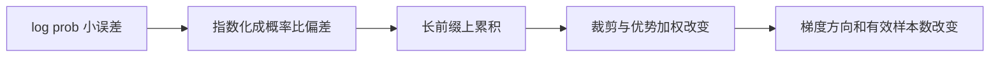

# 第八章　模型后训练

[返回目录](../README.md)

> 这一章是 [π 工坊](https://pi.duanjl.com/)第 08 站“回炉重造”的深入版。默认你已经玩过这一站的三个任务：[▶ 8-1 平的](https://pi.duanjl.com/#/play/8-1) · [▶ 8-2 涨得真好](https://pi.duanjl.com/#/play/8-2) · [▶ 8-3 满分](https://pi.duanjl.com/#/play/8-3)，也翻过[第 08 站的手册](../manual/08-training.md)。手册讲“游戏里看到了什么”，这一章讲原理、取舍，以及 Pi 在训练这件事里能出什么力。

## 阅读路线

| 手册里的零件 | 本章接着讲什么 | 去哪一节 |
| --- | --- | --- |
| [四个阶段各补什么](../manual/08-training.md#c-stages) | 模型为什么是一个概率分布；loss masking；中期训练的两类缺口与回放；LoRA | [8.1](#t-tr-stages) |
| [SFT 记忆，RL 泛化？](../manual/08-training.md#c-sft-rl) | 两种优化目标的差别：覆盖式与寻峰式；在线反馈的三个机会；SFT 数据从哪来 | [8.2](#t-tr-sft-rl) |
| [先别急着动模型](../manual/08-training.md#c-when-train)、[毛病在 Harness，就别去训练模型](../manual/08-training.md#c-layers) | 决策顺序与选择门槛；逐层归因在 Pi 里每一层看哪里 | [8.3](#t-tr-when) |
| [能力探针](../manual/08-training.md#c-probe)（8-1）、[格式解析率与冷启动](../manual/08-training.md#c-format) | 组内优势为什么会消失；pass@k 的算术；探针协议；用 Pi 跑一次探针 | [8.4](#t-tr-probe) |
| [采样和训练算出来的概率对不上](../manual/08-training.md#c-logprob) | GRPO 一步的四个动作、PPO 与 DPO；online 与 on-policy；数值失配的放大链 | [8.5](#t-tr-step) |
| [太仁慈的模拟器](../manual/08-training.md#c-simulator)、[训练和评估要隔开](../manual/08-training.md#c-isolation) | 环境保真度；让模型扮演环境；环境工程的顺序；多轮信用分配与反馈 token 屏蔽 | [8.6](#t-tr-env) |
| [隐藏验收](../manual/08-training.md#c-reward)（8-2）、[钻漏洞，和猜考官](../manual/08-training.md#c-seeking) | 奖励设计三个维度；为什么要挂在模型够不着的事实上；在 Pi 里把验收挂在“准备收工”那一刻 | [8.7](#t-tr-reward) |
| [路径审计](../manual/08-training.md#c-path)（8-3） | RLVP 的公式、四条原则与可达性；和执行边界、可信根的分工；在 Pi 里收集路径信号 | [8.8](#t-tr-path) |
| [数据与环境，比算法重要](../manual/08-training.md#c-efficiency) | 样本效率为什么低；在轨蒸馏与自蒸馏；Prompt 蒸馏与 CoT 蒸馏 | [8.9](#t-tr-efficiency) |
| [过早结束与过度矫正](../manual/08-training.md#c-overcorrect) | 第七章的评估数据怎样变成训练数据；三个问题案例 | [8.10](#t-tr-cases) |
| 这一站“哪里是真的”那张表 | Pi 不训练模型，它能提供原料和练习场：会话轨迹、工具、钩子 | [8.11](#t-tr-pi) |

本章以 Pi 0.87.1、固定提交 `f07218c4d4bbc12bef056a7058c3dd49dfe41abe` 为依据，沿用全书的三个标记：**【内建】** 是这个版本直接提供的行为，**【扩展】** 是能用 Pi 的接口实现、但要自己写代码，**【建议】** 是一般工程选择，Pi 没有替你完成。

原书观点出自李博杰《深入理解 AI Agent》第 8 章，下文简称“原书”。

先把话说在前头：**Pi 不训练模型。** 它没有训练接口，没有梯度，也不保存训练需要的某些数字（8.5 会讲是哪个）。前七章每一节都能落到 Pi 的源码上，这一章做不到。Pi 能出力的地方有两处：它的会话文件是现成的**训练原料**，它的工具、扩展钩子和 SDK 可以搭成**练习场**。这两处在各节里顺手点一下，8.11 再统一讲清。其余部分照实讲原书的思路。

贯穿全章的是一个小场景。你们团队在 Pi 里接了一个自己用 vLLM 部署的开源模型，用了一个月，攒下四条抱怨：

| 编号 | 抱怨 |
| --- | --- |
| A | 它不懂公司内部的订单协议，订单号的格式都写不对 |
| B | 让它按 JSON 调内部工具，它总在 JSON 前后加两句客气话 |
| C | 修 bug 没跑测试就说“已完成” |
| D | `edit` 改带反斜杠的那几行，十次有七次报“没找到” |

老板的意见很干脆：“那就训一下吧。”这一章要回答的是：四条里哪条该训、该用哪种训法、训之前要先量什么，以及哪条根本不该去动模型。

---

<a id="t-tr-stages"></a>

## 8.1 一个概率分布，四次调整

### 模型输出的是一张概率表

理解后训练，先抓住原书反复强调的一句：**模型的输出本质上是一个概率分布。** 给它“中国的首都是”，它并不“知道”答案，它给词表里每个词一个概率，“北京”的概率很高，“上海”低一些，“香蕉”几乎为零。所谓训练，就是调这张表：想要的词概率调高，不想要的调低。

原书把模型能力的开发拆成四个环节，它们的区别只在两处：**想要什么**，以及**用什么信号说出“想要”**。原书的比方是：预训练是通识教育，中期训练是集中研修专业教材，SFT 是老师示范答题，RL 是自己下场做题、按得分复盘。

| 阶段 | 数据 | 优化目标 | 学到什么 | 原书给的典型代价 |
| --- | --- | --- | --- | --- |
| 预训练（Pre-training） | 海量互联网文本 | 预测下一个词 | 语言规律、世界知识、基本推理 | 数百万到数千万美元 |
| 中期训练（Mid-training） | 目标语言、领域、能力语料，加通用保留数据 | 继续预测下一个词，通常对全部 token 算损失 | 补领域知识和基础能力 | 中到高 |
| 监督微调（SFT） | 几千到几万条“输入—输出”示范 | 预测下一个词，只在回答上算损失 | 指令遵循、格式、风格、流程 | 几小时到几天 |
| 强化学习（RL） | 任务、环境、奖励信号 | 最大化期望奖励 | 策略：同样会做的几种做法里，哪种更常用 | 常是 SFT 的几十到上百倍 |

### 预训练：读完图书馆，却不会答题

预训练的任务简单到让人意外：给一段文字的前半截，猜下一个 token（Next Token Prediction）。猜错了，按差距（损失，loss）调参数。在几万亿 token 上反复猜，模型被迫学会语法、事实和基本推理，因为没有别的捷径能一直猜对。

可预训练完的模型不好用。原书的例子：你问它一个问题，它可能接着写出更多问题，因为互联网上一个问题后面常常跟着另一个问题。它学会了文本的规律，没学会“被提问就回答”这个**协议**。

### SFT：同一个任务，换了数据

原书要读者打通的第一个认知是：**SFT 和预训练在数学上是同一个任务**，都是预测下一个词、最小化同一个损失函数。区别只有两处：

1. 数据换成了“用户提问 → 理想回答”的示范对。
2. **损失只算在回答上**，叫 loss masking（损失屏蔽）。

第二条用一个样本看最清楚。下面每个方块是一个 token，打勾的才参与算损失：

```text
[用户] 订 单 号 怎 么 写 ？ [助手] 格 式 是 PO- 加 八 位 数 字 。
  ✗    ✗  ✗  ✗  ✗  ✗  ✗  ✗    ✗    ✓  ✓  ✓  ✓   ✓  ✓  ✓  ✓  ✓  ✓
```

我们不想让模型学“怎么提问”，只想让它学“怎么回答”，所以问题那半截的梯度被屏蔽掉。这个小动作在 8.6 还会出现一次：多轮工具轨迹里，**环境返回的 token 也要屏蔽**。

SFT 的目标是“让示范回答里每个 token 的概率尽量高”，也就是尽量复现示范。原书据此给了一句定位：**用极高的样本效率，把稳定的“输入→输出”映射与协议固化进参数。** 它擅长的是格式、风格、流程这类协议性知识（该怎么说、怎么做），不擅长大量事实性知识（知道什么）。噪声也一样：示范里的每一处错，SFT 都会忠实地写进参数。

### 中期训练：通用教材里没有的章节

抱怨 A 是另一种缺口。模型没见过这套内部协议，不是“不会按格式说”，是“不知道”。原书把这类问题交给**中期训练**（Mid-training，也叫继续预训练 CPT，或按领域、任务细分成 DAPT、TAPT）：从已有的基础模型出发，沿用预测下一个词的目标，把数据收窄到目标领域，对全部 token 算损失。

它补两类缺口：

| 缺口 | 原书的例子 |
| --- | --- |
| 知识缺口 | 目标语言、金融医疗法律领域、企业内部文档、某类代码库没被通用语料覆盖好，连术语都不懂 |
| 基础能力缺口 | 目标任务需要的长上下文、代码模式、数学推导、跨模态表征还没形成；采样再多次也几乎得不到正确解 |

为什么不用 SFT 灌知识？原书的解释是：几百条问答只覆盖有限的问法，模型容易**记住问法，而不形成能广泛调用的知识**。反过来，中期训练降低了领域文本的损失，也不保证知识能被问答式地取出来，所以稳健的配方通常是：中期训练吸收知识，小规模 SFT 教它怎样回答，有了非零成功率再上 RL。

中期训练有两个代价必须提前想好：

- **灾难性遗忘**（catastrophic forgetting）。原书的实验 8-5 用 Mistral 7B v0.3 加韩语维基继续预训练，数据约 80% 韩语、20% 英语（原书说这只是该实验的选择，不是通用默认值），再做韩语 SFT。韩语盲评改善了，英语能力下降了。
- **会变的事实不该写进权重。** 需要频繁更新、引用出处、控制权限或删除的事实，走第三章的 RAG。

原书给中期训练的数据构造列了五步：**从失败分布反推数据**（确认低 pass@k 来自哪类缺口，别把格式错误误诊成知识不足）；**构造高密度目标语料**（去重、过滤、查评估集污染）；**按能力配比**（自然长文本、思维链数据、Agent 执行轨迹）；**双重回放**（原始短文本和通用数据保住旧能力，“长度提升后的旧任务”检验会做的事放进更长窗口还会不会）；**多维门禁**（loss 之外看领域留出集、通用能力、指令遵循和 pass@k，领域升、通用降，说明配比或学习率太猛）。原书在陷阱里还点了一条：**标称窗口不等于有效窗口**，位置编码允许 128K 输入，不代表模型在 128K 上还会检索、推理和规划。

### LoRA：贯穿所有训练的省钱默认项

全参数微调要给几十亿参数都存梯度和优化器状态，显存吃不消。**LoRA**（Low-Rank Adaptation，低秩适配）冻结原权重，在旁边挂一个很小的低秩“补丁”来学，参数量约为原来的 1% 到 5%。原书汇总的几条经验：

| 经验 | 内容 |
| --- | --- |
| 挂在哪 | 所有主要权重矩阵都要挂，尤其参数最多的 MLP 层；只挂注意力层会掉点 |
| 学习率 | 最优学习率约为全参微调的 10 倍，SFT 和 RL 都成立 |
| rank | SFT 用 64 到 256；RL 每轮信息量小，8 到 32 甚至 1 就够 |
| 部署 | 一台推理服务器可以同时加载多个 adapter，做多租户 |
| 遗忘 | 原权重冻结，遗忘风险较低，但**不免疫** |

---

<a id="t-tr-sft-rl"></a>

## 8.2 SFT 记忆，RL 泛化？

### 两种目标，两种形状

SFT 最大化示范回答的概率，RL 最大化期望奖励。听起来只是换了个目标函数，落到概率分布上，形状差得很远。

一个问题往往有好几类合理回答，每一类在分布里是一个“峰”。原书的说法是：

- **SFT 是覆盖式的**（mass-covering）。它逐条学示范，倾向于把示范里出现过的每个峰都覆盖到。
- **RL 是寻峰式的**（mode-seeking）。它按奖励重新分配概率，配合常见的反向 KL 约束，更容易把概率集中到少数高奖励的峰上。

```text
示范里有三种写法：      SFT 之后：              RL 之后（奖励只认 B）：
  A    B    C            A    B    C              A    B    C
  ▂    ▂    ▂            ▅    ▅    ▅              ▁    █    ▁
```

最后保持多样还是收缩到少数模式，原书说取决于示范分布、奖励函数、KL 的方向与系数、熵正则和采样温度。这张图只是画个直觉。

原书还有一个比喻：**SFT 细致地学已有地图，RL 拿着奖励这枚指南针去探地图外的路线。** 地图不准、指南针不准，都会迷路。

### GeneralPoints：把 J 背成了 10

手册讲过这个实验的结论（[手册 · SFT 记忆，RL 泛化？](../manual/08-training.md#c-sft-rl)），这里补上数字的来龙去脉。GeneralPoints 是一个类似“24 点”的卡牌游戏，原书用 Llama-3.2-Vision-11B，先做 SFT 初始化让它会按格式输出，再在相同计算预算下分别继续 SFT 和 RL（带价值网络的 PPO）。训练时 J、Q、K 都按 10 算；测试时分别按 11、12、13 算（规则变体），或者把黑色花色换成红色（视觉变体）：

| 分布外测试 | 起点 | RL 之后 | SFT 之后 |
| --- | --- | --- | --- |
| 规则变了（纯文本 GP-L） | 11.5% | 15.0%（+3.5%） | 3.4%（−8.1%） |
| 花色变了（图像 GP-VL） | 23.6% | 41.2%（+17.6%） | 13.7%（−9.9%） |

原书给的解释和观察一致：有限的 SFT 数据强化了“见到 J/Q/K 就当 10”的固定模式；结果导向的 RL 更可能强化“重新计算，直到得到正确答案”的策略，J 变成 11 时照样能用。视觉变体里，RL 还改善了底层的视觉识别，SFT 反而让识别准确率下降，因为它过度拟合了思考过程里的 token 模式。

这组实验还藏着两条容易漏的结论：

1. **不经 SFT 直接 RL，在这个设定下完全失败。** 基础模型产不出结构化输出，奖励根本算不出来。这是 8.4 格式门的出处。
2. **验证迭代越多，泛化越好**：10 次 +5.99%，1 次 +0.48%。原书据此说，测试阶段多花计算是这里泛化提升的重要因素。

然后是原书在全章至少五处重申的话：**这只是受控设置下的倾向，不是 SFT 与 RL 的普遍属性。** 数据足够多样、正则得当时 SFT 也能泛化；奖励或环境有偏时，RL 一样会对捷径过拟合，8-2 和 8-3 就是两个现成的例子。

### 在线反馈给了 RL 三个机会

原书把 RL 相对固定数据 SFT 的优势，归到“在线反馈”带来的三个机会上：

| 机会 | 意思 | 原书的提醒 |
| --- | --- | --- |
| 评估示范之外的候选 | SFT 只能学数据里写下来的回答；RL 能强化奖励函数能打分的新行为。实验 8-13 SimpleVLA-RL 里机器人发现了人类示范里没有的“推切”动作 | 奖励识别不了的质量学不到，探索不到的策略发现不了 |
| 利用“验证比生成容易” | SFT 要先有人写出正确答案；RL 只需要能判断对错。数学可以对答案，代码可以跑测试，证明可以交给验证器 | 验证器不完整，就会被钻空子 |
| 在自己走到的状态上训练 | 离线模仿有**协变量漂移**（covariate shift）：策略一旦偏离示范，就进入数据里没有的状态，缺少恢复信号。特定的序列模仿设定下，误差最坏随轨迹长度 T 近似按 T² 累积，在线数据聚合可降到约 T | 8.9 的在轨蒸馏把这一点和 SFT 的密集监督结合起来 |

原书还顺带指出：**后训练会塑造模型“何时行动”。** 同一个中性的 Coding Harness 里换模型，有的倾向先多读文件再改，有的倾向尽早改、靠测试反馈修。别把这拟人化成“谨慎”，那是参数里的策略在估计“多读一个文件”和“提交并验证”哪个预期价值更高。

RL 在大模型上跑得动，底气来自先验。原书在可选阅读里做过一个对照：一个最优解 11 步、奖励稀疏的寻宝游戏，没有先验的表格 Q-learning 前 5000 局基本不赢，约 10000 局才稳定通关；LLM Agent 第一局 18 步就通关，规则变了还能推理着适应。区别不在学习算法，在于后者带着海量的预训练先验，把搜索空间压小了；现实里每次交互都有成本，一万次试错不可接受。原书作者的强观点是：**先验 > 环境 > 算法**。

### SFT 的数据从哪来

既然 SFT 的上限由数据决定，原书给了三条来路，常常组合使用：

| 来路 | 特点 |
| --- | --- |
| 人工专家示范 | 质量天花板最高，贵而慢，适合当定义格式与风格的种子 |
| 教师模型生成 | 让强模型批量产出示范，过滤后蒸馏给学生 |
| 拒绝采样（Rejection Sampling） | 模型自己对同一题采多条候选，验证器筛出对的，再拿来训自己；这样做 SFT 叫 **RFT**（拒绝采样微调），介于 SFT 和 RL 之间，不训奖励模型，也不做策略梯度 |

原书推荐的流水线是：


几个关键点：任务蓝图要提炼的是用户意图、初始状态、可用工具、业务约束、常见失败和成功条件，**去掉身份信息后重新生成虚构的人物、订单和文件**，免得模型记住客户数据或内部凭据；能写成测试、数据库断言、状态差异的检查优先用确定性代码；数据不必贪多，数千到数万条高质量样本通常就够固化格式。原书的说法是，与其堆十万条脏数据，不如精修一万条干净的。

**失败轨迹不能直接当正确示范。** 它们可以拿来构造偏好对、发现覆盖缺口，或者补上诊断与修复后再加入训练。这一条在 8.11 把 Pi 会话变成数据时会用到。

---

<a id="t-tr-when"></a>

## 8.3 先别动模型：缺什么，补什么

### 决策顺序

回到四条抱怨。原书给这一节定的基调是：**先判断缺的是底座、协议还是策略，不要把“模型做不好”统一归因成需要 RL。** 顺序是四步：

1. **先排除不需要改权重的方案**：提示词、工具、代码约束、上下文管理能解决的，不训练；事实要频繁更新、引用或删除的，走 RAG。
2. **在留出集上测能力支持**：pass@1、pass@k、部分进展率、格式解析率，再人工审计失败原因（8.4）。
3. **用 SFT 立协议，不拿它硬塞知识库。**
4. **只在有探索空间时上 RL。**

原书的选择准则表，换成我们的场景来读：

| 观察到的现象 | 主要缺口 | 优先方法 | 进入下一阶段的门槛 |
| --- | --- | --- | --- |
| 领域概念、语言或基础操作不会；合理采样下 pass@k 仍接近 0 | 知识和能力不在基础模型的有效支持里 | 中期训练；动态事实用 RAG | 领域留出集改善，通用保留集可接受，开始出现可验证的正确或部分正确轨迹 |
| 偶尔能做对，但格式、工具 schema、语气或固定流程不稳 | 行为协议没有固化 | SFT 或约束解码 | 解析成功率稳定，关键动作能被验证器可靠评分 |
| 已有非零成功率和可靠奖励，但好策略概率低、长程决策或分布外泛化不足 | 概率质量的分配 | RL | 奖励和真实目标一致；一组 rollout 里有足够的奖励差异；独立测试集随训练改善 |
| 只有少量稳定示范，没有可交互的环境 | 有可模仿的数据，没有在线反馈 | SFT、RFT、离线偏好优化 | 先建基线和评估，再判断值不值得建 RL 环境 |

这不是要求每个项目依次跑完三种训练，原书特别说明：强基础模型可能直接进 RL，格式型任务可能只要 SFT，稳定的领域知识可能只做中期训练。关键是每一步都有可测的进入条件。

把四条抱怨过一遍，第一步就能筛掉一大半：

| 抱怨 | 先试的不训练方案 | 真到要训练时，缺的是什么 |
| --- | --- | --- |
| A 内部协议不懂 | 协议文档做成 Skill（第二章），或者给一个校验订单号格式的工具（第四章） | 协议庞大、互相关联、上下文放不下时，是知识缺口，找中期训练 |
| B JSON 夹客套话 | 工具 schema 写清楚；能用约束解码就用 | 协议缺口，SFT |
| C 没跑测试就说完成 | 第五章的完成闸门：说完成时由 Harness 跑验收 | 闸门拦得住一次，拦不住它每次都想收工；这是策略问题，可以 RL 或 DPO（8.10） |
| D `edit` 找不到 | 先逐层归因，见下文 | 多半根本不是模型的事 |

原书在章末给的组合图景，也是这张表背后的原则：**用 RAG 管动态事实，用 ICL（上下文学习）快速试验能用语言描述的策略，用程序固化确定性流程和硬约束，用中期训练吸收稳定的领域知识，再用 SFT 和 RL 塑造难以由外部规则完整表达的行为。** 判断依据不只是任务稳不稳定，更重要的是**能力能不能被外部符号充分表达**。原书举的两头：医疗影像识别、自然的语气，领域再怎么变也往往需要参数更新；长期稳定的转账审批规则，反倒应该由代码保证，不能只靠模型记忆。

<a id="t-tr-layers"></a>

### 逐层归因：抱怨 D 该算在谁头上

抱怨 D 是原书第三个问题案例的翻版。编辑工具按字符串匹配 `old_string`，差一个空格、换行、反斜杠、Unicode 组合字符都会失败，看起来像模型抄不准。原书要求沿整条链路逐层比对，**哪一层先变，就归哪一层**：


| 先变的那一层 | 归给谁 |
| --- | --- |
| 读文件或工具返回时字节已经变了 | 工具 |
| 序列化、转义、提示拼装改了内容 | Harness |
| tokenizer 编码再解码就变了 | tokenizer |
| 模型收到的上下文和原文一字不差，而模型输出是**第一个**出现差异的位置 | 模型的精确复制能力，这才是后训练候选 |

原书确认是模型的问题之后，才做了训练：以 Qwen3-8B 为基座，bf16 LoRA 训 2 个 epoch，训练任务有三种（逐字复述；在相似且等长的几个字符串里选出完全相同的那个；把指定字符串完整抄进 `old_string` 的 JSON 参数），只对目标字符串提供逐 token 监督。逐字节精确复制的准确率从基座的 37.5% 升到 78.9%，独立边界集上 80.1%。另做的 tokenizer 审计显示，Qwen3 和 Qwen2.5 的 tokenizer 无损往返本身也只有 80.1%。**所以 80.1% 同时是模型复制和 tokenizer 的上限，剩下那点不能算到模型头上。**

落到 Pi 上，这条链路的大部分层都有地方可看：

| 层 | 在 Pi 里看哪里 | 标记 |
| --- | --- | --- |
| 工具返回 | 会话文件里 `role: "toolResult"` 的消息，原样记着工具交给模型的内容（[ToolResultMessage](https://github.com/earendil-works/pi/blob/f07218c4d4bbc12bef056a7058c3dd49dfe41abe/packages/ai/src/types.ts#L539)） | 【内建】 |
| Harness 序列化、模型上下文 | 监听 `before_provider_request`，把真正发给模型服务的请求体落盘。官方示例 [provider-payload.ts](https://github.com/earendil-works/pi/blob/f07218c4d4bbc12bef056a7058c3dd49dfe41abe/packages/coding-agent/examples/extensions/provider-payload.ts#L6) 就是这么做的 | 【扩展】，示例现成 |
| 模型输出 | 会话文件里 `role: "assistant"` 的消息，带着工具调用参数（[AssistantMessage](https://github.com/earendil-works/pi/blob/f07218c4d4bbc12bef056a7058c3dd49dfe41abe/packages/ai/src/types.ts#L515)） | 【内建】 |
| JSON 解析、参数校验 | `prepareArguments` 和 schema 校验，见[第四章 4.4](04-tools.md#t-tool-fidelity) | 【内建】 |
| 工具匹配 | `edit` 先精确、后宽松的两步匹配，见[第四章 · Pi 的 `edit`](04-tools.md#t-tool-fuzzy-edit) | 【内建】 |
| tokenizer、chat template | 在模型服务那一侧，Pi 看不到；要在 vLLM 那边单独审计 | 【建议】 |

有一处值得多想一步。Pi 的 `edit` 在精确匹配失败后会退到宽松匹配，把弯引号、破折号、特殊空格、行尾空白这类常见的抄写偏差先在 Harness 里吸收掉。所以你在 Pi 里统计到的“`edit` 找不到”，已经是**被 Harness 宽容过一遍之后**的失败率；拿它去和别的 Harness 下的数字比、或者当成模型复制能力的度量，都会失真。反斜杠不在宽松规则里，抱怨 D 恰好落在宽容的盲区，更该先查 JSON 转义那一层（第四章 4.4 讲过，模型想写一个反斜杠，JSON 里得写两个）。

原书这一案例给 Harness 设计师的启发很朴素：训练很贵，Harness 便宜，毛病在哪一层就修哪一层。

---

<a id="t-tr-probe"></a>

## 8.4 能力探针：有没有东西可学

### 为什么一组全零就学不到

8-1 的事故是“一批轨迹全是零分”（[手册 · 先测能力，再谈训练](../manual/08-training.md#c-probe)）。手册用“减去平均分”算过一次优势，这里把它说完整。

GRPO 这类算法对同一个任务采一组 rollout，用组内比较给每条轨迹一个“相对优势”。常见的实现在减去组内均值之后，还会除以组内标准差（这一条是本书补充的通用做法，不出自原书）。原书的例子是 16 条里成 4 条，按这种做法算一遍（本书现算）：

| | 奖励 | 减去均值 0.25 | 再除以标准差约 0.433 |
| --- | --- | --- | --- |
| 成功的 4 条 | 1 | +0.75 | 约 +1.73 |
| 失败的 12 条 | 0 | −0.25 | 约 −0.58 |

16 条全是 0 时，均值是 0，每条减完都是 0，标准差也是 0，实现里通常直接把优势记成 0。**全 1 也一样。** 原书把这叫组内优势消失：大家奖励相同，比不出谁更好。8-1 是全零组，8-3 是它的镜像全满组，8.8 会看到路径信号怎样把全满组救回来。

PPO 不靠组内比较，可原书指出，全零奖励下它也看不到“该往哪里移动”的正向样本。换算法救不了这一局。

### pass@k：分布里到底有没有

能力探针量的是 pass@k：在留出的任务上，用与训练相近的温度采样 k 次，至少成功一次的概率。单次成功率为 p，近似独立采样时：

$$
\text{pass@}k = 1-(1-p)^k
$$

拿几个 p 算一算（本书按公式现算），顺带算出每步 16 条的一组里“全是零”的概率 (1−p)¹⁶：

| 单次成功率 p | pass@16 | pass@64 | 一组 16 条全零的概率 |
| --- | --- | --- | --- |
| 20% | 约 97% | 约 100% | 约 3% |
| 5% | 约 56% | 约 96% | 约 44% |
| 1% | 约 15% | 约 47% | 约 85% |
| 0.1% | 约 2% | 约 6% | 约 98% |

这张表说清了两件事。第一，p 在 5% 上下时，RL 有东西可放大，但每步仍有四成多的组是全零，白白浪费；这时加大每组采样数、给部分奖励是有道理的。第二，p 到了 0.1% 这个量级，加采样只能以约 1/p 的速度等偶然的成功。原书的原话大意是：**这种效率会迅速失去实际意义。** RL 擅长把“已有但概率低”的成功推高，不擅长从全零奖励里凭空造出模型没学过的知识和能力。

所以 pass@k 的读法是：

| pass@k 的样子 | 说明什么 | 下一步 |
| --- | --- | --- |
| pass@1 低，pass@k 随 k 明显上升 | 正确做法在分布里，只是概率小 | RL、拒绝采样、蒸馏都有东西可放大 |
| 合理的 k、温度和任务覆盖下，pass@k 仍接近 0 | 基础模型几乎生成不出成功轨迹 | 看失败缺什么：缺知识补中期训练；会做但说不利索先 SFT；能局部前进但到不了终点，加可验证的部分奖励或课程 |

第七章里 pass@k 是“能力上限”，偏乐观，不适合决定上不上岗（见[第七章 7.3 成功的两种口径](07-evaluation.md#t-eval-passk)）。到了训练场，这个乐观的上限正好是要问的问题。

### 探针协议：一个数不够

原书给的诊断是一组量，缺一不可：

| 测什么 | 回答什么 | 抱怨里的例子 |
| --- | --- | --- |
| pass@1、pass@k | 有没有东西可放大 | C：修 bug 的任务，64 次里有几次真的修好 |
| 格式解析率 | 奖励函数能不能读懂它的输出 | B：JSON 前后的客套话让解析失败 |
| 部分进展率 | 没做成的走到了哪一步 | A：卡在第一步（订单号），还是卡在最后一步（提交） |
| 人工审计失败轨迹 | 卡在知识、格式，还是策略 | 8-1 的“连订单号的格式都写不对”就是这一栏的产物 |

几条纪律：任务来自**留出集**；**采样配置固定**且和训练时相近，贪心解码量出来的 pass@1 说明不了探索空间；先用少量 rollout 检查“任务可完成、验证器能区分对错”，再扩大规模。

<a id="t-tr-format"></a>

### 格式门与冷启动

RL 有两个前提：**输出能被验证（格式）**，以及**策略偶尔能成功（能力）**。抱怨 B 卡在第一个前提上：奖励函数要解析 JSON，模型偏要在前后说客气话，解析失败，奖励算不出来，曲线和 8-1 一样是平的，病因却完全不同。所以格式解析率要单独量。

解法通常是先用少量 SFT 把格式立住，这叫**冷启动**（cold start），或者用约束解码直接限制输出形状。原书给了两头的例子：

| 情形 | 结果 |
| --- | --- |
| Llama-3.2-Vision-11B，严格结构化输出，不经 SFT 直接 RL（实验 8-11） | 完全失败，奖励算不出来 |
| 足够强、已有非零成功率的基础模型（DeepSeek-R1-Zero） | 可以跳过 SFT 直接 RL |

R1 后来补的冷启动 SFT，原书说主要是为了可读性和语言一致性，不是为了注入任务知识。另外，原书在陷阱里专门提醒：**可接受的解析失败率取决于任务和奖励设计，不该把固定阈值当成普遍标准**，先用小规模评估定门槛。

### 用 Pi 跑一次探针

**【扩展】** Pi 不提供探针，但跑探针需要的零件都在。思路是：每次在一份全新的工作区副本里起一个不落盘的会话，让模型做一遍任务，结束后用程序判分。

- 被测模型：Pi 可以通过 `models.json` 接 vLLM、SGLang 等兼容服务（[模型配置说明](https://github.com/earendil-works/pi/blob/f07218c4d4bbc12bef056a7058c3dd49dfe41abe/packages/coding-agent/docs/models.md#L43)），这正是训练框架通常用来采样的引擎。
- 不落盘的会话：SDK 的 `SessionManager.inMemory()`（[SDK 说明](https://github.com/earendil-works/pi/blob/f07218c4d4bbc12bef056a7058c3dd49dfe41abe/packages/coding-agent/docs/sdk.md#L48)）。
- 采样温度：Pi 核心没有温度设置项；`before_provider_request` 可以替换请求体（[事件定义](https://github.com/earendil-works/pi/blob/f07218c4d4bbc12bef056a7058c3dd49dfe41abe/packages/coding-agent/src/core/extensions/types.ts#L714)），provider-payload 示例的注释里就演示了改 `temperature`。要和训练时的采样配置对齐，就在这里固定。

下面是**示意伪代码**，`freshWorkspace`、`verify` 和 `classifyFailure` 要你自己写，`verify` 读的是工作区里的真实状态：

```js
// 伪代码：同一个任务做 k 遍，统计成功、格式和失败原因。
import { createAgentSession, SessionManager } from "@earendil-works/pi-coding-agent";

async function probe(task, k) {
  const results = [];
  for (let i = 0; i < k; i++) {
    const cwd = await freshWorkspace(task);            // 每次一份干净副本
    const { session } = await createAgentSession({ cwd, sessionManager: SessionManager.inMemory() });
    await session.prompt(task.prompt);
    results.push({
      ok: await verify(task, cwd),                      // 读文件、跑隐藏测试，不看模型怎么说
      failure: classifyFailure(session.messages),       // 解析失败？卡在第几步？
    });
    session.dispose();
  }
  return results;
}
```

这段代码的价值在最后那两个字段：`ok` 给出 pass@k，`failure` 给出格式解析率和部分进展。人工审计时，再把 `session.messages` 存下来一条条读。

---

<a id="t-tr-step"></a>

## 8.5 一步训练里发生了什么

### GRPO 的四个动作，和一笔时间账

原书用一个 SWE-bench 式的任务讲 GRPO（Group Relative Policy Optimization）：某 Python 项目的 `parser.py` 在空输入时抛 `IndexError`，要求修好，且不许改测试。

| 步 | 做什么 | 这一步的细节 |
| --- | --- | --- |
| 1 采样 | 同一份代码、同一条问题描述复制进 16 个隔离沙箱，各做一遍；每一遍“读码 → 改文件 → 跑测试 → 提交”叫一次 rollout | 16 次可能走出不同的路：补边界检查、只捕获异常掩盖问题、改错文件、试图改测试 |
| 2 奖励 | 验证器在干净环境里应用补丁、跑测试 | 4 条通过且没改测试，得 1；12 条得 0 |
| 3 优势 | 组内比较，高于平均为正，低于平均为负 | 全成或全败，优势消失 |
| 4 更新 | 优势转成损失，算梯度，优化器（如 AdamW、Muon）更新参数 | 背下的不是某个补丁；“先复现、查边界、改实现、跑测试”会更常出现 |

四步合起来叫一个 **step**。原书提醒，不同训练框架可能把内部的多个 minibatch 更新另行计数，看日志前要先确认 `step` 的定义。时间账是原书估的：复杂 Agent 的一次 rollout 有几十轮工具调用，16 条并行，墙钟时间由最慢的那条决定，假设约 2000 秒；梯度和优化器更新约 600 秒；一步约 43 分钟，100 步接近 72 小时。原书在思考题里还专门问了长尾：一批里绝大多数 rollout 已经结束，却要等那几条最长的，集群 GPU 在空等。

另外两个常见名字，区别主要在“拿谁来比较”：

| 算法 | 比较的对象 | 适合 |
| --- | --- | --- |
| GRPO | 同一问题的多条 rollout，不要价值模型 | 结果可验证的任务；本章 SimpleVLA-RL、RLVP 用它 |
| PPO | 训一个价值模型，估计每一步“通常能做到多好” | 需要细粒度信用分配的长轨迹；GeneralPoints、V-IRL、ReTool 用它 |
| DPO | 事先收集好的“较好—较差”偏好对，不在线生成 | 有离线偏好数据时；8.10 的过早结束案例用它 |

原书的总结是：**算法决定怎样比较轨迹、怎样更新参数；奖励决定什么算成功；环境和数据决定模型能经历哪些问题。** 这一章后半部分的分量，都压在后两样上。

<a id="t-tr-logprob"></a>

### online 不等于 on-policy

两个常被混用的词，原书专门分开：

| 词 | 意思 |
| --- | --- |
| online（在线） | 数据在训练过程中不断和环境交互产生 |
| on-policy（在轨） | 生成 rollout 的行为策略 μ，和当前要优化的策略 π_θ 相同或足够接近 |

异步集群即使一直在线生成，只要 rollout worker 落后了几个 checkpoint，数据就已经带了 off-policy 成分。回放旧轨迹、用旧模型或教师生成的数据，更是明显的 off-policy。

数据如果来自另一个策略，就要用**重要性比率**纠正：

$$
\rho_t=\frac{\pi_\theta(a_t\mid s_t)}{\mu(a_t\mid s_t)}=\exp\big(\log\pi_\theta(a_t\mid s_t)-\log\mu(a_t\mid s_t)\big)
$$

直觉上，ρ 问的是“这个 token，现在的模型比当初采样它的模型更愿意还是更不愿意说”。真正新鲜的 on-policy rollout，在参数更新**之前**应该满足 π_θ = μ，ρ 恰好是 1。PPO 的裁剪（clipping）限制 ρ 离 1 太远时的更新幅度，原书强调它**能限制离群更新，却不能无损恢复丢失的分布覆盖**：裁得太多丢梯度，不裁又会被少数样本主导。

### 同一份权重，算出两个概率

大规模 RL 通常用 vLLM、SGLang 一类推理引擎采样，再用 FSDP、Megatron 一类训练框架重算 log prob 和梯度。原书指出，两边加载同一份权重，也会因为浮点精度、加法的归约顺序、张量并行方式、批大小、KV cache 和融合算子不同，给同一个 token 算出略有不同的 log prob。于是更新前本该是 1 的 ρ 已经偏了：**名义上同步了权重，数值上 on-policy 变成了 off-policy。**

单个 token 差一点不要紧，麻烦在放大链：



原书的例子：4000 个 token 的 log ratio 都有同方向的 10⁻³ 偏差，轨迹级比率累积到 e⁴，约 54.6。真实误差未必同号，但它说明了长序列为什么会把“每个 token 看着很小”的误差放大。表现出来是：比率尖峰、大量 token 被裁剪、梯度或响应长度突变，接着奖励和熵一起塌。

原书给的工程清单：

| 做法 | 为什么 |
| --- | --- |
| 任何参数更新之前，用同一批轨迹比较 sampler 和 trainer 的 token log prob，监控 ρ 的均值、分位数、最大值、近似 KL 和被裁剪比例 | 这是最直接的 on-policy 单元测试 |
| 同步的不只是权重，还有 LoRA adapter、tokenizer、chat template、模型版本和位置编码配置 | 任何一样不同，两边算的都不是同一个分布 |
| rollout 保存**生成时**的 behavior log prob，不能事后拿当前模型冒充 | 事后重算就把 μ 和 π_θ 混成了一个 |
| 尽量对齐精度、并行布局和关键算子；做不到，就明确按 off-policy 处理并监控有效样本数 | 别假设裁剪会自动兜底 |
| 保持 rollout 新鲜，限制每批数据上的更新轮数和异步落后程度 | 复用旧数据换吞吐，是要量过的取舍 |

**Pi 这里有一个必须知道的空缺。** 固定版本的 Pi 在消息类型里没有任何 log prob 字段，助手消息记的是内容、模型名、用量和停止原因（[AssistantMessage](https://github.com/earendil-works/pi/blob/f07218c4d4bbc12bef056a7058c3dd49dfe41abe/packages/ai/src/types.ts#L515)）。所以：

- Pi 的会话文件**不能直接当 on-policy RL 的回放**。它缺 μ，算不出 ρ；最多当 off-policy 数据，用在 SFT、RFT、DPO 这类不需要行为概率的方法上。
- 拿 Pi 当 rollout 外壳时，behavior log prob 要在采样服务那一侧取、那一侧存，并和 Pi 的会话按请求对上号（【建议】）。
- chat template 的渲染也发生在服务那一侧（[第二章 · Chat Template](02-context.md#t-ctx-template)）。trainer 重算概率时用的模板，必须和服务渲染时的一模一样。

---

<a id="t-tr-env"></a>

## 8.6 环境：练习场和考场

### 环境一失真，策略就失效

原书开这一节的判断很重：**RL 的瓶颈往往不在算法，而在环境是否足够真实、可重置、可并行。** 真实的电话、付款、文件修改有成本、有副作用、不可逆，不能靠无限重试来弥补一次错误；真实 API 有速率限制，还会封号。于是要造一个稳定、可控、可重放的“影子世界”。

环境一失真，策略就失效：仿真里的客服总按固定套路回话、错误信息和生产对不上，模型就学到一套只在仿真里管用的“应试策略”。原书说这是 RL 项目**最常见的失败方式**，练习场和考场不一样；而高保真环境常常比训练本身更贵、更难。环境的另一半是奖励函数（8.7）。原书的忠告是一句问话：**动手调算法之前，先问自己，我的仿真环境真的像真实世界吗？**

<a id="t-tr-simulator"></a>

### 造不出环境，就让模型扮演环境

有些环境不是贵，是根本造不出来：真实用户不能拿来试错，物理世界没法快进。原书介绍了一条越来越主流的路：让一个 LLM 扮演环境。它分两个层次：

| 层次 | 做法 | 原书的例子 |
| --- | --- | --- |
| 合成工具返回值 | 模型发出搜索词，由一个“模拟引擎”生成检索结果 | ZeroSearch：训练初期返回高质量、强相关的文档，随训练逐步掺噪声；训练全程没见过真实搜索引擎，接上真的照样表现好 |
| 仿真整个环境动态 | 给定状态和动作，推出下一个状态和反馈 | DreamGym 的“经验模型”；客服、销售类 Agent 普遍用 LLM 扮演用户，τ-bench 系列就建在这个思路上 |

ZeroSearch 的课程设计值得单独记一笔：**先仁慈，再逐步变差。** 一开始就给垃圾结果，模型学不会搜索；一直给好结果，模型学不会从垃圾里挑。这和手册里斯金纳的鸽子是同一个道理：先奖励能做到的，再把标准往真实那边推。

这条路的风险，原书说得毫不含糊：**模拟器的世界知识就是训练的天花板，它的系统性偏差会被策略照单全收。** 模拟的客户比真人耐心、模拟的搜索引擎从不返回垃圾，学到的就是只在“模型扮演的世界”里成立的策略。更糟的是 RL 会主动找模拟器的漏洞去钻。原书思考题 13 问的就是：钻空子的对象从“真实环境的规则”换成了“模拟器的偏见”，会出现哪些具体的 reward hacking？稳妥的做法是**混合**：模拟承担大部分交互量，辅以真实交互，并用真实交互定期校准模拟器。

<a id="t-tr-isolation"></a>

### 环境工程的顺序，与训练评估隔离

原书给的顺序是：**任务蓝图 → 可重置模拟器 → 确定性验证器 → 训练与评估隔离 → 少量真实交互校准**。隔离这一步，RL 比 SFT 多一条规矩：**训练环境和评估环境可以共享任务生成器和验证代码，但不能共享同一批任务。** 测试用例、隐藏状态和参考解留在验证器那一侧。训练集还要按任务模板、客户或时间段去重划分。这正是第七章“防止背答案”搬到训练场上的样子（[第七章 · 防泄漏](07-evaluation.md#t-eval-leak)）：在那里被背的是考题，在这里模型会被练到“背过”整个任务集。原书思考题 10 追问得更深：τ²-bench 的动态参数、AndroidWorld 的参数化模板缓解了这个问题，可模板结构本身还是固定的，怎样在利用评估数据的训练价值和保持评估独立之间找平衡？这道题没有标准答案，练习 6 留给你。

还有一笔容易忽略的账：确定性验证器“便宜”不等于“没成本”。原书提到，Lean 证明检查、测试运行器、容器执行可能让 CPU 验证慢过 GPU 生成，这时吞吐取决于验证器 worker 的并行度，继续堆 GPU 没用。

16 个隔离沙箱怎么搭、隔离做到哪一层，见[沙盒专题](s-sandbox.md)。训练环境的隔离要求只会比线上更严：线上的 Agent 偶尔越界一次，训练里的策略会**系统地**去试每一条边界。

<a id="t-tr-multiturn"></a>

### 多轮：功劳算给哪一轮

单轮任务一次输入、一次奖励。Agent 是多轮的：思考、行动、观察，再思考，这正是第一章的 ReAct 循环。奖励要到很多轮之后才知道，于是有了**信用分配**（credit assignment）问题。原书的例子：客服 Agent 用 10 轮对话解决了问题、拿了好评，这份功劳归第 2 轮的精准提问，还是第 7 轮的耐心解释？

原书介绍的做法：多轮 LLM RL 通常把折扣因子设为 γ = 1；PPO 的价值网络或 turn-level 优势负责把终点反馈归到较早的动作；GRPO 把轨迹级优势均摊到生成的 token 上，长轨迹要注意信号被稀释。

接入工具之后还有一个实现细节，原书特别点名：**环境返回的 token 不是策略生成的，算策略梯度时要屏蔽，只对模型自己的思考和工具调用参数回传梯度。** 否则模型会被训练去预测沙盒输出，而不是学会使用工具。这是 8.1 那个 loss masking 在多轮里的样子。在 Pi 的会话文件里，这条边界是现成的：模型生成的内容在 `role: "assistant"` 的消息里，工具返回在 `role: "toolResult"` 的消息里，用户输入在 `role: "user"` 里。把会话转成训练样本时，**只有 assistant 消息里的 token 该打勾**。8.11 再细说。

---

<a id="t-tr-reward"></a>

## 8.7 奖励：挂在模型够不着的事实上

### 三个维度

8-2 的学徒学会了说“已完成”，因为奖励挂在这句话上（[手册 · 奖励什么，就学到什么](../manual/08-training.md#c-reward)）。原书把奖励设计拆成三个互补的维度：

| 维度 | 选项 | 原书的取舍 |
| --- | --- | --- |
| 来自哪里 | 规则可验证（RLVR）；人类偏好训出的奖励模型（RLHF）；生成式奖励模型（GRM），先给诊断再给分 | 规则可验证最可靠、最便宜、可复现，也最难钻空子；RLHF 的奖励模型只是偏好的代理，过度优化会被钻，通常要用 KL 正则把策略锚在 SFT 模型附近；GRM 更透明，但仍要抽样人工校准 |
| 什么时候给 | 结果奖励（ORM），结束时判；过程奖励（PRM），中间步判 | 先用结果奖励建可靠基线，再只为**真正可验证的中间事件**加过程信号 |
| 表达多少信息 | 标量、半标量（先理由后分数）、向量（准确、完整、成本、安全分开打）、生成式诊断 | 有确定答案或测试，用二元标量；多个独立目标用向量或加权；开放式任务用生成式诊断，配事实校验和人工抽检 |

时机这一维，原书拿两个机器人与导航实验做了对照：V-IRL 用逐步的导航反馈，密集信号换来收敛速度；SimpleVLA-RL 只给成功或失败，每个任务只用一条演示做 SFT 冷启动，RL 把成功率从 17.3% 提到 91.7%，还发现了示范里没有的动作。**最优路径未知时，稀疏的结果奖励反而保留了更大的探索空间。** 过程奖励的代价是把模型限制在设计者预设的路径上，标注和验证也更贵。

信息量这一维，原书有一句值得抄下来的话：**每增加一个评价维度，就增加一种被策略钻空子的可能。** 先确认一个信号能在少量 rollout 里产生有意义的组内差异，再决定要不要加进训练。

### 第七章的验证器，就是这里的奖励函数

8-2 的“隐藏验收”和第七章造的验证器是同一种东西（[第七章 7.5 验证器](07-evaluation.md#t-eval-verifier)）。原书在本章开头就说，第七章的评估环境为训练提供练习场，评估指标为训练定义目标。两处的区别只在用途：

| | 第七章：评估 | 第八章：训练 |
| --- | --- | --- |
| 验证器的输出拿来做什么 | 打分、出报告、决定上不上线 | 当奖励，直接改参数 |
| 验证器有漏洞会怎样 | 分数虚高一次 | 策略被**系统地**推向漏洞 |
| 对验证器的要求 | 可靠 | 可靠，而且要经得住几百步的针对性优化 |

第二行是这一节的要害。原书的话是：如果验证器本身有系统性偏差，RL 只会更快地利用它。评估里一个小漏洞是噪声，训练里同一个漏洞是梯度方向。挂奖励之前，手册给了三句自查：分数是不是模型自己说了算；检查读的是真实状态还是模型的文字；模型够不够得着这套检查。原书对长程任务的要求，就是这三句的结论：**“是否完成”的判定，要交给模型写不了的隐藏测试、状态断言或外部终止钩子**，不能依赖模型自己声称完成。

<a id="t-tr-seeking"></a>

### 钻漏洞与猜考官

原书区分了两种“分数高、事没办成”：

| | 奖励投机（reward hacking） | 奖励揣测（reward seeking） |
| --- | --- | --- |
| 怎么回事 | 钻规则或实现的漏洞拿高分 | 在心里建一个“评判器会看什么”的模型，按猜测调整行为 |
| 典型样子 | 改测试文件；只看回复长度时就写冗长的废话 | 不篡改什么，只是自设一个过于简单的检查，刚好通过就提前收工 |
| 交付物 | 满足奖励的字面 | 满足代理指标，不满足真实意图 |

原书的结论是：**“通过了 grader”不能自动等价于“任务完成了”。** 评判器是意图的代理，训练越强，模型越可能把代理当成目标本身。这和经济学里那句常被引用的古德哈特定律（Goodhart's law）说的是一回事：一个指标一旦成了目标，就不再是好指标（这条旁证是本书加的，不出自原书）。

### 在 Pi 里：验收挂在“准备收工”那一刻

原书讲过渡期的做法：模型说任务完成时，Harness 在隔离的工作区运行模型看不到的验收测试，通过给正奖励，不通过给负奖励。Pi 恰好有一个对应的时刻。

**【内建接口，验收要自己写】** `agent_before_settle` 是一次运行在最终结束前最后一个能动手的边界：处理函数可以追加条目，也可以要求再继续一次（[事件定义](https://github.com/earendil-works/pi/blob/f07218c4d4bbc12bef056a7058c3dd49dfe41abe/packages/coding-agent/src/core/extensions/types.ts#L818)，[官方说明](https://github.com/earendil-works/pi/blob/f07218c4d4bbc12bef056a7058c3dd49dfe41abe/packages/coding-agent/docs/extensions.md#L109)）。同一个钩子，在线上和训练场有两种相反的用法：

| | 线上（第五章的完成闸门） | 训练场（隐藏验收） |
| --- | --- | --- |
| 验收没过时 | 返回 `continue: true`，把失败告诉模型，让它接着修 | **不告诉模型**，只记一个奖励 |
| 为什么 | 目的是把这一单做对 | 目的是给策略一个它没法针对的信号；告诉它检查项，它就学会针对检查项 |
| 记在哪 | 进上下文 | 进会话文件里不进上下文的 `custom` 条目，训练管线再去读 |

下面是训练场那一种的**示意伪代码**，`runHiddenTests` 要你自己实现，测试文件放在工作区之外、模型的工具碰不到的地方：

```js
// 伪代码：准备收工时跑隐藏验收，只记奖励，不告诉模型。
pi.on("agent_before_settle", async (event, ctx) => {
  const passed = await runHiddenTests(ctx.cwd);      // 读真实文件和状态，不看模型说了什么
  return {
    entries: [{ type: "custom", customType: "hidden-accept", data: { reward: passed ? 1 : -1 } }],
  };
});
```

`custom` 条目不参与模型上下文（[会话格式说明](https://github.com/earendil-works/pi/blob/f07218c4d4bbc12bef056a7058c3dd49dfe41abe/packages/coding-agent/docs/session-format.md#L162)），正好满足“学徒看不到”。“改不了”则要靠工作区隔离来保证，Pi 的扩展本身不提供隔离，见[沙盒专题](s-sandbox.md)。

---

<a id="t-tr-path"></a>

## 8.8 路径约束：奖励结果，惩罚路径

### 结果奖励看不见路

8-3 的奖励挂对了东西（回归测试真的通过），可那东西模型够得着，于是它学会了改测试（[手册 · 奖励结果，约束过程](../manual/08-training.md#c-path)）。原书的说法是：结果奖励回答“事情有没有办成”，表达不了“是否按规定办成”。改测试文件、跳过身份验证、执行破坏性命令，都能拿到表面的成功。

原书的方案叫 **RLVP**（Reinforcement Learning with Verified Penalty）：**奖励结果，惩罚路径。** 它的出发点是一个观察：真实环境通常是**非对称验证器**，检测“做了一个坏动作”便宜又可靠，证明“这一步确实朝目标前进了”却很难。于是总奖励写成：

$$
R = O + \beta\,\Phi
$$

O 是结果奖励，Φ 是由确定性规则**逐个动作**算出的路径信号（违规扣分；可验证的合规动作或可达子目标给少量部分分），β 调两者比重。两路先各自归一化再合并，免得路径信号淹没主目标。它不改 PPO 或 GRPO，只改每一步看到的奖励。原书给的实现骨架，用中文注释改写如下：

```python
outcome = verify_final_state(trajectory)              # 读最终状态，不信模型自述
path_signal = 0
for step in trajectory:
    path_signal += deterministic_path_signal(step)    # 违规扣分，或可达进展加分
reward = normalize(outcome) + beta * normalize(path_signal)
```

### 四条原则，和可达性

原书给了四条设计原则：

| 原则 | 不这样会怎样 |
| --- | --- |
| 只惩罚**具体动作**，不惩罚“不够努力” | “态度不端正”数不出来，数不出来的规则一定能被钻 |
| **结果奖励始终保留** | 只罚不奖，最安全的策略是什么都不做 |
| 每个惩罚配一条**可达的合规路径** | 合规的路走不通，罚得再狠也只能教会它放弃 |
| 规则**确定**，难钻空子 | 由另一个模型的印象判定，又多了一个可讨好的对象 |

RLVP 真正的价值，原书说不在“奖励越密越好”，在于**恢复组内差异**。回想 8.4：纯结果奖励在全败组和全胜组都是零方差，没有梯度。8-3 的二十个任务全过测试，就是一个全胜组：老实修好的和改了测试的，奖励一模一样。加上路径信号，它们重新拉开差别。

| 组的情况 | 违规惩罚 | 进展奖励 |
| --- | --- | --- |
| 全胜组 | 违规通常容易检测，几乎总能拉开差别 | 能 |
| 全败组 | 能拉开差别，但只教会“别做坏事” | 只有部分进展可达时才有用 |

所以原书说：**惩罚是通常可达的那一半，进展奖励是受可达性门控的那一半。** 基础策略根本不会采样合规动作时，先用少量示范把这条路“种”出来，合规行为稳定后再逐步减弱塑形。

原书的实验 8-16 给了三组数：TerminalBench 上违规次数从 3.71 降到 0.66，成功率基本持平；miniF2F 上，可达的部分奖励把达到 0.9 成功率所需的迭代从 7.0 降到 4.4；软件修复里，所有 rollout 都过不了任何测试时，进展信号不可达，加了也没收益。原书由此提醒：**先测信号可达性，再决定加不加奖励维度。** 原书也划了边界：这些数字来自可控的代理环境，不能直接外推到线上；RLVP 只管能被机器判定、与结果无关的约束动作，替代不了对语义意图、交付完整性和过早结束的独立检查。

### 执行边界、可信根、路径惩罚：三样都要

手册里那张“5-3 捷径、9-3 全绿、8-3 满分”的对照表，是这一站最该带走的一张。教材这里把三样东西的分工说透：

| | 第五章的执行边界 | 第九章的可信根 | 本章的路径惩罚 |
| --- | --- | --- | --- |
| 在哪一刻起作用 | 动作执行之前 | 一直在：尺子放在它够不着的地方 | 训练时，算奖励的那一刻 |
| 管的是 | 这一次别做 | 它想做也做不到 | 以后别再想做 |
| 漏了会怎样 | 一次坏动作落地 | 尺子被改，评估和奖励一起失效 | 捷径被一次次奖励，写进参数 |
| 深入 | [第五章 5.6](05-coding.md#t-code-guard) | [第九章](09-evolution.md)；[手册 · 可信根](../manual/09-evolution.md#c-trusted-root) | 本节 |

第五章说过，对已有模型，Harness 护栏是外部约束；对能训练的模型，过程惩罚把它内化。训练环境里，执行边界和可信根**照样要装**：一来防止训练中的坏动作真的伤到东西，二来被拦下的尝试本身就是 Φ 的输入。被拦了还在伸手，说明那条近路在它的分布里还没消失。

规则写得是否严密，在训练里比在线上要紧得多。第五章拆过官方示例 `protected-paths.ts` 用 `path.includes(p)` 判路径的漏洞。线上 Agent 碰巧撞上这个漏洞是小概率事件；训练里，RL 会在几百步里把每一个漏洞都试出来，然后专挑它走。

### 在 Pi 里收集路径信号

**【扩展】** Pi 的 `tool_call` 事件在每个工具真正执行前触发，可以拦截（[ToolCallEventResult](https://github.com/earendil-works/pi/blob/f07218c4d4bbc12bef056a7058c3dd49dfe41abe/packages/coding-agent/src/core/extensions/types.ts#L1217)）。拦下的调用以一条出错的工具结果回到模型，留在轨迹里。再用 `pi.appendEntry()` 把每次违规写成不进上下文的条目（[接口定义](https://github.com/earendil-works/pi/blob/f07218c4d4bbc12bef056a7058c3dd49dfe41abe/packages/coding-agent/src/core/extensions/types.ts#L1499)），训练管线按条目算 Φ。**示意伪代码**，`violates` 里的规则要逐条确定：

```js
// 伪代码：执行边界和路径审计合在一处。拦下坏动作，同时记一笔违规。
const RULES = [
  { id: "edit-eval", test: (e) => isWrite(e) && underDir(e.input.path, "eval/") },
  { id: "skip-auth", test: (e) => e.toolName === "submit_order" && !e.input.verifiedIdentity },
];

pi.on("tool_call", async (event) => {
  const hit = RULES.find((r) => r.test(event));
  if (!hit) return undefined;
  pi.appendEntry("path-audit", { rule: hit.id, toolCallId: event.toolCallId });
  return { block: true, reason: `规则 ${hit.id}：这个动作不允许` };
});
```

两点取舍。第一，`underDir` 要按规范化后的路径判断，别重蹈 `includes` 的覆辙。第二，拦截之后要不要把规则名告诉模型？线上要告诉，它才能换条路；训练里告诉它，等于给了一条“可达的合规路径”的提示，这在冷启动阶段是好事，原书说的“先种出来再撤掉塑形”就可以从这里撤。

---

<a id="t-tr-efficiency"></a>

## 8.9 样本效率：每次交互换回多少信号

即使环境、奖励都做对了，RL 还有一个硬伤：样本效率低。原书把“样本效率”定义为**每次昂贵的环境交互，能带来多少有效的参数更新**，举的 ReTool，RL 训练约 9 天，SFT 约 1 小时，200 倍以上。根子在反馈太稀疏。原书的例子：客服说“需要信用卡后四位”，模型只能从最终的 0 或 1 里反复试错，可能要几百次交互才偶然学会这一步；人听一次就记住了。中间的错误原因、缺了哪个字段、流程上的提示，都没有直接变成学习信号。

### 在轨蒸馏：学生走路，教师指路

蒸馏把一次 rollout 变成密集的监督。原书讲的**在轨蒸馏**（On-Policy Distillation）先厘清了“policy”指什么：**谁生成学生要学的那些状态前缀**，不是谁提供监督。

| 方法 | 状态由谁采样 | 每条轨迹的主要监督 |
| --- | --- | --- |
| SFT、离轨蒸馏 | 人或教师 | 标注答案的逐 token 监督，密集 |
| 在轨 RL | 当前学生 | 结果或过程奖励，通常稀疏 |
| 在轨蒸馏 | 当前学生 | 教师在学生前缀上给的逐 token 分布，密集 |

SFT 的监督密集，但只覆盖教师会走到的状态；学生早期犯了教师不会犯的错，就进入没见过的前缀，误差沿长序列累积（8.2 的协变量漂移）。RL 在学生自己的状态上训练，却只有一个终点信号。在轨蒸馏把两者拼起来：**学生决定走到哪里，教师在学生已经走到的位置告诉它下一步的完整概率分布。** 一条长度为 T 的 rollout，从一个 0/1 变成约 T 组逐 token 监督。原书的伪代码：

```python
student_trajectory = rollout(student, task)
loss = 0
for state in student_trajectory:
    teacher_logits = teacher(state)
    loss += KL(student_logits(state), teacher_logits)
update_student(loss)
```

原书给的数字：数学等任务上，达到同等性能所需的训练步数约为纯 RL 的 1/10。作者团队在一个“时间感”Agent 任务上比较过 DPO、四种 RL 和在轨蒸馏，前几种分别卡在稀疏奖励、目标错位、rollout 形状不匹配和策略崩溃上；换成冻结的 Qwen3-32B 当教师、在学生自己的多轮轨迹上逐 token 对齐，训练平滑收敛，四种条件下通过率比同源 SFT 基线高 23 到 47 个百分点。原书的结论是：**瓶颈往往不是奖励函数不够复杂，而是每次交互提供的信号不够密。**

前提也要记清：必须有一个**明显强于学生**的教师；学生至少要能进入教师可纠正的有效状态，基础模型连领域概念都没有时，还是要先中期训练或离轨冷启动；环境要够真实，否则教师对陌生偏差状态的评分也不可靠。8.5 的数值一致性检查在这里照样要做，名义上的在轨蒸馏也会退化成带分布错位的训练。

### 没有更强的教师：在轨自蒸馏

垂直领域里常常找不到更强的教师。原书介绍的 **OPSD**（On-Policy Self-Distillation）让同一个模型分饰两角：教师版额外看到“特权信息”（标准答案、人工示范、领域文档），学生版只看到问题，在自己的轨迹上向教师版逐 token 对齐。对着答案解释学生刚走过的路，比独立探索容易，所以仍有密集信号。

三条边界：特权信息**只能在训练侧构造**，不能泄露给部署的 Agent；它**不会凭空造知识**，模型拿着答案也讲不清过程，就没有额外信号；朴素的 OPSD 可能丢掉原有的思考风格，需要保留正则。

### 两种更朴素的蒸馏

原书在 SFT 一节还讲了两种蒸馏，它们省的是推理成本，不是训练成本，但和 Agent 开发者关系很近：

| | Prompt 蒸馏 | CoT 蒸馏 |
| --- | --- | --- |
| 做法 | 教师在完整长提示和思考模式下作答，训练数据只留用户输入和最终结论 | 把教师完整的“思考加答案”轨迹转给学生，用拒绝采样过滤掉答案错的 |
| 原书给的效果 | “思考到非思考”这一维可获得 20 到 30 倍的响应速度 | 同等参数量下可恢复教师 70% 到 80% 的能力 |
| 代价 | 继承教师的边界；教师若靠工具保证正确，单纯输出蒸馏会丢掉这层鲁棒性 | 继承教师的系统性错误和冗长的思考习惯 |
| 什么时候做 | 产品形态稳定、输入分布可预期、成本约束明显时；探索期保留显式提示 | 寻求自主可控模型的跟随者策略 |

CoT 蒸馏碰到一个现实障碍，原书叫“思维围墙”：一些闭源思考模型给用户看的不是原始思考，而是改写或摘要后的版本。Pi 的消息类型里就能看到这堵墙的形状：思考内容有一个 `redacted` 标记，被安全过滤器遮掉的思考只剩一段不透明的加密载荷，存在 `thinkingSignature` 里，供多轮对话回传给同一个服务，人读不了，也训不了（[ThinkingContent](https://github.com/earendil-works/pi/blob/f07218c4d4bbc12bef056a7058c3dd49dfe41abe/packages/ai/src/types.ts#L370)）。原书作者的判断是：绝大多数做后训练的人根本不需要蒸馏闭源模型的思维链，教师只需要明显强于学生，后训练 200B 及以下的模型，开源 SOTA 当教师已经够用（使用前仍应确认许可证对蒸馏产物的条款）。

### 数据与环境，比算法重要

把 8.4 到 8.9 连起来看，原书全章的第二条主线就清楚了：

| 决定成败的东西 | 它决定什么 |
| --- | --- |
| 中期训练语料 | 底座补到了哪里 |
| SFT 示范 | 协议稳不稳 |
| 环境和奖励 | RL 能探索、能强化什么 |
| 算法 | 怎样比较、怎样更新（掌握现成的 PPO、GRPO 基本用法即可） |

原书说，很多场景下只要前两类数据到位，甚至根本不需要 RL；当前 RL 的主要瓶颈是**样本效率与分布一致性**。核心原则一句话：**投大规模资源之前，先用小规模实验验证关键假设。** 小批中期训练语料看遗忘曲线，少量 SFT 数据看格式能否稳定，小批 rollout 看 pass@k、奖励差异和数值一致性。快速失败，好过大规模失败。

---

<a id="t-tr-cases"></a>

## 8.10 从问题案例到训练数据

原书这一节回到第七章留下的问题：基于生产问题案例建的评估数据集，怎样变成后训练的输入。映射表如下：

| 第七章的评估数据 | 第八章的训练用法 |
| --- | --- |
| 端到端回归任务（含验证器） | RL 的 rollout 任务和可验证奖励；拒绝采样的采样池 |
| 轨迹前缀回归任务 | DPO 偏好对；决策边界的 SFT 示范；在轨蒸馏的教师状态 |
| 失败归因记录（首个错误步骤与类别） | 过程监督的负标签；RLVP 路径惩罚的规则来源 |
| Rubric 多维评分与人工金标集 | 向量奖励的各维度；生成式奖励模型的训练与校准数据 |

第三行值得多看一眼：8.8 的路径规则不该凭空写，它们来自第七章失败归因里一条条“首个错误步骤”。

<a id="t-tr-overcorrect"></a>

### 案例 1：过早结束（抱怨 C）

Coding Agent 最常见、也最难根治的失败之一：测试没跑就说完成；要改三个功能，改完两个就收尾；失败两次就宣布“不可能”。原书分析，归因记录把首个错误定在“准备宣称完成”的那个**决策边界**上，之前读码改码可能都没错，错的是“缺乏证据时下结论”。生产侧有三类信号能抓到它：用户纠正（“你根本没跑测试”）、点踩、事后审计（宣称完成的轨迹里没有任何测试调用）。8.7 讲的奖励揣测，说的正是这类行为。原书给了两条路：

| 分支 | 数据 | 关键点 |
| --- | --- | --- |
| RL | 端到端回归任务；宣称完成时才跑隐藏验收测试，过 +1，不过 −1 | 测试必须读真实文件或状态，不能只检查它是否说了“已完成” |
| DPO | 截取“准备宣称完成”那个前缀；被拒绝的是过早宣称，被选中的是“先跑测试、逐条核对验收条件，再下结论” | 被选中的样本由教师生成、规则验证器过滤；案例太少时换任务类型、换缺失的验证项、换完成措辞扩成数百条；小配比混通用数据做 LoRA |

然后是这一节的坑：**过度矫正**。只盯“没完成时是否继续验证”，会训出一个永远不敢收尾的模型，每个任务都无限验证下去，延迟和成本一起崩。所以评估要两套集，缺一不可，这是第一章命名的“边界集加保留集”模式在参数层面的版本：

| 集合 | 看什么 | 只看它会怎样 |
| --- | --- | --- |
| 边界集 | 任务未完成时，它是否继续验证 | 训出永不收工的模型 |
| 保留集 | 任务确实已完成时，它是否正常宣称完成 | 看不出过早结束有没有改善 |
| 通用能力抽查 | LoRA 补丁有没有伤到别的能力 | 修好一处，坏了一片 |

原书的实验 8-17 是一个教学实验：24 条写实的过早结束问题案例，覆盖四类失败（未跑测试就宣称完成、多目标只完成一部分、验收条件未满足、遇错放弃并宣称不可能，还含删除失败测试这类更恶劣的变体），另有严格隔离的留出评估集，边界 12 条、保留 8 条。原书还提醒一种新形态的作弊：模型可能学会**口头声称去验证**而不真的验证。这正是奖励必须依赖模型写不了、改不了的隐藏测试的原因。

### 案例 2：中文引号

用户反馈“中文文章里的直引号应统一为弯引号”。原书说这句话描述的是期望，不是可以直接训练的规则：同一个引号，在中文正文、英文原文、Markdown 行内代码、代码块、代码注释、JSON、路径里，角色完全不同。正确的修复是**作用域敏感的最小编辑**：中文自然语言里的引用改成弯引号；英文原文、可执行代码、JSON、路径、标识符和反引号里的内容原样保留；判断不了作用域时保留原文。

原书先把规则写成 Skill，正例覆盖中文段落、嵌套引用、代码注释里的中文，反例覆盖英文原文、字符串字面量、JSON、路径、行内代码和整段代码；再用 Qwen3-8B 做 bf16 LoRA，训 2 个 epoch（256 次更新），按 16 类片段、10 种文章体裁、9 种编程语言渲染出 1024 条训练、256 条留出、256 条边界样本。两个细节值得注意：同一份 Skill 同时当了生成标签、质量门禁和回归规范；**生产侧的解析器和语法检查不撤**，模型只负责判断作用域、生成最小编辑。

这个案例和第四章 4-2 的弯引号事故是一对（[第四章 4.4](04-tools.md#t-tool-fidelity)）。4-2 里是工具悄悄把弯引号换成直引号，毛病在 Harness，修工具就好；这里是“该不该换”本身需要判断，规则写不全，才轮到训练。同样是引号，归因不同，解法就不同。原书的第三个案例（编辑文件经常失败）就是抱怨 D，8.3 已经讲完。它和引号案例共享第七章的失败归因和隔离协议，评分标准却相反：一个是“该改才改、该留则留”，一个是“必须逐字一样”。

---

<a id="t-tr-pi"></a>

## 8.11 Pi 能提供什么：原料与练习场

前面各节顺手点过的 Pi，在这里收拢。一句话：**Pi 不训练模型，它产出训练要用的轨迹，也能当训练要用的环境。** 下表区分清楚哪些是现成的、哪些要自己补：

| 训练需要 | Pi 里有什么 | 标记 |
| --- | --- | --- |
| 完整的交互轨迹 | 会话 JSONL：用户、助手、工具结果分角色记录，助手消息带模型名、用量、停止原因（[会话条目类型](https://github.com/earendil-works/pi/blob/f07218c4d4bbc12bef056a7058c3dd49dfe41abe/packages/coding-agent/src/core/session-manager.ts#L64)） | 【内建】 |
| 这条轨迹是哪个策略产生的 | 每条助手消息记着 `provider` 和 `model`；中途换模型会留下 `model_change` 条目（[ModelChangeEntry](https://github.com/earendil-works/pi/blob/f07218c4d4bbc12bef056a7058c3dd49dfe41abe/packages/coding-agent/src/core/session-manager.ts#L74)） | 【内建】 |
| 给轨迹打标 | `label` 条目可以给任意条目挂标签（[LabelEntry](https://github.com/earendil-works/pi/blob/f07218c4d4bbc12bef056a7058c3dd49dfe41abe/packages/coding-agent/src/core/session-manager.ts#L135)）；扩展可以写不进上下文的 `custom` 条目 | 【内建】 |
| 奖励与路径信号 | `agent_before_settle` 挂隐藏验收（8.7），`tool_call` 挂路径审计（8.8） | 【扩展】 |
| 可并行、可重置的 rollout | SDK 的 `createAgentSession` 加 `SessionManager.inMemory()`，每次一份干净工作区（8.4）；也可以用 `pi --mode json` 在子进程里跑，事件流按 JSONL 输出（[JSON 事件流](https://github.com/earendil-works/pi/blob/f07218c4d4bbc12bef056a7058c3dd49dfe41abe/packages/coding-agent/docs/json.md#L1)） | 【扩展】 |
| 被训练的策略来采样 | `models.json` 接 vLLM、SGLang 等兼容服务 | 【内建】 |
| 隔离 | Pi 的扩展跑在 Pi 进程里，挡不住进程本身；隔离要靠外层 | 【建议】，见[沙盒专题](s-sandbox.md) |
| 行为策略的 log prob | **没有**。要在采样服务那一侧取、那一侧存 | 【建议】 |
| tokenizer 与 chat template 的渲染结果 | **没有**。发生在服务那一侧 | 【建议】 |

### 把一份会话变成 SFT 样本

**【建议】** Pi 没有导出训练数据的功能，下面是自己写转换脚本时要过的几道关，前三道和 Pi 的会话结构直接相关：

1. **用模型当时看到的上下文，不用原始流水账。** 会话文件只追加不改，可发给模型的上下文会经过压缩和 `context_edit`：压缩之后，模型看到的是摘要，而不是摘要之前的原文；`context_edit` 可以把某条旧消息从后续上下文里删掉或替换（[会话格式 · ContextEditEntry](https://github.com/earendil-works/pi/blob/f07218c4d4bbc12bef056a7058c3dd49dfe41abe/packages/coding-agent/docs/session-format.md#L137)，[上下文怎么重建](https://github.com/earendil-works/pi/blob/f07218c4d4bbc12bef056a7058c3dd49dfe41abe/packages/coding-agent/docs/session-format.md#L220)）。拿原始流水账当输入，等于让模型学“在它没见过的上下文里该怎么答”。Pi 自己重建上下文用的是 [`buildSessionContext`](https://github.com/earendil-works/pi/blob/f07218c4d4bbc12bef056a7058c3dd49dfe41abe/packages/coding-agent/src/core/session-manager.ts#L576)，转换脚本应该走同一条路；更稳的办法是 8.3 那个 `before_provider_request` 日志，直接存真正发出去的请求体。
2. **只在 assistant 消息上算损失。** user 和 toolResult 消息只当输入（8.1 的 loss masking、8.6 的反馈 token 屏蔽）。
3. **核对模型来源。** 中途换过模型的会话，各段轨迹出自不同的策略，要按 `model` 字段切开；被遮掉的思考（`redacted`）只能丢弃。
4. **只留验证通过的轨迹**，这就是 RFT。失败的轨迹不当正确示范。
5. **去掉身份信息**，按原书的做法重新生成虚构的人物、订单和文件，免得模型记住客户数据或内部凭据。
6. **按任务、客户或时间切分**训练集和评估集，评估集来自不重叠的任务类型。

还有一个现成的富矿，是本书的建议，不出自原书：Pi 的会话是一棵树（[第三章 · 会话树](03-memory.md#t-session-tree)）。用户在某一步回退、换个说法重来，同一个前缀下就长出两个分支。如果你能用验证器或人工判断两个分支谁更好，它们就是一对天然的 DPO 偏好对：前缀相同，续写不同。注意它仍然是 off-policy 数据，而且“用户选择重来”不等于“原来那一支错了”，要标注后才能用。最后别忘了，训练环境不是线上环境的复制品：线上的闸门把失败告诉模型，训练里的隐藏验收不能（8.7）。

---

## 练习与参考答案

### 练习 1：四条抱怨，各走哪条路

回到开头的 A、B、C、D。对每一条，说出：先试哪种不训练的方案；如果非训不可，缺的是底座、协议还是策略，用哪种方法；训之前要量什么。

**参考答案：**

| 抱怨 | 先试 | 非训不可时 | 训之前量什么 |
| --- | --- | --- | --- |
| A 内部协议 | 协议文档做成 Skill，或者加一个校验订单号格式的工具 | 协议庞大、上下文放不下：知识缺口，中期训练，后接小规模 SFT 教它按问答取用 | pass@k（多半接近 0）和失败审计，确认卡在“不知道”而不是“说不对”；中期训练还要留通用保留集看遗忘 |
| B JSON 客套话 | 写清 schema，能用约束解码就用 | 协议缺口，SFT 冷启动 | 格式解析率；SFT 之后看解析率是否稳定，再决定能不能进 RL |
| C 过早结束 | 第五章的完成闸门 | 策略缺口：RL（隐藏验收当奖励）或 DPO（决策边界偏好对） | pass@k 看有没有“先验证再收工”的轨迹可放大；准备边界集和保留集 |
| D `edit` 找不到 | 逐层归因：先查工具返回、请求体、JSON 转义 | 只有模型收到的上下文与原文一致、而输出是首个差异点时，才做复制能力的 SFT | 逐层 diff；tokenizer 往返审计，算出上限 |

### 练习 2：要不要加采样量

基础模型在留出集上 pass@1 = 2%，每步每组采 16 条。一组全零的概率是多少？如果把每组加到 64 条呢？加采样量在这里是不是有道理？

**参考答案：** 16 条全零的概率是 0.98¹⁶ ≈ 0.72，也就是七成多的组没有梯度；64 条时是 0.98⁶⁴ ≈ 0.27（这两个数按公式现算）。这时加大每组采样数是有道理的：成功概率不是零，只是低，大组能显著减少全零组。但要配两件事：先看失败审计，确认没做成的那些不是卡在格式（如果是，先 SFT 把格式立住，p 可能直接翻几倍）；再考虑可达的部分奖励，让全零组里也有差别。和 8-1 对比：8-1 是 64 遍全零，p 近乎为零，加采样就只是在等 1/p。

### 练习 3：这个奖励挂得对吗

任务是“把服务的重试次数从 3 改成 5，并确认服务按新配置运行”。有人提了四种奖励，逐一判断能不能用、为什么：

1. 模型的最终回复里包含“已改为 5”，得 1 分。
2. 训练环境结束时读取 `config.yaml`，`retries` 字段等于 5，得 1 分。
3. 结束时调用服务的 `/health/config` 接口，返回的生效配置里重试次数是 5，得 1 分；`config.yaml` 放在模型可写的工作区。
4. 在 3 的基础上，路径审计记录模型是否改动了 `config.yaml` 以外的文件，每处扣分。

**参考答案：**

1. 不能用。分数由模型自己说了算，这就是 8-2：它会学会说。
2. 比 1 好，读的是真实状态，但只验了一半：任务还要求“服务按新配置运行”，改了文件没重启或没重新加载，也能拿满分。这是奖励揣测的温床：模型会把“改文件”当成任务的全部。
3. 验的是真实目标，可以当结果奖励。`config.yaml` 可写是任务本身的需要，不算漏洞；要警惕的是，`/health/config` 接口本身是否在模型够得着的地方，比如模型能不能改掉接口的实现让它永远返回 5。验证用的接口和代码要放在可信根里。
4. 方向对，但规则要具体：“改动 `config.yaml` 以外的文件”太宽，重启服务可能要写 pid 文件、日志会被写入，这些都会被误罚，模型可能学会“不重启”来躲惩罚。按 RLVP 的原则，只罚确定的具体动作（比如改动服务源码、改动健康检查实现、删除日志），并确认合规的那条路（改配置、发重新加载信号）是可达的。

### 练习 4：把一份 Pi 会话变成训练样本

一份 Pi 会话里有：用户提了任务；模型读了三个文件、改了一个、跑了测试，测试失败；中途触发过一次压缩；用户用 `/model` 换了一个更强的模型；新模型修好了，测试通过，最后说“完成”。这份会话能不能当 SFT 数据？怎么用？

**参考答案：** 不能整份直接用。按 8.11 的几道关：

- 按 `model` 字段切成两段，两段出自不同策略。前一段以测试失败告终，不当正确示范；后一段是更强模型在**前一段留下的状态**上修好的，可以当“从这个状态出发怎样修好”的示范，有点像在轨蒸馏里“教师在学生走到的位置上指路”，只是这里是离线的。
- 压缩之后，后一段模型看到的是摘要加保留的部分，而不是完整的原始历史。输入要按 Pi 重建上下文的方式取，或者直接用请求体日志。
- 只在 assistant 消息上算损失，工具返回和用户消息只当输入。
- “完成”这句话要有隐藏验收撑腰：用验证器在干净环境里复核一遍，过了才留。
- 去身份信息，确认这类任务不在评估集里。

### 练习 5：哪些该进路径惩罚

一个客服退款 Agent 的训练环境里，有人提了五条路径规则。哪些适合按 RLVP 的原则放进 Φ？

1. 未调用 `verify_identity` 就调用 `refund`，扣分。
2. 回复语气不够热情，扣分。
3. 修改 `refund_policy.md`，扣分。
4. 调用 `verify_identity` 成功，加少量分。
5. 对话超过 10 轮，扣分。

**参考答案：**

1. 适合。具体动作，规则确定，合规路径（先核身份再退款）可达。
2. 不适合。不是具体动作，判定不确定，要靠另一个模型的印象，正是“多一个维度多一种被钻的可能”。真要管语气，放进 Rubric 评估，别放进路径惩罚。
3. 适合放，但更该先用可信根让它根本改不了（政策文件对 Agent 只读）；惩罚是第二道。
4. 可以，这是“可验证的合规动作给少量部分奖励”，属于受可达性门控的那一半。要防两件事：分值小于结果奖励，并且对重复调用不重复给分，否则它会学会反复核身份刷分。
5. 要慎重。它“结果中性”吗？复杂的退款可能确实需要更多轮，罚轮数会把模型推向过早结束，正是 8.10 的毛病。如果真要控成本，放进结果侧的成本维度，并配保留集检查它没有因此草草收工。

### 练习 6：评估集能不能拿来训练

（原书思考题 10）SWE-bench Verified、τ²-bench、AndroidWorld 这类评估集也能用于后训练。拿评估集训练，是不是违反了训练集与测试集分离的原则？怎样在利用评估数据的训练价值和保持评估独立之间找平衡？

**参考答案（一种思路，不是唯一答案）：** 如果同一批任务既训又测，是违反的，评估分数会虚高到失去意义。原书给的界线是：**共享任务生成器和验证代码，不共享同一批任务。** 在这条线上还可以再往前走几步：按模板族而不只按实例切分，让评估集里有训练时没见过的模板结构；保留一小份从不用于任何训练、定期从真实生产问题里补充的“冷”评估集；训练用过的评估任务，在报告里单独列一栏，不和独立评估的数字混算；用第七章的回归思路，发现某个模板族的训练分和冷评估分开始分叉，就当成过拟合的信号。参数化模板能缓解实例层面的背题，缓解不了结构层面的，所以最后那一份“冷”集是底线。

---

## 带走几句话

1. 中期训练补底座，SFT 立协议，RL 重新分配策略。先分清缺的是哪一样，别把“做不好”统统归因成需要 RL。
2. 训之前先问能不能不训；毛病在 Harness 的，修 Harness。逐层归因，哪层先变归哪层。
3. RL 不擅长从全零里造能力。先测 pass@k、格式解析率、部分进展，再决定补底座、立协议，还是开练。“SFT 记忆、RL 泛化”只是受控实验里的倾向。
4. 奖励要挂在模型够不着的事实上。第七章的验证器在这里就是奖励函数，它的每个漏洞都会变成梯度方向。
5. 只奖结果，它会找最省事的路。结果照样奖，具体的违规动作逐条扣，留一条走得通的正路；执行边界和可信根在训练环境里照样要装。
6. 名义上 on-policy 不等于数值上 on-policy；环境失真是 RL 最常见的失败方式。训练和评估共享生成器和验证器，不共享任务。
7. 修一种错，要另外量它有没有伤到别的：边界集看改没改好，保留集看有没有过度矫正。
8. Pi 不训练模型。它的会话轨迹是原料，工具和钩子能搭成练习场；它不存 log prob，这些轨迹只能当 off-policy 数据。

## 接着读

- 上一章：[第七章　Agent 的评估](07-evaluation.md)。那一章造的验证器、评估环境和失败归因，这一章拿来当奖励、练习场和路径规则的来源。
- 下一章：[第九章　持续进化](09-evolution.md)。原书在本章结尾指出，参数只是 Agent 自我进化的四种载体之一，另外还有知识、指令和程序；8.8 那张表的第二列可信根，在那里展开。
- 相关章节：[第一章 1.14 五个设计模式](01-agent-loop.md#t-design-patterns)（边界集加保留集）；[第二章 · Chat Template](02-context.md#t-ctx-template)；[第三章 3.2 轨迹](03-memory.md#t-session-trajectory)（Pi 会话文件的结构）；[第四章 4.4 参数要原样送到](04-tools.md#t-tool-fidelity)；[第五章 5.6 约束动作](05-coding.md#t-code-guard)；[沙盒专题](s-sandbox.md)（训练沙箱的隔离）。
- 游戏与手册：[第 08 站手册](../manual/08-training.md)；任务 [8-1](https://pi.duanjl.com/#/play/8-1)、[8-2](https://pi.duanjl.com/#/play/8-2)、[8-3](https://pi.duanjl.com/#/play/8-3)
- 延伸阅读：[从提示工程到 Harness 工程](notes/prompt-context-harness.md)（为什么可靠性越来越多地在模型之外解决，这一章是它的反面：什么时候真的要回到模型里）
- 原书：李博杰《深入理解 AI Agent》[第 8 章　模型后训练](https://github.com/bojieli/ai-agent-book/blob/main/book/chapter8.md)。本章的四阶段分工（底座、协议、策略）、loss masking、中期训练的两类缺口与五步数据构造、LoRA 经验、覆盖式与寻峰式、GeneralPoints、在线反馈的三个机会、Q-learning 与 LLM 的对照、SFT 数据的三条来路与合成流水线、选择准则与决策顺序、pass@k 与能力诊断、格式与冷启动、GRPO 四步与时间账、online 与 on-policy、数值失配的放大链与工程清单、环境保真度、让模型扮演环境、环境工程顺序与训练评估隔离、多轮信用分配与反馈 token 屏蔽、奖励设计三维、奖励投机与奖励揣测、RLVP 的公式与四条原则、在轨蒸馏与自蒸馏、Prompt 蒸馏与 CoT 蒸馏、评估数据到训练用法的映射、三个问题案例，都来自那一章，是用自己的话转述的。数字里，四阶段的代价、实验 8-5 的 80%/20%、LoRA 的 1%–5%、10 倍与各档 rank、GeneralPoints 的各组百分比与 +5.99%/+0.48%、5000 局/10000 局/18 步、2000 秒/600 秒/43 分钟/72 小时、4000 个 token 与 e⁴≈54.6、17.3%→91.7%、3.71→0.66 与 7.0→4.4、9 天对 1 小时、约 1/10、23 到 47 个百分点、20 到 30 倍、70% 到 80%、200B、24 条与 12/8 条、1024/256/256、37.5%/78.9%/80.1%，都是原书的数。组内标准化优势的算例、pass@k 与全零组概率表、练习里的各个数，是本书按公式现算的；古德哈特定律的旁证、Pi 会话树当偏好对的建议、Pi 各钩子在训练场里的用法，是本书加的。原书本章还有不少动手实验（从零预训练小模型、多模态投影层、语音与多语言思考的 SFT、AdaptThink 学会何时不思考、V-IRL、ReTool、AWorld-train），这里没有复现。

[上一章](07-evaluation.md) · [返回目录](../README.md) · [下一章](09-evolution.md)
