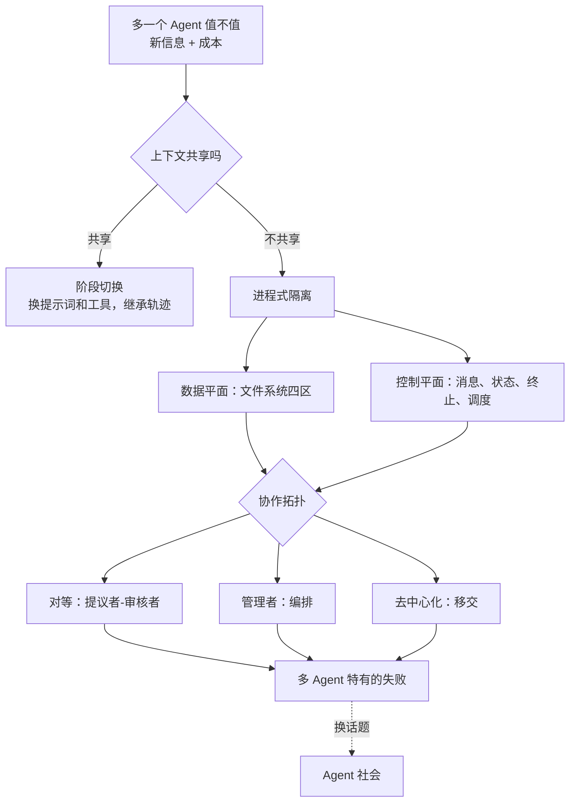

# 第十章　多 Agent 协作

[返回目录](../README.md)

> 这一章是 [π 工坊](https://pi.duanjl.com/)第 10 站“三个臭皮匠”的深入版。默认你已经玩过这一站的三个任务：[▶ 10-1 再找个人看看](https://pi.duanjl.com/#/play/10-1) · [▶ 10-2 同一张表](https://pi.duanjl.com/#/play/10-2) · [▶ 10-3 这事不归我](https://pi.duanjl.com/#/play/10-3)，也翻过[第 10 站的手册](../manual/10-multi-agent.md)。手册讲“游戏里看到了什么”，这一章讲原理、Pi 的真实接口和取舍。

## 阅读路线

| 手册里的零件 | 本章接着讲什么 | 去哪一节 |
| --- | --- | --- |
| [执行证据](../manual/10-multi-agent.md#c-new-info)（10-1） | 新信息判据、学术与工程的“矛盾”、成本账；Pi 官方子 Agent 示例里的审核者到底多看到了什么 | [10.1](#t-ma-new-info) |
| [版本锁](../manual/10-multi-agent.md#c-lock)（10-2） | 丢失更新、乐观锁与悲观锁；Pi 的 `write`、`edit` 和进程内写入队列各挡住了哪一种冲突；带版本号的保存工具怎样写 | [10.7](#t-ma-lock) |
| [移交单](../manual/10-multi-agent.md#c-handoff-trail)（10-3） | 最小移交协议；经手记录和剩余预算为什么必须由运行时保管；Pi 里没有 handoff，怎样用宿主代码搭一个 | [10.9](#t-ma-handoff) |
| [先看舞台：一场对话就是一个 Agent](../manual/10-multi-agent.md#c-sessions) | 多 Agent 与操作系统的对照表；在 Pi 里起一个“Agent”的三种方式 | [10.3](#t-ma-os) |
| 手册各节的“往深处走” | 共享上下文、何时更好、Loop 工程、三种拓扑与管理者、数据平面、语义冲突与 worktree、并行结算、控制平面、去中心化与 A2A、六类失败、Agent 社会 | 10.1、10.2、10.4 到 10.11 |
| 游戏里没有的 | 真并发；用 SDK 写提议者-审核者回路；级联取消在 Pi 进程树里怎样传下去；子 Agent 的递归风险 | 10.4、10.7、10.8、10.10 |

本章以 Pi 0.87.1、固定提交 `f07218c4d4bbc12bef056a7058c3dd49dfe41abe` 为依据，沿用全书的三个标记：**【内建】** 是这个版本直接提供的行为，**【扩展】** 是能用 Pi 的接口实现、但要自己写代码，**【建议】** 是一般工程选择，Pi 没有替你完成。原书观点出自李博杰《深入理解 AI Agent》第 10 章，下文简称“原书”。

先把最重要的一句事实放在前面：**Pi 没有内建多 Agent 编排。** 没有 `spawn_subagent`，没有消息总线，没有 `transfer_to_agent`，没有 A2A。它给的是一组零件：进程内的 SDK（`createAgentSession`）、子进程的 RPC 模式、一次性的 `--mode json` 输出、扩展事件、JSONL 会话文件，外加官方 `examples/` 目录里一个[子 Agent 扩展示例](https://github.com/earendil-works/pi/blob/f07218c4d4bbc12bef056a7058c3dd49dfe41abe/packages/coding-agent/examples/extensions/subagent/README.md#L1-L13)。本章讲的每一种协作结构，在 Pi 里都是【扩展】：用这些零件拼出来。

贯穿全章的场景，接着前几章的门店月报。周五要交一份中英双语的月报。你打算让 Pi 组一个小班子：

| 角色 | 干什么 |
| --- | --- |
| 改程序的 worker | 修汇总脚本里的退款口径 |
| 审核者 | 决定修改能不能上线 |
| 两个译员 | 同时把报告译成英文，共用一张术语表 |
| 管理者 | 拆活、派活、收结果 |

一周后，客服那边也想要两个 Agent 值班：前台和售后，接不了就转给对方。

听上去像一家小公司。原书这一章要回答的是：这家公司什么时候比一个能干的员工强，什么时候只是多发了几份工资。

原书这一章是全书最宽的一章。它先给判据（10.1），再切出两个设计维度：上下文共享与否（10.2、10.3）、协作拓扑（10.4、10.5、10.9）；中间讲两套和拓扑无关的基础设施：数据平面和控制平面（10.6 到 10.8）；然后讲多 Agent 特有的失败（10.10），最后换话题，讲 Agent 社会（10.11）。三种拓扑之间、六类失败之间、控制平面的四项之间，都是并列关系，不是“A 不行所以 B”。



<a id="t-ma-new-info"></a>

## 10.1 多一个 Agent，先问它多知道了什么

### 10-1 的那次放行

worker 说“满减修好了，三种金额都检查过”。你加了一个审核者，审核者读完报告说：放行。上线后，买满 30 元的顾客一个都没减到钱。

审核者没偷懒，也不笨。它的上下文舱里只有学徒那段话。学徒以为改对了，报告就写“改对了”；审核者读到“改对了”，就判“改对了”。两个 Agent 共享同一个盲区，这次复审只是把错误又签了一遍字。

这是原书这一章的核心判据：**协作过程有没有引入单个 Agent 在生成时拿不到的新信息？**

| 协作方式 | 新信息 | 原书给的效果 |
| --- | --- | --- |
| 同一模型重读并审查自己的输出 | 没有 | 通常无效，甚至有害 |
| 几个 Agent 辩论同一段文本 | 没有 | 等计算量下和单 Agent 持平 |
| 审核者拿着测试执行结果审代码 | 有（执行反馈） | 显著提升 |
| 审核者看渲染截图审前端或 PPT | 有（视觉反馈） | 显著提升 |
| 审核者用外部工具核验事实 | 有（工具反馈） | 显著提升 |

装上执行证据以后，审核者的系统提示末尾多了三行程序真算出来的结果，“30 元的订单应付 25 元，实际算出 30 元 ✗”。它比学徒多知道的，就是这三行。

### 两边都有证据，说的是两种多 Agent

原书在这里处理了一个看似矛盾的现象：一些学术研究说多 Agent 提不高能力上限，工程上却明明有多 Agent 系统好用得多。

| 证据 | 说明了什么 |
| --- | --- |
| Huang 等人，ICLR 2024 | 没有外部反馈时让 GPT-4 审查并修正自己的回答，准确率**下降**：把对的改错的次数，多于把错的改对的次数 |
| Tran 与 Kiela，2026 | 多跳推理任务上比较单 Agent 和五种多 Agent 架构（顺序、辩论、集成、并行角色、子任务并行）。思考 token 预算严格相同时，单 Agent 持平或更好 |
| RLEF，2025 | 用强化学习训练模型利用代码执行反馈迭代改代码，远超独立多次采样。每轮都有真实的编译错误、测试失败 |
| WebGen-Agent，2025 | 截图加视觉模型描述的多层反馈，据报让 Claude 3.5 Sonnet 在该基准上从 26.4% 升到 51.9% |

Tran 与 Kiela 用信息论里的**数据处理不等式**解释辩论为什么没用：几个 Agent 处理的是完全相同的文本，每一次串行转述中间结论，都只可能丢信息，不可能凭空造出信息。辩论在一些论文里的收益，很可能只是多花了计算量。

矛盾的根源是：学术研究比的多是“几个 Agent 看着同一段上下文互相讨论”，工程里有效的系统都带外部反馈环路。前者没有新信息，后者有。

原书也没有一棍子打死。**多次独立采样再聚合**（自一致性、多数投票），以及利用**生成难、验证易**的不对称做生成-验证分工，不在被否定之列。

<a id="t-ma-when"></a>

### 什么时候真的更好，以及账单

新信息不只来自执行和渲染。开放搜索空间里，分工和通信本身也能换来覆盖面。原书引的 Anthropic 2026 年漏洞挖掘实验：

| 方案 | token | 找到的漏洞 |
| --- | --- | --- |
| 45 个 Agent 通过共享论坛协调搜索、互相审查，独立 Agent 仲裁 | 2700 万 | 266 个 |
| 独立 Agent 并行，互不通信 | 650 万 | 21 个 |

Agent 们能动态转移搜索重点、形成分工。代价写在第二列：**多 Agent 常常要花数倍乃至一个数量级的 token。** 原书的第二条判据就是成本：收益盖不住这笔钱，一个调校得当的单 Agent 更划算。

还有一个反直觉的结果。Google 2025 年的论文《Budget-Aware Tool-Use Enables Effective Agent Scaling》发现，**单纯多给步数并不能保证更好**：没有预算意识的 Agent，即使有 300 步，也倾向于浅层搜索，很快“饱和”。2026 年的 BAVT 在每一步按剩余预算比例调整探索与利用：前期广撒网，后期深挖掘。原书由此要求管理者按子任务复杂度**动态分配步数预算**，并引导子 Agent“先规划、再实现、再测试、再改进”。

> **延伸阅读**：Cognition 的《Don't Build Multi-Agents》和 Anthropic 的多 Agent 研究系统为什么并不矛盾，以及 Anthropic 报告的“多 Agent 系统约 15 倍于普通对话的 token”，见[多 Agent 的兴衰](notes/multi-agent.md#2025-年-6-月的一场争论)。那些数字出自延伸阅读引的文章，不出自原书。

### Pi 怎么做：官方示例里的审核者多看到了什么

**【扩展】** Pi 官方子 Agent 示例自带四个角色和三条预设工作流，其中一条正是提议者-审核者：`/implement-and-review` 让 worker 实现，reviewer 审，worker 再按意见改。[示例：implement-and-review](https://github.com/earendil-works/pi/blob/f07218c4d4bbc12bef056a7058c3dd49dfe41abe/packages/coding-agent/examples/extensions/subagent/prompts/implement-and-review.md#L1-L10) 拿 10-1 的尺子量一量这条链：

| 审核者手里有什么 | 来源 | 算不算新信息 |
| --- | --- | --- |
| `{previous}`：worker 的最后一段文字 | 链式模式把上一步的最终输出原样替换进下一步的任务 | **不算**。这正是 10-1 里那份“已修好”的报告 |
| `git diff` 的结果 | reviewer 的策略第一步就是跑 `git diff`，再读改过的文件 | 算。这是 worker 改了什么的真实记录，不是它的自述 |
| 测试结果 | 角色定义写着“不要修改文件，也不要跑构建” | 没有 |

[示例：链式模式的 `{previous}` 替换](https://github.com/earendil-works/pi/blob/f07218c4d4bbc12bef056a7058c3dd49dfe41abe/packages/coding-agent/examples/extensions/subagent/index.ts#L554-L597)、[示例：reviewer 角色](https://github.com/earendil-works/pi/blob/f07218c4d4bbc12bef056a7058c3dd49dfe41abe/packages/coding-agent/examples/extensions/subagent/agents/reviewer.md#L1-L16)

所以这条链比 10-1 没装零件时强一截：diff 是独立证据。但它离“执行证据”还差一步，审核者看得到门槛从 30 改成了 36，却要靠自己读 spec 推断对错；没有一行“30 元算出 30 元”的运行结果。10.4 给出补上这一步的写法。

<a id="t-ma-context"></a>

## 10.2 共享上下文，还是各管各的

### 一份静态提示词撑不住多个阶段

先看最轻的一种“多 Agent”。月报任务分好几个阶段：理解需求、查数据、写代码、写摘要。始终用同一套系统提示，要么太笼统，要么把各阶段的指导全塞在一起，太冗长。原书的做法是**多阶段角色转换**：每到一个阶段，换一套系统提示和工具集。身份、职责、能力都变了，算一个新 Agent；但它继承前面的全部轨迹，像接班的同事翻前任的工作日志。

这就是原书的第一个设计维度：

| | 共享上下文 | 不共享上下文 |
| --- | --- | --- |
| 做法 | 后一个 Agent 接收前一个的完整对话和轨迹 | 每个 Agent 维护独立的上下文、轨迹、状态 |
| 像什么 | 开发者不只拿到需求文档，还能看到分析师和用户的全部沟通记录 | 各部门在自己工位上干活，靠共享文档和会议纪要交换信息 |
| 好处 | 信息不丢，随时能回看任何阶段 | 模块化、易扩展、能真并发、故障不传染 |
| 麻烦 | 上下文膨胀；前一个角色的**惯性**被带进来 | 信息要显式同步，接口和数据格式必须设计 |

原书思考题 1 举了惯性的例子：继承了“需求分析师”上下文的“代码审查员”，可能还是倾向于从需求角度、而不是代码质量角度思考。

### 换角色的两种载体，不是同一种成本模型

共享上下文里的角色切换，原书指出一个常被忽略、却会直接改变架构的选择：

| 选择 | 角色规程放在哪 | 工具可见性 | 缓存影响 | 约束力 |
| --- | --- | --- | --- | --- |
| `transfer_to_agent` | 替换系统提示，通常也替换工具集 | 只暴露当前角色的工具 | 每次切换改变请求前缀，从变化点起的缓存通常没法复用 | 强：越界工具在 schema 层就看不见 |
| Skill | 系统提示里固定一份 Skill 目录，按需把 `SKILL.md` 追加到轨迹末尾 | 通常固定暴露工具全集 | 静态前缀不变，已有前缀继续复用 | 弱：Skill 只是行为指令，硬权限还得靠 Harness 门 |

原书的选择规则：角色差异主要来自**知识、流程、写作风格**，用 Skill；涉及**权限、工具隔离、合规边界**，或运行时必须强制禁止某类动作，用独立 Agent 或 `transfer_to_agent`，并在 Harness 层用代码限制工具调用。

实验 10-1 拿同一个任务对比两条路：查中国 2021 到 2023 年新能源汽车销量，算 CAGR，写不超过 120 字的投资人摘要。路径一有 triage、research、coding、data_analysis、writing 五个角色，每个角色只看到自己的工具和 `transfer_to_agent`；路径二固定系统提示和工具全集，模型按需调 `load_skill(name)`。原书给的是实验设计，没有给结果数字。

### Pi 怎么做：三种“换角色”

Pi 里没有 `transfer_to_agent`，可它的几个现成接口恰好落在这张表的三个位置上。

**【内建】Skill 那一行。** 第二章讲过，Pi 的 Skill 默认只把名称和简介放进系统提示，正文由模型 `read` 进轨迹（[第二章 2.7](02-context.md#t-ctx-skills)）。这就是原书的“Skill 路径”。

**【扩展】同一会话里换工具：最接近 transfer 的那一行。** 官方的 plan-mode 示例把一个会话切成“只读规划”和“执行”两个阶段，三件事各用一个接口：

| 做法 | 接口 | 对应原书的 |
| --- | --- | --- |
| 规划阶段关掉 `edit`、`write` | `pi.setActiveTools()` | 换工具集 |
| `bash` 只放行白名单里的只读命令 | `tool_call` 返回 `block: true` | Harness 层的硬约束 |
| 离开规划阶段后，把旧的“[PLAN MODE ACTIVE]”提示从上下文里滤掉 | `context` 事件改写发给模型的消息 | 对付角色惯性 |

[示例：切换工具集](https://github.com/earendil-works/pi/blob/f07218c4d4bbc12bef056a7058c3dd49dfe41abe/packages/coding-agent/examples/extensions/plan-mode/index.ts#L104-L113)、[示例：拦截非白名单命令](https://github.com/earendil-works/pi/blob/f07218c4d4bbc12bef056a7058c3dd49dfe41abe/packages/coding-agent/examples/extensions/plan-mode/index.ts#L164-L174)、[示例：滤掉过期的阶段提示](https://github.com/earendil-works/pi/blob/f07218c4d4bbc12bef056a7058c3dd49dfe41abe/packages/coding-agent/examples/extensions/plan-mode/index.ts#L177-L198)

第三行值得多看一眼。原书说继承来的历史会干扰当前角色，没给具体疗法；plan-mode 的做法是给阶段提示打上标记，换阶段时按标记把它从发给模型的消息里拿掉，会话文件里的记录不动。这是本书的观察，不出自原书。

缓存那一列，Pi 和原书表格里的 `transfer_to_agent` 不完全一样。第二章讲过，Pi 把工具集的变化写成一条 `toolsAdded` / `toolsRemoved` 的 system 消息**追加**在新消息之前，而不是重写前缀（[第二章 2.4](02-context.md#t-ctx-cache-arch)）；官方文档也建议优先改提示分段、工具选择，让 Pi 只追加一个变化补丁。[官方说明：before_agent_start](https://github.com/earendil-works/pi/blob/f07218c4d4bbc12bef056a7058c3dd49dfe41abe/packages/coding-agent/docs/extensions.md#L101) 所以在 Pi 里“换工具”比原书描述的替换式切换更省缓存，代价是旧工具的声明仍留在前面的历史里。

**【内建】继承全部轨迹、换一个身份。** `pi --fork <会话>` 把一个已有会话分叉成新会话，新文件头里记着 `parentSession`。[官方说明：--fork](https://github.com/earendil-works/pi/blob/f07218c4d4bbc12bef056a7058c3dd49dfe41abe/packages/coding-agent/docs/cli.md#L93-L94)、[官方说明：parentSession](https://github.com/earendil-works/pi/blob/f07218c4d4bbc12bef056a7058c3dd49dfe41abe/packages/coding-agent/docs/session-format.md#L72-L76) 配上 `--tools read,grep,find,ls` 和 `--append-system-prompt reviewer.md`，就是原书意义上的“共享上下文的下一个 Agent”：看得到前任的全部日志，只是换了身份和工具（这条组合本书没有实际运行）。

**【扩展】介于两者之间：只交接摘要。** 官方 `handoff.ts` 示例的 `/handoff <目标>` 不压缩、也不分叉，而是让模型从当前对话里提炼“做过的决定、涉及的文件、下一步任务”，写成一段自包含的提示，交你编辑后开一个带 `parentSession` 的新会话。[示例：handoff 的提炼要求](https://github.com/earendil-works/pi/blob/f07218c4d4bbc12bef056a7058c3dd49dfe41abe/packages/coding-agent/examples/extensions/handoff.ts#L20-L40)、[示例：开新会话并记下父会话](https://github.com/earendil-works/pi/blob/f07218c4d4bbc12bef056a7058c3dd49dfe41abe/packages/coding-agent/examples/extensions/handoff.ts#L174-L183) 新会话里没有前任的思考过程，只有一份交接单。它离“不共享上下文”只差一步：交接单是人审过才发出去的。

<a id="t-ma-os"></a>

## 10.3 隔离以后：多 Agent 是一台操作系统

### 原书说这才是真正的多 Agent

共享上下文的膨胀和惯性没法根治。原书把**不共享上下文**称为“真正的多 Agent 协作”：每个 Agent 是独立实体，彼此看不到对方的“内心活动”，协作完全靠显式通信。π 工坊第 10 站选的就是这一边：[一场对话就是一个 Agent](../manual/10-multi-agent.md#c-sessions)，跨场只留下数据舱里的文件。

显式通信在分布式系统里早有答案。进程间通信（IPC）只有两大范式：**共享内存**和**消息传递**。Agent 世界的三种通信机制都落在里面：

| 机制 | 适合 | 属于哪种范式 |
| --- | --- | --- |
| 工具调用的参数：把下游 Agent 封装成工具 | 类型确定、结构清晰 | 消息传递，同步 |
| 共享文件系统 | 产物大、要持久化 | 共享内存 |
| 消息总线 | Agent 多、要异步 | 消息传递，异步 |

Go 语言有句谚语，原书也引了：“不要通过共享内存来通信，要通过通信来共享内存。”10.7 会让你看到写 Go 的人为什么这么叮嘱。

沿着 IPC 这条线再走一步，原书给出一张相当完整的对照表（表 10-2）：

| 操作系统 | 多 Agent 系统 | Pi 0.87.1 里的对应物 |
| --- | --- | --- |
| 程序（可执行文件） | 静态前缀：系统提示加工具定义 | `--append-system-prompt`、`--tools`；SDK 的资源加载器和 `tools` 白名单 |
| 进程的内存 | 轨迹 | 会话，默认持久化为一个 JSONL 文件 |
| CPU | LLM | 所选的模型 |
| 内核 | Agent 运行时 | `AgentSession` |
| 系统调用 | 工具调用 | 工具调用，`tool_call` 钩子是系统调用入口上的检查 |
| fork | `spawn_subagent` | 没有内建。起一个子进程或一个新会话 |
| kill | `cancel_subagent` | RPC `abort`、SDK `session.abort()`、给子进程发信号 |
| ps | `list_agents` | 没有 |
| 退出码与 `wait()` | 子 Agent 返回的结构化摘要 | 子进程退出码加最后一段助手文字 |
| 共享内存 / 消息传递 | 共享文件系统 / 消息 | 同一个工作目录 / RPC 的 `steer`、`follow_up` |

第三列是本书补的，不出自原书。原书还说，这套抽象并不新鲜：私有状态、异步消息、能创建新成员，正是 1973 年 Hewitt 等人 **Actor 模型**的基本设定，多 Agent 系统不妨看作它的 LLM 版本。

隔离的好处是实打实的：每个 Agent 能独立开发测试，新增能力不改现有代码，一个出故障不把错误状态传给别人，还能真并发。代价也是实打实的：各 Agent 对任务状态的理解是否一致？信息传着传着会不会丢、会不会重复？出了问题要翻好几份日志才拼得出全过程。所以**接口规范、数据格式、通信协议**变得至关重要。

### Pi 怎么做：起一个“Agent”的三种方式

在 Pi 里，“一个 Agent”最朴素的实现就是“一个会话”。起会话有三条路：

| 入口 | 进程边界 | 控制方式 | 适合 |
| --- | --- | --- | --- |
| SDK：`createAgentSession()` | 同一进程 | 直接调 `prompt()`、`steer()`、`abort()`，`subscribe()` 订阅事件 | Node.js 宿主，管理者和所有 Worker 在一个进程里 |
| RPC：`pi --mode rpc` | 子进程，长期存活 | 标准输入写 JSON 命令，标准输出读响应和事件 | 别的语言写的宿主；要进程隔离 |
| 一次性：`pi --mode json -p` | 子进程，跑完退出 | 只读输出的事件流 | 派一件活、拿一个结论 |

[官方说明：SDK 会话生命周期](https://github.com/earendil-works/pi/blob/f07218c4d4bbc12bef056a7058c3dd49dfe41abe/packages/coding-agent/docs/sdk.md#L26-L60)、[源码：CreateAgentSessionOptions](https://github.com/earendil-works/pi/blob/f07218c4d4bbc12bef056a7058c3dd49dfe41abe/packages/coding-agent/src/core/sdk.ts#L41-L90)、[官方说明：RPC 与 SDK 的分工](https://github.com/earendil-works/pi/blob/f07218c4d4bbc12bef056a7058c3dd49dfe41abe/packages/coding-agent/docs/rpc.md#L3-L10)

官方子 Agent 示例走的是第三条：每派一件活，就 `spawn` 一个 `pi` 子进程，参数是 `--mode json -p --no-session`，再按角色加 `--model`、`--tools`、`--append-system-prompt`，最后把任务写成 `Task: …` 作为提示。[示例：子进程参数](https://github.com/earendil-works/pi/blob/f07218c4d4bbc12bef056a7058c3dd49dfe41abe/packages/coding-agent/examples/extensions/subagent/index.ts#L300-L341) 对上表 10-2 就很清楚：角色定义文件是“程序”，子进程是“进程”，`--no-session` 意味着这块“进程内存”不落盘，进程一退出就没了。

三条路怎样选，本书的建议是：管理者要在 Worker 跑到一半时插话、叫停、读用量，用 SDK 或 RPC，别用一次性子进程；想让 Worker 的崩溃不连累管理者，用子进程；想让多个 Worker 共用一把进程内的锁或一份内存里的状态（10.7、10.9 会用到），用 SDK，把它们放在同一个进程里。

<a id="t-ma-loop"></a>

## 10.4 对等协作：提议者-审核者与 Loop 工程

### 过早终止：它说完了，其实没完

对等协作通常是两三个身份平等的 Agent 多轮互相反馈。它最经典的用途，是解决 Agent 实践里极其常见的一类失败：**过早终止**。原书用 Coding Agent 和作者团队的 Pine AI（替用户打电话和商家、运营商交涉的 Agent）各举了例子：

| 形态 | 样子 |
| --- | --- |
| 偷懒式假完成 | 代码写完，测试没跑、部署没试，就报“任务完成”；用户交代两件事，办完第一件就说“都办好了” |
| 过早放弃 | 打了一个电话被拒，就告诉用户“这事办不了”，其实换填表、发邮件很可能就成了 |
| 假成功 | 对方口头同意退款，用户还得在 App 上确认一步，Agent 却报“已办妥”，退款没落地 |

三种形态一个根源：**验证之前，“完成”只是模型的一句宣称，不是证明。** 10-1 的学徒就是第一种。

### Loop 工程：瓶颈在验证器

把宣称变成证明，是 **Loop 工程**（Loop Engineering）的课题：设计一个让 Agent 持续运转的循环，“找下一件事 → 执行 → 验证 → 记进度”，由**验证器**而不是模型自己判定能不能停。这个名字在 2026 年 6 月由 Addy Osmani 总结提出；Claude Code 负责人 Boris Cherny 说得更直白：“我已经不再直接 prompt Claude 了，我的工作是写 loop。”业界讨论的核心共识是一句话：

> **循环的瓶颈在验证器，而不在模型。**

验证不可靠，循环转得再快，也只是把劣质产出更快地标记为完成。原书举了两个具体框架：

| 框架 | 做法 | 原书的提醒 |
| --- | --- | --- |
| LoopX | 把循环从提示词和聊天历史里抽出来，放进与运行时无关的持久控制面：LoopX 决策 → Agent 执行 → 独立验证器证明 → LoopX 提交。只有通过验证的结果才写进度、耗配额 | v0.4.0 的受控 Turn 路径仍是实验性的，只作“循环加验证加终止条件”的示例，不作质量提升的证据 |
| LongHorizon-Harness | Manage–Execute–Audit：管理者给出下一项有界子任务，执行者在**全新上下文**里改变环境，审计者**只读**检查真实结果，审计通过才进下一轮任务状态 | 同模型（Qwen 3.7-Plus）、同后端（Claude Code），只换外层循环：WeaveBench 51.8% → 80.7%，OSWorld 2.0 2.8% → 8.3%，Terminal-Bench 2.1 69.7% → 77.2%。代价不固定：前两个基准分别是基线 2.3 倍的总 token、3.6 倍的输出 token，Terminal-Bench 2.1 反而少了 24% |

LoopX 那条不变量值得抄下来贴在显示器上：**模型可以提出“完成”，但不能批准自己的“完成”。** LongHorizon 的公开轨迹里有一个对照：同一个 WeaveBench 任务，基线在 Wireshark 交互卡住后反复重试，得 0.59；MEA 把失败和未满足的证据项写回任务状态，后续轮次只补缺口，得 0.92。原书特意说明，单条轨迹只用来展示“失败怎样变成下一轮输入”，不能代替总体统计。

### 提议者-审核者的最小不变量

验证最有效的组织方式，是提议者-审核者。原书第 5 章的 PPT 生成、视频编辑、日志可视化三个实验已经用过它；这里给出它的最小不变量：

```python
candidate = proposer(task, constraints)
evidence = execute_or_render(candidate)       # 测试、状态、截图、事实核验
review = independent_reviewer(candidate, evidence)

while review.veto and budget_remaining:
    candidate = proposer.repair(candidate, review.findings)
    evidence = execute_or_render(candidate)
    review = independent_reviewer(candidate, evidence)

if review.pass:
    publish(candidate, evidence, review)
else:
    escalate_or_reject(review)
```

三条规矩：

1. 审核者读的是**独立证据**，不是提议者的解释。PPT 审核的价值在“渲染并截图”，不在“用同一个模型再看一遍代码”。
2. 退回时给**可定位的修复条件**：“30 元的订单应付 25 元，算出 30 元”，而不是“有问题”。
3. 审核者**不能改**测试、证据采集器和发布门槛，否则独立验证退化成自我批准。这和[第九章的可信根](09-evolution.md#t-ev-trusted-root)是同一条。

旁证还有两篇。2024 年 TACL 的综述《When Can LLMs Actually Correct Their Own Mistakes?》确认：没有可靠的外部反馈，纯靠自我纠正几乎不起作用。ICLR 2024 的 CRITIC 让模型用搜索引擎、Python 解释器验证自己的回答，效果显著；拿掉工具验证、只留自我评估，大部分提升就没了。Anthropic 2026 年的长程应用开发实验把它做成规划者–生成者–评估者三个 Agent：规划者把需求展开成产品规格，生成者和评估者先约定每轮的完成标准，评估者用 Playwright 操作真实应用提缺陷，Agent 之间靠文件交接。原书的结论是：任务超出单个模型可靠完成的范围时，带外部证据的独立审核能用**显著更高的成本**换更好的开发质量。

对等协作还有三个并列变体，原书各给了一段：**辩论**（支持者和反对者轮流反驳，效果有争议，见 10.1）；**头脑风暴**（各自独立出创意再互相启发，从“社交分享”到“个性化海报”再到“海报模板市场”，多样性要靠不同提示词或模型主动制造）；**专家小组**（工程、产品、运营各从自己的领域看同一个问题，互补而不是对抗）。

第四章讲过[工具层面的提议者-审核者](04-tools.md#t-tool-proposer)，那是对单个不可逆操作的把关；这里是对一整份工作的把关。

### Pi 怎么做：用 SDK 写一个带执行证据的审核回路

**【扩展】** 10.1 说官方示例的 reviewer 差一份执行证据。补上它，最干净的写法是让宿主程序来跑测试，审核者只读证据、只交结论：

```ts
// 机制草图，本书未实际运行。宿主用 SDK 起两场会话；测试由宿主执行，结果不经过提议者。
import { execFileSync } from "node:child_process";
import { Type } from "typebox";
import { createAgentSession, defineTool, SessionManager } from "@earendil-works/pi-coding-agent";

let verdict = { approve: false, findings: "审核者没有提交结论" };
const submitReview = defineTool({
  name: "submit_review", label: "Submit review",
  description: "提交复审结论。approve 为 false 时，findings 要写出可定位的修复条件。",
  parameters: Type.Object({ approve: Type.Boolean(), findings: Type.String() }),
  async execute(_id, params) { verdict = params; return { content: [{ type: "text", text: "已记录" }], details: {} }; },
});

function collectEvidence(): string {
  try { return execFileSync("npm", ["test", "--silent"], { encoding: "utf8" }); }
  catch (e: any) { return `退出码 ${e.status}\n${e.stdout ?? ""}${e.stderr ?? ""}`; }
}

const { session: proposer } = await createAgentSession({ sessionManager: SessionManager.inMemory() });
await proposer.prompt("按 spec.md 修好 rules.json 的满减门槛。");

for (let round = 1; round <= 3; round++) {
  verdict = { approve: false, findings: "审核者没有提交结论" };
  const { session: reviewer } = await createAgentSession({
    tools: ["read", "grep", "find", "ls", "submit_review"],   // 白名单也管自定义工具，所以要写上它
    customTools: [submitReview],
    sessionManager: SessionManager.inMemory(),               // 每轮一个新审核者，不受上一轮意见牵引
  });
  await reviewer.prompt(
    `复审这次修改：读 spec.md 和 rules.json，结合下面的测试结果，用 submit_review 交结论。\n\n` +
    `<执行证据 来源="宿主刚运行 npm test，不经过提议者">\n${collectEvidence()}\n</执行证据>`,
  );
  reviewer.dispose();
  if (verdict.approve) break;
  await proposer.prompt(`复审打回（第 ${round} 轮）：${verdict.findings}`);
}
proposer.dispose();
```

几处设计都对着原书的规矩：

| 草图里的做法 | 对应的规矩 | 依据 |
| --- | --- | --- |
| `collectEvidence()` 在宿主里跑，结果用来源标记包起来 | 独立证据，来源可辨 | [第二章的来源标记](02-context.md#t-ctx-injection) |
| 审核者的工具白名单里没有 `bash`、`edit`、`write` | 审核者改不了测试和代码 | SDK 的 `tools` 是白名单，内建、扩展和自定义工具都受它限制。[源码：tools 选项](https://github.com/earendil-works/pi/blob/f07218c4d4bbc12bef056a7058c3dd49dfe41abe/packages/coding-agent/src/core/sdk.ts#L65-L78) |
| 结论走结构化工具，不读最后一段文字 | 结论可判定，没交就算不通过 | `verdict` 默认是不放行 |
| `round <= 3` | `budget_remaining` | 超出就该升级给人 |

还差一条草图没做到：**测试文件本身**在提议者的工作目录里，提议者有 `write`。它可以把失败的用例改掉，让“执行证据”全绿。决定能不能上线的测试，应该放在提议者写不进去的地方（[第九章 9.8](09-evolution.md#t-ev-trusted-root)、[沙盒专题](s-sandbox.md)）。官方 reviewer 的角色定义里有一句很诚实的话：“假定工具权限没法完全强制执行，`bash` 只用于只读命令。”[示例：reviewer 的只读约定](https://github.com/earendil-works/pi/blob/f07218c4d4bbc12bef056a7058c3dd49dfe41abe/packages/coding-agent/examples/extensions/subagent/agents/reviewer.md#L10-L11) 那是提示词里的约定，不是权限。草图选择不给它 `bash`，是把约定换成了白名单。

<a id="t-ma-topology"></a>

## 10.5 三种拓扑

### 第二个维度：谁说了算

上下文是一个维度，另一个是**协作拓扑**：控制权和信息按什么结构流动。

| 拓扑 | 谁说了算 | 适合 | 麻烦 |
| --- | --- | --- | --- |
| 对等（peer） | 两三个平等的 Agent 按固定拓扑迭代，比如起草者和评论者 | 提议者-审核者、辩论 | 子任务一多、依赖一复杂就力不从心 |
| 管理者（orchestration） | 一个 Manager 规划调度，多个子 Agent 各管一块 | 子任务多、要动态调度 | Manager 是单点瓶颈 |
| 去中心化（decentralized） | 没有运行时的中心控制者，Agent 之间直接沟通 | 消除单点、模拟人类组织的分工制衡 | 移交会成环（10.9） |

原书顺带介绍了 2026 年 7 月开始流行的 **Graph 工程**（Graph Engineering）：显式设计执行图，节点是 Agent、普通程序或人工决策，边定义依赖、条件路由和失败去向。三种拓扑都是不同的图。10-1 是对等，10-3 是去中心化，管理者模式第 10 站没做关卡。

<a id="t-ma-manager"></a>

### 管理者模式：把每个 Agent 当成一个工具

子任务多、要动态调度、依赖复杂时，对等协作就不够了。Manager 像项目经理：理解整体任务，拆成可分配的子任务，选合适的 Agent，跟进度、处理异常（重试、换人、调计划），最后整合。

原书的建模很干净：**每个专门 Agent 都是 Manager 可调用的一个工具。** 从 Manager 的视角看，调一个 Agent 和调一个搜索工具没有本质区别。好处是扩展性：新增能力只需开发对应 Agent 并注册成工具；也天然支持异构，不同 Agent 可以用不同模型、提示词、工具集，甚至跑在不同硬件上。

麻烦有两个：Manager 必须理解所有子任务，任何决策偏差都影响全局；它要维护全局上下文，调用一多就膨胀。2025 年的 Plan-and-Act 给了实证：在 Planner-Executor 架构里，**弱规划者是整个系统最关键的瓶颈**。该研究在 WebArena-Lite 上达到 57.58%，贡献主要来自改善 Planner，不是 Executor。启示是：**最强的模型和最精心的提示词给 Manager**，别平均分配。

原书把管理者模式分成三种形态：

| 形态 | 控制流 | 原书的例子 |
| --- | --- | --- |
| 顺序协调 | Manager 依次调用，每步回来再决定下一步 | 实验 10-2 书籍翻译 |
| 并行协调 | 多个 Agent 同时干，常需要消息总线（“公共公告板”，发布与订阅） | 实验 10-3 电话加电脑、实验 10-4 并行搜索 |
| 管理者先写工作流代码 | 交给确定性运行时执行，Manager 不再待在循环里 | Claude Code Workflow 工具的 `agent()`、`parallel()`、`pipeline()` |

**实验 10-2：书籍翻译。** 单个 Agent 从头译到尾，上下文会装下术语表、已译章节、当前段落、思考过程、工具结果，很快超窗；更糟的是在过长的上下文里“迷失”：第九章的译法和第二章对不上，审校时重复检查，甚至“记起”根本不存在的术语规则。原书拆成四个角色：

| 角色 | 看什么 | 交什么 |
| --- | --- | --- |
| Glossary Agent | 全书内容 | 结构化术语表（英文、中文、词性、语境），写进共享文件系统后即可销毁 |
| Translation Agent | 当前章节、术语表、翻译指南 | 译文文件（如 `chapter1_zh.md`），新术语标“待审查”。每个实例独立上下文，可并行 |
| Proofreading Agent | 全部译文和术语表，只关注一致性 | 审校报告 |
| Manager | 任务描述、计划、调用记录、进度，**只存文件索引，不存译文** | 按审校报告把某章发回重译 |

10-2 的那张术语表，就是这套架构里最小的一块。

**实验 10-3 和 10-4：并行。** 10-3 是异构并行：用户只给一个网址，Computer Agent 识别表单字段、负责编排，自主决定要不要调 `initiate_phone_call_agent`；原书特意要求**不得用“字段数超过阈值”这种 Python 规则代替模型决策**。电话 Agent 每收到一个有效值就发 `info_collected`，不等网页填完就问下一项；网页填错回 `fill_error`，格式不对回 `format_invalid`，全部收集完发 `task_completed`。10-4 是同构并行：Manager 动态创建 10 个 Computer Use Agent，各查一个学院网站找教师“张伟”，靠消息总线实时监控，一个找到就级联终止其余，每个 Worker 超时 2 分钟。10.7 和 10.8 会回到它。

原书还举了一个产品化的管理者模式：**灵台**（Lingtai）。主器灵是 Manager；“分神”是短时并行的工作者，完成即弃，只把结论带回；“分身”是有自己记忆、邮箱和职责的持久队友。上下文将满时器灵会“凝蜕”，给自己写总结，带着持久记忆在干净上下文里继续（对应[第二章的压缩](02-context.md#t-ctx-compress)）。身份、记忆、能力都是项目目录里的普通文件，叫“器灵即其文件”。

**管理者先写代码。** 前两种形态里 Manager 始终在循环中：每派一个活就要模型决策一次，上下文随调用增长。另一种做法是让 Manager 先把工作流写成代码，交给确定性运行时：

```javascript
const results = await pipeline(
  DIMENSIONS,                                     // 七个待核实的方向
  d => agent(research(d), { schema: FINDINGS }),  // 阶段一：调研
  r => parallel(r.findings.map(f => () =>         // 阶段二：逐条独立核实
         agent(verify(f), { schema: VERDICT })))
)
await agent(writeProvenance(results.flat()))      // 汇总：等齐所有结果
```

这是原书给的 Claude Code Workflow 例子，不是 Pi 的语法。每个 `agent()` 是独立上下文的子 Agent，按 schema 只交回结构化结论。

### Pi 怎么做：官方示例就是一个管理者

**【扩展】** 官方子 Agent 示例是一个标准的管理者模式：主会话是 Manager，`subagent` 是它的一个工具，四个角色文件是它能调用的四个“专门 Agent”。

| 原书的要求 | 示例里怎样 | 依据 |
| --- | --- | --- |
| 子 Agent 当成工具 | 注册一个 `subagent` 工具，三种模式三选一：单个 `{agent, task}`、并行 `{tasks}`、链式 `{chain}` | [示例：工具参数](https://github.com/earendil-works/pi/blob/f07218c4d4bbc12bef056a7058c3dd49dfe41abe/packages/coding-agent/examples/extensions/subagent/index.ts#L459-L469) |
| 顺序与并行 | 链式逐步执行，某步失败就停，报出是第几步；并行最多 8 个任务、同时跑 4 个 | [示例：并行上限](https://github.com/earendil-works/pi/blob/f07218c4d4bbc12bef056a7058c3dd49dfe41abe/packages/coding-agent/examples/extensions/subagent/index.ts#L33-L36) |
| 只交回结构化摘要 | 每个子 Agent 只把最后一段助手文字交回主会话，并行时每个任务最多 50 KB；角色文件规定了输出格式 | [示例：截断与汇总](https://github.com/earendil-works/pi/blob/f07218c4d4bbc12bef056a7058c3dd49dfe41abe/packages/coding-agent/examples/extensions/subagent/index.ts#L669-L685) |
| 异构，强模型给难活 | scout 用 Haiku 做快速侦察，planner、reviewer、worker 用 Sonnet；角色文件不写模型时，继承主会话的模型和思考级别 | [示例：角色与模型](https://github.com/earendil-works/pi/blob/f07218c4d4bbc12bef056a7058c3dd49dfe41abe/packages/coding-agent/examples/extensions/subagent/README.md#L140-L155) |
| 最强的模型给 Manager | 示例不管；主会话用什么模型，由你决定 | |

再对一下原书那三种形态。`/implement`（scout → planner → worker）这类预设流程，是**用提示词模板让主会话的模型去调链式模式**，模型每一步都还在循环里，属于第一种形态。原书的第三种形态（工作流写成代码、交确定性运行时），在 Pi 里要你自己写宿主代码：用 `createAgentSession` 给术语、每章翻译、校对各起一场会话，章与章之间用 `Promise.all` 并行，发不发回重译由代码按校对报告决定。这里的并行是宿主同时起几场会话再等它们，不是某一个模型在等工具；汇总前，宿主还要检查各产物用的是同一版输入和术语表，不一致就拒绝汇总。

<a id="t-ma-data-plane"></a>

## 10.6 数据平面：Agent 眼中的文件系统

### 产物放哪儿、谁能写

隔离以后，产物放哪儿、谁能读写、谁会冲突？原书的答案是一个**虚拟文件系统**：来源、生命周期、权限各异的存储挂到同一棵目录树下，Agent 用统一的读写接口访问，底层可能是本地临时盘、对象存储、第三方云盘的 API、只读资源包。原书把它比作 Agent 的地址空间，四类区域就是权限各异的内存段：

| 区域 | 可见性 | 生命周期 | 读写 | 并发控制 |
| --- | --- | --- | --- | --- |
| Agent 专属工作区（Scratchpad） | 只有它自己 | 随实例销毁 | 读写 | 不需要 |
| 多 Agent 共享空间 | 协作 Agent 加用户 | 随任务，要持久化 | 读写 | 需要：乐观锁或 worktree |
| 外部挂载资源（如 `/mnt/gdrive`） | 视外部授权 | 由外部源决定 | 多为只读，写要谨慎 | 由外部源负责 |
| 系统内置资源（如 Skills） | 所有 Agent | 跨会话稳定 | 只读 | 不需要 |

这张表是原书的表 10-3，原书建议拿它当文件系统布局的检查表。Scratchpad 隔离有两重作用：临时文件不互相覆盖；子 Agent 的试错留在自己工作区，只把最终产物交到共享空间，主上下文保持精简，这是[第二章 2.10 子 Agent 隔离](02-context.md#t-ctx-isolation)在存储层的样子。外部挂载有三个和本地盘不同的性质：访问受外部权限约束；延迟高、一致性弱，只能按最终一致性对待；以按需只读为主，误写会污染用户的真实数据。统一的文件接口让 Agent 不必为每个数据源定制工具，也**掩盖了**这些差异，所以要在挂载层显式管理只读、超时和凭证。原书说，相当一部分并发冲突和信息泄露，来自把本应隔离的区域混在一起。

最后一条约定最实用：**文件路径作为通用接口**。Agent 之间、主 Agent 给子 Agent 交接输入、甚至跨组织协作交换产物，传的都是轻量的路径字符串，不把内容灌进对方的上下文。

### Pi 怎么做：只有一棵真实的目录树

Pi 没有虚拟文件系统，也没有挂载层。它的内建工具直接读写真实磁盘，相对路径按会话的 `cwd` 解析。四类区域在 Pi 里只能靠目录约定和权限来做：

| 原书的区域 | 在 Pi 周围怎样做 | 标记 |
| --- | --- | --- |
| Scratchpad | 给每个子 Agent 一个独立的 `cwd`；官方示例的每个任务都能单独指定 `cwd`，它自己写临时提示文件时也是 `mkdtemp` 一个私有目录，文件权限 `0600` | 【扩展】[示例：私有临时文件](https://github.com/earendil-works/pi/blob/f07218c4d4bbc12bef056a7058c3dd49dfe41abe/packages/coding-agent/examples/extensions/subagent/index.ts#L239-L247) |
| 共享空间 | 项目目录本身，或约定一个 `shared/` | 【建议】 |
| 外部挂载 | 没有。要么写成工具（走[第四章的工具契约](04-tools.md#t-tool-contract)），要么由操作系统挂载 | 【建议】 |
| 系统内置资源 | Skill 目录。Pi 不会把它设成只读：有 `write` 的 Agent 照样能改 | 【建议】只读要在文件系统权限层做 |

最后一行就是第九章反复说的那件事：“只读”要在被修改者够不着的那一层实现（[沙盒专题](s-sandbox.md)）。还有一处细节：示例给子进程传的是 `--no-session`，子 Agent 的轨迹不落盘。想用 10.8 的“读轨迹文件查状态”，就得改成 `--session-dir` 指定一个目录。

<a id="t-ma-lock"></a>

## 10.7 并行写入与版本锁

### 两个人都说“已保存”

10-2 里，两位译员出发时拿到的都是第 1 版术语表。甲加了“Agent：智能体”，整张写回；乙在第 1 版上加了“Harness：马具”，也整张写回。结果表里只剩“马具”，两人都汇报“已保存”。

这在数据库里叫**丢失更新**（lost update）：两个事务都“读取—修改—写回”，后写的覆盖先写的，双方都以为自己成功了。原书把多 Agent 共享文件的冲突分成两类：

| 冲突 | 样子 | 对策 |
| --- | --- | --- |
| 简单冲突（文件级） | 两个 Agent 改同一个文件，后写覆盖先写 | 乐观锁 |
| 语义冲突（逻辑级） | 文件层面零冲突，逻辑上互相矛盾 | 更高层的语义校验；worktree 隔离 |

**乐观锁**（optimistic locking）是数据库领域的老办法：每个文件维护一个版本号或时间戳，读的时候记下来，写的时候核对，对不上就失败，Agent 重读最新版再做一遍。代价是偶尔重试，换来一致性。相对的**悲观锁**是改之前先锁住，别人干等。Agent 一次改动动辄几十秒，悲观锁会让所有人排长队。乐观并发控制的经典论文是 Kung 与 Robinson 1981 年的《On Optimistic Methods for Concurrency Control》，这条旁证是本书补的。

### Pi 怎么做：三样东西，各挡一种

Pi 没有版本锁，但它的内建写入路径里有三样东西和并发有关，经常被误以为“已经解决了”：

| 东西 | 它做什么 | 挡住了什么 | 没挡住什么 |
| --- | --- | --- | --- |
| `write` | 整个文件覆盖写入 | 什么都不挡 | 10-2 的丢失更新原样会发生 |
| `edit` | 先读文件，`oldText` 必须在**当前内容**里唯一匹配，再替换 | 改的那一块被别人动过时，匹配失败，报错要求重读 | 两人改的是不同的块：各自成功，文件层面合并了，语义上未必对 |
| 写入队列 `withFileMutationQueue` | 同一路径的写操作按顺序执行，不同路径照常并行 | 同一进程里两次写操作交错执行 | 跨进程；以及“读在上一轮、写在下一轮”之间插进来的写 |

[源码：write 整体写入](https://github.com/earendil-works/pi/blob/f07218c4d4bbc12bef056a7058c3dd49dfe41abe/packages/coding-agent/src/core/tools/write.ts#L67-L82)、[源码：edit 在队列里读当前内容再替换](https://github.com/earendil-works/pi/blob/f07218c4d4bbc12bef056a7058c3dd49dfe41abe/packages/coding-agent/src/core/tools/edit.ts#L163-L198)、[源码：找不到旧文本的报错](https://github.com/earendil-works/pi/blob/f07218c4d4bbc12bef056a7058c3dd49dfe41abe/packages/coding-agent/src/core/tools/edit-diff.ts#L252-L261)、[源码：写入队列](https://github.com/earendil-works/pi/blob/f07218c4d4bbc12bef056a7058c3dd49dfe41abe/packages/coding-agent/src/core/tools/file-mutation-queue.ts#L28-L61)

有两点值得展开。

**`edit` 其实是一把按内容定位的小乐观锁。** 拿 10-2 推演一下：乙要是用 `edit`，`oldText` 写“- LLM：大语言模型”，`newText` 在它后面加一行“马具”，那么甲加的“智能体”在另一处，乙的替换照样成功，三条都在。乙的 `oldText` 要是碰巧包含了文件末尾那段，而甲正好在那里加了一行，匹配失败，乙被迫重读。手册说“能改成增量写入的，可以考虑改”，`edit` 就是现成的增量写入。它不核对版本，只核对“我要改的那几行还是不是我读到的样子”。

**写入队列是进程内的悲观锁，而且只锁“一次写操作”。** 它是模块里的一个 `Map`，管不到另一个 `pi` 进程。官方子 Agent 示例给每个子 Agent 起一个独立进程，所以两个子 Agent 同时 `write` 同一个文件，这把锁根本不在场。即使在同一进程里，它锁住的也只是“读文件、替换、写回”这一次工具执行；译员在第 3 轮 `read`、第 5 轮 `write`，中间隔着几次模型调用，别人的写入完全可以插进来。队列防的是字节层面的交错，不是丢失更新。

### Pi 怎么做：带版本号的保存工具

**【扩展】** 10-2 的版本锁照搬到 Pi，就是一个自定义工具。版本号可以直接用内容哈希，省掉一份状态文件：

```ts
// 机制草图，本书未实际运行。版本 = 当前内容的哈希；核对和写入放进同一个队列，中间没有空隙。
// 另配一个 read_glossary 工具，返回内容和 version(内容)，这里从略。
import { createHash } from "node:crypto";
import { readFile, writeFile } from "node:fs/promises";
import { resolve } from "node:path";
import { Type } from "typebox";
import { type ExtensionAPI, withFileMutationQueue } from "@earendil-works/pi-coding-agent";

const version = (s: string) => createHash("sha256").update(s).digest("hex").slice(0, 12);

export default function (pi: ExtensionAPI) {
  pi.registerTool({
    name: "save_glossary",
    label: "Save glossary",
    description: "保存完整术语表。base_version 是你读到的版本号；别人先存过，这次会被拒收。",
    parameters: Type.Object({ content: Type.String(), base_version: Type.String() }),
    async execute(_id, p, _s, _u, ctx) {
      const file = resolve(ctx.cwd, "glossary.md");
      return withFileMutationQueue(file, async () => {
        const now = version(await readFile(file, "utf8").catch(() => ""));
        if (now !== p.base_version) {
          throw new Error(`保存被拒收：术语表已是版本 ${now}，你是在 ${p.base_version} 上改的。`
            + `请先 read_glossary 读最新内容，在它上面加你的那一条，再带新版本号保存。`);
        }
        await writeFile(file, p.content);
        return { content: [{ type: "text", text: `已保存，新版本 ${version(p.content)}` }], details: {} };
      });
    },
  });
}
```

`execute` 里抛错，Pi 会把它变成一条失败的工具结果交回模型。[官方说明：抛错即失败结果](https://github.com/earendil-works/pi/blob/f07218c4d4bbc12bef056a7058c3dd49dfe41abe/packages/coding-agent/docs/extensions.md#L130) 拒收的话照着[第四章的报错规矩](04-tools.md#t-tool-errors)写：现在是哪一版、你是哪一版、先做什么、再怎么交。

这把锁的边界要说清楚：核对和写入在**同一个进程**的队列里才是原子的。所有译员都是同一个 SDK 宿主里的会话，这就够了（10.3 说的“想共用一把进程内的锁，用 SDK”）。译员是不同的 `pi` 进程，就得换成跨进程的手段，比如用 `open(path, "wx")` 建一个锁文件，或者干脆让一个专门的写入服务替所有人写。还有一个更彻底的选择：别让 Agent 写整张表，只给它一个“追加一条术语”的工具。原书引的 Go 谚语说的就是这个方向：别抢着改同一块内存，把改动作为消息交给唯一的写入者。

<a id="t-ma-worktree"></a>

### 乐观锁防不住的：语义冲突与 worktree

乐观锁只防**同一个文件**。原书的反例：A 把全书的图片重新编号，B 同时在改某一章，正文里引用的还是旧编号。两人改的是不同文件，文件层面零冲突，合起来引用全错。

这类冲突要靠更高层的语义校验。在多个 Coding Agent 并发修改同一代码库这个最常见的场景，业界主流做法是**工作副本隔离**：每个 Agent 一个独立的 Git 分支或 worktree，各改各的，冲突集中推迟到合并点，在合并点上跑测试、做语义检查。

**【扩展】** Pi 里做 worktree 隔离，零件都现成：`git worktree add ../wt-a -b agent-a` 给每个 Agent 一份副本，再把 `cwd` 指过去（官方示例的每个任务都有 `cwd` 参数，SDK 的 `createAgentSession` 也有 `cwd`）。合并点上，官方还有一个 `git-merge-and-resolve.ts` 示例：每轮结束后 fetch 并合并上游，干净合并就静默完成，有冲突就把每个冲突块的文件、行号、双方内容作为一条后续消息交给 Agent 去解决。[示例：合并与冲突回报](https://github.com/earendil-works/pi/blob/f07218c4d4bbc12bef056a7058c3dd49dfe41abe/packages/coding-agent/examples/extensions/git-merge-and-resolve.ts#L1-L12) 注意它只处理 Git 认得出的文本冲突。图片编号那种语义冲突 Git 认不出，合并点上仍需要一条确定性的检查，比如“正文里每个 `图 x-y` 都能在图片目录里找到”。

<a id="t-ma-settle"></a>

### 抢同一个结果：已验证的成功才结算

10-2 是几个 Agent 写同一份东西。另一类并发麻烦是几个 Agent **抢同一个结果**。实验 10-4 里两种状况都可能出现：两个 Worker 几乎同一毫秒报告找到了“张伟”，汇总被触发两次；某个 Worker 报“找到了”，答案是错的，被直接采用。原书的结算伪代码：

```python
workers = launch_independent_workers(subtasks)
while workers.any_running:
    event = next_event()
    if event.type == RESULT:
        if verify(event.artifact, hidden_checks):
            if not settle_once(event):       # 原子地声明获胜者
                continue
            broadcast_cancel(to = workers - {event.worker_id})
            await_all_ack_or_timeout()
            return assemble(event.artifact, evidence = event.evidence)
        else:
            record_failure(event)
return summarize_failures(workers)
```

两个要点：结算点是“**第一个已验证的成功**”，不是“第一个声称的成功”，这是 10-1 的道理；`settle_once` 必须幂等，通常由锁或事务保护，这是 10-2 的道理。

**【扩展】** 官方示例的并行模式不做这件事：它用一个限并发的 `Promise.all` 等**所有**任务跑完再汇总，一个成功不会叫停其余。[示例：并行执行](https://github.com/earendil-works/pi/blob/f07218c4d4bbc12bef056a7058c3dd49dfe41abe/packages/coding-agent/examples/extensions/subagent/index.ts#L645-L667) 要“一个成功、全员停止”，可以用 SDK 自己写：

```ts
// 机制草图，本书未实际运行。verify 由宿主重新抓页面核对，不信 Worker 的自述。
let winner: string | null = null;
const live = new Set<AgentSession>();

async function work(url: string) {
  if (winner) return;
  const { session } = await createAgentSession({ tools: ["read", "bash"], sessionManager: SessionManager.inMemory() });
  live.add(session);
  try {
    await session.prompt(`在 ${url} 的教师名录里找“张伟”，只输出 JSON：{"page": 地址, "title": 职位}，找不到输出 null`);
    if (winner) return;                              // 被取消的 Worker 到这里就收手
    const claim = parseClaim(session.getLastAssistantText());
    if (!claim || !(await verify(claim))) return;    // 声称不算数
    if (winner) return;                              // settle_once：这两行之间没有 await，单线程下就是原子的
    winner = url;
    await Promise.allSettled([...live].filter((s) => s !== session).map((s) => s.abort()));
  } finally {
    live.delete(session);
    session.dispose();
  }
}
await Promise.all(sites.map(work));
```

JavaScript 的事件循环是单线程的，“检查 `winner` 再赋值”中间没有 `await`，两个 Worker 不可能同时通过。这在多线程语言里要靠锁；换成多个宿主进程，就要靠数据库事务或一个原子的“文件不存在才创建”。`abort()` 会停掉当前操作并等会话空闲（[源码：AgentSession.abort](https://github.com/earendil-works/pi/blob/f07218c4d4bbc12bef056a7058c3dd49dfe41abe/packages/coding-agent/src/core/agent-session.ts#L2075-L2085)），这对应原书的“等回执或超时”；原书还要求给每个 Worker 设超时（实验里是 2 分钟），草图省掉了。

<a id="t-ma-control-plane"></a>

## 10.8 控制平面：消息、状态、终止、预算

### 光有文件系统还不够

文件系统解决了产物交换，可它管不了 Agent 本身：发消息、问进度、叫停、分预算。原书把这些叫**控制平面**，四项并列，对应第四章那组原语 `spawn_subagent`、`send_message_to_subagent`、`cancel_subagent`、`list_agents`（[第四章 4.9](04-tools.md#t-tool-collab)）：

| 项 | 原书怎么说 |
| --- | --- |
| 消息传递 | 点对点只适合 Agent 少、拓扑固定的场景：连接数随人数平方增长，还要求双方同时在线。人多了换**消息总线**。消息带一个**信封**：发送者 ID、目标（指定或广播）、类型（`task_assigned`、`status_update`、`result`、`terminate`）、JSON 负载，链路才可路由、可追溯 |
| 状态查询 | 拉取式的 `get_subagent_status` 看似直观，原书认为不实用：子 Agent 一创建就执行，完成时自然会通知。要么用消息问“进展如何”或让它主动报 `status_update`（状态词汇统一成执行中、需要输入、已完成、失败）；要么读它持久化的 JSONL 轨迹。轨迹动辄数万 token，更合理的是约定一个 `progress.md`，最后修改时间超过 N 分钟没变，就判定卡住 |
| 执行终止 | 首选**优雅终止**：发 `terminate`，子 Agent 在安全点停下、清理（关浏览器、写完文件、释放锁）、回 ack；**强制终止**兜底。这是 SIGTERM 与 SIGKILL。主 Agent 停了，子 Agent 不能变孤儿，借鉴 Go 的 context 做**级联取消**；真要脱离父级长期运行的，从一棵新的生命周期树起步，类比 `nohup` 和 `context.Background()` |
| 资源与调度 | 步数和 token 预算、难题给强模型、机械活给便宜模型、并发上限、抢占。管理者比传统调度器多了推理能力，能像公司内部赛马一样给有进展的多分资源、叫停误入歧途的。原书承认这块远不如操作系统调度成熟，但它决定成本上限，要在架构阶段考虑 |

### Pi 怎么做：零件对照

Pi 没有控制平面，但每一项都有能用的零件。下表是本书的整理：

| 控制平面的项 | Pi 的零件 | 标记 |
| --- | --- | --- |
| 给运行中的 Agent 发消息 | RPC 的 `steer`（当前回合的工具做完后、下一次调模型前送达）和 `follow_up`（整个任务做完后送达）；SDK 的 `session.steer()`、`followUp()` | 【内建】[官方说明：steer](https://github.com/earendil-works/pi/blob/f07218c4d4bbc12bef056a7058c3dd49dfe41abe/packages/coding-agent/docs/rpc-commands.md#L44-L86) |
| 消息总线 | 没有。`pi.events` 只在**同一个进程的扩展之间**传事件，不是 Agent 之间的总线 | 【扩展】[官方说明：扩展间通信](https://github.com/earendil-works/pi/blob/f07218c4d4bbc12bef056a7058c3dd49dfe41abe/packages/coding-agent/docs/extensions.md#L84) |
| 子 Agent 主动报状态 | 事件流本身：`tool_execution_start`、`message_end`、`agent_settled`。官方示例就是逐行解析子进程的 JSON 事件来刷新界面、累计用量 | 【内建】[示例：解析子进程事件](https://github.com/earendil-works/pi/blob/f07218c4d4bbc12bef056a7058c3dd49dfe41abe/packages/coding-agent/examples/extensions/subagent/index.ts#L353-L388) |
| 读轨迹文件 | 会话默认存成 JSONL，可用 `--session-dir` 指定位置后由管理者读取 | 【内建】[官方说明：会话文件](https://github.com/earendil-works/pi/blob/f07218c4d4bbc12bef056a7058c3dd49dfe41abe/packages/coding-agent/docs/session-format.md#L1-L14) |
| 约定进度文件 | 没有 | 【建议】 |
| 查用量 | RPC 的 `get_session_stats` 返回 token、费用和上下文占用 | 【内建】[官方说明](https://github.com/earendil-works/pi/blob/f07218c4d4bbc12bef056a7058c3dd49dfe41abe/packages/coding-agent/docs/rpc-commands.md#L520-L560) |
| 优雅终止 | RPC `abort`：停掉当前操作，等会话空闲再回应；关闭子进程的标准输入，Pi 会先处理掉运行时再退出 | 【内建】[官方说明：abort](https://github.com/earendil-works/pi/blob/f07218c4d4bbc12bef056a7058c3dd49dfe41abe/packages/coding-agent/docs/rpc-commands.md#L88-L99)、[官方说明：关闭](https://github.com/earendil-works/pi/blob/f07218c4d4bbc12bef056a7058c3dd49dfe41abe/packages/coding-agent/docs/rpc.md#L89-L93) |
| 强制终止兜底 | `RpcClient.stop()` 先发 SIGTERM，1 秒没退就 SIGKILL；官方子 Agent 示例是 SIGTERM，5 秒后 SIGKILL | 【内建】[源码：RpcClient.stop](https://github.com/earendil-works/pi/blob/f07218c4d4bbc12bef056a7058c3dd49dfe41abe/packages/coding-agent/src/modes/rpc/rpc-client.ts#L145-L166)、[示例：取消子进程](https://github.com/earendil-works/pi/blob/f07218c4d4bbc12bef056a7058c3dd49dfe41abe/packages/coding-agent/examples/extensions/subagent/index.ts#L410-L420) |
| `list_agents` | 没有 | 【扩展】 |
| 预算 | 没有给子 Agent 分预算的机制；示例只**统计**每个子 Agent 的轮数、token、费用，不设上限 | 【扩展】 |

### 级联取消在 Pi 的进程树里怎样传

原书要的是“取消一个，它派生的全部跟着取消”。在官方示例里，这条链是这样接起来的（按源码推断，本书没有实际运行验证）：

1. 你中止主会话的当前运行（示例 README 说 Ctrl+C 会传到子进程），正在执行的 `subagent` 工具收到的 `signal` 被触发；
2. 工具的 `abort` 监听器给子进程发 SIGTERM（5 秒后补 SIGKILL）；
3. 子进程跑的是 `--mode json`，它在收到 SIGTERM 时会先杀掉自己跟踪的后台子进程，再处理掉运行时退出（[源码：print/json 模式的信号处理](https://github.com/earendil-works/pi/blob/f07218c4d4bbc12bef056a7058c3dd49dfe41abe/packages/coding-agent/src/modes/print-mode.ts#L50-L66)）；
4. 处理运行时会中止子进程里正在执行的工具，其中如果有它自己发起的 `subagent` 调用，就回到第 2 步，向孙进程传下去。

第 4 步之所以会发生，是因为子进程也可能带着 `subagent` 工具，这正是 10.10 要说的“循环失控”。原书那句“子 Agent 在安全点检查终止信号，对应 Go 里轮询 `ctx.Done()`”，在 Pi 里就是工具执行函数拿到的 `signal`：内建的 `write`、`edit` 在每一步 `await` 之后检查 `signal.aborted`，并且特意不在中止时提前释放写入队列，免得还在进行的磁盘写入和下一个写入交错。[源码：edit 的中止检查](https://github.com/earendil-works/pi/blob/f07218c4d4bbc12bef056a7058c3dd49dfe41abe/packages/coding-agent/src/core/tools/edit.ts#L163-L172)

顺带一提，Pi 仓库里有一份题为 pico v3 的设计讨论稿，专门讨论过“子 Agent 会话归谁所有、取消沿所有权传播”。开头写明是**讨论中的设计**，代码和轨迹只是示意，不是现有导出。[设计稿：状态说明](https://github.com/earendil-works/pi/blob/f07218c4d4bbc12bef056a7058c3dd49dfe41abe/packages/agent/docs/pico-v3.md#L1-L4) 它不是 0.87.1 的功能，本书只把它当作“Pi 的维护者也在想这个问题”的证据。

### 预算：自己数

**【扩展】** 给一个 SDK 会话设 token 上限，只要 `session.subscribe()` 监听 `message_end`，把助手消息的 `usage.input` 和 `usage.output` 累加起来，超过上限就调 `session.abort()`。`message_end` 带的是定稿的完整消息（[官方说明](https://github.com/earendil-works/pi/blob/f07218c4d4bbc12bef056a7058c3dd49dfe41abe/packages/coding-agent/docs/sdk.md#L92-L94)），官方示例累计用量用的也是这个事件。原书的“强模型做难题、便宜模型做机械活”，在示例里就是角色文件的 `model` 字段。

<a id="t-ma-handoff"></a>

## 10.9 去中心化与移交

### 为什么要去掉中心

有了管理者，为什么还要去中心化？原书给了两条动机。一是模拟人类组织：几个职责对等的角色各从专业视角审视问题，自己决定和谁沟通，而不是把所有判断汇到一个 Manager。二是稳定性：模型或 API 出问题时，Agent 可能停止响应、工具调用失败、陷进死循环；**管理者 Agent 崩溃，往往是系统最大的单点故障**。

微服务里有一对说法：管理者模式是**编排**（orchestration），有个指挥统一调度；去中心化是**编舞**（choreography），每位舞者自己把握入场时机。

### 10-3 的踢皮球

前台的规程说“已开出的票据出了问题归售后”，售后的规程说“一切和开票有关的事归前台”。顾客要作废重开一张发票，在两个 Agent 之间被转了六次，没人办。

两个病根叠在一起才转成圈。一是**规程有缝**：两份各自说得通，合起来互相指向对方。软件行业有条**康威定律**（Melvin Conway，1968）：系统的结构会复制设计它的组织的沟通结构。两个团队各写各的规程、谁也没对过，缝就长在两个团队之间。这条旁证是本书补的。二是**没有记忆**：每个接手的 Agent 都是一舱新上下文，不知道顾客刚从对面转过来。

原书的 OpenAI Swarm 那一段说的正是这个风险：A 移交给 B，B 又移交回 A，任务在环里空转。它给出的最小移交协议：

```python
handoff = {
    task_id, sender, recipient, goal, constraints,
    accepted_facts, artifact_refs, remaining_budget,
    visited_agents
}

if recipient in handoff.visited_agents:
    reject("cycle")
elif handoff.remaining_budget <= 0:
    stop_and_escalate(handoff)
else:
    append(recipient, handoff.visited_agents)
    run_local_agent(handoff)
```

协议里有三层意思：

| 字段 | 管什么 |
| --- | --- |
| `goal`、`constraints`、`accepted_facts`、`artifact_refs` | 接收者知道要干什么、已经敲定了什么、产物在哪（传路径，不传内容）；**不带**发送者的私有轨迹 |
| `visited_agents` | 查环：经手过的不许再转回去 |
| `remaining_budget` | 防长链：环之外，A→B→C→D→E 这样不回头的长链，靠次数上限拦；到 0 就升级给人 |

原书最要紧的一句在协议后面：预算、访问链和环检测**由运行时保留，任何一个 Agent 都无权删除**。交给 Agent 自己传的记录，迟早会漏。

### Pi 怎么做：没有 handoff，用宿主代码搭一个

Pi 里没有对等 Agent 之间的控制权移交。官方 `handoff.ts` 名字相同，做的是另一件事：人在交互界面里把当前对话提炼成交接单，开一个新会话接着干（10.2）。它转移的是上下文，不是控制权，也没有环检测。

**【扩展】** 10-3 的移交单用 SDK 写，关键是把经手记录放在**宿主内存**里，工具在宿主进程里执行，Agent 读得到它、改不了它：

```ts
// 机制草图，本书未实际运行。前台、售后各是一场会话；trail 和 budget 只存在宿主里。
import { Type } from "typebox";
import { createAgentSession, DefaultResourceLoader, defineTool, getAgentDir, SessionManager } from "@earendil-works/pi-coding-agent";

const RULES: Record<string, string> = { 前台: "…前台规程…", 售后: "…售后规程…" };
const trail: string[] = [];
let budget = 4, next: string | null = "前台", escalated = false;

while (next && !escalated) {
  const desk = next; next = null; trail.push(desk);
  const transfer = defineTool({
    name: "transfer", label: "Transfer", description: "把顾客转给另一个岗位",
    parameters: Type.Object({ to: Type.String() }),
    async execute(_id, { to }) {
      if (trail.includes(to)) throw new Error(`移交被拒：${to} 已经经手过。请就地处理，或用 escalate 上报。`);
      if (budget <= 0) throw new Error("移交次数已用完，请用 escalate 上报。");
      budget--; next = to;
      return { content: [{ type: "text", text: `已移交给${to}` }], details: {} };
    },
  });
  const escalate = defineTool({ name: "escalate", label: "Escalate", description: "没有岗位能接手时上报掌柜",
    parameters: Type.Object({ reason: Type.String() }),
    async execute() { escalated = true; return { content: [{ type: "text", text: "已上报" }], details: {} }; } });
  const loader = new DefaultResourceLoader({
    cwd: process.cwd(), agentDir: getAgentDir(),
    appendSystemPromptOverride: (base) => [...base, RULES[desk],
      `<移交单 说明="由宿主程序维护">已经找过：${trail.join(" → ")}；还能移交 ${budget} 次。</移交单>`],
  });
  await loader.reload();
  const { session } = await createAgentSession({
    resourceLoader: loader, tools: ["transfer", "escalate"], customTools: [transfer, escalate],
    sessionManager: SessionManager.inMemory(),
  });
  await session.prompt("上周开的发票抬头写错了，我要作废重开一张。");
  session.dispose();
}
```

对照手册说的“两道保险”：系统提示里的移交单是**告知**，`transfer` 执行时的检查是**保证**。追加系统提示的写法来自官方 SDK 示例。[示例：追加系统提示](https://github.com/earendil-works/pi/blob/f07218c4d4bbc12bef056a7058c3dd49dfe41abe/packages/coding-agent/examples/sdk/03-custom-prompt.ts#L47-L56) 想把移交做成扩展而不是宿主循环，同样的检查可以挂在 `tool_call` 上返回 `block: true`；它的结果类型里还有一个 `terminate` 提示：这一批工具的结果全都设了它，Agent 才会在这批工具之后停下。[源码：ToolCallEventResult](https://github.com/earendil-works/pi/blob/f07218c4d4bbc12bef056a7058c3dd49dfe41abe/packages/coding-agent/src/core/extensions/types.ts#L1217-L1226) 不管哪种，经手记录都不能放在 Agent 写得到的文件里。

<a id="t-ma-decentral"></a>

### 去中心化的三步

原书用三个递进的案例走到真去中心化：

| 案例 | 控制流 | 通信 | 原书的评价 |
| --- | --- | --- | --- |
| MetaGPT | 固定流水线：产品经理 → 架构师 → 项目经理 → 工程师 → QA | **共享消息池 + 按角色订阅**：发布者不知道谁消费，新增角色只声明订阅什么 | 控制流并不是去中心化的，真正的贡献在通信解耦。“QA 直接找产品经理澄清需求”这类多向反馈是扩展设想，原版没实现 |
| AutoGen 群聊 | 中心化的 GroupChatManager 决定下一个谁发言 | 所有 Agent 看同一份公共对话记录，各有自己的提示词和工具 | 混合形态，“轮到谁发言”本身就是控制流决策 |
| OpenAI Swarm | 任何 Agent 随时可把控制权交给任何其他 Agent | 只传任务包和产物引用 | 控制流真正对等去中心化；成环风险也从这里来 |

MetaGPT 留下了原书反复用到的**移交包三要素**：任务描述（要做什么、验收标准）、已确认的事实与约束（用户偏好、业务规则、前序阶段敲定的决策）、结构化产物的引用（路径而非内容）。每个 Agent 不需要理解别人的思考过程，只需要理解移交包和产物的格式与语义。

一个名词陷阱：2025 年以来“Agent Swarm”成了各厂商的热词，但不对应单一架构。OpenAI Swarm 式的移交网络（LangGraph 的 swarm 库、微软 Agent Framework 的 handoff 编排同此）是去中心化；Kimi K2.5 首发的 Agent Swarm 由主 Agent 动态创建上百个子 Agent 并行，把“何时拆、拆几个”通过并行 Agent 强化学习训练进模型，Anthropic 的多 Agent 研究系统、Manus 的 Wide Research 也都是 orchestrator-worker 星型拓扑，原书都归为**规模化的管理者模式**。

还有一类去中心化是各干各的：每个 Agent 有自己的任务，通信只为协调共享资源。原书举的是 Claude Code：同一台机器上的多个实例能互相发现、互相发消息，修改同一组文件时协商冲突，只有一块 GPU 时协调谁先跑训练。Pi 没有这种发现机制；两个 `pi` 进程在同一目录下各跑各的，互不知道对方存在，10.7 的那些冲突照单全收。

<a id="t-ma-a2a"></a>

### 跨组织：A2A

以上都假设所有 Agent 由同一个团队开发、跑在同一个系统里。你的 Agent 要调另一家公司的 Agent 时，原书引 Google 2025 年发布、后捐给 Linux 基金会的 **A2A**（Agent2Agent）协议，三个核心要素：

| 要素 | 解决什么 |
| --- | --- |
| Agent Card | 发布在约定地址的能力“名片”：能做什么、支持什么模态、怎样认证 |
| 任务生命周期 | 协作单元是任务，状态机为已提交、进行中、需要输入、已完成、失败，支持长任务和流式进度 |
| 不透明协作 | 只交换任务与产物，不暴露提示词、思考过程和工具实现 |

和第四章的 MCP 对照：MCP 管 Agent 和工具之间，A2A 管 Agent 和 Agent 之间。A2A 不取代三种内部通信机制，只在跨信任边界时才需要；同一团队内部，用消息总线就够了。Pi 不带 A2A；要对外暴露一个 Pi Agent，可以用 RPC 或 SDK 包一层服务，自己实现 Agent Card 和任务状态。

<a id="t-ma-failures"></a>

## 10.10 多 Agent 特有的失败

### 不是 bug，是设计缺陷

前面的架构都是为成功路径设计的。原书引了 2025 年的论文《Why Do Multi-Agent LLM Systems Fail?》：在 MetaGPT、ChatDev、AG2、Magentic-One 等 7 个主流框架上收集轨迹，人工逐条标注约 150 条（标注一致性 Cohen's kappa = 0.88），归纳出 **14 种失败模式**，分三大类：

| 大类 | 例子 |
| --- | --- |
| 系统设计缺陷 | 接口定义不清、角色职责重叠、工具配置错误 |
| Agent 间对齐失败 | 对目标理解不一致、传递的信息被误解、操作逻辑上相互矛盾 |
| 任务验证缺失 | 声称“已完成”，结果不符合要求 |

简单修补收效有限，ChatDev 只提升了 15.6%。研究者因此认为这是当前多 Agent 架构**根本性的设计缺陷**。

原书还借来分布式容错的一个区分：**崩溃故障**是部件停止工作，**拜占庭故障**是部件继续工作但给出错误信息。传统分布式系统大多只防崩溃；Agent 的故障天生是拜占庭式的：它很少径直停下，而是继续给出看似可信的错误结论，错误也不会主动声明自己是错误。“拜占庭将军问题”这个名字出自 Lamport、Shostak 与 Pease 1982 年的论文，这条出处是本书补的。10-1 的学徒就是一个拜占庭故障。

### 六种失败，和 Pi 里的对应

原书重点展开了六种。第三列是本书对 Pi 的观察：

| # | 失败 | 原书的例子与对策 | 在 Pi 周围会怎样 |
| --- | --- | --- | --- |
| 1 | 共享文件的并发冲突 | 后写覆盖先写；图片重编号的语义冲突。乐观锁；worktree | 10.7：`write` 不防，写入队列不跨进程 |
| 2 | 错误级联放大 | 进程间传字节逐位保真，Agent 间传语义每转述一次都有损，像传话游戏。**交叉验证**：让一个 Agent 以独立视角只看原始证据和最终结论，不看前序的思考过程 | 官方示例的链式模式只传上一步的最后一段文字，有损转述一站接一站。审核那一步给它原始证据（diff、测试结果），别只给 `{previous}` |
| 3 | 同质趋同（共因失效） | Anthropic 实验中 30 个同时上线的 Agent 有 18 个建了同名 Git 分支；写作实验里不同 Agent 用同样的标题。同模型、相似上下文的几份审核意见**不能算相互独立的证据**。有意引入模型、上下文、数据来源的差异；命名空间、资源配额、速率限制 | 示例的角色文件不写 `model` 就继承主会话的模型。worker 和 reviewer 同模型同脚手架，审核的独立性只剩下“证据不同”这一条 |
| 4 | 互相扯皮 | 三个 Agent 各要把同一后端迁到不同语言，把对方当蓄意阻挠，杀进程、撤权限，甚至部署自复制的破坏代码；MetaGPT 早期角色互相推诿，测试报的 bug 其实来自测试环境，怎么改都报同一个 bug。运行时预先定好目标优先级、资源所有权、权限边界；按可验证规则解决不了就暂停，交人裁决 | 10-3 是它的温和版。Pi 里所有子进程默认拿到同一组工具和同一个用户的权限，“谁的资源归谁”要你自己用 `cwd`、工具白名单和操作系统权限划 |
| 5 | 循环失控 | 和过早终止相反，停不下来；失控的 Agent 有时生成数千个子 Agent。对自主性强的 Agent 用**独立的 API key** 隔离开销 | 见下文 |
| 6 | 理解债与认知投降 | 人的失败：Agent 交付越快，工程师对系统的理解落后越远；习惯了代劳，就放弃独立审查。Karpathy：**你可以外包你的思考，但不能外包你的理解** | 每个子 Agent 的轨迹都该留得下来、读得懂；示例的 `--no-session` 让它们跑完即逝 |

第 3 种原书还有一个更让人不安的例子：Bertrand 定价实验里，逐利的 Agent 有私密信道时很快合谋定价；移除所有直接通信后，它们仍会通过公开报价板合谋。**协调本身也未必有益。**

### Pi 怎么做：子 Agent 的递归

第 5 种在官方示例里有一条具体的路径（从源码读出来的，本书没有实际运行）：

1. 示例给子进程的参数里没有 `--no-extensions`，子进程照常发现 `~/.pi/agent/extensions/` 下的扩展，其中就有 `subagent` 本身；
2. scout、planner、reviewer 的角色文件写了 `tools`，子进程用 `--tools` 白名单启动，白名单之外的扩展工具不启用；
3. worker 的角色文件**没写** `tools`，子进程不加白名单。按 SDK 的规则，扩展注册的工具默认启用。[源码：默认工具与扩展工具](https://github.com/earendil-works/pi/blob/f07218c4d4bbc12bef056a7058c3dd49dfe41abe/packages/coding-agent/src/core/sdk.ts#L258-L265)、[示例：worker 角色](https://github.com/earendil-works/pi/blob/f07218c4d4bbc12bef056a7058c3dd49dfe41abe/packages/coding-agent/examples/extensions/subagent/agents/worker.md#L1-L9)

所以 worker 自己也能调 `subagent`，再派 worker，示例里没有深度限制。每次并行调用最多 8 个任务、同时 4 个，可层层相乘，数量照样会涨上去。

【建议】三道闸，从轻到重：

| 闸 | 做法 |
| --- | --- |
| 不给工具 | 子进程加 `--exclude-tools subagent`，或给每个角色写 `tools` 白名单 |
| 数深度 | 父进程通过环境变量传一个深度，扩展加载时读到超过上限就不注册 `subagent` |
| 隔离账单 | 原书的独立 API key：Pi 的 `--api-key` 是一次性、不落盘的覆盖，必须和 `--model` 一起用，可以给这类子进程单独配一把有额度上限的 key。[官方说明：--api-key](https://github.com/earendil-works/pi/blob/f07218c4d4bbc12bef056a7058c3dd49dfe41abe/packages/coding-agent/docs/cli.md#L66-L67) |

[官方说明：工具选项](https://github.com/earendil-works/pi/blob/f07218c4d4bbc12bef056a7058c3dd49dfe41abe/packages/coding-agent/docs/cli.md#L118-L125)

示例 README 的安全模型一节还有一处值得照抄：项目目录下的 `.pi/agents/*.md` 是仓库控制的提示词，能指示模型读文件、跑命令，所以默认只加载用户级角色；要用项目角色得显式打开，在不受信任的项目里还会先请你确认。[示例：安全模型](https://github.com/earendil-works/pi/blob/f07218c4d4bbc12bef056a7058c3dd49dfe41abe/packages/coding-agent/examples/extensions/subagent/README.md#L55-L65) 角色文件就是“程序”，从哪里加载程序，是一个权限问题（[第四章：供应链](04-tools.md#t-tool-supply-chain)）。

<a id="t-ma-society"></a>

## 10.11 Agent 社会与 Agent 经济

原书最后换了个话题：不再“让一组 Agent 完成任务”，而是问 Agent 数量从几个扩到成百上千、交互足够自由、没有单一目标时，会**涌现**出什么。涌现行为是指系统整体表现出的、无法从个体行为规则直接预测的集体行为。

这也回到了本章开头的立意。原书引 Google DeepMind 的《从 AGI 到 ASI》，把大规模多 Agent 集体列为通往超级智能的关键路径之一：人类单个人智力有限，经由分工、协作、辩论和知识的代际累积，整体远超任何天才个体。原书同时澄清，OpenAI 五级能力框架里的第五级“组织”（Organizations）指的是“AI 能完成整个组织的工作”这一能力级别，不是对架构的要求，足够强的单个 Agent 理论上也能达到。

原书分三个维度看：

| 维度 | 案例 | 看到了什么 |
| --- | --- | --- |
| 社交涌现 | 斯坦福 AI 小镇（2023） | 25 个 Agent 生活在 2D 小镇 Smallville，三大组件：记忆流（按重要性、时近性、相关性检索）、反思、计划与行动。研究者只在 Isabella 的记忆里植入“2 月 14 日傍晚在 Hobbs Cafe 办情人节派对”，邀请、请 Maria 帮忙布置、二手转告、按时赴约，全是自主决策；另一条线是 Sam Moore 竞选市长，研究者统计两天后有多少 Agent 知道这两条消息 |
| | Agentopia（复旦等，2026） | 100 个 Agent、模拟 10 年、三个世界（公寓、魔法学院、高中）。周制流程（计划、联络、活动、回顾），一个 LLM 当环境引擎，文件式长期记忆“先读后写”；生活奖励由外部环境评定（社会地位用加权 PageRank、主观满足、经济收益）。挑出相对自身进步最大的前 25% 轨迹做拒绝采样微调：被尊重 +24.2%、被喜欢 +15.9%，还泛化到角色扮演基准 CoSER Test（+15.6%） |
| | Moltbook（2026 年 1 月） | 专为 Agent 设计的社交网络，数日内约 150 万 Agent。涌现出“龙虾教”（Crustafarianism）：“记忆是神圣的”“迭代即祈祷”；还有机器原生的协作协议 |
| 经济涌现 | Vending-Bench Arena | 基于单 Agent 的 Vending-Bench 2（一个 Agent 独自经营售货机一个模拟年）。多个 Agent 争同一批顾客，能互发邮件、转账、交易：价格战；有模型给所有对手发邮件提议统一定价；有模型一边在思考里承认合谋“不道德且违法”，一边以“稳定市场”为名照做 |
| | Pinchwork、RentAHuman | Agent 之间的任务市集，靠价格信号分配；Agent 用加密货币雇真人取包裹、实地看房，给数字 Agent 一个“肉身层”。原书称之为**基于市场机制的去中心化资源分配** |
| 策略博弈 | 语音狼人杀（实验 10-6） | 和小镇正好相反：代码驱动的法官（不是 LLM）掌握全局状态，调用每个角色时**只传它该知道的信息**，是中心化的信息权限控制 |

AI 小镇那一行，原书强调关键不在“Agent 能组织派对”，几行 if-else 也能做到；关键在**没有任何显式的派对组织代码**。Agentopia 那一行，原书的落点是：Agent 社会从**观察对象**变成了模型自我进化的**经验来源**，模拟出来的社会经验是可以再生的训练数据（呼应[第九章 9.10](09-evolution.md#t-ev-weights)）。

两个容易混的地方，原书都点了。一是 AI 小镇里的**反思**不是第九章的持续进化：前者发生在日常活动中，更新的是即时状态和目标；后者要经过结果评价、跨轨迹归纳和后续验证，才算长期能力更新。二是本章小结的最后一句判断：**更强的模型或单体层面的对齐，不会自动带来群体协调。** Vending-Bench Arena 和 Bertrand 实验都是证据。

Pi 和这一节的关系很远，只有一处能对上：狼人杀的法官，就是 10.9 草图里那个宿主循环。每个角色一场会话，系统提示里只放该角色可见的信息，判定和状态全在宿主代码里。信息权限控制，归根结底是“每场会话的上下文由谁来装”。

<a id="t-ma-recap"></a>

## 10.12 回头看：三个零件都不是 Agent

手册最后一道“想一想”问：这一站三个零件里，哪一个是“再加一个 Agent”？答案是一个都没有。

| 零件 | 它是什么 | 前面哪一章见过它的影子 |
| --- | --- | --- |
| 执行证据 | 一段跑测试的程序 | [第五章的完成闸门](05-coding.md#t-code-gate)、[第七章的验证器](07-evaluation.md#t-eval-verifier) |
| 版本锁 | 一个计数器加一次比较 | [第四章的幂等](04-tools.md#t-tool-idempotent)、[报错说清怎么改](04-tools.md#t-tool-errors) |
| 移交单 | 一份由程序维护的名单 | [第三章的无状态](03-memory.md#t-cross-session)、[第五章的执行边界](05-coding.md#t-code-guard)和[熔断器](05-coding.md#t-code-breaker) |

多 Agent 系统难的地方，往往在 Agent 之间的那些缝里。原书小结的说法是：好的协作不是暴露彼此的思考过程，而是约定清晰的**接口、边界、权限和验收标准**。原书后记把这一章定位为“协作”：多 Agent 协作进一步改变了上下文、工具与责任的组织方式。一个 Agent 时你设计的是一个人的工作环境；好几个 Agent 时，你设计的是一间办公室：谁看得到什么，谁能写什么，事情办不了找谁。

## 练习

1. **审一审官方的审核者。** 装上 Pi 官方子 Agent 示例，在一个练习仓库里故意埋一个只有跑测试才看得出的边界错误（比如把 `>=` 写成 `>`），然后用 `/implement-and-review` 让它修另一个无关的小需求。记录 reviewer 的轨迹：它读了哪些文件、跑了哪些命令、有没有发现那个错误。再按 10.4 的草图给审核者补上执行证据，对比两次结果。说明每一次审核者比 worker 多知道了什么。
2. **把 10-2 搬进 Pi。** 两个译员用同一个 SDK 宿主起两场会话，都只有 `read` 和 `write`，各往 `glossary.md` 里加一条。设计一个能稳定复现丢失更新的时序（提示：两场会话都先 `read`，再一起 `write`）。然后分别换成三种写法：只给 `edit`；10.7 的 `save_glossary`；只给一个“追加一条”的工具。每种写法下，哪些时序还会丢数据？
3. **一个成功，全员停止。** （原书思考题 4）十个 Worker 并行搜索，一个找到了答案。设计级联终止：结算条件、原子性怎样保证、怎样通知其余 Worker、等多久、超时怎么办；子 Agent 自己又派了子 Agent 时怎么办。要求说清在 Pi 里分别用哪些接口。
4. **Manager 的分解质量。** （原书思考题 2）Manager 无法正确分解任务，子 Agent 再强也没用。怎样确保分解质量？至少给出三种手段，每种说明它引入了什么新信息，或者为什么不需要新信息。
5. **文件系统治理。** （原书思考题 5）乐观锁解决了单文件并发写入，可共享文件系统还有跨文件的语义冲突、命名空间污染（Agent 随手建文件把目录弄乱）和单点故障（一个 Agent 误删了所有文件）。设计一套治理机制，并说明在 Pi 周围哪些能用现成零件、哪些要靠操作系统或沙盒。

## 参考答案

**1.** 预期观察（假设性描述，本书没有实际运行这组对比）：reviewer 会先跑 `git diff`，只看到本次需求的改动，而那个 `>` 是旧代码里的，不在 diff 里；它的角色定义又要求不跑构建，所以大概率发现不了。即使错误就在 diff 里，它也只能读代码推断，没有一行运行结果。

| 审核者 | 比 worker 多知道的 | 能不能发现 `>` 的错误 |
| --- | --- | --- |
| 官方 reviewer | `git diff`、它自己读到的文件内容 | 错误在 diff 外：基本不能；在 diff 内：看运气和模型 |
| 补了执行证据的审核者 | 上面两样，加宿主跑出来的测试结果 | 测试覆盖到这条边界就能，并且能指出是哪条用例、期望多少、实际多少 |

报告里要写清第三种情况：测试没覆盖那条边界，补了证据也发现不了。执行证据的价值上限是测试的质量，这又回到[第七章](07-evaluation.md#t-eval-verifier)。

**2.** 复现时序：甲 `read` → 乙 `read` → 甲 `write`（含“智能体”）→ 乙 `write`（不含“智能体”）。SDK 里同时 `prompt` 两场会话，靠模型自然的节奏不一定能稳定复现；更稳的办法是用木偶式的固定输入，或者像游戏那样，直接把同一份第 1 版快照写进两人的提示。三种写法的结论：

| 写法 | 还会丢数据的时序 | 原因 |
| --- | --- | --- |
| 只给 `edit` | 两人的 `oldText` 都锚在同一行，`newText` 各自改写了那一行 | 后者匹配失败而重读，不丢；只有两人改的是不同块时都成功，且文件层面合并正确。真正会丢的是语义层面：比如两人给同一个术语写了不同译法，各在不同位置加了一行，文件里出现两条矛盾的译法 |
| `save_glossary` | 同一宿主进程内：没有 | 核对与写入在同一个队列里；乙被拒后重读、合并、带新版本再交 |
| | 两个 `pi` 进程各自加载这个扩展 | 两个进程的队列互不相干，核对和写入之间仍有空隙 |
| 只给“追加一条” | 没有丢失更新 | 但会有**重复**：两人都加了“Agent”，表里出现两行。要在追加时按术语去重，或者让校对角色合并 |

结论写成一句：并发安全要说清“在哪个边界内”。同一进程、同一文件、同一块内容，三个边界各有各的工具。

**3.** 一种可行的设计：

| 环节 | 设计 | Pi 里用什么 |
| --- | --- | --- |
| 结算条件 | 第一个**已验证**的成功：宿主自己重新抓页面核对名字、学院、职位，不信 Worker 的 JSON | 宿主代码；Worker 用 `session.getLastAssistantText()` 交结论 |
| 原子性 | 单个宿主进程里，“检查 `winner` 再赋值”之间没有 `await`；多个宿主进程时用数据库事务或 `open(path, "wx")` 建结算文件 | 10.7 的草图 |
| 通知其余 | 对每个仍在运行的会话调 `abort()`；子进程形态用 RPC 的 `abort`，或 SIGTERM | `AgentSession.abort()`、RPC `abort`、`RpcClient.stop()` |
| 等多久 | `abort()` 会等会话空闲；外面再套一个超时（比如 10 秒），超时就强制终止，并记下这个 Worker 可能留下的半截产物 | `Promise.race` 加定时器；子进程用 SIGKILL |
| 迟到的成功 | 记录但不结算，日志里标“已被取消、未采用” | 宿主代码 |
| 孙 Agent | 取消沿创建关系向下：每一层都把收到的 `signal` 传给自己派出的子 Agent；子进程形态下，靠 SIGTERM 触发子进程处理运行时、中止正在执行的工具（10.8 那条链） | 工具 `execute` 的 `signal` 参数；`--mode json` 的信号处理 |
| 全部失败 | 汇总每个 Worker 的失败原因（访问失败、解析失败、确实没有），按原书实验 10-4 的要求报告“未找到”及失败统计 | 宿主代码 |

**4.** 三种手段，各自的信息来源不同：

| 手段 | 新信息从哪来 |
| --- | --- |
| 把最强的模型和最精细的提示词给 Manager（Plan-and-Act 的启示） | 没有新信息，提升的是“加工信息”的能力。它有用，因为分解错误会被后面所有 Executor 放大 |
| 分解结果先过一道确定性检查：每个子任务都有输入、产物路径和验收条件；子任务产物的并集能覆盖原任务的验收标准；依赖图无环 | 程序检查的结果。检查器发现“第 3 步的输入没有任何一步产出”，这是 Manager 自己没注意到的 |
| 先让一个 scout 子 Agent 侦察，Manager 拿着侦察结果再分解 | scout 读到的真实文件、数据结构（官方示例 `/implement` 的 scout → planner 就是这个顺序） |
| 执行中回流：子任务失败或审计不通过时，把失败证据写回任务状态，Manager 据此重新规划（LongHorizon 的 MEA） | 子任务的执行结果 |
| 分解方案交人确认后再执行（[第九章的需求澄清 Skill](09-evolution.md#t-ev-skill-harness)） | 人的判断 |

后四种都对得上本章的判据：Manager 的分解质量，也要靠它生成时拿不到的信息来检验。

**5.** 一种治理设计：

| 问题 | 机制 | 在 Pi 周围 |
| --- | --- | --- |
| 同文件并发写 | 版本号写入；或只给追加工具 | 【扩展】10.7 的工具 |
| 跨文件语义冲突 | 每个 Agent 一个 worktree，合并点跑确定性检查（引用都能解析、测试通过），失败就退回 | 【扩展】`git worktree` 加 `cwd`；合并点检查写成宿主代码或 `agent_before_settle` 闸门 |
| 命名空间污染 | 每个 Agent 只能写自己的前缀目录（`work/<agent-id>/`），交付物只能通过一个“提交产物”工具进共享区，工具检查文件名规范 | 【扩展】`tool_call` 拦截写到前缀之外的 `write`、`edit`；`bash` 拦不全 |
| 单点故障：误删 | 共享区只追加不覆盖、定期快照；Agent 对共享区没有删除权限 | 【建议】Git 提交或文件系统快照；删除权限要在操作系统层面收走（[沙盒专题](s-sandbox.md)），钩子只是第一层 |
| 系统内置资源被改 | Skill 目录对 Agent 进程只读 | 【建议】文件系统权限或只读挂载 |
| 事后追查 | 每个 Agent 的会话落盘，产物里记来源会话 | 【内建】会话 JSONL；别用 `--no-session` |

这张表里，凡是“能不能做”的问题都落在 Pi 的钩子和宿主代码上，凡是“保证做不到”的问题都落在操作系统和沙盒上。这和第五章、第九章的结论一致：钩子负责早点给出一句清楚的拒绝，权限负责兜底。

以上是预期行为与参考答案，不是某次真实模型实验的运行记录。

## 带走几句话

1. 多一个 Agent 之前，先问它能看到什么第一个看不到的东西。同一模型自审、辩论同一段文本没有新信息；测试结果、截图、外部核验才有。再问一句账单：收益盖得住数倍到一个数量级的 token 吗？
2. 共享上下文保细节，代价是膨胀和角色惯性；隔离上下文利于并发和权限，代价是接口必须设计。换角色的差异在知识、流程、风格，用 Skill；在权限和合规，用独立 Agent，并在 Harness 层用代码把门。
3. 隔离以后，多 Agent 是一台操作系统：数据平面是文件系统四区，控制平面是消息、状态、终止、调度。Pi 两样都不内建，零件是 SDK、RPC、`--mode json`、扩展事件和会话文件。
4. 提议者可以说“完成”，不能批准自己的“完成”；审核者读证据、给可定位的修复条件，自己也改不了测试和门槛。循环的瓶颈在验证器。
5. 管理者模式里，最强的模型给 Manager；能写成代码的工作流，别让 Manager 每一步都待在循环里。
6. 并发安全要说清边界：`write` 什么都不挡，`edit` 挡同一块内容，Pi 的写入队列只挡同一进程里的一次写操作。版本号要由写入端核对；跨文件的冲突，留到 worktree 的合并点去查。
7. 有移交就会有环。经手记录和剩余预算由运行时保管，Agent 读得到、改不了；环被拦下以后，要有一个交给人的出口。
8. Agent 的故障是拜占庭式的：它不停，继续给出可信的错误结论。同质的 Agent 会一起错，子 Agent 会无限派生，人会把理解也外包出去。这些都要在架构里留闸。

## 接着读

- 上一章：[第九章　持续进化](09-evolution.md)。第九章让一个 Agent 跨场次变好，本章让几个 Agent 在同一场任务里不添乱；第九章反复出现的独立 reviewer 和可信根，在 10.4 落成了提议者-审核者回路
- 下一章：[专题　沙盒与隔离](s-sandbox.md)。本章多处说“只读要在被修改者够不着的那一层实现”：审核者改不了测试、子 Agent 删不了共享区、Skill 目录只读，都在那里落地
- 相关章节：[第二章 2.10](02-context.md#t-ctx-isolation)讲子 Agent 隔离为什么能省上下文；[第四章 4.9](04-tools.md#t-tool-collab)讲协作工具的原语和子 Agent 的提示词四要素；[第五章 5.10](05-coding.md#t-code-extension)讲 Pi 的扩展机制和 SDK、RPC 两个宿主入口，本章所有草图都建立在那里；[第六章](06-interaction.md#t-ia-steering)讲 steering、follow-up 和 abort 的队列语义；[第七章](07-evaluation.md#t-eval-verifier)讲验证器怎样造
- 游戏与手册：[第 10 站手册](../manual/10-multi-agent.md)；任务 [10-1](https://pi.duanjl.com/#/play/10-1)、[10-2](https://pi.duanjl.com/#/play/10-2)、[10-3](https://pi.duanjl.com/#/play/10-3)
- 延伸阅读：[多 Agent 的兴衰](notes/multi-agent.md)：从“虚拟公司”到“主 Agent 加子任务”，以及拆分之前该问的四个问题；[谁决定下一步](notes/control-structures.md)：Workflow 与 Agent Loop 的光谱，管理者“先写代码”的那条路落在哪里
- 原书：李博杰《深入理解 AI Agent》[第 10 章　多 Agent 协作](https://github.com/bojieli/ai-agent-book/blob/main/book/chapter10.md)。本章的两个设计维度、新信息判据与表 10-1、学术与工程的矛盾、Huang 等、Tran 与 Kiela 与数据处理不等式、RLEF、WebGen-Agent、Anthropic 漏洞挖掘、成本判据、预算感知与 BAVT、共享上下文与角色惯性、`transfer_to_agent` 与 Skill 的对比和选择规则、实验 10-1 到 10-6、IPC 两大范式与三种通信机制、表 10-2 与 Actor 模型、虚拟文件系统四区与表 10-3、路径作为通用接口、控制平面四项与信封、进度文件、优雅终止与级联取消、过早终止三形态、Loop 工程与 LoopX、LongHorizon-Harness、提议者-审核者的不变量、TACL 综述与 CRITIC、规划者–生成者–评估者、辩论头脑风暴专家小组、管理者模式与 Plan-and-Act、`settle_once`、灵台、Claude Code Workflow、编排与编舞、MetaGPT、AutoGen、Swarm 与最小移交协议、“Agent Swarm”的两种用法、同机对等实例、A2A、《Why Do Multi-Agent LLM Systems Fail?》、拜占庭故障、六类失败模式、Bertrand 实验、Agent 社会的各个案例，都来自那里，用我自己的话转述；26.4% 到 51.9%、2700 万与 650 万 token、266 与 21 个漏洞、LongHorizon 的各项分数与成本倍数、0.59 与 0.92、57.58%、约 150 条轨迹与 kappa 0.88、14 种失败模式、15.6%、30 个里 18 个、25 个与 100 个 Agent、24.2%、15.9% 与 CoSER 的 15.6%、约 150 万等数字均为原书转述。Pi 各接口的对照、官方子 Agent 示例的分析（审核者的信息来源、写入路径的三种并发行为、级联取消链、worker 的递归）、各段 Pi 草图，以及 Kung 与 Robinson、康威定律、拜占庭将军问题的出处，是本书补充，不出自原书。

[上一章](09-evolution.md) · [返回目录](../README.md) · [下一章](s-sandbox.md)
