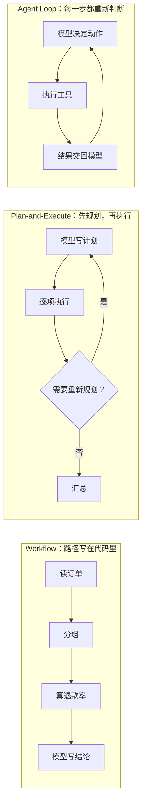

# 谁决定下一步：Workflow、Plan-and-Execute 与 Agent Loop

**简体中文** | [English](../../en/book/notes/control-structures.md)

[返回延伸阅读](README.md) · [返回目录](../../README.md)

> **从哪里分叉出来**：[第二章 2.4 循环真正做了什么](../02-runtime.md#24-循环真正做了什么什么时候结束) · [第六章 6.5 状态恢复](../06-extensibility.md#65-状态恢复不要只保存一个内存变量)
> **前置概念**：工具调用、轮次（第二章）
> **继续阅读**：[多 Agent 的兴衰](multi-agent.md) · [工具调用怎样走到今天](tool-calling.md) · [从提示工程到 Harness 工程](prompt-context-harness.md) · [第八章 经验也需要退役](../08-evolution.md#经验也需要退役) · [第八章 8.4 把经验保存为合适的产物](../08-evolution.md#84-把经验保存为合适的产物)
> **资料核验日期**：2026-11-09

第二章的循环里，模型每看到一次工具结果，就自己决定下一步：再读一个文件、改程序，还是直接回答。今天的编码 Agent 大多这样工作，但这并不是让 LLM 做事的唯一结构。两三年前，许多团队会先让模型写出完整计划再逐项执行，或者干脆把每一步写进代码，只让模型填空。

这些做法现在少见了，但并没有消失，退场的原因也值得了解。它们能说明一件比 Pi 的源码更长久的事：**Harness 里的很多部件是在补偿某一代模型的弱点；模型变了，这些部件也该跟着重新评估。**

## 同一个调查，三种控制方式

回到退款调查。负责人问：“新版结账页上线后退款是不是变多了？”下面用三种结构完成同一件事，区别只在于**下一步由谁决定、在什么时候决定**。

| 结构 | 谁决定下一步 | 什么时候决定 | 在退款调查里的样子 |
| --- | --- | --- | --- |
| Workflow | 开发者写的代码 | 写程序时 | 代码依次读取订单、按页面版本分组、计算退款率，最后把数字交给模型写结论 |
| Plan-and-Execute | 模型（规划器） | 任务开始时，必要时重新规划 | 模型先列出“1. 读订单 2. 读客服记录 3. 对比版本……”，执行器逐条完成 |
| Agent Loop（ReAct） | 模型 | 每看到一次结果 | 模型读完订单，发现客服记录里“退款”含义不一致，于是先停下来问口径 |

三者并不互斥。一个 workflow 的某一步可以交给 Agent 去做；一个 Agent 也可以把固定的 workflow 当作工具调用。真正的设计问题是：这个任务的哪一部分在动手之前就能确定，哪一部分必须先看到资料才能决定。

## Workflow：把路径写进代码

Anthropic 在 2024 年底的《Building effective agents》中做了一个后来被广泛引用的区分：workflow 是“LLM 与工具通过预先定义的代码路径编排”的系统，agent 则由 LLM 动态决定自己的流程和工具使用。文中列出提示链、路由、并行、编排者-工作者、评估者-优化者五种 workflow 模式，并建议先用最简单的方案，只在确有需要时才增加复杂度。[Anthropic：Building effective agents](https://www.anthropic.com/engineering/building-effective-agents)

Workflow 曾经流行，是因为当时的模型很难可靠地连续做对多步。把路径写死，等于让代码承担“下一步做什么”，模型只负责它擅长的单步语言任务。这样做还有工程上的好处：行为可预测，便于测试，成本也容易估算。

它的弱点在退款调查里很明显。代码写好的路径假定“退款”只有一种含义；客服记录显示有一部分退款其实是换货，程序不会停下来提问，只会算出一个看起来合理、实际上口径混乱的数字。**Workflow 只能处理开发者事先想到的分支。**

所以 workflow 至今仍是许多场景的正确答案：步骤稳定、必须可重复、需要审计或高频运行的任务，例如每晚生成固定格式的报表。在这类任务里，用代码固定步骤并不是在补偿模型的弱点，而是任务本身就要求结果确定。第八章还会讲到相反的方向：Agent 在循环中摸索出一套稳定做法后，可以把它[固化为程序](../08-evolution.md#84-把经验保存为合适的产物)，也就是由 Agent 产出 workflow。

## Plan-and-Execute：先列计划，再逐项执行

2023 年前后，“先规划，后执行”是 Agent 设计中最常见的结构之一。Plan-and-Solve 提示法让模型先拆解问题，再逐步求解；BabyAGI 一类项目用任务列表驱动执行；LangChain 在 2023 年 5 月将其总结为 Plan-and-Execute Agent；ReWOO 把推理与观察分开，先一次性生成带占位符的完整计划，以减少重复的 token 消耗；LLMCompiler 进一步把计划表示为依赖图，让互不依赖的步骤并行执行。[Plan-and-Solve](https://arxiv.org/abs/2305.04091) · [LangChain：Plan-and-Execute Agents](https://blog.langchain.dev/plan-and-execute-agents/) · [ReWOO](https://arxiv.org/abs/2305.18323) · [LLMCompiler](https://arxiv.org/abs/2312.04511)

它当时有三个实际好处：

1. **给模型一份外部的工作记忆。** 早期模型在长循环中容易重复、跑偏，或者忘记还剩哪些事没做。一份写下来的计划，可以在每一步提醒它目标是什么。
2. **省钱、省时间。** 强模型只规划一次，便宜的模型负责执行；不必每一步都把全部历史交给强模型重新思考。
3. **便于人工审阅。** 用户可以在动手前看一眼计划，发现方向不对就及早纠正。

问题在于，计划写在看到资料之前。调查类任务的下一步往往取决于上一步的发现：读到客服记录之前，没人知道要先确认退款口径。为了应对这种情况，Plan-and-Execute 加入了“重新规划”；但当任务越不确定，重新规划就越频繁。如果每执行一步都要重新规划，它实际上就变成了 Agent Loop，只是多了一层模块。

## 为什么 Agent Loop 成了默认结构

ReAct 在 2022 年提出“推理与行动交替进行”：模型先思考，调用工具，读到观察结果后再思考。[ReAct](https://arxiv.org/abs/2210.03629) 这个想法本身早于 Plan-and-Execute 的流行，但要让它稳定工作，模型必须每一步都判断可靠。此后几代模型补齐了这些能力：原生的结构化工具调用、更长的上下文，以及大量面向多步任务的训练。逐步判断变得足够可靠后，“每一步都重新决定”就从最昂贵的方案变成了最简单的方案。

计划并没有消失，而是换了位置。它从控制结构变成了上下文里的一段文字：模型可以自己写一个计划，在循环中边做边改，宿主不必理解它。

Pi 是这种变化的一个清楚例子。它的核心循环并不区分“规划阶段”和“执行阶段”，见[第二章 2.4](../02-runtime.md#24-循环真正做了什么什么时候结束)。Plan mode 以官方扩展示例的形式提供，扩展列表称它为“Claude Code 风格的 plan mode”：规划时停用 `edit`、`write`，只允许只读的 shell 命令；模型在 `Plan:` 标题下写出编号步骤，执行时用 `[DONE:n]` 标记完成。[源码：扩展示例列表](https://github.com/earendil-works/pi/blob/f07218c4d4bbc12bef056a7058c3dd49dfe41abe/packages/coding-agent/examples/extensions/README.md#L51)、[源码：切换只读工具](https://github.com/earendil-works/pi/blob/f07218c4d4bbc12bef056a7058c3dd49dfe41abe/packages/coding-agent/examples/extensions/plan-mode/index.ts#L108)、[源码：解析计划与完成标记](https://github.com/earendil-works/pi/blob/f07218c4d4bbc12bef056a7058c3dd49dfe41abe/packages/coding-agent/examples/extensions/plan-mode/utils.ts#L131-L154)

这里的计划只是一段被正则表达式解析的回复文字，循环本身没有变化。Plan-and-Execute 在 Pi 里已经不是运行时结构，而是建立在循环之上的一种可选交互方式：它保留了“动手前先让人审阅”的价值，放弃了“必须按计划执行”的约束。

## Todo 工具的兴衰：脚手架有保质期

Claude Code 的待办工具，几乎完整地经历了一个 Harness 部件从“必要”到“多余”的过程。下面的时间线来自 Claude Code 官方更新日志，日期为对应版本在 npm 上的发布时间。[Claude Code CHANGELOG](https://raw.githubusercontent.com/anthropics/claude-code/0ed94698aa0aeee471465fc9c867c2e8434c4d68/CHANGELOG.md)

| 版本（发布日期） | 更新日志记录的变化 |
| --- | --- |
| 0.2.93（2025-04-30） | Claude 获得一个 Todo list，“帮助它保持方向、更有条理” |
| 2.1.16（2026-01-22） | 加入新的任务管理系统，支持依赖跟踪等能力 |
| 2.1.233（2026-08-14） | 待办与任务工具（TaskCreate/Get/Update/List、TodoWrite）在 Opus 4.8、Sonnet 5、Fable 5、Mythos 5 及更新的模型上不再提供；可通过 `CLAUDE_CODE_ENABLE_TODO_TOOLS=1` 恢复 |
| 2.1.268（2026-09-10） | 改为只在 Claude 3.x、Opus 4.0–4.7、Sonnet 4.0–4.6、Haiku 4.5 上提供这些工具，其他模型需要通过环境变量开启 |

2026 年 1 月发布任务系统时，Claude Code 团队成员公开说明：与之前的模型相比，Opus 4.5 能自主运行更久、更好地跟踪自己的状态，在较小的任务上已经不需要 TodoWrite。[发布说明转载](https://youmind.com/landing/x-viral-articles/claude-code-tasks-update)

读这段历史时，有三点值得注意：

- **工具解决的是一个具体故障。** 待办清单弥补的是“长任务中忘记还剩什么”。每次更新清单，都会把剩余目标重新写进上下文，相当于定期提醒。模型自己能稳定跟踪状态之后，这份提醒就只剩成本：多一次工具调用，多一段上下文，系统提示里还要多写使用规则。
- **取舍是按模型做的，不是一次性删除。** 同一个产品，对旧模型保留工具，对新模型默认关闭，还留了一个开关。Harness 的配置实际上随模型版本变化。
- **删除也有下游代价。** 一些第三方 Skill 仍在指示模型使用待办工具，新模型上这些指令就无法执行了。[superpowers issue #2177](https://github.com/obra/superpowers/issues/2177) 这和[第八章讲的经验退役](../08-evolution.md#经验也需要退役)是同一个问题：规则所依赖的条件消失了，规则本身却还留在系统里。

由此可以得出一条可操作的做法：**给每个 Harness 部件写明它在补偿什么故障，并在换模型时重新验证这个故障是否还存在。** 只写“加一个待办工具”，日后没人知道能不能删；写明“补偿模型在超过 20 步的任务中遗漏子目标，验证方法是某组回归任务”，换模型时就能用同一组任务决定去留。Pi 把待办做成[可从会话分支恢复状态的扩展示例](../06-extensibility.md#65-状态恢复不要只保存一个内存变量)而不放进核心，也让这类部件更容易按需加载或移除。

## 模型会“吃掉” Harness 吗

既然计划、待办这些部件都在被模型吸收，一种常见的观点是：Harness 最终会被模型吃掉，只剩一个空循环。这种说法可以追溯到 Rich Sutton 2019 年的《The Bitter Lesson》：长期来看，能利用算力扩展的通用方法，总会胜过人工编入的领域知识。[The Bitter Lesson](http://www.incompleteideas.net/IncIdeas/BitterLesson.html) Plan-and-Execute 让位于循环、Todo 工具被默认关闭，都可以看作这条规律的例子。

但把所有 Harness 一概而论并不准确。更有用的做法是把它分成两类：

| 类型 | 它做什么 | 例子 | 模型变强后 |
| --- | --- | --- | --- |
| 补偿型 | 弥补模型当前做不到或做不稳的事 | 强制计划、待办提醒、复杂的提示链、反复强调的规则 | 往往缩减或变为可选 |
| 边界型 | 定义模型所在的环境和责任 | 权限与沙箱、真实执行工具、会话持久化、[截断时拒绝执行](../02-runtime.md#25-一条有参考意义的设计原则先确认输入完整再执行动作)、独立验收、成本上限 | 不会消失，只会改变形态 |

边界型部件不会被“吃掉”，因为它们回答的不是模型能力的问题。模型再强，也不能给自己授权删除生产数据库；它自己说调查已经完成，也不能代替[独立验收](../01-first-agent.md)。会话要保存在哪里、谁能看到，也是应用的决定，与模型多聪明无关。

所以更准确的说法是：**Harness 的重心在移动，从“替模型思考”转向“为模型提供环境与边界”。** Pi 核心只保留循环和少量工具，把补偿型能力交给扩展，正是押注这个方向。读这本书时可以带着这个问题：每遇到一个机制，问一问它属于哪一类，五年后它大概率还在不在。

## 怎样为一个任务选择控制结构

- **步骤事先已知，且要求结果可重复**：用 workflow。可以先让 Agent 在循环中摸索，再把稳定做法固化为程序。
- **动手前需要人批准方向**：在循环之上加计划审批，例如 Pi 的 plan-mode 扩展。计划用于审阅，不必用来约束执行。
- **下一步取决于中途的发现**：用 Agent Loop，并为它准备好可以随时停下来提问的出口，见第二章对[“完成本轮回复”与“完成业务调查”的区分](../02-runtime.md#24-循环真正做了什么什么时候结束)。
- **怀疑某个部件已经多余**：不要凭感觉删除。用当初引入它时针对的故障构造回归任务，在新模型上对比开启和关闭两种情况，方法见[第八章 8.6](../08-evolution.md#86-评估既看改善也看退化)。

## 参考资料

- Yao et al. [ReAct: Synergizing Reasoning and Acting in Language Models](https://arxiv.org/abs/2210.03629). 2022.
- Wang et al. [Plan-and-Solve Prompting](https://arxiv.org/abs/2305.04091). 2023.
- Xu et al. [ReWOO: Decoupling Reasoning from Observations](https://arxiv.org/abs/2305.18323). 2023.
- Kim et al. [An LLM Compiler for Parallel Function Calling](https://arxiv.org/abs/2312.04511). 2023.
- LangChain. [Plan-and-Execute Agents](https://blog.langchain.dev/plan-and-execute-agents/). 2023.
- Anthropic. [Building effective agents](https://www.anthropic.com/engineering/building-effective-agents). 2024.
- Rich Sutton. [The Bitter Lesson](http://www.incompleteideas.net/IncIdeas/BitterLesson.html). 2019.
- Anthropic. [Claude Code CHANGELOG](https://raw.githubusercontent.com/anthropics/claude-code/0ed94698aa0aeee471465fc9c867c2e8434c4d68/CHANGELOG.md)（固定在 2026-11-06 的提交）.
