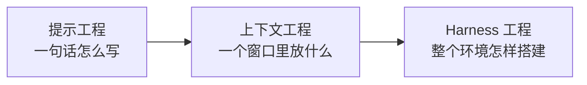

# 从提示工程到 Harness 工程：名字变了，重心也在移动

**简体中文** | [English](../../en/book/notes/prompt-context-harness.md)

[返回延伸阅读](README.md) · [返回目录](../../README.md)

> **从哪里分叉出来**：[第一章 1.1 先认清我们在使用什么](../01-first-agent.md#11-先认清我们在使用什么) · [第八章 8.1 先问“改变了哪里”](../08-evolution.md#81-先问改变了哪里)
> **前置概念**：Agent、Harness、上下文（第一章）
> **继续阅读**：[谁决定下一步](control-structures.md) · [模型看不全的时候](context-strategies.md) · [记忆的几种形状](memory-shapes.md)
> **资料核验日期**：2026-11-09

第一章把 Agent 拆成模型、上下文、工具，再加上组织它们的 Harness。这套说法在几年前并不常见。那时人们谈论的是“提示工程”：怎样写一段提示词，让模型给出更好的回答。后来流行的词换成了“上下文工程”，再后来又出现了“Harness 工程”。

名字的变化不只是营销上的更新换代。每个名字都反映了当时人们认为瓶颈在哪里：先是一句话怎么写，然后是一个窗口里放什么，再到模型所处的整个环境怎样搭建。

## 三个名字

| 名字 | 流行时期 | 关注对象 | 典型手段 | 本书对应 |
| --- | --- | --- | --- | --- |
| 提示工程 | 2020–2024 | 一次请求的文字 | 角色设定、少样本示例、“一步一步思考” | 第三章 3.2 系统提示 |
| 上下文工程 | 2025 年起 | 每一轮模型看到的全部输入 | 检索、压缩、按需加载、工具结果裁剪 | 第三、四章 |
| Harness 工程 | 2026 年起 | 模型所在的整个运行环境 | 项目规则、检查脚本、权限、反馈回路、评估 | 第五至八章 |

这三个阶段并没有严格的先后边界，后一个也没有取代前一个。今天写系统提示仍然需要提示工程的功夫，只是它在整体工作里所占的比重变小了。

## 提示工程：一次请求怎么写

2020 年的 GPT-3 论文展示了“上下文学习”：不用重新训练，只要在提示里给几个例子，模型就能完成新任务。[Language Models are Few-Shot Learners](https://arxiv.org/abs/2005.14165) 2022 年的思维链论文发现，让模型在提示中先写出推理步骤，复杂推理题的正确率会明显提高。[Chain-of-Thought Prompting](https://arxiv.org/abs/2201.11903)

这一时期的瓶颈是：模型对措辞很敏感，同一个问题换个说法，结果可能相差很多。于是出现了大量技巧：给模型设定角色、提供示例、要求一步一步思考、用特定格式包裹输入。

后来的模型经过指令微调和推理训练，对措辞不再那么敏感，很多技巧的效果随之减弱，这与[谁决定下一步](control-structures.md)里 Todo 工具的命运相似。但提示工程中最有价值的部分保留了下来：把任务说清楚，交代背景，给出验收标准。第一章要求给任务写验收条件，就是这种能力。

## 上下文工程：一个窗口里放什么

2025 年 6 月，Shopify CEO Tobi Lütke 说他更喜欢“上下文工程”这个说法，因为它更准确地描述了核心技能：为任务提供足够的上下文，让 LLM 有可能解决它。Andrej Karpathy 随后表示赞同，并把它描述为“在上下文窗口中为下一步填入恰好合适的信息”的艺术与科学。[Simon Willison：Context engineering](https://simonwillison.net/2025/Jun/27/context-engineering/)

同年 9 月，Anthropic 发表《Effective context engineering for AI agents》，把上下文工程称为提示工程的自然延续，定义为在推理过程中整理和维护最优 token 集合的一组策略，其中包括提示以外的信息。[Anthropic：Effective context engineering](https://www.anthropic.com/engineering/effective-context-engineering-for-ai-agents)

名字之所以变，是因为工作对象变了。Agent 不再只回答一个问题，而是在循环中运行几十轮。每一轮模型看到的，除了提示词，还有工具定义、读过的文件、历史消息和压缩摘要。决定效果的，往往已经不是提示词写得多巧，而是这些内容选得对不对。本书第三章整章讨论的就是这件事，具体做法的演变见[模型看不全的时候](context-strategies.md)。

## Harness 工程：模型在什么环境里工作

2026 年 2 月，Mitchell Hashimoto 在《My AI Adoption Journey》中把自己的一个工作步骤称为 “engineer the harness”：每当 Agent 犯了一个错误，就花时间做一个解决方案，让它以后不再犯同样的错。做法有两种：把规则写进 `AGENTS.md`，或者写一个脚本，让 Agent 能快速、自动地知道自己哪里做错了。他也说，自己不确定业界是否已经有公认的说法。[Mitchell Hashimoto：My AI Adoption Journey](https://mitchellh.com/writing/my-ai-adoption-journey) 同月，OpenAI 也发表了以 “Harness engineering” 为题的工程文章，介绍团队用 Codex 开发产品的经验。[OpenAI：Harness engineering](https://openai.com/index/harness-engineering/)

这一次的变化，是关注范围从“模型看到什么”扩展到“模型在什么环境里做事”：

- **反馈回路。** Agent 不只是读规则，还要能运行测试、检查器，并从失败中得到明确的信息。第五章讲的[让失败变成下一步可以使用的信息](../05-tools.md#让失败变成下一步可以使用的信息)就是这一层。
- **边界。** 权限、沙箱、执行前的完整性检查，决定了 Agent 能做什么、不能做什么。
- **持续改进。** 每次失败都可能转化为一条规则、一个 Skill 或一段程序，第八章整章讨论的就是这件事。

Hashimoto 描述的两种做法，正好对应第八章 8.1 表格里的两类改变：写进 `AGENTS.md` 是改变外部知识或操作过程，写检查脚本是改变可执行程序。

## 名字背后的重心转移

把三个名字放在一起看，可以看到重心在一步步向外移动：

这个方向与[谁决定下一步](control-structures.md)的结论一致：随着模型变强，补偿型的部分（措辞技巧、强制计划、待办提醒）逐渐变得可选，而边界型的部分（工具契约、权限、验收、评估）越来越重要。工作的重心从“替模型思考”转向“为模型准备环境”。

对读者来说，这也提示了一种阅读本书的方式。第一、二章介绍 Harness 是什么，第三、四章是上下文工程，第五到八章越来越接近 Harness 工程。遇到一个机制时，可以问自己：它是在帮模型把话说对，帮模型看到对的东西，还是在为模型划定环境和边界？前两类可能会随着模型进步而改变，第三类则会长期存在。

## 参考资料

- Brown et al. [Language Models are Few-Shot Learners](https://arxiv.org/abs/2005.14165). 2020.
- Wei et al. [Chain-of-Thought Prompting Elicits Reasoning in Large Language Models](https://arxiv.org/abs/2201.11903). 2022.
- Simon Willison. [Context engineering](https://simonwillison.net/2025/Jun/27/context-engineering/). 2025-06-27.
- Anthropic. [Effective context engineering for AI agents](https://www.anthropic.com/engineering/effective-context-engineering-for-ai-agents). 2025-09-29.
- Mitchell Hashimoto. [My AI Adoption Journey](https://mitchellh.com/writing/my-ai-adoption-journey). 2026-02-05.
- OpenAI. [Harness engineering: leveraging Codex in an agent-first world](https://openai.com/index/harness-engineering/). 2026-02.
