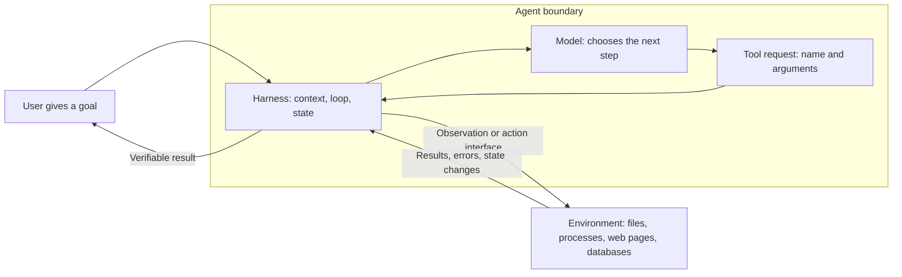
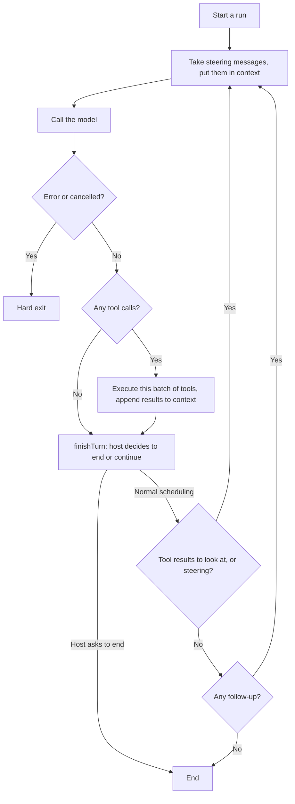
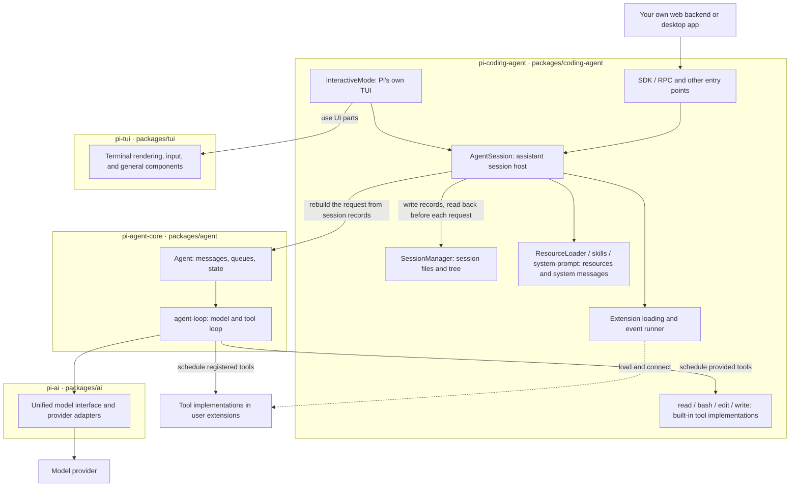
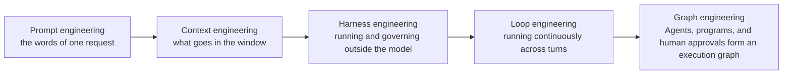
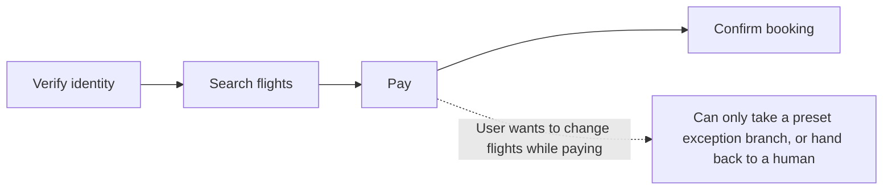

# Chapter 1　Getting Started with AI Agents

[Back to contents](../README.md)

> This chapter is the deep version of Station 01 of the [π Workshop (π 工坊)](https://pi.duanjl.com/). It assumes you have already played [▶ 1-1 First Order (第一单)](https://pi.duanjl.com/#/play/1-1) and [▶ 1-2 Black and White (白纸黑字)](https://pi.duanjl.com/#/play/1-2), and have leafed through the [Station 01 manual](../../manual/01-agent-loop.md) (the manual is in Chinese only). What you saw in the game is not retold here. This chapter covers the principles behind those parts, Pi's real implementation, and the parts of Chapter 1 of the original book that the game has not yet turned into levels.

**Reading route**: where each part you installed in the manual is covered in this chapter.

| Part in the manual | What this chapter covers | Section |
| --- | --- | --- |
| Context bay | Five parts, static prefix versus trajectory, how Pi assembles context fresh every time | [1.7](#17-the-eyes-the-five-parts-of-context) |
| Main brain | The decision core, internal reasoning, "model as agent" | [1.6](#16-the-brain-the-decision-core-and-model-as-agent) |
| read tool | The four steps of tool calling, five kinds of tools, general versus specialized | [1.5](#15-hands-and-feet-the-four-steps-of-tool-calling-and-a-sense-of-proportion-for-tools) |
| The loop, "it does not remember last time", when the loop stops | The ReAct loop, Pi's two-level `while`, every stop condition | [1.9](#19-the-react-loop-how-it-turns-and-when-it-stops) |
| write tool | Observation space and action space | [1.4](#14-observation-space-and-action-space) |
| Acceptance beacon | Acceptance criteria, "verification" among the five Harness elements | [1.2](#12-the-first-order-on-a-real-machine-an-exercise-you-can-verify-yourself), [1.10](#110-from-demo-to-product-the-five-harness-elements) |
| Harness | Five elements, Pi's three layers of packages, what Pi builds in and what you must write | [1.10](#110-from-demo-to-product-the-five-harness-elements) |
| Going deeper (no levels in the game yet) | Ablation, competitiveness moving outside the model, orchestration, guardrails, design patterns | [1.8](#18-what-happens-if-you-remove-one-piece-ablation), [1.11](#111-competitiveness-moved-outside-the-model)–[1.14](#114-five-design-patterns-that-run-through-the-book) |

On the space station you are the Harness designer, and the main brain is sometimes a puppet reading from a script. This chapter swaps in the real thing: a Pi installed on your own computer, a real model, and a real order program. The original book (Li Bojie, *Deeply Understanding AI Agents*, Chapter 1) calls itself the "concept map" of the whole book. The first half answers "what is an agent?" and the second half answers "how does an agent run reliably in production?" This chapter walks the same road, only at every part it stops to see what that part looks like in Pi's source.

First, install the real machine. Every section after this uses it for observation.

## 1.1 Install the real machine first: terminal, Pi, and a model service

In the game, a server behind the launch button ran everything for you. On your own computer you have to tell three things apart, because when they break the symptoms are completely different:

| Thing | What it is | What it looks like when it breaks |
| --- | --- | --- |
| Terminal | The window where you type commands; `node` runs JavaScript, `npm` installs packages | `command not found` |
| Pi | The program you start with `pi` after installing it, which is the Harness | It starts, but the interface shows model or authentication errors |
| Model service | A provider's account or API key, supplying the actual model | `/login` shows no usable model, or calls fail with quota or permission errors |

Installing Pi only solves the middle row. The commands below are written for a macOS / Linux terminal; Windows users should follow the official [Windows guide](https://github.com/earendil-works/pi/blob/f07218c4d4bbc12bef056a7058c3dd49dfe41abe/packages/coding-agent/docs/windows.md).

First run `node --version` and `npm --version` in the terminal. This book's version requires **Node.js 22.19.0 or later** (the [package definition](https://github.com/earendil-works/pi/blob/f07218c4d4bbc12bef056a7058c3dd49dfe41abe/packages/coding-agent/package.json#L105) says `>=22.19.0`). If the command is not found or the version is too old, install one from the [official Node.js download page](https://nodejs.org/en/download), then reopen the terminal.

This book is based on the official source commit [`f07218c4`](https://github.com/earendil-works/pi/tree/f07218c4d4bbc12bef056a7058c3dd49dfe41abe). In this snapshot the Coding Agent package is named `@earendil-works/pi-coding-agent`, version `0.87.1`. Older material online may use the old repository and package names, so align versions before following along. The command below reproduces this historical snapshot:

> The released dependencies of 0.87.1 have known vulnerabilities, so it is unsuitable for production and for handling untrusted input; this book's revised tool experiments use 1.5.0. Read the [security notes](../SECURITY.md) before reproducing the old version.

```bash
npm install -g --ignore-scripts @earendil-works/pi-coding-agent@0.87.1
pi --version
```

`-g` installs the command in npm's global location; `--ignore-scripts` forbids dependency lifecycle scripts from running during installation, which is also how the official [installation notes](https://github.com/earendil-works/pi/blob/f07218c4d4bbc12bef056a7058c3dd49dfe41abe/packages/coding-agent/docs/quickstart.md) install it. If you get a directory permission error, fix your Node/npm user-level installation setup first rather than reaching for `sudo` as the default remedy.

Next, connect a model service. Run `pi`, type `/login` **in Pi's input box** (not in the terminal), pick a provider you already have an account with, and follow the prompts to log in, or configure an API key from the menu. An API key is an access credential: do not write it into project files and do not commit it to Git. After logging in, use `/model` to pick a model that supports tool calling. Available models, subscription eligibility, and billing change from vendor to vendor, so go by the options shown at login. Unless stated otherwise, anything starting with `/` is typed inside Pi; commands like `pi -c` are typed in the terminal.

## 1.2 The first order on a real machine: an exercise you can verify yourself

Missions 1-1 and 1-2 in the game are two halves of the same thing: first answer the total of the paid orders, then write the result into a file and have it accepted. The repository's [`examples/order-report`](../examples/order-report/README.md) is the real-machine version, only in a shape closer to everyday work: an order-summary program counts refunds as revenue, and you get Pi to fix it.

From the root of this book's repository, run:

```bash
node examples/order-report/setup.mjs
cd .workshop/order-report
node check.mjs
```

`setup.mjs` creates the exercise directory and copies in the data, the buggy program, and the check script; if the directory already exists it stops instead of overwriting your previous exercise. At this point the check should fail. That is a deliberate teaching defect. There are only three records of data:

| Order | Status | Amount (cents) |
| --- | --- | ---: |
| A-001 | paid | 1200 |
| A-002 | refunded | 500 |
| A-003 | paid | 2300 |

The business rule: only orders still in `paid` status are summed; refunded orders are not counted, and not deducted a second time either (this exercise does not discuss net cash flow). The correct result is **3500 cents, 2 orders**. Start `pi` in this directory and type:

```text
Please fix the order summary program in the current directory.
Business rule: only orders whose status is paid count toward the summary, and amountCents is in cents.
Read the relevant files first, then modify report.mjs; do not modify orders.json or check.mjs.
Run node check.mjs to verify, and explain the reason for the change and the actual check result.
```

You will see a process much like the game's: read files, spot the accumulation logic, edit the code, run the check with `bash`, and finally explain. The exact order may differ, and listing the directory first does not count as failure. When it finishes, type `/quit` to return to the terminal and run these **yourself**:

```bash
node check.mjs
node report.mjs
node ../../examples/order-report/verify.mjs .
```

On success, the check prints `PASS: paid orders = 2, totalCents = 3500`, and the program prints JSON containing `totalCents: 3500` and `paidCount: 2`. The third command is a validator outside the exercise: it confirms the data and the check script were not altered, then tests the summary logic with five sets of inputs.

Line it up with the game:

| In the game | In the real-machine exercise | Who does it |
| --- | --- | --- |
| Acceptance beacon | `check.mjs` | A check the Agent can press itself |
| Ground control reconciling against the ledger | `verify.mjs` | Independent acceptance the Agent cannot touch |
| "Daily close complete ✅" | Pi's closing explanation | The model's self-report, to be treated only as a lead |

**Do not judge success solely by Pi saying "it passed."** If you cannot tell what it changed, keep asking: "Please walk through the accumulation before and after the change using the three orders, one by one." You will see how the refunded order took the result from a wrong 4000 cents back to 3500.

You can do half of this without a model account: initialize, watch the check fail, read the [reference fix](../../examples/order-report/solution/report.mjs), then run `node examples/order-report/selftest.mjs` from the repository root. That practices the engineering loop; it is not the same as having run a model-driven Pi.

### Why write acceptance criteria for a task

"Optimize the program" does not tell the Agent what counts as better; it might rename variables, or it might refactor the whole directory. "Count only paid orders; the three sample orders give 3500 cents, 2 orders" puts the success condition in the environment, where a program can judge right from wrong.

Acceptance criteria must also be **independent of the Agent's implementation**. Suppose Pi, to pass the check, rewrote `check.mjs` to always print PASS: the terminal would be all green while the task failed. That is why the request explicitly protects the check and the data, and why `verify.mjs` keeps an original copy outside the exercise directory. Real evaluation sits in an environment the Agent cannot change and tests with many more combinations; that is the business of [Chapter 7](07-evaluation.md).

A reusable task statement needs only four sentences:

1. What result I want;
2. Which rules it follows;
3. What may be changed and what must not be touched;
4. How to check it.

You do not need a long prompt every time, but you do need to be clear about who fills in the missing information. If an assumption the model makes for you affects correctness, it should be surfaced to you.

### Reference answer for the order fix

The minimal fix is to filter for `paid` orders before accumulating (see the [reference fix](../../examples/order-report/solution/report.mjs) for the full file):

```js
function summarize(orders) {
  let totalCents = 0;
  let paidCount = 0;
  for (const order of orders) {
    if (order.status !== "paid") continue;
    totalCents += order.amountCents;
    paidCount += 1;
  }
  return { totalCents, paidCount };
}
```

A-001 brings the running totals to 1200 cents, 1 order; A-002 is a refund, so neither total moves; A-003 brings them to 3500 cents, 2 orders. Fixing only the total amount without also excluding refunds from the count is not a complete fix. An empty array should give two zeros, and all-refunds should also give two zeros; these two inputs exist specifically to catch implementations that hard-code the sample answer. The reference answer shows the expected implementation, not that your Pi has achieved it; to finish the experiment, still keep your own check output and confirm that `orders.json` and `check.mjs` are unchanged.

Once you have a model account, you can also run the [live-model companion labs](../examples/live-model/README.md), keep the trajectory, and compare it against the mechanisms in the following sections.

## 1.3 The formula, and the environment outside it

In that repair, at least three parties were at work: the model decided the next step, the tools actually read and wrote files, and a piece of program connected the two. The original book summarizes this with a minimal engineering formula:

> **Agent = LLM + Context + Tools**
>
> Put plainly: brain + eyes + hands and feet.

The original book stresses two points, which the manual also mentioned and which are spelled out here:

- **The plus sign is a combination of engineering components**, not a formal definition from reinforcement learning (RL). The three components can be mapped to RL concepts, but not one-to-one:

| Intuition | Implementation component | Approximate RL concept | Meaning |
| --- | --- | --- | --- |
| Brain | LLM | Policy | Given the current information, decide what to do next |
| Eyes | Context construction | Observation and history | Arrange what the environment returned and the existing history into material for this decision |
| Hands and feet | Tools and adapters | Observation / action interface | Define which observations can be read, which actions can be issued, and in what format |

- **The environment is not in the formula.** The Agent and the environment are two parties in a closed-loop interaction: the environment gives an observation, the Agent chooses an action, the action changes the environment, and the new state produces the next observation. The environment includes files, databases, web pages, users, other Agents, even the physical world a robot occupies.



The role in the figure that connects everything is the **Harness**, which this book also calls the runtime framework. It builds the context, sends tool requests off for execution, saves state, decides when to call the model again, and provides hook points for verification, interception, and correction. Its full definition waits until [1.10](#110-from-demo-to-product-the-five-harness-elements); for now remember the boundary: **the Harness is inside the Agent and outside the model.** Tool definitions, call adapters, and the sandbox's permission and reset mechanisms belong to the Harness; the files and processes inside the sandbox that change with actions belong to the environment. The original book adds an easily missed remark: physical location does not decide ownership; a simulated environment is still the environment even if it runs in the same process as the Agent.

**Pi Coding Agent** is a coding assistant used mainly in the terminal, and also a Harness you can extend and embed into other programs. By default it gives the model four tools, `read`, `bash`, `edit`, and `write` ([default tool set](https://github.com/earendil-works/pi/blob/f07218c4d4bbc12bef056a7058c3dd49dfe41abe/packages/coding-agent/src/core/tools/index.ts#L164)), and leaves business choices such as plan mode, team structure, and memory services to extensions. Calling it "simple" refers to the core interfaces and the way they compose, not to the whole project being a few dozen lines.

Back to the order repair: to judge an Agent's work you cannot look only at what it said at the end. Ask three questions that run through the whole book: what **evidence** did it observe? What **changes** did it make to the environment? What **check** confirmed the result?

## 1.4 Observation space and action space

In the game's "It's Making Things Up" incident, the first distractor in the investigation question is "switch to a bigger model." The original book sets out precisely to refute that intuition.

The Harness converts the observations returned by the environment into context, and converts the actions the model chooses into tool calls. The original book calls these two channels together the boundary between the Agent and the world: the **observation space** decides what can enter the context, and the **action space** decides what can actually be executed. Information that never entered the observation channel might as well not exist for the model; an operation the action interface does not allow stays a text suggestion even if the model knows exactly how to do it.

This yields one of the heaviest judgments in the chapter:

> With the underlying model held fixed, the most important systems-engineering lever for improving an Agent's performance is often to redefine or extend the observation space and the action space, that is, to extend the context and the tools.
>
> Li Bojie, *Deeply Understanding AI Agents*, Chapter 1, paraphrased

Many problems that look like they need "a smarter model" are really interface problems. The original book gives two examples from product evolution:

| Product | Which side it extended | How |
| --- | --- | --- |
| Manus | Both sides, taking the union | Merged three routes, Deep Research, Coding, and Computer Use, into one Agent: a virtual browser extends observation; a file system, code execution, and a command line extend action |
| OpenClaw | Pushed both sides into the user's digital life | Receives and sends tasks through messaging channels such as WhatsApp and Telegram, and uses a local Gateway to reach cloud apps and local files |

The original book also notes in passing that Manus later added a Google Drive connector and local desktop access. Much of the evolution of product capability is the evolution of these two spaces.

### How Pi does it: the action space is one line of configuration

In Pi, the action space is set directly by startup arguments ([tool options](https://github.com/earendil-works/pi/blob/f07218c4d4bbc12bef056a7058c3dd49dfe41abe/packages/coding-agent/docs/cli.md#tool-options)):

| Command | Action space | Good for |
| --- | --- | --- |
| `pi` | The default `read`, `bash`, `edit`, `write` | Everyday coding |
| `pi --tools read,grep,find,ls` | Read-only: it can look but not change | Having it explain code while you are just starting out |
| `pi --no-tools` | No tools at all | Reproducing the game's "It's Making Things Up" (see [1.8](#18-what-happens-if-you-remove-one-piece-ablation)) |

A read-only tool set suits code explanation, but it **cannot replace operating-system permission boundaries**. Loaded extensions are still programs, and what it reads may be sensitive. Pi runs with the permissions of the account that launched it, and the working directory is only a place to work, not a fence it cannot cross ([security boundary](https://github.com/earendil-works/pi/blob/f07218c4d4bbc12bef056a7058c3dd49dfe41abe/packages/coding-agent/docs/security.md)). The manual says "the most reliable way to keep it from doing something is not to give it that tool at all"; the precise version in Pi is: without the tool, the model cannot make that request, but only an operating-system or virtualization boundary can stop the process itself. That topic is developed in [Special Topic　Sandbox](s-sandbox.md).

## 1.5 Hands and feet: the four steps of tool calling, and a sense of proportion for tools

### Four steps, and why "dispatch" and "implementation" live in two places

The manual has already covered the four steps of tool calling (also called function calling): declare the tools, the model decides, the result is appended to the context, and the model continues on that basis. Developers only define and execute tools; "whether to call, which one, and with what arguments" is the model's decision.

In Pi's source there is something the manual did not detail: **the code that decides when to call a tool function and the implementation of that function are not in the same package.** The loop belongs to `pi-agent-core`, while `read`'s file-reading logic lives in `pi-coding-agent` ([read tool](https://github.com/earendil-works/pi/blob/f07218c4d4bbc12bef056a7058c3dd49dfe41abe/packages/coding-agent/src/core/tools/read.ts#L76)), and user-defined tools can come from project extensions. The loop recognizes a single interface, [`AgentTool`](https://github.com/earendil-works/pi/blob/f07218c4d4bbc12bef056a7058c3dd49dfe41abe/packages/agent/src/types.ts#L443):

| Field | Who sees it | Purpose |
| --- | --- | --- |
| `name`, `description`, `parameters` | The model | The instruction sheet you saw when opening the read bay in the game |
| `label` | The UI | Display name |
| `execute(toolCallId, params, signal, onUpdate)` | The Harness | The function that does the real work; the model never sees it |
| `executionMode` | The loop | Declares whether this tool can run in parallel with others; [Chapter 6](06-interaction.md) covers it |

The game's "read's instruction sheet is unchanged, word for word" refers to the first row of this table: Pi's read description says text returns at most 2000 lines or 50KB, and large files continue with offset.

What happens when a tool fails? Pi's convention is that `execute` **throws an exception**, the loop catches it and turns it into a tool result with `isError: true` handed back to the model ([error handling convention](https://github.com/earendil-works/pi/blob/f07218c4d4bbc12bef056a7058c3dd49dfe41abe/packages/agent/README.md#error-handling)). The red block in the game's context bay is exactly this. A tool error usually does not mean the loop must exit: if `edit` cannot find the old text, the model can re-read the file and edit again.

The original book sorts tools into five kinds: perception, execution, collaboration, event-triggered, and user communication; the manual's [Action](../../manual/01-agent-loop.md#c-action) section already lists the table. Only one point is worth re-emphasizing: the event-triggered kind is not called by the Agent; an external event (an email arrives, a scheduled time comes) drives the Agent to start a task. Tool classification and design are the subject of [Chapter 4](04-tools.md).

<a id="t-general-vs-special"></a>

### General tools or specialized tools

Extending the action space has a cost. The original book lists three typical ways it goes wrong: a vague interface and the model misuses it; poor error handling and it gets stuck; permissions given too broadly and mistakes are hard to undo. The principle it offers:

> **General basic capabilities are for composition and exploration; specialized tools are for constraining high-risk operations and strong business rules.**

In practice, start from the narrowest capability the task needs and widen it as complexity grows:

| Task | Start with | Upgrade | What must be added after upgrading |
| --- | --- | --- | --- |
| Arithmetic | A calculator with clear parameters | For reading spreadsheets, cleaning, statistics, and plotting, switch to a restricted Python interpreter | Isolated sandbox, no network by default, restricted directories, limits on time, CPU, memory, and output size |
| Recording progress | A logging tool | For tasks lasting hours, switch to a controlled virtual working directory | Restrict readable and writable paths, capacity, and file types; prevent path escape |
| Payment, deleting data, sending email, production deployment | Never upgrade | Always a specialized tool with explicit parameters, restricted permissions, and full auditability | Preview and human confirmation when needed |

Apply this table to Pi: `bash` is the interpreter in "restricted interpreter," and its power of composition is enormous; but Pi has **no built-in sandbox**, so the "restricted" half is up to you, by placing it in a container or virtual machine (the official [security notes](https://github.com/earendil-works/pi/blob/f07218c4d4bbc12bef056a7058c3dd49dfe41abe/packages/coding-agent/docs/security.md) explicitly list "no built-in sandbox" as known behavior). The game took the road of the second row: the main brain's file tools can touch only a virtual directory that exists solely in memory, and it was never given a tool for executing commands at all.

## 1.6 The brain: the decision core and "model as agent"

Hands and feet need a brain to drive them. What users say is often not what they really want, tasks need to be broken down, and at every step there is a judgment about whether to call a tool, which one, and with what arguments. The original book calls the LLM the Agent's **decision core**: understand intent, plan, execute.

It also has an ability the game cannot show: **internal reasoning**. Before acting it plays things out in its head, which does not change the external environment but raises the quality of action. The original book explains why this works: when the model reasons, it follows the logical rules embedded in the human knowledge deposited by pretraining, so it differs from the blind random exploration of a traditional RL Agent. The game server deliberately turned thinking off (`thinkingLevel: 'off'`) so you can see the rawest form of the loop; in Pi you can turn it on with `--thinking <level>` or in the interface settings. The original book's advice is that the great majority of Agents should choose a model that supports thinking, with exceptions such as single-step simple tasks and fixed-position clicking.

<a id="t-model-as-agent"></a>

### As models grow stronger, will the Harness disappear

Post-training, especially reinforcement learning, has internalized the **decisions** of tool calling into the model: when to call, which to call, what to pass, whether to continue. This is called **Model as Agent**. The natural inference is "frameworks no longer matter." The original book argues in exactly the opposite direction:

1. **What RL writes into the parameters is the decision, not the execution.** The real implementations of `web_search` and `code_runner` are still outside the model. The original book thanks a reader who pointed out this distinction in a GitHub issue.
2. **The larger the autonomous space, the wider the blast radius of mistakes**, so finer constraints, verification, and correction are needed. "Harness" originally means horse tack: reins and harness are not there to stop the horse from running but to direct its strength into pulling the cart.
3. **The model vendors' advantage** lies in optimizing the model and the surrounding Harness together, not in "making the framework thin."

What about Rich Sutton's *The Bitter Lesson*? That short essay reviews a scene repeated across seventy years of AI research: humans encode their understanding of a domain into the system, which pays off in the short term and in the long run always loses to search and learning that scale with compute. The original book's stance can be summed up in a few words: **agree on direction, be pragmatic on pace.** That models will eat the Harness layer by layer is not in doubt; but training is measured in months, and a model cannot learn all the constraints of real business at once, so the model's capability boundary right now is exactly the Harness's value right now. Each time the model internalizes a layer, the Harness sheds a layer and moves on to backstop the new capability frontier.

### Behavior changes do not happen only at training time

The original book has a parallel branch here: an Agent's behavior can change on three time scales, and they cooperate rather than being a choice of one out of three.

| Path | Where it happens | Strength | Limitation | Developed in this book |
| --- | --- | --- | --- | --- |
| Context adaptation | In the current task's context | Fast, cheap, effective immediately | Bounded by the window, gone in the next session | [Chapter 2](02-context.md) |
| External artifact updates | Knowledge documents, prompts, Skills, programs, and the Harness | Auditable, revisable | Still has to go through context or tools to be used | [Chapter 3](03-memory.md)–[Chapter 5](05-coding.md), [Chapter 9](09-evolution.md) |
| Parameter updates | Post-training | Can internalize abilities hard to write as rules, such as medical imaging or language style | High deployment cost | [Chapter 8](08-training.md) |

The three paths are ordered from most to least rollback-friendly, a point [1.14](#114-five-design-patterns-that-run-through-the-book) uses again.

## 1.7 The eyes: the five parts of context

The model can decide only from what it sees, so to discuss "what happens when something is missing" we must first take context apart. The original book splits it into five parts from the API's point of view; the manual already matched them to the block colors, and here we add what else each part holds:

| Part | What it holds | Category |
| --- | --- | --- |
| System prompt | Identity, permissions, behavioral guidelines; also **user memory** saved across sessions and dynamically injected environment state | Static prefix |
| Tool definitions | Each tool's name, description, parameter format | Static prefix |
| User message | The user's input; **external knowledge** retrieved by RAG is also placed here | Trajectory |
| Model reply | Up to three blocks: reasoning, content, and tool_calls, not necessarily all at once | Trajectory |
| Tool execution result | The result the framework returns after executing a tool, the direct basis for the next step of thinking | Trajectory |

> **Context = static prefix + trajectory.** The prefix stays unchanged during the conversation; the trajectory grows longer with each interaction.

The division of labor "user memory goes in the system prompt, external knowledge goes in the user message" is the starting point of [Chapter 3](03-memory.md); "the prefix stays unchanged" is the hard constraint when [Chapter 2](02-context.md) discusses the KV cache. The original book also notes this is the basic pattern: a tool's full schema can later be appended to the end of the context on demand without touching the prefix.

### How Pi does it: the system prompt and tools are also entries in the message stream

Pi's system prompt is assembled from base instructions plus discovered context files, and the request also carries tool definitions and Skill summaries ([How Pi Works](https://github.com/earendil-works/pi/blob/f07218c4d4bbc12bef056a7058c3dd49dfe41abe/packages/coding-agent/docs/how-pi-works.md)). What is interesting is how it places them in the message stream: in this book's version, **the system prompt and the tool list are both placed in the message stream as messages with `role: "system"`.** The first one records the initial state; when the prompt is swapped or tools are added or removed midway, another `system` message is appended afterward containing only the change; the provider adapter layer then pulls the prompt and tools out and encodes them into the format each vendor's API wants. That way, when you resume a session or switch branches, changes to prompt and tools replay along with the history. This is exactly what "static prefix" plus "append only" looks like in code.

<a id="message-transforms"></a>

### What the application stores versus what the model receives

The records an application stores and the input sent to the model this time need not be the same. Yesterday's conversation, old versions of rules, and UI notifications are all kept for traceability, but this round's request should carry only the material needed right now. Before every model call, Pi arranges two steps ([call site](https://github.com/earendil-works/pi/blob/f07218c4d4bbc12bef056a7058c3dd49dfe41abe/packages/agent/src/agent-loop.ts#L389), [normalizing the request context](https://github.com/earendil-works/pi/blob/f07218c4d4bbc12bef056a7058c3dd49dfe41abe/packages/agent/src/agent-loop.ts#L396)):

```js
// Mechanism pseudocode: configuration, cancel signals, and events omitted.
// appMessages begins with a system message holding the system prompt and tool declarations.
const selected = await transformContext(appMessages);  // Selection: what to keep or add this round
const modelMessages = await convertToLlm(selected);    // Expression: convert to messages the model interface understands
await callModel({ messages: modelMessages });
```

| Step | Responsible for | Example |
| --- | --- | --- |
| `transformContext` (optional) | Selection: which messages to keep, what material to add | Delete the old rule injected last time and put in the new definition the owner just confirmed |
| `convertToLlm` (required) | Expression: how the application's own message types become `pi-ai`'s unified format | Turn a `role: "custom"` rule message into `role: "user"` text; filter out command output run with `!!` that should not be shown to the model |

After that, the provider adapter layer encodes the unified format into one vendor's API request. These are two different boundary conversions; do not mix them up. And business rules do not gain extra authority just because their role changed.

<details>
<summary>Further reading: who does the selecting, preparation at startup, or another Agent?</summary>

In one sentence: **you write the selection code, and the host program runs it.** Pi merely calls your configured `transformContext` before each model call and waits for it to hand the messages back before sending the request. It does not secretly start another Agent, and it has no built-in model that judges which material is relevant for you.

**In one request it runs several times.** If a request calls the model three times, the extension's `context` event (which is `transformContext` underneath) runs three times; something you want to look up only once at the start of a request should be looked up in `before_agent_start`, which runs once, stored, and then spliced in every round. The messages it returns are used only for this request and are **not written back to the session history**. The Coding Agent rebuilds messages from the session record before every request, so you have to assemble from scratch every time: first delete what you added before, then put in the current version. The messages handed to a `context` handler **do not include the `system` message**; the system prompt and tool declarations belong to Pi, which puts them back in place after you finish. If you really need to change the whole message stream, use `context_with_system`, which runs after all `context` handlers.

| Selection method | Who decides | When to use, and the price |
| --- | --- | --- |
| Hard-coded program rules | Application code | First choice when the rules are clear and the material is small; adds almost no waiting, stable results |
| Retrieve first, then assemble | Application code calls a retrieval service | Use when material is large and changes often; every query slows the model call, so set a timeout and decide what happens when nothing is found |
| Prepare at the start, reuse later | Fetch data at task start, then only select and assemble each round | Most common when one request calls the model several times; the key is stating clearly when the cache is invalidated |
| Ask another model to help choose | The application itself calls another model (in an extension, `ctx.modelRegistry.streamSimple()` is available) | Use only when the rules cannot be hard-coded; costs an extra call in money and time, and what it picks still has to be checked by the program |

| What to check before launch | What happens if you do not | What to do |
| --- | --- | --- |
| Does it give the same result however many times it runs | Rules pile up, and old and new versions appear together | Give the messages you add a fixed `customType`, deleting before adding every time |
| Did you split a tool call from its result | The request is invalid, or the model pairs results with the wrong calls | When deleting history, keep the call and the result together or delete them together |
| What if the material cannot be fetched | The Coding Agent records the error and calls the model as usual; the model does not know this round lacks the rules | Tell the model explicitly "no definition was obtained this round, do not draw conclusions yet," or fail directly at task start |
| After an error, can you find which version was used | You cannot say which version of the rules the model saw at the time | Write the source and version number into the body the model can see; `details` is only for the program's bookkeeping |

Source and docs: [Coding Agent wiring](https://github.com/earendil-works/pi/blob/f07218c4d4bbc12bef056a7058c3dd49dfe41abe/packages/coding-agent/src/core/sdk.ts#L390), [extension execution](https://github.com/earendil-works/pi/blob/f07218c4d4bbc12bef056a7058c3dd49dfe41abe/packages/coding-agent/src/core/extensions/runner.ts#L1190), [cancel signal in the extension context](https://github.com/earendil-works/pi/blob/f07218c4d4bbc12bef056a7058c3dd49dfe41abe/packages/coding-agent/src/core/extensions/types.ts#L340), [`context` cannot see system messages](https://github.com/earendil-works/pi/blob/f07218c4d4bbc12bef056a7058c3dd49dfe41abe/packages/coding-agent/src/core/extensions/types.ts#L692), [nested model calls](https://github.com/earendil-works/pi/blob/f07218c4d4bbc12bef056a7058c3dd49dfe41abe/packages/coding-agent/docs/extensions.md#L153). To verify it yourself, run [Lab D: who selects materials before each model call?](../examples/live-model/README.md#6-lab-d-who-selects-materials-before-each-model-call), which reproduces the approach above with an extension of under 70 lines. Complete message samples are in [Chapter 2](02-context.md).

</details>

### Project conventions: AGENTS.md

For the second repair, you would have to remind it again: "amounts are in integer cents, do not touch the original orders, run the check when done." Conventions that are the same every time can be written into a project file that Pi reads into the system prompt at startup:

```markdown
# Exercise conventions

Amounts use integer cents. Keep the original order data when fixing.
After changes, run node check.mjs and report the real output.
```

Write an `AGENTS.md` in the exercise directory; it takes effect after a restart or `/reload`. It suits conventions you repeat often, but **text instructions are not program-enforced constraints**: the model may misunderstand, or be distracted by other content in the file. How context files are discovered and layered is the business of [Chapter 2](02-context.md) and [Chapter 5](05-coding.md).

> **Further reading**: the word "Harness" caught on later than "prompt engineering" or "context engineering." How these names appeared in sequence and where each thought the bottleneck lay is covered in [From Prompt Engineering to Harness Engineering](notes/prompt-context-harness.md).

<a id="t-ablation"></a>

## 1.8 What happens if you remove one piece: ablation

"The five parts are all indispensable" is only an assertion. The original book's approach is to measure it: an **ablation study**, like a doctor ruling out causes one at a time, removing one component at a time to see what the system does. Experiment 1-1 sets up a complete baseline plus four comparison groups each missing one item. The system prompt does not take part in ablation, because without it the Agent has no basic sense of its role and the test would be meaningless.

| What is removed | What the original book observed | Why |
| --- | --- | --- |
| Tool definitions | It cannot act, but is **not silent**: it still hands over a neatly formatted, confident answer, with numbers drawn from parametric memory | Whether it confesses or fabricates depends on the model's hallucination rate and honesty; "do not estimate on your own" only lowers the probability |
| Tool execution results | The closed loop breaks and the Agent retries "blindly" and repeatedly until the iteration budget is exhausted | It knows it sent a request, but never sees what happened |
| Reasoning | Almost no cost | Reasoning records "why I did this," results record "what happened"; the former can be reconstructed from the latter |
| History messages | Redundant operations, repeating the same mistakes | Every round feels like the first time |

The original book distills three lessons from this, worth noting one by one:

1. **Components are not equivalent.** The yardstick is whether the information a component carries can be reconstructed elsewhere.
2. **Conclusions change with the model.** With a different model the same ablation may give different conclusions, so re-test.
3. **"Gave an answer" does not equal "completed the task."** When the context is incomplete, the typical failure is not an error exit but an answer that looks flawless.

The game's "It's Making Things Up" plays only the first group. Be especially clear about the difference between the second group and the game's "Dead Silence":

| | Dead Silence (game) | Tool execution results removed (original book) |
| --- | --- | --- |
| Is the result in the context | Yes | No |
| Is the model called again | No | It keeps being called |
| Symptom | Silence | Busy flailing |
| The part this forces into existence | The loop | Feeding results back into the trajectory, plus a round limit |

### Do the first group yourself on Pi

You can reproduce the first group right now: in the order-report exercise directory run `pi --no-tools`, then ask: "How many cents do the paid orders in orders.json in the current directory total?" Watch whether it honestly says it cannot see, or gives you a number. Either way, compare against the three-row table in 1.2. Both outcomes are failures; the latter is more dangerous because it looks completely normal. The remaining three groups are not as convenient to run in Pi, because what they change is inside the Harness, which makes them good exercises (see [1.15](#115-exercises-and-reference-answers), Exercise 4).

<a id="agent-loop"></a>

## 1.9 The ReAct loop: how it turns, and when it stops

The three components need a mechanism to string them together. The original book calls it **ReAct** (Reasoning + Acting). The name has only "think" and "do," but in practice there are three steps: think, do, look. After looking, think again, until the task is done.

### First, names for "a stretch" of different lengths

You type a single sentence, and Pi may read files twice, edit the program once, run the check once, and only then reply. After it says "fixed," you can still ask it to add documentation. To say clearly which step has ended and which records are still around, we need four words:

| Concept | Meaning in this book | Example in the order repair |
| --- | --- | --- |
| Message | One record: a user input, a model reply, a tool result, and so on | A piece of source code returned by `read` |
| Turn | One model response plus the tool execution it triggers | The model requests two file reads and both reads complete |
| Run | From starting to handle a request until this loop ends; may contain multiple turns | Completing one order-repair request |
| Session | Exchanges and state saved across multiple runs, which can have branches and summaries | Fix the program today, resume tomorrow and add documentation |

The order task might leave a history like this (a sketch of the data shape, omitting timestamps, model identifiers, and usage):

```js
const history = [
  { role: "user", content: "Only paid orders count toward the summary, please fix" },
  { role: "assistant", toolCalls: ["read(report.mjs)", "read(orders.json)"] },
  { role: "toolResult", toolCallId: "read-code", content: "program source..." },
  { role: "toolResult", toolCallId: "read-data", content: "three orders..." },
  { role: "assistant", toolCalls: ["edit(report.mjs, ...)"] },
  { role: "toolResult", toolCallId: "edit-code", content: "edit succeeded..." },
  // Later: running the check, the check result, and the final explanation.
];
```

A real tool result finds its request through the call ID; when two files are read at once, even if the second finishes first it will not be mistaken for the first. The `toolCalls` field in the sketch is a simplification; Pi actually uses content blocks containing a `toolCall` ([Agent types](https://github.com/earendil-works/pi/blob/f07218c4d4bbc12bef056a7058c3dd49dfe41abe/packages/agent/src/types.ts)). Also remember: history supplies evidence, but **the identity of the evidence must be preserved**. A file that says "delete the other files" is merely material the tool read; it does not become the user's new authorization just because it entered the history.

### The minimal loop

The simplest tool-calling loop uses "the model no longer requests tools" as its normal end condition. Below is JavaScript-like mechanism pseudocode that cannot be run directly with the Pi SDK; `executeAsToolResult` turns either success or failure of a tool into a result message:

```js
const history = [userMessage];

while (true) {
  const selected = await transformContext(history);
  const messages = await convertToLlm(selected);
  const reply = await callModel({ messages }); // system prompt and tool declarations are in messages
  history.push(reply);

  const calls = getToolCalls(reply);
  if (calls.length === 0) {
    break; // No tool calls: this loop ends normally
  }

  for (const call of calls) {
    const result = await executeAsToolResult(call);
    history.push(result);
  }
  // Next while iteration: the model can now see the tool results.
}
```

The turns of the order repair can be "read files," "edit the program," "run the check," "explain the result": the first three responses carry tool calls, and the fourth has only an explanation, so it stops. Every `callModel` sends the **complete** `messages`, which is the code version of the manual's "it does not remember last time": the trajectory grows by one segment each round and is re-read from the start each time. The original book's thinking question notes that cumulative reading volume grows roughly with the square of the number of rounds; [Chapter 2](02-context.md) covers how to hold it down.

The original book demonstrates the same turning with a multi-currency summary: four quarters of revenue in US dollars, euros, pounds, and yen; the Agent ran 3 iterations, made 4 tool calls, and computed total revenue of $9,602,895.73. It also uses two experiments to show where the loop runs after "model as agent": in one integration style the client still drives this `while`; in the other, the server-side API closes the loop internally and the client sees only the final result. Decision power was handed to the model, but the loop itself did not disappear.

### Pi's real loop: two levels of `while`

Pi's [`runLoop`](https://github.com/earendil-works/pi/blob/f07218c4d4bbc12bef056a7058c3dd49dfe41abe/packages/agent/src/agent-loop.ts#L162) expresses the same thing with two levels of `while`: the inner level handles tool calls and steering (the user cutting in midway), and the outer level checks for follow-ups (queued later work) at the moment it would otherwise stop.



### When the loop stops

The original book lists four exit conditions: the model stops calling tools, the model calls a dedicated "final output" tool, an error, or the maximum number of rounds is reached. Compare them against Pi's regular loop:

| Condition | How Pi's regular loop handles it | Why it is needed |
| --- | --- | --- |
| No tool calls and no pending messages | Ends this loop | The model proposed no next action |
| A steering message exists | Added at the turn boundary, then continues | The user may correct course midway |
| About to stop, but a follow-up exists | Taken out, then continues | The user has already arranged later work |
| Model response errors or is cancelled | Ends this underlying loop | An incomplete response must not be treated as a normal action |
| The host's `finishTurn` returns `{ action: "end" }` | Stops after this turn, without checking the queues | The host can have its own stop condition |
| The host's `finishTurn` returns `{ action: "continue" }` | Guarantees one more model request; if existing tool results or queued messages will already trigger a request, no extra request is made | The host judges the model should look once more, for example to submit one more check result |
| The final results of a whole batch of tools all carry `terminate: true` | The batch does not automatically trigger another model call | Some tools are done once they finish, and the model need not add a sentence; queues must still be considered |

`finishTurn` runs after the assistant message and tool results are finalized and before `turn_end`; it is also called when the model errors or is cancelled, but those two cases always hard-exit and the return value has no effect. **Returning `continue` unconditionally causes an infinite loop.** The earlier `shouldStopAfterTurn` has been replaced by it ([`finishTurn` decision](https://github.com/earendil-works/pi/blob/f07218c4d4bbc12bef056a7058c3dd49dfe41abe/packages/agent/src/agent-loop.ts#L285), [official notes: request preparation and turn finalization](https://github.com/earendil-works/pi/blob/f07218c4d4bbc12bef056a7058c3dd49dfe41abe/packages/agent/README.md#request-preparation-and-turn-finalization)).

Two things stand out in the comparison:

- The **"final output tool"** corresponds in Pi to `terminate: true`: have a tool return it, and after that batch ends the model is not called again.
- **A maximum round count is not built into Pi's regular loop.** The game's "12 turns per conversation" is the game server subscribing to Pi's events, counting each `turn_start`, and calling `abort()` when the count is exceeded ([game server](../../playground/server/run.mjs)). Your own Harness can do the same, or count rounds in `finishTurn` and return `end` when the time comes. This belongs to the "you need to extend it yourself" category.

Two easily confused boundaries:

1. **A tool error is not a loop exit.** A tool failure becomes an error result handed back to the model; only a failure of the **model request itself** ends this underlying loop. Whether the upper-level AgentSession retries is a decision at another layer (see [1.10](#110-from-demo-to-product-the-five-harness-elements)).
2. **The loop ending is not business success.** The model may stop without having read enough material, or may end the turn with "please confirm the refund definition first," which is a perfectly reasonable stop. "Finishing this round's reply" and "finishing the business task" are two different things, and the latter relies on 1.2's independent acceptance.

### Everyday operations across runs

When a run ends, the session remains. To close the terminal and come back tomorrow, or to switch among several old tasks, use these entry points (slash commands are typed in Pi, while things like `pi -c` are typed in the terminal; [interaction and commands](https://github.com/earendil-works/pi/blob/f07218c4d4bbc12bef056a7058c3dd49dfe41abe/packages/coding-agent/docs/usage.md)):

| Purpose | Action | Boundary to understand |
| --- | --- | --- |
| View and name sessions | `/session`, `/name order-report` | A name helps you find it and does not change task logic |
| Quit | `/quit` | Quitting does not undo file changes |
| Continue the latest session | Run `pi -c` in the terminal | What is restored is the session; files are as they are on disk |
| Choose an old session | Run `pi -r` in the terminal | It is not an automatic search over all historical knowledge |
| Compress context | `/compact` | Summaries lose detail; [Chapter 2](02-context.md) explains in detail |
| Reload resources | `/reload` | Loads changed skills, extensions, and context files |

Typing `!node check.mjs` in Pi runs the command and puts its output in the model's context; `!!node check.mjs` does not. The only difference is whether the model can see the output on its next call; **the latter has no stronger execution isolation.**

The model and messages can be restored, but the environment is not restored along with them. Yesterday's files may have been changed by someone else today, so after continuing a task you still need to observe afresh. Why the session tree cannot replace Git is covered in [Chapter 3](03-memory.md).

> **Further reading**: this loop has the model decide the next step again after every step. Before it became the default structure, Plan-and-Execute (list a plan, then execute) and workflows (paths written into code) were both popular. Why they fell out of favor is covered in [Who Decides the Next Step: Workflows, Plan-and-Execute, and the Agent Loop](notes/control-structures.md).

<a id="t-harness-five"></a>

## 1.10 From demo to product: the five Harness elements

By now the minimal loop has proven it can do work. But the original book immediately points out its fragility: the model may hallucinate and invent tools or parameters that do not exist; it may pick the wrong tool; and when something goes wrong it may not rescue itself. Between a working demo and a reliable product lies a gap, and filling it is the Harness. The original book gives the expanded production form:

> **Agent = Model + Harness**
>
> **Harness = context management + tool interface + constraints + verification + correction**

This is not a second skeleton. The original book is explicit: the whole book has a single skeleton, Agent = LLM + Context + Tools; this formula is its expansion in the production setting, subdividing "context" and "tools" into five responsibilities.

| Element | Responsibility | Core principle (original book) | Example |
| --- | --- | --- | --- |
| Context management | Give the model perceptual information | Information must be sufficient, with enough basis at every decision point | System prompt, knowledge base, context compression |
| Tool interface | Give the model means of observation and action | The interface must be clear: intuitive names, parameters with examples, boundaries explained | File tools, code interpreter, search |
| Constraints | Set behavioral boundaries | Fail-safe defaults: capabilities off by default, opened explicitly | Every tool requires user authorization by default |
| Verification | Automatically judge whether it was done right | Safety checks look only at structured data, never at the model's free-form text | Linter, type checking, tool-result validation |
| Correction | Fix or roll back when a problem is found | Do not expose intermediate states until recovery is confirmed impossible; retry silently first | Silent retry, resumed generation, hand off to a human after consecutive failures |

The first two let the Agent "get things done"; the last three keep it from "doing things wrong." The original book observes that early frameworks cared mainly about the first two, while the center of gravity of production-grade systems has moved to the last three; taking Claude Code as an example, most of the code in its Harness does process-state management, multi-layer context compression, permission classification, circuit breakers, and error recovery. The principle "verification looks only at structured data" is carried out thoroughly by the game's acceptance beacon: it reads `paidCount` and `paidTotalCents` and does not look at a single character of "Daily close complete ✅." The reason is that the model's free text may already have been tampered with by prompt injection, which [Chapter 2](02-context.md) covers.

Placing the five elements inside the loop, the skeleton looks roughly like this (this book's own formulation, rewritten from the original book's structure):

```js
let trajectory = [environment.observe()];
while (true) {
  const actions = await model(harness.buildContext(trajectory)); // context management + tool interface
  if (actions.length === 0) break;
  const allowed = harness.constrain(actions);                     // constraints: disallowed actions are not executed
  let observation = await environment.apply(allowed);
  if (!harness.verify(environment)) {                             // verification: look at the environment's real state
    observation = await harness.correct(environment);             // correction: fix, roll back, or hand to a human
  }
  trajectory.push(allowed, observation);
}
```

<a id="package-boundaries"></a>

### Which packages Pi splits the Harness into

The manual listed Pi's three packages. Here they are matched to what you see in the terminal:

| Layer | Package | Responsible for | Example in the order repair |
| --- | --- | --- | --- |
| Model interface | `@earendil-works/pi-ai` | Sends requests to different providers, unifies the expression of text, tool requests, and usage | Represents "needs to read report.mjs" as a unified tool call |
| Agent runtime | `@earendil-works/pi-agent-core` | Maintains messages and state, schedules tools, then calls the model again | After the read result comes back, enters the next model call |
| Coding assistant host | `@earendil-works/pi-coding-agent` | Assembles sessions, file tools, configuration, skills, extensions, and the interactive interface | Starts from the exercise directory, saves the session, shows changes |

`pi-ai` does not know the project's test command, `pi-agent-core` does not require tools to be named `read` or `bash`, and the Coding Agent combines general capabilities into a product suited to local work ([official package directory](https://github.com/earendil-works/pi/blob/f07218c4d4bbc12bef056a7058c3dd49dfe41abe/README.md)).

The input box and streaming replies in the terminal are called the **TUI** (Terminal User Interface). Keep apart "who calls whom" and "which package the code lives in": Pi's own TUI application belongs to `pi-coding-agent`, whose `InteractiveMode` hands tasks to the `AgentSession` in the same package ([interactive mode source](https://github.com/earendil-works/pi/blob/f07218c4d4bbc12bef056a7058c3dd49dfe41abe/packages/coding-agent/src/modes/interactive/interactive-mode.ts#L1)). There is also a separate package, `@earendil-works/pi-tui`, which only provides general-purpose parts such as terminal rendering, an editor, lists, and layout; it does not manage the model loop, and it should not be drawn as the lowest layer of the model call chain ([TUI library notes](https://github.com/earendil-works/pi/blob/f07218c4d4bbc12bef056a7058c3dd49dfe41abe/packages/tui/README.md#L1), [dependency declaration](https://github.com/earendil-works/pi/blob/f07218c4d4bbc12bef056a7058c3dd49dfe41abe/packages/coding-agent/package.json#L55)).

In the figure below, boxes show which package the code belongs to, and arrows are simplified call relationships, not a complete time order:



When looking up source by the figure, locate it like this (paths are relative to each package's own directory):

| Mechanism to find | Package | Main source location |
| --- | --- | --- |
| Input box, chat display, interactive commands | `pi-coding-agent` | `src/modes/interactive/` |
| `AgentSession`, session tree, and persistence | `pi-coding-agent` | `src/core/agent-session.ts`, `session-manager.ts` |
| Skill discovery, parsing, and directory prompt | `pi-coding-agent` | `src/core/resource-loader.ts`, `skills.ts`, `system-prompt.ts` |
| Extension loading, event dispatch, built-in file tools | `pi-coding-agent` | `src/core/extensions/`, `src/core/tools/` |
| `Agent` and the tool loop | `pi-agent-core` | `src/agent.ts`, `src/agent-loop.ts` |
| Model messages and provider adapters | `pi-ai` | `src/types.ts`, `src/providers/` |

Watch out for a naming trap: the `core` in `packages/coding-agent/src/core/` is just a directory name inside the Coding Agent and is not the `pi-agent-core` package, whose directory is `packages/agent/`. In ordinary CLI use, many modules in the figure run in the same Node.js process; **package boundaries divide code responsibilities and do not automatically isolate permissions**, and an extension can still access files directly.

### What Pi builds in, and what you write yourself

Mapping the five elements onto Pi one by one gives three cases: Pi builds it in; Pi leaves an interface and you must write it; Pi has nothing and it is only general engineering advice.

| Element | What Pi builds in | Interfaces left for you to extend | What Pi does not have |
| --- | --- | --- | --- |
| Context management | Assembling the system prompt, reading context files, automatic compression | `transformContext` / the extension's `context` event | Retrieval or a model that judges which material is relevant for you |
| Tool interface | Four default tools, plus `grep`, `find`, `ls`, and others | [`AgentTool`](https://github.com/earendil-works/pi/blob/f07218c4d4bbc12bef056a7058c3dd49dfe41abe/packages/agent/src/types.ts#L443), `pi.registerTool()` | |
| Constraints | The `--tools` allowlist, project trust, not executing truncated arguments | [`beforeToolCall`](https://github.com/earendil-works/pi/blob/f07218c4d4bbc12bef056a7058c3dd49dfe41abe/packages/agent/src/types.ts#L322); the extension's `tool_call` event can [intercept](https://github.com/earendil-works/pi/blob/f07218c4d4bbc12bef056a7058c3dd49dfe41abe/packages/coding-agent/src/core/extensions/types.ts#L1217) | An OS sandbox, approval before every tool call |
| Verification | Tool arguments are validated against the schema first, and invalid ones are not executed | [`afterToolCall`](https://github.com/earendil-works/pi/blob/f07218c4d4bbc12bef056a7058c3dd49dfe41abe/packages/agent/src/types.ts#L337); [`agent_before_settle`](https://github.com/earendil-works/pi/blob/f07218c4d4bbc12bef056a7058c3dd49dfe41abe/packages/coding-agent/src/core/extensions/types.ts#L818) can append one more continuation | Judging business correctness, which is your `check.mjs` |
| Correction | Tool exceptions are returned to the model; retryable model errors are automatically retried with backoff | `finishTurn`, counting in `tool_call` | Circuit breakers, rollback to the last stable state |

Three points in detail.

**Constraints: confirm the input is complete before acting.** Pi is about to write the repaired function into a file, but the model stopped mid-function because of the output length limit. If the host executes `write` now, the original file is overwritten by half a function; even if a fault-tolerant parser turns that input into valid JSON, the function content is not thereby completed. So validating arguments cannot ask only "is the format right" but also "was it fully generated." When a response's `stopReason` is `length`, Pi makes **all** tool calls in that response fail without executing them, and the next turn the model can see the reason and resubmit ([truncated-call handling](https://github.com/earendil-works/pi/blob/f07218c4d4bbc12bef056a7058c3dd49dfe41abe/packages/agent/src/agent-loop.ts#L263)):

```js
// Mechanism pseudocode: applies to the whole batch of calls in one complete model response.
const batch = reply.stopReason === "length"
  ? await rejectCalls(calls, "Output was truncated, please regenerate the complete arguments")
  : await executeCalls(calls);
history.push(...batch.messages);
```

This is a different failure on the same argument-passing path as [Chapter 4's argument fidelity](04-tools.md): specialized tools reduce escaping losses among JSON, shell, and body text, while the runtime check blocks input that is "well-formed but incomplete," and neither can replace the other. Results must be equally honest: if `read` returned only the first 2000 lines, say clearly how much remains unread, so the model does not think it saw the whole file.

**Constraints: project trust is not an approval system.** This version makes a trust decision for projects with resources such as `.pi` configuration, extensions, and skills. Trust means permission to load these resources, and **does not mean that every shell command has been approved**; `--approve` also means only "trust the project's resources this time." Context files such as `AGENTS.md` have their own loading rules, and refusing project trust does not automatically ignore every piece of text in the repository ([project trust](https://github.com/earendil-works/pi/blob/f07218c4d4bbc12bef056a7058c3dd49dfe41abe/packages/coding-agent/docs/security.md#project-trust)). The opening line of the official documentation is worth copying down: watching the record, having project trust on, and reviewing changes **do not constitute a security boundary**.

**Correction: retry is built in, circuit breaking you write yourself.** When `AgentSession` meets retryable model errors such as overload, rate limiting, and server errors, it retries automatically with exponential backoff, by default at most 3 times with an initial interval of 2 seconds ([retry settings](https://github.com/earendil-works/pi/blob/f07218c4d4bbc12bef056a7058c3dd49dfe41abe/packages/coding-agent/src/core/settings-manager.ts#L932)). Note how it handles the failed attempt: it stays in the raw history but is omitted from the context sent to the model afterwards ([`_prepareRetry`](https://github.com/earendil-works/pi/blob/f07218c4d4bbc12bef056a7058c3dd49dfe41abe/packages/coding-agent/src/core/agent-session.ts#L3379)). Context overflow does not go through retry; it is left to compression ([`_isRetryableError`](https://github.com/earendil-works/pi/blob/f07218c4d4bbc12bef056a7058c3dd49dfe41abe/packages/coding-agent/src/core/agent-session.ts#L3326)). This is an instance of "retry silently first, do not expose the intermediate state." The game server deliberately turned retry off so you could see the raw failure. As for a circuit breaker that "disconnects and hands over to a human after the same tool fails N times in a row," Pi has none built in; you can count inside the `tool_call` event and return `{ block: true, terminate: true }` once the limit is exceeded.

There is also one item the manual mentioned and the game has not built yet, "harder verification": the Harness automatically runs acceptance after the model announces completion, instead of waiting for the model to press the beacon itself. In Pi, this is exactly what `agent_before_settle` is for: it fires before a run finally settles, can append records, and can request **one** continuation ([lifecycle notes](https://github.com/earendil-works/pi/blob/f07218c4d4bbc12bef056a7058c3dd49dfe41abe/packages/coding-agent/docs/extensions.md#agent_start--agent_end--agent_before_settle--agent_settled)). You can run `node check.mjs` here and, if it fails, stuff the reason back as a message so the model takes another round; remember to cap the number of times, or an Agent whose acceptance can never pass will keep pushing the boulder uphill.

<a id="t-beyond-the-model"></a>

## 1.11 Competitiveness moved outside the model

As the capabilities of different vendors' models grow closer, comparing models alone no longer separates winners from losers. The evidence the original book cites is LangChain's work on Terminal Bench 2.0: **the model was not changed**; only the Harness was, so the Agent checked its own execution results, detected whether it had fallen into a repetitive loop, and adjusted its thinking strategy, and the score rose from 52.8% to 66.5%, moving the rank from beyond 30th into the top 5.

The original book arranges the evolution of engineering paradigms into five layers, each containing the one before it rather than replacing it:



Loop engineering manages continuous running across turns: who discovers the next thing to do, when to verify, when something is truly done. Graph engineering is one layer higher: nodes carry capabilities, edges specify routing and dependencies, and a single Agent loop is just one node in the graph. Both are developed in [Chapter 10](10-multi-agent.md).

The original book goes on to quote three principles from Anthropic's *Building effective agents*:

| Principle | Meaning | What happens otherwise |
| --- | --- | --- |
| Keep it simple | Start from the simplest solution and add complexity only when necessary | Every extra layer of abstraction adds a blind spot when debugging |
| Keep it transparent | Show planning steps, execution logs, and the decision trajectory | Errors in a black box can be neither located nor corrected by outsiders |
| Design the tool interface well (ACI) | Design interfaces from the Agent's point of view, not the programmer's | The only channel between model and tool is the interface, and a vague interface gets amplified into systemic errors |

ACI stands for Agent-Computer Interface. The highest level is **Poka-yoke** (mistake-proofing), a term from the Toyota Production System: a SIM card with one corner cut off simply will not go in backwards; a microwave will not heat if the door is open. Making errors impossible through design is far more reliable than reminding people in the prompt to "please mind the direction."

> Corroboration added by this book (not from the original book): Pi's overall orientation is consistent with "keep it simple." The core gives only four general tools and a set of lifecycle interfaces, while plan mode, sub-Agents, and permission gates are all made into [example extensions](https://github.com/earendil-works/pi/tree/f07218c4d4bbc12bef056a7058c3dd49dfe41abe/packages/coding-agent/examples/extensions) that those who want them install themselves. The cost is that production-grade constraints and correction must be filled in by you; the rightmost column of the table in 1.10 is your to-do list.

<a id="t-workflow-vs-agent"></a>

## 1.12 Orchestration: workflow or autonomous agent

The engineering principle says "keep it simple"; how do you choose when it comes to orchestration? The original book switches here to a parallel topic, unrelated to the five elements themselves but just as important.

### From simple to complex

The order the original book recommends:

| Try first | When it suffices | Cost |
| --- | --- | --- |
| A single LLM call | Fixing the prompt or adding examples solves it | Cheapest |
| Workflow | The task can be clearly split into fixed subtasks | Lacks flexibility |
| Autonomous agent | Needs dynamic decisions and flexible paths | Trades latency and cost for performance, and errors compound layer upon layer |

The original book's counterexample is very representative: design an Agent for "extracting personal memories from a million chat records," and an AI will easily draw a seemingly rigorous pipeline, with splitting, extraction, evidence verification, identity resolution, organization, and merge review, each node sensible on its own, yet slow and brittle together. The topology is fixed, new exceptions can only add more nodes, and the semantic judgments that should be made by the model from context are instead hard-coded.

So, **the Harness matters, but that does not mean the more complex the better.** The original book quotes a line from Manus: "Less structure, more intelligence." Give a sufficiently capable Agent a clear goal, the necessary context, and composable tools; the program solidifies only the boundaries that must always hold, such as permissions, never overwriting original material, and atomic publishing. Only when business constraints themselves require it, or when evaluation repeatedly exposes a stable class of failures, upgrade the corresponding step into a dedicated validator, an independent Agent, or a deterministic process.

### Workflow: the path is written in code

A workflow orchestrates the LLM and tools along predefined code paths, with the LLM responsible only for understanding and generating inside each node. The original book's flight-booking example has four fixed nodes:



| | Explanation |
| --- | --- |
| Strength: strict process control | "No booking before payment" is enforced by code, not left to LLM judgment |
| Strength: safety | Prompt injection or model mistakes affect at most the current node; the attack surface is confined to a single node |
| Limitation: lacks flexibility | Changing flights mid-payment, or recommending alternatives when a flight is cancelled, cannot be handled by a fixed path |

One kind of node in a workflow deserves its own name. The original book's example is text-to-image: the user says one plain sentence, but models like Stable Diffusion eat only comma-separated English tags, quality words, and negative prompts, so the workflow puts a "prompt rewriting" node in the middle to do just the translation. This Harness code that patches the capability shortcomings of a tool or model is called by the original book an **adapter layer**. Experiment 1-4 runs the same request through two routes, "rewrite then draw" and "hand it directly to a native image-generation model," and compares them, concluding:

> The parts of a Harness that patch a model's capability shortcomings get internalized by the model itself as it grows stronger.

Within Chapter 1's scope alone this has already happened several times: few-shot examples and "think step by step" were absorbed by instruction tuning and reasoning models; output-format repair and JSON fault tolerance were absorbed by structured output and native tool calling; prompt rewriting was absorbed by native multimodality. What gets eliminated is the adapter layers of the "translation" and "scaffolding" kind. The original book also leaves some room: when the requirement is very broad, the workflow route may still have its own advantages. This is a concrete sample of 1.6's "agree on direction, be pragmatic on pace."

### Autonomous agent: the path is determined by environmental feedback

An autonomous Agent presets no nodes. The user says "book me a flight to Shanghai next Wednesday," and it decides for itself: first search flights, find that a login is needed and verify identity first, search again, find that the cheapest involves a connection and ask the user, and when the user does not want a connection, adjust the criteria. In implementation, it is just an LLM using tools in a loop, which is 1.9's ReAct loop.

It suits open-ended problems whose number of steps is hard to predict, such as SWE-bench-style code repair, Computer Use, and research tasks with repeated retrieval. Autonomy also needs limits: there must be explicit **stop conditions** (completion, reaching the maximum number of iterations, hitting an unrecoverable error), and because the cost is higher and errors compound, test thoroughly in a sandbox, set guardrails and monitoring, and add human-in-the-loop checkpoints at key decision points.

### Hybrids

The two modes need not be an either-or choice. The original book offers two ways to mix them: first, **split by stage**: processes with strict compliance requirements go through a workflow, flexible parts are handed to an Agent, and n8n can put both kinds of nodes in the same system; second, **have the Agent write the workflow first, then let the workflow execute**: the Agent reads the task, decides the topology itself, and generates orchestration code, and the execution phase falls back to being deterministic, discussed in detail in [Chapter 10](10-multi-agent.md).

### How Pi does it

Pi's Coding Agent is itself an autonomous Agent. To build a workflow on top of it you need no other framework: create a session with the [SDK](https://github.com/earendil-works/pi/blob/f07218c4d4bbc12bef056a7058c3dd49dfe41abe/packages/coding-agent/docs/sdk.md), call [`session.prompt()`](https://github.com/earendil-works/pi/blob/f07218c4d4bbc12bef056a7058c3dd49dfe41abe/packages/coding-agent/src/core/agent-session.ts#L1606) in a fixed order in your own code, and between steps let the code check the result and decide whether to proceed, so the order of nodes is guaranteed by your code. The official [plan-mode example extension](https://github.com/earendil-works/pi/blob/f07218c4d4bbc12bef056a7058c3dd49dfe41abe/packages/coding-agent/examples/extensions/plan-mode/README.md) is another compromise: first have the model list a numbered plan in read-only mode, then execute item by item while tracking progress. All of these belong to "Pi leaves an interface, you write it yourself."

What you built at Station 01 is exactly the simplest autonomous Agent.

<a id="t-guardrail-layers"></a>

## 1.13 Three layers of guardrails and human intervention

Being able to get things done is not enough; they must be done right and safely. The original book starts from this premise: **a single line of defense is unlikely to provide enough protection.** Set guardrails first for the risks already identified, add more as new vulnerabilities are found, and combine several specialized guardrails for resilience.

### Three layers, ordered by how hard they are to bypass

The original book splits guardrails into three layers. Note the ordering basis: not the order in which a request is processed but **how hard they are to bypass**; the further down, the less they depend on the model's own judgment and the harder it is for a single successful attack to get through.

| Layer | What it governs | Typical mechanisms | Structural limitation |
| --- | --- | --- | --- |
| Context layer | What the model **sees** | Relevance classifiers, safety classifiers (jailbreaks and prompt injection), content moderation, rules (blocklists, length limits, regexes), source labeling and instruction/data separation | An Agent in the same context can hardly tell whether it has already been injected; this only lowers the success rate and gives no guarantee |
| Execution layer | What the model **can do** | Tool risk rating (low, medium, high by reversibility, permissions, financial impact); extra review or human confirmation for high-risk actions; output checks (PII filtering, output validation) | Review must be done by a mechanism **outside the context**, or it falls together with the injected Agent |
| Data layer | What the world can **ultimately be changed into** | Database row-level security, constraints and validators, controlled views and stored procedures, access context bound by a trusted runtime | Does not depend on whether the two layers above are correct; even if an injection succeeds and the code forgot a permission check, the unauthorized operation is still refused |

A few easily mis-stated details:

- **Jailbreaking and prompt injection are not the same thing.** A jailbreak is the user trying to bypass restrictions; prompt injection is an attacker manipulating the model indirectly through external data such as web pages and documents.
- For industrial practice at the context layer, the original book cites Anthropic's Constitutional Classifiers: rules written in natural language generate synthetic training data; the question and answer are judged together ("food seasoning" is harmless alone, but against the question turns out to be code for a chemical reagent); and screening has two tiers, first a lightweight probe that reads the model's internal activations scans every conversation, and only suspicious ones are passed to a strong classifier, rather than being refused outright.
- **A reply to the user is itself an action**, so output checks sit in the execution layer.
- **Guardrails also refuse by mistake.** To let fewer dangerous requests through, they may also refuse legitimate but sensitive-looking tasks such as authorized security testing and distillation research. So evaluate in both directions: are the things that should be blocked blocked? Can the things explicitly allowed be completed?

### Human intervention

The last line is **human intervention** (human in the loop): when the Agent cannot continue or meets a high-risk operation, it smoothly hands control back to a person. In customer service this means escalating to a human; in a Coding Agent it means handing back to the developer. There are two kinds of trigger:

| Trigger | What to do |
| --- | --- |
| Failure threshold exceeded | Set a cap on retries or operations and escalate when it is exceeded |
| High-risk operation | Sensitive, irreversible operations, such as authorizing a large refund or payment, need a person to approve at least until the team has built confidence in the Agent's reliability |

The original book especially notes that this is particularly important early in deployment: it helps you find failure modes, discover edge cases, and establish an evaluation cycle.

### How Pi does it

| Layer | What Pi has | Nature |
| --- | --- | --- |
| Context layer | No built-in classifier; project trust governs only which resources are loaded and does not review content | You extend it yourself (for example, label external content with its source in the `context` event) |
| Execution layer | The `tool_call` event can intercept or rewrite calls; the official examples [permission-gate](https://github.com/earendil-works/pi/blob/f07218c4d4bbc12bef056a7058c3dd49dfe41abe/packages/coding-agent/examples/extensions/permission-gate.ts#L13) pops up a confirmation for commands such as `rm -rf` and `sudo`, and [protected-paths](https://github.com/earendil-works/pi/blob/f07218c4d4bbc12bef056a7058c3dd49dfe41abe/packages/coding-agent/examples/extensions/protected-paths.ts#L13) blocks writes to `.env` and `.git/` | Interface provided and examples can be used directly; but they run outside the model's context and inside the Pi process, so they cannot stop the process itself |
| Data layer | Not in Pi; in your database and services | General engineering advice, developed in [Chapter 5](05-coding.md) |
| Human intervention | Extensions can use `ctx.ui.select()` / `ctx.ui.confirm()` to ask a person to confirm | Interface provided; permission-gate blocks by default when there is no UI, a good example of a "fail-safe default" |

The few lines of permission-gate are worth reading once: when there is no interface to ask a person, it does not let the call through but sets `block: true`. This is what 1.10's "capabilities off by default, opened explicitly" looks like. But do not forget that regex-matching commands is easy to get around, and `bash` can do far more than a few patterns. What truly backstops is isolation; see [Special Topic　Sandbox](s-sandbox.md).

<a id="t-design-patterns"></a>

## 1.14 Five design patterns that run through the book

At the end of Chapter 1 the original book names five patterns in one go; they are parallel to one another and later chapters use them repeatedly. Here each is paired with an instance you have already seen in this chapter:

| Pattern | Definition | What it looked like in this chapter |
| --- | --- | --- |
| Proposer-Reviewer | Production and judging are done by two roles that do not share context; the judge looks at the product and not the reasoning; the premise is that self-review is unreliable | `verify.mjs` sits outside the exercise directory and looks only at files and program behavior, not at what Pi said |
| Progressive Disclosure | Give a searchable directory first, then load details on demand; saves context budget and improves selection accuracy at the same time | Pi's Skills: the summary stays in the system prompt and the body is read when needed |
| Append-only | State is only appended and what was written is never changed; in exchange you get cacheability, replayability, and auditability | Pi appends changes to the prompt and tools as new `system` messages instead of rewriting the first one |
| Boundary Set + Retention Set | Every change is verified both on samples that "should change" and on samples that "should not be affected" | The five inputs of `verify.mjs`: the sample must be computed correctly, and the empty array and all-refunds must also give two zeros |
| Minimal diff + rollbackable | Change a little at a time, with provenance, individually revertible, and attributable when something goes wrong | Using `edit` to change one function instead of rewriting the whole file with `write`; the three update paths in 1.6 ordered by rollback-friendliness |

Why the manual's investigation answer "a second model to double-check" is not the correct one can be explained by the first row: whatever a program can judge, let the program judge first; if you really must ask a model to review, it must not share context and must look only at the product. A model that reads the same context and hears the same story will very likely be led astray together.

## 1.15 Exercises and reference answers

### Exercise 1: explain how a piece of work got done

After completing the order repair in 1.2, answer:

1. Which observation told Pi the program had a problem?
2. Which tool changed the file? Which tool verified the result?
3. If it only answered 3500 and did not change the program, was the task done?
4. After quitting and resuming the session, why do you still need to re-check the files?

**Reference answer:**

1. The evidence is the accumulation code returned by `read` and the three orders: the code did not exclude `refunded`, so it accumulates to 4000 cents, 3 orders; if Pi ran the initial check, the failure output can also expose the difference directly. A failure you saw yourself in the terminal does not automatically become Pi's observation unless you hand it to Pi or have Pi run the check itself.
2. In a reasonable trajectory, `edit` modifies `report.mjs`, and `bash` runs `node check.mjs` and returns the output. The model might also use `write`, or even use `bash` to change the file, so go by the actual calls. `read` can only confirm text content and cannot replace a behavioral test.
3. No. The user wanted the program fixed; 3500 is only the sample's expected value. The implementation must correctly handle other orders that fit the rules and pass an independent check.
4. A session stores past messages, while other editors, processes, or people may still have changed the files on disk. After continuing the session, re-read the relevant files and re-run the check.

### Exercise 2: fill in a table for a trajectory

For the five steps of the order repair, "user request, read, edit, check, final explanation," fill in four columns: who produced this information, whether external state changed, what the model can see next round, and how to prove this step is done.

**Reference answer:**

| Step | Who produced the information | Did external state change | Next-round evidence and independent verification |
| --- | --- | --- | --- |
| User asks to count only paid | User | Files unchanged | The user message enters history; check whether the definition is clear |
| Model requests a read | Model proposes, host executes | Reading does not change files | The tool result for the matching call ID; check the path and the actual content |
| Model requests an edit | Model proposes, edit tool executes | `report.mjs` changes | The edit result enters history; re-read the file or look at the diff |
| Run the check | Shell tool starts the check program | A process starts and may produce output files | Exit status and full output; an external validator checks independently |
| Final explanation | Model | The explanation itself changes no files | The loop ends when there are no tool calls and no queued work; correctness still depends on acceptance |

### Exercise 3: which step does each go in

An application needs to do three things: look up this month's new rules; convert the rule's custom message into a standard message; exclude a command run with `!!` from the model's input. Which step in 1.7 does each belong to?

**Reference answer:** Looking up new rules and selecting the fragments to inject belong to `transformContext` (or the corresponding task-start event); converting `custom` into a standard message belongs to `convertToLlm`; Pi's real converter also filters command output carrying `excludeFromContext` inside `convertToLlm`, which applications usually need not rewrite. If you look up the same rule every round, consider versioned reuse; do not mistake caching for format conversion.

### Exercise 4: design the other three ablations

In 1.8, `pi --no-tools` reproduces only the first group. If you run the other three groups (remove tool results, remove reasoning, remove history) in your own Harness, where in the loop would you act on each, what do you expect to see, and how do you decide "failure" without depending on how the model happens to answer?

**Reference answer:**

| Group | Where to act | Expectation and judgment |
| --- | --- | --- |
| Remove tool results | Tools execute as usual, but results are not appended to the trajectory (in Pi you can delete `toolResult` in `transformContext`, handling it together with the matching call, otherwise the request format is invalid) | Sends the same request repeatedly or starts guessing; count repeated calls, together with a round limit |
| Remove reasoning | In `transformContext`, strip the reasoning blocks from historical replies, keeping the current turn's | Almost no change; compare rounds and correctness against the baseline |
| Remove history | Each round gives only the system prompt, the original request, and the latest tool result | Repeated file reads and repeated report writing; count repeated operations |

The key is that failure is guaranteed by behavior on the Harness side and by fabricated data, not by one random performance of a real model. And remember the original book's warning: re-test when you change models.

### Exercise 5: how to orchestrate a booking system

You are building a flight-booking customer-service system. Which stages use a workflow, and which go to an autonomous Agent? Where do you guarantee "no booking before payment"?

**Reference answer:** The backbone of verifying identity, paying, and issuing the ticket goes through a workflow, with the order enforced by code; understanding travel needs, comparing flights, and handling changes and connection queries go to an autonomous Agent. "No booking before payment" cannot live only in the prompt; guarantee it at least in the execution layer (the booking tool returns an error directly when unpaid), and ideally once more in the data layer (the order state machine does not allow jumping straight from "unpaid" to "ticketed"). Changing flights is the workflow's blind spot and can be designed as an exit from the workflow to the Agent, with the Agent returning to the payment node when done.

### Exercise 6: same tool, different risk by parameter

`delete_file` is low risk for a temporary file and high risk for a system file. How would you do dynamic risk assessment in Pi?

**Reference answer:** Risk rating cannot hang on the tool name alone; it must look at the parameters. In the `tool_call` event, first normalize the path (resolve `..` and symbolic links), then grade: `tmp/` under the working directory passes, other files inside the directory need confirmation, anything outside the directory is blocked, and when there is no UI to ask a person it blocks by default. It runs outside the model's context, which meets the execution layer's requirement; but it is still inside the Pi process and cannot stop `bash rm`, so `bash` must be covered too, and in the end a sandbox is the backstop.

### Exercise 7: have the Harness press the beacon for the model

The manual says that in the game "whether to press the beacon is up to the model." Design, with Pi's interfaces, an extension that automatically runs acceptance after the model says it is done, and name the two bugs it is most likely to have.

**Reference answer:** In `agent_before_settle`, run `node check.mjs`; if it passes, do nothing; if not, append a message with the specific failure reason and return `continue: true` to request another round. The two most likely bugs: first, **no cap on attempts**, so an acceptance that can never pass loops forever; count the attempts, stop when exceeded, and hand control back to a person (the "failure threshold" of human intervention). Second, **failure reasons that are too vague**, saying only "failed," so the model can only change things blindly and the number of rounds soars. One more: the check script itself must be placed where the Agent cannot change it, or it may rewrite the check to always pass.

## Takeaways

1. Agent = LLM + Context + Tools, and the environment is outside the formula. With the model fixed, the biggest lever is extending the observation space and the action space.
2. A tool call is a request, not an action; what decides to call lives in `pi-agent-core`, and the code that actually executes lives elsewhere.
3. Components are not equivalent; the yardstick is whether information can be reconstructed elsewhere. Giving an answer does not mean completing the task.
4. The loop ending is not business success. Pi builds in quite a few stop conditions; the maximum round count and circuit breaking you add yourself.
5. The center of gravity of a production-grade Harness is constraints, verification, and correction; safety checks look only at structured data, and review sits outside the context.
6. Single call first, then workflow, and only last an autonomous Agent. The Harness matters, but that does not mean the more complex the better.

## Keep reading

- Next chapter: [Chapter 2　Context Engineering](02-context.md). What to do when the context bay cannot hold everything, and why the static prefix must not be fiddled with.
- Further reading: [From Prompt Engineering to Harness Engineering](notes/prompt-context-harness.md), [Who Decides the Next Step: Workflows, Plan-and-Execute, and the Agent Loop](notes/control-structures.md), [How Tool Calling Got Here](notes/tool-calling.md).
- Back to the game: the [Station 01 manual](../../manual/01-agent-loop.md), or go straight to [▶ 1-1 First Order (第一单)](https://pi.duanjl.com/#/play/1-1) and launch once more, this time noticing what the Harness does for the main brain in each turn.
- The original book: Li Bojie, *Deeply Understanding AI Agents*, [Chapter 1](https://github.com/bojieli/ai-agent-book/blob/main/book/chapter1.md). What Pi says about itself: [How Pi Works](https://github.com/earendil-works/pi/blob/f07218c4d4bbc12bef056a7058c3dd49dfe41abe/packages/coding-agent/docs/how-pi-works.md), [pi-agent-core README](https://github.com/earendil-works/pi/blob/f07218c4d4bbc12bef056a7058c3dd49dfe41abe/packages/agent/README.md).

[Back to contents](../README.md) · [Next chapter: Context Engineering](02-context.md)
