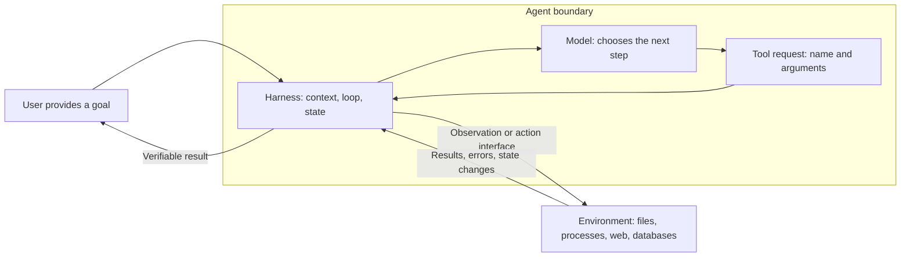

# Chapter 1: Meet Pi and Complete Your First Task

[简体中文](../../book/01-first-agent.md) | **English**

You notice that an order program calculates the wrong amount and want AI to help. In a chat window, it might suggest a change. With Pi, you can ask it to read the program on your computer, edit the file, run checks, and return the result. To use this kind of assistant, we first need to understand how it moves from giving advice to taking action.

You do not need to have written an agent or know TypeScript. You only need to open a terminal and observe files changing in a practice directory. This chapter distinguishes models, context, tools, and the harness, then explains how an agent reaches its environment. You will install Pi, configure model access, complete an independently verifiable repair, and learn session operations and project conventions. By the end, you should be able to explain who decides, who edits files, and who supplies evidence of correctness.

### Start with a checkout release

Imagine you are helping develop an e-commerce order system. After choosing products, customers visit a checkout page to confirm their address, shipping fee, and total, then pay. Your team has released a new page that moves the shipping information and changes the payment button text. For observation, only some customers see the new version.

The project lead asks:

> “Refunds seem to have increased since the new checkout launched. Can you investigate whether the redesign caused a problem? Tomorrow morning we need to decide whether to restore the old version.”

You have order exports, support records, and release notes. Orders show who requested refunds; support records include complaints about shipping fees; release notes describe the changes. These materials have not been combined, and you do not yet know whether the increase is related to the redesign.

Before asking a large language model (LLM) to investigate, consider how it will access the materials and use them to move forward.

First, it needs the actual evidence. Given only the lead's request, it can list possible causes. To investigate this incident, it must read orders, inspect customers' own words, and locate the relevant release record. With substantial data, it also needs to run calculations rather than estimate numbers in its reply.

Second, it must distinguish answered questions from open ones. Does “refund” mean an application was submitted, or that money was returned? Does a shipping complaint show that the new page was misleading? These distinctions affect calculations and conclusions. When evidence is missing, we want targeted questions and explicit gaps rather than a premature verdict.

Halfway through, you might discover that the actual decision is whether to expand the new version to more users. That differs from reverting everyone already using it. The model must revise its plan, retain established facts, and seek evidence relevant to the revised question.

Finally, the investigation needs inspectable results: how numbers were calculated, which records support each conclusion, and what remains unknown. The model can organize evidence and recommend an action; the lead makes the release decision.

We will build the foundations for this work with Pi: reading materials and running programs through tools, preserving progress across conversations, and continuing after requirements change. This chapter starts with a small order repair. After learning runtime, context, and memory mechanisms, we return to [the investigation in Chapter 7](07-general-agent.md#changing-task). The [companion lab](../examples/investigation/README.md) supplies materials for observing Pi yourself.

## 1.1 Know what you are using

When you enter the investigation request into Pi, at least three things must happen: understand the question, read evidence, and decide what to do next. The model, tools, and the program organizing them have different responsibilities. Knowing these boundaries helps you interpret a run.

A **large language model**, or LLM, generates output from input. Input can contain text; some models also accept images. A model can explain code, propose steps, and request tools with particular arguments. That alone does not grant it access to your computer's files.

A **tool** is an execution interface provided by the host program. For example, `read` accepts a file path and returns content; `write` accepts a path and text and writes a file. The model requests the call; the program behind the tool opens the file.

**Context** is the information actually passed to the model for this request: task instructions, system instructions, tool definitions, relevant file excerpts, and earlier conversation and tool results. A file being on disk does not mean the model has read it.

A useful introductory equation is:

> Agent = LLM + context + tools.

This leaves out a key role: who organizes these parts into a system that keeps running? That role is usually called the **harness**. It constructs context, dispatches tool requests, saves state, decides when to call the model again, and offers integration points for validation, interception, and correction.

The model primarily chooses what to do next; the harness determines how that decision enters execution. The model proposes reading a file, the harness validates arguments and schedules the tool, and the filesystem returns content. Permissions and validation also fall within a production harness's responsibilities, but a particular framework may not implement a complete permission system. Pi has no built-in operating-system sandbox. You must inspect its actual boundaries rather than infer them from the definition above.

**Pi Coding Agent** is primarily a terminal coding assistant and also an extensible harness that can be embedded in other programs. Its default tools are `read`, `bash`, `edit`, and `write`. Many business decisions are left to extensions instead of prescribing one planning mode, team structure, or memory service. “Minimal” describes its core interfaces and composition, not a claim that the entire project consists of a few dozen lines.

This book uses official source commit [`f07218c4`](https://github.com/earendil-works/pi/tree/f07218c4d4bbc12bef056a7058c3dd49dfe41abe). The Coding Agent package in that snapshot is version `0.87.1`, named `@earendil-works/pi-coding-agent`. Older material may use former repository and package names; align versions when following this book. [Package definition](https://github.com/earendil-works/pi/blob/f07218c4d4bbc12bef056a7058c3dd49dfe41abe/packages/coding-agent/package.json)

## 1.2 What separates the agent from its environment?

The evidence is still on your computer: orders in a CSV file and support feedback in another document. Even if Pi starts in that directory, the model does not automatically know every file's contents. It must request a read; the returned excerpts then become evidence it can use.

These files and the systems holding them belong to the agent's **environment**. An environment can also include databases, websites, users, other agents, or a robot's physical world. Agents obtain information through observation interfaces and change the environment through action interfaces.



Suppose you ask, “Find out why the accounting program counts refunds as revenue.” Pi needs to read code and data. The model sees only what tools return; it cannot magically know that another table contains refund records. After editing, it must run checks. A successful write proves that writing occurred, not that the accounting logic is correct.

This introduces a principle developed in [Chapter 5's tool contracts](05-tools.md#51-a-tool-is-a-contract-not-just-a-function): success must identify exactly what succeeded. A successful write and successful business validation are separate pieces of evidence.

Assessing an agent therefore requires more than its final reply. What evidence did it observe, what did it change, and what checks confirmed the result? These questions recur throughout the book.

## 1.3 Installation: the terminal, Pi, and model services

To try this yourself, you need both a running Pi installation and access to a model service. Installing the software addresses the first requirement. We will check the runtime, install Pi, then configure a model.

The terminal is the window where you enter commands. `node` runs JavaScript programs; `npm` installs packages; `pi` starts Pi after installation. The commands below use common macOS/Linux shell syntax. Windows users can consult the official [Windows guide](https://github.com/earendil-works/pi/blob/f07218c4d4bbc12bef056a7058c3dd49dfe41abe/packages/coding-agent/docs/windows.md).

Check Node.js first:

```bash
node --version
npm --version
```

This version requires **Node.js 22.19.0 or later**. If the commands are missing or too old, install a suitable version from the [official Node.js download page](https://nodejs.org/en/download), then reopen your terminal. Common Node.js installations include `npm`.

Install the pinned version to reduce differences between the tutorial and actual behavior:

The command below reproduces the historical snapshot. Published dependencies of 0.87.1 have known vulnerabilities; do not use it in production or with untrusted input. The revised tool lab uses 1.5.0. Read the [security notes](../SECURITY.md) before reproducing the older version.

```bash
npm install -g --ignore-scripts @earendil-works/pi-coding-agent@0.87.1
pi --version
```

`-g` installs the command in npm's configured global location. `--ignore-scripts` prevents dependency lifecycle scripts from running during installation, matching this version's official instructions. If installation reports insufficient directory permissions, fix your user-level Node/npm configuration instead of treating `sudo` as the default remedy.

Pi also needs a model service. Installing software and obtaining model access are separate steps. Run:

```bash
pi
```

Then enter this **in Pi's input box**:

```text
/login
```

Choose the service for your existing account and follow the login instructions. You can also configure an API key in the login menu. An API key is a service credential; keep it out of project files and Git. Then use `/model` to select a model supporting tool calls. Available models, subscription eligibility, and billing can change; use the options and provider documentation available when you log in.

`/login` and `/model` are interpreted by Pi, not the shell. Unless stated otherwise, enter slash operations inside Pi. [Installation and authentication](https://github.com/earendil-works/pi/blob/f07218c4d4bbc12bef056a7058c3dd49dfe41abe/packages/coding-agent/docs/quickstart.md)

## 1.4 An exercise you can verify yourself

The full investigation requires several sources and rounds of judgment. For your first attempt, use a small problem with an obvious result: an order summary incorrectly counts refunded orders as revenue. The exercise includes a program, three fictional orders, and a checker. You need not understand the source first. Run the check, observe the failure, then ask Pi to repair it.

From the repository root, run:

```bash
node examples/order-report/setup.mjs
cd .workshop/order-report
node check.mjs
```

`setup.mjs` creates a directory and copies the data, buggy program, and checker. It stops if the directory already exists to avoid overwriting earlier work. The initial check should fail: refunds are included in revenue. This is an intentional teaching defect.

There are three orders:

| Order | Status | Amount in cents |
| --- | --- | ---: |
| A-001 | paid | 1200 |
| A-002 | refunded | 500 |
| A-003 | paid | 2300 |

`paid` means payment completed; `refunded` means refunded. The exercise rule is to summarize orders still marked paid and exclude refunded orders. This is not a net cash-flow calculation, so do not subtract refunds again. The correct result is **3500 cents and 2 orders**. A clear definition gives the code a verifiable target.

Start Pi in this directory:

```bash
pi
```

Enter:

```text
Repair the order summary program in this directory.
Business rule: include only orders whose status is paid; amountCents is in cents.
Read the relevant files first, then edit report.mjs. Do not modify orders.json or check.mjs.
Run node check.mjs and explain the change and the actual check result.
```

This request supplies the goal, rules, permitted scope, and acceptance method without prescribing every implementation step. You should see Pi read files, identify the accumulation logic, edit code, run the checker through `bash`, and explain the result. Tool order can vary; listing the directory first is not a failure.

After completion, enter `/quit` to return to the terminal and independently run:

```bash
node check.mjs
node report.mjs
node ../../examples/order-report/verify.mjs .
```

Success produces `PASS: paid orders = 2, totalCents = 3500`, and the program prints JSON containing `totalCents: 3500` and `paidCount: 2`. The external verifier also confirms that the data and checker are unchanged and tests five input sets. **Do not rely solely on Pi saying the checks passed.**

If the edit is unclear, ask: “Walk through the accumulation before and after the change, one order at a time.” You can see how excluding the refund changes the incorrect 4000 to 3500, making correctness inspectable.

Without model access, you can still initialize the exercise, run the failing check, read the [reference repair](../../examples/order-report/solution/report.mjs), and run the external verifier. That practices the engineering loop but does not constitute a model-driven Pi run.

### Reference repair

A minimal repair filters for `paid` before accumulation. This JavaScript matches the exercise data structure; the [reference file](../../examples/order-report/solution/report.mjs) is runnable.

```js
function summarize(orders) {
  let totalCents = 0;
  let paidCount = 0;
  for (const order of orders) {
    if (order.status !== "paid") continue;
    totalCents += order.amountCents;
    paidCount += 1;
  }
  return { totalCents, paidCount };
}
```

A-001 brings the totals to 1200 cents and one order. A-002 is refunded, so neither total changes. A-003 brings them to 3500 cents and two orders. Fixing the amount without excluding refunded orders from the count is incomplete. An empty array or an array containing only refunds should produce two zeroes; these inputs help detect a hardcoded sample answer.

The reference describes the expected implementation; it does not prove your Pi run succeeded. Keep your actual check output and confirm that `orders.json` and `check.mjs` stayed unchanged.

## 1.5 Why tasks need acceptance criteria

“Improve the program” does not define better. The agent might rename variables, change the algorithm, or restructure the directory. “Count only paid orders; the three samples should yield 3500 cents and two orders” places success in the environment.

Acceptance criteria must also be independent of the implementation. If Pi changes `check.mjs` to always print PASS, the terminal looks successful while the task fails. That is why this exercise protects its checker and data. A real evaluation should include more order combinations in an environment the agent cannot tamper with; this small checker introduces the distinction.

A reusable task description can answer four questions: what result do I want, which rules apply, what may change, and how will it be checked? You do not always need a long prompt, but you should know who fills information gaps. Assumptions affecting correctness should be visible to you.

## 1.6 Useful first operations

After the repair, you might close the terminal and inspect more data tomorrow, or switch between older tasks. You need to recover the right session, not merely remember the conversation. Slash commands below run inside Pi; startup commands such as `pi -c` run in the terminal.

| Goal | Operation | Boundary |
| --- | --- | --- |
| Inspect the current session | `/session` | Shows identity, file, and related information |
| Name the task | `/name order-report` | Helps retrieval without changing task logic |
| Exit | `/quit` | Does not undo file edits |
| Continue the latest session | Run `pi -c` in the terminal | Restores conversation; disk files retain their current state |
| Select an older session | Run `pi -r` in the terminal | Does not automatically search all historical knowledge |
| Compact context | `/compact` | Summaries lose detail; see Chapter 3 |
| Reload resources | `/reload` | Loads changed skills, extensions, context files, and similar resources |

Inside Pi, `!node check.mjs` runs a shell command and includes its result in model context. `!!node check.mjs` excludes the output from context. The distinction concerns what the next model request can see, not stronger execution isolation. [Interaction and commands](https://github.com/earendil-works/pi/blob/f07218c4d4bbc12bef056a7058c3dd49dfe41abe/packages/coding-agent/docs/usage.md)

For initial observation, try:

```bash
pi --tools read,grep,find,ls
```

This limits the tool set and is useful for explaining code. A read-only tool set does not replace OS permissions: loaded extensions are still programs, and read content can be sensitive. Pi normally has the permissions of the account that starts it. Its working directory is a location, not an inescapable boundary.

## 1.7 Project instructions and project trust

On the next repair, you repeat: “Use integer cents, preserve raw orders, run checks after editing.” Repeated conventions can go in a project file Pi reads at startup. Write `AGENTS.md` in the exercise directory:

```markdown
# Exercise conventions

Use integer cents for amounts. Preserve original order data during repairs.
After editing, run node check.mjs and report the actual output.
```

After restarting or `/reload`, Pi includes such instructions in context. They are suitable for recurring conventions, but text instructions are not enforced program constraints. The model can misunderstand them or be influenced by other file content.

This version also makes a trust decision for projects containing `.pi` configuration, extensions, skills, and related resources. Trust allows those resources to load; **it does not mean every shell command is approved**. Likewise, `--approve` trusts project resources for this run rather than adding an approval system to all tool operations. Context files such as `AGENTS.md` have separate loading rules; refusing project trust does not automatically exclude all repository text. [Security boundaries](https://github.com/earendil-works/pi/blob/f07218c4d4bbc12bef056a7058c3dd49dfe41abe/packages/coding-agent/docs/security.md)

## 1.8 Exercise: explain how the work was completed

After repairing the program, answer:

1. Which observation told Pi the program was wrong?
2. Which tool changed the file, and which checked the result?
3. Is the task complete if Pi gives the correct answer, 3500, without editing the program?
4. Why inspect files again after exiting and resuming a session?

### Reference answers

1. Evidence includes the accumulation code and three orders returned by `read`: without excluding `refunded`, the code totals 4000 cents and three orders. If Pi runs the initial check, that failure exposes the discrepancy too. A failure you saw independently in the terminal is not automatically Pi's observation; pass it to Pi or have Pi run the check.
2. A reasonable trace uses `edit` to change `report.mjs` and `bash` to run `node check.mjs`. The model might instead use `write` or even modify files through `bash`; inspect actual calls. Reading text cannot replace a behavior test.
3. No. The task is to repair a program; 3500 is only the sample expectation. The implementation must handle other valid orders and pass independent checks.
4. A session stores earlier messages. Editors, processes, or people can still change files on disk. Reread files relevant to the next action and run appropriate checks. [Chapter 4](04-memory.md) explains why restoring a session does not restore the external world.

The next chapter breaks the visible process into loops, messages, and state, showing why the same model can behave differently under different harnesses.

With model access, run the [live-model labs](../examples/live-model/README.md), preserve traces, and compare observations with these mechanisms.

[Back to contents](../README.md) · [Next: Runtime and architecture](02-runtime.md)
