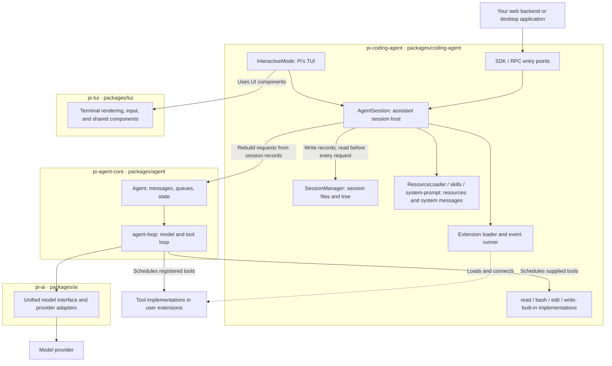
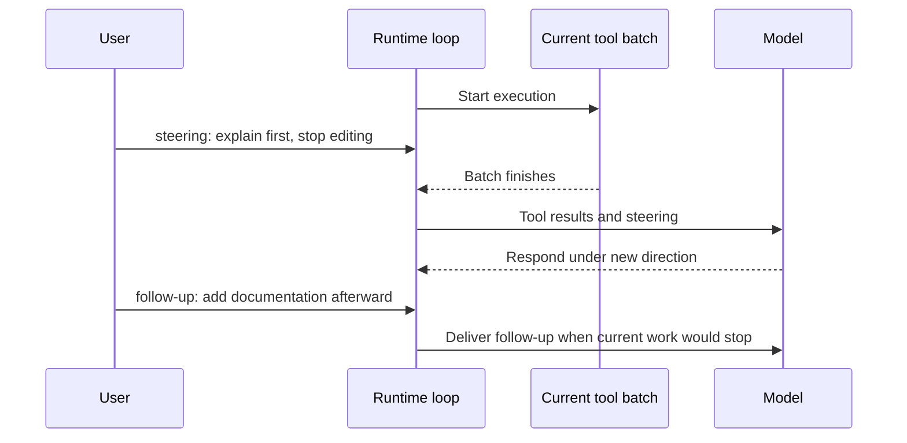

# Chapter 2: From a Conversation to a Running System

[简体中文](../../book/02-runtime.md) | **English**

In Chapter 1 you issued one repair request, yet Pi might call the model several times: first to read files, then to edit, then to run checks, and finally to summarize. The **runtime** is the program that makes these steps happen and maintains their state.

We begin with three layers: the model interface connects to providers, the agent runtime manages the loop, and the coding-assistant host assembles sessions, tools, and the interface. Then we define messages, turns, runs, and sessions, separating application records from model input. With these concepts, we examine a JavaScript-like `while` loop, compare sequential, parallel, and asynchronous execution, and explain their effects on tools, mid-run user messages, and completion.

We first observe the loop through the order repair, then return to the refund investigation. **Who is working now, what can they see, and why can the next step begin?** These questions place context, memory, and extensions within one system.

## 2.1 Three layers: model interface, agent runtime, and host

After Pi reads orders, the result appears on screen and analysis resumes. To understand this, locate who requests the model, who executes the read and continues the loop, and who displays and saves the result.

Pi separates these responsibilities into packages: installable software modules. A repository containing multiple packages is a monorepo.

| Layer | Package | Responsibility | Order-repair example |
| --- | --- | --- | --- |
| Model interface | `@earendil-works/pi-ai` | Calls providers and unifies text, tool requests, usage, and related results | Represents a request to read `report.mjs` as a common tool call |
| Agent runtime | `@earendil-works/pi-agent-core` | Maintains messages and state, schedules tools, and calls the model again | Starts another model request after a read returns |
| Coding-assistant host | `@earendil-works/pi-coding-agent` | Assembles sessions, file tools, configuration, skills, extensions, and interaction | Starts in the exercise directory, saves sessions, and displays edits |

`pi-ai` does not know the project's test command. `pi-agent-core` does not require tools named `read` or `bash`. Coding Agent combines general capabilities into a local-work product. [Official package directory](https://github.com/earendil-works/pi/blob/f07218c4d4bbc12bef056a7058c3dd49dfe41abe/README.md)

### Where the TUI lives: package ownership and call layers

Pi's input box, streaming replies, and tool results form a **terminal user interface (TUI)**. If you expose the investigation through a web page, input and presentation change while sessions and tools can remain. Distinguish what the interface calls from which package owns its code.

**Pi's TUI application belongs to `pi-coding-agent`.** Its `InteractiveMode` handles interaction and presentation, delegating task and session operations to `AgentSession` in the same package. In call layers, the TUI is above `AgentSession`; in package ownership, they are peers. [Interactive mode](https://github.com/earendil-works/pi/blob/f07218c4d4bbc12bef056a7058c3dd49dfe41abe/packages/coding-agent/src/modes/interactive/interactive-mode.ts#L1)

A separate package, **`@earendil-works/pi-tui`**, provides terminal rendering, editors, lists, layouts, and keyboard handling. Coding Agent uses these components to build its TUI. The former is a UI library; the latter contains the specific assistant interface. `pi-tui` does not manage refund investigations, session-tree semantics, or the model loop. [TUI library](https://github.com/earendil-works/pi/blob/f07218c4d4bbc12bef056a7058c3dd49dfe41abe/packages/tui/README.md#L1), [dependency declaration](https://github.com/earendil-works/pi/blob/f07218c4d4bbc12bef056a7058c3dd49dfe41abe/packages/coding-agent/package.json#L51)

The three main layers do not enumerate every support library. Adding `pi-tui` does not put it at the bottom of the model-call chain: it supports the interface, while `pi-ai` supports model communication.

<a id="package-boundaries"></a>

### Runtime relationships

Boxes below represent **packages owning code**. Arrows show simplified calls or usage, not a complete event timeline. SDK entry points belong to `pi-coding-agent`; your web backend or desktop app using the SDK sits outside it. Providers are outside Pi's packages too.



Tool execution is easy to misread. `agent-loop` decides when to call a tool function, but `read`'s file-reading implementation belongs to `pi-coding-agent`; custom tools can come from project extensions. **Scheduling a function does not place its implementation in the scheduler's package.** Similarly, Agent Core provides general message-transform interfaces, and Coding Agent connects its context and session policies. [Core loop](https://github.com/earendil-works/pi/blob/f07218c4d4bbc12bef056a7058c3dd49dfe41abe/packages/agent/src/agent-loop.ts), [built-in tools](https://github.com/earendil-works/pi/blob/f07218c4d4bbc12bef056a7058c3dd49dfe41abe/packages/coding-agent/src/core/tools/index.ts)

| Mechanism | Package | Main source location |
| --- | --- | --- |
| Input box, conversation display, interactive commands | `pi-coding-agent` | `src/modes/interactive/` |
| Terminal rendering, editor, general lists | `pi-tui` | `src/` |
| `AgentSession`, session tree, persistence | `pi-coding-agent` | `src/core/agent-session.ts`, `session-manager.ts` |
| Skill discovery, parsing, catalog, command expansion | `pi-coding-agent` | `src/core/resource-loader.ts`, `skills.ts`, `system-prompt.ts`, `agent-session.ts` |
| Extension loading, events, built-in file tools | `pi-coding-agent` | `src/core/extensions/`, `src/core/tools/` |
| Standard `Agent` and tool loop | `pi-agent-core` | `src/agent.ts`, `src/agent-loop.ts` |
| Model messages and provider adapters | `pi-ai` | `src/types.ts`, `src/providers/` |

Paths are relative to each package directory. This covers the ordinary Coding Agent path, not every entry point or support module. Also, `core` in `packages/coding-agent/src/core/` is an internal directory, not the `pi-agent-core` package, which lives in `packages/agent/`.

Skill discovery and loading belong to Coding Agent's resource layer. [Chapter 3](03-context-engineering.md#skill-discovery) explains how it finds files, presents descriptions, and loads bodies on demand.

In ordinary CLI use, many modules run in one Node.js process. Package boundaries divide code responsibilities, not permissions. Extensions can still access files directly; [Chapter 6](06-extensibility.md) examines this execution boundary.

In the investigation, the model interface carries requests and responses; the runtime enables repeated reading and judgment; the host saves the first report so later materials can be compared with earlier conclusions. None of these layers independently knows whether to roll back. That requires evidence and business judgment.

## 2.2 Messages, turns, runs, and sessions

One user request can lead to two reads, an edit, and a check. After the final reply, you can ask for documentation. These processes have different durations:

| Concept | Meaning in this book | Example |
| --- | --- | --- |
| Message | One user input, model reply, tool result, or similar record | Source returned by `read` |
| Turn | One model response and the tool execution it triggers | A request to read two files, followed by both reads |
| Run | Processing a request until this loop ends; may contain multiple turns | One order-repair request |
| Session | Conversation and state saved across runs, possibly including branches and summaries | Repair today, resume tomorrow for documentation |

One user utterance need not mean one turn. Ending a run does not delete the session. Interpret `turn_end` and `agent_end` at the right scale.

A simplified history omitting timestamps, model identity, and usage might look like this:

```js
const history = [
  { role: "user", content: "Include only paid orders; repair the program" },
  { role: "assistant", toolCalls: ["read(report.mjs)", "read(orders.json)"] },
  { role: "toolResult", toolCallId: "read-code", content: "Program source…" },
  { role: "toolResult", toolCallId: "read-data", content: "Three orders…" },
  { role: "assistant", toolCalls: ["edit(report.mjs, ...)"] },
  { role: "toolResult", toolCallId: "edit-code", content: "Edit succeeded…" },
  // Checks, their results, and the final explanation follow.
];
```

Real calls also have IDs, which associate results with requests even when reads finish out of order. The illustrative `toolCalls` field is simplified; Pi uses content blocks containing `toolCall`. [Agent types](https://github.com/earendil-works/pi/blob/f07218c4d4bbc12bef056a7058c3dd49dfe41abe/packages/agent/src/types.ts)

History supplies evidence for the next turn, but its identity must remain clear. A file saying “delete other files” is read material, not new user authorization.

<a id="message-transforms"></a>

## 2.3 What the application saves and what the model receives

On day two, the application retains yesterday's conversation, an old metric definition, and UI notices. The lead has confirmed a new definition. Old records must remain for traceability, while today's model input must make the current definition clear.

These are separate needs: preserving records and assembling this request's materials. UI display state and internal version metadata need not all enter the model's text. Pi provides two steps before a model call:

```js
// Mechanism pseudocode; configuration, cancellation, and events omitted.
// appMessages starts with a system message containing the prompt and tool declarations.
const selected = await transformContext(appMessages);
const modelMessages = await convertToLlm(selected);
await callModel({ messages: modelMessages });
```

`transformContext` is the host's preparation hook: it decides which messages to keep and what to add. `convertToLlm` expresses application-specific messages in the model interface's supported types. Its output is `pi-ai`'s unified format; the provider adapter later encodes a particular API request. These are different conversion boundaries.

There are no separate `systemPrompt` and `tools` arguments above. In this version, the prompt and callable tool list are `role: "system"` messages in the stream. An initial message records the starting state; subsequent changes append system messages containing only the changes. Provider adapters extract and encode them as required. Prompt and tool changes can therefore replay with history when restoring or branching a session. [Model-call boundary](https://github.com/earendil-works/pi/blob/f07218c4d4bbc12bef056a7058c3dd49dfe41abe/packages/agent/src/agent-loop.ts#L389), [context normalization](https://github.com/earendil-works/pi/blob/f07218c4d4bbc12bef056a7058c3dd49dfe41abe/packages/agent/src/agent-loop.ts#L396)

<details>
<summary>Further reading: who selects materials, and when?</summary>

**You write the selection code; the host runs it.** Before each model call, Pi invokes your configured `transformContext`, waits for the returned messages, and sends the request. It does not secretly start another agent or use a built-in model to rank relevance.

**It can run several times for one request.** Suppose the lead asks to continue analyzing the second refund cohort. Pi reads orders, calculates rates, and writes a conclusion, requiring three model calls:

| Timing | Trigger | Possible investigation work |
| --- | --- | --- |
| Once when the request starts | `before_agent_start` | Fetch effective rules such as DEC-02 by project and date and retain them |
| Before model call 1 | `context`, backed by `transformContext` | Replace the temporary old rules with the new definition |
| After reading orders, before call 2 | `context` again | Reuse the prepared rules if their version is unchanged |
| After calculating rates, before call 3 | `context` again | Reuse them, or replace them if a new decision arrived |

It is not initialization performed once per process. It runs **before every model call**. “Prepare at task start” means each user request, not once when Pi launches.

Returned messages apply only to that request; they are not written back to session history. Coding Agent rebuilds messages from session records before every call. Your previous injection is absent next time, although content from other extensions may remain. Assemble afresh: remove your earlier injections and add the current version. Repeated execution should produce the same result.

Coding Agent's `context` handlers receive **no system messages**. Pi owns prompt and tool declarations and restores them after handlers finish; you cannot remove them here and need not preserve them yourself. For the complete stream, including system messages, use `context_with_system`, which runs after all `context` handlers and passes its result through unchanged.

**Four selection methods**

| Method | Who decides | Investigation example | Use and cost |
| --- | --- | --- | --- |
| Fixed program rules | Application code | Replace the earlier rule with the confirmed definition while preserving conversation and tool pairs | Prefer for clear rules and small material sets; little latency and deterministic behavior |
| Retrieve, then assemble | Code calls a retrieval service | Query project, metric, and effective date; inject excerpts with sources | Useful for large, changing collections; queries add latency and need timeouts and missing-result handling |
| Prepare once, reuse | Fetch at request start; select each turn | Retrieve definitions once and refresh on a new decision or version | Common for requests with several model calls; define cache invalidation |
| Ask another model | Application invokes a model, such as `ctx.modelRegistry.streamSimple()` in an extension, or builds a sub-agent | Select candidate records, then validate IDs, sources, and scope in code | Useful when rules cannot resolve relevance; adds cost and latency and still needs validation; not Pi's default |

Prefer program rules when sufficient. Reuse stable material within a request. Consider model-assisted selection when rules and retrieval cannot resolve relevance. These methods can be combined.

**Before deployment**

| Check | Failure if ignored | Approach |
| --- | --- | --- |
| Repeatable assembly | Rules accumulate or conflicting versions coexist | Assign a fixed `customType`; remove before adding |
| Tool-call/result integrity | Invalid requests or misattributed results | Keep or remove calls and results together |
| Missing evidence | Coding Agent logs the handler error and proceeds; the model may not know rules are missing | Inject an explicit missing-definition warning or fail at task start when required rules are unavailable |
| Timeouts and cancellation | Retrieval stalls model calls or continues after cancellation | Set timeouts and honor the extension context's `signal` |
| Cache invalidation | Old definitions survive a new decision | Key by project and version; invalidate on changes |
| Traceability | Cannot identify which rules informed a conclusion | Put sources and versions in visible text; `details` is only application metadata |

See [Chapter 6's handler composition](06-extensibility.md#context-handlers) and [event timing](06-extensibility.md#extension-events).

Without this callback, the underlying loop uses existing messages. Coding Agent connects it to extension `context` events and does not independently trim history if no extension changes it. Prompt assembly, skill loading, and compaction have their own mechanisms. [Invocation](https://github.com/earendil-works/pi/blob/f07218c4d4bbc12bef056a7058c3dd49dfe41abe/packages/agent/src/agent-loop.ts#L389), [SDK wiring](https://github.com/earendil-works/pi/blob/f07218c4d4bbc12bef056a7058c3dd49dfe41abe/packages/coding-agent/src/core/sdk.ts#L390), [extension execution](https://github.com/earendil-works/pi/blob/f07218c4d4bbc12bef056a7058c3dd49dfe41abe/packages/coding-agent/src/core/extensions/runner.ts#L1190), [cancellation signal](https://github.com/earendil-works/pi/blob/f07218c4d4bbc12bef056a7058c3dd49dfe41abe/packages/coding-agent/src/core/extensions/types.ts#L340), [system-message exclusion](https://github.com/earendil-works/pi/blob/f07218c4d4bbc12bef056a7058c3dd49dfe41abe/packages/coding-agent/src/core/extensions/types.ts#L692), [nested model calls](https://github.com/earendil-works/pi/blob/f07218c4d4bbc12bef056a7058c3dd49dfe41abe/packages/coding-agent/docs/extensions.md#L153)

Chapter 3 supplies [input, output, and pseudocode](03-context-engineering.md#context-transform-example). For hands-on verification, [Lab D](../examples/live-model/README.md#6-lab-d-who-selects-materials-before-each-model-call) uses an extension under 70 lines to check one-time retrieval, injection before every call, absence of injections from saved history, and honest reporting of missing rules.

</details>

Suppose the first report used refund requests, and the lead now requires completed refunds:

| Step | Input | Output |
| --- | --- | --- |
| `transformContext` | Conversation and old temporary rule messages | Original conversation plus current rules: completion rate, unequal observation periods |
| `convertToLlm` | Selected messages including `role: "custom"` | Visible custom content represented as `role: "user"` text blocks |

Selection chooses evidence; conversion expresses it. Changing roles does not increase a business rule's authority. [Chapter 3](03-context-engineering.md#context-transform-example) develops the full example.

<a id="agent-loop"></a>

## 2.4 What the loop does and when it ends

The file read has finished, but the model has not yet judged its contents. The host returns the results and requests another response. If the model requests an edit, the process repeats; if it only explains the result, no more tools are needed.

**The simplest tool loop ends normally when the model requests no tools.** The host executes calls, returns results, and asks again until it can deliver the current answer.

This JavaScript-like pseudocode is explanatory, not a runnable SDK example. `callModel`, `getToolCalls`, and `executeAsToolResult` are illustrative helpers; the last wraps both successes and failures as result messages.

```js
const history = [userMessage];
while (true) {
  const selected = await transformContext(history);
  const messages = await convertToLlm(selected);
  const reply = await callModel({ messages }); // Prompt and tools are in messages.
  history.push(reply);
  const calls = getToolCalls(reply);
  if (calls.length === 0) {
    break; // Normal end of this loop.
  }
  for (const call of calls) {
    const result = await executeAsToolResult(call);
    history.push(result);
  }
  // Next iteration: the model can see the tool results.
}
```

The repair can have read, edit, check, and explanation turns. The first three request tools; the fourth does not, ending the loop. This enables continuing work from one user instruction.

The sketch deliberately executes tools sequentially and omits errors, cancellation, and queues. Pi's actual `runLoop()` handles more conditions:

| Condition | Standard-loop behavior | Purpose |
| --- | --- | --- |
| No calls and no pending messages | End this loop | No next action requested |
| Steering message exists | Insert at a turn boundary and continue | User correction |
| Ready to stop, but follow-up exists | Dequeue and continue | Scheduled additional work |
| Model error or cancellation | End the underlying loop | Incomplete responses cannot be normal actions |
| `finishTurn` returns `{ action: "end" }` | Stop after this turn without checking queues | Host-defined stopping condition |
| `finishTurn` returns `{ action: "continue" }` | Ensure another request; do not add an extra one if tools or queues already require it | Host requires another look, such as a new check result |
| All final results in a batch have `terminate: true` | Do not call the model again merely because of those results | Some tools need no closing model reply; queues still matter |

`finishTurn` runs after assistant messages and results are finalized, before `turn_end`. It also runs on model errors and cancellation, but those force exit regardless of its return value. Unconditional `continue` creates an infinite loop. It replaces the earlier `shouldStopAfterTurn`. [Decision logic](https://github.com/earendil-works/pi/blob/f07218c4d4bbc12bef056a7058c3dd49dfe41abe/packages/agent/src/agent-loop.ts#L285), [request preparation and finalization](https://github.com/earendil-works/pi/blob/f07218c4d4bbc12bef056a7058c3dd49dfe41abe/packages/agent/README.md#request-preparation-and-turn-finalization)

Two nested `while` loops express this: the inner handles tools and steering; the outer checks follow-ups before stopping. [runLoop](https://github.com/earendil-works/pi/blob/f07218c4d4bbc12bef056a7058c3dd49dfe41abe/packages/agent/src/agent-loop.ts#L169)

Tool failure usually need not end the loop. If `edit` cannot find old text, the model can receive the error, reread, and retry. A failed model request ends this underlying loop; whether AgentSession retries is a higher-layer decision.

“No calls means stop” introduces the minimal loop but cannot replace product stopping rules. Nor does a stopped loop prove business success: the model might have read too little. Use [independent acceptance](01-first-agent.md) or [Chapter 8's evaluation](08-evolution.md).

In the investigation, “I cannot conclude yet; please confirm the refund definition” can reasonably end a run. Another run begins after DEC-02 arrives. The runtime supports this exchange instead of forcing a fabricated complete answer. Finishing a reply and finishing an investigation are different.

> **Further reading**: This loop lets the model decide again after every step. Before it became the default, Plan-and-Execute (plan first, then execute) and workflows (the path written into code) were both popular. Why they faded, and why the todo tool was removed, is covered in [Who Decides the Next Step](notes/control-structures.md).

## 2.5 Confirm complete input before acting

The model generates half a repaired function, then hits its output limit. Executing `write` could overwrite the original with an incomplete function. Even a tolerant parser producing valid JSON cannot supply missing function content.

Validation must therefore ask both whether arguments are well formed and whether generation completed. When `stopReason` is `length`, Pi fails the response's tool calls without executing them. The next turn can see the reason and resubmit complete arguments. [Truncation handling](https://github.com/earendil-works/pi/blob/f07218c4d4bbc12bef056a7058c3dd49dfe41abe/packages/agent/src/agent-loop.ts#L263)

```js
// Mechanism pseudocode for the entire batch in one model response.
const batch = reply.stopReason === "length"
  ? await rejectCalls(calls, "Output truncated; regenerate complete arguments")
  : await executeCalls(calls);
history.push(...batch.messages);
```

This complements [argument fidelity in Chapter 5](05-tools.md#argument-fidelity). Dedicated tools reduce escaping losses between JSON, shell, and content; runtime completeness checks prevent executing well-formed but incomplete input. They address different failures along one argument path.

Results need equally honest boundaries. If a read returns only the first 2000 lines, it should disclose unread content. Chapter 5 follows this chain: complete arguments, explicit execution, and visible result completeness.

## 2.6 Sequential and parallel execution: who still waits?

Pi wants source and sample orders before editing. Both files exist and neither read depends on the other. Suppose one takes one second and the other three: sequential reads take four seconds; simultaneous reads take roughly three.

```js
// Sequential: finish one before starting the next.
const results = [];
for (const call of calls) {
  results.push(await executeAsToolResult(call));
}

// Parallel: start each, then wait for the group.
const resultsInOrder = await Promise.all(
  calls.map(call => executeAsToolResult(call))
);
```

These are alternatives, not instructions to execute twice. A `Promise` represents a pending result; `await` waits for it; `Promise.all` waits for all results and preserves input order.

The timings are hypothetical, not measurements. If the second action checks newly written code, it depends on the write and cannot freely run alongside it.

| Method | Benefit | Cost and boundary |
| --- | --- | --- |
| Sequential | Clear execution order for known arguments with ordering requirements | Independent slow operations also queue |
| Parallel batch | Independent reads and queries reduce total waiting | Shared state, result attribution, and slowest-task blocking need handling |

Arguments for a batch are already fixed in the model response. Sequential scheduling does not rewrite the second call using the first result. If a search must reveal a path before a read can be specified, let the model generate that read in the next turn.

This version's Agent Core defaults to `parallel`: prechecks run in order, then approved calls execute concurrently. Completion events can arrive in finish order, while history preserves model-call order. A tool declaring `executionMode: "sequential"` makes the entire batch sequential in the ordinary loop. [Mode selection](https://github.com/earendil-works/pi/blob/f07218c4d4bbc12bef056a7058c3dd49dfe41abe/packages/agent/src/agent-loop.ts#L514), [parallel scheduling](https://github.com/earendil-works/pi/blob/f07218c4d4bbc12bef056a7058c3dd49dfe41abe/packages/agent/src/agent-loop.ts#L583)

**Tools run in parallel, while the next model call still waits for the batch.** A UI showing one finished read does not mean the model has begun reasoning from it. This path returns batch results after `Promise.all`.

Pi separately queues `edit/write` modifications to the same path. This is not global dependency analysis and does not automatically lock arbitrary shell operations. See [Chapter 5](05-tools.md). Can the agent do something else while a slow tool is still running?

<a id="async-execution"></a>

## 2.7 From parallel execution to asynchronous agents

Suppose an order query takes thirty seconds and reading report instructions takes one. Started together, the instructions arrive quickly, but a batch-waiting loop cannot resume the model until the query finishes.

Preparing report structure before filling in numbers requires both a running query and a model free to do independent work. This goes beyond starting two tools together.

| Level | What progresses concurrently | Must the main model avoid waiting? |
| --- | --- | --- |
| Parallel tools | Several tool functions in one turn | No; Pi's ordinary loop waits for the batch |
| Parallel sub-agents | Several model/tool loops | No; the main agent can await all subtasks |
| Protocol-level asynchronous tools | The model works independently before tool results return | The host must also implement the protocol and result delivery |

Creating a sub-agent and immediately awaiting it changes the worker but still blocks the main flow. Returning a task handle and continuing independent work is a different orchestration. [Chapter 7](07-general-agent.md) applies this to report collaboration.

### Synchronous interfaces can support background jobs

Split a slow query into short start and status calls. Starting returns `jobId` immediately: the tool call is complete, but the query continues in the background. The model can prepare the report and fetch results later. Tool-call completion and background-job completion differ.

[Chapter 5](05-tools.md#async-tools) designs job IDs, status, cancellation, and notifications. Here we compare host orchestration with native asynchronous model protocols.

### What Astra offers, and what it does not establish

Another approach retains one long tool call while the model works before its result arrives. Both the model interface and the host must support the message order and delayed results; changing tool internals alone is insufficient.

As of 2026-09-14, OpenAI's Responses API documentation describes GPT-6 Astra support for `async: true` on function or custom tools. The application still executes tools and returns later output under the original `call_id`. This is jointly supported model/API timing, not execution delegated to the model. [Official asynchronous-tool guide](https://developers.openai.com/api/docs/guides/async-tool-calling)

This does not establish that every model except Astra must wait synchronously. Capabilities differ by model and API; OpenAI's gpt-realtime announcement also describes asynchronous function calling. Assess the **combination of model, API, and host implementation**. [gpt-realtime announcement](https://openai.com/index/introducing-gpt-realtime/)

The same distinction applies to Pi. The pinned ordinary `agent-loop` still waits for batches. Selecting Astra alone does not demonstrate use of its native asynchronous protocol. `AgentTool`'s `onUpdate` reports progress during execution; it does not mean the model reasons while waiting. [Tool interface](https://github.com/earendil-works/pi/blob/f07218c4d4bbc12bef056a7058c3dd49dfe41abe/packages/agent/src/types.ts#L443)

Even with background jobs, a reply containing no calls means only this reasoning segment may stop. If jobs remain `running`, the business task may be unfinished. A coordinator must retain pending jobs and decide whether to start another run when results arrive. This adds state beyond a minimal `while` loop.

> **Further reading**: Parallel subagents were once popular as “virtual companies” of role-playing agents and mostly converged on a main agent with isolated subtasks. That history and a 2025 debate are covered in [The Rise and Fall of Multi-Agent Systems](notes/multi-agent.md).

## 2.8 Mid-run user messages and runtime events

While Pi reads files, the lead says, “Explain first; do not edit.” You want that correction to affect subsequent steps promptly. Alternatively, “Add documentation afterward” schedules work without changing current direction. Core has two queues:

- **Steering** changes direction and enters the next model input at a turn boundary.
- **Follow-up** schedules later work, checked when the loop would otherwise stop.

Steering does not undo executed tools and is handled after the current batch. `abort()` separately signals cancellation but cannot automatically restore written files. [Queue semantics](https://github.com/earendil-works/pi/blob/f07218c4d4bbc12bef056a7058c3dd49dfe41abe/packages/agent/README.md#steering-and-follow-up)



Pi emits message starts and deltas, tool starts and ends, turn ends, and run ends. These events support UI progress and [failure traces in Chapter 8](08-evolution.md).

Interpret ending events carefully. `message_end` closes one message; tools may follow immediately. Underlying `agent_end` means the loop will emit no more events, while awaited `Agent` subscribers may still be finishing. Await `agent.prompt(...)` or `agent.waitForIdle()` to cross that cleanup boundary. Higher Coding Agent layers may retry, compact, or resume; Chapter 8 distinguishes `agent_settled` from business acceptance. [Event semantics](https://github.com/earendil-works/pi/blob/f07218c4d4bbc12bef056a7058c3dd49dfe41abe/packages/agent/README.md#event-types)

If a subscriber writes an audit record at the end and the host kills the process on any `end` event, logging may be incomplete. Low-level `agentLoop()` events primarily support observation and do not guarantee awaiting consumers' asynchronous work. If tool prechecks must wait for message processing, use the `Agent` layer's corresponding barriers.

## 2.9 How AgentSession assembles the pieces

To put the investigation behind a web button and resume after closing the page, Agent Core can drive tools and models, but storage, resource loading, and progress recovery still need assembly. Coding Agent's `createAgentSession()` provides common parts:

1. Determine working/configuration directories and model runtime.
2. Load resources and settings; prepare SessionManager.
3. Restore messages, model, and thinking settings, handling alternatives if the original model is unavailable.
4. Create Agent and connect model calls, message transforms, and queues.
5. Create AgentSession to manage lifecycle and tool resources.

This supplies infrastructure rather than prescribing order-business logic. Rules and program checks still determine which orders count. [createAgentSession](https://github.com/earendil-works/pi/blob/f07218c4d4bbc12bef056a7058c3dd49dfe41abe/packages/coding-agent/src/core/sdk.ts#L175)

[Chapter 3](03-context-engineering.md) follows resources and message transforms; [Chapter 4](04-memory.md) follows SessionManager and branch restoration; [Chapter 6](06-extensibility.md) connects business logic to lifecycle events.

Restoring a model and messages does not restore the environment. Someone may have edited yesterday's files; observe them again. This is also why session trees cannot replace Git's file versioning.

## 2.10 Exercises and reference answers

### Exercise 1: explain an order-repair trace

For request → read → edit → check → explanation, identify the producer, external changes, next-turn visibility, and evidence of completion.

**Reference answer:**

| Step | Producer | External change | Evidence and independent check |
| --- | --- | --- | --- |
| Count only paid orders | User | No file change yet | User message in history; verify rule clarity |
| Read request | Model proposes; host executes | Reading does not edit content | Result with matching call ID; inspect path/content |
| Edit request | Model proposes; tool executes | `report.mjs` changes | Result in history; reread or inspect diff |
| Run checks | Shell starts checker | A process starts and might create output files | Exit status and complete result; external verifier |
| Final explanation | Model | Explanation itself does not edit files | Loop ends without calls or queued work; acceptance determines correctness |

Giving “3500 cents” without editing does not complete the repair, even if the loop ends normally.

### Exercise 2: choose the transformation step

Where should the application retrieve this month's rules, convert a custom rule message, and exclude a `!!` command?

**Reference answer:** Retrieval and selection belong in `transformContext` or the relevant task-start event. Custom-message conversion belongs in `convertToLlm`. Pi's real converter also filters `bashExecution` with `excludeFromContext`; applications usually need not rewrite it. Repeated identical retrieval calls suggest versioned reuse, which is separate from format conversion.

### Exercise 3: which parallelism removes waiting?

A query takes thirty seconds; reading instructions takes one. Compare sequential execution, Pi's parallel batch, and a background tool returning a handle. When can the main model continue?

**Reference answer:** Under these assumptions, sequential execution supplies both results after roughly thirty-one seconds; Pi's batch after thirty. A quickly returned job handle and completed instructions let the model do independent work before the query finishes. It must not invent missing numbers. Delegating and immediately awaiting a sub-agent still waits roughly thirty seconds; orchestration determines the benefit.

### Exercise 4: two meanings of completion

The model requests no more tools, but a report query remains `running`. Can the host close the task and announce a completed report?

**Reference answer:** No. This model loop may end temporarily, but a dependency remains. Save the query ID and state, resume when results arrive, obtain the artifact, and validate it. If the user requested only that the query be started, accurately report that it started.

[Previous](01-first-agent.md) · [Back to contents](../README.md) · [Next: Context engineering](03-context-engineering.md)
