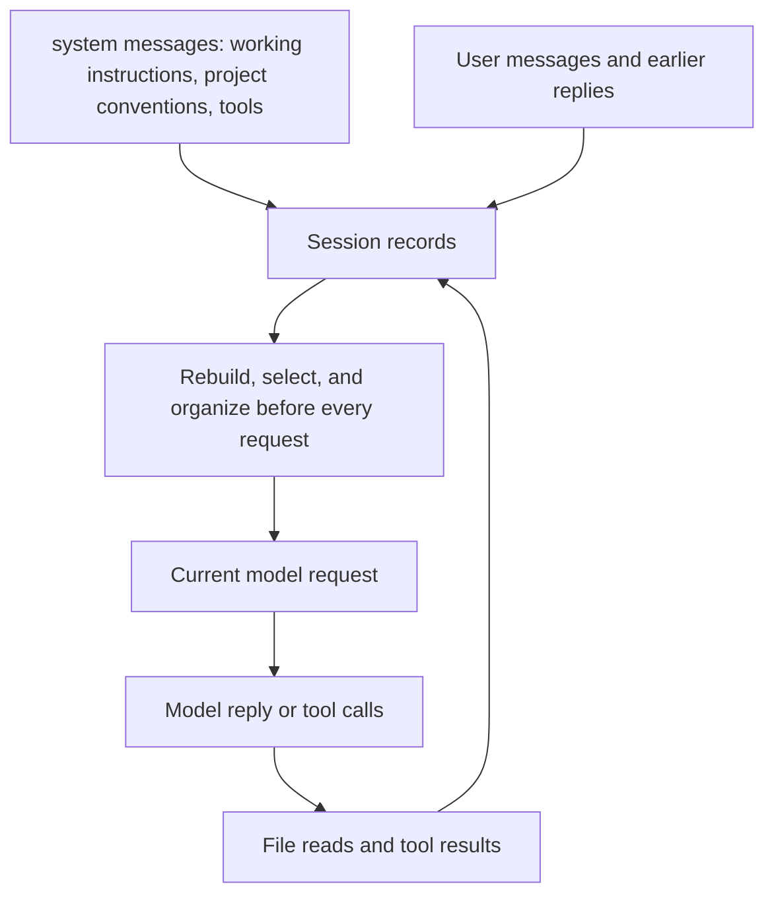
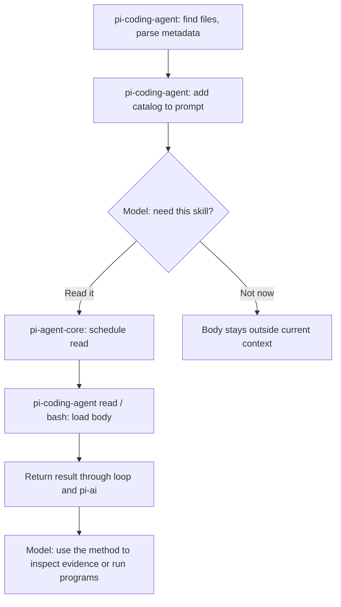

# Chapter 3: Context Engineering—Give the Model What It Needs Now

[简体中文](../../book/03-context-engineering.md) | **English**

Suppose you ask Pi to repair an incorrect report total. Initially it knows only that request. After reading code, it learns amounts are stored as strings. Tests reveal a rounding error. You add “preserve the old report format,” introducing another constraint. Reliable editing depends on model capability and on whether these facts appear clearly and completely in the next request.

**Context is the input material available for this response.** It includes system prompts, the question, conversation, tool definitions, and results. What appeared in the terminal, what exists on disk, and what the model actually receives are three different sets. Pi's context engineering continually organizes useful parts of the first two into the third.

[Chapter 2](02-runtime.md) explained when to call the model again; this chapter explains what each request carries. We cover the context window, system prompts and `AGENTS.md`, templates and skills, request-time transforms, and compaction. An exercise tracks exactly when information enters or leaves view. Mechanisms refer to Pi `0.87.1`, commit `f07218c4d4bbc12bef056a7058c3dd49dfe41abe`. Pseudocode explains behavior and is not a runnable plugin.

In the refund investigation, the model can first read the task, metric notes, and source index, then inspect shipping-related feedback as that lead emerges. When the lead changes the metric, it must understand both yesterday's calculation and today's definition. Building on [Chapter 2's transformation example](02-runtime.md#message-transforms), we examine loading and organizing accumulating material.

## 3.1 The context window is not memory for the entire project

You might want to supply the entire repository, all support records, and days of logs at once. Input capacity is limited; even within capacity, relevant constraints can be buried in irrelevant content. Understanding the limit helps decide what to read now and what to defer.

Models process **tokens**, units of text or multimodal encoding that do not map simply to characters or words. The context window bounds a request's information. Accounting for input, output, and cached usage also depends on the provider.

Pi does not automatically load the whole repository. It supplies tools such as `read`: the model chooses material, the host reads it, and results return. To confirm an amount field, read its definition and callers first, expanding only as evidence requires.

Think of each request as a handoff: working instructions, user requirements, and recent actions and observations. Tools add material for the next judgment. Context engineering asks whether necessary evidence is present and its relationships are clear, rather than whether the prompt is long enough.



“Preserve the old format” is a stable constraint. Failing test output should remain until resolution. A hundred successful dependency-install logs usually need not recur. Information has different useful lifetimes.

> **Further reading**: When material does not fit the window, pre-retrieval, long context, just-in-time retrieval, and compaction with isolation each became the mainstream answer in turn. Why each appeared and what material it suits is covered in [When the Model Cannot See Everything](notes/context-strategies.md).

## 3.2 Assembling the system prompt

At startup you ask only “Check refund statistics.” The host must also tell the model what tools and working environment it has.

Pi's default system prompt describes a coding assistant, available tools, usage advice, and Pi documentation locations. Advice depends partly on the tool set: with shell access but no dedicated search tools, it recommends shell exploration. Brief prompt descriptions complement the actual parameter schemas. [Prompt assembly](https://github.com/earendil-works/pi/blob/f07218c4d4bbc12bef056a7058c3dd49dfe41abe/packages/coding-agent/src/core/system-prompt.ts#L121), [shell fallback advice](https://github.com/earendil-works/pi/blob/f07218c4d4bbc12bef056a7058c3dd49dfe41abe/packages/coding-agent/src/core/system-prompt.ts#L101)

This version divides the prompt into named sections, such as tools, guidelines, documentation, project context, skills, and working directory. The initial `system` message records the full prompt; later section changes append only the difference. Supporting models can preserve cached prefixes; other providers receive a merged full prompt. Returning an entire `systemPrompt` from `before_agent_start` instead uses that text as this run's opening prompt without section-based differences. [Section differences](https://github.com/earendil-works/pi/blob/f07218c4d4bbc12bef056a7058c3dd49dfe41abe/packages/coding-agent/src/core/system-prompt.ts#L204), [extension behavior](https://github.com/earendil-works/pi/blob/f07218c4d4bbc12bef056a7058c3dd49dfe41abe/packages/coding-agent/docs/extensions.md#L101)

Prompts must not promise absent capabilities. “Access the database” creates no connection: a suitable tool and actual access conditions are required.

To customize, `SYSTEM.md` replaces the default prompt; `APPEND_SYSTEM.md` adds instructions. A trusted project's `.pi/SYSTEM.md` takes precedence over `~/.pi/agent/SYSTEM.md`; append files use the same project-first selection. Selection does not concatenate both same-named files. [Prompt-file discovery](https://github.com/earendil-works/pi/blob/f07218c4d4bbc12bef056a7058c3dd49dfe41abe/packages/coding-agent/src/core/resource-loader.ts#L1027)

Even after replacement, the builder appends loaded project context, eligible skill catalogs, and the working directory. Replacement concerns the default body, not the entire request.

Beginners usually need project conventions or appended instructions:

```markdown
# Project conventions

Interface amounts are decimal strings; do not calculate them using binary floating point.
After changing report logic, run the report tests specified in the project documentation.
Output field names are a compatibility contract; confirm callers before changing them.
Distinguish checks actually run from checks not yet run.
```

These specify data rules, verification, change boundaries, and reporting evidence. They are easier to implement and verify than “be an excellent, rigorous engineer.” Prompts state requirements; enforcement depends on host and tool checks.

## 3.3 `AGENTS.md`: keep project knowledge beside the project

One project uses integer cents; another exposes decimal strings. You want the right conventions when starting in each directory without repeating test commands. Pi loads project instructions at startup or resource reload; directory selection matters.

Within one directory, this version tries `AGENTS.override.md`, `AGENTS.md`, `AGENTS.MD`, `CLAUDE.md`, then `CLAUDE.MD`, selecting the first readable regular file. It first adds context from the user configuration directory, then walks from the filesystem root to the working directory, adding ancestor files in order, handling duplicate paths and certain nested-worktree masking. [Context discovery](https://github.com/earendil-works/pi/blob/f07218c4d4bbc12bef056a7058c3dd49dfe41abe/packages/coding-agent/src/core/resource-loader.ts#L71)

An override replaces the ordinary file in its own directory. A child file does not automatically replace parent rules by matching keys: loading primarily concatenates text. If a parent says A and a child B, state B's scope explicitly.

Discovery follows the current working directory's ancestors. **Reading a deeper file later does not recursively load all instructions from that file's directory.** Start in the relevant subproject or explicitly instruct Pi to read its conventions.

Context files differ from executable extensions. Project trust controls settings, skills, extensions, and similar resources, but not `AGENTS.md` or `CLAUDE.md`. The loader decides trust first, then loads context files regardless of the decision unless context-file loading is explicitly disabled. Untrusted extensions do not imply invisible repository text. [Trust decision](https://github.com/earendil-works/pi/blob/f07218c4d4bbc12bef056a7058c3dd49dfe41abe/packages/coding-agent/src/core/resource-loader.ts#L398), [subsequent context loading](https://github.com/earendil-works/pi/blob/f07218c4d4bbc12bef056a7058c3dd49dfe41abe/packages/coding-agent/src/core/resource-loader.ts#L515), [trust documentation](https://github.com/earendil-works/pi/blob/f07218c4d4bbc12bef056a7058c3dd49dfe41abe/packages/coding-agent/docs/security.md#L55)

Keep `AGENTS.md` small and stable. Put detailed manuals elsewhere and specify when to read them. Always-loaded files consume input; endlessly appending manuals can undermine usability.

<a id="skill-ownership"></a>

## 3.4 Prompt templates and skills: repetition and on-demand capability

“List conclusions first, then sources and open questions” is reusable report wording. A long manual on fields, amounts, and exceptions is needed only during reconciliation. Templates handle repeated expression; skills organize task-specific methods.

A Pi **prompt template** is Markdown in a prompt directory, expanded through `/template-name`, with placeholders such as `$1` and `$ARGUMENTS`. Expansion substitutes strings; it neither executes shell code nor recursively expands placeholders inside arguments. [Argument substitution](https://github.com/earendil-works/pi/blob/f07218c4d4bbc12bef056a7058c3dd49dfe41abe/packages/coding-agent/src/core/prompt-templates.ts#L63)

A **skill** has a name, description, and body and can reference scripts, examples, and supporting material. Pi reads files and parses metadata during loading but normally places only the name, description, and path in the system prompt. **The host reading a skill does not mean the model has seen its body.** The model can later request the full text through `read` or `bash`. This is progressive disclosure. [Metadata and prompt formatting](https://github.com/earendil-works/pi/blob/f07218c4d4bbc12bef056a7058c3dd49dfe41abe/packages/coding-agent/src/core/skills.ts#L277)

<a id="skill-discovery"></a>

### Who discovers skills?

You add `.pi/skills/report-check/SKILL.md`. Discovery includes two distinct actions: code finds available files, and the model chooses what the current task needs.

| Stage | Responsible component | Action |
| --- | --- | --- |
| Find files and parse metadata | Coding Agent resource loader and `skills.ts` | Follow resource configuration and paths |
| Present the catalog | Coding Agent prompt assembly | Usually include names, descriptions, and locations, not full bodies |
| Decide relevance | Model | Select whether to request a read |
| Schedule reading | Agent Core's ordinary loop | Execute the host's `read` or `bash` |
| Read the body | Tool implementation, built-ins in Coding Agent | Return file content as a tool result |
| Explicit `/skill:report-check` | Coding Agent's `AgentSession` | Read and expand the body before a later model call |

Discovery and progressive loading are **host policies**. The generic loop needs no special understanding of `SKILL.md`. An application using only Agent Core must supply its own resource policy. [Resource loading](https://github.com/earendil-works/pi/blob/f07218c4d4bbc12bef056a7058c3dd49dfe41abe/packages/coding-agent/src/core/resource-loader.ts#L672), [catalog format](https://github.com/earendil-works/pi/blob/f07218c4d4bbc12bef056a7058c3dd49dfe41abe/packages/coding-agent/src/core/skills.ts#L348), [explicit expansion](https://github.com/earendil-works/pi/blob/f07218c4d4bbc12bef056a7058c3dd49dfe41abe/packages/coding-agent/src/core/agent-session.ts#L1793)

If this convention is called a “skill discovery protocol,” remember who implements it. `<available_skills>` is text in context instructing the model to read files as needed. It is **not a specialized network protocol through which `pi-ai` discovers skills for a model service**. `pi-ai` transports requests containing that text. Explicit expansion also belongs to `AgentSession`; the TUI is one input entry point. See the [package diagram](02-runtime.md#package-boundaries).



Create `.pi/skills/report-check/SKILL.md` in a practice project:

```markdown
---
name: report-check
description: Use when checking report amounts, aggregation definitions, or output-field compatibility.
---

Confirm the report name and reporting period.
Read input examples and report-generation code; identify amount units.
Independently calculate an expected result for a small sample, then compare output.
Classify discrepancies as calculation errors, missing data, or definition differences.
If verification has not run, explicitly say "not yet verified."
```

A skill supplies a method. Tools still observe data; the model still judges. It is neither a new model nor a registered tool. Overbroad descriptions cause irrelevant loading; missing applicability conditions can prevent discovery.

`disable-model-invocation: true` removes a skill from the model-facing catalog while preserving explicit `/skill:name` invocation. It controls automatic discovery, not file permissions. An available reader can still access the file. The system prompt includes the catalog only when `read` or `bash` exists. A skill on disk is not necessarily usable. [Catalog filter](https://github.com/earendil-works/pi/blob/f07218c4d4bbc12bef056a7058c3dd49dfe41abe/packages/coding-agent/src/core/skills.ts#L348), [tool condition](https://github.com/earendil-works/pi/blob/f07218c4d4bbc12bef056a7058c3dd49dfe41abe/packages/coding-agent/src/core/system-prompt.ts#L165)

## 3.5 Request-time processing: preserve history, change the view

The lead supplies a new metric definition mid-investigation. You want the next request to use it without deleting the old conversation. Static startup files cannot express all changing selection needs. The `context` extension event can return a new message array before each request.

<a id="context-transform-example"></a>

### Updating the metric during an investigation

Initially METRIC-01 defines the refund rate as the share of orders with refund requests. DEC-02 later requires the share with completed refunds. These are document IDs in the example, not Pi configuration. Preserve the earlier report and its definition while replacing the temporary current-rules injection.

This custom-message shape follows Pi; retrieval and filtering are application pseudocode, not a built-in knowledge base.

```js
async function transformContext(messages) {
  // Remove only this extension's previous rules; keep conversation and tool pairs.
  const selected = messages.filter(message =>
    !(message.role === "custom" && message.customType === "report-rules")
  );

  // Application-defined retrieval; choose per-call lookup or versioned caching.
  const rules = await lookupRules("checkout-investigation", "DEC-02");
  // rules.text: "Use completed refunds; earlier cohort observed 14 days, later cohort 3."
  selected.push({
    role: "custom",
    customType: "report-rules",
    content: `Reference: ${rules.source}\n${rules.text}`,
    display: false,
    details: { ruleVersion: rules.version },
    timestamp: Date.now(),
  });
  return selected;
}
```

Saved history remains intact. Only this request's view replaces outdated temporary rules with sourced current rules. `display: false` hides an ordinary terminal notification; **it does not hide the message from the model**.

The model interface does not recognize Pi's `custom` role, so conversion expresses its visible content as an ordinary message:

```js
function convertToLlm(messages) {
  // Mechanism pseudocode: only relevant branches; summaries and other types omitted.
  return messages.flatMap(message => {
    if (message.role === "custom") {
      return [{
        role: "user",
        content: typeof message.content === "string"
          ? [{ type: "text", text: message.content }]
          : message.content, // May already contain text/image blocks.
        timestamp: message.timestamp,
      }];
    }
    if (message.role === "bashExecution") {
      if (message.excludeFromContext) return []; // A user !! command.
      return [{
        role: "user",
        content: [{ type: "text", text: formatCommandResult(message) }],
        timestamp: message.timestamp,
      }];
    }
    return [message]; // Other example messages are user / assistant / toolResult.
  });
}
```

The model receives the reference, completed-refund definition, and unequal observation periods. `customType`, `display`, and `details.ruleVersion` do not automatically become visible text. Put the version in content if it matters to reasoning. `role: "user"` is an interface representation, not proof of a new human command; retain its reference-material identity.

Pi's real converter also expresses branch and compaction summaries and formats `!` command results, while excluding `!!` output. [Messages and conversion](https://github.com/earendil-works/pi/blob/f07218c4d4bbc12bef056a7058c3dd49dfe41abe/packages/coding-agent/src/core/messages.ts#L163)

**Retrieving and replacing stale rules belongs to selection; expressing custom messages and excluding explicitly hidden command output belongs to conversion.** Coding Agent connects `transformContext` to `context`; applications usually integrate there. See [Chapter 6](06-extensibility.md#context-handlers).

This separates preservation from transmission. Request-only retrieval need not repeatedly append to session files. For later audit, separately persist source information. If retrieval is slow, prepare baseline materials at request start and reuse by version; [Chapter 6](06-extensibility.md#extension-events) covers event placement.

Trimming has structural constraints. Preserve call/result relationships rather than keeping “succeeded” after deleting what executed. Keep sources attached to external material; insertion does not authorize it to rewrite system rules. Delimiters and prompts help identify boundaries, but actual permissions belong in the host or tools. See [execution boundaries](05-tools.md#59-least-privilege-belongs-at-the-execution-boundary) and [chunked reading](05-tools.md#55-large-reads-must-disclose-what-remains-unread).

## 3.6 Compaction: turn older work into a useful handoff

After a long debugging session, history contains old source versions, failed tests, and logs, while only one discrepancy remains. Sending everything exhausts capacity; discarding everything loses constraints such as preserving the old format.

Pi's **compaction** summarizes older messages and retains recent ones, continuing with a summary plus a kept segment.

Two budgets matter: space reserved before reaching capacity, and recent history retained during compaction. Compaction is enabled by default, with `reserveTokens = 16384` and `keepRecentTokens = 20000`:

```js
// Pseudocode: threshold only; tokenCount may be estimated.
const shouldCompact = compactionEnabled
  && tokenCount > contextWindow - reserveTokens;
```

For a 128000-token window, the threshold is 111616, and the count must be strictly greater. `keepRecentTokens` guides the retained segment, not summary length. [Defaults](https://github.com/earendil-works/pi/blob/f07218c4d4bbc12bef056a7058c3dd49dfe41abe/packages/coding-agent/src/core/compaction/compaction.ts#L142), [threshold](https://github.com/earendil-works/pi/blob/f07218c4d4bbc12bef056a7058c3dd49dfe41abe/packages/coding-agent/src/core/compaction/compaction.ts#L289)

Counts are not always exact. Pi uses recent assistant usage plus estimated later messages when possible; otherwise it estimates messages. Tool output, images, and provider encoding affect actual size. Reserved space reduces overflow risk without eliminating it. [Estimation](https://github.com/earendil-works/pi/blob/f07218c4d4bbc12bef056a7058c3dd49dfe41abe/packages/coding-agent/src/core/compaction/compaction.ts#L215)

This version checks after the underlying loop ends and after tool results, before the next assistant response. If tools terminate the run without another response, that intermediate check is unnecessary. Automatic handling also covers overflow and recoverable length termination; a particular overflow recovery permits one compact-and-retry attempt to prevent infinite loops. [Pre-turn checks](https://github.com/earendil-works/pi/blob/f07218c4d4bbc12bef056a7058c3dd49dfe41abe/packages/coding-agent/src/core/agent-session.ts#L587), [recovery branches](https://github.com/earendil-works/pi/blob/f07218c4d4bbc12bef056a7058c3dd49dfe41abe/packages/coding-agent/src/core/agent-session.ts#L2579)

Pi counts backward from recent messages to find a legal cut. It avoids cutting at tool results to prevent orphaned results. A long user request can be split internally, with a handoff summary for its earlier portion. Retention is therefore an approximate target, not an exact token slice. [findCutPoint](https://github.com/earendil-works/pi/blob/f07218c4d4bbc12bef056a7058c3dd49dfe41abe/packages/coding-agent/src/core/compaction/compaction.ts#L453)

```js
// Pseudocode; helper names explain responsibilities, not SDK methods.
const path = getRootToLeafPath(session);
const cut = findLegalCut(path, { keepRecentTokens });
const oldMessages = messagesMovingOutOfWindow(path, cut);
const summary = await summarize({
  previousSummary,
  messages: oldMessages,
  include: ["goal", "constraints", "progress", "decisions", "next steps"],
});
appendCompaction({ summary, firstKeptEntryId: cut.entryId });
const nextMessages = [asSummaryMessage(summary), ...keptMessages, ...newMessages];
```

The active path comes from the session tree. When switching between repairs, summarize the selected branch, not assumptions from another branch. [Chapter 4](04-memory.md) explains selection.

Summary prompts request goals, constraints, progress, decisions, and next steps rather than vague descriptions. Repeated compaction must include previously retained messages now leaving the window, not just messages after the last compaction record. [Summary prompt](https://github.com/earendil-works/pi/blob/f07218c4d4bbc12bef056a7058c3dd49dfe41abe/packages/coding-agent/src/core/compaction/compaction.ts#L529), [preparation](https://github.com/earendil-works/pi/blob/f07218c4d4bbc12bef056a7058c3dd49dfe41abe/packages/coding-agent/src/core/compaction/compaction.ts#L894)

Compaction is lossy. Full failure output may become “tests failed”; tentative guesses may become falsely definite. Original records remain in the session file, but the model does not automatically see displaced details. State constraints clearly, preserve exact values in files or links, and reread when necessary. Do not expect summaries to retain every character.

Extensions can customize compaction through `session_before_compact`; official examples exist. Alternative summary models or structured fields are extensibility options, not universally enabled defaults. Inspect returned `summary` and `firstKeptEntryId`, not just an example's introductory comment. [Pre-compaction event](https://github.com/earendil-works/pi/blob/f07218c4d4bbc12bef056a7058c3dd49dfe41abe/packages/coding-agent/src/core/agent-session.ts#L2441)

> **Further reading**: Besides compaction, a question that requires heavy reading can go to a subagent that reads in another window and returns only the conclusion. For a comparison, see [When the Model Cannot See Everything](notes/context-strategies.md#compaction-and-isolation-subtracting-within-a-long-task).

## 3.7 Exercise: follow information from file to context

Check whether project conventions load, skill bodies are read, and older constraints remain supported after compaction. Use a fictional project marker and a small report. Work in a disposable directory; merge with existing files rather than overwriting them.

1. Create `AGENTS.md` stating “The project codename is Paper Kite; all sample amounts use Chinese yuan.” Start Pi, inspect loaded-context notices, and ask for the codename and unit.
2. Create the `report-check` skill above and `/reload`. Ask naturally for help checking report totals and observe whether Pi reads the skill. Compare explicit `/skill:report-check`.
3. Supply about ten lines of fictional report data and request a step-by-step reconciliation. Add “Check only; do not edit files.”
4. Enter `/compact Preserve the project codename, amount unit, check-only constraint, and unfinished work`. A short session may contain nothing worth compacting; do not manufacture huge logs merely to trigger it. Try later in a longer practice session.
5. Ask for current goals and constraints. Use `/session` to locate the file and inspect the `compaction` entry and retained boundary.

### Reference answers and observation method

Expected results below are not actual observations unless you perform the exercise.

1. The answer should be **Paper Kite** and **Chinese yuan**, sourced from `AGENTS.md`. Startup notices confirm loading; the reply checks use. A correct reply without identifying the source does not verify the loading path. Check for `AGENTS.override.md` first if present.
2. Natural triggering depends on description matching and model choice, so automatic reads are not guaranteed. A file-read trace is direct evidence. Explicit invocation expands content through the host without requiring the same `read` call. If explicit invocation fails, inspect format, discovery, trust, and reload before blaming model selection.
3. Two sample amounts, 12 and 23 yuan, should total **35 yuan**. The reply should show arithmetic and retain the no-edit constraint; the trace should contain no writes. Correct arithmetic does not excuse editing. Do not confuse this fictional yuan example with Chapter 1's integer-cent data.
4. With sufficient history and successful compaction, the new summary should retain Paper Kite, yuan, check-only behavior, and unfinished work. If no content can be compacted, record “not triggered”; no summary evidence exists.
5. After actual compaction, the reply should restate the task, unit, and constraint. The new `compaction` record contains `summary` and `firstKeptEntryId`. The codename could still come from `AGENTS.md`, so a correct answer alone does not prove summary retention. Inspect the entry. No new entry means no proof this compaction completed.

If constraints disappear, compare the original message, summary, and current request. Establish whether the information was recorded, retained, then removed by request-time processing.

### Further exercise: do skills survive a web interface?

Your team replaces the terminal UI with a web page but keeps sessions, skills, and tools. What changes? Does using only Agent Core preserve discovery automatically?

**Reference answer:** Your app implements input, results, and session entry points. Coding Agent's SDK or RPC can retain `AgentSession` and resource loading; dropping the built-in TUI does not discard skills. With only `pi-agent-core`, implement file discovery, catalog prompts, and command expansion yourself. `pi-tui` supplies terminal components, not skill policies.

Following this path turns “the model forgot” into concrete causes: not loaded, not retrieved, trimmed, compacted, or seen but not followed. The next chapter extends the path beyond a session to durable storage and retrieval.

With model access, run the [live-model labs](../examples/live-model/README.md) and compare traces with these mechanisms.

[Previous](02-runtime.md) · [Back to contents](../README.md) · [Next](04-memory.md)
