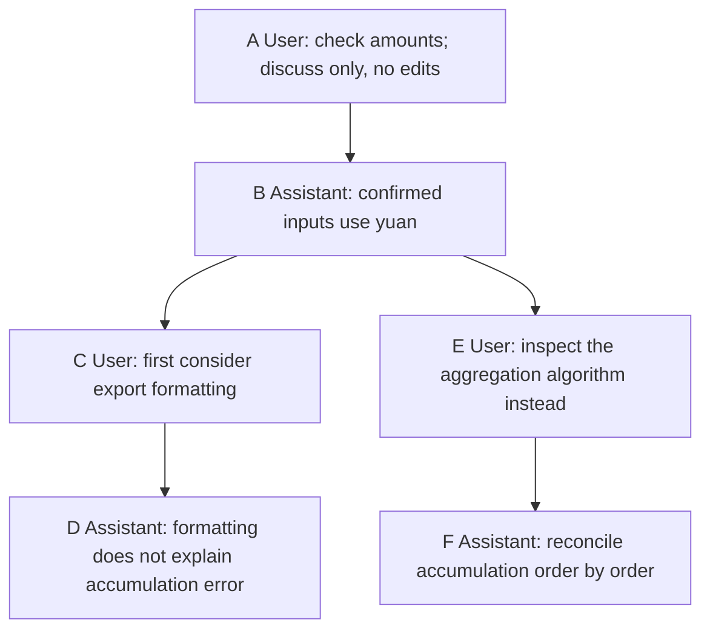

# Chapter 4: Memory and Knowledge Bases—Store It, Then Retrieve It Correctly

[简体中文](../../book/04-memory.md) | **English**

Yesterday you and Pi located a report error but had not repaired it. Today you want to continue, preserving the project's amount convention and your preference for conclusions first. These facts appeared earlier, but they may have been stored differently and may not automatically be available after restarting.

This chapter distinguishes current context, session history, durable instructions, and external knowledge bases. A report-debugging example demonstrates recovery, navigation, and branching, including selecting the right `/tree` message and why it does not restore disk files. We then examine active paths, compaction records, extension state, and external memory with sources and expiration.

[Chapter 3](03-context-engineering.md) asked what this request should see; here we ask where to find it next time. [Chapter 5](05-tools.md) turns retrieval and reading into well-defined tools.

Yesterday's process is session history; the amount convention is project knowledge; presentation preferences are user-level information. One summary containing all three can drag irrelevant history into new tasks. Raw chat alone makes important decisions hard to find.

Pi provides session persistence, recovery, tree branches, summaries, and instruction files usable across sessions. **The verified version has no default pipeline that automatically extracts user profiles and semantically retrieves them across sessions.** Files, tools, and extensions can connect external memory, but the application owns schemas, extraction, user isolation, and updates. Know this boundary rather than waiting for unconfigured behavior.

After a metric changes, the lead may still ask how yesterday's number was calculated. Keep the old definition's source while identifying the currently applicable definition. We begin with storage scope, then restore sessions and choose investigation branches.

## 4.1 Four storage scopes

“Continue yesterday's repair” needs a task's progress. “Put conclusions first in all future reports” needs broader persistence. Even information on disk must reenter input at the appropriate time.

| Scope | Question answered | Pi mechanism | Main limit |
| --- | --- | --- | --- |
| Current working context | What happens next? | Messages, tool results, request transforms | Limited window; trimming and compaction |
| Session history | What happened in this task? | JSONL files, active branch, summaries | New sessions do not search all old sessions automatically |
| Durable user/project instructions | What should always apply? | Global/project `AGENTS.md`, skills, and similar files | Maintained by people or extensions; can become stale |
| External memory/knowledge base | What should be found in large histories? | Custom tools, events, external services | Integration owns retrieval, permissions, and conflicts |

Global `AGENTS.md` provides a simple form of long-term memory across projects. It does not decide what chat deserves retention or whether “English for this report” is a lasting language preference. The loader finds and reads files. [Global and project loading](https://github.com/earendil-works/pi/blob/f07218c4d4bbc12bef056a7058c3dd49dfe41abe/packages/coding-agent/src/core/resource-loader.ts#L119)

Content can also be classified as events, facts, and methods: a repair trace, an amount unit, or reconciliation steps. This is separate from scope. A method can live in a skill or database; a fact can remain temporary or become a confirmed durable instruction. Decide what it is, whom it applies to, and how long it should last before choosing storage.

## 4.2 Session files: recoverable work records

To continue unfinished debugging, restore that session rather than repeat everything. Pi normally stores sessions under `~/.pi/agent/sessions/`, organized by working directory. Configuration can relocate this directory. Use `pi -c` for the latest session, `pi -r` to select one, or `pi --session <path-or-ID>` for a specific session. `--no-session` creates an ephemeral session without disk persistence. [Session operations](https://github.com/earendil-works/pi/blob/f07218c4d4bbc12bef056a7058c3dd49dfe41abe/packages/coding-agent/docs/sessions.md#L50), [CLI options](https://github.com/earendil-works/pi/blob/f07218c4d4bbc12bef056a7058c3dd49dfe41abe/packages/coding-agent/docs/cli.md#L85), [directory generation](https://github.com/earendil-works/pi/blob/f07218c4d4bbc12bef056a7058c3dd49dfe41abe/packages/coding-agent/src/core/session-manager.ts#L589)

The format is **JSONL**: one JSON object per line, supporting sequential reads and appends. A header records identity, time, and working directory. Later entries record messages, model changes, compactions, branch summaries, and extension state.

This simplified excerpt omits required real-message fields and is not an importable session:

```json
{"type":"session","version":3,"id":"demo","timestamp":"2026-09-14T00:00:00Z","cwd":"/work/report-demo"}
{"type":"message","id":"a","parentId":null,"message":{"role":"user","content":"Check the amounts"}}
{"type":"message","id":"b","parentId":"a","message":{"role":"assistant","content":"First inspect sample inputs"}}
{"type":"message","id":"c","parentId":"b","message":{"role":"user","content":"Do not edit files yet"}}
```

`id` identifies an entry; `parentId` identifies its predecessor. A line-oriented file can therefore represent a logical tree. [Entry types](https://github.com/earendil-works/pi/blob/f07218c4d4bbc12bef056a7058c3dd49dfe41abe/packages/coding-agent/src/core/session-manager.ts#L44)

Plain-text chat cannot reliably reconstruct user messages, tool calls, results, and the selected route. Structured entries preserve these relationships.

Persistence is not a database business transaction. Model and tool records do not independently prove external writes or database commits succeeded. Inspect real results and environment state; recording an attempted action does not replace checking its outcome.

<a id="session-tree"></a>

## 4.3 Session trees: when and where to go back

You are discussing a report discrepancy without editing files. Pi confirms inputs use yuan. You suspect displayed decimal places and explore plan A: changing export formatting. Several turns later that fails to explain the discrepancy. You want to return to the shared unit confirmation and try plan B: inspect accumulation order by order.

If prior discussion remains useful, simply ask to inspect aggregation. Branch when you want to preserve the old attempt while comparing another route from common facts. Branching also lets you rewrite an earlier ambiguous question. Old attempts remain; the next request follows the selected route.

Letters below stand for generated entry IDs. Model settings and tools are omitted; this example only discusses plans.



### Navigate from D back to B

1. After the reply, enter `/tree`. Move with Up/Down and confirm with Enter; type words such as “inputs” to search. Default Left/Right pages; Ctrl+Left/Right or Alt+Left/Right collapses, expands, or navigates branches.
2. With many tools, Ctrl+O cycles `default → no-tools → user-only → labeled-only → all`. Use `no-tools` to select assistant B; `user-only` hides it. Filtering changes presentation, not stored messages or context.
3. Select B and press Enter. Normally `Summarize branch?` appears. Choose `No summary` for this first experiment. A setting that skips the prompt proceeds without a summary.
4. Send “Inspect the aggregation algorithm instead.” E attaches after B and the reply becomes F. `/tree` now shows C→D and E→F after B.
5. To resume plan A, select D, decline summarization, and send another instruction. You need not write `parentId` manually.

These are pinned-version defaults; custom bindings can differ. Escape clears an active search before exiting on another press. You can open the tree during a reply; confirming navigation makes the interactive host abort it first. Wait for ongoing compaction or navigation to finish. [Operations](https://github.com/earendil-works/pi/blob/f07218c4d4bbc12bef056a7058c3dd49dfe41abe/packages/coding-agent/docs/sessions.md#L30), [key handling](https://github.com/earendil-works/pi/blob/f07218c4d4bbc12bef056a7058c3dd49dfe41abe/packages/coding-agent/src/modes/interactive/components/tree-selector.ts#L1004), [summary choices](https://github.com/earendil-works/pi/blob/f07218c4d4bbc12bef056a7058c3dd49dfe41abe/packages/coding-agent/src/modes/interactive/interactive-mode.ts#L5400)

**Selecting user and assistant messages differs.** Selecting assistant B resumes after B. Selecting user C returns to its parent B and places C's question in the editor for revision. Select B to preserve its conclusion and ask something new; select C to rewrite that question. Existing nonempty editor drafts are not overwritten, so clear the editor to observe prefill. Selecting the current leaf does not navigate. `custom_message` also resumes at its parent and prefills text. [Target-type handling](https://github.com/earendil-works/pi/blob/f07218c4d4bbc12bef056a7058c3dd49dfe41abe/packages/coding-agent/src/core/agent-session.ts#L3709)

### “Reverse” only restores chronological order

Walking parents from F produces `[F, E, B, A]`; the model needs `[A, B, E, F]`, so code calls `reverse()`. **It does not invert the tree, exchange parents and children, or rewrite old parent IDs.**

```js
// Mechanism pseudocode; indexing details omitted.
function getActivePath(entriesById, leafId) {
  const path = [];
  let current = entriesById.get(leafId);
  while (current) {
    path.push(current); // F, E, B, A
    current = entriesById.get(current.parentId);
  }
  return path.reverse(); // A, B, E, F
}
const path = getActivePath(entriesById, "F");
const messages = buildContextFromPath(path); // Then compaction and conversion.
```

Reversal occurs while reading the active path. Users navigate; there is no need for a “reverse tree” command. C and D do not enter F's request merely because they remain in the file. [buildSessionPath](https://github.com/earendil-works/pi/blob/f07218c4d4bbc12bef056a7058c3dd49dfe41abe/packages/coding-agent/src/core/session-manager.ts#L390). This follows [Chapter 3's distinction](03-context-engineering.md#context-transform-example) between saved records and request views.

### Carrying lessons from plan A

If A established useful evidence, choose `Summarize`. Use `Summarize with custom prompt` to retain only verified facts, failure reasons, and unfinished work. Default summarization requires a model call; `No summary` allows navigation without model access.

Pi finds the common ancestor of the old leaf and target, collects the route being left, and summarizes it. A new `branch_summary` attaches at the destination. Inserting S after B makes E's parent S, producing A→B→S→E→F. This carries a summary of experience, not the union of both branches. `session_before_tree` extensions can participate or cancel. [Preparation](https://github.com/earendil-works/pi/blob/f07218c4d4bbc12bef056a7058c3dd49dfe41abe/packages/coding-agent/src/core/agent-session.ts#L3581), [summary attachment](https://github.com/earendil-works/pi/blob/f07218c4d4bbc12bef056a7058c3dd49dfe41abe/packages/coding-agent/src/core/agent-session.ts#L3727)

### Choosing `/tree`, `/fork`, or `/clone`

Use `/tree` to change direction inside one investigation. A new session file is useful for an independent experiment or follow-on task.

| Operation | Purpose | History and editor |
| --- | --- | --- |
| `/tree` | Switch routes within a task | Same file retains branches; selecting a user message allows revision |
| `/fork` | Experiment from an earlier question | New file copies the path to the question's parent; selected question prefills the editor |
| `/clone` | Start follow-on work with the full current path | New file keeps the active path; empty editor |

There is a small documentation/implementation discrepancy. User docs describe an earlier user message; RPC docs still describe selection from the active branch, but the selector collects user messages across the whole session. Copying follows the selected message's parent chain. Check which route a question belongs to even if its wording matches. [RPC description](https://github.com/earendil-works/pi/blob/f07218c4d4bbc12bef056a7058c3dd49dfe41abe/packages/coding-agent/docs/rpc-commands.md#L606), [candidate collection](https://github.com/earendil-works/pi/blob/f07218c4d4bbc12bef056a7058c3dd49dfe41abe/packages/coding-agent/src/core/agent-session.ts#L3782), [path copying](https://github.com/earendil-works/pi/blob/f07218c4d4bbc12bef056a7058c3dd49dfe41abe/packages/coding-agent/src/core/agent-session-runtime.ts#L262)

These are interactive commands. CLI `--fork <path-or-ID>` copies a source session into a new file; it is not the interactive message selector. [CLI branch command](https://github.com/earendil-works/pi/blob/f07218c4d4bbc12bef056a7058c3dd49dfe41abe/packages/coding-agent/docs/cli.md#L93)

Returning to old conversation does not restore old files. If A edited code, selecting B changes conversation context while disk retains A's edits. Compare code using prior Git commits or separate working directories, and inspect `git diff` and content after switching. Navigation cannot undo deletion, database writes, or sent messages. [Chapter 5](05-tools.md) treats side effects as independently recorded and verified actions, not chat-tree transactions.

## 4.4 Compaction records and recovery: history and view coexist

After yesterday's `/compact`, recovery must neither resend all old logs nor omit checks performed after the summary. It needs the summarized portion, retained original messages, and subsequent additions.

A `compaction` entry stores `summary` and `firstKeptEntryId`, marking the first original entry to retain. Pi gets the active path, finds its latest compaction, and assembles the summary, retained pre-compaction messages, and post-compaction entries. [buildContextEntries](https://github.com/earendil-works/pi/blob/f07218c4d4bbc12bef056a7058c3dd49dfe41abe/packages/coding-agent/src/core/session-manager.ts#L476)

```js
// Mechanism pseudocode for an existing valid compaction record.
function restoreContext(path) {
  const compactAt = path.findLastIndex(entry => entry.type === "compaction");
  if (compactAt < 0) return convertEntriesToMessages(path);
  const compaction = path[compactAt];
  const before = path.slice(0, compactAt);
  const keepFrom = before.findIndex(entry => entry.id === compaction.firstKeptEntryId);
  const kept = keepFrom < 0 ? [] : before.slice(keepFrom);
  const after = path.slice(compactAt + 1);
  return convertEntriesToMessages([compaction, ...kept, ...after]);
}
```

A summary replaces history's position in current input, not the original entries in the file. Restoring a compacted session does not reload all original text into the window. Here, session records are the sole source of model input: AgentSession rebuilds from the active path before each request instead of relying on a separate in-memory copy. Recovery, navigation, and compaction therefore affect the next request naturally. [Context construction](https://github.com/earendil-works/pi/blob/f07218c4d4bbc12bef056a7058c3dd49dfe41abe/packages/coding-agent/src/core/session-manager.ts#L576), [per-request rebuilding](https://github.com/earendil-works/pi/blob/f07218c4d4bbc12bef056a7058c3dd49dfe41abe/packages/coding-agent/src/core/agent-session.ts#L608)

To exclude one old message without deleting history, append `context_edit`. With `replacement: null`, later requests omit it; supplied replacement content changes only its model-input representation. The original remains in the session file, UI, and exports. Edits are branch-local: navigating before the edit restores the original representation. [ContextEditEntry](https://github.com/earendil-works/pi/blob/f07218c4d4bbc12bef056a7058c3dd49dfe41abe/packages/coding-agent/docs/session-format.md#L137)

An old number may remain in original records while missing from the summary. Retrieve the source rather than asking the model to guess confidently. Recoverable history supports verification; summaries support continuing work.

## 4.5 Extension state: saved for code, not necessarily the model

An indexer may save “processed through entry c” to avoid duplicate work. Code needs that progress, while the model usually does not. Conversely, “the user confirmed yuan” must be visible to affect arithmetic.

Saving in a session file does not establish visibility. Pi distinguishes:

- `custom`: persistent extension state, normally excluded from model context.
- `custom_message`: model-visible message content, with `display` controlling terminal presentation rather than model visibility.

Data and `details` can hold application metadata; only designated content enters input through conversion. [Custom entry definitions](https://github.com/earendil-works/pi/blob/f07218c4d4bbc12bef056a7058c3dd49dfe41abe/packages/coding-agent/src/core/session-manager.ts#L119), [entry conversion](https://github.com/earendil-works/pi/blob/f07218c4d4bbc12bef056a7058c3dd49dfe41abe/packages/coding-agent/src/core/session-manager.ts#L439)

[Chapter 6](06-extensibility.md#extension-state) covers APIs and rebuilding state after exiting or switching branches.

## 4.6 From file memory to an external knowledge base

After several investigations, the team records confirmed metrics, reasons for changes, and checking methods. A new colleague asks why the report excludes refund requests. You want Pi to find the decision, not offer a generic explanation.

For ten records, readable files are sufficient. Put confirmed presentation preferences in global instructions and decisions in `docs/decisions.md`. That filename is your organizational choice; Pi does not auto-load it.

Across hundreds of decisions and several projects, reading every document becomes slow. Similar names, old definitions, and temporary exceptions collide. Define entities, sources, and validity before choosing storage:

| Form | Suitable content | Maintenance cost |
| --- | --- | --- |
| Short Markdown entries | A few preferences and conventions | Readable, but duplicates and ambiguous scope need control |
| Contextual paragraphs | Reasons behind decisions | Rich explanations; repeated facts may be scattered |
| JSON/database fields | Filterable user, project, time, and status | Local updates are easy; schema design and migration remain |
| Records with subjects, relations, and sources | Facts easily confused across people/projects | Identity links and evidence need maintenance |
| Original text plus indexes | Large conversation/document/change collections | Versions, permissions, and invalidation must be maintained |

“Reports use yuan” is short but ambiguous. “Procurement's monthly report uses Chinese yuan” identifies the object. Structured fields can separate `reportId`, `currency`, and `unit`; confirming person, session location, and effective date explain authority. Richer structure costs more to extract, verify, and update; more fields do not inherently mean better memory.

Identity is particularly error-prone. Two people called Lin in different departments may be distinct. Use stable subject IDs, treat names as mutable attributes, and record people/project relationships separately. Graphs can express responsibility and rule replacement, but Pi neither prescribes a knowledge graph nor automatically resolves entities.

Code can query structured state deterministically: current project, effective this month, `active` status. The model then explains results instead of reading every rule and resolving all constraints from scratch. This is application storage/query design, not an automatic Pi memory job.

A colleague may say “report total discrepancy” while an old record says “amount accumulation error.” Vector retrieval maps text to numeric representations and searches by distance to find semantic similarity. Similarity proves neither truth nor applicability to the current user or version.

**Retrieval-augmented generation (RAG)** retrieves material before supplying relevant excerpts for an answer. It requires neither training a model nor a vector database. Exact matching may work better for error codes, order IDs, and paths; semantic search may help paraphrases. Combine them only after validating real queries.

Retrieving a long document is not enough. Extract text, split by section or coherent meaning, and preserve document ID, heading path, version, and source location for each chunk. Build keyword/vector indexes. At query time, filter permissions and versions, search and merge candidates, optionally rerank, then read originals. Keep table headers with rows and avoid splitting critical code definitions into unintelligible fragments.

Tiny chunks lose conditions; large chunks carry irrelevant material. A unit declaration isolated in the next chunk can make cents look like yuan. Moderate overlap and headings reduce this risk but add duplicates requiring merging. Pi supplies integration points; evaluate chunking, indexes, and retrieval against your documents.

The following is a **proposed design, not a built-in service**: `memory_search` returns a few candidates and `memory_read` reads selected originals. The host fixes user/project scope; model-supplied user IDs must not bypass authorization.

```js
// Application design pseudocode, not built-in Pi APIs.
async function memorySearch({ query, cursor }) {
  const scope = authenticatedHost.memoryScope();
  const page = await knowledgeBase.search({ scope, query, cursor, limit: 5 });
  return { candidates: page.items, nextCursor: page.nextCursor };
  // Candidates include ID, title, time, source, and a short summary.
}
async function memoryRead({ id }) {
  const scope = authenticatedHost.memoryScope();
  const record = await knowledgeBase.read({ scope, id });
  checkVersionAndValidity(record);
  return { text: record.text, source: record.source };
}
// Search candidates first, then read selected records by ID.
```

Search-then-read is not unique to memory. [Chapter 5](05-tools.md#search-and-read) applies it to files, pagination, truncation, and source locations.

Alternatively, retrieve during `before_agent_start` and inject selected excerpts during `context`. Tools let the model decide when to search; events let the application supply baseline context. Combine them without duplicate injections. [Tool registration](https://github.com/earendil-works/pi/blob/f07218c4d4bbc12bef056a7058c3dd49dfe41abe/packages/coding-agent/src/core/extensions/types.ts#L1426), [context execution](https://github.com/earendil-works/pi/blob/f07218c4d4bbc12bef056a7058c3dd49dfe41abe/packages/coding-agent/src/core/extensions/runner.ts#L1190)


## 4.7 Writing, conflicts, and forgetting: memory needs maintenance

A temporary dollar report for overseas colleagues must not become “this project defaults to dollars.” Otherwise better retrieval consistently returns the wrong rule. Separate exceptions from lasting conventions before saving.

Records should identify the object, fact, scope, source, and time. Give a temporary exception its own task scope. This is an application schema, not Pi's required format:

```json
{
  "id": "report-currency-002",
  "subject": "monthly-sales-report",
  "fact": "Official report amounts use Chinese yuan",
  "scope": "project:report-demo",
  "source": {"kind": "user-confirmation", "sessionId": "demo", "entryId": "c"},
  "recordedAt": "2026-09-14T00:00:00Z",
  "status": "active",
  "supersedes": "report-currency-001"
}
```

`supersedes` identifies the replaced record without silently erasing history. Recording time and effective time differ: learning today about next month's rule does not make it effective today. Add `validFrom` and `validUntil` where needed and filter queries.

First confirm that apparently conflicting facts concern the same subject and scope. A preference and a task exception can coexist; separate projects can use different tools. Only then choose replacement, historical retention, or clarification. Recency matters only with credible sources and consistent scope. A freshly scraped unknown page must not override user-confirmed facts.

Knowledge bases need invalidation. Update or expire indexes after source changes. Deletion or revoked access must stop cached excerpts from being returned. Deleting a memory requires policies for linked originals, summaries, indexes, and caches, not merely hiding a search result. Session compaction does not do this.

Start by storing a few explicit sourced facts, expiring temporary state, separating verified claims from guesses, and checking sources before relying on important old information. Add extraction automation and complex indexes when scale warrants them.

## 4.8 Exercises: prove what was saved

Compare restored sessions, new sessions, branches, and explicit file reads using traceable markers. No external database is required. Real conversations require configured model access; file/tree inspection is local. These are source-based expectations, not claims that the book ran every exercise with a real model.

### Exercise 1

Start Pi in a practice directory. Provide two fictional facts: “Report codename Paper Kite” and “Sample number 731.” Say these apply only to this exercise and must not be written to global preferences. Record the session ID through `/session`.

**Reference answer:** Both facts should appear in a user message in this session. The global preference file should not automatically change. Inspect actual messages and files instead of trusting “remembered.”

### Exercise 2

Exit, restore with `pi --session <ID>`, and ask for the facts. Inspect the original user message in the session file. Successful restoration proves session history, not cross-session retrieval.

**Reference answer:** Expect Paper Kite and 731 if they remain in reconstructed context. If compacted out, inspect originals; inability to answer does not mean deletion. Confirm the same session ID and original entry.

### Exercise 3

Use `/new` and ask for the sample number. Without a memory extension or automatically loaded file, do not rely on an accurate answer. If correct, establish its source.

**Reference answer:** A new session does not automatically acquire 731. It should acknowledge missing evidence or search using configured tools. A lucky answer is insufficient; inspect files, calls, and retrieved evidence.

### Exercise 4

Return to the original session and branch with `/tree`, discussing plan A on one route and B on another. Inspect both saved routes and the active path. Do not edit files.

**Reference answer:** Select the shared assistant message as in [Section 4.3](#session-tree), choose `No summary`, and send B. Both routes remain; the current path follows B. Selecting a user message instead resumes at its parent and prefills its question.

### Exercise 5

Manually create `docs/decisions.md` containing a dated fictional decision with a scope. In a new session explicitly request a read, then ask about it. Compare storage with reading.

**Reference answer:** Creation proves storage only. A tool read makes content available in this request. Check path, date, scope, and citation. The filename alone does not trigger loading.

### Exercise 6: define external-memory acceptance results

Test exact number recall, separation of same-named reports across projects, explicit replacement of an old decision, admitting an unrecorded answer is unknown, and denying revoked records. Inspect retrieval and sources, not fluency.

**Reference answer:** Require the correct record's number; no project B record in project A results; effective new decisions with replacement traceability; empty candidates or acknowledged uncertainty for missing information; and no search, read, or cache disclosure after revocation. Assert IDs, scope, versions, sources, and access results. Wording can vary. These are integration criteria, not default tests Pi ships or has passed.

You should now be able to identify where information lives, what brings it into input, why it remains valid, and how to correct stale or wrong retrieval. Pi provides recoverable sessions and composable interfaces; reliable long-term memory depends on connecting them into an inspectable information path.

With model access, run the [live-model labs](../examples/live-model/README.md) and compare actual traces.

[Previous](03-context-engineering.md) · [Back to contents](../README.md) · [Next](05-tools.md)
