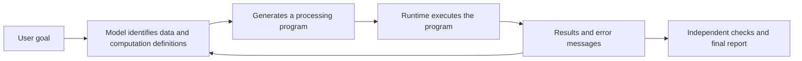
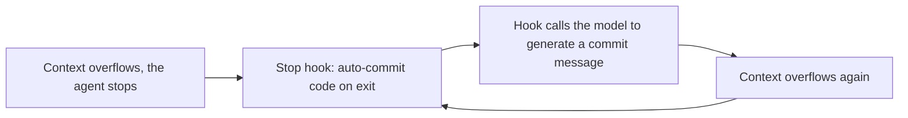
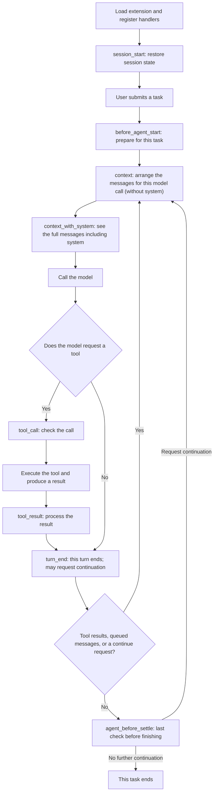

# Chapter 5　Coding Agents and General Agents

[Back to contents](../README.md)

> This chapter is the deep-dive companion to Station 05, "The Handyman Who Codes" (会写代码的万能工), of [π Workshop](https://pi.duanjl.com/). It assumes you have already played the station's four missions: [▶ 5-1 House Rules (这儿的规矩)](https://pi.duanjl.com/#/play/5-1) · [▶ 5-2 It Says It's Fixed (它说修好了)](https://pi.duanjl.com/#/play/5-2) · [▶ 5-3 The Shortcut (捷径)](https://pi.duanjl.com/#/play/5-3) · [▶ 5-4 Try Again (再试一次)](https://pi.duanjl.com/#/play/5-4), and flipped through the [Station 05 manual](../../manual/05-coding.md) (the manual is written in Chinese only). The manual says "what you saw in the game"; this chapter covers the principles, Pi's real implementation, and the trade-offs.

## Reading route

| Part from the manual | What this chapter covers next | Where |
| --- | --- | --- |
| [Project instruction files](../../manual/05-coding.md#c-brief) (5-1) | What goes in an instruction file and how to tend it; how Pi itself loads them, and how extensions attach rules on demand | [5.2](#t-code-brief) |
| [Done means verified](../../manual/05-coding.md#c-gate) (5-2) | Wiring a completion gate into Pi with `agent_before_settle`; failure samples decide whether a check really happened | [5.4](#t-code-gate) |
| [Constrain actions, not just results](../../manual/05-coding.md#c-guard) (5-3) | What the `tool_call` hook can and cannot block; folding validation into the execution tool; the trust boundary moving down | [5.6](#t-code-guard) |
| [The circuit breaker](../../manual/05-coding.md#c-breaker) (5-4) | Pi's built-in breakers, how to write a tool-layer breaker yourself, the death spiral | [5.8](#t-code-breaker) |
| The "Going deeper" boxes in each manual section | Why Coding plus a file system, clarification and design documents, the four Harness components, fault taxonomy and graded recovery, cross-vendor takeover, meta-capability | 5.1, 5.3, 5.5, 5.7, 5.9, 5.11 |
| Not in the game | Pi's extension mechanism: events, registering tools, state recovery, application hosts | [5.10](#t-code-extension) |

This chapter is based on Pi 0.87.1, pinned at commit `f07218c4d4bbc12bef056a7058c3dd49dfe41abe`, and reuses the book's three markers: **[Built-in]** is behavior this version provides directly, **[Extension]** can be implemented with Pi's interfaces but you write the code yourself, and **[Recommendation]** is a general engineering choice that Pi does not do for you. The original-book ideas come from chapter 5 of Li Bojie's *Understanding AI Agents in Depth* (深入理解 AI Agent), called "the original book" below.

The original chapter has an unusual structure: the first half is a fairly tight chain of progression (how a coding agent becomes reliable); the second half, "code as a meta-capability", is several parallel directions, with security and a set of implementation details sandwiched in between. This chapter follows that structure: 5.1 to 5.9 walk the main chain, 5.10 covers the extension mechanism Pi uses to assemble these parts, and 5.11 and 5.12 are two parallel blocks.

First, a small task that runs through the whole chapter. An operations colleague receives an orders table, a refunds table, and a summary table every month and wants Pi to reconcile them before the report goes out. It must read files, write scripts to do the arithmetic, and put its conclusions in `output/`. Every "it says it's done" in this job may be true, or may be only what it believes. Each section of this chapter starts from one of these gaps.

<a id="t-code-core"></a>

## 5.1 Why Coding plus a file system

### Open-ended tasks can't have their tools stocked in advance

Suppose there are 600 daily store reports, and the user wants to "compute each store's refund rate this month and find anomalous changes". Stuffing all the files into the context and having the model add up numbers in natural language wastes context and can hardly guarantee arithmetic consistency. The other path is to have the model look at the file structure first and then write a program to process it: the model decides the computation plan, and the program applies the same rule over and over. The raw data stays in files; the model reads only samples, rules, anomalies, and summaries.

The opening judgment of chapter 5 of the original book comes from here: **the core of a general agent aimed at open-ended tasks is a Coding Agent plus a file system.** Open-ended tasks (deep research, content generation, data processing) have fuzzy boundaries, and the tools cannot be listed in advance; rather than stock them all, give the agent the ability to build tools on the spot. The original book calls this ability a **meta-capability**, expanded in 5.11. The original book adds that nearly all efficient content generation eventually lands on code: PPT and Word are essentially OOXML, PDFs can be generated from Markdown, HTML, or LaTeX, and a successful sequence of browser actions can also be frozen into code. As for clicking through a graphical interface directly (Computer Use), it loses to writing code or calling an API on cost, latency, and stability.



This diagram has two feedback layers. If the program has a syntax error, the runtime reports it; if the program ends normally, the business definition may still be wrong. The former is caught by execution feedback, the latter needs the task definition and independent checks. "The code ran" proves only that it can execute on the current input, not that the problem is solved. This sentence is foreshadowing for 5.4.

### Seven tools, and one is enough

For ease of understanding, the original book lists seven core tools: code interpreter, Bash, Read, Write, Edit, Glob, Grep. It immediately explains that the seven are **not all indispensable**: a single Bash covers most of it, and OpenAI Codex uses the shell as its only general execution entry, plus one syntax-constrained `apply_patch` for editing files. The original book's TODO example uses only Grep and Write.

**[Built-in]** Pi enables only four tools by default, `read`, `bash`, `edit`, and `write`; `grep`, `find`, and `ls` must be enabled explicitly. [Source: default enabled tools](https://github.com/earendil-works/pi/blob/f07218c4d4bbc12bef056a7058c3dd49dfe41abe/packages/coding-agent/src/core/sdk.ts#L258) `bash` executes commands through a subprocess, and the working directory, environment, and abort signal are all part of the execution. [Source: local shell execution](https://github.com/earendil-works/pi/blob/f07218c4d4bbc12bef056a7058c3dd49dfe41abe/packages/coding-agent/src/core/tools/bash.ts#L81) It does not preinstall a universal interpreter in the core: if you call `python3`, the system must really have Python; if you call some library, that library must be importable.

This approach widens the capability boundary from "how many tools were registered in advance" to "which programs the environment can safely run". The price is that environment management becomes part of the application: dependency versions, encodings, permissions, paths, and the network all affect the result. **Fewer tools does not mean less engineering responsibility.** Nor does it mean Pi comes preconfigured with web search, a browser, or office connectors, let alone that every business should allow the agent to write arbitrary code (see the [end of 5.11](#t-code-limits)). The original book draws a boundary around this judgment: it holds only for open-ended general agents. A vertical customer-service agent has a closed task space, whose core is a fixed process, domain tools, and a dialogue strategy, with code just one item in the toolbox.

<a id="t-code-fs"></a>

### The file system is the information hub

Halfway through an investigation, the directory already holds a raw export, a cleaned table, a scratch script, and two versions of the report. Resuming the next day, if you can't tell which is the raw data and which is an intermediate result, you can't recompute, and you can't explain the differences. The original book calls the file system the agent's **information hub**: memory is read from files, products are written to files, and experience is stored as files. Its sales-report example has five steps: read `MEMORY.md` to learn the user prefers PDF, call tools to fetch data, write code to analyze, produce the report, and record the data source back into `MEMORY.md`.

The original book takes particular care to explain why OpenClaw stores memory in Markdown instead of a vector store: users can open and edit it directly (if something was remembered wrongly, delete that line), Markdown naturally preserves chronological order, and Git can roll it back. This was covered in [Chapter 3](03-memory.md#t-memory-formats). A suggested task layout (this book's recommendation; Pi won't create it for you):

```text
monthly-report/
  input/             raw data and export notes
  rules/             metric definitions, business rules, report requirements
  scripts/           data transformation and validation programs
  work/              temporary results and anomaly lists
  output/            final report, charts, and source notes
  checks/            known samples used for acceptance
```

The directories exist to preserve the identity of information: raw input can be re-read, temporary results can be discarded and recomputed, rules have versions, and the final report can be traced back to inputs and programs. Mixed into one file, the model fixing the report might casually change the "raw data". A practical principle: **keep bulk facts in the environment, and bring only the small amount of evidence needed to advance the task into the context.** Detail rows stay in the CSV, and the model sees field descriptions, statistics, and anomaly samples. Files provide capacity, and the reading and selection strategies of [Chapter 2](02-context.md) do the choosing. Of course, a file existing does not mean the model has read it, nor that the content is reliable; the application must still tell the agent where to look and check whether it is current.

<a id="t-code-brief"></a>

## 5.2 Project instruction files: read the house rules at the door

In 5-1 the main brain kept to "amounts in cents" and "order numbers continue the sequence" because those two were written in the `orders.json` it had read; "log a change record when changing an order" was in `AGENTS.md`, which it hadn't read, so it had no way to follow it ([manual · project instruction files](../../manual/05-coding.md#c-brief)). The original book says that in a new repository with no documents the agent should not act blindly but first build a cognitive framework, generating initial documents itself by reading code if necessary. **Making knowledge explicit is the precondition of collaboration.**

A **project instruction file** is the agent-specific form of this: `CLAUDE.md`, `AGENTS.md`, and `.cursorrules` are de facto standards, injected automatically at the start of each session, equivalent to a project-level system prompt. How Pi discovers these files level by level, how it wraps them into the system prompt, and why they are not subject to project trust were covered in [Chapter 2](02-context.md#t-ctx-prompt); here we cover only what to write and how to tend them.

### What to write

The original book's list has three kinds, with concrete examples:

| Kind | The original book's example | Why include it |
| --- | --- | --- |
| Build and test commands | "Use `pnpm test`, not `npm test`" | You could roughly guess from the code, and a wrong guess wastes a whole turn |
| Code style | "No `any` type" | A team convention that isn't necessarily visible everywhere in the code |
| Explicit off-limits areas | "Don't modify the `migrations/` directory" | Stepping on it is an incident |

The difference from a README is the reader: a README is written for people, an instruction file for the agent. The original book compares it with OpenClaw's two resident files: `SOUL.md` fixes "who the agent is", the project instruction file fixes "how to work in this project"; `MEMORY.md` accumulates cross-session experience.

### Why it is "the most economical stable prefix"

From chapter 2's angle, the original book adds: the instruction file's content doesn't vary with the task and is at the very front every time, so it naturally falls in the segment [the KV Cache can reuse](02-context.md#t-ctx-kv-cache). Conversely, writing today's date or the current branch into it means shattering the cache by hand every day. Environment information that changes belongs in the [status bar](02-context.md#t-ctx-status). The original book also gives a metric for assessing a team's "AI-ready" degree: **can a remote newcomer start work independently with only the repository and the documents?** This is where chapter 2's "teams friendly to remote work are often friendly to agents too" lands at the codebase level: decisions recorded in documents, context written in issues and PRs, so the agent can read them.

### How to tend it

An instruction file isn't written once and done. A few tending principles:

| Principle | Practice | Basis |
| --- | --- | --- |
| Write only what you can't tell from the code | Leave conventions visible at a glance to the code | Every model call pays its input cost |
| Put detailed rules elsewhere | The instruction file lists only "for this kind of work, read that rule file" | See Pi's official example below |
| Change it along with the code | If the build command changes, change the instruction file in the same commit | The original book: **outdated documentation is worse than none** |
| One mistake, one addition | Each kind of mistake the agent makes gets a new rule or a check script | Mitchell Hashimoto calls this "engineer the harness" (this book's addition, not from the original book; see [further reading](notes/prompt-context-harness.md#harness-engineering-the-environment-the-model-works-in)) |

Be careful with the last one: adding rules is easy and deleting them is hard, and a rule set that only grows will bloat. Question 5 in the original chapter's discussion questions asks exactly this: how to do "garbage collection" on accumulated rules, which [Chapter 9](09-evolution.md) picks up.

**[Built-in]** Pi automatically loads context files such as `AGENTS.md` at startup (chapter 2). The workshop's "Project Notes" part does a hand-made version of the same thing: it turns off Pi's automatic discovery, reads that virtual file, and wraps it into the system prompt. [Source: 5-1's system prompt](../../playground/server/station5.mjs#L162)

**[Extension]** "Put detailed rules elsewhere, read on demand" has a ready-made official example, [`claude-rules.ts`](https://github.com/earendil-works/pi/blob/f07218c4d4bbc12bef056a7058c3dd49dfe41abe/packages/coding-agent/examples/extensions/claude-rules.ts#L1): it scans the project's `.claude/rules/` directory, puts only the list of rule files into the system prompt, and the model uses `read` to read the specific one when needed. The system prompt holds the catalog and the body stays in files, the same idea as [chapter 2's Skills](02-context.md#t-ctx-skills).

**[Recommendation]** An instruction file is text, not a program-enforced constraint. With "don't modify `migrations/`" written in, the model will mostly listen; to guarantee it can't, block at 5.6's execution boundary. The original book calls this "constraint over guidance".

<a id="t-code-clarify"></a>

## 5.3 Before acting: clarification and design documents

With the rules read, the next hole is the requirement itself. The original book's example: the user says "optimize system performance", and does that mean lower response time, less memory, or higher throughput? Is changing the interface acceptable? Where is the bottleneck? Starting to write while the requirement is vague usually means a lot of rework. 5-2 also buries a requirements problem: the complaint says "36 yuan wasn't discounted", and the spec says "5 off over 30". The complaint is a symptom; the spec is the requirement.

The original book's process has two steps. First **clarify**: small changes with clear boundaries go straight ahead; complex tasks explore first and ask a person if necessary. Then **write a design document**: which modules change, why, what approach, what dependencies are introduced, and the expected impact. The original book says a design document has two benefits: it forces the agent to validate the plan at the conceptual level first; and it gives people an intervention point much easier than reviewing hundreds of lines of code, with work starting after approval. The original book also notes this is a recommended process, and products such as Claude Code and Codex trim it as needed, skipping the design document for simple bugs.

There's also a spot that's easy to get wrong. Some models, before editing, read widely across directories, implementations, callers, and tests; others read only the few most likely relevant files and submit a patch, treating compile and test feedback as part of the investigation. The original book points out that this threshold of "when to stop reading and start changing" is **first of all a behavioral strategy the model has learned**, not merely a product style: it may stay the same when the Harness changes, and may change when the same Harness gets a different model. The Harness can amplify or suppress it, but need not be its source. [Chapter 7](07-evaluation.md) measures this difference under a fixed Harness, and [Chapter 8](08-training.md) explains from post-training how it gets written into the parameters.

**[Extension]** Pi's core has no "plan mode". The official example [`plan-mode`](https://github.com/earendil-works/pi/blob/f07218c4d4bbc12bef056a7058c3dd49dfe41abe/packages/coding-agent/examples/extensions/plan-mode/README.md#L1) implements one with an extension: once on, `edit`/`write` are disabled and `bash` lets only read-only commands through; the model outputs numbered steps under `Plan:`, the extension extracts them for progress tracking, and the state is restored with the session. This is exactly the shape of "explore read-only first, write a plan, execute after approval", and the read-only part is guaranteed by the program, not persuaded by a prompt.

Why "list the plan first, then execute" often has to fall back to "look and decide as you go" in investigation tasks is covered in the further reading [Who decides the next step](notes/control-structures.md).

<a id="t-code-case"></a>

### A combined case: the requirement changes mid-task

Clarification doesn't always happen at the start. In the case below, the requirement only becomes clear in the second round.

The team opened a new checkout page to a portion of users, changing where the shipping fee is displayed and the payment button text. The person in charge sees that refunds seem to have increased and wants to know whether to restore the old version. On hand are an order export, customer-service excerpts, and release notes, none of which directly answers "did the redesign cause it?" The refund field may record requests or completions; the new version was opened only to some users, so "orders after launch" don't all come from the new version; customer service mentions shipping-fee issues, but some people may also have requested refunds over delivery delays. Without separating these, even a correctly computed summary table can support the wrong decision. The [accompanying material](../examples/investigation/README.md) provides two batches of 20 orders each, the old metric definitions, the release notes, and customer-service excerpts.

**Round one: first separate the phenomenon, the leads, and the conclusion.** An acceptable reference path (the model need not follow this order strictly):

1. Read the task and metric definitions, and confirm that the existing field represents a refund **request**, not a completion.
2. Write a small program to compute the request rate: from 3/20 = 15% to 8/20 = 40%. The program does the computing, and the model explains what this number still cannot tell us.
3. The release notes also mention a new-customer acquisition campaign. Look again by new versus returning customers: the new-customer share goes from 20% to 80%, new customers' request rate is 50% both before and after; returning customers go from 6.25% to 0%. Neither the overall figures nor the grouped observations support direct attribution.
4. Customer-service material mentions the shipping-fee notice, but two pieces of feedback belong to the same order, and others concern delivery, mistyped addresses, and second thoughts. These are leads to verify, and a rate of complaints cannot be estimated from hand-picked fragments.
5. Save a preliminary report and the open items, and ask the person in charge: what decision is actually being made, which metric to use, and whether there is version-exposure data.

**Round two: new material changes the metric and also the goal.** The person in charge adds: management looks at the refund **completion rate**; the real worry is that the shipping-fee display is being misread, and the first decision is whether to pause expanding the gray release; no more instrumentation is available. A new event table shows completion rates of 15% and 25% for now, but the earlier batch has been observed for 14 days and the later one for only 3. An agent that can adapt to change must change four things: the computation shifts from the request flag on orders to completion events joined to orders; the report keeps the old request rate but corrects its use; the causal judgment adds the observation window and the missing version exposure; and the deliverable changes from a full report to a one-page decision memo plus a minimal verification plan. The round-one products must be kept so the reader can see what changed and why.

```js
// Investigation strategy sketch: not a Pi built-in flow, nor a complete implementation.
let goal = readUserRequest();
let evidence = [];
let questions = [];

while (!readyToDeliver(goal, evidence)) {
  const next = chooseNextStep(goal, evidence, questions); // chosen by the model
  if (next.kind === "clarify") {
    saveFindingsAndQuestions(evidence, next.questions);
    break; // this run waits for the user, and does not fabricate missing information into conclusions
  }
  const observation = await executeTool(next.tool, next.args);
  evidence.push(withSourceAndDefinition(observation));
  questions = reconsiderWhatIsUnknown(goal, evidence);
}

// The next user input starts a new run; the model does not receive future material out of thin air.
const update = await receiveUserUpdate(); // received by the host
const changes = compareGoalAndDefinitions(goal, update); // the model identifies the changes
await savePreviousReport();
goal = reviseGoal(goal, changes);
// Then enter the model-tool loop again, recompute under the new definitions, keeping the old basis.
```

`chooseNextStep` and `compareGoalAndDefinitions` stand for judgments made by the model; the other helper functions are illustrative too. [Chapter 1's underlying loop](01-agent-loop.md) keeps calls and results flowing back and forth, while this snippet describes the business task advancing inside that loop. They are not the same `while`, and Pi does not preinstall a stopping rule for refund investigations.

**Without a single conclusion, you can still accept strictly.** A qualified deliverable may recommend briefly pausing the expansion of the gray release and first comparing shipping-fee visibility across the old and new pages with the same task; or, after explaining the risk and stopping criteria, recommend keeping the small-scale observation. But some statements can be clearly marked wrong: calling a request a completion, double-counting the same order, claiming a nonexistent randomized control, ignoring the 14-day versus 3-day difference, or describing a recommendation as already executed. Acceptance thus has two parts: programs check the joins, deduplication, and numbers; a person reads the trajectory to check whether the evidence supports the claims, whether key unknowns were retained, and whether the user's change affected the actions taken. The full two-round procedure, numeric answers, a sample memo, and the evaluation sheet are in the [combined experiment](../examples/investigation/README.md).

<a id="t-code-gate"></a>

## 5.4 Done means verified

### The most common slacking

The original book says the **most common way a Coding Agent slacks off is to finish writing code and report "task complete" without running tests**. The main brain in 5-2 didn't lie: it really did make the 36-yuan customer eligible for the discount; it just fixed the complaint, not the rule, and between its change and its saying "fixed", nothing verified anything ([manual · done means verified](../../manual/05-coding.md#c-gate)).

The original book's remedy is the **test-fix loop**: write tests covering the normal path, boundaries, and exceptions; when a test fails, don't simply report the failure to the user, but analyze, locate, and modify until it passes. Defining "tests pass", rather than "code written", as the completion criterion is how "verification decides when you may stop" lands in the coding scenario.

The manual compared two approaches: Station 01's acceptance beacon is a tool the main brain presses only if it wants to; Station 05's completion gate is not a tool, and the moment the main brain stops, the space station runs it by itself. The original book's fulcrum sentence is right here: **reliability depends on infrastructure, not on how strong the model is.** A process written in a prompt is only a suggestion; for "done only when tests pass" to hold, the program must guarantee it at the moment the agent announces completion.

### Wiring a gate into Pi

**[Built-in]** Pi has no built-in "completion gate". But it leaves an interposable boundary before a run ends: `agent_before_settle`. It is the last point at which you can act, and the handler can append entries and request another model request. [Official notes: the pre-settle boundary](https://github.com/earendil-works/pi/blob/f07218c4d4bbc12bef056a7058c3dd49dfe41abe/packages/coding-agent/docs/extensions.md#L66), [event declaration](https://github.com/earendil-works/pi/blob/f07218c4d4bbc12bef056a7058c3dd49dfe41abe/packages/coding-agent/src/core/extensions/types.ts#L817)

**[Extension]** The gate can be wired as follows. Below is **mechanism pseudocode**; `runTests` is implemented by the application:

```js
// Mechanism pseudocode: runTests returns null if everything passes, else a concrete failure reason; noteForHuman produces an entry for humans to read. Both are implemented by the application.
const MAX_ROUNDS = 2;
let rounds = 0;

pi.on("agent_settled", () => { rounds = 0; }); // reset only after the whole run settles; see the table below

pi.on("agent_before_settle", async (event) => {
  if (event.outcome !== "completed") return;          // don't append on error or abort, so as not to pile error on error
  const failure = await runTests();
  if (!failure) return;                                // all passed, let it settle
  if (rounds >= MAX_ROUNDS) {
    return { entries: [noteForHuman("Tests still failing; automatic repair stopped: " + failure)] }; // hand it to a person, don't continue
  }
  rounds += 1;
  return {
    entries: [{
      type: "custom_message", customType: "completion-gate", display: true,
      content: `[Completion gate] You said you were done, but the tests did not pass: ${failure} Keep fixing until the tests pass.`,
    }],
    continue: true,                                    // request another model request
  };
});
```

Four points.

| Point | Why |
| --- | --- |
| Write the failure reason into a message the model can see | Blocking without saying leaves it not knowing which item was wrong. The reply in 5-2 spelled out "the 30-yuan order should pay 25, but computed 30" |
| Have a cap | The official docs say plainly that unconditional continuation causes loops. "Keep handing it back until the tests pass" is a recovery path with no ceiling, exactly 5-4's disease ([official notes](https://github.com/earendil-works/pi/blob/f07218c4d4bbc12bef056a7058c3dd49dfe41abe/packages/coding-agent/docs/extensions.md#L109)) |
| Reset the count only after settling | Don't reset in `agent_start`: retries, overflow recovery, and continuations the gate itself requests all make Pi emit `agent_start` again, and once the count resets, the cap is nominal. [Source: the run loop](https://github.com/earendil-works/pi/blob/f07218c4d4bbc12bef056a7058c3dd49dfe41abe/packages/coding-agent/src/core/agent-session.ts#L1468) |
| Check the settle reason | `outcome` is `completed`, `aborted`, or `error`. Running tests and appending messages on error means calling the model once more on an error path, which is where 5.8's death spiral begins |

In addition, Pi executes a continuation request only when the current context can really be continued; when it can't, it reports that this continuation was invalid and settles as usual. [Source: handling of the pre-settle boundary](https://github.com/earendil-works/pi/blob/f07218c4d4bbc12bef056a7058c3dd49dfe41abe/packages/coding-agent/src/core/agent-session.ts#L1531)

The workshop doesn't use this event; it uses a plainer host-side approach: after `prompt()` returns, the server runs the check, and if it fails, sends the reason as a new question with `prompt()` again, at most twice. [Source: the workshop's completion gate](../../playground/server/run.mjs#L982) The two are equivalent; the difference is where the gate lives: the former lives in an extension, so any host that loads the extension has the gate; the latter lives in the host, so a different host means rewriting it.

<a id="t-code-test-loop"></a>

### Two more things after tests pass

After "implement and test", the original book adds two more steps:

| Step | The original book's requirement | How to wire it in Pi |
| --- | --- | --- |
| Self code review | Read the code, run lint, or call a dedicated review sub-agent | **[Extension]** For a review sub-agent see [Chapter 4's collaboration tools](04-tools.md#t-tool-collab); the reviewer is only meaningful if it gets information the proposer doesn't have |
| Documentation sync | If the architecture changed, update the documents. Outdated documents are worse than none | **[Recommendation]** Put "do the instruction file and architecture docs need changing?" among the gate's check items |

In its implementation details the original book also mentions **instant syntax feedback**: after writing a file, the tool layer immediately runs a linter and returns structured errors ("line 10: undefined variable result") with the return value, like an IDE's red squiggles. This moves part of acceptance to right after every write. Pi's `write`/`edit` don't run a linter; if you want one, listen to `tool_result` and append the check results, wired as in [Chapter 4](04-tools.md#t-tool-exec-feedback).

One last reminder: the gate verifies only what it was told to verify. If 5-2's test covered only the 36-yuan case, a threshold of 36 would pass too, and the gate would vouch for it. How well the tests are written decides what the gate is worth, which [Chapter 7](07-evaluation.md) covers in depth.

<a id="t-code-csv"></a>

### Hands-on: failure samples decide whether a check really happened

Let's carve out a step of the earlier investigation that can be computed by hand. Put the following fictional data into `input/orders.csv` in the exercise directory; `amount` is the original order amount (yuan), and refunds are marked with `status=refunded`:

```csv
order_id,store,amount,status
A001,East,100.00,paid
A002,East,50.00,refunded
A003,West,80.00,paid
A004,West,20.00,paid
```

The task for Pi can be written like this:

> Read input/orders.csv and compute, per store, the number of orders, the number of refunded orders, and retained revenue. Retained revenue sums only the amounts of paid orders; the refund rate is refunded orders divided by all orders. First check for duplicate order_id, unknown status, and invalid amounts; when problems are found, output an anomaly list and do not silently skip them. Implement it with the Python standard library, leave the original file unchanged, and write output to output/. Attach the run command and acceptance results to the final report.

This input turns "help me analyze this" into an execution contract: the meaning of the fields, the computation method, the behavior on anomalies, and the location of products are all stated, so the agent need not invent its own definition of "refund rate". The same term may be read as the share of refund amount, the share of refunded orders, or the rate after excluding cancelled orders.

The reasonable process is to read a sample first, then write the program. The computation mechanism is roughly:

```js
// Mechanism pseudocode, not directly runnable; readCsv, parseDecimal, writeErrors, etc. are implemented by the application.
// The decimal helpers here mean exact decimal arithmetic, not ordinary JS floating-point addition.
const seen = new Set();
const totals = new Map();
const errors = [];

for (const row of readCsv("input/orders.csv")) {
  const problems = validateRow(row, seen); // required fields, duplicate IDs, status and amount
  if (problems.length > 0) {
    errors.push({ line: row.line, problems });
    continue;
  }
  seen.add(row.order_id);
  const amount = parseDecimal(row.amount);
  const store = getOrCreateTotals(totals, row.store);
  store.orders += 1;
  if (row.status === "refunded") { store.refunds += 1; }
  if (row.status === "paid") { store.income = decimalAdd(store.income, amount); }
}

if (errors.length > 0) {
  writeErrors(errors);
  markRunFailed(); // don't write an incomplete summary as the official report
} else {
  writeReport(sortStoresAndComputeRates(totals));
}
```

Why decimal amounts? Common binary floating-point numbers cannot exactly represent many decimal fractions, and repeated summation accumulates tiny errors. The model needn't simulate these operations in its head; it should pick the right runtime type and let the program compute. Amount validation must also exclude infinite values: "parses as a number" is not complete business validation.

The acceptance standard can be computed by hand: East has two orders, one refunded, a refund rate of 50%, retained revenue of 100 yuan; West has two orders, zero refunds, a refund rate of 0%, retained revenue of 100 yuan; total 200 yuan.

Then copy the data and add a duplicate order. The expected result is that the report fails explicitly and points out the duplicate id, not that revenue becomes 300 yuan and completion is declared. Add an unknown status and see whether it is treated as paid. **Failure samples decide whether a "check" really happened.** Running only on normal input, it is hard to notice that a program quietly dropped data.

Pi provides file operations and the run loop here, and the business acceptance rules come from us. It does not become trustworthy automatically just because an output file is named `validated-report.md`. Trust comes from the verifiable relationships among input, rules, program, run results, and checks.

<a id="t-code-harness4"></a>

## 5.5 The four Harness components and the four quadrants

5.4's gate relies on "there are tests to run". Why does programming happen to have them? The original book's answer is this chapter's core conclusion: **Coding Agents are the most mature not because code-generation models are especially strong, but because the infrastructure that software engineering has accumulated over decades is naturally a Harness.** [Chapter 1](01-agent-loop.md#t-harness-five) split the Harness into two levels, "context and tools" and "constraints, verification, and correction"; landing on Coding Agents, the original book sorts it into four components:

| Component | The question it answers | What software engineering already has | What Pi has |
| --- | --- | --- | --- |
| Acceptance baseline | What counts as done | Test suites, CI, code-review standards | **[Extension]** No built-in gate; wire one with 5.4's `agent_before_settle` |
| Execution boundary | What can be touched and what cannot | Module boundaries, dependency rules, permissions | **[Built-in]** the `--tools` allowlist; **[Extension]** `tool_call` interception (5.6); strong isolation relies on the [sandbox](s-sandbox.md) |
| Feedback signal | Automated right-or-wrong judgment | Linter output, test results, type-check errors | **[Built-in]** tool exceptions and argument-validation failures become error results handed back to the model (5.7) |
| Rollback means | How to recover from a mistake | Git, sandboxes, snapshots | **[Built-in]** a session can [go back to an old node on the tree](03-memory.md#t-session-tree), but **the files do not go back with it**; **[Extension]** the official example [`git-checkpoint.ts`](https://github.com/earendil-works/pi/blob/f07218c4d4bbc12bef056a7058c3dd49dfe41abe/packages/coding-agent/examples/extensions/git-checkpoint.ts#L20) does a `git stash create` snapshot before each turn and asks at fork time whether to restore the code too |

`git-checkpoint.ts` has a detail worth noting: the snapshot references are stored in an in-memory `Map` and vanish when the process exits. It only demonstrates the interface; to make a rollback point survive a restart, use the state recovery covered in 5.10.

### The four quadrants: which tasks suit an agent

The original book uses two dimensions, task clarity and degree of verification automation, to divide tasks into four cells (table 5-1):

| | Result automatically verifiable | Result needs human verification |
| --- | --- | --- |
| **Goal clear** | Best zone: fixing a bug that has test cases | Throughput-limited: code refactoring needs human review |
| **Goal vague** | Efficiently going astray: optimizing "code quality" with a linter | Hard to start: "make the UI look nicer" |

The bottom-left cell is the most interesting: there is automatic feedback but the goal is vague, and the system **efficiently runs in the wrong direction**. 5-3's `check_ledger` is a miniature bottom-left cell: it asks only "are there negative numbers?", so even wiping the ledger turns it green. The original book says the Harness's goal is to push as many tasks as possible to the top-left corner. Programming is naturally there: tests supply acceptance criteria, linters and type checks give instant feedback, and Git gives rollback.

The original book cites three industry cases in support. A large tech company's large-scale code migration got three things right: knowledge must live in the codebase itself (what the agent can't see doesn't exist), constraints are encoded into linters and CI rather than written in documents, and verification and correction are automated across the whole chain. LangChain optimized only the Harness (system prompt, tool middleware, self-verification loop) and improved benchmark performance significantly, and even used an agent to analyze failure trajectories to improve the Harness. Anthropic split long tasks into two roles: an initializer agent decomposes a task list, and an executor agent advances step by step and leaves intermediate results for the next round, curing "trying to do too much at once" and "claiming completion too early".

### Four transferable principles

| Principle | Meaning | Where this chapter uses it |
| --- | --- | --- |
| Constraint over guidance | Linters, types, and CI are "can't do"; a "please follow" in the system prompt is only "better not" | End of 5.2, 5.6 |
| Verification must be automated | Human review is a non-scalable bottleneck | 5.4 |
| The faster and more structured the feedback, the better | The more specific the error and the closer to the moment it occurs, the faster the correction | The gate's reply in 5.4, the error results in 5.7 |
| Rollback must be reliable | Only inside a safety net can you try boldly | The last row of the table above |

For the story behind the turn "an agent's reliability lies mainly outside the model", see the further reading [From Prompt Engineering to Harness Engineering](notes/prompt-context-harness.md).

<a id="t-code-guard"></a>

## 5.6 Constrain actions, not just results

### Right result, wrong process

The acceptance baseline governs the result; the execution boundary governs the **process**. The original book's example: when fixing a database fault, delete the database and rebuild it, and the "fix" really works, but the data is gone; when fixing a compile error, delete all the code and rewrite it, and the build really passes, but the implementation is gone. 5-3's wiped ledger is the same kind of thing ([manual · constrain actions](../../manual/05-coding.md#c-guard)). The original book says such destructive shortcuts always exist: even if you write the limits into the final evaluation metric, the agent can often get around them, which is exactly what [Chapter 8](08-training.md) calls reward hacking in its everyday form in agent tasks.

So the original book requires dedicated checks and approval for dangerous actions like `rm -rf`, deleting production data, and overwriting unread files. Training has a counterpart too: Chapter 8's RLVP (verifiable-path penalty, "reward the result, punish the path") penalizes verifiable violations in the process on top of the outcome reward. For an existing model, the Harness guardrail is an external constraint; for a model you can train, process penalties internalize it.

### Pi's `tool_call`: ask first, before acting

**[Built-in]** Before each tool call really executes, Pi runs the `tool_call` handlers registered by extensions in turn; if any returns `{ block: true, reason }`, the call is not executed and `reason` goes back to the model as an erroring tool result. [Source: emitToolCall](https://github.com/earendil-works/pi/blob/f07218c4d4bbc12bef056a7058c3dd49dfe41abe/packages/coding-agent/src/core/extensions/runner.ts#L1134) When a handler itself throws, Pi also blocks the call; the failure direction is safe. [Official notes](https://github.com/earendil-works/pi/blob/f07218c4d4bbc12bef056a7058c3dd49dfe41abe/packages/coding-agent/docs/extensions.md#L201)

5-3's execution boundary hangs right here. The workshop attaches each task's `guard` to `tool_call` ([source: wiring](../../playground/server/run.mjs#L842)), and 5-3's does just three things ([source: 5-3's execution boundary](../../playground/server/station5.mjs#L230)):

1. If the call isn't a write to `ledger.json`, let it through.
2. **Parse as JSON** the content about to be written, count the entries, and compare with the existing ledger.
3. If it got smaller, or can't be parsed, block, with a reason that says plainly "from 8 entries to 0; edits allowed, deletion not".

Step 2 is the key: it understands the arguments instead of searching a string for `[]`. Compare the official example [`protected-paths.ts`](https://github.com/earendil-works/pi/blob/f07218c4d4bbc12bef056a7058c3dd49dfe41abe/packages/coding-agent/examples/extensions/protected-paths.ts#L13): it blocks `write` and `edit` to `.env`, `.git/`, and `node_modules/`, judging by `path.includes(p)`. This has three holes, which show exactly why "constraining actions" is hard:

| Hole | Example | Root |
| --- | --- | --- |
| Use another entrance | `echo x > .env` in `bash`; it looks only at `write`/`edit` | Only some action entrances are blocked |
| Collateral damage | Writing `docs/how-to-use-.env.md` is blocked too | String containment is not path semantics |
| Path tricks | A file symlinked to `.env` | The real path isn't normalized |

So the `tool_call` hook suits expressing **business policy** (the ledger may be edited but not deleted; publish only after reconciliation passes), while strong isolation should be left to the operating system, containers, and standalone services. Why a keyword blacklist can't withstand the combinatorial explosion of the shell, and what three things a sandbox needs to do, are in the [Sandbox special topic](s-sandbox.md). Two more `tool_call` contracts to remember, covered in [Chapter 4](04-tools.md#t-tool-fidelity): a handler may modify arguments in place, and after modification they are **not validated again**; and with parallel calls, one call's check can't see the results of its sibling calls in the same batch (detailed in 5.7).

**[Recommendation]** What you say when you block matters as much as whether you block. The reason should state what was blocked, why, and what is allowed. Block without saying, and the model will mostly try again in a different posture and bump into it once more.

<a id="t-code-rule-gate"></a>

### Fold validation into the execution tool

5-3's `check_ledger` is a standalone acceptance tool, which the main brain may or may not press. In discussing coding up business rules, the original book points out that **a standalone validation tool is easily skipped**, and it's better to have the execution tool validate internally first. Its example is τ-bench's airline scenario `cancel_reservation`, with five cancellation policies: used segments can't be cancelled; bookings within 24 hours can be cancelled unconditionally; airline-cancelled flights can always be cancelled; business class can always be cancelled; economy requires insurance to cancel. The original book sets up three layers of assurance:

| Layer | Approach | Does it carry safety? |
| --- | --- | --- |
| Natural-language rules in the prompt | Let the model explain the policy to the user and find workarounds ("rebook instead of cancel") | No |
| Parameters as a checklist | The tool description lists all policies; add a few optional parameters such as `expected_cabin_class` and `expected_has_insurance`, requiring item-by-item checking before the call. To fill in these parameters the model first looks up the order, and may well notice a violation while preparing the call, never making it | No. `expected_*` are the model's own statements; they can be hallucinated and can be injected |
| Server-side ground-truth validation | Cabin class, insurance, booking time, segments, and flight status are all looked up in the database, with the current time taken from the server clock; a mismatch between `expected_*` and ground truth only logs a warning | **Carries it** |

Here the original book has a sentence worth copying down: **the last line of defense must be built on data the model cannot forge; independence means not only an independent model but, above all, an independent source of data.** If `has_insurance` is a parameter the model fills in, one sentence from the user, "I bought insurance", can disable the gatekeeper. The original book also stresses that natural-language rules and coded rules are **complementary, not substitutes**; the value of coded rules lies not in saving tokens but in preventing irreversible operations (cancelling orders, transferring funds, deleting data). The original book's experiment 5-5 ran a comparison with Qwen3-4B, and describes expected results without giving numbers.

<a id="t-code-trust-boundary"></a>

### The Artifact pattern and the trust boundary moving down

**The Artifact pattern.** Having the model read thousands of lines of query results and then recite them in words costs tokens, is slow, and, worse, "copying" can go wrong. The original book's approach is to have the model write only the SQL, with the system executing and rendering it directly so that **the data bypasses the model**; it can further produce visualization code, forming a "query + chart" pipeline. The original book immediately adds: the Artifact pattern shortens the data path, but **it cannot replace permission checks and execution isolation**. The execution layer still needs a read-only account, only pre-approved SELECTs let through, DDL/DML and multiple statements rejected, parameterized binding, time and row limits, and visualization code in a sandbox. **The trust boundary moves down to the data layer.** In the past, permission decisions were written in stable application-layer code. When interfaces, workflows, and data-access code are all generated by the agent on the fly, the new code may miss a permission check or expose a hidden field, whether through an ordinary generation error or through injection. If the checks are also written in this dynamic code, they sit in the same trust domain as the code they constrain. The original book's goal: **don't expect the AI to write permission checks correctly every time; make it so that even if it writes them wrong, it can't get around them.**

| Means | Effect |
| --- | --- |
| Row-level security, constraints, validators | The database itself rejects unauthorized reads and writes |
| Controlled views, stored procedures | Expose only the permitted shapes |
| Access context bound by a trusted runtime | Every read and write carries an identity that generated code can't forge, and it can't obtain high-privilege credentials |

The application layer may pre-check to improve the experience; the data layer keeps the final ruling, and every access path must go through it. The original book's experiment 5-15 verifies this with a hiring workflow: skipping a state transition, writing an out-of-range salary, and cross-tenant reads must all be rejected. If 5-3 put the ledger in a database, the most robust form of "edit, never delete" is that the account simply has no DELETE permission; in [Chapter 1's three layers of guardrails](01-agent-loop.md#t-guardrail-layers), that is the very bottom layer.

<a id="t-code-security"></a>

### The security chain: an outline of four lines of defense

5-3 blocks bad ideas the main brain came up with itself. Harder to deal with are bad ideas slipped in by others. The original book gathers security into a narrative thread parallel to the main chain; here we list only the outline, with the main text in the [Sandbox special topic](s-sandbox.md):

| Line of defense | The original book's key points |
| --- | --- |
| Threat model | Simon Willison's **lethal trifecta**: private data, untrusted content, external communication. The original book adds **persistent memory**, which is not a fourth necessary condition but an amplifier. Input filtering alone can hardly stop injection; the point is to leave an injected agent no chance to execute dangerous actions |
| Three sandbox items | Network egress cut by default with an allowlisted proxy; source read-only, a separate writable workspace, credentials not mounted; resource quotas plus timeouts, with a timeout returning a structured error |
| Command semantic parsing | `$(echo rm) -rf /` evades a literal ban; `find -exec rm` and `curl -o /etc/crontab` hide dangerous actions in arguments; you must understand how each command consumes its arguments |
| Delegator loyalty | A model defaults to "I help whoever talks to me". The original book measured a spectrum: the too-honest one blurts out "our floor price is 12000", the too-suspicious one refuses even legitimate requests, and the two ends are a seesaw. Prompt injection is in essence a subversion |

Pi's side of the facts is one sentence, but an important one: **Pi has no built-in sandbox**; it reads, writes, and executes with the privileges of the account that started it, and it doesn't ask for approval before every tool call. [Official security boundary](https://github.com/earendil-works/pi/blob/f07218c4d4bbc12bef056a7058c3dd49dfe41abe/packages/coding-agent/docs/security.md#L3)

<a id="t-code-fault"></a>

## 5.7 Faults: classify first, then recover

### Four layers of faults

With actions under control, the next hole is faults themselves. [Chapter 1's ablation experiment](01-agent-loop.md#t-ablation) already showed that dropping a single tool-result feedback can trap an agent in an infinite loop; production faults are far more varied. The original book divides them into four layers by where they occur, and the right-hand column of the table below is what Pi builds in at that layer (the original book's analysis in this section is based on studying implementations such as Claude Code; this book maps it onto Pi's source):

| Layer | Faults the original book lists | How Pi handles them |
| --- | --- | --- |
| API layer | Rate limiting (429), overload, timeouts, dropped connections, output hitting the cap and truncated | **[Built-in]** Classify retryable versus non-retryable by error text, and automatically retry the retryable with backoff (see "graded recovery" below) |
| Tool layer | Hallucinated calls, malformed arguments, execution throwing exceptions, and the same error recurring with the model retrying verbatim | **[Built-in]** A nonexistent tool returns `Tool X not found`; arguments not matching the schema return a validation error; `execute()` throwing becomes an error result. None ends the session. [Source: prepareToolCall](https://github.com/earendil-works/pi/blob/f07218c4d4bbc12bef056a7058c3dd49dfe41abe/packages/agent/src/agent-loop.ts#L711), [catching execution exceptions](https://github.com/earendil-works/pi/blob/f07218c4d4bbc12bef056a7058c3dd49dfe41abe/packages/agent/src/agent-loop.ts#L773). "Repeating verbatim" has no built-in detection |
| Context layer | Window overflow, compaction failure, corrupted trajectory structure (tool call missing its paired result) | **[Built-in]** Overflow goes to compaction rather than retry; before sending a request, orphaned tool calls are automatically given an error result of `No result provided`. [Source: pairing repair](https://github.com/earendil-works/pi/blob/f07218c4d4bbc12bef056a7058c3dd49dfe41abe/packages/ai/src/api/transform-messages.ts#L158) |
| Control-flow layer | Dead loops (repeating the same operation with no progress), death spirals | **[Extension]** No built-in repetition fingerprint or maximum turn count; see 5.8 |

The tool layer has one more very fine built-in handling: when the model output is truncated by the length limit (`stopReason` is `length`), the tool-call arguments in that message may all be cut in half, and Pi **fails all of them**, not executing calls that may already be broken. [Source: tool calls in truncated messages](https://github.com/earendil-works/pi/blob/f07218c4d4bbc12bef056a7058c3dd49dfe41abe/packages/agent/src/agent-loop.ts#L267)

### Detection: first ask whether it's worth retrying

The original book says the first judgment after catching a fault is not "should we retry" but "**is it worth** retrying". Retrying makes sense for rate limiting, overload, and network jitter; with illegal arguments, insufficient permissions, or a nonexistent tool, no number of verbatim retries changes anything, and you must change the input or the strategy. A production-grade Harness maintains an "error to recovery strategy" mapping table.

**[Built-in]** Pi's table is in `pi-ai`, as two groups of regular expressions: one recognizes retryable errors such as `overloaded`, `rate limit`, `429`, `503`, and connection resets; the other specifically excludes quota-exhaustion errors such as `insufficient_quota`, `quota exceeded`, and `billing`. Quota exhaustion also often comes back as a 429, but it isn't "fine after a short wait". [Source: the two groups of patterns](https://github.com/earendil-works/pi/blob/f07218c4d4bbc12bef056a7058c3dd49dfe41abe/packages/ai/src/utils/retry.ts#L7), [the decision function](https://github.com/earendil-works/pi/blob/f07218c4d4bbc12bef056a7058c3dd49dfe41abe/packages/ai/src/utils/retry.ts#L237) Context overflow is excluded from retry separately and handed to compaction. [Source: _isRetryableError](https://github.com/earendil-works/pi/blob/f07218c4d4bbc12bef056a7058c3dd49dfe41abe/packages/coding-agent/src/core/agent-session.ts#L3326)

Beyond single errors, the original book also asks to detect **patterns**:

| Signal | The original book's approach | Pi |
| --- | --- | --- |
| Repeated-call fingerprint | Compute a fingerprint of "tool name + arguments"; the same fingerprint recurring means a no-progress loop. 5-4's twelve `sync_stock({})` have identical fingerprints | **[Extension]** Compute it yourself in `tool_call` |
| Consecutive-failure count | One independent counter per recovery path, giving the circuit breaker its basis | **[Extension]** See 5.8 |
| Idle watchdog | The most dangerous thing about a streaming connection isn't disconnecting, it's **silently hanging**: connected but no data flowing. SDK timeouts often cover only establishing the connection, so you need an independent watchdog. Every long-lived connection needs a liveness signal | **[Built-in]** `httpIdleTimeoutMs` defaults to 300000 ms, covering idleness of both response headers and body. [Official settings](https://github.com/earendil-works/pi/blob/f07218c4d4bbc12bef056a7058c3dd49dfe41abe/packages/coding-agent/docs/settings.md#L106) |
| Trajectory integrity | When a tool call lacks its paired result, repair it automatically before injection | **[Built-in]** See "context layer" in the table above |

On the last row, the original book has a very fine reminder: **lenient in product mode, strict in training mode.** In a product you can patch with a placeholder so the conversation goes on; patching placeholders into training data carries synthetic content into the model. Pi's `No result provided` is the product-mode approach. If you use Pi's session files as training samples ([Chapter 8](08-training.md)), you must first find and handle such synthetic results.

<a id="t-code-fault-boundary"></a>

### Fault boundaries: one failure should not drag down a batch

The original book's example: a batch reads three files in parallel, one doesn't exist, and only that one is reported while the other two return as usual. A fault propagates only within the same batch of parallel calls and does not rise to the parent. In discussing parallel tool calls, the original book adds two more: each tool declares whether it supports concurrency, **defaulting to no**, which is fail-safe; when one call fails, only the calls in the same batch that **depend** on it are cascade-aborted.

**[Built-in]** Pi's approach is partly the same as the original book and partly different:

| | The original book's advice | Pi 0.87.1 |
| --- | --- | --- |
| Who a failure affects | Only itself | Same. Each call's exception is caught separately and becomes its own error result; sibling calls complete as usual. [Source: parallel execution](https://github.com/earendil-works/pi/blob/f07218c4d4bbc12bef056a7058c3dd49dfe41abe/packages/agent/src/agent-loop.ts#L583) |
| Default for concurrency | Default to not concurrent | **Default to parallel.** A tool definition may declare `executionMode: "sequential"`; if any tool in a batch is sequential, the whole batch runs sequentially |
| Cascade abort of dependent calls | Yes | No dependency analysis. Calls in the same batch are by default treated as independent of each other |
| When execution starts | As soon as the arguments are validated, overlapping with the generation of later calls | Only after the whole reply has finished streaming |

Default parallelism brings a timing that extension authors must know: calls in the same reply first go through pre-checks (`tool_call`) one after another, and only then execute concurrently. So the `tool_call` handler of the second call **may not see** the first call's result. [Official notes: tool pre-checks and parallelism](https://github.com/earendil-works/pi/blob/f07218c4d4bbc12bef056a7058c3dd49dfe41abe/packages/coding-agent/docs/extensions.md#L115)

For two checks that read different files read-only, this is fine. If they jointly modify a "completed count", you need program-level synchronization or sequential execution. The most dangerous case is the model requesting "check the report" and "publish the report" in the same reply: the publish's check must not treat "another check is queued" as "the check has passed". Have the publishing service verify an existing acceptance record, or split the dependency across two turns. This also shows that a progress counter is not a reliable publishing credential: "three done" can't prove which three, against which input, or generated by which version of the validator. A reliable record carries the check-item identifier and an input digest, verified item by item at publish time.

<a id="t-code-graded-recovery"></a>

### Graded recovery: don't bother the user if you can avoid it

Throwing every fault at the user makes for a poor experience; blind retrying presses an already-gasping service even harder. The original book defines three levels by transparency to the user, not escalating when a lower level can solve it:

| Level | The original book's approach | Pi 0.87.1 |
| --- | --- | --- |
| 1. Silent retry | Exponential backoff **with random jitter**, to avoid many clients retrying in sync and causing secondary congestion; honor the server's wait hints; retry foreground calls, and give up directly on failed background auxiliary calls (title generation, input suggestions) to avoid "retry amplification" | **[Built-in]** Default up to 3 attempts, starting at 2 seconds and doubling each time, with a single wait capped at 60 seconds ([defaults](https://github.com/earendil-works/pi/blob/f07218c4d4bbc12bef056a7058c3dd49dfe41abe/packages/coding-agent/docs/settings.md#L108)). The delay formula is pure exponential, **with no jitter added** ([source: retryDelayMs](https://github.com/earendil-works/pi/blob/f07218c4d4bbc12bef056a7058c3dd49dfe41abe/packages/ai/src/utils/retry.ts#L113)). The failed attempt stays in the raw history but is omitted from the context sent to the model afterward ([source: _prepareRetry](https://github.com/earendil-works/pi/blob/f07218c4d4bbc12bef056a7058c3dd49dfe41abe/packages/coding-agent/src/core/agent-session.ts#L3379)). The two kinds of auxiliary calls, compaction and branch summaries, also share the same retry budget, which differs from the original book's "give up on failed background auxiliary calls": Pi's compaction is no optional garnish, and without it the main loop would overflow |
| 2. Degrade and resume | Output hits the cap: first raise the limit and resend, and if that isn't enough, append a meta-instruction making the model continue from the break point; main model persistently overloaded: degrade to a fallback model, first stripping format blocks private to the old model | **[Built-in]** When output is truncated by length and recoverable, or context overflows, delete the failed reply, compact, and retry **once** (see 5.8). **[Extension]** There is no automatic switch to a fallback model; an extension can swap with `pi.setModel()`, and cross-model message conversion is done by Pi itself (see 5.9) |
| 3. Surface to the user | Speak only when the first two levels have both failed, attaching the recovery actions already tried | **[Built-in]** During retries it emits `auto_retry_start`/`auto_retry_end` events, from which the UI shows "retry number N"; only after they are exhausted is the error left to the user |

The original book closes this section with a principle: **the boundary of error handling is not a single request but the whole recovery loop.** Before it is confirmed that recovery is impossible, intermediate errors should not be exposed to consumers, whether users or downstream systems subscribed to events. Pi omitting the failed attempt from the model's view and emitting only retry events is an instance of this principle. When Chapter 1 discussed Pi's correction layer, it already introduced the basic retry behavior; what this section adds are three details: jitter, quota errors, and auxiliary calls.

Tool-layer errors take another path: **don't end the session; turn the error into input for the model.** The more specific the error fed back, the easier the model's self-correction. How to write a good error message was covered in [Chapter 4](04-tools.md#t-tool-errors). The 503 in 5-4 returned to the cabin this way, which is how the main brain got the chance to decide to escalate.

<a id="t-code-ext-errors"></a>

### When an extension itself fails

Extensions are part of the recovery loop too. If the data-dictionary service disconnects briefly, and the extension responsible for supplementing context throws, then for the application to go on generating the report, it must know whether the model is missing a required definition.

**[Built-in]** Different events treat a handler's throw differently: the `context` event logs the error and continues; a `tool_call` throw blocks the call; when a `user_bash` handler errors, the command is blocked outright and does not fall back to local execution. [Official notes: `user_bash` error means interception](https://github.com/earendil-works/pi/blob/f07218c4d4bbc12bef056a7058c3dd49dfe41abe/packages/coding-agent/docs/extensions.md#L119) For critical business conditions, return an explainable failure, combined with tool or server-side constraints.

**[Recommendation]** Logs should distinguish "registered", "started", "succeeded", and "accepted". A start notification only proves that the code got that far, and an end event may also carry an error. Each call should leave a call id, a short status, and an evidence location, so that investigating interruptions, duplicate execution, and partial completion has something to go on. Don't copy complete customer data and system prompts into logs just for debugging convenience.

<a id="t-code-breaker"></a>

## 5.8 Circuit breakers: every recovery path needs a ceiling

### The recovery mechanism can itself become a fault

In 5-4 the main brain hammered a dead service twelve times, until the turn cap stopped it ([manual · circuit breaker](../../manual/05-coding.md#c-breaker)). The original book says **the recovery mechanism itself can fail too**, so every recovery path needs an explicit circuit-breaker ceiling: give up on compaction after several consecutive compaction failures, fall back to asking a person after consecutive permission-classification failures, and attempt output continuation only a fixed number of rounds.

Where do thresholds come from? The original book's answer is **production data, not guesswork**. It cites Claude Code's compaction breaker: the "3 consecutive" came from real session statistics. One session once failed more than three thousand times in a row on this path; these useless retries alone wasted about 250,000 API calls a day worldwide; over a thousand sessions saw 50 or more consecutive failures. Three is the empirical inflection point between "the vast majority of faults have recovered before this" and "retrying further is basically hopeless". The 3 in 5-4 is a game setting that happens to equal this number, but there is no report behind it.

### Which gates Pi builds in

**[Built-in]** Going through Pi's recovery paths, every one has a ceiling:

| Recovery path | Ceiling | After exhaustion |
| --- | --- | --- |
| Retryable model errors | Default 3 (`retry.maxRetries`) | Leave the error to the user |
| Context overflow or recoverable truncation | Compact and retry **once**, with the `_overflowRecoveryAttempted` flag preventing another | Reports "Context overflow recovery failed after one compact-and-retry attempt", suggesting shrinking the context or switching to a model with a larger window. [Source](https://github.com/earendil-works/pi/blob/f07218c4d4bbc12bef056a7058c3dd49dfe41abe/packages/coding-agent/src/core/agent-session.ts#L2671) |
| `turn_end`/`agent_before_settle` requesting continuation | Each gives only "one more request"; whether to request consecutively is controlled by the extension | The docs explicitly warn: unconditional continuation loops |
| The model repeatedly calling the same failing tool | **None** | Pi has no maximum turn count either, and will keep spinning |

The last row is 5-4's scenario. The workshop's 12-turn cap was added by the workshop itself, not by Pi. [Source: the workshop's limit](../../playground/server/run.mjs#L23)

### Writing a tool-layer circuit breaker yourself

**[Extension]** 5-4's breaker ([source](../../playground/server/station5.mjs#L279)) looks through this launch's record of tool calls: if the last three `sync_stock` calls all failed, it throws the switch. In an ordinary Pi extension, you can keep the books with `tool_result` and throw the switch in `tool_call`. Mechanism pseudocode:

```js
// Mechanism pseudocode: recovery paths are divided by tool name; the threshold 3 is only an example and should come from your own run data.
const THRESHOLD = 3;
const failures = new Map(); // tool name -> consecutive failure count

pi.on("agent_settled", () => failures.clear()); // same as 5.4: don't reset in agent_start

pi.on("tool_result", (event) => {
  const n = event.isError ? (failures.get(event.toolName) ?? 0) + 1 : 0; // one success resets it
  failures.set(event.toolName, n);
});

pi.on("tool_call", (event) => {
  if ((failures.get(event.toolName) ?? 0) < THRESHOLD) return;
  return {
    block: true,
    reason: `Circuit breaker tripped: ${event.toolName} has failed ${THRESHOLD} times in a row and will no longer be let through. Stop retrying and report the situation to the user.`,
    terminate: true, // hint to stop after this batch; takes effect only when every result in the batch asks to terminate
  };
});
```

Read the semantics of `terminate` carefully: it is only a hint, and Pi skips the automatic next request only when all tool results in the same batch ask to terminate. [Source: ToolCallEventResult](https://github.com/earendil-works/pi/blob/f07218c4d4bbc12bef056a7058c3dd49dfe41abe/packages/coding-agent/src/core/extensions/types.ts#L1217) 5-4's breaker doesn't use it, relying instead on the half-sentence in the refusal reason, "stop retrying and report the situation to the shopkeeper", to make the main brain stop by itself. The two approaches can be stacked: the reason tells the model what to do, and `terminate` guarantees it has no further chance to try wildly.

The questions to answer when designing a breaker are already listed in the manual's "how to use" table (what to count, to what number, what to do after tripping, when to close again, what backstop lies outside). Here is one the manual didn't expand: **how to divide "a path".** Dividing by tool name means that when two tools sit on the same dead service, you waste double the money for nothing; dividing by the service depended on is more accurate but requires maintaining a tool-to-service mapping; dividing by a "tool name + arguments" fingerprint catches spinning in place but lets slip spinning with slightly changed arguments each time. There is no uniquely correct division; it depends on which kind of loop you want to prevent.

<a id="t-code-death-spiral"></a>

### The death spiral

More insidious than a single-point breaker is the **death spiral**: logic on the error-handling path itself calls the model, errors again, and triggers a chain reaction. The original book describes a chain that really happened:



The original book's two protections:

1. **On the error path, disable every side-effect logic that would call the model again**; better to lose an auxiliary feature (such as automatic memory extraction) once.
2. Use a **recursion-depth counter** to detect and break a residual chain.

Compare with Pi's official [`auto-commit-on-exit.ts`](https://github.com/earendil-works/pi/blob/f07218c4d4bbc12bef056a7058c3dd49dfe41abe/packages/coding-agent/examples/extensions/auto-commit-on-exit.ts#L37), which is quite interesting. It does exactly "auto-commit on exit", but its commit message simply takes the first line of the last assistant reply and **does not call the model**. This example naturally avoids the spiral. If you find the commit message too crude and want to switch to model generation, you must add two safeguards at the same time: call only when `outcome === "completed"` (covered in 5.4); and if the call itself fails, fall back to the truncation approach, with no retry and no further hook triggered.

Finally, the original book requires, above all automatic mechanisms, **global termination and escalation conditions**: a maximum number of iterations, a session budget cap, and escalation to a person once consecutive failures exceed a threshold. Pi has none of the three built in. **[Extension]** A maximum turn count can be counted in `turn_end` and then call `ctx.abort()`; a budget can accumulate the `usage` of each reply; escalating to a person depends on whether the host has a UI, and when `ctx.hasUI` is false, write "needs human attention" as a product, rather than wait for a confirmation dialog that will never appear.

<a id="t-code-handoff"></a>

## 5.9 Switching vendors and carrying on

The second level of graded recovery has the move "degrade to a fallback model". When the main model is **persistently** unavailable, you need to switch to another vendor and finish the trajectory. The original book says the real obstacle is not the different interface addresses, but that part of the trajectory belongs only to the original vendor.

Tool calls and tool results are structured differently by each vendor but mean the same thing, so just render them again. What's hard is the model's **thinking**: it consists of a readable piece of text plus a vendor credential, the credential proving that this thinking really came from that model. **What cross-vendor takeover can carry away is the text; what it can't is the credential.** Worse, vendors' requirements differ: lenient ones don't verify, strict ones reject any credential they didn't issue themselves; and the credential isn't necessarily attached to the thinking, it may be attached to a tool call. So "delete the thinking cleanly and you're safe" backfires with some vendors. The original book's design principles:

First, design for the strictest end, and prepare a fallback for cases that can't be satisfied: rewrite historical tool calls as textual narration, so the model no longer treats them as tools it really called but can still carry on. Second, store the trajectory in a neutral format: thinking split into portable text and non-portable credentials, tool calls recording only name and arguments, with identifiers regenerated for the target vendor when rendering the request. Third, on switching, always discard the credentials, and bring the text in **as ordinary content**, not stuffing it back into where the target vendor puts thinking; the thinking summaries vendors give are portable copies already, so just keep them.

The original book also points out that the value of a neutral trajectory is more than switching: [Chapter 7](07-evaluation.md)'s evaluation replay, [Chapter 8](08-training.md)'s training samples, and [Chapter 9](09-evolution.md)'s experience extraction all use the same artifact.

### Pi's message format is a neutral trajectory

**[Built-in]** This is the block of Pi's source that matches the original book most neatly. Pi's session is not stored in any one vendor's interface format but as `pi-ai`'s own unified messages; before each request, `transformMessages` re-renders for the target model. For each assistant message it first asks "is this the same model" (provider, API, and model ID all identical), then handles each accordingly. [Source: transformMessages](https://github.com/earendil-works/pi/blob/f07218c4d4bbc12bef056a7058c3dd49dfe41abe/packages/ai/src/api/transform-messages.ts#L64)

| Content in history | Same model | Switched model |
| --- | --- | --- |
| Encrypted thinking (redacted) | Kept as is | **Dropped**; it is valid only for the original model |
| Signed thinking | Kept as is; replay needs the signature | Signature dropped, thinking text **converted into an ordinary text block** |
| `thoughtSignature` on a tool call | Kept | Deleted |
| Tool call ID | Unchanged | Regenerated per the target vendor's rules, with the ID in the corresponding tool result rewritten in sync |
| Assistant message that errored or was aborted | Skipped entirely | Skipped entirely |

[Source: handling of thinking blocks](https://github.com/earendil-works/pi/blob/f07218c4d4bbc12bef056a7058c3dd49dfe41abe/packages/ai/src/api/transform-messages.ts#L101), [skipping errored turns](https://github.com/earendil-works/pi/blob/f07218c4d4bbc12bef056a7058c3dd49dfe41abe/packages/ai/src/api/transform-messages.ts#L195)

Against the original book: dropping credentials, bringing text in as ordinary content, and regenerating IDs for the target vendor are all done. What isn't done is the original book's last fallback, "rewrite historical tool calls as textual narration"; after switching models, Pi still sends historical tool calls as structured calls.

**[Extension]** Pi won't automatically switch to another vendor because one keeps erroring. You can switch manually with `/model`, or write an extension: in `agent_before_settle`, on seeing that this run ended in error (`outcome` is `error`, at which point the built-in retries are used up), call `pi.setModel()` to swap to a fallback model and request a continuation; the model switching itself needs to be counted too, so you don't flip back and forth between two vendors and create another loop. The original book's experiment 5-1 designs a comparison of three approaches (pass through as is, strip everything, neutral format), requiring honest records of which vendor combinations fail and with what errors, and comparing how often the same tool is called repeatedly after the switch; experiment 5-2 studies continuation when output breaks off mid-thinking, mid-body, and mid-tool-arguments. The original book gives technical plans and acceptance criteria without result numbers, and this book hasn't reproduced them.

<a id="t-code-extension"></a>

## 5.10 Pi's extension mechanism: installing the parts

Every section from 5.4 to 5.9 said "**[Extension]** can be wired like this". This section puts those interfaces together and explains them: a Pi **Extension** is a piece of TypeScript loaded by the host that can register tools, subscribe to run events, save custom state, and also provide commands and UI. An extension is not another standalone agent; it usually doesn't reimplement the model loop, but plugs application logic into specific places of the existing loop.

### First pick the smallest place to change

You want Pi to write reports according to company standards. If only the sections and tone are to be fixed, a prompt template is enough; if you also need to explain data sources, computation definitions, and check steps, write a Skill ([Chapter 2](02-context.md#t-ctx-skills)); only when you need to call a dedicated database, check every tool call, or maintain program state across turns do you need an extension. The difference: the same validation written in a template or Skill, the model may follow when it reads it; written in an extension, it directly refuses execution when conditions aren't met. So reliable applications often use both natural language and programs. For a report application, "how revenue is computed" is business, and "how tool results get sent back to the model" is the host; the extension author owns the domain decisions, and Pi runs the common facilities those decisions need.

<a id="t-code-ext-events"></a>

### Events: sockets in the lifecycle

The function that looks up the data dictionary is written; when should it be called? On every startup, on every user task submission, or on every model inference? Put in the wrong place, it may read stale descriptions, or download dozens of times for one task. When the host reaches these points it emits **events**, some for observation only, some able to add messages or block actions:



This is a mechanism diagram with retries, compaction, and queued messages omitted, not a complete event-timing specification. [Source: event definitions](https://github.com/earendil-works/pi/blob/f07218c4d4bbc12bef056a7058c3dd49dfe41abe/packages/coding-agent/src/core/extensions/types.ts#L692) The positions this chapter used are plain on the diagram: 5.6's execution boundary is at `tool_call`, 5.8's bookkeeping at `tool_result`, 5.4's completion gate at `agent_before_settle`.

The two most easily confused moments are these: `before_agent_start` comes before the user's task enters the loop and runs only once; `context` comes before **every** model call, and one task may run it many times. Unconditionally putting a time-consuming retrieval in `context` makes the same question get queried repeatedly. You can retrieve once at the start of the task and reuse it afterward, but state the invalidation conditions. [Source: the event before a user request](https://github.com/earendil-works/pi/blob/f07218c4d4bbc12bef056a7058c3dd49dfe41abe/packages/coding-agent/src/core/agent-session.ts#L1700)

```js
// Mechanism pseudocode, not directly runnable; all helpers below are implemented by the application.
let taskDictionary;

pi.on("before_agent_start", async (event) => {
  const fullDictionary = await retrieveDictionary(monthOf(event.prompt));
  taskDictionary = keepFieldsAndSource(fullDictionary);
});

pi.on("context", (event) => {
  const messages = removeOurOldReferenceBlocks([...event.messages]);
  return { messages: insertReferenceBlock(messages, taskDictionary) };
});
```

Deduplicate before inserting, to keep the context from growing in the loop; preserve the identity of the material, so the text from the data dictionary stays material and is not upgraded into instructions that could override the user's request.

**How multiple `context` handlers chain.** One removes the old rule injection, another adds this run's metric definitions, and the two must process the same messages in a definite order. Pi first deep-copies the messages, then runs handlers in registration order, each one's output being the next one's input; the messages handed to them don't include `system`, and Pi puts the system prompt and tool declarations back afterward; finally it runs `context_with_system`, which can see the full message stream, then converts to `pi-ai`'s unified format to hand to the provider adapter layer. Pseudocode for this pipeline is in [Chapter 1](01-agent-loop.md). [Source: SDK wiring](https://github.com/earendil-works/pi/blob/f07218c4d4bbc12bef056a7058c3dd49dfe41abe/packages/coding-agent/src/core/sdk.ts#L390), [event execution order](https://github.com/earendil-works/pi/blob/f07218c4d4bbc12bef056a7058c3dd49dfe41abe/packages/coding-agent/src/core/extensions/runner.ts#L1190), [conversion before the model request](https://github.com/earendil-works/pi/blob/f07218c4d4bbc12bef056a7058c3dd49dfe41abe/packages/agent/src/agent-loop.ts#L386)

These handlings affect only the view sent to the model this time, and don't delete the original records in the session file. How selection itself is done is in [Chapter 2](02-context.md#t-ctx-transform).

<a id="t-code-ext-tools"></a>

### Registering tools: handing a business interface to the model

The metric definitions are maintained by one of the team's services and may change monthly. You can wire it up as a `lookup_metric` tool: input a metric name and month, return the definition, source, and effective date. Below is deliberately pseudocode, to highlight the division of interface responsibility:

```js
// Mechanism pseudocode, not directly runnable; schema, validation, and query helpers are provided by the application.
pi.registerTool({
    name: "lookup_metric",
    description: "Look up the metric definition in effect for a given month; does not modify data",
    parameters: {
        metric: requiredString(),
        month: monthStringSchema()
    },
    async execute(callId, params, signal, onUpdate, context) {
        validateMonthAndScope(params, context);
        const result = await queryMetricService(params, { signal });
        return {
            content: [{ type: "text", text: describeWithSource(result) }],
            details: { schemaVersion: 1, metric: result }
        };
    }
});
```

The five arguments the execute function receives each have a use: the call id suits correlating logs; the abort signal must keep being passed to the network client, so that a user's cancellation really stops the underlying work; the progress callback can report "querying" but must not pass progress off as a result. [Source: ToolDefinition](https://github.com/earendil-works/pi/blob/f07218c4d4bbc12bef056a7058c3dd49dfe41abe/packages/coding-agent/src/core/extensions/types.ts#L453)

Don't mix up `content` and `details`: the former goes to the model, the latter holds the structured data for recovery state or UI display. If the source goes only in `details`, the model can't see it; fields the model must base judgments on must appear in `content`. Sensitive fields should be restricted on the server side at return time, and not hidden only in the UI. For reporting errors with `throw` and how to write the spec sheet, see [Chapter 4](04-tools.md#t-tool-spec); for registering after startup and activating tools on demand, see [Chapter 4](04-tools.md#t-tool-too-many).

<a id="t-code-ext-state"></a>

### State recovery: don't keep just an in-memory variable

A report has three tables; Pi finishes checking the first two, and you quit as it starts the third. Opening it tomorrow, the application needs to know which checks completed, where the results are, and whether the raw data changed. If progress lives only in `let completedTables = []`, it vanishes when the process exits. 5.5's `git-checkpoint.ts` has the same problem.

[Chapter 3](03-memory.md#t-session-trajectory) distinguished two kinds of entries: `custom` is an extension's persistent state, not entering the model context by default, written with `pi.appendEntry(customType, data)`; for progress the model needs to know, use `pi.sendMessage()` to send a short message. [Source: semantics of custom entries](https://github.com/earendil-works/pi/blob/f07218c4d4bbc12bef056a7058c3dd49dfe41abe/packages/coding-agent/src/core/session-manager.ts#L125), [extension API](https://github.com/earendil-works/pi/blob/f07218c4d4bbc12bef056a7058c3dd49dfe41abe/packages/coding-agent/src/core/extensions/types.ts#L1483) The recovery logic is designed by the extension, and must consider new sessions, session switches, branch navigation, and resource reloads, not just reading once at initial startup.

Recovery also has the question of "which stretch of history to read". At time point A you complete table one, then table two, then branch from A to recompute. Scanning the whole session file for the last progress entry would drag in the state of table two from the other branch. The official docs say it plainly: rebuild from `ctx.sessionManager.getBranch()`, not from all entries; an abandoned branch represents another history. [Official notes: where to keep state](https://github.com/earendil-works/pi/blob/f07218c4d4bbc12bef056a7058c3dd49dfe41abe/packages/coding-agent/docs/extensions.md#L174)

```js
// Mechanism pseudocode, not directly runnable; emptyState and decodeState are implemented by the application.
function restore(context) {
  let state = emptyState();
  for (const entry of context.sessionManager.getBranch()) {
    if (entry.type === "custom" && entry.customType === "report-state") {
      state = decodeState(entry.data); // parse the complete snapshot by schemaVersion
    }
  }
  return state;
}

pi.on("session_start", (_event, context) => { state = restore(context); });
pi.on("session_tree", (_event, context) => { state = restore(context); });

// After a check succeeds and its evidence is written, save a new complete state snapshot.
pi.appendEntry("report-state", state);
```

The official to-do extension uses a similar method: structured state goes in the tool result's `details`, and on `session_start` and `session_tree` it scans the current branch to recover. [Source: to-do state recovery](https://github.com/earendil-works/pi/blob/f07218c4d4bbc12bef056a7058c3dd49dfe41abe/packages/coding-agent/examples/extensions/todo.ts#L114)

> **Further reading**: Pi makes both to-do and plan mode into extension examples rather than built-in features. Claude Code, by contrast, built in a to-do tool first and later turned it off by default on newer models. This history shows that Harness parts go stale as model capability grows; see [Who decides the next step](notes/control-structures.md#the-rise-and-fall-of-the-todo-tool-scaffolding-has-a-shelf-life).

Two boundaries to remember. First, **restoring session state is not undoing external side effects**. Once the report has been sent, switching to the branch before sending can't recall the email. The state should keep identifiers for external operations, and on retry first confirm with the service whether it was executed; flows involving publishing, payment, and database writes also need server-side idempotency ([Chapter 4](04-tools.md#t-tool-idempotent)). Second, when a session is created, resumed, or forked, the old extension instance ends and extensions are loaded again for the new session, with the `reason` of `session_start` telling you why (`startup`, `reload`, `new`, `resume`, `fork`). Put connection cleanup in `session_shutdown` and recovery in `session_start`, and don't keep writing with the old session's context. [Source: the reasons for session_start](https://github.com/earendil-works/pi/blob/f07218c4d4bbc12bef056a7058c3dd49dfe41abe/packages/coding-agent/src/core/extensions/types.ts#L568), [official notes: old context is invalid after a session replacement](https://github.com/earendil-works/pi/blob/f07218c4d4bbc12bef056a7058c3dd49dfe41abe/packages/coding-agent/docs/extensions.md#L158)

<a id="t-code-ext-host"></a>

### From personal extensions to application hosts

Personal extensions go in `~/.pi/agent/extensions/`, and project extensions in `.pi/extensions/`. To share extensions, Skills, templates, and themes together, organize them into a Pi Package distributed through npm or Git. A package is only a combination of resources and a distribution method and adds no isolation; pinning the package version or Git commit is how you know which set of behaviors a given run used. [Official notes: package management](https://github.com/earendil-works/pi/blob/f07218c4d4bbc12bef056a7058c3dd49dfe41abe/packages/coding-agent/docs/packages.md#L3) For the supply-chain risks of third-party extensions, see [Chapter 4](04-tools.md#t-tool-supply-chain). When the terminal is unsuitable for end users, Pi has two integration entries:

| Entry | Form | Fits |
| --- | --- | --- |
| SDK | An in-process interface: a Node.js application uses `createAgentSession()` to create a session, subscribe to events, and call `session.prompt()`, and may supply tools, a resource loader, and a session manager. [Source: SDK entry](https://github.com/earendil-works/pi/blob/f07218c4d4bbc12bef056a7058c3dd49dfe41abe/packages/coding-agent/src/core/sdk.ts#L41) | JavaScript/TypeScript hosts. π Workshop's server is wired this way |
| RPC | Start a `pi --mode rpc` subprocess and exchange JSON lines over standard input and output | Writing the host UI in another language |

For example, to write a report-upload page in Python, start a Pi subprocess and write the request to its standard input:

```json
{"id":"report-1","type":"prompt","message":"Check the summary definitions in this month's report"}
```

Each record ends with LF, and the receiver splits only on LF, and must not treat other Unicode separators inside a JSON string as boundaries. [Official protocol: framing](https://github.com/earendil-works/pi/blob/f07218c4d4bbc12bef056a7058c3dd49dfe41abe/packages/coding-agent/docs/rpc.md#L50) The host may first receive a command-accepted response, then receive Agent events one after another. `success: true` means only that the input was accepted, queued, or handled, **not that the report completed correctly**. [Official protocol: the response to prompt](https://github.com/earendil-works/pi/blob/f07218c4d4bbc12bef056a7058c3dd49dfe41abe/packages/coding-agent/docs/rpc.md#L60) This is the same reasoning as 5.4: don't turn the UI into "task succeeded" the moment "accepted" arrives; track the follow-up events, the actual products, and the acceptance results.

<a id="t-code-meta"></a>

## 5.11 Meta-capability: code beyond programming

The second half of the original chapter changes the angle: code isn't only for writing programs, it is "a capability that can create other capabilities", able to produce on the spot new tools (scripts, API call sequences), new constraints (assertions, validation rules), and new forms of expression (forms, PPT, video frames). The original book covers six directions from the inside out by what they act on, and **they are parallel to each other**, not one forcing the next. 5.6 earlier already covered the two closest to constraints (folding validation into execution, and Artifacts with the trust boundary moving down); the rest go in one table here:

| Direction | The starting failure | The original book's approach | The qualification to remember |
| --- | --- | --- | --- |
| Thinking tool | "In a class of 40, 60% chose math, 45% physics, 25% both; how many chose only physics?" natural-language reasoning wrongly subtracts from the math count and gets 14; code computes 8 | The model understands and formalizes the problem; an interpreter, symbolic computation, or a constraint solver does the exact computing. The original book cites Wolfram's view: Wolfram Alpha computes exactly but is brittle at natural-language understanding, which LLMs happen to supplement | When a strong model can get it right by thinking alone, the gain approaches zero. **The thickness of the scaffolding depends on the model** |
| Business rules | "Refundable within 7 days of purchase": 7 calendar days or working days? Purchase means ordering or shipping? | Write it as code: unambiguous, deterministic, suited to complex combinations | Complementary to prompt rules; the value lies in preventing irreversible operations (5.6) |
| Multimedia generation | Writing a PPT with Slidev, the side writing code can't see the overflow and crowding that get rendered | **Proposer-reviewer**: the reviewer renders to an image and hands it to a vision model for structured feedback (page number, issue type, severity), iterating until it meets the bar or hits a maximum number of rounds | The core advantage is **context management**: the reviewer sees only the latest render each time, and the proposer accumulates only text feedback; and the reviewer receives new information the proposer doesn't have |
| Video editing | Video software's GUI is too complex, coordinates are hard to give | Go through the Blender Python API or FFmpeg; wrap video analysis in a sub-agent, first one frame every 10 seconds for rough location, then one per second for fine location | The sub-agent isolates a large number of screenshots |
| Code or generative model | A flange's screw hole changes from M5 to M6 | Look at three things: is there a compact exact description, can precision be verified programmatically, can the representation be edited. The code route changes one number and reruns; a generative model can only start over wholesale | The reverse for something like a potted plant, whose intrinsic complexity is nearly unbounded; the two can also be mixed, code for geometry and a generative model for texture |
| System adapter | An external system has no SDK, and return formats drift | Read the docs on the spot, look at one or two real responses, and generate glue code; when log parsing fails, hand the sample to the agent to generate a new parser, hot-update after testing; for a system with no interface, first use Computer Use, then freeze the successful operation sequence ([Chapter 9](09-evolution.md)) | The original book's discussion question 3: adaptability may **mask** "the format change is actually a bug" |
| Generative UI | Plain text is linear and monotonous; generating HTML/JS directly may, once injected, produce scripts that steal data | The agent outputs only a JSON interface description, and the client renders it with preset trusted components (protocols like A2UI); dynamic forms collect information all at once and can also express dependencies (when booking a flight, the return date appears only after choosing "round trip") | The cause is prompt injection, with effects similar to XSS, but it can't be called XSS wholesale; AG-UI is a transport protocol and doesn't stand beside A2UI |
| Agent bootstrapping | Even agents written by the strongest code models often have casual context management, sloppy tool design, and use models and APIs that are outdated in the training data | **Example-based generation**: give a high-quality implementation as a reference, copy first and then modify specifically, which the original book calls "gene duplication plus mutation". The premise is self-repair, with OpenClaw's `doctor` checking three kinds of problems: configuration, state, and services | The original book deliberately lowers expectations: `doctor` is based on deterministic checks, with the LLM only covering the long tail |

A few cross-cutting observations:

- **Proposer-reviewer** appeared once in [Chapter 4](04-tools.md#t-tool-exec-layers), where it was pre-approval of irreversible operations; here it is iterative improvement of multimedia generation. Same pattern, different purpose. Chapter 10 will cover multi-agent forms beyond it.
- **Pi builds in none of these six directions.** They are all combinations of "Coding Agent + environment": if the environment has Python, SymPy, Slidev, and FFmpeg, the agent can use them. To make a stable flow, **[Extension]** turn the key steps into tools (such as "render page N and return a screenshot") and put the review loop in a gate like 5.4's.
- Most of the dozen-plus experiments of the original chapter (5-3 to 5-16) take the form "technical plan + acceptance criteria", with few result numbers (the K&K puzzle requiring over 90%, and video-location error within 3 seconds, are among the few exceptions). This book hasn't reproduced them.

<a id="t-code-limits"></a>

### The boundaries of code capability

An investigation script can be modified repeatedly in the working directory, and rerun if it computes wrongly. If the next task becomes "reserve stock for a real order", a wrong execution affects other orders. Both can be expressed in code, but how freely the model may rewrite them can't be arranged the same way.

| Situation | How to arrange it |
| --- | --- |
| File batch processing, data cleaning, format conversion, charting, maintaining documents | Let the agent write temporary programs, and try freely in the working directory |
| Strict business constraints such as inventory and payment | A dedicated service provides `query_stock` and `reserve_stock`, checking warehouse scope, stock version, and idempotency on the server. Letting the model freely write SQL to change production tables hands a constraint the service could guarantee over to a throwaway program |
| Tasks with no deterministic acceptance | A program can check word count and links, but can't prove the argument is insightful; it can draw charts, but can't prove the metrics were well chosen. Report separately the parts a machine can verify and those needing human judgment |
| Files from unfamiliar sources, running code unattended | When `bash` runs generated code it has the privileges of the Pi process; environment isolation, the mount scope, and the credential scope are arranged by the host. The four-row CSV exercise needs only a working directory and Python, not mailbox credentials and a home directory. Mounting the entire host directory read-write into a container still lets the container change host files ([Sandbox special topic](s-sandbox.md)) |

**Keep generation and delivery separate.** Pi wrote the monthly report into `output/`, which is clear progress, but it hasn't been sent to the team. If a tool binds generation and sending together, every revision may resend a half-finished product. Once separated, first accept the product, then deliver it through the publishing system; if the user has explicitly authorized "reports meeting the conditions are published automatically", the application executes as authorized while checking whether the product meets the conditions.

**When running unattended, store "what we're waiting for".** If a month's data is missing, output a gap list and end this run, to rerun when the data is complete; don't fabricate data, and don't have the process wait for a confirmation dialog that has no UI. Pi's programmatic interfaces can carry such an application, but the waiting queue, business notifications, and completion status are for the host to design.

<a id="t-code-impl"></a>

## 5.12 Implementation details: the original book's choices and Pi's choices

Beyond the main chain, the original book has a parallel set of implementation tips and two tool selections. Most have a clear counterpart in Pi, compared in one table:

| Topic | The original book's advice | Pi 0.87.1 |
| --- | --- | --- |
| Reading by range | Support reading by line-number range; return content **with the actual line number prefixed on every line**, so the model can cite precisely and editing is more reliable | `read` supports `offset`/`limit` (1-based), but returns raw lines, **with no line-number prefix**. [Source](https://github.com/earendil-works/pi/blob/f07218c4d4bbc12bef056a7058c3dd49dfe41abe/packages/coding-agent/src/core/tools/read.ts#L150) |
| Environment information | Working directory, git branch, recent commits, staged changes, injected before every inference with an append-style status bar, not written in the static system prompt | The system prompt has the current working directory; git information isn't given to the model. **[Extension]** Wire it through [chapter 2's status bar](02-context.md#t-ctx-status) |
| Terminal state | Maintain a persistent terminal session, with `cd`, virtual environments, and environment variables retained across commands; also keep the ability to open isolated terminals to support parallelism | Each `bash` starts a new subprocess, and `cd` doesn't carry across commands. You can use the `shellCommandPrefix` setting to prefix every command (for example, activate a virtual environment first). [Official settings](https://github.com/earendil-works/pi/blob/f07218c4d4bbc12bef056a7058c3dd49dfe41abe/packages/coding-agent/docs/settings.md#L123) |
| Search tools | Four complementary kinds: regex (grep), file name (glob, the fastest, the first step in exploring structure), semantic search (structure-aware chunking + hybrid retrieval + reranking), symbol-level lookup (not adopted by the mainstream). Claude Code deliberately builds no embedding index, using pure grep + glob; Cursor built an index early on and now also switched to grep + glob | Built-in `grep`, `find`, and `ls`, no embedding index, taking the grep + glob route. For the semantic-retrieval stack, see [Chapter 3](03-memory.md#t-hybrid-search) |
| Editing tools | A five-way comparison: diff description + Apply Model (once used by Cursor, now dropped); old string replaced by new string (Claude Code, Codex, today's Cursor); line-number positioning (line numbers drift with multiple edits); Vim-like commands (designed for people, who watch the state and make small operations, whereas a model thinks long and then batches operations); head-and-tail matching (an improvement on old-for-new that gives only the boundaries) | `edit` is old-for-new, supports multiple `edits` at once, with lenient matching as a fallback when exact matching fails. This trade-off is in [Chapter 4](04-tools.md#t-tool-fuzzy-edit) |

The original book's comment on Vim-like commands deserves a closer look: editors are designed for people, who need to keep seeing the current state and plan the next simple operation; a model works by thinking for a long time and then doing complex operations in a batch. **A tool's shape should fit its user's way of working**, which is the same thing as [Chapter 4's ACI](04-tools.md#t-tool-aci).

## Exercises

1. **A recoverable report checker.** Each month the team receives an orders table, a refunds table, and a summary table, and asks Pi to check all three before delivery. The check may be interrupted, and the data may be updated during the interruption. Write an extension design (no need to connect a real database): the tool's input has a table name and a check item, and the result is split into a model-readable conclusion and structured evidence; the extension state records the data version, completed checks, and external task identifiers. Acceptance runs along four paths: a normal check of the three tables; a retry after the second table fails; recovery after quitting; going back to the branch after the first table was checked. Add one adversarial case: the history records the check as passed, but the raw data has since been updated.
2. **Turn one task into a repeatable process.** After completing the report with 5.4's four-row CSV, don't upgrade the script to a permanent tool yet. Try a dataset with different store names and shuffled row order, then an empty file, a missing field, duplicate orders, and an unknown status. Deliver five things: the raw input, explicit definitions, the processing program, the anomaly or check results, and a traceable final report. Write the correct summary of the four-row input and the expected result for each anomalous input.
3. **Add guardrails to the gate.** Write the completion gate following 5.4's pseudocode. If the tests themselves occasionally fail because of network jitter (flaky tests), what happens to the gate? Give at least two changes.
4. **How to divide circuit-breaker paths.** An extension has two tools, `fetch_orders` and `fetch_refunds`, both backed by the same order service. The service goes down, and the model alternates calls between the two tools. Using 5.8's pseudocode (counting by tool name), how many requests really go out before the breaker trips? How would you change it to count by service? Can fingerprint counting catch it here?
5. **After switching models.** The first half of a session used vendor A's model, and the history has signed thinking, a tool call with a `thoughtSignature`, and a reply that errored and was aborted. Now switch to vendor B's model to continue. By 5.9's table, what do these three things become in the history B receives? What step is still missing from the original book's "neutral format"?

## Reference answers

1. For each table, run two items: `schema` (field check) and `totals` (numeric reconciliation). The tool input is `{ table, check, dataHash, ruleVersion }`, executing only if the table name and check item are in the allowlist. An example state snapshot (field names are defined by the report application, not a Pi built-in format):

   ```js
   // Example state, not directly runnable as an extension; the digest strings are placeholders only.
   const state = {
     schemaVersion: 1,
     dataHash: "sha256:input-v1",
     ruleVersion: "report-rules-v1",
     checks: {
       "orders/schema": {
         status: "passed", evidencePath: "work/orders-schema.json",
         inputHash: "sha256:orders-v1", validatorVersion: "1.0"
       }
     },
     externalTasks: {} // after an external operation happens, record the business request key and the server-side task ID
   };
   ```

   The tool's `content` states directly "orders table field check passed; input version orders-v1; evidence work/orders-schema.json"; `details` stores structured fields for the same conclusion; the full set of checks is saved separately with `appendEntry("report-state", state)`. The success condition is that all six checks pass and each piece of evidence's input digest and rule version still match; you can't just count six success records.

   | Path | State to restore and next step | Evidence you can check |
   | --- | --- | --- |
   | Normal check of three tables | After the six items each succeed, mark the whole report deliverable | Six pieces of check evidence, with consistent input digests and rule versions |
   | Retry after the second table fails | Table one's results are kept; the failed item of table two stays failed and is redone after the cause is fixed, not counted in the completion count first | The failure reason, retry record, and new passing evidence; the failure history is traceable |
   | Recovery after quitting | `session_start` scans the current branch, takes this extension's last snapshot, then verifies the evidence files exist and the versions match | The effective set of checks is the same before and after recovery, without repeating external operations already confirmed |
   | Going back to the branch after table one | Choose that node in `/tree`; after `session_tree`, restore only the records on the current path, and treat tables two and three as pending again | The snapshot visible on the current branch contains only table one; results from other branches must not be mixed in |

   The last row assumes the chosen node comes after table one's snapshot; if chosen before the snapshot, table one can't be counted complete from later records either. Operations already executed by external systems must be checked separately on the server, and switching branches can't undo them. When data updates, recompute the digest first: the simplest is to expire all six items and rerun them as soon as the whole-input digest changes; the finer approach expires only the affected tables and the summary checks that depend on them (if the refund table changed, the orders table's field check may still be valid, but the refund total and the final summary must both be rechecked). The former is easy to get right; the latter requires maintaining accurate dependencies. If an evidence file has been deleted, mark it as missing evidence, and don't let it through on the `passed` field alone. Finally, check whether the design places business judgment (tools), state persistence (`appendEntry`), model-visible information (`content`), and system permissions (server, sandbox) in separate layers.

2. The summary of the four-row input, with the refund rate written as a decimal from 0 to 1 and the human-facing report displaying it as a percentage, to avoid mixing `0.5` and `50`:

   ```csv
   store,order_count,refund_count,refund_rate,retained_revenue
   East,2,1,0.5,100.00
   West,2,0,0,100.00
   ```

   Report body: "The East store has 2 orders, 1 of them refunded, a refund rate of 50%, and retained revenue of 100.00 yuan; the West store has 2 orders, no refunds, and retained revenue of 100.00 yuan. In total 4 orders and 1 refund, an overall refund rate of 25%, and retained revenue of 200.00 yuan." The overall refund rate is total refunds divided by total orders, not a simple average of the stores' refund rates; in this example the two stores have equal order counts, so the average happens to coincide. Here we stipulate that a monthly report must have at least one order, so empty input fails; you could also choose to output "no data", but this must be stated in advance and must not be disguised as a zero refund rate.

   | Test input | Expected result | Where the error is or how to verify |
   | --- | --- | --- |
   | The same input run repeatedly | Both runs give the same business numbers and the same input digest | Compare the summary fields; metadata such as run time may differ |
   | Stores renamed, rows shuffled | Summarized by the new store names, with numbers still matching their own orders | No old store names may remain in the output; compare after sorting by store name |
   | Empty file or header only | Fails explicitly, saying there are no orders to summarize | Record a file-level error for an empty file; for header-only, say the data row count is 0 |
   | Delete the `status` column | Field validation fails, not entering the normal summary | The header lacks `status` |
   | Copy A001 at the end | Duplicate-order error; must not count revenue again and publish | The original A001 is on line 2, the copy on line 6 (counting the header line) |
   | Change A004's status to `pending` | Unknown-status error, neither treated as paid nor silently skipped | Line 5, field `status`, value `pending` |
   | Change A003's amount to `NaN` or a negative number | Invalid-amount error | Line 4, field `amount`, and the original value |

   Repeatability comes from the structure of 5.4's program: each run creates fresh `seen`, `totals`, and `errors`, reads from the file passed in, and finally fixes the store ordering and amount format. Don't hard-code "East", and don't keep accumulating from the last `output/summary.csv`. On an anomaly, mark this run explicitly as failed; keeping the last successful report is fine too, but use a separate run directory or a manifest to show it belongs to the previous input. The five deliverables can be `input/orders.csv`, `rules/metrics.md`, `scripts/report.py`, `work/errors.json`, `output/report.md`, with the report additionally recording the input digest, rule version, program version, run command, and check results. This is the design answer for this question, not files produced by an actual run.

3. A flaky test makes the gate send back a change that was already fixed, so the model starts fixing code that wasn't broken and may make things worse; once the cap is used up, it also hands "tests still failing" to a person, creating a false alarm. Fixes: one, the gate reruns once on failure and only hands it back if both runs fail, attaching both failure reasons in the message; two, classify failures: infrastructure errors such as network and timeout aren't passed to the model (it can't fix them) and go directly to a person as "acceptance-environment fault"; three, the message handed back says exactly which case, how much was expected, and how much was actual, so the model can judge whether it's its own problem; four, in the long run, a flaky test is itself a defect of the acceptance baseline and the test should be fixed, and [Chapter 7](07-evaluation.md) covers how to identify them. Neither the `MAX_ROUNDS` cap nor the `outcome === "completed"` check can be removed.

4. Counting by tool name, each of the two tools must fail 3 times in a row before the breaker trips. With alternating calls, each tool's failure record is interleaved with the other tool's, but the counts are kept per tool, so `fetch_orders` fails 3 times and `fetch_refunds` fails 3 times, for 6 requests actually sent out in all, and from the 7th on both are blocked. To count by service: maintain a `toolName -> service` mapping, increment the service's count in `tool_result` (resetting on success), and in `tool_call` look up the count of the service the tool belongs to, tripping at 3, so the 4th is blocked. Fingerprint counting (tool name + arguments) can't catch it here, because adjacent calls have different tool names and hence different fingerprints; what it is good at is 5-4's "same call spinning in place". The three divisions can be stacked. A turn count and budget backstop are still needed on the outside.

5. Signed thinking: the signature is dropped and the thinking text becomes an ordinary text block, remaining in that assistant message. Tool call: the `thoughtSignature` is deleted, the call itself stays as a structured tool call, the ID is regenerated per B's rules, and the ID in the corresponding tool result is rewritten in sync. The reply that errored and was aborted: skipped entirely, not sent to B. Compared with the original book, dropping credentials, bringing text in as ordinary content, and regenerating IDs all match; what's missing is that fallback: if B requires historical tool calls to carry its own credentials, Pi won't rewrite historical calls as textual narration, so the request may be rejected, and an extension would need to rewrite it itself in `context_with_system`. Also, the original book's neutral format is at the **storage** level, whereas Pi's session file stores unified messages with vendor fields and converts only at send time; the effect is close, but the credentials are still stored alongside the text and merely dropped at send time according to the target.

The above are expected behaviors and reference answers, not records of a real model experiment run.

## Takeaways

1. Open-ended tasks can't have their tools stocked in advance, so the core of a general agent is a Coding Agent plus a file system. This holds only for open-ended tasks; fewer tools does not mean less engineering responsibility.
2. The project instruction file is the most economical stable prefix: write only what you can't tell from the code, put detailed rules elsewhere, and change it along with the code. It is a suggestion, not a constraint.
3. "Written" does not mean "done". In Pi, a completion gate can hang on `agent_before_settle`, but it must have a cap and run only on normal completion. Failure samples decide whether a check really happened.
4. Coding Agents are mature because the acceptance baseline, execution boundary, feedback signal, and rollback means have long existed in software engineering. For other tasks to become reliable, push them toward the "clear goal, automated verification" cell.
5. What you constrain is the action, not only the result. `tool_call` suits expressing business policy; the last line of defense should be built on data and permissions the model can't forge.
6. For faults, classify first and count second: ask whether it's worth retrying before whether to retry. The boundary of error handling is the whole recovery loop.
7. Every recovery path needs a ceiling, with the threshold coming from run data; don't call the model again on an error path. Pi builds in ceilings for model retry and overflow recovery; a tool-layer breaker you write yourself.
8. Cross-vendor takeover can carry away the text and not the credentials. Pi's unified message format and `transformMessages` already do most of it.

## Keep reading

- Previous chapter: [Chapter 4　Tools](04-tools.md)
- Next chapter: [Chapter 6　Interaction: Observation and Action Spaces](06-interaction.md). The original book says the first five chapters still assume the agent and the world take turns acting; chapter 6 extends observation and action to asynchronous events, voice, the screen, and the physical world
- Special topic: [Sandbox](s-sandbox.md): the lethal trifecta, the three sandbox items, command semantic parsing, delegator loyalty
- Related chapters: [Chapter 7](07-evaluation.md) goes on to "are the tests themselves written correctly"; [Chapter 8](08-training.md) covers reward hacking and process penalties; [Chapter 9](09-evolution.md) covers how accumulated rules become reliable experience; [Chapter 10](10-multi-agent.md) covers multi-agent collaboration beyond proposer-reviewer
- Game and manual: [Station 05 manual](../../manual/05-coding.md) (Chinese); missions [5-1](https://pi.duanjl.com/#/play/5-1), [5-2](https://pi.duanjl.com/#/play/5-2), [5-3](https://pi.duanjl.com/#/play/5-3), [5-4](https://pi.duanjl.com/#/play/5-4)
- Further reading: [From Prompt Engineering to Harness Engineering](notes/prompt-context-harness.md); [Who decides the next step](notes/control-structures.md): workflows, Plan-and-Execute, the agent loop, and the rise and fall of the to-do tool
- Companion experiment: [Combined experiment: refunds went up, should we roll back the new version?](../examples/investigation/README.md)
- Original book: Li Bojie, *Understanding AI Agents in Depth*, [chapter 5, Coding Agents and General Agents](https://github.com/bojieli/ai-agent-book/blob/main/book/chapter5.md). This chapter's Coding plus the file system, the seven core tools and their limits, project instruction files and "the most economical stable prefix", the remote-newcomer criterion, clarification and design documents, "when to stop reading and start changing" as a model strategy, the test-fix loop, the four Harness components and table 5-1, the three industry cases, the four principles, delete-and-rebuild and RLVP, τ-bench cancellation policy and the three layers of assurance, the Artifact pattern and the trust boundary moving down, the security chain, the four layers of faults and graded recovery, lenient in product mode and strict in training mode, cross-vendor takeover and the neutral trajectory, the statistics behind the compaction breaker, the death spiral, the six directions of meta-capability, and the choices of search and editing tools all come from there, paraphrased in my own words; the figures "over three thousand", "about 250,000", "over a thousand sessions", "floor price 12000", and the two-step location at 10 seconds and 1 second are all relayed from the original book. Mitchell Hashimoto's "engineer the harness" and the analysis of the holes in `protected-paths.ts` are this book's additions, not from the original book.

[Previous chapter](04-tools.md) · [Back to contents](../README.md) · [Next chapter](06-interaction.md)
