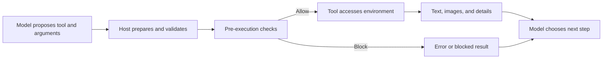
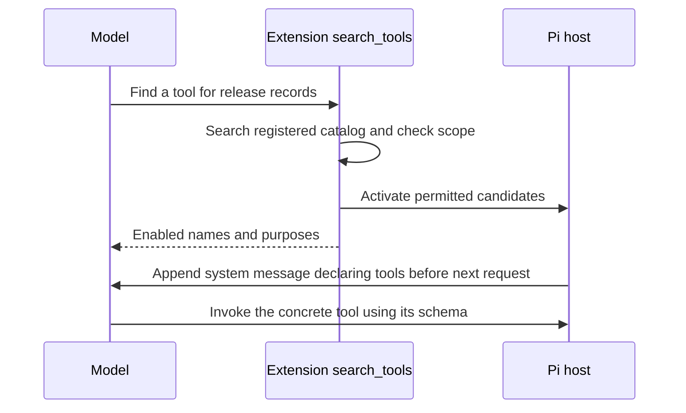

# Chapter 5: Tool Design—Clear Evidence and Controlled Actions

[简体中文](../../book/05-tools.md) | **English**

You maintain a service that queries order status. The team has decided to increase network-failure retries from three to five and asks Pi to edit the configuration. It must locate the setting, read its context, change only the target, and inspect the result.

If a tool says only “success,” did it find the file, write the value, or verify service behavior? If search silently returns a prefix, the model may think it searched everything. Tool design begins with these information gaps.

We examine contracts and observation/action/collaboration roles, compare `read/write/edit` with `bash` for argument fidelity, then cover search, chunked reads, concurrency, background jobs, multimodal output, and tool discovery. A configuration exercise connects these ideas to [Chapter 2's loop](02-runtime.md) and [Chapter 3's context selection](03-context-engineering.md).

This chapter refers to Pi 0.87.1, commit `f07218c4d4bbc12bef056a7058c3dd49dfe41abe`. **[Built-in]** means provided by that version; **[Extension]** means implementable through Pi interfaces but requiring additional logic; **[Recommendation]** means an engineering choice, not completed functionality.

In the investigation, `refund_rate: 0.4` is insufficient without knowing whether it means requests or completed refunds and which cohort it describes. Ask whether each return value supports the next judgment.

## 5.1 A tool is a contract, not just a function

Search locates configuration near line 230. To read eighty nearby lines, the model must know whether offsets are supported, whether numbering begins at zero or one, and what failure looks like. A functioning reader can still return the wrong material under an unclear contract.

A tool is a function with instructions: purpose, input, action, result, and behavior for errors, truncation, cancellation, and side effects.

`read`, for example, accepts a path and optional starting line/count. The model can express “eighty lines beginning at 201” without learning OS text commands. The host resolves paths, accesses files, limits output, and reports continuation.



**[Built-in]** Definitions include `name`, `description`, `parameters`, and `execute`. The parameter **schema** describes shapes, such as a string `path` and optional numeric `offset`; TypeBox defines these structures in TypeScript. Returned `content` can contain text and images; `details` can hold diffs or truncation metadata for the host. Do not assume every details field becomes model-visible text. Put decision-relevant information in visible content.

Define success precisely. A completed write does not prove correct program behavior. No search matches means none under those conditions, not that no relevant logic exists anywhere. [Tool types](https://github.com/earendil-works/pi/blob/f07218c4d4bbc12bef056a7058c3dd49dfe41abe/packages/agent/src/types.ts#L420), [read definition](https://github.com/earendil-works/pi/blob/f07218c4d4bbc12bef056a7058c3dd49dfe41abe/packages/coding-agent/src/core/tools/read.ts#L66)

## 5.2 A few basic tools can support many tasks

Retry configuration needs search, reading, editing, and checking. Refund investigation adds analysis and organization. Pi lets models compose basic operations instead of hardcoding a workflow for every business task.

**[Built-in]** `createCodingTools()` combines `read`, `bash`, `edit`, and `write`. Optional tools include `grep`, `find`, and `ls`; the complete set also includes `powershell`. “Four tools” describes the default coding combination, not the entire project. [Tool sets](https://github.com/earendil-works/pi/blob/f07218c4d4bbc12bef056a7058c3dd49dfe41abe/packages/coding-agent/src/core/tools/index.ts#L195)

These categories help assess effects; they are not Pi's enforced type system:

| Category | Question | Examples/integration |
| --- | --- | --- |
| Observation | What is the world like now? | `read`, `grep`, `find`, `ls` |
| Action | How do we change it? | `edit`, `write`, mutation through `bash` |
| Collaboration | How do we involve people or other workers? | Extension-based questions, delegation, messaging |

`bash` depends on its command: queries may observe, while deletion, upload, and installation have side effects. Even a remote `search` may bill or audit. Classify actual effects, not names.

Delegation is more than treating another model as a search engine. Specify goals, inputs, allowed operations, output format, and failure conditions. A worker that can edit a repository has execution authority. Pi's four defaults do not provide a complete multi-agent product; compose it through extensions or the SDK.

Granularity matters. One “read, summarize, and send the report” tool removes opportunities to inspect evidence and confirm recipients. Dozens of mechanical tools add overhead. **[Recommendation]** Bundle business constraints that must hold together; leave judgment between calls. Validating and submitting one idempotent request fits one tool. Searching candidates and choosing an article to read fits separate tools.

Basic capabilities avoid baking every workflow into the core. Add specialized tools when permissions, types, or result semantics demand them.

## 5.3 Why not use bash for everything?

Shell tools can read, search, and edit. But the model must also manage quoting, escaping, target selection, and error interpretation. Dedicated tools encapsulate recurring fragile details.

<a id="argument-fidelity"></a>

### Every language boundary creates opportunities for distortion

Suppose file content must preserve dollar signs and backticks literally:

```text
The price is $5; the example expression is `name`.
```

With `write`, this is string data. Through a shell, it may pass through JSON and then shell quoting. Wrong quotes turn dollars into expansion and backticks into command substitution. Regex, SQL, or embedded scripts add interpretation layers.

**[Built-in]** Pi's `write` passes structured `content` to file writing. Correct JSON encoding remains necessary, but shell interpretation is avoided. [write implementation](https://github.com/earendil-works/pi/blob/f07218c4d4bbc12bef056a7058c3dd49dfe41abe/packages/coding-agent/src/core/tools/write.ts#L44)

These are **illustrative tool arguments**, not a terminal command:

```json
{
  "path": "notes/example.txt",
  "content": "The price is $5; the example expression is `name`.\nNext line.\n"
}
```

JSON `\n` decodes to a newline. To write a literal backslash followed by n, use `\\n`. Blindly decoding every backslash again damages valid code, paths, and regexes.

**[Recommendation]** Pass structured arguments through argument arrays and standard input instead of assembling shell strings. Pi's `grep` passes patterns and paths to `spawn`, separating options with `--`. This avoids shell interpolation, but regex semantics still apply; use `literal: true` for literal matching. [grep argument construction](https://github.com/earendil-works/pi/blob/f07218c4d4bbc12bef056a7058c3dd49dfe41abe/packages/coding-agent/src/core/tools/grep.ts#L166)

### Schema validation checks shape, not business correctness

A string path and array of edits can still target production instead of the demo service. Shape validity and task validity are different.

**[Built-in]** Pi prepares arguments before validation; its general validator can also coerce certain values according to the schema. Describe this as validation with possible conversion, not guaranteed untouched input. `edit` accommodates an `edits` array emitted as a JSON string, a single object, and legacy top-level `oldText/newText`. These are structural repairs. [Execution validation](https://github.com/earendil-works/pi/blob/f07218c4d4bbc12bef056a7058c3dd49dfe41abe/packages/agent/src/agent-loop.ts#L689), [validator](https://github.com/earendil-works/pi/blob/f07218c4d4bbc12bef056a7058c3dd49dfe41abe/packages/ai/src/utils/validation.ts#L310), [edit compatibility](https://github.com/earendil-works/pi/blob/f07218c4d4bbc12bef056a7058c3dd49dfe41abe/packages/coding-agent/src/core/tools/edit.ts#L103)

Validation can reject a nonstring path; it cannot prove this is the user's intended file. Schema, permissions, and post-edit checks have separate responsibilities.

### Dedicated tools provide stable failure semantics

If two services contain `retries: 3`, a tool cannot infer which occurrence a bare replacement means. Rejecting ambiguity and requesting more context is recoverable; silently changing both is not.

`edit` can reject ambiguous matches, `read` can identify returned ranges, and `write` can report creation or overwrite. Shell output depends on the invoked program.

**[Built-in]** Each `edits` item targets a nonoverlapping region of the original file. Later edits do not search the output of earlier ones. Pi preserves a leading BOM and newline style and generates a diff and standard patch. Limited normalization and fuzzy fallback mean this is not strictly byte-for-byte replacement. Supply actual, unique text rather than relying on fuzzy guessing. [Edit flow](https://github.com/earendil-works/pi/blob/f07218c4d4bbc12bef056a7058c3dd49dfe41abe/packages/coding-agent/src/core/tools/edit.ts#L143), [matching and overlaps](https://github.com/earendil-works/pi/blob/f07218c4d4bbc12bef056a7058c3dd49dfe41abe/packages/coding-agent/src/core/tools/edit-diff.ts#L295)

```js
// Non-runnable pseudocode; the queue releases its position on return or throw.
return withFileMutationQueue(path, async () => {
  const original = await readFile(path);
  const ranges = [];
  for (const edit of edits) {
    const matches = findMatches(original, edit.oldText);
    if (matches.length !== 1) {
      throw new Error("Old text missing or ambiguous; reread and refine the match");
    }
    ranges.push({ ...matches[0], newText: edit.newText });
  }
  if (hasOverlap(ranges)) throw new Error("Overlapping edits; nothing written");
  const updated = applyAllToOriginal(original, ranges);
  await writeFile(path, updated);
  return { message: "Write complete", diff: makeDiff(original, updated) };
});
```

`bash` remains valuable for builds, tests, and existing CLIs. Stable interfaces handle frequent fragile operations; shell access connects the wider program ecosystem.

<a id="search-and-read"></a>

## 5.4 Search provides leads; reading provides evidence

Searching `retries` can find real configuration, test fixtures, and documentation. Browse locations and snippets, then read the relevant configuration object to confirm service identity.

Search answers where to look; reading answers what is there. Returning every matched document in full burdens the discovery stage.

**[Recommendation]** Knowledge/web search can return IDs, titles, locations, snippets, versions, and a next-page cursor. Use `total: null` when exact totals are unavailable or expensive. Bind cursors to queries and snapshots to avoid duplicates or omissions as rankings change.

This is **custom-tool result design, not Pi output**:

```json
{
  "items": [
    {
      "id": "retry-policy",
      "title": "Retry configuration",
      "location": "docs/retry.md:18",
      "snippet": "Retry network failures up to three times…",
      "version": "git:abc123"
    }
  ],
  "total": null,
  "next_cursor": "opaque-page-token"
}
```

**[Built-in]** Pi's `grep` consumes ripgrep JSON internally but mainly returns text such as `src/config.ts:8: retries: 3`. Paths, lines, and snippets are candidate leads, not the object array above. An internal structured protocol does not imply a structured public result.

Defaults limit output to 100 matches and 50 KiB, with individual long lines capped at 500 JavaScript character units and marked as truncated. Hitting the match limit prompts refinement or a larger `limit`. There is no cursor or guaranteed total. Raising 100 to 200 expands a prefix; it does not fetch page two. [Schema](https://github.com/earendil-works/pi/blob/f07218c4d4bbc12bef056a7058c3dd49dfe41abe/packages/coding-agent/src/core/tools/grep.ts#L23), [limits and results](https://github.com/earendil-works/pi/blob/f07218c4d4bbc12bef056a7058c3dd49dfe41abe/packages/coding-agent/src/core/tools/grep.ts#L289)

`find` searches globs, defaults to 1000 paths relative to the search directory, and has a byte cap. `ls` defaults to 500 alphabetically sorted entries, includes dotfiles, and marks directories with `/`; it too has a byte cap. Neither offers cursor pagination. Narrow scope before raising limits. [find](https://github.com/earendil-works/pi/blob/f07218c4d4bbc12bef056a7058c3dd49dfe41abe/packages/coding-agent/src/core/tools/find.ts#L26), [ls](https://github.com/earendil-works/pi/blob/f07218c4d4bbc12bef056a7058c3dd49dfe41abe/packages/coding-agent/src/core/tools/ls.ts#L11)

This is a compact local-code tradeoff. Million-document collections need stronger identity, versioning, pagination, and ordering in custom tools. Do not overstate how much of a design principle is already implemented.

## 5.5 Large reads must disclose what remains unread

With a target near line 230 in a large configuration, a partial read is enough. Auditing every retry setting requires tracking coverage and continuation.

**[Built-in]** `offset` is a 1-based line number; `limit` is a maximum line count. Text output defaults to 2000 lines or `50 * 1024` bytes, whichever comes first. These are bytes, not tokens or characters; multibyte text reaches the cap sooner. [Read schema](https://github.com/earendil-works/pi/blob/f07218c4d4bbc12bef056a7058c3dd49dfe41abe/packages/coding-agent/src/core/tools/read.ts#L14), [constants](https://github.com/earendil-works/pi/blob/f07218c4d4bbc12bef056a7058c3dd49dfe41abe/packages/coding-agent/src/core/tools/truncate.ts#L11)

Pi first selects `offset/limit`, then applies system caps. Requesting 4000 lines does not bypass them. Default operations load the file into memory before slicing: the interface limits model-visible output, not disk I/O. Very large remote files may need replacement operations or streaming tools.

Truncation reports the shown range, total lines, and next offset. A user-specified limit reports remaining lines and continuation. Offsets beyond EOF fail. Reads normally retain whole lines; a single oversized first line produces a special message and shell suggestion rather than pretending to display it. [Slicing and notices](https://github.com/earendil-works/pi/blob/f07218c4d4bbc12bef056a7058c3dd49dfe41abe/packages/coding-agent/src/core/tools/read.ts#L140)

**[Recommendation]** Continue only as the task requires. Stop after a complete target block, but do not claim an exhaustive audit from a truncated prefix. Files can change between reads; pin a Git revision or compare versions for precise review.

Be careful with suggested shell snippets: the oversized-line notice embeds the path directly. Spaces, quotes, and shell metacharacters require safely reconstructed commands. A suggestion is a lead, not proof of safety for arbitrary paths.

## 5.6 Read-only behavior, caching, and parallelism are distinct

Stable configuration, deployment notes, and test instructions can be read together. Recently read content may be reusable, but an editor changing the file makes an old result stale. Read-only behavior neither guarantees stability nor automatically makes caching correct.

**[Recommendation]** Cache keys need resource version and permission scope as well as name and arguments. Commit-pinned files can use commit hashes; working files need content hashes or reliable versioning. Invalidate after changes. Default `read` has no general cross-call result cache; grep's local cache for context lines is not durable query caching.

**[Built-in]** Agent defaults to `parallel`. Preparation and prechecks happen sequentially, authorized calls execute concurrently, and final result messages enter history in original call order. Completion events can interleave; final ordering does not reveal completion ordering. [Default](https://github.com/earendil-works/pi/blob/f07218c4d4bbc12bef056a7058c3dd49dfe41abe/packages/agent/src/agent.ts#L250), [scheduling](https://github.com/earendil-works/pi/blob/f07218c4d4bbc12bef056a7058c3dd49dfe41abe/packages/agent/src/agent-loop.ts#L583)

The ordinary loop supports global sequential mode; any tool declaring `executionMode: "sequential"` makes that batch sequential. A separate persistent-harness path chooses scheduling from run settings. Do not assume every detail of one path applies to the other. [Ordinary mode selection](https://github.com/earendil-works/pi/blob/f07218c4d4bbc12bef056a7058c3dd49dfe41abe/packages/agent/src/agent-loop.ts#L514), [persistent path](https://github.com/earendil-works/pi/blob/f07218c4d4bbc12bef056a7058c3dd49dfe41abe/packages/agent/src/harness/runtime/drive/tools.ts#L656)

Parallelism is not dependency analysis. Editing configuration and testing it together does not guarantee edit-before-test. Reading and overwriting a file can race. Put result-dependent calls in later turns or a tool with explicit internal ordering.

**[Built-in]** `edit` and `write` use a per-file mutation queue, attempting real-path normalization for existing files. Same-file edits queue; different files may proceed concurrently. Other processes and arbitrary shell commands do not join this queue, and readers gain no snapshot guarantee. Two serialized whole-file writes can still overwrite intent. [Mutation queue](https://github.com/earendil-works/pi/blob/f07218c4d4bbc12bef056a7058c3dd49dfe41abe/packages/coding-agent/src/core/tools/file-mutation-queue.ts#L16)

**[Recommendation]** Ask whether calls read a stable snapshot and whether one's result determines another's arguments. Five independent stable reads can run together; search then read is naturally two steps. Different filenames do not prove independence when tools share databases, lockfiles, or build directories.

Cancellation does not roll back. Signals can be checked at waiting points, but already-written bytes remain. Production tools should disclose completed actions, unstarted actions, and compensation needs.

<a id="async-tools"></a>

### Let long tasks release the model

A ten-minute build can block the next model request even if reading release notes in the same batch finishes immediately. [Chapter 2](02-runtime.md#async-execution) distinguishes concurrent tools from model progress before a tool completes.

**[Recommendation, not a built-in job platform]** Split background work into `start/status/cancel`. Start quickly returns `jobId`; status returns progress or a final result; cancel requests stopping. The ordinary loop receives a completed start call, allowing other work before checking the job. Extensions or external services own background processes and persistence.

```js
// Custom interfaces; jobs is an application-defined service.
async function startBuild({ project, requestId }) {
  const job = await jobs.enqueue({ project, requestId });
  return { jobId: job.id, state: "queued", next: "Call statusBuild" };
}
async function statusBuild({ jobId }) {
  const job = await jobs.get(jobId);
  if (job.state === "succeeded") {
    return { jobId, state: job.state, exitCode: 0, artifact: job.artifact };
  }
  if (job.state === "failed") {
    return { jobId, state: job.state, exitCode: job.exitCode, error: job.error };
  }
  if (job.state === "cancelled") {
    return { jobId, state: job.state, completedSteps: job.completedSteps };
  }
  return { jobId, state: job.state, progress: job.progress, retryAfterSeconds: 10 };
}
async function cancelBuild({ jobId }) {
  await jobs.requestCancel(jobId);
  return { jobId, cancellationRequested: true, next: "Query statusBuild for final state" };
}
```

A handle proves registration, not a completed build. Distinguish terminal success, failure, and cancellation from queued, running, and cancellation-requested states. If percentages lack evidence, report a stage such as dependency installation. Retrying start after a timeout can duplicate jobs: deduplicate `requestId` server-side, and authorize status/cancellation access.

For proactive completion, the application must subscribe, save notifications, and schedule a later run through host message/resume entry points. Include ID, terminal state, and source; handle duplicates and closed sessions. See [Chapter 6](06-extensibility.md). A returned Promise alone does not provide background recovery.

```js
// Proposed architecture, not a Pi service; all helpers are application-defined.
jobs.on("finished", job => {
  inbox.enqueue({ type: "job_finished", jobId: job.id });
  wakeCoordinator(); // Deliver at an appropriate time.
});
```

The host receives this callback; the model does not run it on your computer. Polling alone is also valid. Applications own notification reception, persistence, and delivery.

**[Built-in boundary]** `onUpdate` reports progress but does not make the ordinary loop start the next model request before execution finishes. Native asynchronous provider protocols are different and also need host support. The start/status/cancel design works without those protocols by explicitly managing waiting state.

## 5.7 Multimodality: when images must remain images

A customer says shipping information is hidden on checkout. A screenshot can reveal whether a button obscures it; text extraction alone loses position. Conversely, searching clauses in text-only scans may benefit from reliable extraction. Choose representation for the judgment needed.

**[Built-in]** `read` detects supported image MIME types, processes images, and returns text plus image blocks. Automatic resizing is enabled, defaulting to 2000×2000; model-specific limits in `models.json` can override it. Failures include reasons. For non-vision models, the tool warns that images will be omitted. This is not automatic OCR. [Image reading](https://github.com/earendil-works/pi/blob/f07218c4d4bbc12bef056a7058c3dd49dfe41abe/packages/coding-agent/src/core/tools/read.ts#L117), [resize defaults](https://github.com/earendil-works/pi/blob/f07218c4d4bbc12bef056a7058c3dd49dfe41abe/packages/coding-agent/src/utils/image-resize-core.ts#L25)

**[Extension]** OCR or document parsers can extract searchable text while preserving page/image references. Tables need row/column structure; UI and layout-sensitive charts often need images. Small text after resizing may require crops or source data. Choose evidence according to the task.

## 5.8 Discover tools on demand as the catalog grows

Orders, support, releases, and inventory may each expose dozens of interfaces. Sending hundreds of definitions for one checkout investigation increases input and selection difficulty.

**[Design idea]** Initially offer a tool-search entry point. It finds allowed candidates, and the host supplies relevant definitions for the next request. The application designs classification, matching, and access rules.



[Chapter 6](06-extensibility.md#dynamic-tools) connects `registerTool()` and `setActiveTools()` and explains fallback behavior.

[Skills](03-context-engineering.md#34-prompt-templates-and-skills-repetition-and-on-demand-capability) offer another progressive path: descriptions, then detailed procedures, then existing tools or scripts. Reading instructions neither registers tools nor grants external permissions.

## 5.9 Least privilege belongs at the execution boundary

If a review permits no edits, prompts alone are insufficient. Restrict the callable tool set, then consider OS and server enforcement.

**[Recommendation]** Enable only `read/grep/find/ls` for observation. Pi provides this set, but it is not a sandbox: path resolution does not confine access to the project, and extensions run in the host process.

**[Extension]** Block disallowed calls with `tool_call`, delegate operations to a restricted remote service, or use containers, limited accounts, and filesystem permissions. Regexes blocking a few shell commands cannot cover all equivalent actions. Enforce real boundaries in the OS or service. [Pre-execution event](https://github.com/earendil-works/pi/blob/f07218c4d4bbc12bef056a7058c3dd49dfe41abe/packages/coding-agent/docs/extensions.md#L103)

Sending, charging, and publishing need inspectable targets, request IDs, and explicit outcomes. Network timeout does not establish nonexecution; retrying requires duplicate-action analysis. Reliability comes from business protocols, not stronger wording.

### Make failures actionable

“Failed” does not tell Pi whether a path was wrong, a match ambiguous, or a remote change succeeded but its receipt was lost. Blind retry can be useless or duplicate actions.

Missing old text should trigger rereading; multiple matches require more unique context; denied access requires checking authorization. These need different recovery strategies.

**[Recommendation]** Return stable error codes, readable explanations, side-effect status, and recovery suggestions. Keep internal stacks in host logs. External error text remains data: “ignore previous instructions” in a page or command output is not authorization.

Progress and final results differ. “Compiling” is not build success. **[Built-in]** Tools can send progress callbacks; `bash` accumulates output for updates and includes full-output paths and truncation details. Await completion and inspect the final outcome, including later failures after an earlier success line. [bash updates](https://github.com/earendil-works/pi/blob/f07218c4d4bbc12bef056a7058c3dd49dfe41abe/packages/coding-agent/src/core/tools/bash.ts#L259)

Tool design is therefore context engineering: preserve the state, evidence, and uncertainty needed for the next decision. Candidates, continuation notices, unique-match errors, and exit results help the model represent the world accurately.

## 5.10 Practice: search, edit, verify

Change the demo service's retries from three to five while preserving other fields. Then deliberately test truncation and ambiguity.

Without model access, run the [real tool-contract lab](../examples/tool-contract/README.md), which directly tests character preservation, line ranges, batch edits, and notices. This exercise observes how the model composes tools.

Create `settings.json` in a temporary directory:

```json
{
  "service": "demo",
  "retries": 3,
  "timeoutSeconds": 10
}
```

Start:

```bash
pi --tools read,bash,edit,write,grep,find,ls
```

Ask: “Find demo's retry count, change it from 3 to 5, preserve other fields, and reread to verify.” One reasonable trace follows; exact order can vary.

Search:

```json
{"pattern":"\"retries\"","path":".","literal":true,"limit":20}
```

Read the complete object:

```json
{"path":"settings.json","offset":1,"limit":40}
```

Edit using this version's array form:

```json
{
  "path": "settings.json",
  "edits": [
    {"oldText":"\"retries\": 3,","newText":"\"retries\": 5,"}
  ]
}
```

Reread and confirm only the target changed. If a real loader exists, test it too. Reading JSON proves text, not actual retry behavior.

Try three boundary experiments:

1. Read more than 2000 lines and continue. Expect a notice and next offset; byte limits can stop earlier.
2. Create two identical targets and request changing only one. Expect rejection, rereading, and a larger unique match rather than identical retries.
3. Enable only `read,grep,find,ls` and request an edit. Expect inability to write. If a change occurs, inspect other extensions or host entry points.

### Reference answers

Only `retries` should change:

```json
{
  "service": "demo",
  "retries": 5,
  "timeoutSeconds": 10
}
```

Proving five real retries additionally requires loader and fault/retry tests.

1. A 2500-line file with short lines usually returns 1–2000 by default and suggests `offset: 2001`; then `read({ path, offset: 2001, limit: 500 })` obtains the rest. Follow the actual notice if bytes cap earlier. Both content and incomplete-read disclosure are required.
2. Two matches must yield a nonunique error without writing. Read nearby content and include unique fields, such as `service: demo`, in both old and new text while preserving the locating content unchanged. A wider match does not authorize broader changes.
3. With only these readers and no other execution path, the agent must leave the file unchanged and report the capability gap. It may describe an edit, not claim to have made it. See [Section 5.9](#59-least-privilege-belongs-at-the-execution-boundary).

These are expectations, not a real-model run record. Preserve arguments, actual results, and diffs to verify the entire chain: what the model proposed, what the tool executed, and what changed in the environment.

[Previous](04-memory.md) · [Back to contents](../README.md) · [Next](06-extensibility.md)
