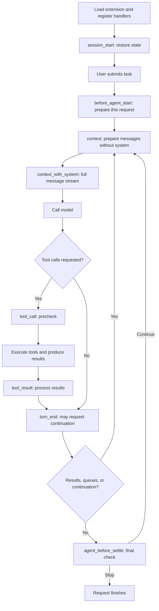

# Chapter 6: Extensions—Connect Your Rules to Pi's Runtime

[简体中文](../../book/06-extensibility.md) | **English**

You can already have Pi read tables, run scripts, and generate a report. The team now wants a repeatable workflow: load the current month's field definitions, use approved read-only customer interfaces, and resume a partially checked report after restarting. Manually pasting instructions and recording progress invites omissions.

We choose between templates, skills, and extensions, identify when application code should run, design query tools and permission checks, then handle exit, branching, and custom interfaces. Earlier chapters' loops, context, and session records become reusable parts.

These requirements change three things: the data dictionary affects what the model sees; read-only queries affect what it can do; recovery affects how work continues. A “follow the rules” prompt cannot solve all three. Editing Pi's core creates upstream merge costs.

An **extension** is TypeScript code loaded by the host. It can register tools, subscribe to events, save state, and provide commands and UI. It is not another independent agent and usually connects application logic to the existing loop rather than reimplementing it.

For the refund investigation, extensions provide metric queries and source access, the model chooses the next evidence to inspect, and the lead makes rollout decisions. [Chapter 7](07-general-agent.md#changing-task) combines these responsibilities.

## 6.1 Choose the smallest place to change

Company report formatting may need only a template. Sources, definitions, and checking methods fit a skill. Dedicated databases, per-call enforcement, or program state require extensions.

[Chapter 3](03-context-engineering.md) covered operational knowledge. Here we distinguish requirements needing code. Templates are reusable input; skills are on-demand knowledge; extensions are executed host code. A skill asks the model to follow a condition; a tool function can reject execution when it is unmet. Reliable applications often combine language and code.

Tool registration includes name, description, schema, execution function, and optional rendering and execution mode. Models need purpose, parameters, and results; terminal users also need progress and readable presentation. Different definition fields serve these needs. [ToolDefinition](https://github.com/earendil-works/pi/blob/f07218c4d4bbc12bef056a7058c3dd49dfe41abe/packages/coding-agent/src/core/extensions/types.ts#L453)

Extensions own domain decisions while Pi supplies common runtime infrastructure. Revenue calculation belongs to the business; returning results to the model belongs to the host.

<a id="extension-events"></a>

## 6.2 Events are lifecycle connection points

A dictionary query is ready. Should it run at Pi startup, at every report request, or before every model call? Wrong placement risks stale definitions or dozens of repeated downloads.

The host emits **events** at these points. Some are observational; others allow message injection or blocking actions.



This mechanism diagram omits retries, compaction, and queues; it is not a full event specification. `before_agent_start` precedes a user request's loop, while `context` precedes every model call. One request can trigger many context events. This version adds intervention at `turn_end` and `agent_before_settle`; both can request another model call. [Chapter 8](08-evolution.md) explains them. [Event definitions](https://github.com/earendil-works/pi/blob/f07218c4d4bbc12bef056a7058c3dd49dfe41abe/packages/coding-agent/src/core/extensions/types.ts#L692)

`before_agent_start` can inject messages or adjust the prompt. Unconditional expensive retrieval in `context` repeats across turns. Retrieve once at request start and reuse selected results with explicit invalidation. [Request-start event](https://github.com/earendil-works/pi/blob/f07218c4d4bbc12bef056a7058c3dd49dfe41abe/packages/coding-agent/src/core/agent-session.ts#L1700)

```js
// Non-runnable mechanism pseudocode; all helpers are application-defined.
let taskDictionary;
onTaskStart(async (task) => {
  const fullDictionary = await retrieveDictionary(task.month);
  taskDictionary = keepFieldsAndSource(fullDictionary);
});
onBuildContext((currentMessages) => {
  const messages = removeOurOldReferenceBlocks([...currentMessages]);
  return insertReferenceBlock(messages, taskDictionary);
});
```

Remove prior injections before inserting to avoid growth. Keep reference identity so dictionary content does not acquire authority over user requirements. Real implementations need legal message types and preserved call/result pairs.

<a id="context-handlers"></a>

### Composing context handlers

One handler removes old rules; another adds current definitions. They must process the same view in a known order.

The SDK connects `transformContext` to `emitContext`. The runner deep-copies messages, then runs registered handlers sequentially, passing each output to the next. Handlers can return arrays or mutate `event.messages`. `context` sees no `system` messages; Pi restores prompt/tool declarations after each handler. Then `context_with_system` sees the full stream and passes its output through unchanged. Conversion to `pi-ai` format precedes provider encoding. [SDK wiring](https://github.com/earendil-works/pi/blob/f07218c4d4bbc12bef056a7058c3dd49dfe41abe/packages/coding-agent/src/core/sdk.ts#L390), [runner order](https://github.com/earendil-works/pi/blob/f07218c4d4bbc12bef056a7058c3dd49dfe41abe/packages/coding-agent/src/core/extensions/runner.ts#L1190), [conversion](https://github.com/earendil-works/pi/blob/f07218c4d4bbc12bef056a7058c3dd49dfe41abe/packages/agent/src/agent-loop.ts#L386)

```js
// JavaScript-like pseudocode; types and error handling omitted.
let messages = deepClone(sessionMessages);
for (const handler of contextHandlers) {
  const visible = messages.filter(m => m.role !== "system");
  const result = await handler({ messages: visible });
  messages = restoreSystemMessages(messages, result?.messages ?? visible);
}
for (const handler of contextWithSystemHandlers) {
  messages = (await handler({ messages }))?.messages ?? messages;
}
const llmMessages = await convertToLlm(messages);
await requestModel({ messages: llmMessages }); // Prompt/tools are system messages.
```

These handlers change a request view, not original session records. See [Chapter 3's example](03-context-engineering.md#context-transform-example).

## 6.3 Register a business tool

A team service maintains monthly metric definitions, so static copies become stale. Expose `lookup_metric`: metric and month in, definition, source, and effective date out. The service continues enforcing scope.

This pseudocode highlights responsibilities rather than inventing a runnable database client:

```js
// Non-runnable; schema, validation, and query helpers are application-defined.
pi.registerTool({
    name: "lookup_metric",
    description: "Read the metric definition effective in a given month; no writes",
    parameters: {
        metric: requiredString(),
        month: monthStringSchema()
    },
    async execute(callId, params, signal, onUpdate, context) {
        validateMonthAndScope(params, context);
        const result = await queryMetricService(params, { signal });
        return {
            content: [{ type: "text", text: describeWithSource(result) }],
            details: { schemaVersion: 1, metric: result }
        };
    }
});
```

Real execution receives the call ID, cancellation signal, progress callback, and extension context. IDs correlate logs. Forward signals to network clients so cancellation reaches underlying work. “Querying” is progress, not a final result. [Tool interface](https://github.com/earendil-works/pi/blob/f07218c4d4bbc12bef056a7058c3dd49dfe41abe/packages/coding-agent/src/core/extensions/types.ts#L453)

`content` carries model-visible material; `details` supports structured state and UI. A source only in details is not guaranteed to be cited. Put reasoning-relevant fields in visible content. Restrict sensitive fields server-side rather than merely hiding them in the UI.

This version allows `registerTool()` after startup, updating the current session. That enables dynamic loading, while catalog discovery and activation policy remain application work. [Dynamic registration example](https://github.com/earendil-works/pi/blob/f07218c4d4bbc12bef056a7058c3dd49dfe41abe/packages/coding-agent/examples/extensions/dynamic-tools.ts#L1)

<a id="dynamic-tools"></a>

### Activate tools on demand

After registering tools, initially expose search and add matched authorized names to the active set. See [Chapter 5's overview](05-tools.md#58-discover-tools-on-demand-as-the-catalog-grows).

**[Built-in interfaces plus extension policy]** Pi provides `registerTool()`, `getAllTools()`, and `setActiveTools()`. It detects additive changes and exposes new definitions before the next request. The extension supplies matching, hierarchy, and access checks.

```js
// Non-runnable pseudocode; searchCatalog and allowedForUser are application-defined.
async function searchTools({ query }) {
  const candidates = await searchCatalog(pi.getAllTools(), query);
  const allowed = candidates.filter(tool => allowedForUser(tool));
  const names = allowed.map(tool => tool.name);
  pi.setActiveTools([...new Set([...pi.getActiveTools(), ...names])]);
  return allowed.map(tool => ({
    name: tool.name,
    description: tool.description,
    limits: tool.limits,
  }));
}
```

**[Built-in]** Initial tools are recorded in the opening `system` message. Later active-set changes append a delta system message before the next request. Supporting model/provider combinations use native deferred-loading semantics. Unsupported providers receive a full message-stream checkpoint, potentially invalidating cached prefixes. Unknown names are ignored; tools must be registered first. Lazy loading therefore does not promise equal caching benefits everywhere. [Dynamic loading](https://github.com/earendil-works/pi/blob/f07218c4d4bbc12bef056a7058c3dd49dfe41abe/packages/coding-agent/docs/extensions.md#L140)

## 6.4 Tool checks do not create a sandbox

If reports require validation before publication, `tool_call` can check acceptance state and return `{ block: true, reason: "Validation not complete" }`. Handlers run in order and stop at a blocking result. [emitToolCall](https://github.com/earendil-works/pi/blob/f07218c4d4bbc12bef056a7058c3dd49dfe41abe/packages/coding-agent/src/core/extensions/runner.ts#L1134)

As [Chapter 5](05-tools.md) explains, policy completeness depends on covered execution paths. Blocking `write` still leaves shell writes. Blocking one publication tool does not constrain an extension calling the service directly. String blacklists do not capture all shell semantics. Hooks express business policy; OS, containers, and services enforce strong isolation.

`tool_call` can mutate input in place, and later handlers see those changes. The source explicitly states there is no schema revalidation afterward. An extension changing a month into an invalid value must validate its own mutation. Prefer avoiding mutation when possible. [ToolCallEvent notes](https://github.com/earendil-works/pi/blob/f07218c4d4bbc12bef056a7058c3dd49dfe41abe/packages/coding-agent/src/core/extensions/types.ts#L1023)

Pi has no built-in sandbox. Extensions and built-ins run with the starting user's permissions. Trust controls loading, not subsequent filesystem/network access; trusting a project does not prove every text or build command safe. [Security boundaries](https://github.com/earendil-works/pi/blob/f07218c4d4bbc12bef056a7058c3dd49dfe41abe/packages/coding-agent/docs/security.md#L3)

A practical report system gives queries read-only credentials, generates artifacts in a working directory, and uses a separate publisher validating destination, approval state, and identity. Each service enforces its own responsibilities.

### When multiple tools act together

Independent order-table and refund-table checks can run concurrently, but the second precheck cannot assume the first completed.

In default parallel mode, calls are prechecked sequentially before execution starts concurrently. Session state is synchronized through the current assistant call message, not necessarily sibling results from the same batch. [Prechecks and parallelism](https://github.com/earendil-works/pi/blob/f07218c4d4bbc12bef056a7058c3dd49dfe41abe/packages/coding-agent/docs/extensions.md#L115)

Shared completion counters need synchronization or sequential execution. A simultaneous check-and-publish request must not treat a queued check as a passed check. Publication should verify existing acceptance records or require a later turn. `executionMode` controls scheduling; the application still expresses business dependencies.

A count is not a publication credential: “three complete” omits identities, inputs, and validator versions. Record check IDs and input hashes and validate each before publishing.

### Error handling is part of the extension contract

If dictionary retrieval throws and reporting continues, the application must know a required definition is missing.

Events handle exceptions differently. `emitContext` logs handler errors and continues. Tool prechecks are responsible for blocking actions. A failing `user_bash` handler blocks the command instead of falling back to local execution. [Fail-closed user_bash](https://github.com/earendil-works/pi/blob/f07218c4d4bbc12bef056a7058c3dd49dfe41abe/packages/coding-agent/docs/extensions.md#L119). Critical conditions need explicit errors plus tool/service enforcement.

Logs should distinguish registration, execution start, execution success, and acceptance. A network-start notice proves only that execution reached that point; an end event can contain failure. Preserve call IDs, short statuses, and evidence locations without copying entire customer datasets or system prompts into logs.

<a id="extension-state"></a>

## 6.5 Recovery requires more than an in-memory variable

You exit after checking two of three tables. Tomorrow the app needs completed checks, evidence paths, and data versions. `let completedTables = []` disappears with the process.

Chapter 4 distinguished program state and visible messages. Use `appendEntry(customType, data)` for extension entries; send a concise message separately when the model needs progress. Restore code state from entries. [Entry semantics](https://github.com/earendil-works/pi/blob/f07218c4d4bbc12bef056a7058c3dd49dfe41abe/packages/coding-agent/src/core/session-manager.ts#L125)

`pi.appendEntry()` persists entries; `pi.sendMessage()` sends custom messages. Recovery must cover new sessions, switches, navigation, and reloads, not only initial startup. [Extension API](https://github.com/earendil-works/pi/blob/f07218c4d4bbc12bef056a7058c3dd49dfe41abe/packages/coding-agent/src/core/extensions/types.ts#L1483)

Branch scope matters. If table one was checked at point A, table two later, and you branch from A, scanning the entire file's last state could import table two from another route. Recover branch-related data along the current path.

```js
// Non-runnable pseudocode; emptyState and decodeState are application-defined.
function restore(context) {
  let state = emptyState();
  for (const entry of context.sessionManager.getBranch()) {
    if (entry.type === "custom" && entry.customType === "report-state") {
      state = decodeState(entry.data); // Parse full snapshot by schemaVersion.
    }
  }
  return state;
}
pi.on("session_start", (_event, context) => { state = restore(context); });
pi.on("session_tree", (_event, context) => { state = restore(context); });
// Save a full snapshot after successful checking and evidence persistence.
pi.appendEntry("report-state", state);
```

The official todo example stores structured state in tool-result `details`, scanning the current branch on `session_start` and `session_tree`. [Todo recovery](https://github.com/earendil-works/pi/blob/f07218c4d4bbc12bef056a7058c3dd49dfe41abe/packages/coding-agent/examples/extensions/todo.ts#L114)

> **Further reading**: Pi ships both todos and plan mode as extension examples rather than built-ins. Claude Code built in a todo tool and later disabled it by default on newer models. That history shows how harness parts expire as models improve; see [Who Decides the Next Step](notes/control-structures.md#the-rise-and-fall-of-the-todo-tool-scaffolding-has-a-shelf-life).

Restoring state does not undo effects. Branching before a sent report does not recall it. Preserve external operation IDs and confirm server-side execution before retrying. Publishing, payment, and database workflows need server idempotency so repeated business requests do not repeat effects.

New, resumed, and forked sessions shut down old extension instances and load replacements; `session_start.reason` identifies why. Clean up connections in `session_shutdown` and restore in `session_start`. Do not keep writing through an old session context. [Reasons](https://github.com/earendil-works/pi/blob/f07218c4d4bbc12bef056a7058c3dd49dfe41abe/packages/coding-agent/src/core/extensions/types.ts#L568), [invalid old contexts](https://github.com/earendil-works/pi/blob/f07218c4d4bbc12bef056a7058c3dd49dfe41abe/packages/coding-agent/docs/extensions.md#L158)

## 6.6 From personal extension to application host

Once colleagues want the tools, share resources. A web upload and progress interface is a separate integration need.

Personal extensions can live in `~/.pi/agent/extensions/`; project extensions in `.pi/extensions/`. A **Pi Package** distributes extensions, skills, templates, and themes via npm or Git. Packaging adds no isolation. Pin versions or commits to identify runtime behavior. [Packages](https://github.com/earendil-works/pi/blob/f07218c4d4bbc12bef056a7058c3dd49dfe41abe/packages/coding-agent/docs/packages.md#L3)

The **SDK** is an in-process Node.js interface: `createAgentSession()`, event subscriptions, and `session.prompt()`, with configurable tools, loaders, and session managers. **RPC** runs `pi --mode rpc` as a subprocess, exchanging JSON over standard input/output for hosts in other languages. [SDK entry](https://github.com/earendil-works/pi/blob/f07218c4d4bbc12bef056a7058c3dd49dfe41abe/packages/coding-agent/src/core/sdk.ts#L41)

A Python web host can write requests to Pi's stdin and read responses from stdout. Each JSON record ends with LF. A basic request is:

```json
{"id":"report-1","type":"prompt","message":"Check this month's report definitions"}
```

The host may receive acceptance followed by agent events. `success: true` means the command was accepted, queued, or handled, not that the report is correct. Track events, artifacts, and acceptance results. Strict LF framing must not treat other Unicode separators inside JSON strings as message boundaries. [RPC prompt and framing](https://github.com/earendil-works/pi/blob/f07218c4d4bbc12bef056a7058c3dd49dfe41abe/packages/coding-agent/docs/rpc.md#L50)

## 6.7 Exercise: design a recoverable report checker

Check orders, refunds, and summary tables before delivery. Work can be interrupted and input can change. Design an extension without a real database.

Tools should take table and check IDs, return readable conclusions and structured evidence, and persist input versions, completed checks, and external IDs.

Test normal completion, retry after table-two failure, restart recovery, and navigation back after table one. Each must explain completion state and evidence. Add stale evidence: history says passed, but input changed. Recheck or report expiration rather than trusting old progress.

Separate business judgment, persistence, visible information, and system permissions. Assigning responsibility clearly matters more than writing many handlers.

### Reference answer

For orders, refunds, and summary, run `schema` and `totals`. Inputs are `{ table, check, dataHash, ruleVersion }`; allowlist table/check names. This snapshot is application-defined:

```js
// Illustrative state, not a runnable extension; hashes are placeholders.
const state = {
  schemaVersion: 1,
  dataHash: "sha256:input-v1",
  ruleVersion: "report-rules-v1",
  checks: {
    "orders/schema": {
      status: "passed", evidencePath: "work/orders-schema.json",
      inputHash: "sha256:orders-v1", validatorVersion: "1.0"
    }
  },
  externalTasks: {} // Business request keys and server task IDs.
};
```

Visible output should say “Orders schema passed; input orders-v1; evidence work/orders-schema.json.” Put structured equivalents in details and persist the full collection with `appendEntry("report-state", state)`. Require six valid checks with matching hashes and rule versions, not merely six success records.

| Path | State and next action | Inspectable evidence |
| --- | --- | --- |
| Normal completion | Mark deliverable after all six pass | Six records with consistent input/rule versions |
| Table-two failure and retry | Retain valid table-one checks; keep failure failed until fixed and rerun | Failure, retry, and fresh pass remain traceable |
| Restart | Scan active branch for latest snapshot; check files and versions | Same valid check set; no duplicated confirmed external actions |
| Navigate after table one | Restore only current-path records on `session_tree`; tables two/three are pending | Snapshot includes table one only, not other branches |

The last row assumes navigation after the state snapshot; selecting before it does not establish table one as complete. See [Chapter 4](04-memory.md). External effects must still be checked with their services.

On changed data, recompute hashes. The simplest correct design expires all six checks. A finer design expires affected checks and dependents: changing refunds may preserve orders/schema but invalidates refund totals and final aggregation. The latter requires accurate dependencies. Missing evidence files must also block release, even if a status says `passed`.

[Previous](05-tools.md) · [Back to contents](../README.md) · [Next](07-general-agent.md)
