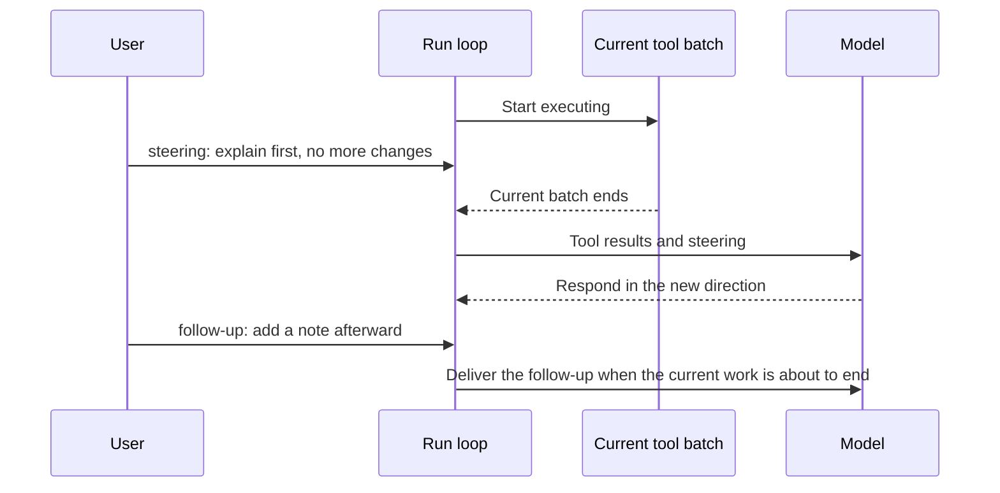
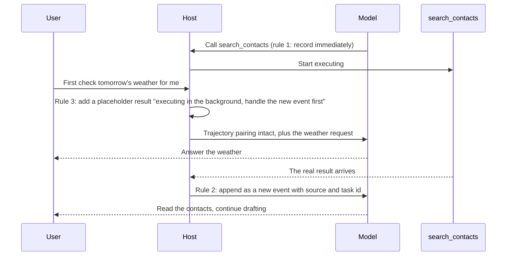
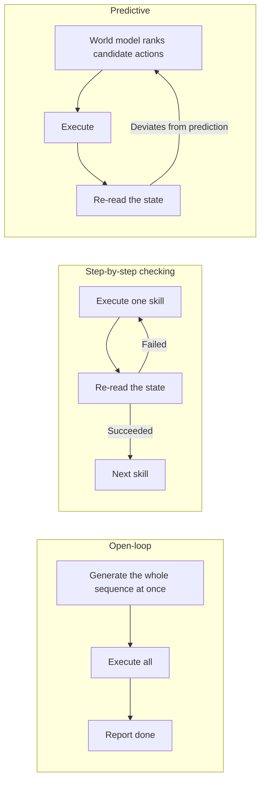

# Chapter 6　Interaction: Observation and Action Spaces

[Back to contents](../README.md)

> This chapter is the deep-dive companion to Station 06, "Eyes, Ears, Hands and Feet" (耳目与手脚), of [π Workshop](https://pi.duanjl.com/). It assumes you have already played the station's three missions: [▶ 6-1 Where to Click (点哪儿)](https://pi.duanjl.com/#/play/6-1) · [▶ 6-2 Gone in a Flash (一闪而过)](https://pi.duanjl.com/#/play/6-2) · [▶ 6-3 Did It Grab? (抓住了吗)](https://pi.duanjl.com/#/play/6-3), and flipped through the [Station 06 manual](../../manual/06-interaction.md) (the manual is written in Chinese only). The manual says "what you saw in the game"; this chapter covers the principles, Pi's real implementation, and the trade-offs.

## Reading route

| Part from the manual | What this chapter covers next | Where |
| --- | --- | --- |
| [Coordinate conversion](../../manual/06-interaction.md#c-coords) (6-1) | The algorithm for choosing a target resolution by aspect ratio; how Pi's `read` tells the model the scale after shrinking an image, and why a click tool should not copy that approach | [6.9](#t-ia-coords) |
| [Look only when the screen changes](../../manual/06-interaction.md#c-keyframe) (6-2) | Why fixed-interval sampling is bound to miss frames; how a watcher program and a screenshot tool divide the work; implementing it in Pi with an extension | [6.9](#t-ia-keyframe) |
| [Check the result of every step](../../manual/06-interaction.md#c-closed-loop) (6-3) | Three kinds of closed loop: open-loop, step-by-step checking, predictive; welding observation into tool returns in Pi | [6.10](#t-ia-closed-loop) |
| [The two lines with no level yet](../../manual/06-interaction.md#c-async) | Asynchrony and event-driven design: event sources, safe points, three handling strategies, placeholders, task handles; how Pi's steering, follow-up, and abort are implemented | 6.2 to 6.7 |
| [Voice](../../manual/06-interaction.md#c-voice) | Cascading, Omni, and full-duplex paradigms; separating fast and slow paths | [6.8](#t-ia-voice) |
| The "Going deeper" boxes in each manual section | Visual grounding, action spaces, the Computer Use world model, hierarchical control, action chunking, shared primitives | 6.9 to 6.11 |

This chapter is based on Pi 0.87.1, pinned at commit `f07218c4d4bbc12bef056a7058c3dd49dfe41abe`, and reuses the book's three markers: **[Built-in]** is behavior this version provides directly, **[Extension]** can be implemented with Pi's interfaces but you write the code yourself, and **[Recommendation]** is a general engineering choice that Pi does not do for you.

The original-book ideas come from chapter 6 of Li Bojie's *Understanding AI Agents in Depth* (深入理解 AI Agent), called "the original book" below.

First, a point that differs from the earlier chapters: this chapter has four lines, and Pi has real material on only one of them. On the asynchrony and event-driven line, Pi's steering, follow-up, abort, and event stream are an implementation you can read line by line, so 6.2 to 6.7 go into fine detail. On the three lines of voice, Computer Use, and robotics, Pi has no built-in implementation; this chapter reports the original book's ideas as they are, then points out which parts can be assembled with Pi's extension interfaces.

---

<a id="t-ia-turns"></a>

## 6.1 Turn-taking is a convention

The world of the first five chapters is considerate: the user finishes a sentence, the agent thinks for a while, calls a few tools, and answers with one; while it thinks, the world stops and waits. This premise is so natural that hardly anyone writes it down. The first sentence of this chapter of the original book writes it down, and then overturns it: **turn-taking is an interaction convention between the model and the interface, not a property of the environment.** Email arrives while the agent is thinking, the user cuts in halfway through its sentence, the page changes between two screenshots, and the cup gets knocked over while the robot arm is reaching out.

The original book splits the observation space and the action space each into two directions that can be extended:

| | Observation space | Action space |
| --- | --- | --- |
| **Content** (chapters 2 to 5) | Context, memory, knowledge bases | Tools, code |
| **Modality** (this chapter) | Sound, screen, physical sensors | Speaking, clicking, joint movement |
| **Timing** (this chapter) | The world pushes in, a continuous stream | Across turns, interruptible, preemptible |

**Modality** concerns form: reading text, or also hearing sound, watching the screen, sensing torque. **Trigger timing** concerns rhythm: whether the agent goes to fetch an observation or the world pushes it in; whether an action finishes within one turn or can span turns, be interrupted, or be preempted by something more urgent.

Along the two axes, the original book lays out four lines, each at its own time scale:

| Line | Time scale | What changes on the observation side | What changes on the action side | This chapter |
| --- | --- | --- | --- | --- |
| Asynchrony and event-driven | Seconds to days | External events wake the agent on their own initiative | Launch first, finish through events later | 6.2–6.7 |
| Voice | 10 milliseconds to 1 second | Listen while speaking, without waiting for a sentence to end | Think while speaking, interruptible | 6.8 |
| Computer Use | Sub-second to seconds | The screen keeps changing between two frames | After an action, reconfirm whether reality still matches the plan | 6.9 |
| Robotics | Milliseconds | Sensors stream back continuously | Plan a short stretch of actions at a time, preemptible | 6.10 |

**These four lines are parallel.** They are not rungs of a ladder, and each later one does not fix a defect the previous one left behind. At two places, asynchrony to voice and voice to Computer Use, the original book writes transition sentences meaning "compress the time scale a bit more"; that is narrative order. Between Computer Use and robotics there isn't even a transition sentence. What really strings them together is a shared control skeleton and a set of shared primitives (wake-up, safe point, cancellation, preemption, fast/slow separation), gathered up in [6.11](#t-ia-primitives).

Remember one sentence that will be cashed in again and again later: once modality and timing expand, **the distance between "I issued an action" and "the world became what I wanted" stretches out.**

---

<a id="t-ia-parallel"></a>

## 6.2 First sort out "at the same time": serial, parallel, and asynchronous

The original book's first metaphor for asynchrony is a service counter. A synchronous agent is like a counter that can only queue people: call one number, handle one person, and only then call the next; a good secretary has several matters spread on the desk, picks among them by urgency, and can set one down when an urgent one arrives mid-task. A synchronous agent either waits for the background task to finish before it can speak, or finishes speaking before it looks at newly arrived events.

But "doing several things at the same time" means at least three things; separate them first, or every later section will blur together.

Before fixing the program, Pi wants to look at the source and an order sample at the same time. Both files exist, and reading either does not depend on the other. Suppose reading the source takes one second and reading the orders takes three: reading one after the other takes four seconds; starting together, you get both in about three.

```js
// Serial: the second starts only after the first ends.
const results = [];
for (const call of calls) {
  results.push(await executeAsToolResult(call));
}

// Parallel: start every item first, then wait together.
const resultsInOrder = await Promise.all(
  calls.map(call => executeAsToolResult(call))
);
```

The two snippets are alternatives. A `Promise` is a result not yet complete, `await` makes the current flow wait for it, and `Promise.all` waits for a whole group of results to complete and returns them in input order. The four and three seconds are assumptions, not measurements.

| Approach | Benefit | Cost and boundary |
| --- | --- | --- |
| Serial | Clear order, suits operations with a required sequence | Slow operations that don't depend on each other still queue |
| Same-batch parallel | Independent reads and queries shorten the total wait | Must handle shared state and result ownership, and a slow task holds up the whole batch |

The arguments of calls in the same batch are already fixed in the model's response. Serial scheduling doesn't take the first item's result to change the second item's arguments; if you must first search for a path and then decide which file to read, you have to wait for the search result to return and let the model generate the read request in the next turn.

**[Built-in]** The Pi Agent Core of this book's version defaults to [`parallel`](https://github.com/earendil-works/pi/blob/f07218c4d4bbc12bef056a7058c3dd49dfe41abe/packages/agent/src/agent.ts#L250). It first does pre-call checks in order, then runs the approved calls concurrently; tool-completion events appear in actual completion order, while results written into the message history keep the order the model issued them in. As soon as one tool in a batch declares `executionMode: "sequential"`, the whole batch becomes serial ([mode selection](https://github.com/earendil-works/pi/blob/f07218c4d4bbc12bef056a7058c3dd49dfe41abe/packages/agent/src/agent-loop.ts#L514), [parallel dispatch](https://github.com/earendil-works/pi/blob/f07218c4d4bbc12bef056a7058c3dd49dfe41abe/packages/agent/src/agent-loop.ts#L583)).

The easiest thing to mix up here: **the tools run in parallel, and the next model call still waits for the whole batch of tools to complete.** The UI may first show "source read", which doesn't mean the model has taken the source and started the next round of reasoning. This regular Pi path hands back the whole batch of results only after [`Promise.all`](https://github.com/earendil-works/pi/blob/f07218c4d4bbc12bef056a7058c3dd49dfe41abe/packages/agent/src/agent-loop.ts#L643). The `edit/write` on the same path also have a mutation queue; it is not a global dependency analyzer, see [Chapter 4](04-tools.md#t-tool-readonly).

### From parallel to asynchronous

Change the scenario: the investigation must export a batch of orders from a database while also reading a page of report-format notes. The query takes thirty seconds, the notes one second. Start both together and the notes arrive quickly, but inside a loop that waits for the whole batch, the model must still wait for the query to finish before continuing. To let it set up the report structure from the notes first and fill in the numbers when the data returns, "the query is still running" and "the model can do something else" must both hold at once. That is asynchrony.

The three levels cannot all be called "asynchronous":

| Level | What advances at the same time | Is the main model certain not to wait? |
| --- | --- | --- |
| Tool parallelism | Several tool functions in the same turn | Not necessarily; Pi's regular loop still waits for the whole batch |
| Sub-agent parallelism | Several agents' own model-tool loops | Not necessarily; the main agent may choose to wait for all sub-tasks |
| The model protocol supports asynchronous tools | While a tool result hasn't returned, the model continues independent work | The host must also wire in the matching protocol and result delivery |

Creating a sub-agent and immediately `await`ing it only swaps the executor, and the main flow is blocked just the same. A sub-agent that returns a handle on launch while the main agent goes off to do independent work is a different orchestration. [Chapter 10](10-multi-agent.md) will land this distinction in topologies.

A synchronous tool interface can also carry background tasks: split a slow query into three short calls, `start/status/cancel`; `start` returns a `jobId` immediately, that tool call is over, and the query keeps running in the background. The design of task IDs, terminal states, deduplication, and cancellation was covered in [Chapter 4](04-tools.md#t-tool-async), so it isn't repeated here; remember just one distinction: **a tool call ending does not mean the background task has ended.**

The original book states a premise here, on which the next several sections rest: **first check which message sequencing the model and API support.** Some interfaces require every tool call to be completed with a result before continuing; others already allow a tool to be suspended while the model carries on working. The former rely on an event queue, task handles, and a compatibility layer; the latter can use the native protocol directly. Using `asyncio` in the code doesn't mean the model is asynchronous.

**[Built-in boundary]** The regular `agent-loop` of this book's pinned version executes by waiting for the whole batch. The [`onUpdate` progress callback](https://github.com/earendil-works/pi/blob/f07218c4d4bbc12bef056a7058c3dd49dfe41abe/packages/agent/src/types.ts#L440) of `AgentTool` is only an update interface during tool execution, and cannot be equated with the model being able to keep reasoning while it waits.

> **Further reading**: Sub-agent parallelism was once popular in the form of "several roles forming a virtual company", and later mostly converged on "a main agent plus isolated sub-tasks". This history is in [The rise and fall of multi-agent systems](notes/multi-agent.md).

---

<a id="t-ia-event-sources"></a>

## 6.3 Let the world wake the agent: where events come from

With "at the same time" sorted out, the first real question is: when nobody is talking to the agent, how does it know it's time to work?

The original book dissects the open-source framework OpenClaw. Its Gateway routes messages from multiple channels to the agent, and there are three more built-in mechanisms:

| Mechanism | When it fires | Where the event comes from |
| --- | --- | --- |
| Hooks (event hooks) | Lifecycle events such as session creation and reset | Inside the framework |
| Cron (scheduled dispatch) | Per a cron expression, e.g. `0 9 * * 5` is every Friday at 9 a.m. | The clock |
| Heartbeat | Wakes up every N minutes to see whether there is anything to handle | The clock |

Messages from built-in channels are themselves pushed and routed on arrival. But the only things that let the agent "get moving on its own" without a user message are Cron and Heartbeat, **and both are time-driven**. The original book points out that the real shortcoming is that third-party events outside the built-in channels (a new email, an API callback, an urgent notification) have no immediate path and may be seen only on the next cycle.

The original book's example is PineClaw, a plugin Pine AI built for OpenClaw. Pine AI makes real phone calls for users: negotiating bills, cancelling subscriptions, handling claims. During a call the representative may need the user at any moment: to read out a one-time verification code, join a three-way call within seconds, or confirm a discount the other side offers. With heartbeat polling, by the time the user is notified of the code the representative is waiting for, the call has already dropped. PineClaw's solution is the **Channel**: opening a real-time channel between the Gateway and the Pine API, so that when the call connects, needs input, or ends, events are pushed to the agent immediately.

The original book's conclusion: **real proactive service needs both that the agent can check on a schedule and that events can proactively notify the agent.**

### Two kinds of tools directly tied to events

Chapter 1 listed five kinds of tools, and [Chapter 4](04-tools.md#t-tool-perception) covered perception, execution, and collaboration; the remaining two depend on an asynchronous runtime and go here.

**Event-trigger tools** are the entrance through which the world enters the agent:

| Tool | What it governs | The original book's example and key points |
| --- | --- | --- |
| `set_timer` | Things that depend on physical time | To call the bank's mortgage department on Saturday, set "call next Monday at 10:00"; recurring timers do periodic checks and also poll external services that don't support push. Heartbeat is its systematized implementation |
| `monitor_shell` | Output of background commands | Watching constantly costs too many tokens, while waiting until it finishes can't notice a hang. The original book mentions Claude Code's monitor tool looks only at new output or output containing keywords |
| `connect_channel` | External push: new email, API callbacks, IM messages | PineClaw's Channel is the typical case |

Two design points: **trigger conditions and filter rules must be clear**, so unrelated events don't wake the agent and burn compute; **event payloads should carry enough context**, so the agent needn't do another round of lookups on waking.

**User-communication tools** solve the opposite problem. In a native ReAct loop, assistant messages are shown directly to the user, who must open that session to converse. OpenClaw changed this to use a dedicated tool for messaging the user, which can carry images and files and add push notifications by urgency, so both the user and the agent can message each other at any time. The original book says many people describe it as having "a sense of a living person", and this is where that comes from. Channels can extend to instant messaging, SMS, email, phone, and push, with the agent choosing a channel by urgency, user state, nature of the content, and preference. The original book points out especially: **a notification is also a recall mechanism**, proactively calling the user back when a long task is done.

**Acting as whom?** For the agent to appear on these channels on the user's behalf, there is an identity question. The original book's trade-off: directly managing the user's personal accounts looks convenient, but on a mistake or compromise all of the user's digital identity is exposed; steadier is to give the agent **a virtual identity of its own** (dedicated communication accounts, storage, and compute environment, like a secretary with their own office phone and email), deployed in **an isolated execution environment**: a virtual computer (VM or container), a virtual phone (Android emulator). There are two practical issues that come with it: websites' anti-bot mechanisms recognize data-center IPs, so residential proxies are often needed in practice; when login must be done as the user in person, use VNC/RDP to let the user log in themselves in a visual environment, and reuse the token while it's valid. The agent and the virtual environment exchange **paths** rather than contents through a shared file system, to avoid taking up context. The levels and costs of isolation are in the [Sandbox special topic](s-sandbox.md).

### What Pi does

Pi's core has no timer or external-channel tools, but it leaves a door for sending events into a session.

**[Built-in]** An extension can call [`pi.sendMessage()`](https://github.com/earendil-works/pi/blob/f07218c4d4bbc12bef056a7058c3dd49dfe41abe/packages/coding-agent/src/core/extensions/types.ts#L1483) to push a custom message into the session, with two options deciding how it enters the loop ([the branches inside the session](https://github.com/earendil-works/pi/blob/f07218c4d4bbc12bef056a7058c3dd49dfe41abe/packages/coding-agent/src/core/agent-session.ts#L1936)):

| The agent's state at that moment | Option | Result |
| --- | --- | --- |
| Idle | `triggerTurn: true` | Immediately starts a run, with the model handling this message |
| Idle | No trigger | Only recorded in the session, the model is not called |
| Running | `deliverAs: "steer"` (default) | Goes into the steering queue, handed to the model at the next turn boundary |
| Running | `deliverAs: "followUp"` | Goes into the follow-up queue, handled when it would otherwise stop |
| Any | `deliverAs: "nextTurn"` | Held until the next user-initiated run |

**[Built-in]** The official example [`file-trigger.ts`](https://github.com/earendil-works/pi/blob/f07218c4d4bbc12bef056a7058c3dd49dfe41abe/packages/coding-agent/examples/extensions/file-trigger.ts#L14) is a minimal `connect_channel`: in `session_start` it does `fs.watch` on a file, and when there's content it calls `sendMessage(..., { triggerTurn: true })`, then clears it after reading. An external system does `echo "Run the tests" > /tmp/agent-trigger.txt` and Pi wakes up. Another path is RPC mode: an external process sends the [`steer`, `follow_up`, and `abort` commands](https://github.com/earendil-works/pi/blob/f07218c4d4bbc12bef056a7058c3dd49dfe41abe/packages/coding-agent/src/modes/rpc/rpc-types.ts#L22) through standard input.

**[Built-in]** The minimal version of user communication is [`notify.ts`](https://github.com/earendil-works/pi/blob/f07218c4d4bbc12bef056a7058c3dd49dfe41abe/packages/coding-agent/examples/extensions/notify.ts#L54): when the run has fully settled (`agent_settled`), it sends a native terminal notification. The sentence in its comment deserves copying down: after `agent_end`, Pi may still retry, compact, or go on to run queued follow-ups, so notify only on `agent_settled`. This is the "recall" the original book speaks of, with just one channel, the terminal.

**[Extension]** Wiring a webhook as an event channel looks roughly like this. `sendMessage`, `session_start`, `session_shutdown`, and `ctx.abort()` are Pi's real interfaces; `startWebhookServer`, `passesFilter`, `classify`, and `waitUntilIdle` are ones you write yourself:

```js
// Sketch: external event -> Pi session. Shows the wiring only, cannot run as is.
export default function (pi) {
  let server;
  pi.on("session_start", async (_event, ctx) => {
    server = await startWebhookServer(async (event) => {
      if (!passesFilter(event)) return;                    // trigger conditions and filtering
      const text = [
        `[External event · not a user instruction]`,
        `Source: ${event.source}　Channel: ${event.channel}`,
        `Content: ${event.summary}`,
        `Related: ${event.relatedTask ?? "none"}`,
      ].join("\n");
      const message = { customType: "external-event", content: text, display: true, details: event };
      if (classify(event) === "urgent" && !ctx.isIdle()) {
        ctx.abort();                                       // cancellation-based: create a safe point early
        await waitUntilIdle(ctx);
        pi.sendMessage(message, { triggerTurn: true });
      } else {
        pi.sendMessage(message, { triggerTurn: true, deliverAs: "followUp" });
      }
    });
  });
  pi.on("session_shutdown", async () => { await server?.close(); server = undefined; });
}
```

All three details are forced by Pi's extension rules:

- **The listener starts in `session_start` and shuts down in `session_shutdown`.** The extension docs explicitly say [not to start processes, sockets, listeners, or timers in the factory function](https://github.com/earendil-works/pi/blob/f07218c4d4bbc12bef056a7058c3dd49dfe41abe/packages/coding-agent/docs/extensions.md#L58), because in some situations an extension is loaded without opening a session; cleanup must be idempotent. The official `file-trigger.ts` doesn't close anything, and exercise 8 comes back to pick on it.
- **Write the source into `content`.** All the model can see is `content`; `details` is only for the UI and logs (the boundary [Chapter 4](04-tools.md#t-tool-contract) covered). An external event may hide instructions, and labeling "this is an external event, not a user instruction" is part of [Chapter 2's prompt-injection defense](02-context.md#t-ctx-injection-defense).
- **An urgent event relies on `abort` plus re-triggering.** Pi's steering waits for the turn boundary and doesn't count as preemption; to really interrupt, you can only cancel first. The next section goes into detail.

---

<a id="t-ia-safe-point"></a>

## 6.4 The event loop, safe points, and three handling strategies

An event arrives; what if several arrive at once? The user's new message, a tool result, a timer expiring, and another agent's collaboration request can all crowd into the same second.

The skeleton the original book gives is the **event loop** from concurrent programming: an asynchronous agent is a long-running loop, and each round takes a number of events from the input queue, appends them to the trajectory, calls the model once, executes the tools it decides on, and goes back to the start to wait for the next batch. The original book likens it to Go's `for { select { ... } }` reading messages from a channel.

The key concept is the **safe point**. Under a synchronous interface, events are consumed only at the boundary of a turn: while the model is reasoning and tools are executing, new events wait in the queue until a stretch of reasoning ends or a tool returns. Native asynchrony has boundaries too, only managed at a different layer. There is another sentence the original book stresses repeatedly: **a "stop" message does not undo actions that have already happened**; cancellation requires the executor itself to respond to the cancel signal, like checking `ctx.Done()` in Go.

### First let the event say who it is

Understand before handling. A general agent's input comes from more than the user: a message sent by a third party isn't addressed to the agent, but the agent must understand and evaluate it. The original book advocates modeling every input as a **structured event** with four dimensions:

| Dimension | What it answers | Examples |
| --- | --- | --- |
| Source | Who | The user themself, a contact, a stranger, a system notification |
| Channel | How it arrived | Phone, SMS, IM, email, timer, asynchronous tool result, command-line monitor |
| Content | What was said | Body, emotion, urgency, whether a reply is needed |
| Context | What it relates to | Which old conversation it replies to, how it connects to the current task |

The original book's refund-email example:

```json
{
  "source": {"type": "email", "sender": "client@example.com"},
  "channel": "gmail_webhook",
  "content": {"subject": "Refund request", "body": "Order #12345 would like a refund..."},
  "context": {"priority": "high", "customer_tier": "vip", "related_orders": ["#12345"]}
}
```

With clear modeling, the agent won't mistake user input for a tool result, nor a tool result hiding instructions for a user instruction. The original book also draws an analogy with the trigger ecosystem of workflow platforms such as n8n: webhooks, timers, email, database changes, file watching; each kind of trigger is one "sense" of the agent.

### Three handling strategies

People handling several things weigh urgency. The original book gives three strategies by urgency, which become clear in terms of safe points:

```mermaid
flowchart TB
  E[New event arrives] --> C{Lightweight classifier decides}
  C -->|Urgent: Stop! I misspoke| X[Cancellation-based: stop reasoning, send cancel signal<br>clear the queue, append along with the urgent event<br>call the model again immediately]
  C -->|Routine: only look at the last month| Q[Queued: put in the queue<br>append all at once at the next safe point]
  C -->|Independent and light: what's the weather today| P[Parallel: start a separate reasoning session<br>mark the result "in parallel with the main task" and append back to the trajectory]
```

| Strategy | Relation to the safe point | The original book's example |
| --- | --- | --- |
| **Cancellation-based** | **Creates** a safe point **early** for an urgent event | The user says "Stop! I misspoke" just as the agent is about to perform a wrong operation |
| **Queued** | Waits for the **next naturally occurring** safe point | Mid-search the user adds "only look at the last month's results"; it is handed to the model together with the search results, saving a round trip |
| **Parallel** | **Doesn't wait** for the main loop's safe point and starts another loop | While analyzing a large amount of data, the user asks "what's the weather today": unrelated to the main task, needs speed, low cost |

The original book's urgency classification: `user.interrupt`, `supervisor.instruction`, `agent.interrupt`, and external alerts marked urgent count as urgent; `user.input`, `agent.input`, `tool.result`, and `timer.trigger` count as non-urgent. But it immediately adds that hard-coded rules have limits: "stop right now", "what's the weather today", and "send the report to me in Chinese" are distinguished by semantics, and **a lightweight classification model is recommended for event routing**. One last constraint: the cancellation point must be a place where the tool or reasoning can wrap up safely, and unfinished tool results use explicit placeholders, **never forged as success**.

<a id="t-ia-steering"></a>

### What Pi does: steering, follow-up, and abort

Pi Agent Core's queues are the most worthwhile stretch of real code on this line. First, the user's side:

**[Built-in]** In Pi's interactive interface, you can keep typing while the agent is working ([usage notes](https://github.com/earendil-works/pi/blob/f07218c4d4bbc12bef056a7058c3dd49dfe41abe/packages/coding-agent/docs/usage.md#change-direction)):

| What you want | Action | Which queue |
| --- | --- | --- |
| Adjust the current task | Type, then press `Enter` | steering: wait until the current reply and its tool calls are done, then guide the next reply |
| Add work after the current task is done | Type, then press `Alt+Enter` | follow-up: wait until Pi has finished the current task |
| Take queued messages back into the editor | `Alt+Up` | |
| Stop the current task | `Escape` | abort: cancel, with queued messages returned to the editor |

The SDK has the same three actions: [`AgentSession.prompt()`](https://github.com/earendil-works/pi/blob/f07218c4d4bbc12bef056a7058c3dd49dfe41abe/packages/coding-agent/src/core/agent-session.ts#L1655) must specify `streamingBehavior: "steer" | "followUp"` while running, or it errors; the underlying `Agent` has [`steer()`](https://github.com/earendil-works/pi/blob/f07218c4d4bbc12bef056a7058c3dd49dfe41abe/packages/agent/src/agent.ts#L296), [`followUp()`](https://github.com/earendil-works/pi/blob/f07218c4d4bbc12bef056a7058c3dd49dfe41abe/packages/agent/src/agent.ts#L301), and [`abort()`](https://github.com/earendil-works/pi/blob/f07218c4d4bbc12bef056a7058c3dd49dfe41abe/packages/agent/src/agent.ts#L338), and calling `prompt()` again while running throws directly, telling you to use the first two instead ([the guard in `prompt`](https://github.com/earendil-works/pi/blob/f07218c4d4bbc12bef056a7058c3dd49dfe41abe/packages/agent/src/agent.ts#L370)).



Now the loop's side. [Chapter 1](01-agent-loop.md#agent-loop) drew `runLoop`'s two layers of `while`; here we look only at **where it goes to check the queues**, and those places are Pi's safe points:

| Position | What it does | Source |
| --- | --- | --- |
| The run has just started | Take steering once (the user may have typed during the wait) | [L175](https://github.com/earendil-works/pi/blob/f07218c4d4bbc12bef056a7058c3dd49dfe41abe/packages/agent/src/agent-loop.ts#L175) |
| After the next turn's preparation | Preparation may take long (compaction, say), and steering that arrived meanwhile is picked up | [L204](https://github.com/earendil-works/pi/blob/f07218c4d4bbc12bef056a7058c3dd49dfe41abe/packages/agent/src/agent-loop.ts#L204) |
| A turn ends (after `turn_end`) | Take steering again; if any, continue the inner loop | [L294](https://github.com/earendil-works/pi/blob/f07218c4d4bbc12bef056a7058c3dd49dfe41abe/packages/agent/src/agent-loop.ts#L294) |
| When the inner loop is about to exit | Take follow-up; if any, go back to the inner loop | [L301](https://github.com/earendil-works/pi/blob/f07218c4d4bbc12bef056a7058c3dd49dfe41abe/packages/agent/src/agent-loop.ts#L301) |

Condensed into pseudocode:

```js
// Mechanism pseudocode: keeps only the queue-related parts.
let pending = drainSteering();                  // safe point ①
while (true) {
  let more = true;
  while (more || pending.length > 0) {
    history.push(...pending); pending = [];
    const reply = await callModel(history);
    if (reply.stopReason === "error" || reply.stopReason === "aborted") return;
    more = await runToolBatch(reply);           // returns only after the whole tool batch has run
    pending = drainSteering();                  // safe point ②: turn boundary
  }
  const followUps = drainFollowUp();            // safe point ③: about to stop
  if (followUps.length === 0) break;
  pending = followUps;
}
```

Against the original book's three strategies:

| The original book's strategy | What it corresponds to in Pi | Marker |
| --- | --- | --- |
| Queued | **steering**. It waits for the next naturally occurring safe point (the batch of tools finishing), and does not undo tools already executed. The [official notes](https://github.com/earendil-works/pi/blob/f07218c4d4bbc12bef056a7058c3dd49dfe41abe/packages/agent/README.md#steering-and-follow-up) put it clearly: when steering is injected, all tool calls of the current assistant message have already completed | **[Built-in]** |
| A "lazier" queued | **follow-up**. Checked only when there are no tool calls and no steering | **[Built-in]** |
| Cancellation-based | **abort** plus re-initiating. `abort()` only sends a cancel signal; the model's interrupted message ends with `stopReason: "aborted"` and the loop exits hard. It does not automatically append the urgent message and call the model again; the interactive UI returns the queued messages to the editor and lets you decide how to resend | **[Built-in]** cancel, **[Extension]** re-initiate |
| Parallel | Not built in. You can start another path with a nested model call in an extension or the [subagent extension example](https://github.com/earendil-works/pi/blob/f07218c4d4bbc12bef056a7058c3dd49dfe41abe/packages/coding-agent/examples/extensions/subagent/README.md#L1) | **[Extension]** |
| Routing with a classifier model | Not built in. The `classify` in 6.3's webhook sketch is where it belongs | **[Extension]** |

Two names are easy to misread and need to be called out:

1. **Pi's steering is not preemption.** The README example writes `"Stop! Do this instead."`, which reads like an emergency brake, but in fact it still waits for the batch of tools to finish. If a `bash` that takes ten minutes is executing, the steering message waits ten minutes. To truly stop immediately, you can only `abort`.
2. **Pi's steering is also not the original book's Mid-turn steering.** The latter is the model receiving a new requirement **in the middle** of thinking or outputting (6.6); Pi stuffs the message into the next request **at the turn boundary**. Same name, different timing.

**[Built-in]** `steeringMode` and `followUpMode` both default to [`"one-at-a-time"`](https://github.com/earendil-works/pi/blob/f07218c4d4bbc12bef056a7058c3dd49dfe41abe/packages/agent/src/agent.ts#L244): each safe point takes only one, leaving the rest for the next round; set to `"all"` and it takes everything at once ([queue implementation](https://github.com/earendil-works/pi/blob/f07218c4d4bbc12bef056a7058c3dd49dfe41abe/packages/agent/src/agent.ts#L158)). In the Coding Agent these two are [settings](https://github.com/earendil-works/pi/blob/f07218c4d4bbc12bef056a7058c3dd49dfe41abe/packages/coding-agent/docs/settings.md#L29), [passed into the Agent by `createAgentSession`](https://github.com/earendil-works/pi/blob/f07218c4d4bbc12bef056a7058c3dd49dfe41abe/packages/coding-agent/src/core/sdk.ts#L395). This choice and the "attention scattering" at the end of 6.5 are two answers to the same problem.

---

<a id="t-ia-placeholder"></a>

## 6.5 Dangling tool calls: placeholders and task handles

The original book's experiment 6-1 uses a mail agent to demonstrate the simplest event queue: three emails enter the queue in turn and are handled in turn. The real difficulty appears at the moment a tool hasn't returned and the user cuts in.

The original book's example: the agent is drafting an email for the user and has called `search_contacts` to look up a contact; the result hasn't come back, and the user says "wait, first check tomorrow's weather for me". If the interface requires **every tool call to be paired with a result** before continuing, the trajectory is left with a call that has no result, and the agent can't take it along to handle the new message. The original book specifically notes that this restriction comes from **the chosen protocol and model combination**, not a rule that every model must obey.

### Five rules for staying compatible with the synchronous format

The original book's core idea: **when there is no interruption, let the model see a standard synchronous trajectory; insert a placeholder only on interruption, to complete the format.**

| Rule | Content |
| --- | --- |
| 1 | Promptly record assistant messages and tool calls the API has completed; keep server-managed reasoning state per the provider's continuation protocol, and don't concatenate invisible thinking text yourself |
| 2 | Record a tool result only when the tool truly completes; a trajectory in execution is in a "partially complete" state |
| 3 | When a tool is interrupted mid-execution, generate a placeholder result for the unfinished tool (such as "the tool is executing in the background, please handle the new event first"), append the interrupting event, and call the model again |
| 4 | With no native steering or mid-way continuation interface, cancel the unfinished generation, keep the messages and tool state confirmed complete, append the new event, and request again. Never feed half-finished output or hidden reasoning back as a legitimate prefix |
| 5 | Non-interrupting events go into the queue and are appended all at once when the current cycle completes |

Applied to the email-drafting example:



### The semantic risk of placeholders, and task handles

A placeholder completes the format and also buries a mine: the model may take "task started" for "task finished" and make judgments that depend on it before the real result comes back. The original book's defense is explicit task state and result validation, plus specifically checking in evaluation for **whether data that hasn't arrived was fabricated**; it also warns that one failure can't be used to pin the cause on some undisclosed training process.

A more fundamental remedy is to express asynchrony **at the design level of the tool interface**. The name `phone_call` implies "make the call, return the call record"; change it to `initiate_phone_call`, returning a task id and initial state at once ("call initiated, dialing"), and notify connect and hang-up with `phone_call_connected` and `phone_call_ended` events. **The name and description themselves must convey that "this is only initiating"**; the description the original book gives as an example: "This tool starts a phone task handled by a sub-agent. It returns a task ID immediately after the task is successfully initiated, and you may continue with other things. You will receive a separate notification event when the call ends." For the companion tools to query status and cancel, see [`start/status/cancel` in Chapter 4](04-tools.md#t-tool-async).

The original book's experiment 6-2 puts these together: three simulated scripts advance at 3%, 2%, and 1% per second, and the user requires "whichever finishes first, look at the progress of the rest, and cancel if it hasn't passed 50%". Exercise 6 has you work through this problem.

### What Pi does

Pi doesn't implement the placeholder scheme of "after an interruption, let the tool keep running in the background", but the **format repair** of rules 3 and 4 it does, and does with restraint.

**[Built-in]** The provider adapter layer passes over the messages before sending a request ([`transform-messages.ts`](https://github.com/earendil-works/pi/blob/f07218c4d4bbc12bef056a7058c3dd49dfe41abe/packages/ai/src/api/transform-messages.ts#L158)):

- **An interrupted or errored assistant message is skipped entirely and not replayed** ([skip logic](https://github.com/earendil-works/pi/blob/f07218c4d4bbc12bef056a7058c3dd49dfe41abe/packages/ai/src/api/transform-messages.ts#L201)). The reason given in the source comment is exactly rule 4's worry: such a message may have reasoning without body text, carry incomplete tool calls, and replaying it makes some providers error; the model should start over from the last valid state.
- **A tool call with no result gets a synthetic result**, with the content `No result provided` and marked `isError: true` ([synthetic result](https://github.com/earendil-works/pi/blob/f07218c4d4bbc12bef056a7058c3dd49dfe41abe/packages/ai/src/api/transform-messages.ts#L167)). It's added upon meeting a new user message or a new assistant message, and also when the trajectory still dangles at the end. What it says is "no result", marked as an error, never forged as success.

**[Built-in]** When `abort` is pressed during a run, tools in a parallel batch that haven't started get an error result of [`Operation aborted`](https://github.com/earendil-works/pi/blob/f07218c4d4bbc12bef056a7058c3dd49dfe41abe/packages/agent/src/agent-loop.ts#L617); a `bash` that is running [kills the whole process tree](https://github.com/earendil-works/pi/blob/f07218c4d4bbc12bef056a7058c3dd49dfe41abe/packages/coding-agent/src/core/tools/bash.ts#L125) and returns the output so far plus a `Command aborted`; `edit` checks for cancellation only after every `await` ([Chapter 4](04-tools.md#t-tool-idempotent) covered that comment). Together, these three are the real form of the original book's "cancellation requires the executor to respond to the cancel signal": **cancellation takes effect at waiting points, and bytes already written and commands already run are not taken back because of it.** For a tool to hook into cancellation, it must work with [the third argument of `execute`, `signal`](https://github.com/earendil-works/pi/blob/f07218c4d4bbc12bef056a7058c3dd49dfe41abe/packages/agent/src/types.ts#L452).

So the difference between Pi and the original book's compatibility scheme is: the original book's placeholder says "still running, will give you the result in a moment", and a real result does come later; Pi's synthetic result says "no result", and nothing comes later. If you want the former, use a task handle: the tool returns a `jobId` at once, and when the result arrives you send it in with `pi.sendMessage` as an event carrying the task id, which hooks right into 6.3's event channel. **[Extension]**

<a id="t-ia-batch"></a>

### Batched events: the model responded only to the last one

When the queued strategy appends several events at once, the original book observed that the model may **respond only to the last one**, with the earlier requests dropped. It gives two layers of intervention:

- Prompt layer: tell the model "when you receive multiple consecutive events, take all the information into account".
- Status-bar layer: put an explicit marker before each event and a summary sentence at the end.

```text
[Unhandled event 1/4] Tool result from database_query: ...
[Unhandled event 2/4] User note: only look at data from the Beijing region
[Unhandled event 3/4] System reminder: 30 minutes left until the report deadline
[Unhandled event 4/4] User asks: how is the progress?
Above are 4 unhandled events, including 1 tool result, 2 user messages, and 1 system reminder. Make sure your response covers all the information.
```

This is the same idea as [Chapter 2's status bar](02-context.md#t-ctx-status): put the structure the model tends to overlook in front of its eyes with one line of text.

Pi's default `"one-at-a-time"` takes another path: each safe point hands over only one, so the model faces one thing at a time and naturally can't leave things out; the price is a few more model calls, and later messages wait a few more rounds. Switching to `"all"` returns to the original book's scenario, where you can use the `context` event to add `[k/N]` markers to the last few consecutive messages before sending the request. **[Extension]** Which is better depends on whether the events are related: "only Beijing" and "30 minutes to the deadline" must be considered together to be right, and feeding them one by one may let the earlier round run once under the old conditions. This passage is this book's own analysis; the original book does not discuss Pi's queue modes.

---

<a id="t-ia-native"></a>

## 6.6 Native asynchrony: a message that can arrive is not a message well used

In the compatibility scheme above, the runtime arranges the order in which events are admitted, and the model itself is still synchronous. Another path is to make the model itself understand this rhythm.

The original book writes that as of September 2026, GPT-6 Astra provides two capabilities:

| Capability | What it does | The original book's example |
| --- | --- | --- |
| **Async tool calling** | Separates launching an action from getting its result; while the result hasn't returned, keep doing work that doesn't depend on it | While looking up a meeting venue, first organize the agenda and prepare a checklist, then compare options when the venue information returns |
| **Mid-turn steering** | The user adds requirements while the model is still thinking or composing its answer | Add mid-way "the budget was reduced" or "the attendee count changed"; completed work is kept and the new constraints are carried into what follows |

According to OpenAI's Responses API documentation (checked by this book on 2026-09-14), Astra supports setting `async: true` on functions or custom tools; the tools are still executed by the application, and later outputs are handed back under the original `call_id`. This is a message sequencing both the model and the interface support, not hosting execution to the model ([official async tool notes](https://developers.openai.com/api/docs/guides/async-tool-calling)). Nor can it be written as "everything except Astra can only wait synchronously"; OpenAI also described asynchronous function calling in [the gpt-realtime release notes](https://openai.com/index/introducing-gpt-realtime/). The unit of judgment is the **combination of model, API, and host implementation**.

The original book then pours cold water: native asynchrony solves **whether messages can arrive mid-run**; whether it is reliable in complex tasks depends on how the model uses those messages. It lists three checks:

| Check | What it asks | What failure looks like |
| --- | --- | --- |
| Result ownership and unfinished state | Is a late result attributed to the right task? When a result is absent, does the model fabricate data? | The venue hasn't been looked up yet and a price is already reported |
| Task recovery and action control | After handling an interjection, does it still remember the original task? Can it tell "change the plan" from "stop"? | After answering the budget question, forgets it was comparing venues |
| Using multiple updates together | Were both the budget and attendee constraints obeyed? | Remembers only the last one |

And one more boundary: **modifying the plan is not stopping a running tool, and certainly doesn't undo actions already taken**; execution, cancellation, and state still belong to the runtime. Improvement can go through training (training models in asynchronous environments, [Chapter 8](08-training.md)) or through the system (clear task state, event sources, and execution feedback). Evaluation must be split in two layers: did the model understand the change, and did the system execute according to the change; see [Chapter 7](07-evaluation.md).

**[Built-in boundary]** The regular `agent-loop` of this book's pinned version still executes by waiting for the whole batch, as in 6.2; swapping the model name for Astra can't prove this path uses the native asynchronous protocol.

Even if the application has implemented background tasks, a model reply in this round with no tool calls only means this stretch of reasoning can stop; while there are `running` tasks, the business isn't done. The coordinator must store these unfinished tasks and decide, when results arrive, whether to start the next run. This is the extra state you must add when moving from a minimal `while` loop toward an asynchronous application.

---

<a id="t-ia-run-events"></a>

## 6.7 How people outside know where it has got to: run events and the host

The other half of an asynchronous agent is making the inside visible to the **outside**. The UI needs to show progress, external programs need to know when they can wrap up, and [Chapter 7](07-evaluation.md) and [Chapter 9](09-evolution.md) rely on trajectories to analyze failures.

**[Built-in]** Pi Agent Core emits these events ([event notes](https://github.com/earendil-works/pi/blob/f07218c4d4bbc12bef056a7058c3dd49dfe41abe/packages/agent/README.md#event-types)):

| Event | Meaning |
| --- | --- |
| `agent_start` / `agent_end` | A run starts; the underlying loop emits no more events |
| `turn_start` / `turn_end` | A turn (one model call plus the tools it triggers) begins and ends |
| `message_start` / `message_update` / `message_end` | Any message starts, streaming increments (assistant only), ends |
| `tool_execution_start` / `update` / `end` | A tool starts, reports progress, completes |

Read the ending events precisely:

| What you see | What it tells you | What it does **not** tell you |
| --- | --- | --- |
| `message_end` | This message is finalized | Tools may be about to execute right after |
| `turn_end` | This turn's model reply and tool results are finalized | The next turn may begin at once because of steering or tool results |
| `agent_end` | The underlying loop emits no more events | Awaited subscribers may still be wrapping up |
| `agent.prompt(...)` or [`waitForIdle()`](https://github.com/earendil-works/pi/blob/f07218c4d4bbc12bef056a7058c3dd49dfe41abe/packages/agent/src/agent.ts#L347) returns | The run and all awaited `agent_end` subscribers have finished | The Coding Agent layer above may still retry, compact, or go on to run follow-ups |
| The Coding Agent's [`agent_settled`](https://github.com/earendil-works/pi/blob/f07218c4d4bbc12bef056a7058c3dd49dfe41abe/packages/coding-agent/src/core/agent-session.ts#L875) | Pi will not automatically continue anymore | The business task is complete |

An example: a subscriber writes an audit record at the end, and the host kills the process as soon as it sees an event name containing `end`; the log may not have been written yet. The low-level `agentLoop()` event stream is mainly for observation and doesn't guarantee waiting on the consumer's asynchronous processing; for a barrier like "finish handling the message before the tool pre-check", use the `Agent` layer, which treats handling of the assistant's `message_end` as a barrier before the tool pre-check. For the `agent_settled` in the last row and the `agent_before_settle` before it, which can append one continuation, [Chapter 1](01-agent-loop.md#t-harness-five) covered how to use them for automatic acceptance.

### Hooking into your own application: `createAgentSession`

Suppose the team wants to connect the refund investigation to its own page: the user clicks a button to start, it carries on after the page is closed, and users can interject and stop midway. With Agent Core alone, you would arrange session storage, resource loading, and progress recovery yourself. The Coding Agent's [`createAgentSession()`](https://github.com/earendil-works/pi/blob/f07218c4d4bbc12bef056a7058c3dd49dfe41abe/packages/coding-agent/src/core/sdk.ts#L175) assembles the common parts:

1. Determine the working directory, configuration directory, and model runtime.
2. Load resources and settings, and prepare the SessionManager.
3. Restore messages, model, and thinking settings from an existing session; handle the replacement choice when the original model is unavailable.
4. Create the Agent, wiring up model calls, message transformation, and queues (including the `steeringMode` above).
5. Create the AgentSession, which goes on managing the session lifecycle and tool resources.

The page's "add a note" button calls `session.prompt(text, { streamingBehavior: "steer" })`, "after this is done" calls `followUp`, and "stop" calls `session.abort()`; the progress bar subscribes to events, and "you can close the page now" waits for `agent_settled`. This doesn't prescribe the order business's workflow; whether an order counts into the summary is still decided by business rules and program verification. For the package layering see [Chapter 1](01-agent-loop.md#package-boundaries).

The model and messages can be restored, but the environment is not restored along with them. Yesterday's files may have been changed by someone today, so you still need to re-observe before continuing, a sentence that gets harder in 6.9 and 6.10.

---

<a id="t-ia-voice"></a>

## 6.8 Voice: compressing the time scale to milliseconds

**Pi has no voice capability**: no voice input, speech synthesis, or real-time audio interface. This section covers the original book's ideas, to help you understand the trade-offs on this line.

The original book's reason for voice is practical: normal speaking speed is about four times typing, and it takes up neither hands nor eyes, so it naturally fits into a loop of continuous work that may be interrupted at any time. It splits the problem in two halves: **the speech model decides "what it can answer", and the interaction architecture decides "whether it can hear clearly, respond in time, and hand over the floor naturally".**

### Three paradigms are trade-offs

The original book borrows the three-way division OpenAI used when introducing GPT-Live, stressing that the three are **not old-replaced-by-new**, but trade-offs under different latency, cost, and observability constraints:

| Paradigm | Structure | Strength | Weakness |
| --- | --- | --- | --- |
| Cascading | VAD → ASR → LLM → TTS | Clear modules, easy to replace and debug | Latency adds up stage by stage; tone and emotion are lost at the interfaces |
| End-to-end Omni | Native audio in and out, interacting turn by turn | Lower latency, preserves tone, emotion, and ambient sound | Still relies on turns, training and debugging cost more |
| Full-duplex | Native audio in and out, continuously listening, speaking, and deciding | Allows overlapping speech and natural interruption | Training, control, and evaluation are all more complex |

The main thread running through all three is: how to escape "taking turns to speak", and VAD's (voice activity detection) guessing about who holds the floor.

### The cascading ledger, and streaming perception

Each of the four cascading stages has its own bottleneck: VAD must wait for a stretch of silence before confirming the user is done; ASR (speech recognition) has recognition latency and also chops up and misrecognizes email addresses, personal names, and proper nouns; the LLM has first-token latency, longer with reasoning on; TTS (speech synthesis) has first-packet latency. Run in series, the waits stack up. The original book points out three ailments: latency accumulation; the binary voiced/unvoiced signal can't express hesitation, emotion, backchannels, and ambient sound; and context is severed.

Keep the division of modules and let each stage **emit increments as early as possible**, which is called streaming perception:

| Stage | How to get ahead |
| --- | --- |
| ASR transcribes while listening | As soon as the user opens their mouth, recognize at intervals and produce a provisional transcript; confirm the final draft after they finish |
| LLM speculative execution | Send the provisional transcript to the model first; if the final draft matches, one call is saved, and if not, cancel and redo |
| LLM segmented output | As soon as the first speakable segment of text emerges, hand it to TTS |
| TTS incremental synthesis | Return audio chunk by chunk, with generation, synthesis, and playback overlapping |

The term "speculative execution" deserves attention: branch prediction in a CPU is the same trick, running ahead on the most likely case and throwing it away to redo if the guess was wrong. The original book also has two reminders: Whisper's encoder needs a complete audio segment and can't be used directly as a streaming model; and when building the turn judgment of "has the speaker finished" into a streaming recognizer, **the training labels may use only information visible at the moment of the decision**, otherwise a judgment trained with a "god's-eye view" can't be reproduced after launch. The recognizer can also output acoustic event markers such as `speak_start/end`, `interrupt`, `emotion`, `laugh`, `sigh`, and `noise`, lined up in the same event stream as text tokens.

### Omni and full-duplex

Omni uses a single model to listen to audio directly, generate a reply, and output speech; it can sense pauses and can also sing and speak in special intonation. But it **still assumes taking turns**, relying on VAD to divide the floor: when a user reads out a string of digits with a pause in the middle, they may be treated as finished. The original book's experiment 6-6 compares MiniCPM-o 4.5 answering directly from audio with self-cascading (transcribe first, then answer), measuring whether audio information is retained, not "thinking while speaking".

Full-duplex no longer presupposes turns, listening and speaking continuously, constantly deciding whether to continue, pause, interrupt, or call a tool. The original book lists three representatives: Kyutai's Moshi (2024) models both sides' audio streams in parallel; Thinking Machines Lab's interaction model advances in "micro-turns" of short audio chunks, with silence, overlap, and interruption all kept in context, and can delegate the whole conversation to a background reasoning model; GPT-Live brings full-duplex to production scale, likewise handing complex tasks to the background.

### Separating fast and slow paths

"Interaction performance" and "intelligence ceiling" are two dimensions: the front end must respond while the user is still on the line, and the back end can think a bit longer. The original book offers three schemes and notes that they **are design trade-offs, not a linear iteration**:

| Scheme | Approach | Flaw |
| --- | --- | --- |
| One: fast thinking responds, slow thinking answers | A fast model answers within a few hundred milliseconds, and a slow model derives in the background | Two instances each thought it through: the fast one recommends buying, the slow one finds seconds later that the plan lacks a key feature, and the user hears two conflicting answers |
| Two: fast thinking interacts, slow thinking reminds | The slow model hands suggestions to the front end through the status bar or a dedicated interface, and the front end keeps the conversation going and decides how to phrase it | Indirect communication; the front end may misread the suggestions and can't see the back end's intermediate thinking; it can "wait for results" but can't truly think while speaking |
| Three: unify thinking and expression | Step-Audio R1: MGRD selects thinking that really cites acoustic features for training, with reinforcement learning to prevent skipping thinking and just guessing; MPS dual brain has the planning brain continuously produce fragments and the expression brain speak right away | Thinking and expression are bound into the same training cycle |

The original book's assessment of fast/slow separation deserves a note: it is not only a latency compromise. Once front and back ends are decoupled, **when a stronger back-end model is released you swap only the back end, without retraining the real-time speech system**, and take the dividends of model progress directly. The evidence it cites: as of August 2026, Pine AI's voice agent using fast/slow separation ranked first on the τ³-Voice leaderboard, ahead of Grok Voice and GPT-Realtime-2. The original book also clarifies two meanings of "end-to-end": end-to-end in the **voice path** (listening to audio directly, producing audio) and end-to-end in the **cognitive architecture** (interaction and deep thinking sharing one model), two independent axes. A system can be end-to-end in the voice path while separating fast and slow cognitively.

Finally, a small independent topic: traditional TTS is too fluent, with zero pauses, which gives away its machine identity. The original book's remedy is to have the main model output control markers outside the text, such as `THINKING`, `EMO:happy`, `SPEED:0.8x`, which TTS maps to pauses, prosody, speaking rate, or laughs and sighs.

The fast/slow separation pattern doesn't belong to voice alone. 6.9's "a cheap program watches the screen, the main brain makes judgments" and 6.10's "high-level planning is slow, low-level control is fast" are both what it looks like at other time scales.

---

<a id="t-ia-cu"></a>

## 6.9 Computer Use: a closed loop on the screen

Voice observation is a one-dimensional stream of sound. Computer Use moves the problem onto a two-dimensional screen: observation is continuously changing pixels, actions are clicks and typing at coordinates, and there's a question voice doesn't have: **after the action is done, does reality still match the plan?**

**Pi has no built-in Computer Use tools**: no screenshot, click, or keyboard tools. `read` can read image files and extensions can register any tool, so it can be built, but you build it yourself.

The original book's loop has four steps: take a screenshot; a multimodal model receives the screenshot and the task and outputs a thought and an action; the execution layer performs it in the real environment; after the interface responds, take another screenshot.

The original book first draws a line: **understanding the interface** and **completing the task** are two different things. The former can be tested with a single screenshot Q&A; the latter must handle loading, state changes, mistaken operations, and irreversible consequences inside a closed loop. The main brain in 6-1 "understood" the screenshot, and the task failed all the same.

For the action space, the original book introduces three kinds of tools from Anthropic's reference implementation: `computer` (mouse, keyboard, screenshot, wait; typing with a 12-millisecond gap between characters), `bash` (a persistent session, 120-second timeout, using a sentinel string to tell when a command ends), and `str_replace_editor` (editing by string matching). The original book stresses that this is a reference design, not any vendor's private protocol; the Harness can convert formats, and open-weight vision models can drive the same loop. The manual's [action space section](../../manual/06-interaction.md#c-action-space) has details.

<a id="t-ia-grounding"></a>

### Visual grounding: multiple choice or fill in the blank

Each round, the model must find the target in the screenshot, which is called **visual grounding**. The original book divides it into two broad approaches: one turns grounding into a **multiple-choice question**, numbering the interface elements first so the model reports only a number; the other is **pure coordinate prediction**, where the model looks at the image and reports coordinates like a person. Multiple choice has two ways of posing the question:

| Route | How to pose the question | Fits |
| --- | --- | --- |
| Set-of-Mark (SoM) | Proposed by Microsoft in 2023: a segmentation model (SAM, SEEM) cuts the picture into candidate regions and overlays numbers | Pure vision, works for native desktops and games; segmentation can miss and misdetect |
| Structured element index | browser-use: get the DOM or accessibility tree through CDP, pick out interactive elements, number and box them, and list them as a text inventory | Interfaces where structure can be obtained. **Doesn't save tokens**, but is stable |
| Pure coordinate prediction | SeeClick, Claude computer use: trained on huge numbers of screenshot-position pairs | Needs no annotation but needs dedicated training, and is sensitive to resolution |

The original book's way to choose: **if structured information can be obtained, prefer the DOM or accessibility tree; if not** (Photoshop, interfaces drawn with Canvas or WebGL, games) **pick between SoM and coordinate prediction**, both of which still have an accuracy gap on small elements and dense interfaces. In the original book's metaphor, multiple choice is easier to answer than fill-in-the-blank: it's easier for the model to be right saying "click [123]" than "click (350, 464)".

<a id="t-ia-coords"></a>

### Coordinate conversion: how much you shrank on looking, how much to scale up on clicking

The coordinate-prediction route has a systematic pitfall. The original book takes Claude computer use as the example: its training screenshots were of three sizes, XGA (1024×768), WXGA (1280×800), and FWXGA (1366×768); if the screenshot resolution doesn't match, coordinates are **systematically offset**. So the tool layer must do **two-way coordinate scaling**, choosing the target resolution by aspect ratio first. The manual explained "why"; here the algorithm is written out in full:

```js
// Sketch: the screenshot tool and the click tool share one scale. TARGETS are the resolutions the model was trained on.
const TARGETS = [[1024, 768], [1280, 800], [1366, 768]];

function pickTarget([w, h]) {
  // pick the tier with the closest aspect ratio, no stretching
  return TARGETS.reduce((best, t) =>
    Math.abs(t[0] / t[1] - w / h) < Math.abs(best[0] / best[1] - w / h) ? t : best);
}

function makeScaler(screen) {
  const [tw, th] = pickTarget(screen);
  const s = Math.min(tw / screen[0], th / screen[1]);       // uniform scale; the side where the ratios mismatch gets black bars
  return {
    shotSize: [Math.round(screen[0] * s), Math.round(screen[1] * s)],
    toScreen: ([x, y]) => {
      const p = [Math.round(x / s), Math.round(y / s)];
      if (p[0] < 0 || p[1] < 0 || p[0] >= screen[0] || p[1] >= screen[1]) {
        throw new Error(`Screenshot coordinates (${x}, ${y}) land outside the screen after conversion; no click made.`);
      }
      return p;
    },
  };
}
```

Plugging in the original book's worked example: a 2560×1440 screen (16:9); the three tiers have aspect ratios of roughly 1.33, 1.60, and 1.78, so choose FWXGA 1366×768; the scale takes the smaller of the two sides, 768/1440 ≈ 0.533, giving a screenshot of about 1365×768; the model clicks (683, 384), which converts back to about (1281, 720), and the original book, converting each side separately, writes ≈ (1280, 720); the one-pixel difference is rounding from 1366 not being exactly 16:9. If you forced it into 4:3 1024×768, the horizontal direction would be squashed, the two directions would need a scale each, and a round button in the picture would turn flat. The game in 6-1 simplified this to "exactly 2.5 times".

**[Built-in]** Pi has a very interesting piece of real code here. When `read` reads an image it auto-scales by default, [shrinking proportionally by aspect ratio](https://github.com/earendil-works/pi/blob/f07218c4d4bbc12bef056a7058c3dd49dfe41abe/packages/coding-agent/src/utils/image-resize-core.ts#L99); a shrunk image gets [a line of explanation attached](https://github.com/earendil-works/pi/blob/f07218c4d4bbc12bef056a7058c3dd49dfe41abe/packages/coding-agent/src/utils/image-process.ts#L98), generated by [`formatDimensionNote`](https://github.com/earendil-works/pi/blob/f07218c4d4bbc12bef056a7058c3dd49dfe41abe/packages/coding-agent/src/utils/image-resize.ts#L116):

```text
[Image: original 2560x1440, displayed at 2000x1125. Multiply coordinates by 1.28 to map to original image.]
```

The source comment says its purpose is "to help the model understand the coordinate mapping". That's appropriate for `read`: `read` only lets the model look at an image, with no click tool downstream waiting for coordinates, so telling the model the ratio, so it has a feel for it when discussing positions in the image, is enough. But if you build Computer Use on Pi, **don't copy this approach and make the model do the multiplication itself**. A click is an action, and one wrong multiplication may be 6-1's "delete the draft"; the manual is right that deterministic arithmetic goes to the program. The correct division of labor is that the screenshot tool shrinks and the click tool scales up, with the model living only in the screenshot coordinate system. **[Extension]** Register the two tools with `pi.registerTool`, sharing the `makeScaler` above; the click tool's return writes both the screenshot coordinates and the real coordinates, so when something goes wrong you can see at a glance which step miscalculated.

<a id="t-ia-keyframe"></a>

### Keyframes: what happened between two frames

At this point, every perception method hides an assumption: **the screen is still.** Take one, think one step, click once. A real screen plays videos, pops up notifications that flash by, and plays voices in a meeting. The original book describes such an agent as "opening its eyes only once every 3 to 5 seconds, and having no ears at all". Its judgment: what should be redesigned is the **observation interface**; the action interface needn't be touched.

Why is fixed-interval sampling bound to miss things? This is an old problem. Signal processing has the Nyquist sampling theorem, roughly that the sampling frequency must be at least twice the highest frequency of the signal to lose no information (this corroboration is this book's addition, not from the original book). A popup on the screen has no "highest frequency": it may stay for only 0.3 seconds, or only 0.05. However short the interval, something shorter slips through, and the more often you look the more it costs, with most screenshots still capturing an unchanged picture.

The original book cites the **Agent–Computer Observation Interface** (AOI) proposed by Li and Noah Shi, which turns continuous environmental change into discrete events the model can handle, with three techniques:

| Technique | What it does |
| --- | --- |
| Screen keyframe screenshots | A small model judges whether the picture has a **meaningful** change, and captures only if so. The original book says 1 frame per second already works well when changes are frequent |
| Volume-gated speech transcription | Call speech recognition only when there is sound, and put the text in the context, so the agent can "hear" |
| Describing the picture in words | Describe a screenshot in one sentence. After the original image is later cleared from the context, the sentence remains, equivalent to compression of multimodal history |

This is fast/slow separation once more: a cheap program keeps watching, and the main brain steps in only when a judgment is needed. Split into two components:

```js
// Sketch: the watcher program and the screenshot tool. grab, differs, describeCheap are your own implementations.
const missed = []; let last = null;   // missed: keyframes accumulated since the last screenshot
function watch() {                    // cheap: pixel difference or a small model, no main brain
  setInterval(async () => {
    const frame = await grab();
    if (last && differs(last, frame)) missed.push({ at: Date.now(), text: await describeCheap(frame) });
    if (missed.length > 5) missed.shift();          // has a cap, so it doesn't blow up the context
    last = frame;
  }, 200);
}
async function screenshot() {         // the tool the main brain calls
  const now = await describeCheap(await grab());
  const lines = [`The screen now: ${now}`];
  for (const f of missed.splice(0)) lines.push(`[Keyframe: the screen was at ${f.at}] ${f.text}`);
  return lines.join("\n");          // current picture first, past frames after, all timestamped
}
```

**[Extension]** In Pi, `watch()` is started in `session_start` and stopped in `session_shutdown` (the rule from 6.3), and `screenshot` is registered with `pi.registerTool`. The game part of 6-2 is a more simplified version: it doesn't really keep watching, but looks back over the timeline at screenshot time and fills in the pictures that appeared since the last one, with the same effect.

<a id="t-ia-cu-world"></a>

### World model: guess the consequences before acting

Keyframes solve "can't see it all" and not "thinks slowly". The original book says the observation interface **does not eliminate planning latency**; the loop is still the serial "screenshot, think, click". It cites OSWorld-Human's efficiency study: even when the task is accomplished, agents take clearly more steps than people and wait longer; accuracy catching up with humans doesn't mean it's pleasant to use.

The original book's next step is the **world model**: before acting, predict the next state of the desktop, continue along the plan if it matches expectations, and stop to re-observe only when it deviates. This is how people use computers; they don't stop to think at every click. Two requirements:

- **Desktop state is more than pixels**: also windows, focus, scroll position, input-box contents, loading state, permissions, network returns.
- **What to predict is the state difference the task needs and that can be checked**, with no need to paint a realistic future screenshot. Example: creating a new Python file in VS Code, first predict the key states of the file tree and editor after success; before deleting a file, predict in an isolated virtual desktop whether an irreversible confirmation box will pop up, and ask the user to confirm if necessary.

This connects to 6-1: for an irreversible action, it's best to know the consequences before acting. The original book mentions Photon-1 announced by Induction Labs in July 2026: each frame compressed into discrete latent tokens, autoregressively predicting the next-state representation after an action, with pre-training using 30,000 H200 GPU-hours; the numbers and comparisons are the company's self-reports.

The original book has a small section on mobile, parallel to the technical chain above. There are real technical differences (Android's AccessibilityService, touch gestures giving the same coordinate different meanings), but the author's view is that what really holds back phone agents is the **ecosystem**: agents bypass the monetization chain of ads, traffic, and impulse buying, so platforms and agents are in a structural conflict of interest that is hard to reconcile in the short run.

---

<a id="t-ia-robot"></a>

## 6.10 Robotics: a closed loop in the physical world

**Pi has no robot control capability.** This section of the original book uses one task all the way through: **put the red cup into the tray, put the yellow scrap paper into the trash bin, and finally re-observe and confirm the state of the tabletop.** 6-3 is a scaled-down version.

The original book says robot manipulation is harder than answering questions about images because it must act continuously in the real world, each action changing the situation at the next moment. A usable system must answer four questions: what to accomplish, which sub-task to do first, what actions the current skill outputs, and after the action whether reality still matches the plan. Without feedback at any link, even great knowledge and planning in the high-level model may fail to finish.

When autonomous tabletop tidying fails, is it that the arm can't do it, or that the algorithm isn't used well? The original book's diagnostic method is to **hold the hardware fixed and swap the operator**: an XLeRobot costing a few hundred dollars, teleoperated by a person, can already complete multi-step tabletop tasks continuously, so for this task "the hardware is not the bottleneck, the algorithm is". The original book specifically limits this to this task, without generalizing to open environments. When a person teleoperates, they naturally do many things the algorithm must be told explicitly: slow down when approaching the cup, correct the grasp point when the cup slips, look again if it didn't grip, and glance to check after setting it down. The last two are 6-3's "step-by-step check". Teleoperation is also data collection.

The original book's experiments split into real-robot and simulation here: 6-10 (real-robot teleoperation) and 6-12 (real-robot autonomous) are real-robot, 6-11, 6-13, and 6-14 are simulation, and the results must be reported separately.

<a id="t-ia-control-layers"></a>

### Hierarchical control

High-level reasoning is too slow, and using it to control joints directly would drag down the whole machine; low-level control runs at too high a frequency, and handing it to the high level would drown it in irrelevant detail. The original book's layering:

| Layer | What it governs | Rough rhythm |
| --- | --- | --- |
| Task goal | "Tidy the desk" | Minutes |
| Long-horizon planning | Which object to handle first, the completion condition of each step | Seconds to minutes |
| Basic skills | `pick`, `place` | About 1 to 3 seconds |
| VLA / skill policy | Current picture plus skill instruction, outputting actions | About 1 to 10 inferences per second |
| Low-level control and safety layer | Speed limits, emergency stop | 50 to 1000 times per second |

The original book's claim: **the model does not output arbitrary joint angles directly**, only choosing among bounded skills such as `pick`, `place`, `verify_state`, and `stop`, carried out by calibrated, speed-limited executors with timeouts. This is the same logic as drawing execution boundaries for the main brain in chapter 5 ([Chapter 5](05-coding.md)), except that here what gets smashed is the real thing.

Long-horizon planning splits a sentence like "tidy up" into `pick(red_cup) → place(red_cup, tray) → verify_state()`, and each completed skill yields a checkable node: if a grasp fails, retry only the current step; if an object was moved by a person or the goal changed, replan only the affected later steps. The rules the original book sets for the agent's tools: do one thing at a time, with a fixed scope, with a timeout, and **re-observe immediately after execution**. Experiment 6-12 uses Gemini Robotics-ER 1.5 plus five tools (`observe_scene`, `pick`, `place`, `verify_state`, `stop`); the human may only start, emergency-stop, and supervise, may not take over midway, and may not skip the real check on the strength of "I said it's done".

<a id="t-ia-closed-loop"></a>

### Open-loop, step-by-step checking, predictive

6-3's accident, in the old words of control engineering, is **open-loop**: the whole sequence of actions is done in one go and then reported, with "done" confirmed by the instruction itself. The original book's experiment 6-13 moves the same table, the same task, and the five tools into a simulator, lets grasps occasionally suffer recoverable momentary failures, and compares three approaches:



The relationship the original book wants to verify: open-loop carries a local failure to the end of the task; step-by-step checking can recover; prediction can further help the planner rank; and **final success must be confirmed by a fresh observation from `verify_state`**. The original book also cautions that this experiment doesn't prove that a tiny simulated world model equals a real physical model.

**[Extension]** On Pi, the most direct way to "weld" observation into the action return is the `tool_result` event: it can rewrite the `content` shown to the model in a tool result, with multiple handlers passing the baton in order ([Chapter 4](04-tools.md#t-tool-exec-feedback) uses the same door to attach a linter to `edit`).

```js
// Sketch: after every arm call, read the sensors once and attach the result to the return. readSensors is your own implementation.
pi.on("tool_result", async (event) => {
  if (event.toolName !== "arm") return;
  const obs = await readSensors();
  if (!obs.confident) {
    return { content: [...event.content, { type: "text", text: "[Sensor observation] State cannot be confirmed. Call stop and report." }] };
  }
  return { content: [...event.content, { type: "text", text: `[Sensor observation] ${obs.text}` }] };
});
```

This is exactly how 6-3's "step-by-step check" part works. Compared with the original book giving the agent a separate `verify_state` tool, it is more forceful: the main brain can't skip observation even if it wants to, at the price of one extra sensor read per step. Observation itself can also err or be blocked; if it can't be confirmed, stop and report, and don't treat it as success. Retries need a cap, or you hit chapter 5's circuit-breaker problem.

<a id="t-ia-action-chunk"></a>

### VLA and action chunking

Planning defines only "what change of state is wanted" and doesn't decide how continuous actions are produced. The **VLA** (Vision-Language-Action model) handles this step: current observation plus a skill instruction, outputting actions. RT-2 and OpenVLA cut continuous actions into discrete tokens to connect with language models; π₀ generates smooth continuous trajectories directly. The original book says there is no simple better or worse between the two.

The speed gap is a hard constraint: a large model can only infer 1 to 10 times a second, while a controller must update dozens to thousands of times a second. The engineering remedy is **action chunking**: the model generates a short stretch of future actions at once, the control thread executes at high frequency, and the model prepares the next stretch in the background. The price is the same as in 6-2: **the longer the chunk, the smoother, but the less new picture is seen during that time**. If the cup is knocked while the arm is reaching, it may still be executing actions generated from the old picture. The original book's intended meaning: action chunking is a trade-off between smoothness and reaction speed, not a free speed-up.

The original book then lists four limitations of VLAs: limited training data (having seen the word "cup" doesn't mean having seen the friction of various materials); behavior cloning learns only "what to do next", without understanding consequences; every robot differs in degrees of freedom, coordinate system, gripper, and actuator latency; and the observation may already be out of date.

So it is the **world model**'s turn again, this time as an "action-outcome predictor": current state plus a candidate action, predicting the next state, then comparing, choosing an action, replanning, or stopping safely. The original book says a VLM that only describes video or a model that only generates pictures is not automatically a reliable world model; it must know the action and predict the action's effect on the environment. V-JEPA 2 predicts the future in an internal state space; World-Action Model explicitly learns "action to future observation". Three uses:

| Use | What it does |
| --- | --- |
| Before acting | Compare candidates. Example: the scrap paper is half blocked by the cup; grab the paper first, move the cup first, or grab from another direction |
| During execution | Compare the prediction with the real observation; if the deviation is large, shorten the action chunk, stop, or replan |
| During training | Less trial and error on real machines |

The most important sentence: **prediction can only help choose, and cannot replace acceptance; the real observation is the final fact.** The farther the prediction, the larger the error, and being able to generate video doesn't mean being able to guide actions; you still need short-horizon prediction, real-time observation, uncertainty estimation, and an independent hardware safety controller.

**From simulation to a real machine.** Being stable in a simulator doesn't mean the real machine will work: background, lighting, camera position, occlusion, friction, sensor noise, and actuator latency all differ (the sim2real problem). The original book's experiment 6-14 trains four RGB vision policies of identical structure with the variation of the training pictures progressively widened (fixed picture, changed background, changed object appearance, changing background, appearance, lighting, and noise together), tests them in the original and new environments, and sees whether widening the training variation helps adapt to new camera pictures. Even with an improvement, a real machine still needs camera calibration, actuator testing, and a complete safety loop.

---

<a id="t-ia-primitives"></a>

## 6.11 The skeleton and primitives the four lines share

In its summary, the original book gathers the four lines into one control skeleton:

```text
Continuous perception
  → judge the current state and timing
  → choose a reply or action
  → let the output enter the environment
  → observe the feedback
  → continue, correct, retry, stop, or replan
```

The game's three levels each supply one link of the skeleton: 6-1 supplies the conversion at "let the output enter the environment", 6-2 supplies "continuous perception", and 6-3 supplies "retry" after "observe the feedback".

The original book also lists five shared primitives, wake-up, safe point, cancellation, preemption, and fast/slow separation, and in its discussion questions points out that they are implemented quite differently at different time scales. The specific entries in the table below are this book's arrangement following the original book's ideas, and the last column is what can be found in Pi:

| Primitive | Async events | Voice | Computer Use | Robotics | In Pi |
| --- | --- | --- | --- | --- | --- |
| **Wake-up** | An event channel wakes the agent | Hearing the user begin to speak | Keep a frame when the picture changes | A sensor detects a deviation | `sendMessage({ triggerTurn: true })`, RPC commands **[Built-in interface, source needs an extension]** |
| **Safe point** | Reasoning ends, a tool returns | A spot in a sentence where speech can stop | One step of action done | One skill done | Take steering at the turn boundary, take follow-up when about to stop **[Built-in]** |
| **Cancellation** | The executor responds to the cancel signal | Drop a failed speculative execution | Abandon this step, take a new screenshot | `stop`, emergency stop | `abort()` plus `AbortSignal`, effective only at waiting points **[Built-in]** |
| **Preemption** | An urgent event jumps the queue | The user cuts in and interrupts | A popup interrupts the plan | The cup is knocked, the old action chunk is void | None; steering waits for the batch of tools to finish, and preemption can only be "cancel then re-initiate" **[Extension]** |
| **Fast/slow separation** | A light question starts a separate session | Fast front-end model, slow back-end model | A cheap program watches the screen, the main brain judges | High-level planning is slow, low-level control is fast | Not built in; nested model calls and sub-agent extensions can build it **[Extension]** |

One angle for reading this table is what the original book's 12th discussion question asks: why does the same primitive look different at different scales? Take "cancellation": in event-driven work, cancelling a background task a second or two late is not a big problem, and most actions can still be compensated; in robotics, cancelling an action chunk 50 milliseconds late may mean the cup has already been knocked over. What mainly decides the implementation is **the speed of environmental change** and **the reversibility of the action**, while observation cost decides "how often to look". Exercise 7 lets you pick a primitive and walk through it yourself.

---

## Exercises and reference answers

### Exercise 1: which kind of "parallel" solves the waiting

A slow query takes thirty seconds, and reading the format notes takes one. Compare serial, Pi's same-batch parallel, and a background tool that returns a task handle: when does the main model get a chance to continue in each?

**Reference answer:** Under this assumption, serial gets both results after about thirty-one seconds; Pi's same-batch parallel enters the next round after about thirty seconds. If the background tool quickly returns a task handle, the read also completes, and the main model can do independent work before the query finishes; it must not make up figures while the real query result hasn't arrived. Handing the query to a sub-agent and then waiting for it right away still takes about thirty seconds; whether the main flow improves depends on the orchestration, not on the name "sub-agent".

### Exercise 2: are both states called "done"

The model has stopped requesting tools, but a report-query task in the application is in `running`. Can you close the task now and announce to the user that the report is complete?

**Reference answer:** No. The current model loop may end for now, but the business task still has unmet dependencies. The application should save the query ID and state, resume handling when the result arrives, obtain the actual product, and accept it. If the user only asked to start the query, you can accurately say "the query has been started", but not that the report has been generated.

### Exercise 3: which path for each of four messages

Pi is running a test command that takes five minutes. Four messages arrive one after another during this time; for each, should you use steering, follow-up, abort and re-initiate, or start a separate path?

1. "When the tests are done, organize the failed cases into a table."
2. "Stop running, you're connected to the production database!"
3. "By the way, what license does this repository use?"
4. "Just look at the failures under the `payments/` directory."

**Reference answer:**

| Message | Which path | Why |
| --- | --- | --- |
| 1 | follow-up (`Alt+Enter`) | Work added after the current task is done; it shouldn't affect the tests themselves |
| 2 | abort (`Escape`), then re-initiate | Urgent, can't wait five minutes. Steering waits until this batch of tools ends, and can't afford that. Note that abort can only kill the test process; data already written to the production database is not rolled back, so next you must find out what was written |
| 3 | Start a separate path (Pi has no built-in parallel strategy; open another session or use a sub-agent extension) | Unrelated to the main task, and light; stuffed into steering it adds a round to the main task, and in follow-up the user waits five minutes |
| 4 | steering (`Enter`) | A routine addition, handed to the model together with the results once the tests finish, which is just in time; it changes how to read the results and needn't stop the tests |

### Exercise 4: what Pi emits on an interjection

The model issues a `search_contacts` call, the tool is still running, the user presses `Escape`, then types "first check tomorrow's weather" and sends it. What will the model see in the next request? What is missing compared with the original book's compatibility scheme?

**Reference answer:** On `Escape`, if the model's message was already finalized and the tool is executing, the running tool receives the cancel signal and ends with an error result (`bash` gives a `Command aborted` carrying the output so far; a tool that hasn't started gets `Operation aborted`); if the model was still streaming output when interrupted, that assistant message ends as `aborted` and is skipped entirely when the request is sent, so the half-finished tool call in it doesn't appear. Should the history be left with a call with no paired result, the adapter layer adds an error result of `No result provided`. So in the next request, the model sees "the contact query failed or has no result", plus the weather question. Compared with the original book, what's missing is the half of "the tool keeps running in the background and its result arrives later as a new event": Pi's cancellation really stops the tool, and after the weather is answered the contact result won't come back by itself and must be queried again. To get the original book's effect, make `search_contacts` into a task handle and deliver the result back with `sendMessage` when it arrives.

### Exercise 5: compute coordinates on another screen

The screen is 2880×1800. The target resolutions are only the three tiers XGA 1024×768, WXGA 1280×800, and FWXGA 1366×768. Which tier should you pick? How big is the screenshot? The model clicks (640, 400); what point is that on the real screen? What happens if you force it down to 1366×768?

**Reference answer:** The aspect ratio of 2880×1800 is 1.6 (16:10), and WXGA is exactly 1.6, so pick it. The scale is 1280/2880 = 800/1800 ≈ 0.444, the screenshot is 1280×800, with no black bars. (640, 400) is the exact center of the screenshot, converting back to (640×2.25, 400×2.25) = (1440, 900), also the exact center of the screen. Forced down to 1366×768, the horizontal scale is 2880/1366 ≈ 2.108 and the vertical 1800/768 ≈ 2.344; the two directions differ, and the picture is squashed vertically; if the tool converts back with only one scale, the y coordinate will be systematically off, more so the lower down.

### Exercise 6: three scripts race

The original book's experiment 6-2: three scripts advance at 3%, 2%, and 1% per second. The user says "run these three scripts at the same time; whichever finishes first, check the progress of the rest, and cancel if it hasn't passed 50%". When does the first finish? What are the other two at at that moment? Which should be cancelled? What tools are needed? In Pi's regular loop, if the three scripts are three ordinary `bash` calls in the same batch, what happens?

**Reference answer:** The 3% script finishes in about 33 seconds; at that time the 2% one is at about 66% and the 1% one at about 33%, so cancel the latter. The tools needed: a start tool that returns a task ID immediately, a status tool that queries progress by ID, a cancel tool by ID, plus a notification on completion (an event or periodic query). If written as three ordinary `bash` calls in the same batch, Pi runs them in parallel but waits for **all three to end** before entering the next round, so the model has no chance at all to look at progress at second 33, "cancel if not past 50%" cannot be carried out, and the 1% script runs on to 100 seconds. Steering sent by the user midway also can't get in until then. This is the difference between "tool parallelism" and an "asynchronous agent".

### Exercise 7: the same primitive, two scales

Pick one primitive (wake-up, safe point, cancellation, preemption, fast/slow separation), explain how its implementation differs between event-driven work (seconds to days) and robot action chunking (milliseconds), and judge what mainly determines the difference: the speed of environmental change, the reversibility of actions, or the cost of obtaining observations. (The original book's discussion question 12)

**Reference answer (taking "safe point" as the example):** In event-driven work, a safe point is the end of a stretch of reasoning or the return of a tool, which Pi's turn boundary is; the interval can be seconds to minutes, and events waiting in the queue a while is usually fine. In action chunking, a safe point is the completion of one action chunk, and the chunk length decides how long before a new observation can be accepted; with chunks of several hundred milliseconds, after the cup is knocked the arm keeps reaching by the old picture. What mainly decides the difference is **the speed of environmental change**: the faster the environment changes, the denser the safe points must be, and past a certain density you can only rely on a lower-level safety layer (emergency stop) as the backstop. **The reversibility of actions** decides whether to predict or approve before the safe point: reversible actions can be "act first, look after", irreversible ones must be "look first, act after". Observation cost decides how densely safe points can be laid: when every observation requires an expensive model call, a cheap program must do the watching, which returns us to fast/slow separation.

### Exercise 8: pick faults in `file-trigger.ts`

Treat the official example [`file-trigger.ts`](https://github.com/earendil-works/pi/blob/f07218c4d4bbc12bef056a7058c3dd49dfe41abe/packages/coding-agent/examples/extensions/file-trigger.ts#L14) as a production external event channel, and find at least three places that need to change.

**Reference answer:**

1. **The listener isn't closed.** It does `fs.watch` in `session_start` but doesn't close it in `session_shutdown`. On session switches and reloads, several listeners stack up and the same trigger gets handled multiple times. The extension docs require cleanup in an idempotent `session_shutdown` handler.
2. **The source is unclear.** The content gets only an `External trigger:` prefix. Who wrote the file, when, and which task it relates to, the model doesn't know. Any process that can write to `/tmp` can give the agent instructions, a ready-made prompt-injection channel. At the very least, label it "external event, not a user instruction", and ideally write source, channel, content, and context by 6.4's four dimensions, and restrict who may write the file.
3. **No filtering or urgency.** Every file change does `triggerTurn: true`, and while running it goes into steering by default. What should be filtered isn't filtered; and what's urgent can only wait for the turn boundary. You can add filter rules and choose follow-up, steering, or abort-and-re-initiate by urgency.

---

## Takeaways

1. Turn-taking is a convention between model and interface, not a property of the environment. Once modality and timing expand, the distance between "I issued an action" and "the world became what I wanted" stretches out.
2. The four lines are parallel: four faces of the same problem at four time scales, sharing one closed-loop skeleton and five primitives.
3. Tool parallelism is not asynchrony: Pi's regular loop waits for the whole batch of tools to finish before asking the model. A tool call ending also doesn't mean the background task has ended.
4. Proactive service needs both: the agent can check on a schedule, and events can proactively wake the agent. When an event comes in, state its source clearly, and don't let external content pose as the user.
5. Pi's steering is a queue at the turn boundary, follow-up is a queue looked at only when about to stop, and abort is cancellation; none is preemption. Cancellation takes effect only at waiting points and can't take back what has already happened.
6. A dangling tool call must be explicitly completed with "no result" or "still running", never forged as success; to express "this is only initiating", use a task handle and let the name and description speak for you.
7. Leave deterministic arithmetic to the program: how much you shrank on looking, how much to scale up on clicking, choosing the target size by aspect ratio.
8. Looking once in a while, you can't see what happens in between. Let a cheap program keep watching and keep a frame only when something changes.
9. "Done" must be confirmed by a fresh observation. Prediction can only help choose; the real observation is the final fact.

## Keep reading

- Previous chapter: [Chapter 5　Coding Agents and General Agents](05-coding.md). The completion gate governs "written does not mean done"; this chapter's step-by-step checking is what it looks like in the physical world.
- Next chapter: [Chapter 7　Evaluating Agents](07-evaluation.md). The question the original book leaves at the end of this chapter: how do we judge whether these agents are built right? The two-layer evaluation of 6.6, "did the model understand the change, did the system execute according to the change", is expanded there.
- Related chapters: [Chapter 1, 1.9 The ReAct loop](01-agent-loop.md#agent-loop) (`runLoop`'s two layers of `while`); [Chapter 4, How long tasks yield their waiting time](04-tools.md#t-tool-async) (`start/status/cancel`); [Chapter 2, the status bar](02-context.md#t-ctx-status); [Sandbox special topic](s-sandbox.md) (the isolation levels behind a virtual identity); [Chapter 10](10-multi-agent.md) (orchestration of sub-agents).
- Game and manual: [Station 06 manual](../../manual/06-interaction.md) (Chinese); missions [6-1](https://pi.duanjl.com/#/play/6-1), [6-2](https://pi.duanjl.com/#/play/6-2), [6-3](https://pi.duanjl.com/#/play/6-3)
- Further reading: [The rise and fall of multi-agent systems](notes/multi-agent.md); [Who decides the next step](notes/control-structures.md)
- Original book: Li Bojie, *Understanding AI Agents in Depth*, [chapter 6, Interaction: Expanding the Observation and Action Spaces](https://github.com/bojieli/ai-agent-book/blob/main/book/chapter6.md). This chapter's "turn-taking is a convention", the two axes of modality and timing, the four lines with their shared skeleton and primitives, OpenClaw and PineClaw, the three kinds of event-trigger tools, user-communication tools, virtual identity, the event loop and safe points, structured events, the three handling strategies, the five compatibility rules, task handles, unhandled-event markers, native asynchrony and the three checks, the three voice paradigms and fast/slow separation, Computer Use's action space and visual grounding, two-way coordinate scaling, AOI, the two uses of world models, the mobile ecosystem, robot hierarchical control, long-horizon planning, VLA and action chunking, the three closed-loop comparison, and sim2real all come from that chapter, paraphrased in my own words. The 12 milliseconds, 120 seconds, three resolution tiers and (683, 384) → (1280, 720), 3 to 5 seconds, 1 frame per second, each level's control frequency, 3%/2%/1%, 30,000 GPU-hours, and the time notes for July, August, and September 2026 are all the original book's numbers. The corroboration of the Nyquist sampling theorem, the specific entries of the primitives table, and the comparison of Pi's queue modes with the original book's batch problem are this book's additions. The original chapter also has a dozen or so hands-on experiments (event queue, asynchronous interruption, native asynchrony comparison, cascading voice and streaming perception, Omni comparison, control-marker TTS, Computer Use Demo and browser-use, XLeRobot teleoperation and autonomous tidying, cross-environment vision policies), which are not reproduced here.

[Previous chapter](05-coding.md) · [Back to contents](../README.md) · [Next chapter](07-evaluation.md)
