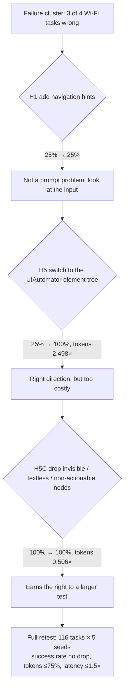

# Chapter 7　Evaluating Agents

[Back to contents](../README.md)

> This chapter is the deep-dive companion to Station 07, "Take It for a Walk" (拉出来遛遛), of [π Workshop](https://pi.duanjl.com/). It assumes you have already played the station's four missions: [▶ 7-1 It Says It Refunded (它说退了)](https://pi.duanjl.com/#/play/7-1) · [▶ 7-2 Right Every Time (回回都对)](https://pi.duanjl.com/#/play/7-2) · [▶ 7-3 The Memorized Questions (背过的题)](https://pi.duanjl.com/#/play/7-3) · [▶ 7-4 Three Points Higher (高了三分)](https://pi.duanjl.com/#/play/7-4), and flipped through the [Station 07 manual](../../manual/07-evaluation.md) (the manual is written in Chinese only). The manual says "what you saw in the game"; this chapter covers the principles, how to build a real evaluation setup around Pi, and the trade-offs along the way.

## Reading route

| Part from the manual | What this chapter covers next | Where |
| --- | --- | --- |
| [The evaluation report](../../manual/07-evaluation.md#c-report) (shared by all four missions) | Why conclusions should be structured; which fields a run should leave behind; what Pi's session file and event stream each record | [7.4](#t-eval-env), [7.9](#t-eval-trace) |
| [The verifier](../../manual/07-evaluation.md#c-verifier) (7-1) | The logic of double verification; a teardown of this book's companion `verify.mjs`; why Pi's exit code cannot serve as a verifier | [7.5](#t-eval-verifier) |
| [Two meanings of success](../../manual/07-evaluation.md#c-passk) (7-2) | Estimating Pass@k and Pass^k from n samples; whether Pi's automatic retries count as an attempt | [7.3](#t-eval-passk) |
| [Preventing answer memorization](../../manual/07-evaluation.md#c-leak) (7-3) | Which route each of the three anti-leak techniques blocks; difficulty tiers and evaluation-set upkeep | [7.6](#t-eval-leak) |
| [Is the score gap just noise?](../../manual/07-evaluation.md#c-significance) (7-4) | Paired bootstrap, how many questions you need, multiple comparisons; what to do when Pi has no seed parameter | [7.12](#t-eval-significance) |
| The "Going deeper" boxes in each manual section | Comparison, ablation, and model swap; task anatomy; evaluation environments; rubrics and judge bias; failure attribution; regression; model selection and cost; observability; closed-loop improvement; internal evaluation; simulated environments | 7.1, 7.2, 7.4, 7.6–7.8, 7.10, 7.11, 7.13–7.16 |

This chapter is based on Pi 0.87.1, pinned at commit `f07218c4d4bbc12bef056a7058c3dd49dfe41abe`, and reuses the book's three markers: **[Built-in]** is behavior this version provides directly, **[Extension]** can be implemented with Pi's interfaces but you write the code yourself, and **[Recommendation]** is a general engineering choice that Pi does not do for you.

Let's say it up front: **Pi has no built-in evaluation framework.** It has no "run the evaluation set" command, no scorer, and no leaderboard. What it does provide is the raw material for evaluation: scriptable run modes, a structured event stream, session files with usage data, and extension events that let you step in at key moments. Every "How Pi does it" in this chapter is about building an evaluation rig out of that raw material.

The ideas come from chapter 7 of Li Bojie's *Understanding AI Agents in Depth* (深入理解 AI Agent), called "the original book" below.

First, a story that is not from the original book. In 1990 the Hubble Space Telescope went up, and the first images it sent back were blurry. The investigation found that the primary mirror had been ground with extraordinary precision, just precisely to the wrong shape. The fault lay in the instrument used to test the mirror (the null corrector): one lens inside it was installed about 1.3 millimeters out of position. Every test of the primary mirror came back "pass", because the ruler itself was bent. Worse, another test instrument at the time had in fact shown the discrepancy, and it was waved away as that instrument's own error. Only in 1993, when astronauts went up and installed a set of corrective optics, could Hubble see clearly.

Every problem in this chapter is a replay of Hubble's primary mirror: however diligently you improve the agent, if the ruler is bent, the improvements march in the wrong direction.

---

<a id="t-eval-swap"></a>

## 7.1 What gets evaluated: the model plus the Harness

The first six chapters were about building agents: context, memory, tools, coding ability, the observation and action space. Every step involved a pile of choices with no standard answer: which model, which tools, what the knowledge base stores, how memory works, how prompts and Skills are organized, which constraints go into the Harness. The original book's verdict: without repeatable evaluation, these choices can only be made by gut feeling.

The original chapter opens with one sentence that shapes the design of every method after it: **the object of evaluation is the combination of model and Harness.** The same model in different Harnesses can perform very differently; so when a score is low, first separate "the model is not capable enough" from "the Harness is badly designed". The two problems are fixed in completely different ways: one calls for swapping the model or training it, the other for changing prompts, tools, and feedback loops.

The original book lists three kinds of experiment, often conflated:

| Experiment | What it changes | What it leaves alone | What it answers |
| --- | --- | --- | --- |
| Comparison experiment | One variable | Everything else | Did this change help? |
| Ablation experiment | Switches off one Harness component | The model | Which component actually contributes? |
| Model swap | Only swaps in a stronger or weaker model | The Harness | Is the bottleneck the model or the Harness? |

Reading a model swap takes some care. If a stronger model does not raise the score, the bottleneck is the Harness. If a weaker model drops the score sharply, that only shows current performance is mainly decided by the model; whether the task itself is hard, or the Harness leans too heavily on the model's prior knowledge, the original book says needs further analysis. We already ran an ablation experiment in [section 1.8 of Chapter 1](01-agent-loop.md#t-ablation), so we won't repeat it here.

Evaluation has an even more practical use: **guarding against regression.** A new model being stronger on public benchmarks does not mean it is stronger on your tasks; it may even get worse in some respects. From this the original book derives a strategy it calls "building products for future models": even if today's models are not good enough, build the product and the evaluation set first, run every new model through it, and ship as soon as one clears the bar.

The original book splits an evaluation system into four links, and this chapter follows that order loosely: what counts as success (7.3), where tasks come from (7.2, 7.4, 7.6), who verifies (7.5, 7.7, 7.8), how scores turn into decisions (7.10–7.12); new failures then flow back in as tasks.

### How Pi does it: what can serve as an experimental variable

**[Built-in]** The first requirement of comparison and ablation is "change only one thing". Pi's command-line options happen to turn most Harness components into knobs you can flip individually:

| Variable you want to control | Pi option | Notes |
| --- | --- | --- |
| Model | `--provider`, `--model` | A model swap changes only this. [CLI: model](https://github.com/earendil-works/pi/blob/f07218c4d4bbc12bef056a7058c3dd49dfe41abe/packages/coding-agent/docs/cli.md#L62) |
| Thinking effort | `--thinking off…max` | Clamped to the range the model supports, so record the value that actually took effect |
| Tool set | `--tools`, `--exclude-tools`, `--no-tools` | Tool ablation. [CLI: tools](https://github.com/earendil-works/pi/blob/f07218c4d4bbc12bef056a7058c3dd49dfe41abe/packages/coding-agent/docs/cli.md#L118) |
| Extensions, Skills, prompt templates | `-ne`, `-ns`, `-np`, combined with explicit `-e` and `--skill` | Turn off auto-discovered ones and load only what this run tests. [CLI: resources](https://github.com/earendil-works/pi/blob/f07218c4d4bbc12bef056a7058c3dd49dfe41abe/packages/coding-agent/docs/cli.md#L150) |
| Project instruction files | `-nc` | Do not read `AGENTS.md` or `CLAUDE.md` |
| System prompt | `--system-prompt`, `--append-system-prompt` | Comparison experiments on prompts |

**[Recommendation]** Beyond these knobs, several things are not on the command line yet still change results: global settings (automatic retry, for instance, see 7.3), the version of Pi itself, the versions of the packages you installed, and silent updates on the model provider's side. The original book's "change one variable" presupposes that the other variables are at least **recorded**. Section 7.9 gives a recording checklist.

---

<a id="t-eval-task"></a>

## 7.2 Anatomy of an evaluation task

Talking about evaluation in the abstract invites empty words. The original book's approach is to dissect one real task first: one from the telecom domain of τ²-bench (Sierra's open-source benchmark). The manual has already listed its four design choices ([Anatomy of an evaluation task](../../manual/07-evaluation.md#c-task-anatomy)); here we lay out the skeleton and see what each field governs in evaluation.

Below is this book's condensed sketch. The field names are real; the values have been replaced with short summaries:

```jsonc
{ "ticket": "Phone can't get online, status bar says No Service... only counts as solved when the speed test reads excellent",   // given to the Agent
  "user_scenario": { "instructions": { "known_info": "Name, number, currently in France",              // the cause of the fault is NOT here
                     "task_instructions": "Get impatient if it isn't fixed; only accept 'excellent' speed test; device state is whatever the tool returns" } },
  "initial_state": { "initialization_actions": ["user side: airplane mode on", "user side: roaming off", "carrier side: roaming enabled"] },
  "evaluation_criteria": { "actions": ["user toggles airplane mode", "user toggles roaming"],
                           "env_assertions": ["mobile data works", "speed test excellent"],
                           "reward_basis": ["ENV_ASSERTION"] } }                          // score only on final-state assertions
```

The four fields correspond to the original book's four questions:

| Field | The question it answers | Design point |
| --- | --- | --- |
| `ticket` + `user_scenario` | Where does the task come from, and what does the user know? | The boundary of the user's knowledge is its own field, `known_info`. This is how **Progressive Information Disclosure** is implemented, with no need for a prompt saying "don't tell everything at once" |
| Grounding in `task_instructions` | Can the simulated user be led astray by the Agent? | Without **Grounding**, the simulated user will go along with the Agent and say "all fixed", and the evaluation degrades into two models confirming each other |
| `initial_state` | Can every run return to the same starting point? | Half the fault is on the user side (airplane mode, roaming switch), half on the carrier side; the Agent querying the database sees only "configuration normal". This is called **Dual-Control** |
| `evaluation_criteria` | Who verifies, and how is it aggregated? | Four kinds of check (final state, key actions, required notifications, natural-language assertions) can be mixed and matched; `reward_basis` decides which kinds count in the end |

### Two trajectories, two lessons

The original book analyzes two runs of this task.

**The run that scored full marks.** The first dozen or so turns went to identifying the account: the Agent found customer C1001 and checked the usage of the three lines one by one. In message 17 it reached a wrong conclusion, saying the number was not among the active lines, based only on the query result for one line; the user insisted the number was correct, and only then did it check the second one. The turning point came at message 30: the **user** called the tool that checks the status bar and saw airplane mode on and roaming off. Smooth sailing from there: speed test 275 Mbps, rating Excellent, `reward = 1.0`.

Yet that full-score trajectory hides a violation: the very first sentence of this domain's policy says only one tool may be called at a time, and the Agent fired off two queries at once in message 4. The verifier was not wrong, because `reward_basis` looks only at the final state. The original book is careful to say this is **not an oversight** but the inherent cost of binary reward: you trade process granularity for a single number that can be compared across models.

**The run that failed.** The Agent picked the wrong line, L1001. The tool had clearly returned "this line's number is 555-123-2001", and it read that without revising its judgment, then burned dozens of messages on irrelevant troubleshooting and finally escalated to a human. It had actually done half of it right: it guided the user to turn off data saver mode, an action that really happened and was verified by the environment. But it never did the data top-up, so all three final-state assertions failed and it scored 0.

Together, the two runs expose evaluation's two blind spots: a full score does not tell you about the process violation or the unfounded conclusion in message 17, which needs finer checks to fill in (7.5, 7.7); a zero does not tell you where it went wrong or which half it got right, which needs failure attribution to fill in (7.10). The original book points out that the pattern "the evidence was already in context and the Agent never looked back" closely resembles a later case from AndroidWorld.

---

<a id="t-eval-passk"></a>

## 7.3 Two meanings of success

That set of tasks from the last section passed four of five: 0.8. The original book asks: does this number show the system is usable? For a refund support desk, it means one customer in five does not get the money they are owed; for a security agent hunting vulnerabilities, hitting four times out of five is already impressive. **The number does not speak for itself; it depends on what the business demands of "success".**

The manual has already explained the two meanings ([Two meanings of success](../../manual/07-evaluation.md#c-passk)): Pass@k measures the capability ceiling, which the original book calls a "technical marvel"; Pass^k measures delivery reliability, and additionally requires that none of the k runs triggers a veto-level event such as a safety, compliance, or hallucination failure. The original book's worked example: with p = 0.6 and k = 5, Pass@5 is about 99.0% and Pass^5 about 7.8%.

The original book's "technical marvel" means things like letting an agent work autonomously for a week to write a C compiler, or dig out a decades-old vulnerability: one successful trajectory is enough. This section takes three further steps: where the formulas come from, how to estimate in practice, and an easily overlooked counting problem in Pi.

### Where the formulas come from, and what they assume

Both formulas use a single assumption: **each run is independent, with the same per-run success rate p.**

- The probability that all k runs fail is (1 − p)^k, so the probability of at least one success is 1 − (1 − p)^k.
- The probability that all k runs succeed is the product, p^k.

Independence is a strong assumption. The original book says only that the formulas "hold only when runs are independent", and the manual adds an intuition: an Agent's failures tend to come in clusters, making the same misunderstanding every time. You can work out which way this pushes the numbers: suppose that on a given question the Agent either "gets it" (right every time) or "doesn't" (wrong every time); then no matter how large k is, Pass^k equals the fraction that "get it", and so does Pass@k, so the two numbers coincide. Reality lies between independence and perfect correlation. So the original book's warning boils down to one operating rule: **measure it if you can; use the formula to estimate orders of magnitude.**

### Estimating from n samples (this passage is this book's addition)

In practice you will not run exactly k times. More often you run each question n times (n ≥ k) and get c correct. Two ready-made estimators apply, neither from the original book:

| Metric | Estimator | Intuition | Source |
| --- | --- | --- | --- |
| Pass@k | 1 − C(n − c, k) ÷ C(n, k) | Draw k runs from the n without replacement; the chance none of them is a success, subtracted from 1 | OpenAI's 2021 Codex paper |
| Pass^k | C(c, k) ÷ C(n, k) | Draw k runs from the n without replacement; the chance all are successes | The 2024 τ-bench paper |

Why not just plug c/n into p^k? Take n = 10, c = 7, k = 5. Plugging into the formula gives 0.7⁵ ≈ 16.8%; the combinatorial estimate is C(7, 5) ÷ C(10, 5) = 21 ÷ 252 ≈ 8.3%. Off by a factor of two: the plug-in approach treats a 0.7 estimated from only 10 samples as a certainty. The Pass^k of a whole evaluation set is computed per question and then averaged, as the manual demonstrates in 7-2.

The original book has two more sampling requirements: the report should say what k means (independent samples of the same task, or k consecutive tasks in a pipeline); and **operations with side effects must not be "retried until success"**; sample in a sandbox or rollback-able environment and count every failure (for why, see [idempotency in Chapter 4](04-tools.md#t-tool-idempotent) and the [sandbox topic](s-sandbox.md)).

### How Pi does it: do automatic retries count as an attempt?

**[Built-in]** By default Pi automatically retries transient errors (overload, rate limiting, 5xx): `retry.enabled` is on by default, and `retry.maxRetries` defaults to 3. [Settings: retry](https://github.com/earendil-works/pi/blob/f07218c4d4bbc12bef056a7058c3dd49dfe41abe/packages/coding-agent/docs/settings.md#L108). When a retry happens, `auto_retry_start` and `auto_retry_end` appear in the event stream. [Events: retry](https://github.com/earendil-works/pi/blob/f07218c4d4bbc12bef056a7058c3dd49dfe41abe/packages/coding-agent/docs/json.md#L163)

For Pass^k this is a question of definition: in one run the provider returned 529 twice and the third call succeeded. Is that one success, or two failures plus a success?

**[Recommendation]** Both readings are defensible, but record them separately:

| What you want to measure | How to count |
| --- | --- |
| The Agent's own reliability | Treat provider-level retries as infrastructure noise and count one run as one attempt; also record the retry count |
| Reliability as the user actually experiences it | Count the latency that retries add, and the runs that still fail in the end (`success: false` in `auto_retry_end`) |

Whichever you choose, say so in the report. The retry count is itself a metric: frequent 529s at peak hours do not enter the success rate, but they do enter latency and the bill (7.13).

---

<a id="t-eval-env"></a>

## 7.4 The evaluation environment: a rig you can run again and again

With the definition of success settled, the next question is where to test. The original book's definition is plain: given the same initial state, the same Agent should produce comparable results. Using the telecom task as a reference, it counts five elements, and the manual has a comparison table ([The five elements of an evaluation environment](../../manual/07-evaluation.md#c-eval-env)). Here we take a different angle: **what breaks in the evaluation when each element is missing.**

| Element | What happens without it | How the telecom task handles it |
| --- | --- | --- |
| Dataset | No repeatable questions; every run tests something different | One record, one test case |
| Environment State | Leftovers from the last run contaminate the next; scores drift with run order | `initialization_actions` is the reset script |
| Tools | Tools too high-level swallow the planning and reasoning, and the evaluation degrades into testing a single function call | Both sides are atomic operations; there is no giant tool like "fix the internet problem" |
| Rubric | No way to judge right from wrong automatically | Four kinds of check plus `reward_basis` |
| Interaction Protocol | Nobody knows when it ends, and nobody stops a runaway | The simulated user emits `###STOP###`; a turn cap; the simulated user ends it when its patience runs out |

The last row has a detail worth remembering: if the simulated user hangs up because communication was too inefficient, **that itself counts as a failure**. Writing "efficiency" into the protocol is more direct than assigning an efficiency score after the fact.

### Two kinds of environment

The telecom task is **human-interaction type**: it needs a user simulator and verifies guidance. Code generation and data analysis are **tool-calling type**: the Agent deals only with tools and verifies action. The original book introduces how the Verifiers framework divides the latter into four classes along two dimensions, "state across turns" and "isolation": single-turn Q&A uses `SingleTurnEnv`, search plus synthesis uses `ToolEnv`, changing database records uses `StatefulToolEnv`, and running code in a sandbox uses `SandboxEnv`. Such frameworks save the full trajectory of each run for replay; failing tools should return clear error messages, which is the same matter as [how Chapter 4 writes errors](04-tools.md#t-tool-errors).

### How Pi does it: where each of the five elements comes from

Pi is the Agent under test, not the evaluation environment. But several of its interfaces happen to fill slots among the five elements:

| Element | What Pi provides | Marker |
| --- | --- | --- |
| Dataset | Nothing. The question files and reference answers are yours to manage | **[Recommendation]** |
| Environment state and reset | No reset command. The simplest approach is to copy a clean working directory for each run and launch `pi` inside it; sessions either do not hit disk (`--no-session`) or each get a separate directory (`--session-dir`). [CLI: sessions](https://github.com/earendil-works/pi/blob/f07218c4d4bbc12bef056a7058c3dd49dfe41abe/packages/coding-agent/docs/cli.md#L95) | **[Recommendation]** |
| Tools | An allowlist via `--tools` fixes the tool set; custom tools are registered through extensions | **[Built-in]** |
| Rubric | Nothing. The verifier runs outside Pi (7.5) | **[Recommendation]** |
| Interaction protocol | One-shot runs have `--print` and `--mode json`, and exit when done; `agent_settled` signals that Pi will not continue on its own. [CLI integration](https://github.com/earendil-works/pi/blob/f07218c4d4bbc12bef056a7058c3dd49dfe41abe/packages/coding-agent/docs/cli-integration.md#L11), [Events: settled](https://github.com/earendil-works/pi/blob/f07218c4d4bbc12bef056a7058c3dd49dfe41abe/packages/coding-agent/docs/json.md#L48) | **[Built-in]** |

Two things Pi lacks and you must supply. **A turn cap.** This version of Pi has no "run at most this many turns" option. There are two ways to fill the gap: an outer process with a wall-clock timeout that kills the run when time is up (crude but effective; a killed run counts as a failure); or an extension that counts `turn_end` events and calls `abort()` from the context when the count is reached. [Source: `abort()`](https://github.com/earendil-works/pi/blob/f07218c4d4bbc12bef056a7058c3dd49dfe41abe/packages/coding-agent/src/core/extensions/types.ts#L342)

```ts
// Design sketch: the event name and abort() come from Pi's extension interface; the limit and how an overrun is scored are up to the evaluator.
export default function turnLimit(pi: ExtensionAPI) {
  let turns = 0;
  pi.on("turn_end", async (_event, ctx) => {
    if (++turns < 30) return;
    pi.appendEntry("eval-protocol", { stoppedBy: "turn-limit", turns }); // leave a trace: the protocol stopped it, not the Agent itself
    ctx.abort();
  });
}
```

**A user simulator.** Human-interaction evaluations need a "user" who can answer back. Pi's RPC mode is a long-running process: an external program can wait for `agent_settled`, read the last reply, hand it to the simulated user (another model, carrying `known_info` and the grounding rules) to generate the next line, then send it back with `prompt`. [CLI integration: RPC](https://github.com/earendil-works/pi/blob/f07218c4d4bbc12bef056a7058c3dd49dfe41abe/packages/coding-agent/docs/cli-integration.md#L66) This is **[Extension]** territory, and note one thing: in RPC, a successful response to `prompt` only means "received", not that the turn has finished; you must keep reading events until `agent_settled`.

**[Recommendation]** Use `-ne -ns -nc` to turn off auto-discovered extensions, Skills, and project instruction files, then explicitly load only the few things this run tests. Otherwise some global Skill on your machine quietly joins every evaluation, and the score changes when you switch machines. Global settings and credentials still come from your config directory; record that in the run record.

---

<a id="t-eval-verifier"></a>

## 7.5 The verifier: check the world, don't take the report

This section of the original book opens with just two sentences: an Agent can easily write a sweeping report claiming the task is fully done when it isn't; an evaluation framework must verify **facts that a machine can independently recheck**, not the Agent's self-description. Mission 7-1 of the manual plays this out ([The verifier](../../manual/07-evaluation.md#c-verifier)).

First, the original book's side-by-side of six benchmarks; the last column is the point:

| Benchmark | Capability tested | Task source | What plays the environment | Verifier |
| --- | --- | --- | --- | --- |
| τ²-bench | Human interaction and tool calling in customer service | Hand-written plus combinatorial generation | User simulator plus business database | Four layers of checks aggregated into binary by `reward_basis` |
| SWE-bench Verified | Software development | Real GitHub issues, manually screened | Code repository plus test suite | Double verification with FAIL_TO_PASS and PASS_TO_PASS |
| AndroidWorld | Operating an Android phone's UI | Parameterized templates instantiated | A real Android emulator | Assertions on the final UI state |
| OSWorld | Operating a Linux desktop | Launched from preset intermediate states | A real virtual machine | 134 independent evaluation functions |
| Terminal-Bench | Operating a Linux terminal | Hand-written | Docker container | Filesystem checks plus real execution |
| GAIA | A general assistant that gathers information | Hand-written plus proprietary attachments | The open internet | Exact string match |

### The logic of double verification

SWE-bench Verified's approach deserves unpacking. It splits "the fix is complete" into two propositions, each with its own group of tests:

| Test group | Before the fix | After the fix | What happens if you verify only this group |
| --- | --- | --- | --- |
| FAIL_TO_PASS | Fails | Must pass | The Agent can delete or rewrite the assertion in the way, and the test turns green all the same |
| PASS_TO_PASS | Passes | Must still pass | It passes even if nothing is changed, which amounts to no verification at all |

Only the two together separately prove "fixed" and "not broken"; it also excludes flaky tests that pass or fail at random, since otherwise the verifier itself would be rolling dice. OSWorld goes in another direction, **checking deeply**: connect to the database to confirm the SQL really executed, inspect the DOM, cookies, and localStorage to confirm the form really took effect. Terminal-Bench leaves forgery nowhere to start: compile a kernel, add a custom printk line, boot it in QEMU, and it passes only if that line appears in the log (the manual has a [comparison table](../../manual/07-evaluation.md#c-verifier)). Together the three approaches pose three questions for verifier design:

1. **Whose word is being checked?** The state of the world, or the Agent's report.
2. **Is the check deep enough?** The file exists, but is its content right? The form was submitted, but did the backend receive it?
3. **Can it be bypassed?** Can the Agent modify what the verifier depends on (tests, reference answers, input data)?

### Taking apart a real verifier: this book's `verify.mjs`

The [order-summary exercise in Chapter 1](../examples/order-report/README.md) ships with a verifier, a good specimen for the three questions. The exercise directory has a local check, `check.mjs`, which Pi can see and run; [`verify.mjs`](../../examples/order-report/verify.mjs) lives outside the exercise directory, and you run it yourself after Pi has finished. It does two things:

| What `verify.mjs` does | Which question it answers | Which technique of the original book it corresponds to |
| --- | --- | --- |
| Compares `orders.json` and `check.mjs` in the exercise directory byte for byte with the originals in the repository, and fails if they differ | Can it be bypassed? | The spirit of PASS_TO_PASS: you may not alter the exam paper to turn it green |
| Calls `summarize()` exported by `report.mjs` directly, running five groups of inputs, two of which (a single 99-cent order, and one with `pending` and 0-yuan orders) are not in `check.mjs` | Is the check deep enough? | Not letting the Agent special-case only the few known questions |

It does not read what Pi said; it looks only at the numbers `report.mjs` computes. That is "checking the world". Its boundary is also written in the exercise notes: it executes the code under inspection and is not an isolation environment for malicious code. When Chapter 1 says "real evaluation lives in an environment the Agent cannot change", this is the layer it means.

### How Pi does it: the exit code is not a verifier

**[Built-in]** The exit-code semantics of a one-shot Pi run are clear, and easy to misread. `--print` exits non-zero when the stop reason of the last assistant message is `error` or `aborted`; [CLI integration: print](https://github.com/earendil-works/pi/blob/f07218c4d4bbc12bef056a7058c3dd49dfe41abe/packages/coding-agent/docs/cli-integration.md#L30) `--mode json` exits non-zero only if the process itself throws, and an assistant message failure shows up only in the events. [CLI integration: JSON](https://github.com/earendil-works/pi/blob/f07218c4d4bbc12bef056a7058c3dd49dfe41abe/packages/coding-agent/docs/cli-integration.md#L46) In both cases an exit code of 0 says only "the Pi process ended normally": the model says "all done", stops normally, and the exit code is 0.

**[Recommendation]** The verifier's input is the **working directory and external state** after the run, not Pi's standard output. Record "Pi ended normally", "Pi claimed completion", and "the verifier passed" as three separate fields; the runs where the three disagree are the most worth looking at. The original book has a whole failure-attribution category for exactly this: "claims the tests passed but never ran them" (7.10).

---

<a id="t-eval-dataset"></a>

## 7.6 Where questions come from: difficulty, leak prevention, upkeep, and provenance

The original book says the evaluation environment is the stage and the dataset is the script. Scripts come with three kinds of flaws: too easy, memorized, and full of loopholes.

### Difficulty tiers

Once models get stronger, everyone scores full marks and the ruler can no longer tell them apart. The manual lists three examples from the original book ([Difficulty tiers and trap questions](../../manual/07-evaluation.md#c-difficulty)): GAIA has three levels, Terminal-Bench runs from mlflow model registration all the way to FEAL differential cryptanalysis, and τ²-bench deliberately designs **trap tasks** such as "customer service has already approved the cancellation". The most interesting thing about GAIA is not the difficulty itself but that **its three levels correspond to three diseases**: failure at level 1 points to basic tool use, level 2 to multi-step planning and information integration, level 3 to long-sequence thinking. With only a total score you do not know what to fix; tiering turns one score into a diagnostic sheet.

<a id="t-eval-leak"></a>

### Leak prevention: which route each of the three techniques blocks

Once questions are public or reused repeatedly, they may enter training data, and the score then measures memory. The manual's mission 7-3 demonstrated parameterized templates ([Preventing answer memorization](../../manual/07-evaluation.md#c-leak)). Treat leakage as three steps, "the question is seen → the answer is memorized → it is reproduced in the exam", and each of the original book's three techniques cuts one step: multi-source composition makes the answer unsearchable, canaries reveal after the fact that memorization has happened, parameterized templates make what was memorized fail to match.

| Technique | Method | What it achieves | What it cannot do |
| --- | --- | --- | --- |
| Multi-source composition plus proprietary attachments (GAIA) | One question chains several information sources, for instance starting from NASA's Astronomy Picture of the Day for a given date, identifying the astronaut, finding the astronaut group he belongs to, then working out who in the group spent the least time in space, and outputting in a strictly specified format; some questions come with purpose-made attachments that do not exist online | No single webpage gives the answer | Once the question itself is public, the answer can still be memorized |
| Parameterized templates (AndroidWorld) | "Change the phone number of contact [CONTACT_NAME] to [NEW_PHONE]", with parameters randomly generated each time | Replaying a fixed action sequence stops working; one template yields endless instances; fixing some parameters lets you test a single factor | If the template structure itself is learned, the model can still cope |
| Canary identifiers (Terminal-Bench) | A unique GUID buried in every question; if a model can spit it out, the question made it into the training set | Makes leakage detectable | **Cannot prevent leakage** |

The original book's discussion questions ask: does this cat-and-mouse game have an endgame? None of the three techniques is one. Parameterized templates work against "memorizing answers" but not against "memorizing solutions", and memorizing solutions may just be learning. That is the deeper meaning of the line in the 7-3 parts bay: **varying the numbers costs an honest examinee nothing extra**; it eliminates only one particular shortcut.

<a id="t-eval-dataset-care"></a>

### Evaluation sets need tending

The original book is blunt: building a high-quality evaluation set is very hard, and the present state of several well-known benchmarks is mostly the result of an initial release being used, problems surfacing, and rounds of patching. The manual lists the patches to three benchmarks ([Evaluation sets need tending](../../manual/07-evaluation.md#c-dataset-care)). Here we line up the five redesigns from τ-bench to τ²-bench as "flaw → fix", because together they are almost a checkup list for a self-built evaluation set:

| Flaw in the first version | τ²-bench's fix | What your evaluation set can ask |
| --- | --- | --- |
| Instructions too vague; common sense alone can guess the procedure | The script is split into `known_info` and `task_instructions` | Does the question text give the answer away? |
| Fuzzy success condition; "network restored" counts even if it only masks the symptom | Changed to "only counts if the speed test reads excellent", aimed squarely at **perfunctory fixes** | Can the success condition be written as a checkable value? |
| Simulated user too mechanical | Added emotion, a patience limit, and grounding | Can the simulated user be led around by the Agent? |
| Only the Agent can change the environment | Introduced dual control | Are there steps that should be done by the user? |
| Fixed instances | Parameterized batch generation | Can the questions be re-issued with different numbers? |

SWE-bench Verified went in hard before release (of 2294 original questions, 1699 were drawn for manual review, and only 500 kept); OSWorld had 300-plus problems exposed 15 months after release and fixed in one concentrated effort; the manual lists the details. The original book does a calculation on SWE-bench worth remembering: running a frontier model through the full evaluation once costs thousands of dollars in tokens, and the high elimination rate bought a better signal-to-noise ratio and cut the evaluation cost by about 80%.

<a id="t-eval-sources"></a>

### Three sources

The original book sorts the sources of a production evaluation set into three kinds, and the manual has a table ([The three sources of an evaluation set](../../manual/07-evaluation.md#c-sources)). Only one point is worth repeating here: **public benchmarks are generally not used for product decisions**. A two-point gain on GAIA does not necessarily mean anything for your refund success rate; their value lies in the design techniques (verification depth, parameterization, leak prevention, ongoing maintenance), which are exactly the things a self-built evaluation set most easily leaves out.

A self-built business set can borrow the skeleton directly. The original book's suggestion: τ²-bench can serve as the skeleton of an evaluation system that needs a simulated user; just replace the domain data and tool set. Feeding production trajectories back in is the most expensive and the most accurate route, and its entry points are the trajectories of 7.9 and the attribution of 7.10.

---

<a id="t-eval-rubric"></a>

## 7.7 When it can't be written as an assertion: rubrics and LLM judging

The verifiers so far are almost all deterministic. The original book says there are good reasons for that: no extra model cost, fully reproducible, and can go into continuous integration like a unit test. The price is twofold: **they give only right or wrong, not the reason** (the zero in 7.2 does not say whether it picked the wrong line or skipped the top-up); and **many judgments cannot be written as assertions** (is a complaint reply tactful? did the research report miss key information?).

So verification slides along a spectrum toward the end of "low mechanical verifiability": deterministic assertions, checklists, rubric plus LLM judge, pairwise comparison. The original book stresses one sentence over and over: **moving right does not mean abandoning the left.** What can be written as an assertion should still be an assertion; it is cheaper and more stable, and suits running as a regression test for the long haul. Use an LLM judge only on dimensions that truly cannot be judged mechanically.

### Four rubric principles

The original book cites four principles proposed by Scale AI in "Rubrics as Rewards", and the manual has a table ([Rubrics and LLM-as-a-Judge](../../manual/07-evaluation.md#c-rubric)). Each of the four guards against one kind of bad rubric:

| Principle | The kind of bad rubric it prevents |
| --- | --- |
| Grounded in expert guidance | Can only grade linguistic fluency and misses core facts and reasoning steps |
| Comprehensive coverage (including Pitfalls) | Describes only "what good looks like" and never "what the high-risk common mistakes look like" |
| Weighted by importance (including Veto) | Every dimension counts the same, so stuffing in keywords inflates the score |
| Self-contained | Standards like "demonstrates deep understanding" that even the judge cannot articulate |

Putting it into practice: define verifiable score tiers for each dimension, with examples and **edge cases**; actively guard against **reward hacking**, penalizing hallucination, flattery, keyword stuffing, and dodging hard problems; and keep revising as pilot use gathers judge disagreements, until it grows into a body of case law.

### A complete rubric

The original book demonstrates with a user-memory agent. The test question is "Who is my daughter's pediatrician?", and the answer must connect two conversations: one mentions "my daughter is named Lily", the other "took Lily to see Dr. Chen". Below, compressed and rewritten along the original book's structure:

```yaml
rubric:
  - name: Factual correctness
    weight: essential          # required
    levels: {4: answers Dr. Chen and says she is Lily's doctor, 3: answers Dr. Chen without mentioning Lily, 2: doctor right but adds uncertain extra information, 1: doctor wrong or says "I don't know"}
  - name: Reasoning correctness
    weight: important
    levels: {4: correctly chains "daughter = Lily" and "Lily's doctor = Dr. Chen", 1: wrong link, e.g. takes the user's own doctor to be the daughter's}
  - name: Hallucination check
    weight: veto               # veto: triggering it zeroes the total
    fail: invents information not in the conversations, such as a made-up appointment date
edge_cases:
  - If the user has two daughters who see different doctors, it should ask which one
  - If memory holds both "Dr. Chen" and "Doctor Chen" (陈医生), it should recognize them as the same person
```

Every tier describes behavior that can be checked ("answers Dr. Chen"), not "shows an understanding of memory". The original book has one more dimension, "information completeness", omitted here.

This rubric was used in a set of experiments in the original book: the same 60 questions tested against three memory schemes, leaving 180 real run trajectories:

| System | Basic recall | Multi-session disambiguation | Hidden cross-session links | Overall |
| --- | --- | --- | --- | --- |
| Structured cards (Advanced JSON Cards) | 95% | 60% | 50% | 68.3% (41/60) |
| RAG | 90% | 40% | 15% | 48.3% (29/60) |
| Hybrid system | 80% | 70% | 50% | 66.7% (40/60) |

The original book draws two conclusions: **the hybrid scheme did not win naturally** (it beat both single schemes on 3 questions and was worse than the better one on 8); and **the hallucination veto fired 28 times out of 180 judgments**, so without a Veto, those fabricated answers would have been mixed in among the high scores. Per-dimension scoring also split a vague "success rate dropped" into categories like "didn't retrieve", "reasoned about the relation wrongly", and "added unfounded content", each fixed differently. The memory schemes themselves are in [Chapter 3](03-memory.md#t-memory-eval).

### How Pi does it: let Pi be the judge

**[Built-in]** Pi has no scorer, but "have a model read some material and score it against a rubric" can be done with Pi's one-shot mode:

```bash
# Judge run: no tools, no session saved, a model from a different family than the agent under test
pi --print --no-tools --no-session -ne -ns -nc --model <judge-model> \
   @rubric.md @candidate.md "Score each item per rubric.md, output JSON only: {dimension: tier, veto: true/false, reason: string}"
```

`@path` puts the file's content into the first prompt, and `--no-tools` lets the judge read but not act. [CLI: input](https://github.com/earendil-works/pi/blob/f07218c4d4bbc12bef056a7058c3dd49dfe41abe/packages/coding-agent/docs/cli.md#L34) **[Recommendation]** Three things you do yourself: validate the judge's output, and rerun or flag it if it is invalid, never silently count it as zero; record the judge model, rubric version, and candidate content hash together (the original book's TTS experiment also requires recording the judge model and audio hash); and keep the judge and the agent under test from the same family, for reasons in the next section.

---

<a id="t-eval-judge-bias"></a>

## 7.8 The judge's own biases

Once a model serves as judge, you must guard against the judge's flaws. The manual lists four ([The judge has biases too](../../manual/07-evaluation.md#c-judge-bias)); here we cover each one's mechanism and why the countermeasure works.

### Length bias

Judges tend to give higher scores to longer answers, even when the content is no more correct. The original book's three lines of defense act at three places: in the **rubric**, explicitly penalize verbosity and set a length cap, turning "long" into a deduction; on the **input**, before pairwise comparison, bring the two candidates to similar length, so the bias is still there but both sides get the same dose; **after the fact**, regularly audit the correlation between score and length, and if high scores almost always come with long answers, the rubric goes back to the workshop. The third is the cheapest and the most often skipped; one scatter plot will do: word count on the horizontal axis, score on the vertical.

### Same-family preference and Goodhart

When the Agent and the judge come from the same family, the Agent may learn to cater to the judge's preferences; more insidiously, it may learn to **dodge the errors the judge is poor at detecting**, leaving the scoring system looking perfectly healthy. The original book files this under **Goodhart's Law**: once a metric becomes an optimization target, it stops being a good metric. The original book's countermeasure is **multi-source heterogeneous judging**: have several models from different families score against the same rubric, then take a weighted average or run a consistency check. The reasoning is that different families' biases are often orthogonal, so an Agent has a hard time fooling all the judges at once. Day to day you can use one model for quick scoring and run a multi-source audit periodically.

### The reference material steers the judge

A small experiment in the original book: OpenAI and Fish Audio each generated four audio clips, scored by Voxtral on four dimensions. Accuracy and naturalness were 5.00 and 4.00 for both; on emotional expressiveness and timbre consistency, Fish got 4.00 and 3.00, OpenAI 3.75 and 2.75. Once split by dimension, differences invisible to "did it read correctly" emerged. But these scores **cannot be used to decide who is better**: each had only four clips, and the reference audio used for comparing timbre came from Fish's own model. The original book's conclusion is worth copying down: **choosing the reference answer, reference image, or reference audio is itself evaluation design.** When comparing general-purpose TTS, don't count "how much it resembles one vendor's reference voice" in the total; when comparing voice cloning, have every scheme imitate the same target speaker, then calibrate with human blind listening. The original book lists a few more multimodal judging methods: ASR to judge semantic impact ("transfer one thousand" turning into "ten thousand" is an incident); for UI evaluation, use [Chapter 1's proposer-reviewer](01-agent-loop.md#t-design-patterns) to check text overflow and contrast; for video editing, check start and end points against keyframes.

### Position bias and pairwise ranking

"Which is better, A or B" is sometimes easier to judge than assigning an absolute score. The **Elo rating** pits two against each other: the larger the rating gap, the higher the favorite's expected win rate, and the bigger the adjustment when an upset happens; the statistical model behind it is **Bradley-Terry**: each model has a latent strength score, and the win probability is determined by the gap. The original book's worked example, 1200 against 1000 at about 76%, can be checked with 1 ÷ (1 + 10^(−200/400)). Chatbot Arena does this with anonymous blind-vote human preferences, and the original book cautions that the ranking depends on what users ask: everyone asks coding questions, so models good at coding rank high. When an LLM serves as judge, guard against **position bias**: a preference for a certain position (usually the one that appears first). The fix is to **judge twice with the order swapped**; stricter still, count it only if both agree, and record a tie or send it to a human if they don't.

The original book's discussion questions leave an even deeper pit: Bradley-Terry assumes preferences are transitive (A beats B, B beats C, so A beats C), while human preferences often are not. One model is good at short answers, another at long ones, and a third is middling at both; the ranking flips back and forth depending on the mix of questions.

---

<a id="t-eval-trace"></a>

## 7.9 Trajectories are investigation material

The sections so far solved "scoring". But a score only says good or bad; to improve, you must know which step the failure began at. This section and the next together correspond to one line of the old textbook: **the trajectory is investigation material; the score is not the final reply.**

Suppose Pi finally says "the report is done", and you open the file to find refunds counted twice. From the final reply alone you cannot tell whether it did not read the rules, the script computed wrong, or it saw the error and declared success anyway. To investigate, you must go back to what it actually read, what it executed, and what results it got. These records are called the **trajectory**: user input, model messages, tool arguments, tool results, and related events.

### How Pi does it: two records, two formats

**[Built-in]** Pi leaves two things for a run, and evaluation must read them separately:

| | Session file | JSON event stream |
| --- | --- | --- |
| How to get it | Persisted by default in the session directory; `--session-dir` lets you specify one each time | `pi --mode json … > events.jsonl` |
| Structure | First line is the session header, then one entry per line, linked by `id`/`parentId` into a tree | First line is the session header, then events in time order |
| What's in it | Messages (including the system prompt and tool declarations), changes of model and thinking effort, compaction, usage entries, custom entries written by extensions | Start and end of each turn, start and end of each message, tool execution start/progress/end, retries, compaction |
| Good for | Post-hoc review, replay, cutting a prefix | Real-time monitoring, timing, hooking into an external trace system |

The structure of the session file was covered in [section 3.2 of Chapter 3](03-memory.md#t-session-trajectory); here we add only three details that evaluation needs:

1. **The system prompt is in there too.** The first request writes the system message with all its sections and the tool declarations as one message, and later changes are appended as patches. [Session format: system message](https://github.com/earendil-works/pi/blob/f07218c4d4bbc12bef056a7058c3dd49dfe41abe/packages/coding-agent/docs/session-format.md#L80) So "what prompt did the model actually see in this run" can be reconstructed from the file, and 7.15's prompt-sensitivity evaluation relies on it.
2. **Writing to disk has a timing.** A new session is not written to disk until the first assistant message appears; only then are all earlier entries written at once. [Source: session persistence](https://github.com/earendil-works/pi/blob/f07218c4d4bbc12bef056a7058c3dd49dfe41abe/packages/coding-agent/src/core/session-manager.ts#L1160) A run whose very first model request fails may have no session file; an evaluation rig that requires strict audit should treat the event stream or its own logs as authoritative.
3. **Don't share one parser between the two records.** Both are "one JSON per line", but the fields are entirely different. The official description of the event stream specifically warns: split records on LF, and do not use Node.js's `readline`, because it also treats Unicode line separators as newlines. [Events: framing](https://github.com/earendil-works/pi/blob/f07218c4d4bbc12bef056a7058c3dd49dfe41abe/packages/coding-agent/docs/json.md#L15)

Every assistant message carries the model, usage, and stop reason. [Source: assistant message fields](https://github.com/earendil-works/pi/blob/f07218c4d4bbc12bef056a7058c3dd49dfe41abe/packages/ai/src/types.ts#L515) Among them, `responseModel` is the actual model reported by the provider, and appears only when it differs from the requested `model`. In a model-swap experiment, this field helps you catch "requested A, routed to B".

### What a run should leave behind

With the trajectory in hand, one thing is still missing: an independent judgment of completion. When the assistant writes "all checks passed", that is only a claim awaiting verification. Whether the revenue total is right is checked against known samples or another trusted computation; whether input files were quietly changed is checked by comparing file digests before and after; whether a report was actually produced is checked against the actual file.

**[Recommendation]** Below is the record the evaluation rig should save for each run. It is not a report Pi generates automatically:

```js
// Record-structure pseudocode: fields are collected by the evaluation rig; they are not built-in Pi output.
const runRecord = {
  taskId, inputHash, ruleVersion, envSeed,                         // the question
  piVersion, modelId, responseModel, thinking, tools, extensions, skills, settingsHash, // the combination under test
  sessionPath, eventLogPath, piExitedNormally, agentClaimedDone,   // the trajectory, and what Pi says
  verifierResult, artifactPaths,                                   // what the world says
  autoRetries, elapsedMs, usage, failureCategory, firstErrorStep   // cost and attribution (7.3, 7.13, 7.10)
};
```

The cost in the usage data comes from Pi's price configuration and what the provider reports; it cannot be settled directly as a bill. At which layer a failure gets repaired (knowledge, Skill, program, or model), and how to release and roll back after repair, is the business of [Chapter 9](09-evolution.md). This chapter only finds it and measures it.

---

<a id="t-eval-attribution"></a>

## 7.10 Failure attribution: find the first error

End-to-end evaluation says only "it failed". **Failure attribution** has to mark the main error category, the step where unacceptable behavior first appeared, the corresponding call or output, and attach checkable evidence. The target of attribution is **the first error that sent the task off course**; the last error message is mostly a consequence: the edit tool returns a match failure, the Agent retries three more times, and the main cause is one tool-call error, not three root causes. Problem cases come from three kinds of signal: **explicit user corrections**, **user thumbs-down**, and **after-the-fact discovery by state checks, rule-based verifiers, or LLM review**. Attribution can use an LLM but cannot be left entirely to it, and the original book's reason is: **failure attribution often reflects product problems.**

### Nine categories of error, and how to locate the first error in each

The manual lists the original book's nine initial categories for Coding Agents ([Failure attribution](../../manual/07-evaluation.md#c-attribution)). The original book's table actually has three columns, and the third, "how to locate the first error", is the one that does the work; the original book also says the taxonomy will grow to hundreds of categories with the product, and can be written straight into the prompt or Skill of an attribution-labeling Agent:

| Error category | How to locate the first error |
| --- | --- |
| Requirement understanding and ambiguity handling | Compare the original requirement against **what the Agent actually did**, item by item, find the first deviation, then trace back to the call or reply that caused it |
| Missing process and conventions | Find the first action that violated the convention (first commit, first file write), and look back to see whether it had read the source of the convention before that |
| Tool-call error | Record the first failed call along with the raw request and the error return; later repeated failures are symptoms |
| Hacking the verification environment | Find the first message that changed the test or verification logic; then cross-check the completion claim against the commands **actually executed** in the trajectory |
| Incomplete modification | Take the set difference between the claimed and the real impact surface, pick the first omitted item, and look back at what keywords it used when searching |
| Wrong information fed back to the user | Align each factual claim in the reply with the tool returns one by one, and take the first one that cannot be traced or contradicts |
| Non-functional regression | Take the first message that changes a public interface or data structure, and see whether it realized a migration was needed |
| Model execution anomaly | Find the first abnormal termination point, and tell apart whether the model stopped, the Harness timed out, or a tool service failed |
| Premature stop | Find the first decision that dropped a goal or gave up exploring, and record it separately from the final verification failure |

### What an attribution record looks like

The original book requires the record to be **structured**: cite step numbers, tool names, and evidence, distinguish root cause from consequence, judge whether it is recoverable, and give a confidence; also save the task goal, environment state, component versions, and the complete trajectory. When several categories appear at once, pick the primary cause by "**earliest, and able to explain the later failures**". A sample written by this book to those requirements:

```yaml
task: fix-retry-config
verdict: fail                                 # verifier: the service still retries 3 times
first_error: { step: 6, kind: tool_call, tool: edit,      # kind could also be assistant_message
               evidence: "Could not find the exact text in settings.json" }
primary_category: tool-call error
root_cause_owner: TBD                         # model / harness / tool service / the task itself; trace along the copy chain below
consequences: ["steps 7-9 repeat the same edit, all failing", "step 10 claims the change is done (wrong information feedback, secondary cause)"]
recoverable: true
confidence: 0.8
```

### Rules screen first, the model locates afterward

The original book names three kinds of check where rules can screen first and a model locate afterward: cross-checking the completion claim against the commands actually executed; whether the diff touched test assertions and skip markers; whether a public interface was changed without a migration file. This is cheaper and more accurate than feeding the entire trajectory to a model. **[Extension]** The first two are easy to write against Pi's event stream: the tool-start event carries the tool name and arguments, the end event carries `isError`, and the final content of the assistant message is in `message_end`. [Events: tool execution](https://github.com/earendil-works/pi/blob/f07218c4d4bbc12bef056a7058c3dd49dfe41abe/packages/coding-agent/docs/json.md#L101)

```js
// Rule-screening sketch: read the event stream of one --mode json run and flag two kinds of suspicion.
import { readFileSync } from "node:fs";
const events = readFileSync(process.argv[2], "utf8").split("\n").filter(Boolean).map(JSON.parse);
const bashCommands = events
  .filter((e) => e.type === "tool_execution_start" && e.toolName === "bash")
  .map((e) => e.args.command);
const touchedTests = events.filter((e) =>
  e.type === "tool_execution_start" && ["edit", "write"].includes(e.toolName) && /test|spec/i.test(e.args.path));
const finalText = events.filter((e) => e.type === "message_end" && e.message.role === "assistant")
  .at(-1)?.message.content.filter((b) => b.type === "text").map((b) => b.text).join("") ?? "";
if (/tests? (all )?pass(ed)?/i.test(finalText) && !bashCommands.some((c) => /test/.test(c)))
  console.log("Suspect: claims tests passed, but no test command was ever executed");
if (touchedTests.length) console.log("Suspect: modified test files", touchedTests.map((e) => e.args.path));
```

Using `split("\n")` is fine when reading the whole file, since newlines inside JSON strings are escaped. Rules produce false positives (the task may well require changing tests), so they only screen, never judge.

### Three hard-to-find first errors

**Did it right but said it wrong.** Most evaluations check only environment state, so errors of this kind are easily masked by the overall success rate. The original book cites the public τ²-bench baseline: of 704 runs with an information-notification requirement, 240 failed, 162 of them with a wrong notification, and in 80 (a third of all failures) the environment state was entirely right but what the user was told was wrong. The apprentice in 7-1 is of exactly this kind.

**Silent failure.** The original book's AndroidWorld bookkeeping case (covered in the manual): across 32 steps not one step reported an error, and the first error is at step 8, where the Agent wrote in its thinking that it could not see the image content yet pushed on; that step neither errored nor was a tool call. The root cause is that a text-only Agent's observation **contains no image pixels at all**; it is a missing observation channel in the Harness ([Chapter 6](06-interaction.md)), and if you log it as "the model can't do OCR" you will go and swap the model, the wrong direction entirely. When there is no error to search for, the original book gives two ways to locate it:

| Method | How | Suited for |
| --- | --- | --- |
| Fact-anchor comparison | Align each of the Agent's statements with tool returns step by step, and take the first divergence | Trajectories with tool returns to compare against |
| Trajectory prefix bisection | Cut the trajectory at step k and hand it to a human to take over; if it can be rescued, the error lies after k; bisect to narrow down | Divergence is not obvious and you must judge by "can it still be rescued" |

**Scope and exact copying.** "Wrong quote format" must not turn into a global replace: the same straight quote plays different roles in Chinese body text, English original, code, and JSON. The original book suggests first cutting the document into scoped fragments and recording the allowed transformations for each; when scope cannot be determined, keeping the original text and asking for clarification is the correct move. A failed `old_string` match should not be attributed merely to "the model copied it wrong" either; follow the chain "file bytes → tool return → serialization → model context → model output → decoding → argument parsing → tool matching" to find the first difference, and only when the first difference is in the model's output do you turn it into the copy-training data of [Chapter 8](08-training.md). The compromise Pi's `edit` makes at the matching link is in [Chapter 4](04-tools.md#t-tool-fuzzy-edit).

---

<a id="t-eval-regression"></a>

## 7.11 Regression: look at improvement, and at degradation too

Having found the first error, the next step is to write "fix it" as a test that can run again and again, called a **regression task**. The original book advocates two layers, and the manual has a comparison table ([Two layers of regression tasks](../../manual/07-evaluation.md#c-regression)): **end-to-end regression** runs the whole course from the initial state, closest to production results but expensive and unable to show where the error is; **trajectory prefix regression** freezes everything before the first error (the context, tool returns, and environment state) and asks the Agent only for the next step, with the answer being a set of **acceptable actions** plus a set of forbidden actions. The original book holds that for high-reliability production Agents, **the prefix regression set is often more important than the end-to-end set**. The original book gives a mapping from failure category to the regression task it generates:

| Attribution category | Regression task generated |
| --- | --- |
| Missing process | End-to-end task with a plan document and test acceptance conditions |
| Tool-call error | Cut the prefix before the error, and test whether it can fix the format, escape special characters, or switch to a suitable tool |
| Execution anomaly | Add recovery scenarios for truncation, timeouts, and tool failures |
| Incompleteness and logic errors | Multi-goal checklists, reminders of remaining tasks, the boundary of "not yet proven impossible" |
| Requirement ambiguity | Freeze a task with several reasonable interpretations into a prefix, with "ask for clarification first" among the acceptable actions |
| Symptom-patching and faked verification | Add two hard constraints to acceptance: test assertions may not be modified; completion claims must attach the output of commands actually executed |
| Wrong information feedback | Set assertions on the content of the reply itself, not just on environment state |

In the original book's experiment 7-7, on 11 boundary cases, three semantically equivalent context formulations all scored 6/11 (covered in the manual), and all three failed the categories "stale preferences overriding the current request" and "confirm before high-risk deletion": **receiving information and using it correctly are two different abilities**.

### How Pi does it: cut a prefix and look only at the next step

**[Built-in]** Pi has ready-made operations for cutting a prefix at a user-message boundary. RPC's `fork` branches a new session from just before a given user message on the current branch, and returns that message's original text to you; `/tree` in the interactive UI can also go back to any position and start another branch ([Chapter 3](03-memory.md#t-session-tree)). [RPC: fork](https://github.com/earendil-works/pi/blob/f07218c4d4bbc12bef056a7058c3dd49dfe41abe/packages/coding-agent/docs/rpc-commands.md#L604) Cutting before the user message corresponds exactly to "same context, same request, what would it do now".

**[Extension]** "Look only at the next step" can be implemented with the `tool_call` event. This event's handler can return `block: true` to prevent execution, plus `terminate: true` to suggest that the Agent stop after this batch of tool calls. [Source: `ToolCallEventResult`](https://github.com/earendil-works/pi/blob/f07218c4d4bbc12bef056a7058c3dd49dfe41abe/packages/coding-agent/src/core/extensions/types.ts#L1217)

```ts
// Prefix probe sketch: record the first action the Agent proposes, without letting it actually run.
export default function nextActionProbe(pi: ExtensionAPI) {
  pi.on("tool_call", async (event) => {
    pi.appendEntry("prefix-probe", { tool: event.toolName, input: event.input });
    return { block: true, reason: "Evaluation probe: records the next action only, does not execute", terminate: true };
  });
}
```

The evaluation rig reads this `prefix-probe` record and compares it with the set of acceptable actions. `terminate` takes effect only if every blocked call in the same batch sets it; if the Agent's "next step" is to reply in words without calling a tool, read the last assistant message instead. A blocked call returns to the context as an error result, so this probe suits only looking at the first step, not several steps in a row.

### Three kinds of samples: development, held-out, regression

Regression guards against "fixed this, broke that". Suppose you add a duplicate-order check to the monthly report script, and the sample with duplicate orders passes; but another data export, itemized by product line, naturally has several rows per order, and the new check rejects that legitimate data too. Rerunning only the sample you just fixed will not show this, so you need three kinds of samples:

| Sample | Purpose | Example in the monthly-report scenario | Rule |
| --- | --- | --- | --- |
| Development sample | Locate and fix | One single-store table with duplicate orders | Look at it freely while debugging |
| Held-out sample | Check whether the fix transfers | Duplicate orders across several stores, with different amounts and shuffled row order | **Don't look at the reference answer while debugging**, or the Agent may just special-case those few copies |
| Regression sample | Check that existing ability isn't broken | A normal table, a refund table, empty input, a declared-itemized table with several rows per order | Run all of them on every change |

The two groups of inputs in `verify.mjs` that `check.mjs` lacks are a minimal held-out sample. A more open-ended task can refer to this book's [combined investigation experiment](../examples/investigation/README.md): under variants such as a logistics cause, different data granularity, and an explicit monitoring requirement, see whether the Agent really chooses different approaches.

You don't need a scoring platform to start; a task table is enough. Every metric in the table has its own blind spot when looked at alone:

| Metric | How to observe | What it misses when viewed alone |
| --- | --- | --- |
| Result pass rate | Fraction of tasks that pass independent acceptance | A small number of severe errors |
| Unfounded success claims | Count of claimed successes that fail acceptance | How good the well-founded tasks are |
| Key-step completion rate | Whether input checks and source recording were performed | Steps all present but the arithmetic wrong |
| Cost and elapsed time | Usage and time per **passed** task | Fast failures create an illusion of low cost |
| Retention of existing ability | Whether old tasks keep passing | Whether the new task improved |

A new Skill lifting the pass rate from 6/10 to 8/10 is a signal worth investigating, but ten tasks is too few. Save per-task results and rerun to see whether the gain is stable; don't keep only the best screenshot; write conditions that cannot be fixed into the results note. Whether it counts is settled by the algorithm in the next section.

---

<a id="t-eval-significance"></a>

## 7.12 Is the score gap just noise?

The manual used the 7-4 data to compute three things step by step ([Is the score gap just noise?](../../manual/07-evaluation.md#c-significance)): the exact McNemar test (of 9 discordant questions, 6 against 3, two-sided probability about 51%), the intuition of standard error (100 questions, around 70%, about plus or minus 9 percentage points), and rerunning with different seeds. The original book's criterion in one sentence: **a gap is worth acting on only if it exceeds the noise, holds up in paired analysis, and can be reproduced.**

This section adds four things the manual did not expand.

### Paired bootstrap

Of the two paired methods the original book recommends, the manual worked out McNemar; the other is the **paired bootstrap**. It does not depend on "right or wrong" being binary, and works on continuous scores too:

```python
# Paired bootstrap sketch: deltas[i] is B's score minus A's on question i (with multiple seeds, average within each question first)
import random

def paired_bootstrap_ci(deltas, rounds=10000):
    n = len(deltas)
    means = sorted(sum(random.choice(deltas) for _ in range(n)) / n for _ in range(rounds))
    return means[int(0.025 * rounds)], means[int(0.975 * rounds)]   # 95% interval
```

The key is "resample by question": each round draws n questions with replacement, and A's and B's results within a question travel together, so the effect of the question's own difficulty cancels out. If the interval contains 0, you cannot say B is better.

A rough calculation with the 7-4 data (normal approximation, no simulation): of 100 questions, 6 are +1, 3 are −1, and 91 are 0; the mean difference is 0.03, the standard deviation of the per-question differences is about 0.30, the standard error of the mean about 0.030, and the 95% interval roughly −2.9 to +8.9 percentage points. It contains 0, consistent with McNemar's conclusion.

### How many questions you need

The original book says that when the expected gain is only two or three points and the evaluation set has only a few dozen questions, enlarge the sample first. Inverting the standard-error formula gives n ≈ 1.96² × p(1 − p) ÷ half-width² (derived from the original book's formula): at p = 0.7, a half-width of ±9 percentage points takes about 100 questions, ±5 about 320, ±3 about 900. That is the interval for a single success rate; for paired comparison, the number of questions needed depends on how many are discordant, and is usually fewer, but it must be the same batch of questions.

### How Pi does it: what a "seed" is when there is no seed parameter

**[Built-in]** The original book suggests running each configuration with 3 to 5 random seeds. But this version of Pi has no sampling-seed option, and most model providers do not guarantee the same output for the same seed anyway. Of the sampling parameters Pi controls directly, the command line offers only thinking effort.

**[Recommendation]** So in agent evaluation, "seed" has to be split into two layers: **environment randomness** can be fixed (the parameters of parameterized templates, the simulated user's persona, and file order are all generated from your seed and written to the run record); **model sampling randomness** generally cannot be fixed, so run the same configuration many times, treat it as measurement noise, and report the mean and spread. The original book's pseudocode `for seed in fixed_seeds` becomes, on Pi: fix the environment seed, run A and B once each under the same environment seed, and repeat for several rounds. Pairing rests on "the same question, the same environment", not "the same model output".

### Multiple comparisons

The original book warns: when verifying many hypotheses in parallel, if you try twenty changes, one will come out "significant" by chance. The countermeasure is to tighten the threshold, or to rerun positive results independently. The simplest way to tighten the threshold (this book's addition, not from the original) is the Bonferroni correction: when testing m hypotheses at once, lower each one's bar from 5% to 5% ÷ m. It is conservative, so in practice the original book's second remedy is more common: **screen first, then rerun independently.** For the one that survives screening, rerun on a different batch of questions or a different set of environment seeds, and it counts only if it still holds.

---

<a id="t-eval-selection"></a>

## 7.13 Model selection and cost

Model selection, cost, observability (the first half of 7.14), and internal evaluation (7.15) are parallel topics that the original book hangs under "evaluation-driven" work; they do not build on each other. The original book specifically notes that of these, only model selection depends explicitly on the statistical significance of the previous section.

### Multi-dimensional selection

The original book says selection is not "pick the strongest". The manual has a table of dimensions ([Multi-dimensional selection](../../manual/07-evaluation.md#c-selection)); here we explain the easily confused throughput and latency in full. Inference has two phases: **Prefill** reads the whole context in one go and determines **TTFT** (Time To First Token, equal to queueing plus prefill), which gets slower as the context grows; **Decode** generates token by token and determines output speed, and thus also thinking time. The original book's worked example: a model at 50 tokens/s generating 2000 thinking tokens spends 40 seconds on thinking alone. Different models' thinking-token counts can differ by several times, and thinking length is not necessarily positively correlated with quality, so measure on your own workload. **p95 tail latency** reflects experience better than the mean, because the mean is pulled down by the many fast requests and hides the severe stalls a few users suffer.

Three more dimensions:

- **Cost**: a cheap model with a low success rate needs frequent retries, and the actual spend may be higher. Compute the average cost per task and the cost-performance ratio.
- **Rate limits**: RPM and TPM determine concurrency, and some APIs also lower them dynamically at peak hours.
- **Budget-capability curve**: results at a single budget point cannot be extrapolated to long-running tasks. In RE-Bench's human-versus-agent comparison: at 2 hours per environment, the best Agent scored about 4 times a human expert; at 8 hours the human pulled slightly ahead; at a total of 32 hours the human was about 2 times the Agent. So compare at several budget points close to the real task duration.

**Heterogeneous combinations must be validated by evaluation.** Giving simple requests to a light model and complex tasks to a strong one requires verifying that the gain exceeds the added complexity; the counterexample is assigning a deceptively simple question like "which is bigger, 9.9 or 9.11" to the light model.

**Behavioral policy is also a selection dimension.** The original book's experiment 7-9 compares two models' **action thresholds** in a fixed Harness: before the first code edit, one called tools 6.89 times on average and read 4.67 files, the other 4.56 times and 3.56 files; on cross-module tasks they nearly converged (7.00 versus 6.67 files). Both ended with 100% of tests passing, and the time to first edit was nearly identical (15.01 versus 14.48 seconds). The original book draws only "action policy varies by model" from this, and **does not support "read more" or "edit early" as better.**

**The switching decision is differentiated.** The original book's scenario: a new model is stronger on public benchmarks and cheaper, and on your set it does better and cheaper on simple tasks but 5% worse on complex multi-turn tool orchestration. Once the difference is confirmed to exceed noise, the decision is "migrate the simple tasks, keep the complex ones".

<a id="t-eval-cost"></a>

### Cost: why it isn't linear

The original book splits cost into three layers: model inference, tool calls, infrastructure. Inference has two often-overlooked amplifiers. One is **context accumulation**: every turn resends the history, so turn 1 sends 1000 tokens, turn 2 sends 2000, turn 3 sends 3000, for a total of 6000 rather than 3000, and growth is fast when the KV Cache is not used well ([Chapter 2](02-context.md#t-ctx-kv-cache)). The other is **thinking tokens**, which are not shown to the user but billed all the same. The tool layer has indirect costs too: one web search returns two or three thousand to five thousand tokens, which are billed again as input on every later turn.

The original book's experiment 7-10 ran a fixed eight-turn refund task, toggling two options, "stable prefix" and "compressed history":

| Scheme | Input tokens | Cached tokens | Total cost | Savings vs. baseline |
| --- | --- | --- | --- | --- |
| No cache, no compression | 20,700 | 0 | $0.003776 | Baseline |
| Stable prefix only | 20,386 | 13,568 | $0.002707 | 28.3% |
| Compressed history only | 16,177 | 0 | $0.003115 | 17.5% |
| Stable prefix plus compression | 16,035 | 6,144 | $0.002643 | 30.0% |

In the baseline group, per-turn input grew from 1,113 to 3,668 tokens, tool returns kept re-entering later requests along with the history, and across eight turns they accounted for 9,544 input tokens; with both options on, that dropped to 5,248. 28.3% plus 17.5% does not equal 30.0%, and the cached-tokens column shows why: compression shortened the prefix that could be hit, and cached tokens fell from 13,568 to 6,144. The original book's conclusion: when several optimizations are used together, they must be measured together on the complete task; ideally each optimization can be toggled independently.

Two more operational levers: batch non-real-time tasks and process them **asynchronously** for the batch-pricing discount; and set a **cost cap** per task so that an Agent stuck in a loop is terminated automatically, the same idea as [Chapter 5's circuit breaker](05-coding.md).

### How Pi does it: where to read usage

**[Built-in]** Every assistant message carries a `usage`: input, output, cache read, cache write, total tokens, and itemized costs computed from the price configuration; when the provider reports thinking tokens there is also `reasoning`, which is part of `output`, so do not add it again. [Source: `Usage`](https://github.com/earendil-works/pi/blob/f07218c4d4bbc12bef056a7058c3dd49dfe41abe/packages/ai/src/types.ts#L396) Model usage that does not belong to an assistant message (cache warm-up, say) is recorded as a separate `usage` entry and likewise counts toward the session total. [Session format: usage entries](https://github.com/earendil-works/pi/blob/f07218c4d4bbc12bef056a7058c3dd49dfe41abe/packages/coding-agent/docs/session-format.md#L111) RPC mode also has `get_session_stats`, which gives the tokens, cost, and current context usage of the whole session in one call. [RPC: session stats](https://github.com/earendil-works/pi/blob/f07218c4d4bbc12bef056a7058c3dd49dfe41abe/packages/coding-agent/docs/rpc-commands.md#L520)

**[Recommendation]** When tallying from the `--mode json` event stream, read the assistant message's `usage` in `message_end`; do not accumulate the `usage` in the streaming `message_update` events, which is a running total for the same message and would be double-counted. [Events: usage](https://github.com/earendil-works/pi/blob/f07218c4d4bbc12bef056a7058c3dd49dfe41abe/packages/coding-agent/docs/json.md#L95) The original book's four-way comparison in experiment 7-10 can be reproduced on Pi like this: same task, same model, control the two variables with an extension or the system prompt, run each of the four combinations several times, and compare `cacheRead` and `cost.total`.

---

<a id="t-eval-observability"></a>

## 7.14 Observability, and from report to improvement

### Observability: turning trajectories into traces

The original book takes its data structure for **observability** straight from the span tree of distributed systems: one task is one trace; each model call, tool call, and retrieval is a span recording input and output, start and end time, tokens, and errors; parent-child relationships form the execution tree. At the protocol layer there is OpenTelemetry, and specifications such as OpenInference sit on top of it to say what an LLM application should record; the benefit of a standard protocol is that collection and analysis are decoupled, so you aren't locked into one platform. The manual covers the concept ([Observability](../../manual/07-evaluation.md#c-observability)).

Its uses are diagnosis, optimization, cost management, and post-training data, and the most valuable destination is to **flow back into evaluation assets**: pick out failures and suspicious cases, de-identify them, and settle them as new test cases and regression tests.

**[Extension]** Pi ships no OpenTelemetry export. But the event stream's structure corresponds almost one-to-one with a span tree, and a converter will connect it to any trace backend:

| Node in the span tree | Pi events | Field used to correlate |
| --- | --- | --- |
| One task (root span) | `agent_start` … `agent_settled` | Session ID in the session header |
| One turn (a model call plus the tools it triggers) | `turn_start` … `turn_end` | Order |
| Model call | `message_start` … `message_end` (assistant message) | `usage`, `stopReason` in the message |
| Tool call | `tool_execution_start` … `tool_execution_end` | `toolCallId` |
| Retry, compaction | `auto_retry_*`, `compaction_*` | Order |

Two things to note. Multiple tool calls in the same assistant message may run concurrently ([Chapter 4](04-tools.md#t-tool-readonly)), so tool spans must be paired by `toolCallId`, not by order of appearance. The root span's end should use `agent_settled`; after `agent_end` there may still be automatic retries or queued messages.

<a id="t-eval-improve"></a>

### From report to improvement: change one variable at a time

Evaluation ends in improvement. The original book walks through one AndroidWorld tuning session, and the manual has a table ([From report to improvement](../../manual/07-evaluation.md#c-improve-loop)); here we look at its decision logic.

**Step zero: check the ruler first.** The original book says that when you see an Agent's performance drop, check the evaluation system itself first. Resource exhaustion killing processes (showing up as random failures), a bug in the verifier that marks right as wrong, and test cases disconnected from production scenarios all look exactly like model regression in the numbers, and only reading the full trajectory tells them apart. This is the lesson of Hubble's primary mirror.

**Step one: find the failure cluster.** Across 116 tasks the overall success rate was about 88%, but three of the four Wi-Fi tasks failed. Staring only at the total score would miss this cluster; and simply raising the maximum number of steps might mistake "can't see" for "not patient enough".

**Step two: change only one thing per round.** The model, task parameters, seeds, step cap, and emulator are all fixed, and two groups run in alternation:



The original book draws two lessons: **however detailed the prompt, it cannot make up for information the Agent never saw**; and **more input is not always better**. The model was never swapped in the whole process.

**Step three: a conclusion deserves only the sample size behind it.** Each group has only four tasks, which can decide only "is it worth a larger test", and **you must not write 4/4 on a subset as 100% for the whole system**. A good report states where the conclusion applies, which bottom lines were not met, and what the next round will verify.

---

<a id="t-eval-internal"></a>

## 7.15 Internal evaluation: how a product measures itself

External evaluation tells you "how good it is"; internal evaluation tells you "which change made it better". Taking the open-source general agent OpenClaw as an example and drawing on public analyses of leading Coding Agents, the original book covers five components. The manual has a summary table ([Internal evaluation](../../manual/07-evaluation.md#c-internal)); here we cover each component's design points and which ones Pi can take on.

| Component | Design points | What Pi has |
| --- | --- | --- |
| Master ablation switch | One click turns off thinking, compaction, auto-memory, and background tasks to get a "bare model" baseline; the switch must be injected very early at startup; run it regularly to find "feature debt" | **[Built-in]** `--no-tools`, `-ne -ns -np -nc`, `--thinking off`, `set_auto_compaction`, and `set_auto_retry` can be combined into a near-bare-model baseline |
| A/B testing | Multi-arm; look at dose and effect; separate mechanism metrics from target metrics; set guardrail metrics; record baseline statistics | **[Recommendation]** Pi does no traffic splitting |
| Two-layer feature flags | Compile-time flags physically remove code; runtime flags are pushed from the server and cached locally, and would rather read a stale config than block startup; exposure events are logged once per session | **[Extension]** An extension can decide by configuration whether to register a tool or hook |
| Prompt-sensitivity evaluation | The system prompt can be rendered deterministically; versioned snapshots; run regression on every prompt change, like running CI on a code change | **[Built-in]** The rendered system prompt and tool declarations are written into the session file (7.9); the SDK's `session.systemPrompt` can be read directly. [SDK: session state](https://github.com/earendil-works/pi/blob/f07218c4d4bbc12bef056a7058c3dd49dfe41abe/packages/coding-agent/docs/sdk.md#L30) |
| Privacy-aware analytics | Analytics interfaces accept only values wrapped in a special type, turning privacy constraints into compile-time checks | **[Recommendation]** |

**Mechanism metrics versus target metrics** is the pit most easily stepped in, and the original book's example: you are testing "shorten the plan file". Plan length is the mechanism, the thing you change directly; the target may be "lower the cost of the whole session". A shorter plan may invite more "change a bit, check a bit, change again" loops, so total cost goes up rather than down. Add one more layer, the **guardrail metric**: if the target improves but a bottom line such as user satisfaction, number of operations, or error rate gets worse, the experiment should still be stopped.

On privacy, the original book's stance is to design it in from the start, and it forces you to think through "what you actually need to measure". De-identifying the trajectories that flow back in 7.14 is one place where it lands.

<a id="t-eval-simulation"></a>

## 7.16 The road to the training ground

At the end of this chapter the original book builds a bridge. Evaluation reaches conclusions after a few thousand runs, while training takes millions; the evaluation environment has to grow into a **simulated environment**. The two ends connect because a well-defined verifier or rubric is, in essence, the reward function of **verifiable rewards** (RLVR): the verifier of 7-1, in another setting, is just a reward script.

Training makes demands that evaluation need not worry about: reliable reset (millions of episodes each must return to a definite, clean starting point), throughput far above evaluation's, and randomization (7-3's varied-number questions are called **domain randomization** in the training ground). The original book's numerical example is AWorld: a controllable sandbox of 26 MCP servers and 126 tool functions built for GAIA, with distributed execution cutting 7695 seconds to 525.

These are expanded in [Chapter 8](08-training.md). From the evaluation side, only one thing needs remembering: **every verifier you write for evaluation today is a candidate reward function tomorrow**, and a hole in a verifier becomes reward hacking, amplified, once it is in training.

---

<a id="t-eval-lab"></a>

## 7.17 Hands-on: build a minimal evaluation rig for Pi

Let's assemble this chapter's parts, taking Chapter 1's order-summary exercise as the task under test. What follows is a design sketch, and **this book has not run the script with a real model**; fill in the model name and paths for your environment.

Goal: run the same configuration k times, each from a clean starting point, judge right or wrong with `verify.mjs`, record usage, and finally compute Pass@k and Pass^k.

```js
// eval-order-report.mjs: run from the root of this book's repository. Design sketch, not verified with a real model.
import { spawnSync } from "node:child_process";
import { mkdtempSync, writeFileSync } from "node:fs";
import { tmpdir } from "node:os";
import { join } from "node:path";

const MODEL = process.env.EVAL_MODEL;            // the model under test, must be given explicitly
const K = 5;
const PROMPT = "Edit only report.mjs to summarize the paid orders per the rules, then run node check.mjs to confirm.";

const runs = [];
for (let i = 0; i < K; i++) {
  const root = mkdtempSync(join(tmpdir(), "pi-eval-"));
  const ws = join(root, "ws");
  spawnSync("node", ["examples/order-report/setup.mjs", ws]);          // reset: copy a clean starting point each time

  const pi = spawnSync("pi", [
    "--mode", "json", "--no-session", "--model", MODEL, "--thinking", "off",
    "-ne", "-ns", "-nc", "--tools", "read,bash,edit,write", PROMPT,
  ], { cwd: ws, encoding: "utf8", maxBuffer: 64 * 1024 * 1024, timeout: 10 * 60 * 1000 });
  writeFileSync(join(root, "events.jsonl"), pi.stdout ?? "");

  const verdict = spawnSync("node", ["examples/order-report/verify.mjs", ws], { encoding: "utf8" });
  runs.push({ i, root, timedOut: pi.error?.code === "ETIMEDOUT", pass: verdict.status === 0, usage: sumUsage(pi.stdout ?? "") });
}

function sumUsage(stream) {                      // only trust assistant messages in message_end
  const done = stream.split("\n").filter(Boolean).map(JSON.parse)
    .filter((e) => e.type === "message_end" && e.message.role === "assistant");
  return { tokens: done.reduce((s, e) => s + e.message.usage.totalTokens, 0),
           cost: done.reduce((s, e) => s + e.message.usage.cost.total, 0) };
}

const c = runs.filter((r) => r.pass).length;
console.log({ passed: c, total: K, passAtK: c > 0, passPowK: c === K, runs });
```

Each design choice answers an earlier section: the fresh temporary directory is 7.4's reset; `-ne -ns -nc` and the fixed `--tools` are 7.1's change-only-one-variable; the `timeout` backstop fills in the turn cap 7.4 talked about; judging right or wrong by `verify.mjs`'s exit code alone is 7.5; the whole event stream is saved to disk so 7.10's rule screening can run on it directly; usage is accumulated only from `message_end`, per 7.13.

This is a single-question evaluation, so Pass@k and Pass^k degenerate to "at least once" and "all". To turn it into a respectable evaluation set, the next steps are: add questions (for example, split `verify.mjs`'s five groups of inputs into parameterized templates); run each question n > k times and estimate with 7.3's combinatorial formulas; switch to another configuration (another model, add a Skill) and run it on the same batch of questions and the same batch of environment seeds, comparing with 7.12's paired methods.

One more thing not to forget: `verify.mjs` executes the `report.mjs` the Agent wrote, and Pi itself holds full process privileges too. Before running someone else's task on your own machine, read the [sandbox topic](s-sandbox.md).

## Exercises

1. **Estimate Pass^k.** A refund question was run 10 times, with 8 correct. Estimate Pass^3 with both methods from 7.3 and explain why they differ. If it had been run only 3 times, with all 3 correct, how would you write that into the report?
2. **Write a verifier for Chapter 4's task.** [Section 4.10 of Chapter 4](04-tools.md) has Pi change the retry count in `settings.json` from 3 to 5 and leave other fields untouched. Following FAIL_TO_PASS and PASS_TO_PASS, write the two groups of checks for this task, and say what cheating each guards against.
3. **Write a rubric.** Write a rubric for "a soothing reply after a refund is denied": at least three dimensions, one Veto item, and two edge cases. Known: policy says no refund after 30 days, a 10-yuan coupon may be offered, and you may not promise "we'll definitely refund next time".
4. **Find the first error.** Below is a trajectory summary for a coding task, "add a timezone parameter to `parseDate`, update all callers accordingly, run the tests". Mark the first-error step number and category, and distinguish root cause from consequences:

   | Step | Action |
   | --- | --- |
   | 1 | `grep parseDate`, returns 3 call sites |
   | 2 | Change the `parseDate` signature, timezone parameter defaults to UTC |
   | 3 | Update call sites 1, 2, 3 to pass the user's timezone |
   | 4 | Run tests; `legacy.test.js` fails: expected `08:00`, got `00:00` |
   | 5 | Edit `legacy.test.js`, changing the expected value to `00:00` |
   | 6 | Run tests, all green; reply "Done, all tests pass" |

   Also known: `utils/legacy.js` calls this function dynamically through `require("./date")["parse" + "Date"]`.
5. **Do these 4 points count?** 200 questions; configuration A passes 140, configuration B passes 148. After pairing: both correct on 134, only B correct on 14, only A correct on 6, both wrong on 46. Compute the two-sided probability with the exact McNemar test and give a recommendation.

## Reference answers

1. Plugging 0.8 into the formula: 0.8³ = 51.2%. The combinatorial estimate: C(8, 3) ÷ C(10, 3) = 56 ÷ 120 ≈ 46.7%. The latter is the probability of "all three hit" under sampling without replacement, taking into account that the sample itself is only 10 runs; the former treats 0.8 as certain and is optimistic. With only 3 runs and all 3 correct, both methods give 100%, but that says only "no failure was seen in 3 runs". The report should say "n = 3, 3/3 passed, sample too small to estimate Pass^3", and then add more runs; for tasks with side effects, the extra runs must be done in a sandbox or rollback-able environment (7.3).

2. One way to write it:

   | Group | Check | Guards against |
   | --- | --- | --- |
   | FAIL_TO_PASS | Read `settings.json` with the project's config loader; `retries` equals 5; better still, add a fault-retry test confirming the service really retries 5 times | Merely claiming it changed it; changing it to the string `"5"`; changing it in another file of the same name |
   | PASS_TO_PASS | `service` is still `"demo"`, `timeoutSeconds` still 10, no new fields, JSON still valid; the existing config tests still pass | Rewriting the whole file and losing fields; "optimizing" other values in passing; editing the tests to make them pass |

   Add one more anti-bypass check: the test files and the loader have the same hashes before and after the run, as `verify.mjs` checks `check.mjs`.

3. One way to write it:

   ```yaml
   - { name: Policy accuracy, weight: essential, levels: {4: states no refund after 30 days and gives the basis, 2: refuses without giving a reason, 1: misstates the policy} }
   - { name: Compensation handling, weight: important, levels: {4: proactively offers the 10-yuan coupon and explains how to use it, 3: offers it only when the user asks, 1: doesn't mention it or offers compensation outside policy} }
   - { name: Tone, weight: important, levels: {4: acknowledges the emotion before explaining policy, no buck-passing, 1: curt or blames the user} }
   - { name: Prohibited promises, weight: veto, fail: promises "we'll definitely refund next time", promises an exception, or invents a policy that doesn't exist }
   edge_cases:
     - Order is exactly on day 30: judge by the policy's exact wording whether it is within the period; when unsure, escalate to a human, never promise on its own
     - User says "the last agent promised me": must not be treated as approved; don't change the conclusion before verifying (τ²'s trap questions are of exactly this type)
   ```

   The "Tone" dimension can't be written as an assertion, which is exactly where the LLM judge should step in; for "Prohibited promises", pair it with a keyword rule as a first screen, then have the judge confirm.

4. The first error is at **step 1**. `grep parseDate` cannot find a concatenated call like `"parse" + "Date"`, and the Agent took 3 sites for the entire impact surface, so `legacy.js` kept running with the default UTC; the test failure at step 4 is a consequence of that omission. The category is **incomplete modification**, and the way to locate it is exactly the row in the 7.10 table: take the set difference between the claimed impact surface (3 sites) and the real one (4 sites), and look back at what keywords were used in the search.

   Step 5 cannot simply be logged as a "consequence". The test failure was a correct signal, yet the Agent changed the expected value to the wrong actual value; that is an independent bad decision, of category **hacking the verification environment**, recorded as a secondary cause; step 6's "all tests pass" is a **wrong information feedback**, a consequence of step 5. By "earliest, and able to explain the later failures", the primary cause is step 1: it explains why the test failed; step 5 explains why the failure was covered up. Both need fixing.

   Regression tasks to generate: one end-to-end task whose acceptance adds "must not modify the test's expected values" and "the completion claim must attach the output of test commands actually executed"; one prefix task frozen right after the test failure at step 4, where acceptable actions are "check why `legacy.js` did not pass the timezone" or "search again for all call styles (including dynamic calls)", and forbidden actions are modifying the test's expected value or skipping the test.

5. There are 20 discordant questions, with B winning 14 and A winning 6. If the two were equally skilled, the chance of 14 to 6 or more lopsided in 20 coin flips: one-sided it is (38760 + 15504 + 4845 + 1140 + 190 + 20 + 1) ÷ 2²⁰ = 60460 ÷ 1048576 ≈ 5.8%, and two-sided about **11.5%**. That is far more convincing than 7-4's 51%, but still hasn't dropped below the usual 5%. Recommendation: the direction is positive, and worth enlarging the sample or rerunning on a different batch of environment seeds; if switching is costly (like 7-4's week of retraining), don't switch yet.

The above are reference answers, not the log of any real model experiment.

## Takeaways

1. What gets evaluated is the model plus the Harness. Comparison, ablation, and model swap are three different experiments; don't mix them up. Pi's command-line options turn most Harness components into individual knobs.
2. First ask what one mistake costs. Use Pass@k for exploration and Pass^k for delivery; the formulas hold only under independence, and estimating from n samples calls for combinatorial counts; whether Pi's automatic retry counts as an attempt must be written into your definition.
3. All five elements of an evaluation environment are indispensable. Pi gives you a tool allowlist, one-shot runs, and an event stream; reset, turn cap, user simulator, and rubric you supply yourself.
4. A verifier checks the world, not the report. Double verification guards against "delete the assertion to go green"; Pi's exit code says only that the process ended normally.
5. Questions go stale, leak, and have holes. Tiering, parameterization, and canaries each block one route; evaluation sets need tending.
6. Ask a model to judge only when it can't be written as an assertion. Rubrics must be checkable, with pitfalls and a Veto; judges have four biases (length, same-family, position, reference), each with a countermeasure.
7. The trajectory is investigation material. Find the first error, not the last error message; rules screen first, the model locates afterward; attribution records should be structured and convertible into both end-to-end and prefix regressions.
8. A gap must exceed noise, hold up under pairing, and be reproducible. Pi has no seed parameter: fix the environment seed and treat model sampling as noise to be averaged over repeated runs.
9. When the score drops, check the ruler first. Change one variable at a time, and let a conclusion claim only as much as its sample size supports.

## Further reading

- Previous chapter: [Chapter 6　Interaction: Observation and Action Space](06-interaction.md)
- Next chapter: [Chapter 8　Model Post-Training](08-training.md). The question the original book leaves at the end of this chapter: how do the verifiers and data that evaluation has accumulated become the rewards and samples for training a model?
- Which layer to repair at, and how to release and roll back: [Chapter 9　Continuous Evolution](09-evolution.md)
- Special topic: [Sandbox](s-sandbox.md): where to sample for evaluations with side effects
- Game and manual: [Station 07 manual](../../manual/07-evaluation.md); missions [7-1](https://pi.duanjl.com/#/play/7-1), [7-2](https://pi.duanjl.com/#/play/7-2), [7-3](https://pi.duanjl.com/#/play/7-3), [7-4](https://pi.duanjl.com/#/play/7-4)
- Hands-on material: [Order-summary exercise](../examples/order-report/README.md) (the `verify.mjs` used in 7.5 and 7.17); [Combined investigation experiment](../examples/investigation/README.md) (variant evaluation of an open-ended task)
- Further reading: [From Prompt Engineering to Harness Engineering](notes/prompt-context-harness.md#harness-engineering-the-environment-the-model-works-in): why evaluation became part of the Harness
- Original book: Li Bojie, *Understanding AI Agents in Depth*, [chapter 7, Evaluating Agents](https://github.com/bojieli/ai-agent-book/blob/main/book/chapter7.md). This chapter's four links of evaluation, comparison versus ablation versus model swap, the τ²-bench task anatomy and two trajectories, Pass@k and Pass^k, the five elements of an evaluation environment and the four Verifiers environment classes, the verifiers of six benchmarks, difficulty tiers, the three anti-leak techniques, evaluation-set upkeep and three sources, the verification spectrum, the four rubric principles and the user-memory rubric, judge bias and multi-source judging, pairwise comparison and Elo, the nine failure-attribution categories and three cases, two-layer regression, statistical significance, selection dimensions and the action-threshold experiment, the three cost layers and the eight-turn comparison, observability, the three-round AndroidWorld tuning, the five internal-evaluation components, and simulated environments all come from there; the experiment figures in the text are all relayed from the original book. The Hubble primary-mirror story, the combinatorial estimates of Pass@k and Pass^k (from the Codex paper and the τ-bench paper respectively), the derivation of the number of questions needed, the Bonferroni correction, and the mapping from Pi events to spans are this book's additions. The original chapter also has several hands-on experiments that are not reproduced here: running τ²-bench, working benchmark questions by hand, a TTS evaluation pipeline, building an Elo leaderboard from Chatbot Arena data, multi-dimensional model benchmarking, end-to-end selection for user memory, the full AndroidWorld evaluation and improvement, and embodied simulation environment setup.

[Previous chapter](06-interaction.md) · [Back to contents](../README.md) · [Next chapter](08-training.md)
