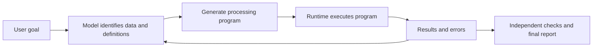

# Chapter 7: From Coding Assistant to General-Purpose Agent

[简体中文](../../book/07-general-agent.md) | **English**

An operations colleague has hundreds of store reports and wants to explain changing refunds. They are not building software, but need to read files, normalize fields, calculate rates, and relate numbers to support feedback. Chat alone makes it hard to verify that processing actually happened.

Pi can read/write files and execute programs, so it can write temporary scripts to perform the work. We explain code as a temporary tool, return to Chapter 1's investigation and revise plans across two evidence rounds, then apply the approach to document retrieval, permissions, and collaboration. A hand-checkable CSV isolates arithmetic verification.

A coding agent's programming ability extends beyond delivering software: it can translate ambiguous requests into executable steps. Pi defaults to `read`, `write`, `edit`, and `bash`; suitable programs, data, and permissions let these operations compose broadly. [Default tools](https://github.com/earendil-works/pi/blob/f07218c4d4bbc12bef056a7058c3dd49dfe41abe/packages/coding-agent/src/core/sdk.ts#L258)

This is compositional potential, not a claim that Pi preconfigures web search, browsers, office connectors, or analysis software, or that every business should permit arbitrary generated code.

## 7.1 Why programs can become temporary tools

For 600 daily store reports, asking the model to add everything in natural language wastes context and makes arithmetic consistency difficult.

Instead, inspect structures and write a program. The model chooses the calculation; code repeatedly applies it. Original details remain in files while context carries samples, rules, anomalies, and summaries.



Syntax failures generate runtime feedback. Successful execution with a wrong business definition requires task rules and independent checks to detect. Running successfully proves execution on current input, not a correct solution.

`bash` executes subprocesses with working directory, environment, and cancellation behavior. Pi does not include a universal interpreter: `python3` must exist and required libraries must be importable. [Local execution](https://github.com/earendil-works/pi/blob/f07218c4d4bbc12bef056a7058c3dd49dfe41abe/packages/coding-agent/src/core/tools/bash.ts#L81)

Capabilities extend from registered tools to safely available programs. Dependencies, encodings, permissions, paths, and networking become application responsibilities. Fewer tools do not mean less engineering.

## 7.2 The filesystem's role

Mid-investigation, raw exports, cleaned tables, scripts, and two reports coexist. Without identities, tomorrow's rerun cannot explain differences.

This is a proposed layout, created by the user or application:

```text
monthly-report/
  input/             Original data and export notes
  rules/             Definitions, business rules, report requirements
  scripts/           Transformation and validation programs
  work/              Intermediate results and anomalies
  output/            Final reports, charts, and sources
  checks/            Known acceptance examples
```

The purpose is preserving identity. Originals must remain rereadable, intermediate results reproducible, rules versioned, and reports traceable. Mixing these can lead the model to “fix” original data while revising a report, destroying the basis for comparison.

Files also index context. To continue yesterday's report, inspect requirements, saved work, and pending anomalies before rereading everything. Existence does not prove the model read a file or that it is current. Direct the agent to sources and verify versions.

**Keep large factual collections in the environment and bring small decision-relevant evidence into context.** CSV holds details; context holds definitions, check statistics, and anomalies. A knowledge base holds full documents; context holds candidate locations and relevant passages. [Chapter 3](03-context-engineering.md) supplies selection; files supply capacity.

<a id="changing-task"></a>

## 7.3 Investigation: more refunds—should we roll back?

### Return to the new checkout

The checkout redesign changes shipping placement and button wording for some users. The lead wants evidence for tomorrow's rollback decision.

Orders, support excerpts, and release notes do not directly establish causation. Pi must inspect what can be computed, what is missing, and what to do next.

A refund field might mean requested or completed. Post-release orders need not all have seen the new version. Shipping complaints are a lead, while delivery delays can cause other refunds. Correct arithmetic can support a wrong decision when these distinctions are lost.

We want Pi to identify ambiguity, select methods, and ask focused questions. Programs repeat settled calculations; evidence selection and judgment evolve. The materials arrive in two rounds.

### Round one: distinguish observations, leads, and conclusions

The [lab](../examples/investigation/README.md) supplies two cohorts of twenty orders, old metric notes, release notes, and support excerpts. A valid reference path is:

1. Confirm that the order field represents requests, not completed refunds.
2. Validate fields and calculate request rates: 3/20, or 15%, becomes 8/20, or 40%. Explain what this cannot establish.
3. Notice an acquisition campaign in the release notes. New-customer share rises from 20% to 80%; their request rate stays 50%. Existing-customer rates change from 6.25% to 0%. Aggregate and grouped observations do not support direct attribution.
4. Treat shipping feedback as a lead. Two excerpts concern one order, and others mention delivery, addresses, and purchase hesitation. Selected excerpts cannot estimate complaint prevalence.
5. Save the initial report and unresolved questions; ask about the actual decision, metric, and version-exposure data.

Computing two rates completes arithmetic, not the investigation. Determine comparability, strength of inference, and the next useful evidence.

### Round two: new material changes the metric and goal

The lead clarifies: “Management uses completed-refund rate. I worry about shipping misunderstandings; first decide whether to pause rollout expansion. More tracking is unavailable.” Events give provisional completion rates of 15% and 25%, but the earlier cohort has fourteen days' observation and the later only three.

Adapt in four places: join completion events to orders; preserve old request rates but correct their role; incorporate unequal windows and missing exposure into causal limits; replace a full report with a one-page decision memo and minimal validation plan. Preserve round one to show what changed and why.

```js
// Investigation strategy sketch, not a built-in workflow or complete implementation.
let goal = readUserRequest();
let evidence = [];
let questions = [];
while (!readyToDeliver(goal, evidence)) {
  const next = chooseNextStep(goal, evidence, questions); // Model judgment.
  if (next.kind === "clarify") {
    saveFindingsAndQuestions(evidence, next.questions);
    break; // Wait for the user rather than invent missing evidence.
  }
  const observation = await executeTool(next.tool, next.args);
  evidence.push(withSourceAndDefinition(observation));
  questions = reconsiderWhatIsUnknown(goal, evidence);
}
// A later user message begins a new run; future materials do not appear magically.
const update = await receiveUserUpdate(); // Host receives it.
const changes = compareGoalAndDefinitions(goal, update); // Model identifies changes.
await savePreviousReport();
goal = reviseGoal(goal, changes);
// Resume the model/tool loop with new definitions and preserved earlier evidence.
```

`chooseNextStep` and `compareGoalAndDefinitions` name model responsibilities; all helpers are illustrative. [Chapter 2's loop](02-runtime.md#agent-loop) transports calls and results; this sketch describes business work within it. Pi does not ship refund-investigation stopping rules.

### No unique decision does not mean no strict acceptance

A qualified recommendation might briefly pause expansion and compare shipping visibility on equivalent tasks. It might also justify continued limited observation with risks and stop criteria. Evidence does not identify one uniquely optimal decision. But confusing requests with completions, double-counting orders, inventing randomization, ignoring observation periods, and claiming a suggestion was executed are clearly wrong.

Acceptance combines program checks for joins, deduplication, and numbers with human trace review for supported claims, retained unknowns, and adaptation. Ambiguity changes standards; it does not eliminate them. See the [lab](../examples/investigation/README.md) for both rounds, calculations, a memo, and a rubric.

This joins the earlier chapters: current evidence selection, old definitions and branches, sourced tool output, business services, and Chapter 8's structurally changed holdouts. Mechanically reusing a shipping explanation for a logistics problem fails generalization.

### Numerical subexercise: CSV to a verifiable table

Use four fictional rows to check arithmetic before relying on it as evidence. Save `input/orders.csv`. `amount` is original order value in yuan; `refunded` marks refunds.

```csv
order_id,store,amount,status
A001,East Store,100.00,paid
A002,East Store,50.00,refunded
A003,West Store,80.00,paid
A004,West Store,20.00,paid
```

Ask Pi:

> Read input/orders.csv and calculate order count, refund count, and retained revenue by store. Retained revenue includes only paid amounts; refund rate is refunded orders divided by all orders. First check duplicate order_id, unknown status, and invalid amounts. Report anomalies instead of silently skipping them. Use Python's standard library, preserve the original, and write to output/. Include commands and acceptance results.

This defines fields, calculation, invalid-input behavior, and artifacts. Without definitions, “refund rate” could mean amount share, order share, or a denominator excluding cancellations.

Read samples and files before writing code. The mechanism is:

```js
// Non-runnable pseudocode; helpers are application-defined.
// Decimal helpers mean exact decimal arithmetic, not ordinary JS floating point.
const seen = new Set();
const totals = new Map();
const errors = [];
for (const row of readCsv("input/orders.csv")) {
  const problems = validateRow(row, seen); // Required fields, ID, status, amount.
  if (problems.length > 0) {
    errors.push({ line: row.line, problems });
    continue;
  }
  seen.add(row.order_id);
  const amount = parseDecimal(row.amount);
  const store = getOrCreateTotals(totals, row.store);
  store.orders += 1;
  if (row.status === "refunded") { store.refunds += 1; }
  if (row.status === "paid") { store.income = decimalAdd(store.income, amount); }
}
if (errors.length > 0) {
  writeErrors(errors);
  markRunFailed(); // Do not publish an incomplete normal report.
} else {
  writeReport(sortStoresAndComputeRates(totals));
}
```

Binary floating point cannot exactly represent many decimal fractions. Choose appropriate runtime numeric types instead of asking the model to simulate arithmetic. Reject infinity and other invalid business values; parseability is insufficient validation.

Hand-check the result: East has two orders, one refund, 50%, and 100 yuan retained; West has two orders, no refunds, 0%, and 100 yuan. Total retained revenue is 200 yuan.

Append a duplicate: the run should fail with an ID/location, not publish 300 yuan. Add an unknown status and confirm it is not counted as paid. **Failure examples prove whether checking really occurred.** Normal-only success can hide silent data loss.

Pi supplies files and a loop; we supply business acceptance. A filename such as `validated-report.md` conveys no automatic trust. Trust comes from inspectable relationships between inputs, rules, code, execution, and checks.

## 7.4 Knowledge assistants: steps before an answer

A new colleague sees daily batch billing in code, while old docs describe real-time processing. “Why did we change?” requires project evidence, not a generic comparison.

Local Markdown can be investigated with file tools and available shell search. External platforms need configured CLIs or extensions; file operations grant no platform access.

Search billing/batch/decision candidates, read relevant passages, compare dates and states to identify the effective decision, then answer with locations. Discovery, exact reading, and applicability are distinct steps.

```js
// Non-runnable pseudocode; retrieval and judgment helpers are application-defined.
const question = "Why did billing switch to batch processing?";
const candidates = await searchDocuments(question);
const selected = selectRelevantAndRecent(candidates);
const passages = await readSelectedPassages(selected);
const facts = separateProposalsDecisionsAndRevocations(passages);
if (facts.hasFinalDecision) {
  return answerWithSources(question, facts);
}
return describeMissingEvidence(question, facts);
```

This combines [Chapter 5's search/read design](05-tools.md) and [Chapter 4's knowledge maintenance](04-memory.md). A proposal is not the current decision. Return version, date, and document identity, and do not treat speculative minutes, approved designs, and retired docs as interchangeable keyword matches.

Reusable decision-status steps can become a skill; scoped platform access a tool; confirmed preferences dedicated memory. Preserve procedures, capabilities, and individual facts separately rather than putting every transcript in global instructions.

## 7.5 Boundaries of code capability

A script can be repaired and rerun in a working directory. Reserving inventory for a real order affects others. Both are expressible in code, but require different freedom.

Batch files, cleaning, conversion, charts, and documents suit temporary programs. Strict business operations suit specialized services. `query_stock` and `reserve_stock` can validate warehouse scope, stock version, and idempotency server-side. Repeated identical requests must not reserve twice. Free-form production SQL moves enforceable constraints into temporary code. General capability should orchestrate interfaces, not remove boundaries.

Some quality is not deterministically verifiable. Word counts and links do not establish an insightful argument; chart generation does not prove a useful metric. Report machine-checked properties separately from human judgment.

Office tasks do not reduce Pi's permissions. Generated code through `bash` usually has process privileges. Hosts must arrange isolation, mounts, and credentials for untrusted inputs and unattended execution. [No built-in sandbox](https://github.com/earendil-works/pi/blob/f07218c4d4bbc12bef056a7058c3dd49dfe41abe/packages/coding-agent/docs/security.md#L3)

The CSV exercise needs a directory and Python, not email credentials or private home files. A minimal environment limits damage. Mounting the entire host read/write into a container still allows modifying those files; containerization alone is not a complete boundary.

### Between generation and delivery

Pi has written a report to `output/`, ready for checking definitions and layout. Generation is progress, but the report has not been sent. Bundling generation with sending risks repeatedly delivering unfinished revisions.

Separate generation from publication so this artifact can pass acceptance before delivery. Where the user has explicitly authorized automatic publication of qualifying reports, the application can follow that authorization while checking its conditions.

Unattended tasks also need persistent waiting state. If a month's input is missing, save a gap list and end the run until it arrives. Do not invent data or wait forever on a confirmation dialog with no interactive interface. Pi's APIs can support this application; queues, business notifications, and completion state remain host responsibilities.

These arrangements make generality useful: common reading, calculation, and generation serve different businesses, each with its own contracts and acceptance conditions. Reusing capabilities need not impose one identical workflow.

## 7.6 Collaboration needs more than additional models

With orders, support, and releases to inspect by morning, three agents might help. But do they share definitions, overwrite files, or leave unfinished work when one fails? Define goals, inputs, artifacts, shared resources, and failures before calling the work parallel.

Sub-agents are not a built-in Pi core feature. The official extension example starts separate `pi` processes with separate context windows and returns results to the main session. No fixed core scheduler does not mean collaboration is impossible. [Sub-agent example](https://github.com/earendil-works/pi/blob/f07218c4d4bbc12bef056a7058c3dd49dfe41abe/packages/coding-agent/examples/extensions/subagent/README.md#L1)

For reports, a checker writes `checks.json`, an analyst `analysis.json`, and a writer reads both. Pin input versions and avoid simultaneous writes to one summary. The coordinator rejects version mismatches.

```js
// Architecture pseudocode; runWorker and other helpers belong to the host.
const input = { inputHash: hashInputs(), ruleVersion: "v1" };
const [checks, analysis] = await Promise.all([
  runWorker("check", input, "work/checker/"),
  runWorker("analyze", input, "work/analyst/")
]);
assertSameInputAndRuleVersion(checks, analysis, input);
assertChecksPassed(checks);
assertRequiredMetricsPresent(analysis);
const report = await runWriter({ checks, analysis }, "output/");
verifyReportAgainstAnalysis(report, analysis);
```

This is not Pi workflow syntax. RPC coordination must distinguish acceptance from validated completion and handle cancellation, timeouts, and budgets. `Promise.all` starts workers concurrently then waits for both; it does not grant native asynchronous reasoning to a model. See [Chapter 2](02-runtime.md) for waiting and [Chapter 5](05-tools.md) for independence. Parallelism adds duplicate reads, cost, and conflict handling. Four CSV rows do not justify three agents; large independent evidence bundles might.

> **Further reading**: Why role-based “virtual company” multi-agent systems faded, and why Cognition's and Anthropic's June 2025 articles do not really conflict, is covered in [The Rise and Fall of Multi-Agent Systems](notes/multi-agent.md).

## 7.7 Exercise: make the task repeatable

Before promoting the four-row script, change names and row order, then try empty files, missing fields, duplicates, and unknown statuses.

Deliver original inputs, definitions, code, checks/anomalies, and a sourced final report. Same inputs should produce identical numbers; new inputs must not reuse old names or amounts. Invalid data must retain locations and not generate normal-looking reports.

Once this works, Pi becomes a reviewable work system. Next, determine which successes to preserve, failures to repair, and evidence proves later versions better.

### Reference answer

Represent rates as decimals from zero to one, formatting percentages only for people:

```csv
store,order_count,refund_count,refund_rate,retained_revenue
East Store,2,1,0.5,100.00
West Store,2,0,0,100.00
```

The report can state East's 2 orders, 1 refund, 50%, and 100.00 yuan; West's 2 orders, no refund, and 100.00 yuan. Total: 4 orders, 1 refund, 25%, 200.00 yuan. Compute the overall rate from total counts rather than generally averaging store rates; equal store sizes make those coincide here.

This exercise requires at least one order. Other products can report no data, but must not disguise it as a zero refund rate.

| Input | Expected result | Location or verification |
| --- | --- | --- |
| Repeat same input | Same business values and input hash | Compare fields; timestamps may differ |
| Rename stores and reorder rows | New names with correct associated values | No stale names; compare after sorting |
| Empty file/header only | Fail explicitly: no orders | File-level error or zero data rows |
| Remove `status` | Schema failure, no normal summary | Missing header field |
| Append A001 | Duplicate error, no duplicate revenue publication | Original line 2 and duplicate line 6 including header |
| Set A004 to `pending` | Unknown status, no silent skip or paid assumption | Line 5, `status`, `pending` |
| Set A003 amount to `NaN` or negative | Invalid amount | Line 4, `amount`, original value |

Create fresh `seen`, `totals`, and `errors` each run, read the provided input, and fix output order/amount formatting. Do not hardcode stores or continue accumulating previous output. Mark failure explicitly. If retaining an older successful report, use separate run directories or a manifest to identify its input.

Suggested artifacts are `input/orders.csv`, `rules/metrics.md`, `scripts/report.py`, `work/errors.json`, and `output/report.md`. Success has an empty anomaly list; failure publishes no new normal report. Record input hash, rules/code versions, command, and checks. These are proposed paths, not claims files were generated by this example.

[Previous](06-extensibility.md) · [Back to contents](../README.md) · [Next](08-evolution.md)
