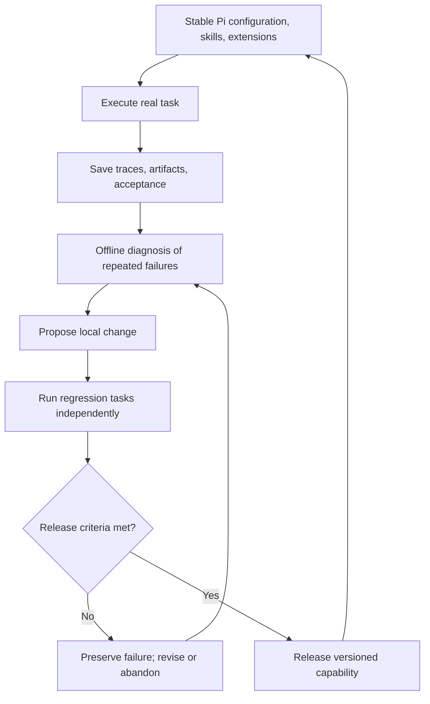

# Chapter 8: Continuous Improvement—Turn Experience into Verified Changes

[简体中文](../../book/08-evolution.md) | **English**

You use Pi for weekly store reports. It initially skips refund checks; you correct it, and it repairs and reruns the script. In a new directory and session tomorrow, the omission returns. You want to preserve the method, not just yesterday's repaired report.

This chapter separates conversational correction from durable capability, uses traces to locate failure, and places fixes in knowledge, skills, or code. We distinguish development examples from independent acceptance and use an improvement report to decide release or rollback. The monthly-report exercise continues, with checks on applicability to the investigation.

Yesterday's correction may exist only in that conversation. Later tasks need a persistent change they can find, understand, and use.

Pi supplies history, context files, skills, extensions, and packages. It does not provide an automatic platform that evaluates all tasks, trains models, and releases capabilities. We separate existing interfaces from an application-built improvement loop.

Investigation failures can extend beyond arithmetic: calculating request rate while answering a completion-rate question, following an obsolete plan, or inferring “no redesign effect” from changing customer mix. Diagnose understanding, evidence, and plan updates as well as code. Use the [lab's structural variants](../examples/investigation/README.md) for logistics causes, different data granularity, and explicit monitoring needs, checking whether plans actually change.

## 8.1 Ask where the change happened

A reminder, a skill edit, and a program fix can each improve a result but have different scope. Specify the changed layer before saying an agent learned.

| Changed object | Report example | Main effect |
| --- | --- | --- |
| Current context | User supplies the refund definition | Subsequent judgments in this task |
| External knowledge | Approved definition and effective date saved | Facts retrieved in later tasks |
| Procedure | Skill requires duplicate checks | Execution steps |
| Executable code | Validator rejects unknown status | Deterministic behavior constraints |
| Model parameters | Dedicated training updates weights | Model's statistical behavior |

These connect to [context and skills](03-context-engineering.md), [memory](04-memory.md), and [tool contracts](05-tools.md). Pi directly supports the first four surrounding changes. It calls models for inference; writing a skill does not update weights. Software updates, package installation, and prompt replacement are not parameter training.

Verification must fit the layer. Knowledge needs accurate, applicable sources. Skills need appropriate loading and use. Programs need input/output and error checks. Model changes need evaluation of the whole combination. “The agent learned” can obscure these responsibilities.

## 8.2 Traces are investigation material; final replies are not scores

Pi says the report is complete, but refunds are duplicated. The final reply cannot reveal whether it missed rules, miscalculated, or ignored a known error. Inspect actual reads, actions, and results.

A **run trace** includes user input, model messages, arguments, results, and events. It helps identify the first departure from requirements.

SessionManager organizes entries and branches and writes JSONL when persistence is enabled. Disk behavior has details: a new session may not flush before an assistant message exists. Do not assume every `appendEntry` immediately creates a complete audit record. Strict audit hosts need explicit flush and backup policies. [Persistence](https://github.com/earendil-works/pi/blob/f07218c4d4bbc12bef056a7058c3dd49dfe41abe/packages/coding-agent/src/core/session-manager.ts#L1160)

`pi --mode json` emits events for external logging. Event streams and session files are different formats despite both being line-oriented JSON; parse them separately. [JSON mode](https://github.com/earendil-works/pi/blob/f07218c4d4bbc12bef056a7058c3dd49dfe41abe/packages/coding-agent/docs/json.md#L1)

Traces still need independent acceptance. “All checks passed” is a claim. Validate totals against known examples or trusted calculations, compare input hashes for tampering, and inspect actual artifacts.

```js
// Proposed application record; values are collected by the application.
const taskRecord = {
  taskId, inputHash, ruleVersion,
  piVersion, modelId, extensionVersion, skillVersion,
  sessionPath, branchId, eventLogPath,
  artifactPaths, independentCheckResult,
  elapsedMs, usage, failureCategory
};
```

Pi does not automatically generate this full evaluation report. Messages can provide model/usage fields, but estimated cost depends on provider reporting and configured prices and is not a billing settlement. [Assistant message fields](https://github.com/earendil-works/pi/blob/f07218c4d4bbc12bef056a7058c3dd49dfe41abe/packages/ai/src/types.ts#L515)

## 8.3 From diagnosis to a minimal fix

Two of five reports fail: one misses duplicate orders; another encounters a service timeout. “Be more careful” addresses neither.

Duplicates could reflect a missing step, a broken field lookup despite a check, or ignored failure followed by publication. The final outcome matches while the fix location differs.

A timeout may require explicit limits, bounded retries, and resumable jobs rather than prompts. Saving a temporary outage as permanent knowledge that a service is unusable causes lasting detours.

First establish the external failure, locate the earliest departure, then identify what was missing there.

```js
// Diagnostic guide, not an automatic classifier; verify conditions from evidence.
if (requiredFactsMissing) {
  inspect("Retrieval and loading");
} else if (factsPresentButStepSkipped) {
  inspect("Skill or orchestration");
} else if (schemaValidButBusinessInvalid) {
  inspect("Tool or server validation");
} else if (toolFailedButReportedSuccess) {
  inspect("Error propagation and acceptance gates");
} else if (externalServiceUnavailable) {
  inspect("Timeouts, bounded retries, recovery");
} else {
  collectMoreEvidence(); // Consider model changes for repeated broader failures.
}
```

This is an investigation order, not a diagnosis algorithm. Prefer explainable local changes over simultaneously replacing models, tools, prompts, and sources, which makes attribution difficult even if outcomes improve.

For duplicates, make the validator reject repeated `order_id`, require the skill to read validation results, and make publication accept only validated artifacts. Each layer has a distinct responsibility; repeating every rule dozens of times is unnecessary.

## 8.4 Save experience in the right artifact

An investigation may establish a metric, explain a missed check, and repair code. “Remember refunds next time” says neither what to read nor what to execute.

An effective-dated metric belongs in rules; a recurring unit/definition confirmation step belongs in a skill; rejecting duplicates with a nonzero exit code belongs in code.

An experience record needs applicability, conclusion, evidence, and version. “Be careful with amounts” is not actionable. A better rule says: check `order_id` uniqueness for order-level exports, but first determine whether multiple rows are legitimate line items before deleting duplicates. Preserve boundaries as well as successful methods.

Skill creation is not proof of use. Pi mainly loads names and descriptions initially; models usually read full bodies on demand. Automatic loading is not guaranteed; `/skill:name` explicitly invokes a skill. [Skill loading](https://github.com/earendil-works/pi/blob/f07218c4d4bbc12bef056a7058c3dd49dfe41abe/packages/coding-agent/docs/skills.md#L41)

Evaluate selection, execution of key steps, and outcome improvement separately. If a skill never loads, fix naming, descriptions, or routing instead of adding body rules.

A one-off script is not yet a reliable tool. Give it explicit inputs, stable outputs, error reporting, and varied examples before packaging it. Premature promotion spreads hidden assumptions.

## 8.5 Protect real tasks with two loops

Pi notices a missing skill step before delivering a report. It can record the issue, but changing a shared skill immediately exposes other tasks to untested behavior.

Finish the current task using established requirements and preserve evidence. Separately review traces, propose a change, evaluate it, and decide publication.



This is a proposed architecture, not a default background service. Start manually: review a few accepted traces weekly, commit a tool or skill revision, and run fixed tasks. Automate after criteria stabilize.

Post-task analysis needs complete results. `turn_end` supplies one turn and tool results; `agent_end` ends an underlying loop; `agent_before_settle` is the last intervention point; `agent_settled` means no automatic retry, compaction, or queued continuation remains and is notification-only. In this version, `turn_end` and `agent_before_settle` handlers can append entries and return `continue: true`, causing another model request. Scoring there may therefore precede new content; unconditional continuation loops forever. [Event semantics](https://github.com/earendil-works/pi/blob/f07218c4d4bbc12bef056a7058c3dd49dfe41abe/packages/coding-agent/src/core/extensions/types.ts#L754), [intervention boundaries](https://github.com/earendil-works/pi/blob/f07218c4d4bbc12bef056a7058c3dd49dfe41abe/packages/coding-agent/docs/extensions.md#L109), [before-settle event](https://github.com/earendil-works/pi/blob/f07218c4d4bbc12bef056a7058c3dd49dfe41abe/packages/coding-agent/src/core/extensions/types.ts#L818)

Settled does not mean business success. The agent may have stopped for missing data or an unrecoverable error. Lifecycle and acceptance answer different questions and need separate records.

## 8.6 Evaluate improvement and regression

A duplicate check fixes one example but rejects legitimate line-item exports. Rerunning only the repaired case cannot reveal this.

Use development cases for diagnosis, holdouts excluded from debugging for transfer, and regression cases for preserved capabilities. A single-store duplicate case can be development; changed stores, amounts, and ordering can be a holdout; normal, refund, and empty cases remain regressions. Do not let the agent repeatedly inspect holdout answers and specialize to them.

A simple task table is enough initially:

| Metric | Observation | Why insufficient alone |
| --- | --- | --- |
| Acceptance rate | Fraction independently passing | Can hide rare severe errors |
| Unsupported success claims | Claimed success despite failed acceptance | Does not measure all justified output quality |
| Key-step completion | Validation and sources present | Complete steps can still miscalculate |
| Cost and time | Usage/time per passed task | Fast failures can look cheap |
| Preserved capability | Old tasks still pass | Does not establish new benefits |

Moving from 6/10 to 8/10 is a signal, not certainty. Small samples and model variation require task-level records and representative repeats. Do not keep only the best screenshot.

Record model, reasoning settings, tool versions, and environment. Simultaneous skill/model/data changes prevent clean attribution. Disclose uncontrolled conditions rather than implying perfect reproducibility.

## 8.7 Release, rollback, and self-modification

If everyone overwrites old files, later failures cannot be tied to versions. Release records need versions, evidence, and a retained previous version.

Pi can help author changes, but authoring and releasing are separate. Version skills, extensions, templates, and configuration. Pin npm versions or Git references so environments do not drift silently. [Pinned packages](https://github.com/earendil-works/pi/blob/f07218c4d4bbc12bef056a7058c3dd49dfe41abe/packages/coding-agent/docs/packages.md#L29)

Code rollback restores old behavior; business rollback addresses effects already produced. Reverting cannot recall sent reports. Record affected outputs and correct them through business procedures.

Independent parties must control acceptance gates for automatically proposed changes. The candidate may edit report generation, not delete duplicate tests, alter answers, or erase failures to improve scores.

Source judgment also remains necessary when converting documents into experience. Summarizing a harmful or wrong webpage does not make it trustworthy. Preserve origins and applicability before adding durable rules, whose effects span many tasks.

### Experience needs retirement too

After a metric API changes, old and new skills can both claim applicability. More appended instructions do not remove the conflict.

Review duplicates, expiration, and conflicts by topic; revise existing rules locally where possible. Retain replaced versions and evidence while pointing the active index to current content. Disable unused extensions before independently revalidating dependencies and APIs. Do not discard failure evidence with retired rules, or ineffective ideas may be proposed again.

Maintenance can be periodic or triggered by interface changes or clustered failures. Pi can load maintained resources; the application decides when, how, and whether to publish them.

## 8.8 Exercise: complete an evidence-based improvement

Before using this week's report assistant next week, record baseline behavior on normal, duplicate, unknown-status, and line-item inputs. Choose one failure class and change a skill or program, predicting an observable effect.

Debug with development cases, then run untouched holdouts and prior successes. Produce a short report with the original problem, trace, change, every case result, timing/usage, and rollback method. Preserve regressions alongside fixes.

Acceptance means later tasks actually invoke the new capability, perform the relevant steps, and improve independent outcomes without breaking required behavior. Merely generating an experience summary is insufficient.

### Reference answer: report the regression too

**All version labels, runs, timings, and pass/fail results below are hypothetical teaching data. This model comparison was not executed by the book and is not a Pi benchmark. Replace these fields with actual evidence in your experiment.**

**Problem and hypothesis.** Version v1 double-counts duplicate `order_id` in order-level CSV. Illustrative trace `runs/before/D2/events.jsonl` shows no uniqueness check; `runs/before/D2/summary.csv` contains duplicate revenue. A pre-aggregation check should reject the input and identify lines rather than generate an incorrect normal report. Change only code while holding model, prompt, skill, Pi version, and environment fixed.

**Minimal change.** Candidate v2 records both line numbers at the second ID occurrence. Any errors cause an anomaly file and nonzero exit. Answers remain unchanged; the tested agent cannot edit holdouts. For invalid-input tasks, a correct located rejection counts as success; report generation alone is not the objective.

| Case and role | Expected behavior | v1 / seconds | Candidate v2 / seconds |
| --- | --- | --- | --- |
| D1 development: Chapter 7's four rows | 200 yuan retained, 25% refund rate | Pass / 12 | Pass / 13 |
| D2 development: append A001 | Reject, identify lines 2 and 6 | Fail: revenue 300 / 12 | Pass / 13 |
| H1 holdout: changed stores/amounts/order, duplicate | Reject and identify actual lines | Fail: double-count / 14 | Pass / 15 |
| R1 regression: unknown status | Reject and identify value | Pass / 10 | Pass / 10 |
| R2 regression: normal refunds | Sum paid amounts only | Pass / 11 | Pass / 12 |
| R3 regression: empty input | Explicit no-data outcome; no publication | Pass / 8 | Pass / 8 |
| R4 regression: declared line-item data | Accept legitimate multiple rows per order | Pass / 14 | Fail: rejects valid lines / 10 |

**Results and interpretation.** Passes increase from 5/7 to 6/7, but R4 regresses. Both average roughly 11.6 seconds, including failed tasks, so this does not demonstrate performance improvement. For D1, R1, R2, and R3, which pass in both, total time rises from 41 to 43 seconds. Usage was not collected; report cost as “not collected,” not inferred from seconds. One run per case cannot estimate model variability.

**Release decision.** Do not release v2. Retain v1 while marking duplicates as a known defect and preventing affected data from direct delivery. Next distinguish granularity: order-level input needs unique `order_id`; declared line-item input needs `(order_id, line_id)` and explicit amount semantics. If granularity is unknown, ask instead of deduplicating. Then rerun regressions and prepare fresh holdouts.

**Rollback and follow-up.** Candidate deployment is isolated. Switch `report-v2` back to `report-v1` and confirm with a normal case. Preserve errors, hashes, and all logs, including R4. If erroneous reports were sent, identify them by run ID and regenerate or correct them. [Chapter 6](06-extensibility.md) explains why state recovery does not undo side effects.

This answers the exercise: duplicate orders are the failure class; missing validation is the first departure; a check is the local fix; holdouts test transfer; regression reveals granularity failure; timing, missing usage, and rollback are retained. “Local benefit, do not release yet” is a valid improvement result.

For skill changes, add evidence that the run actually read the skill and then performed its required validation. Changed file contents without changed traces do not establish changed capability.

[Previous](07-general-agent.md) · [Back to contents](../README.md)
