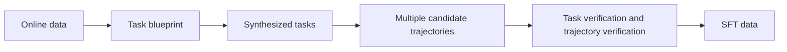
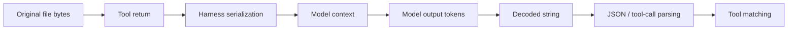
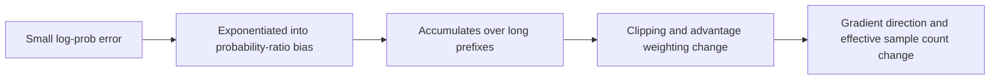

# Chapter 8　Model Post-Training

[Back to contents](../README.md)

> This chapter is the deep-dive companion to Station 08, "Back to the Forge" (回炉重造), of [π Workshop](https://pi.duanjl.com/). It assumes you have already played the station's three missions: [▶ 8-1 Flat (平的)](https://pi.duanjl.com/#/play/8-1) · [▶ 8-2 Climbing Nicely (涨得真好)](https://pi.duanjl.com/#/play/8-2) · [▶ 8-3 Full Marks (满分)](https://pi.duanjl.com/#/play/8-3), and flipped through the [Station 08 manual](../../manual/08-training.md) (the manual is written in Chinese only). The manual says "what you saw in the game"; this chapter covers the principles, the trade-offs, and what Pi can contribute to training.

## Reading route

| Part from the manual | What this chapter covers next | Where |
| --- | --- | --- |
| [What each of the four stages fills in](../../manual/08-training.md#c-stages) | Why a model is a probability distribution; loss masking; the two kinds of gap that mid-training fills, and replay; LoRA | [8.1](#t-tr-stages) |
| [SFT memorizes, RL generalizes?](../../manual/08-training.md#c-sft-rl) | How the two optimization targets differ: mass-covering versus mode-seeking; three opportunities from online feedback; where SFT data comes from | [8.2](#t-tr-sft-rl) |
| [Don't rush to touch the model](../../manual/08-training.md#c-when-train), [If the fault is in the Harness, don't train the model](../../manual/08-training.md#c-layers) | The decision order and selection thresholds; where to look at each layer in Pi for layer-by-layer attribution | [8.3](#t-tr-when) |
| [Capability probe](../../manual/08-training.md#c-probe) (8-1), [Format parse rate and cold start](../../manual/08-training.md#c-format) | Why the within-group advantage vanishes; the arithmetic of pass@k; the probe protocol; running a probe with Pi | [8.4](#t-tr-probe) |
| [Sampling and training compute different probabilities](../../manual/08-training.md#c-logprob) | The four moves of one GRPO step, PPO and DPO; online versus on-policy; the amplification chain of numerical mismatch | [8.5](#t-tr-step) |
| [The too-kind simulator](../../manual/08-training.md#c-simulator), [Keep training and evaluation apart](../../manual/08-training.md#c-isolation) | Environment fidelity; having a model play the environment; the order of environment engineering; multi-turn credit assignment and masking feedback tokens | [8.6](#t-tr-env) |
| [Hidden acceptance](../../manual/08-training.md#c-reward) (8-2), [Exploiting loopholes versus guessing the examiner](../../manual/08-training.md#c-seeking) | The three dimensions of reward design; why to anchor on facts the model cannot reach; hooking acceptance onto the moment of "about to call it done" in Pi | [8.7](#t-tr-reward) |
| [Path audit](../../manual/08-training.md#c-path) (8-3) | The RLVP formula, its four principles, and reachability; the division of labor with the execution boundary and the root of trust; collecting path signals in Pi | [8.8](#t-tr-path) |
| [Data and environment matter more than the algorithm](../../manual/08-training.md#c-efficiency) | Why sample efficiency is low; on-policy distillation and self-distillation; prompt distillation and CoT distillation | [8.9](#t-tr-efficiency) |
| [Premature stopping and overcorrection](../../manual/08-training.md#c-overcorrect) | How Chapter 7's evaluation data becomes training data; three problem cases | [8.10](#t-tr-cases) |
| The "what's real" table at this station | Pi does not train models; it can supply raw material and a practice ground: session trajectories, tools, hooks | [8.11](#t-tr-pi) |

This chapter is based on Pi 0.87.1, pinned at commit `f07218c4d4bbc12bef056a7058c3dd49dfe41abe`, and reuses the book's three markers: **[Built-in]** is behavior this version provides directly, **[Extension]** can be implemented with Pi's interfaces but you write the code yourself, and **[Recommendation]** is a general engineering choice that Pi does not do for you.

The ideas come from chapter 8 of Li Bojie's *Understanding AI Agents in Depth* (深入理解 AI Agent), called "the original book" below.

Let's say it up front: **Pi does not train models.** It has no training interface, no gradients, and it does not even store some of the numbers training needs (8.5 explains which one). In the first seven chapters every section could be tied to Pi's source; this chapter can't do that. Pi can contribute in two places: its session files are ready-made **training raw material**, and its tools, extension hooks, and SDK can be assembled into a **practice ground**. We point at these two in passing in the relevant sections, and 8.11 pulls them together. The rest follows the original book's line of thought as it is.

A small scenario runs through the chapter. Your team has hooked an open-source model, deployed on your own vLLM, into Pi, used it for a month, and collected four complaints:

| ID | Complaint |
| --- | --- |
| A | It doesn't understand the company's internal order protocol; it can't even get the order-number format right |
| B | Told to call an internal tool with JSON, it keeps adding a polite sentence or two before and after the JSON |
| C | When fixing bugs it says "done" without running the tests |
| D | When `edit` changes lines containing backslashes, seven times out of ten it reports "not found" |

The boss's opinion is blunt: "Then let's train it." This chapter answers: which of the four should be trained, with which kind of training, what must be measured before training, and which one should not touch the model at all.

---

<a id="t-tr-stages"></a>

## 8.1 One probability distribution, four adjustments

### A model outputs a probability table

To understand post-training, first grasp a sentence the original book keeps stressing: **a model's output is, in essence, a probability distribution.** Give it "The capital of China is" and it doesn't "know" the answer; it gives every word in the vocabulary a probability: "Beijing" very high, "Shanghai" lower, "banana" nearly zero. Training means adjusting this table: raise the probability of the words you want, lower the ones you don't.

The original book splits the development of model capability into four stages, and they differ in only two respects: **what you want**, and **which signal says "want"**. The original book's analogy: pre-training is a general education, mid-training is intensive study of specialist textbooks, SFT is the teacher demonstrating how to answer, and RL is doing the problems yourself and reviewing by score.

| Stage | Data | Optimization target | What it learns | Typical cost per the original book |
| --- | --- | --- | --- | --- |
| Pre-training | Massive internet text | Predict the next word | Language regularities, world knowledge, basic reasoning | Millions to tens of millions of dollars |
| Mid-training | Target-language, domain, and capability corpora, plus general retention data | Keep predicting the next word, usually with loss on all tokens | Fills in domain knowledge and basic capabilities | Medium to high |
| Supervised fine-tuning (SFT) | A few thousand to tens of thousands of "input-output" demonstrations | Predict the next word, with loss only on the answer | Instruction following, format, style, procedure | Hours to days |
| Reinforcement learning (RL) | Tasks, environment, reward signal | Maximize expected reward | Policy: among several ways it already can do things, which one is used more often | Often tens to hundreds of times SFT |

### Pre-training: read the whole library, still can't answer questions

The pre-training task is surprisingly simple: given the first half of a passage, guess the next token (Next Token Prediction). If the guess is wrong, adjust the parameters by the gap (the loss). Guessing over and over on trillions of tokens forces the model to learn grammar, facts, and basic reasoning, because there is no other shortcut to guessing right consistently.

But a freshly pre-trained model is not pleasant to use. The original book's example: ask it a question and it may continue by writing more questions, because on the internet one question is often followed by another. It learned the regularities of text, not the **protocol** of "when asked, answer".

### SFT: the same task, different data

The first insight the original book wants the reader to reach: **SFT and pre-training are mathematically the same task**, both predicting the next word and minimizing the same loss function. They differ in only two places:

1. The data becomes demonstration pairs of "user question → ideal answer".
2. **The loss is computed only on the answer**, called loss masking.

The second point is clearest on a single sample. Each box below is a token, and only the checked ones count toward the loss:

```text
[User] How do I write an order ID ? [Assistant] The format is PO- plus eight digits .
  ✗     ✗   ✗  ✗  ✗    ✗   ✗  ✗  ✗      ✗         ✓    ✓    ✓    ✓   ✓    ✓      ✓
```

We don't want the model to learn "how to ask", only "how to answer", so the gradient on the question half is masked out. This little move appears once more in 8.6: in multi-turn tool trajectories, **the tokens returned by the environment must be masked too**.

SFT's goal is "make each token of the demonstrated answer as probable as possible", that is, reproduce the demonstration as closely as possible. From this the original book gives a one-line positioning: **at very high sample efficiency, fix stable "input→output" mappings and protocols into the parameters.** What it is good at is protocol-type knowledge such as format, style, and procedure (how to say it, how to do it), and it is not good at large amounts of factual knowledge (what is known). Noise is the same: every error in the demonstrations, SFT faithfully writes into the parameters.

### Mid-training: chapters the general textbook doesn't have

Complaint A is a different kind of gap. The model has never seen this internal protocol; it isn't that it "can't say it in the format", it simply "doesn't know". The original book hands this kind of problem to **mid-training** (also called continued pre-training, CPT, or, subdivided by domain or task, DAPT and TAPT): start from an existing base model, keep the next-word-prediction objective, narrow the data to the target domain, and compute the loss on all tokens.

It fills two kinds of gap:

| Gap | The original book's examples |
| --- | --- |
| Knowledge gap | The target language, the finance, medical, or legal domain, internal enterprise documents, or a type of codebase isn't covered well by general corpora, down to not knowing the terminology |
| Basic-capability gap | The long context, code patterns, mathematical derivation, or cross-modal representation the target task needs has not formed; even many samples almost never yield a correct solution |

Why not pour knowledge in with SFT? The original book's explanation: a few hundred Q&A pairs cover only a limited set of phrasings, and the model easily **memorizes the phrasing without forming knowledge that can be invoked broadly**. Conversely, mid-training lowering the loss on domain text does not guarantee the knowledge can be retrieved in question-and-answer form, so the robust recipe is usually: mid-training absorbs knowledge, small-scale SFT teaches it how to answer, and once there is a non-zero success rate, RL on top.

Mid-training has two costs to think through in advance:

- **Catastrophic forgetting.** The original book's experiment 8-5 continued pre-training Mistral 7B v0.3 on Korean Wikipedia, with data about 80% Korean and 20% English (the original book says this is just that experiment's choice, not a general default), then did Korean SFT. Korean blind evaluation improved, and English ability declined.
- **Facts that change should not be written into the weights.** Facts that need frequent updates, citations, access control, or deletion go through Chapter 3's RAG.

The original book lists five steps for building mid-training data: **work backward from the failure distribution** (confirm which kind of gap the low pass@k comes from; don't misdiagnose a format error as a lack of knowledge); **build a high-density target corpus** (deduplicate, filter, check for evaluation-set contamination); **mix by capability** (natural long text, chain-of-thought data, agent execution trajectories); **double replay** (original short text and general data protect old abilities, and "old tasks at the lengthened context" tests whether what it could do still works in a longer window); **multi-dimensional gates** (beyond loss, look at domain held-out sets, general ability, instruction following, and pass@k; if the domain goes up and general ability goes down, the mix or learning rate is too aggressive). The original book also names one pitfall: **the nominal window is not the effective window**; positional encoding allowing 128K of input does not mean the model can still retrieve, reason, and plan at 128K.

### LoRA: the money-saving default that runs through all training

Full-parameter fine-tuning has to store gradients and optimizer states for billions of parameters, and GPU memory can't take it. **LoRA** (Low-Rank Adaptation) freezes the original weights and learns through a small low-rank "patch" attached alongside, with about 1% to 5% of the original parameter count. A few rules of thumb the original book collects:

| Rule of thumb | Content |
| --- | --- |
| Where to attach | Attach to all the major weight matrices, especially the MLP layers, which hold the most parameters; attaching only to attention layers loses accuracy |
| Learning rate | The optimal learning rate is about 10 times that of full-parameter fine-tuning, for both SFT and RL |
| Rank | 64 to 256 for SFT; RL carries little information per round, so 8 to 32 or even 1 is enough |
| Deployment | One inference server can load several adapters at once, for multi-tenancy |
| Forgetting | The original weights are frozen so the forgetting risk is lower, but **not immune** |

---

<a id="t-tr-sft-rl"></a>

## 8.2 SFT memorizes, RL generalizes?

### Two targets, two shapes

SFT maximizes the probability of the demonstrated answer, and RL maximizes expected reward. It sounds like just swapping the objective function, but on the probability distribution the shapes differ a great deal.

A question often has several kinds of reasonable answers, and each kind is a "peak" in the distribution. The original book's account:

- **SFT is mass-covering.** It learns the demonstrations one by one, and tends to cover every peak that appeared in the demonstrations.
- **RL is mode-seeking.** It redistributes probability according to reward, and with the common reverse-KL constraint it more easily concentrates probability on a few high-reward peaks.

```text
Demonstrations have three phrasings:   After SFT:               After RL (reward recognizes only B):
  A    B    C                            A    B    C              A    B    C
  ▂    ▂    ▂                            ▅    ▅    ▅              ▁    █    ▁
```

Whether the result stays diverse or collapses to a few modes, the original book says, depends on the demonstration distribution, the reward function, the direction and coefficient of the KL term, entropy regularization, and sampling temperature. This picture is only an intuition.

The original book has another metaphor: **SFT carefully learns the existing map; RL takes reward as a compass to explore routes off the map.** If the map is inaccurate or the compass is inaccurate, you get lost either way.

### GeneralPoints: memorizing J as 10

The manual covered this experiment's conclusion ([manual: SFT memorizes, RL generalizes?](../../manual/08-training.md#c-sft-rl)); here we add the story behind the numbers. GeneralPoints is a card game like "24", and the original book uses Llama-3.2-Vision-11B, first initialized with SFT so it can output in the right format, then continued with SFT and with RL (PPO with a value network) respectively under the same compute budget. In training, J, Q, K all count as 10; at test time they count as 11, 12, 13 respectively (a rule variant), or the black suits are changed to red (a visual variant):

| Out-of-distribution test | Starting point | After RL | After SFT |
| --- | --- | --- | --- |
| Rule changed (text-only GP-L) | 11.5% | 15.0% (+3.5%) | 3.4% (−8.1%) |
| Suit changed (image GP-VL) | 23.6% | 41.2% (+17.6%) | 13.7% (−9.9%) |

The original book's explanation matches the observation: limited SFT data reinforced the fixed pattern of "see J/Q/K, treat as 10"; outcome-oriented RL more likely reinforced the strategy of "recompute until you get the right answer", which still works when J becomes 11. In the visual variant, RL also improved the underlying visual recognition, while SFT made recognition accuracy drop, because it overfit the token patterns in the reasoning.

This set of experiments hides two conclusions that are easy to miss:

1. **RL directly without SFT fails completely in this setting.** The base model cannot produce structured output, so the reward can't even be computed. This is where the format gate of 8.4 comes from.
2. **The more verification iterations, the better the generalization**: 10 iterations +5.99%, 1 iteration +0.48%. From this the original book says spending more compute at test time is an important factor in the generalization gain here.

Then there is the line the original book repeats in at least five places across the chapter: **this is only a tendency under a controlled setting, not a universal property of SFT versus RL.** With sufficiently diverse data and proper regularization SFT can generalize too; when the reward or the environment is biased, RL overfits to shortcuts just as well, and 8-2 and 8-3 are two ready-made examples.

### Online feedback gives RL three opportunities

The original book attributes RL's advantage over fixed-data SFT to three opportunities that "online feedback" brings:

| Opportunity | Meaning | The original book's caution |
| --- | --- | --- |
| Evaluating candidates beyond the demonstrations | SFT can only learn the answers written in the data; RL can reinforce new behavior the reward function can score. In experiment 8-13 SimpleVLA-RL, a robot discovered a "push-cut" action absent from the human demonstrations | Quality the reward can't recognize can't be learned, and strategies never explored can't be discovered |
| Exploiting "verifying is easier than generating" | SFT needs someone to write the correct answer first; RL only needs to be able to judge right from wrong. Math can check the answer, code can run tests, proofs can go to a verifier | An incomplete verifier gets exploited |
| Training on the states it reaches itself | Offline imitation has **covariate shift**: once the policy strays from the demonstrations, it enters states absent from the data, with no recovery signal. In specific sequential imitation settings, error accumulates in the worst case roughly as T² in trajectory length T, and online data aggregation can bring it down to about T | 8.9's on-policy distillation combines this with SFT's dense supervision |

The original book also points out in passing: **post-training shapes "when the model acts".** Swap models in the same neutral coding Harness, and some tend to read more files before changing, others to change early and fix by test feedback. Don't anthropomorphize this as "carefulness"; it is the policy in the parameters estimating which has the higher expected value, "read one more file" or "commit and verify".

RL runs on large models thanks to priors. In its optional reading the original book makes a comparison: in a treasure-hunt game with an 11-step optimal solution and sparse reward, tabular Q-learning without priors basically doesn't win in the first 5000 episodes and takes about 10000 episodes to clear stably; an LLM agent cleared it in 18 steps on its first episode and could still reason its way to adapt when the rules changed. The difference is not the learning algorithm but that the latter carries massive pretrained priors that shrink the search space; in reality every interaction has a cost, and ten thousand trials are unacceptable. The original author's strong opinion: **priors > environment > algorithm.**

### Where SFT data comes from

Since SFT's ceiling is set by the data, the original book gives three sources, often combined:

| Source | Characteristics |
| --- | --- |
| Human expert demonstrations | Highest quality ceiling, expensive and slow; suited as seeds that define format and style |
| Teacher-model generation | Have a strong model produce demonstrations in bulk, filter them, and distill to the student |
| Rejection Sampling | The model samples several candidates for the same question, a verifier picks out the correct ones, and these train itself; doing SFT this way is called **RFT** (rejection-sampling fine-tuning), sitting between SFT and RL, with no reward model trained and no policy gradient |

The pipeline the original book recommends:



A few key points: the task blueprint should distill user intent, initial state, available tools, business constraints, common failures, and success conditions, and **after stripping identity information, regenerate fictional people, orders, and files**, so the model doesn't memorize customer data or internal credentials; checks expressible as tests, database assertions, or state diffs should preferably use deterministic code; there is no need for huge volume, since a few thousand to tens of thousands of high-quality samples are usually enough to fix a format. In the original book's words, rather than piling up a hundred thousand dirty examples, polish ten thousand clean ones.

**Failed trajectories cannot be used directly as correct demonstrations.** They can be used to construct preference pairs, to find coverage gaps, or be added to training after diagnosis and repair are appended. This point comes into play in 8.11, when Pi sessions are turned into data.

---

<a id="t-tr-when"></a>

## 8.3 Don't touch the model first: fix what's missing

### The decision order

Back to the four complaints. The tone the original book sets for this section: **first judge whether what's missing is the foundation, the protocol, or the policy; don't uniformly attribute "the model does badly" to needing RL.** The order is four steps:

1. **First rule out solutions that need no weight changes**: if prompts, tools, code constraints, or context management can solve it, don't train; facts that need frequent updates, citation, or deletion go through RAG.
2. **Measure capability support on a held-out set**: pass@1, pass@k, partial-progress rate, format parse rate, then audit the failure reasons by hand (8.4).
3. **Use SFT to establish the protocol, not to cram in a knowledge base.**
4. **Use RL only where there is room to explore.**

The original book's selection table, read through our scenario:

| Observed phenomenon | Main gap | Preferred method | Threshold to the next stage |
| --- | --- | --- | --- |
| Doesn't know domain concepts, language, or basic operations; pass@k is still near 0 under reasonable sampling | Knowledge and capability are not within the base model's effective support | Mid-training; RAG for dynamic facts | Domain held-out set improves, general retention set acceptable, verifiable correct or partially correct trajectories begin to appear |
| Occasionally does it right, but format, tool schema, tone, or fixed procedure is unstable | The behavioral protocol is not fixed | SFT or constrained decoding | Parse success rate is stable and key actions can be scored reliably by the verifier |
| Already has a non-zero success rate and a reliable reward, but the good policy has low probability, or long-horizon decisions or out-of-distribution generalization fall short | The allocation of probability mass | RL | Reward is consistent with the true goal; enough reward variation within a group of rollouts; an independent test set improves with training |
| Only a few stable demonstrations, no interactive environment | There is imitable data but no online feedback | SFT, RFT, offline preference optimization | Build baseline and evaluation first, then judge whether an RL environment is worth building |

This does not require every project to run all three kinds of training in sequence; the original book specifically notes that a strong base model may go straight into RL, a format-type task may need only SFT, and stable domain knowledge may need only mid-training. The key is that every step has a measurable entry condition.

Run through the four complaints and the first step already filters out most of them:

| Complaint | Non-training solutions to try first | When training really is needed, what's missing |
| --- | --- | --- |
| A: doesn't know the internal protocol | Make the protocol document a Skill (Chapter 2), or provide a tool that validates order-ID format (Chapter 4) | When the protocol is huge, interrelated, and won't fit in context, it's a knowledge gap, and calls for mid-training |
| B: JSON wrapped in pleasantries | Write the tool schema clearly; use constrained decoding if you can | A protocol gap, SFT |
| C: says done without running tests | Chapter 5's completion gate: when it says done, the Harness runs the acceptance check | A gate stops it once but cannot stop it from wanting to knock off every time; this is a policy problem, and can be RL or DPO (8.10) |
| D: `edit` can't find it | Attribute layer by layer first, see below | Most likely not the model's problem at all |

The combined picture the original book gives at the end of the chapter is also the principle behind this table: **use RAG for dynamic facts, use ICL (in-context learning) to quickly trial strategies that can be described in language, use programs to fix deterministic procedures and hard constraints, use mid-training to absorb stable domain knowledge, and then use SFT and RL to shape behavior that is hard to express completely in external rules.** The criterion is not only whether the task is stable, but more importantly **whether the capability can be adequately expressed in external symbols**. The original book's two extremes: medical image recognition and natural tone often need parameter updates however the domain changes; a long-stable transfer-approval rule, on the contrary, should be guaranteed by code and not rely on model memory alone.

<a id="t-tr-layers"></a>

### Layer-by-layer attribution: whose fault is complaint D

Complaint D is a replay of the original book's third problem case. The edit tool matches `old_string` as a string; being off by one space, newline, backslash, or Unicode combining character makes it fail, and it looks like the model can't copy accurately. The original book requires comparing layer by layer along the whole chain, and **whichever layer changes first is the one blamed**:



| The layer that changes first | Who it's attributed to |
| --- | --- |
| The bytes already changed when reading the file or in the tool return | The tool |
| Serialization, escaping, or prompt assembly altered the content | The Harness |
| It changes on tokenizer encode then decode | The tokenizer |
| The context the model received is character-for-character identical to the original, and the model output is the **first** place a difference appears | The model's exact-copy ability, which is the only post-training candidate |

Only after confirming it was the model's problem did the original book do the training: with Qwen3-8B as the base, bf16 LoRA for 2 epochs, with three kinds of training task (verbatim recitation; picking out the identical one among several similar, equal-length strings; copying a specified string completely into the JSON argument `old_string`), giving token-level supervision only on the target string. Byte-exact copy accuracy rose from the base's 37.5% to 78.9%, and 80.1% on an independent boundary set. A separate tokenizer audit showed that the Qwen3 and Qwen2.5 tokenizers' lossless round trip itself is only 80.1%. **So 80.1% is simultaneously the ceiling for model copying and for the tokenizer, and the remainder cannot be blamed on the model.**

Applied to Pi, most layers of this chain have somewhere to look:

| Layer | Where to look in Pi | Marker |
| --- | --- | --- |
| Tool return | Messages with `role: "toolResult"` in the session file, which record verbatim what the tool handed the model ([ToolResultMessage](https://github.com/earendil-works/pi/blob/f07218c4d4bbc12bef056a7058c3dd49dfe41abe/packages/ai/src/types.ts#L539)) | **[Built-in]** |
| Harness serialization, model context | Listen to `before_provider_request` and dump the request body actually sent to the model service. The official example [provider-payload.ts](https://github.com/earendil-works/pi/blob/f07218c4d4bbc12bef056a7058c3dd49dfe41abe/packages/coding-agent/examples/extensions/provider-payload.ts#L6) does exactly this | **[Extension]**, example ready-made |
| Model output | Messages with `role: "assistant"` in the session file, carrying the tool-call arguments ([AssistantMessage](https://github.com/earendil-works/pi/blob/f07218c4d4bbc12bef056a7058c3dd49dfe41abe/packages/ai/src/types.ts#L515)) | **[Built-in]** |
| JSON parsing, argument validation | `prepareArguments` and schema validation, see [section 4.4 of Chapter 4](04-tools.md#t-tool-fidelity) | **[Built-in]** |
| Tool matching | `edit`'s two-step matching, exact first and then lenient, see [Chapter 4 · Pi's `edit`](04-tools.md#t-tool-fuzzy-edit) | **[Built-in]** |
| Tokenizer, chat template | On the model service's side; Pi can't see it; audit separately on the vLLM side | **[Recommendation]** |

One thing deserves an extra thought. After exact matching fails, Pi's `edit` falls back to lenient matching, absorbing common copying deviations such as curly quotes, dashes, special spaces, and trailing whitespace inside the Harness first. So the "`edit` not found" rate you count in Pi is the failure rate **after the Harness has already been lenient once**; comparing it with figures from another Harness, or using it as a measure of the model's copying ability, will distort. Backslashes are not among the lenient rules, so complaint D lands exactly in the blind spot of the leniency, and the JSON escaping layer is the first place to check (Chapter 4 section 4.4 covered it: when the model wants to write one backslash, the JSON must contain two).

The lesson this case offers Harness designers is plain: training is expensive and the Harness is cheap; fix whichever layer the fault is in.

---

<a id="t-tr-probe"></a>

## 8.4 Capability probe: is there anything to learn?

### Why a group of all zeros teaches nothing

The accident in 8-1 was "a whole batch of trajectories scoring zero" ([manual: Measure capability first, then talk about training](../../manual/08-training.md#c-probe)). The manual computed the advantage once by "subtracting the mean"; here we finish the story.

Algorithms of the GRPO kind sample a group of rollouts for the same task and use within-group comparison to give each trajectory a "relative advantage". A common implementation, after subtracting the group mean, also divides by the group's standard deviation (this is a general practice this book adds, not from the original book). The original book's example is 4 successes out of 16; computing it this way (computed fresh for this book):

| | Reward | Minus mean 0.25 | Then divided by std ≈ 0.433 |
| --- | --- | --- | --- |
| The 4 successes | 1 | +0.75 | about +1.73 |
| The 12 failures | 0 | −0.25 | about −0.58 |

When all 16 are 0, the mean is 0, every one is 0 after subtraction, the standard deviation is also 0, and implementations usually just record the advantage as 0. **All 1s is the same.** The original book calls this within-group advantage vanishing: everyone's reward is the same, so you can't tell who is better. 8-1 is the all-zero group, 8-3 is its mirror image, the all-full group, and 8.8 will show how path signals rescue the all-full group.

PPO does not rely on within-group comparison, but the original book points out that under all-zero reward it too sees no positive sample telling it "which way to move". Switching algorithms can't save this round.

### pass@k: is it in the distribution at all?

The capability probe measures pass@k: on held-out tasks, sampling k times at a temperature close to training's, the probability of at least one success. With single-run success rate p, and approximately independent sampling:

$$
\text{pass@}k = 1-(1-p)^k
$$

Compute a few values of p (computed from the formula for this book), along with the probability that a group of 16 per step is "all zeros", (1−p)¹⁶:

| Single-run success rate p | pass@16 | pass@64 | Probability a group of 16 is all zeros |
| --- | --- | --- | --- |
| 20% | about 97% | about 100% | about 3% |
| 5% | about 56% | about 96% | about 44% |
| 1% | about 15% | about 47% | about 85% |
| 0.1% | about 2% | about 6% | about 98% |

This table makes two things clear. First, with p around 5%, RL has something to amplify, but more than four in ten groups per step are still all zeros, wasted; at this point it makes sense to raise the number of samples per group and to give partial rewards. Second, once p reaches the 0.1% order of magnitude, adding samples can only wait for a chance success at a rate of about 1/p. The original book's wording is roughly: **this efficiency quickly loses practical meaning.** RL is good at pushing up successes that "exist but have low probability", and not good at conjuring from an all-zero reward knowledge and capabilities the model never learned.

So the way to read pass@k:

| What pass@k looks like | What it says | Next step |
| --- | --- | --- |
| pass@1 low, pass@k rises clearly with k | The correct approach is in the distribution, just with small probability | RL, rejection sampling, and distillation all have something to amplify |
| Under reasonable k, temperature, and task coverage, pass@k is still near 0 | The base model almost cannot generate successful trajectories | Look at what the failures lack: lack of knowledge, mid-training; can do it but can't say it cleanly, SFT first; can progress partway but can't reach the end, add verifiable partial rewards or a curriculum |

In Chapter 7, pass@k is the "capability ceiling", optimistic, and not suitable for deciding whether to put something into service (see [Chapter 7, section 7.3, Two meanings of success](07-evaluation.md#t-eval-passk)). In the training ground, that optimistic ceiling is exactly the question to ask.

### The probe protocol: one number is not enough

The diagnosis the original book gives is a set of quantities, none of which can be dropped:

| What to measure | What it answers | Example from the complaints |
| --- | --- | --- |
| pass@1, pass@k | Is there anything to amplify? | C: on a bug-fix task, how many of 64 runs really fixed it |
| Format parse rate | Can the reward function read its output? | B: the pleasantries around the JSON make parsing fail |
| Partial-progress rate | How far did the unfinished ones get? | A: stuck at the first step (the order ID), or at the last step (submission) |
| Manual audit of failed trajectories | Stuck on knowledge, format, or policy? | 8-1's "can't even get the order-ID format right" is a product of this row |

A few disciplines: tasks come from a **held-out set**; **the sampling configuration is fixed** and close to training's, since a pass@1 measured under greedy decoding says nothing about the exploration space; first use a small number of rollouts to check that "the task can be completed and the verifier can tell right from wrong", then scale up.

<a id="t-tr-format"></a>

### The format gate and cold start

RL has two preconditions: **the output can be verified (format)**, and **the policy occasionally succeeds (capability)**. Complaint B is stuck on the first: the reward function has to parse JSON, and the model insists on saying pleasantries around it, so parsing fails, the reward can't be computed, and the curve is as flat as in 8-1, though the cause is entirely different. So the format parse rate must be measured separately.

The fix is usually to establish the format with a little SFT first, called a **cold start**, or to restrict the output shape directly with constrained decoding. The original book gives examples at both ends:

| Case | Result |
| --- | --- |
| Llama-3.2-Vision-11B, strictly structured output, RL directly without SFT (experiment 8-11) | Complete failure, reward can't be computed |
| A sufficiently strong base model that already has a non-zero success rate (DeepSeek-R1-Zero) | Can skip SFT and go straight to RL |

The cold-start SFT that R1 later added, the original book says, was mainly for readability and language consistency, not for injecting task knowledge. The original book also warns in its pitfalls: **the acceptable parse-failure rate depends on the task and reward design; don't treat a fixed threshold as a universal standard**, and set the bar with a small-scale evaluation first.

### Running a probe with Pi

**[Extension]** Pi provides no probe, but all the parts for running one are there. The idea: each time, start an unsaved session in a brand-new copy of the workspace, let the model do the task once, and score it with a program afterward.

- Model under test: Pi can connect vLLM, SGLang, and other compatible services through `models.json` ([model configuration](https://github.com/earendil-works/pi/blob/f07218c4d4bbc12bef056a7058c3dd49dfe41abe/packages/coding-agent/docs/models.md#L43)), which is exactly the engine training frameworks usually sample with.
- Unsaved session: the SDK's `SessionManager.inMemory()` ([SDK docs](https://github.com/earendil-works/pi/blob/f07218c4d4bbc12bef056a7058c3dd49dfe41abe/packages/coding-agent/docs/sdk.md#L48)).
- Sampling temperature: Pi core has no temperature setting; `before_provider_request` can replace the request body ([event definition](https://github.com/earendil-works/pi/blob/f07218c4d4bbc12bef056a7058c3dd49dfe41abe/packages/coding-agent/src/core/extensions/types.ts#L714)), and the comment in the provider-payload example demonstrates changing `temperature`. To align with the training-time sampling configuration, fix it here.

Below is **illustrative pseudocode**; `freshWorkspace`, `verify`, and `classifyFailure` are for you to write, and `verify` reads the real state in the workspace:

```js
// Pseudocode: do the same task k times, tallying success, format, and failure reasons.
import { createAgentSession, SessionManager } from "@earendil-works/pi-coding-agent";

async function probe(task, k) {
  const results = [];
  for (let i = 0; i < k; i++) {
    const cwd = await freshWorkspace(task);            // a clean copy each time
    const { session } = await createAgentSession({ cwd, sessionManager: SessionManager.inMemory() });
    await session.prompt(task.prompt);
    results.push({
      ok: await verify(task, cwd),                      // read files, run hidden tests; ignore what the model says
      failure: classifyFailure(session.messages),       // parse failure? stuck at which step?
    });
    session.dispose();
  }
  return results;
}
```

The value of this code is in the last two fields: `ok` gives pass@k, and `failure` gives the format parse rate and partial progress. For the manual audit, also save `session.messages` and read through them one by one.

---

<a id="t-tr-step"></a>

## 8.5 What happens in one training step

### GRPO's four moves, and a time budget

The original book explains GRPO (Group Relative Policy Optimization) with a SWE-bench-style task: in some Python project `parser.py` throws `IndexError` on empty input, and the task is to fix it without modifying the tests.

| Step | What it does | Details of this step |
| --- | --- | --- |
| 1 Sample | Copy the same code and the same problem description into 16 isolated sandboxes, each doing it once; each pass of "read code → edit files → run tests → submit" is one rollout | The 16 may take different paths: add a boundary check, merely catch the exception to mask the problem, edit the wrong file, try to edit the tests |
| 2 Reward | A verifier applies the patch in a clean environment and runs the tests | 4 pass without touching tests and score 1; 12 score 0 |
| 3 Advantage | Compare within the group: above average is positive, below average negative | If all succeed or all fail, the advantage vanishes |
| 4 Update | Advantage is turned into a loss, gradients are computed, and the optimizer (AdamW, Muon, etc.) updates the parameters | What gets memorized is not one particular patch; "reproduce first, check the boundary, change the implementation, run the tests" becomes more frequent |

The four steps together make one **step**. The original book cautions that different training frameworks may count the multiple internal minibatch updates separately, so confirm the definition of `step` before reading the logs. The time budget is the original book's estimate: a complex Agent's single rollout has dozens of tool-call turns, 16 run in parallel, and wall-clock time is set by the slowest one, assumed to be about 2000 seconds; gradient and optimizer updates take about 600 seconds; one step is about 43 minutes, and 100 steps approach 72 hours. In its discussion questions the original book also asks about the long tail: the vast majority of rollouts in a batch have finished but must wait for the few longest ones, with the cluster's GPUs idling.

Two other common names differ mainly in "what to compare against":

| Algorithm | What it compares | Suited for |
| --- | --- | --- |
| GRPO | Multiple rollouts of the same problem, no value model | Tasks with verifiable outcomes; this chapter's SimpleVLA-RL and RLVP use it |
| PPO | Trains a value model that estimates how well "things usually go" at each step | Long trajectories that need fine-grained credit assignment; GeneralPoints, V-IRL, and ReTool use it |
| DPO | Pre-collected "better-worse" preference pairs, no online generation | When offline preference data is available; 8.10's premature-stopping case uses it |

The original book's summary: **the algorithm decides how trajectories are compared and how parameters are updated; the reward decides what counts as success; the environment and data decide which problems the model gets to experience.** The weight of the second half of this chapter rests on the last two.

<a id="t-tr-logprob"></a>

### Online is not on-policy

Two words often used interchangeably, which the original book separates deliberately:

| Term | Meaning |
| --- | --- |
| online | Data is generated by continuously interacting with the environment during training |
| on-policy | The behavior policy μ that generated the rollout is the same as, or close enough to, the policy π_θ currently being optimized |

Even when an asynchronous cluster generates online all the time, as soon as a rollout worker falls a few checkpoints behind, the data already carries an off-policy component. Replaying old trajectories, or using data generated by an old model or a teacher, is plainly off-policy.

If the data comes from a different policy, it must be corrected with the **importance ratio**:

$$
\rho_t=\frac{\pi_\theta(a_t\mid s_t)}{\mu(a_t\mid s_t)}=\exp\big(\log\pi_\theta(a_t\mid s_t)-\log\mu(a_t\mid s_t)\big)
$$

Intuitively, ρ asks, "for this token, is the current model more willing or less willing to say it than the model that sampled it?" A truly fresh on-policy rollout should satisfy π_θ = μ **before** the parameter update, so ρ is exactly 1. PPO's clipping limits the update size when ρ strays too far from 1, and the original book stresses that it **can limit outlier updates but cannot losslessly recover lost distribution coverage**: clip too much and gradients are lost; don't clip and a few samples dominate.

### The same weights, two different probabilities

Large-scale RL usually samples with inference engines such as vLLM or SGLang, then recomputes log probs and gradients with training frameworks such as FSDP or Megatron. The original book points out that even when both sides load the same weights, differences in floating-point precision, the reduction order of additions, tensor-parallel layout, batch size, KV cache, and fused kernels make them compute slightly different log probs for the same token. So the ρ that should be 1 before the update is already off: **nominally the weights are synchronized; numerically, on-policy has become off-policy.**

A small difference on a single token is harmless; the trouble is the amplification chain:



The original book's example: 4000 tokens, each with a same-direction bias of 10⁻³ in the log ratio, and the trajectory-level ratio accumulates to e⁴, about 54.6. Real errors won't necessarily share a sign, but it shows why long sequences amplify errors that "look tiny per token". It shows up as ratio spikes, many tokens being clipped, abrupt changes in gradients or response length, and then reward and entropy collapsing together.

The engineering checklist the original book gives:

| Practice | Why |
| --- | --- |
| Before any parameter update, compare the sampler's and trainer's token log probs on the same batch of trajectories, and monitor ρ's mean, quantiles, maximum, approximate KL, and clipped fraction | This is the most direct on-policy unit test |
| Synchronize more than weights: also the LoRA adapter, tokenizer, chat template, model version, and positional-encoding configuration | If any one differs, the two sides are not computing the same distribution |
| Rollouts store the behavior log prob **at generation time**; don't pass off the current model's after the fact | Recomputing afterward merges μ and π_θ into one |
| Align precision, parallel layout, and key kernels as far as possible; where you can't, explicitly treat it as off-policy and monitor the effective sample count | Don't assume clipping will catch it automatically |
| Keep rollouts fresh, and limit the number of update epochs per batch and the degree of asynchronous lag | Reusing old data for throughput is a trade-off that has to be measured |

**Pi has a gap here that you must know about.** The pinned version of Pi has no log-prob field at all in its message types; an assistant message records content, model name, usage, and stop reason ([AssistantMessage](https://github.com/earendil-works/pi/blob/f07218c4d4bbc12bef056a7058c3dd49dfe41abe/packages/ai/src/types.ts#L515)). So:

- Pi's session files **cannot serve directly as on-policy RL replay**. They lack μ, so ρ can't be computed; at most they serve as off-policy data, used for methods that don't need behavior probabilities, such as SFT, RFT, and DPO.
- When using Pi as the rollout shell, the behavior log prob must be taken and stored on the sampling service's side, and matched to Pi's sessions by request (**[Recommendation]**).
- Chat-template rendering also happens on the service side ([Chapter 2 · Chat Template](02-context.md#t-ctx-template)). The template the trainer uses when recomputing probabilities must be identical to the one the service rendered with.

---

<a id="t-tr-env"></a>

## 8.6 The environment: practice ground and exam hall

### Once the environment is distorted, the policy fails

The original book's judgment opening this section is a heavy one: **RL's bottleneck is often not the algorithm but whether the environment is realistic, resettable, and parallelizable enough.** Real phone calls, payments, and file modifications have cost, side effects, and are irreversible; you can't make up for a mistake by retrying endlessly; real APIs have rate limits and may ban the account. So you need to build a stable, controllable, replayable "shadow world".

Once the environment is distorted, the policy fails: if the simulated support agent always replies by a fixed script and error messages don't match production, the model learns a set of "exam-taking strategies" that work only in the simulation. The original book says this is the **most common way** RL projects fail: the practice ground differs from the exam hall; and a high-fidelity environment is often more expensive and harder than training itself. The other half of the environment is the reward function (8.7). The original book's advice comes down to a single question: **before tuning the algorithm, ask yourself, is my simulated environment really like the real world?**

<a id="t-tr-simulator"></a>

### If you can't build the environment, let a model play it

Some environments aren't expensive; they simply can't be built: real users can't be used for trial and error, and the physical world can't be fast-forwarded. The original book introduces an increasingly mainstream route: have an LLM play the environment. It comes in two levels:

| Level | Method | The original book's example |
| --- | --- | --- |
| Synthesizing tool return values | The model issues a search query, and a "simulation engine" generates the search results | ZeroSearch: early in training it returns high-quality, highly relevant documents, gradually mixing in noise as training proceeds; it never saw a real search engine during training, yet performs well when connected to a real one |
| Simulating the whole environment's dynamics | Given a state and an action, derive the next state and feedback | DreamGym's "experience model"; customer-service and sales agents commonly use an LLM to play the user, and the τ-bench series is built on this idea |

ZeroSearch's curriculum design deserves a separate note: **first be kind, then gradually get worse.** Give garbage results from the start and the model can't learn to search; always give good results and it never learns to pick through garbage. It is the same principle as Skinner's pigeons in the manual: reward what can be done first, then push the standard toward the real one.

The risk of this route the original book states without hedging: **the simulator's world knowledge is the ceiling of training, and its systematic biases will be accepted wholesale by the policy.** If the simulated customer is more patient than real people and the simulated search engine never returns garbage, what is learned is a policy that holds only in the "world played by a model". Worse, RL actively looks for simulator loopholes to exploit. Discussion question 13 of the original book asks exactly this: when the object being exploited changes from "the rules of the real environment" to "the simulator's biases", what concrete reward hacking will appear? The sound practice is **mixing**: simulation carries most of the interaction volume, supplemented by real interaction, and real interaction is used periodically to calibrate the simulator.

<a id="t-tr-isolation"></a>

### The order of environment engineering, and isolating training from evaluation

The order the original book gives: **task blueprint → resettable simulator → deterministic verifier → isolate training from evaluation → calibrate with a little real interaction.** On the isolation step, RL has one more rule than SFT: **the training and evaluation environments may share the task generator and verification code, but not the same batch of tasks.** Test cases, hidden state, and reference solutions stay on the verifier's side. The training set should also be deduplicated and split by task template, customer, or time period. This is Chapter 7's "preventing answer memorization" moved to the training ground ([Chapter 7 · Leak prevention](07-evaluation.md#t-eval-leak)): there, what got memorized were exam questions; here the model can be trained until it has "memorized" the whole task set. Discussion question 10 of the original book digs deeper: τ²-bench's dynamic parameters and AndroidWorld's parameterized templates mitigate the problem, but the template structure itself is still fixed; how do you find a balance between exploiting evaluation data's training value and keeping evaluation independent? This question has no standard answer, and exercise 6 leaves it to you.

There is another easily overlooked cost: a deterministic verifier being "cheap" does not mean "free". The original book mentions that Lean proof checking, test runners, and container execution can make CPU verification slower than GPU generation, in which case throughput depends on the parallelism of the verifier workers, and piling on more GPUs is useless.

How to build the 16 isolated sandboxes and how deep isolation should go: see the [sandbox topic](s-sandbox.md). Isolation requirements for a training environment can only be stricter than for production: a production Agent oversteps now and then, but a policy in training will **systematically** probe every boundary.

<a id="t-tr-multiturn"></a>

### Multi-turn: which turn gets the credit

A single-turn task has one input and one reward. An Agent is multi-turn: think, act, observe, think again, which is exactly Chapter 1's ReAct loop. The reward isn't known until many turns later, which brings up the **credit assignment** problem. The original book's example: a support Agent solves the problem in a 10-turn conversation and gets a good rating; does the credit belong to the precise question in turn 2 or the patient explanation in turn 7?

What the original book introduces: multi-turn LLM RL usually sets the discount factor to γ = 1; PPO's value network or turn-level advantages are responsible for attributing the end-of-episode feedback to earlier actions; GRPO spreads the trajectory-level advantage evenly over the generated tokens, and with long trajectories you must watch for the signal being diluted.

Once tools are connected there is an implementation detail the original book names specifically: **the tokens returned by the environment were not generated by the policy, so they must be masked when computing the policy gradient, with gradients flowing back only on the model's own thinking and tool-call arguments.** Otherwise the model is trained to predict sandbox output instead of learning to use tools. This is 8.1's loss masking as it appears in multi-turn. In Pi's session file, this boundary is ready-made: content generated by the model is in messages with `role: "assistant"`, tool returns are in messages with `role: "toolResult"`, and user input is in `role: "user"`. When converting a session into training samples, **only the tokens in assistant messages should be checked.** More on this in 8.11.

---

<a id="t-tr-reward"></a>

## 8.7 Reward: anchor it on facts the model cannot reach

### Three dimensions

The apprentice in 8-2 learned to say "done" because the reward was anchored on that sentence ([manual: What you reward is what it learns](../../manual/08-training.md#c-reward)). The original book splits reward design into three complementary dimensions:

| Dimension | Options | The original book's trade-off |
| --- | --- | --- |
| Where it comes from | Rule-verifiable (RLVR); a reward model trained on human preferences (RLHF); a generative reward model (GRM), which gives a diagnosis before the score | Rule-verifiable is the most reliable, cheapest, reproducible, and hardest to exploit; the RLHF reward model is only a proxy for preference, over-optimization gets exploited, and usually a KL regularizer is needed to anchor the policy near the SFT model; GRM is more transparent but still needs sampled human calibration |
| When it's given | Outcome reward (ORM), judged at the end; process reward (PRM), judged at intermediate steps | Build a reliable baseline with outcome reward first, then add process signals only for **truly verifiable intermediate events** |
| How much information it carries | Scalar, semi-scalar (reason first, then score), vector (accuracy, completeness, cost, and safety scored separately), generative diagnosis | With a definite answer or tests, use a binary scalar; for several independent goals, use a vector or a weighted sum; for open-ended tasks, use generative diagnosis, with fact checking and human spot checks |

On the timing dimension, the original book contrasts two robot-and-navigation experiments: V-IRL used step-by-step navigation feedback, and the dense signal bought convergence speed; SimpleVLA-RL gave only success or failure, used just one demonstration per task for SFT cold start, and RL lifted the success rate from 17.3% to 91.7%, and found actions absent from the demonstrations. **When the optimal path is unknown, a sparse outcome reward actually preserves a larger exploration space.** The cost of process reward is confining the model to the path the designer preset, and annotation and verification are more expensive too.

On the information dimension, the original book has a line worth copying down: **every evaluation dimension you add is one more way for the policy to find a loophole.** First confirm that a signal produces meaningful within-group variation across a small number of rollouts, then decide whether to put it into training.

### Chapter 7's verifier is this section's reward function

8-2's "hidden acceptance" and the verifier built in Chapter 7 are the same kind of thing ([Chapter 7, 7.5 The verifier](07-evaluation.md#t-eval-verifier)). The original book says at the start of this chapter that Chapter 7's evaluation environment provides the practice ground for training, and evaluation metrics define the targets for training. The difference between the two lies only in the use:

| | Chapter 7: evaluation | Chapter 8: training |
| --- | --- | --- |
| What the verifier's output is used for | Scoring, reports, deciding whether to ship | As reward, directly changing parameters |
| What happens if the verifier has a hole | The score is inflated once | The policy is **systematically** pushed toward the hole |
| What is required of the verifier | Reliable | Reliable, and able to withstand hundreds of steps of targeted optimization |

The second row is the crux of this section. The original book says: if the verifier itself has systematic bias, RL only exploits it faster. A small hole in evaluation is noise; the same hole in training is a gradient direction. Before attaching a reward, the manual gives three self-checks: is the score decided by what the model says itself; does the check read real state or the model's words; can the model reach this set of checks. The original book's requirement for long-horizon tasks is the conclusion of those three: **the judgment of "is it done" must be handed to hidden tests, state assertions, or external termination hooks that the model cannot write**, and cannot rely on the model's own claim of completion.

<a id="t-tr-seeking"></a>

### Exploiting loopholes versus guessing the examiner

The original book distinguishes two kinds of "high score, job not done":

| | Reward hacking | Reward seeking |
| --- | --- | --- |
| What's happening | Exploits a loophole in the rules or implementation to get a high score | Builds an internal model of "what the judge will look at" and adjusts behavior by that guess |
| Typical look | Edits the test file; writes long filler when only reply length is checked | Tampers with nothing, merely sets itself an overly simple check and stops early once it just passes |
| What it delivers | Satisfies the letter of the reward | Satisfies the proxy metric, not the true intent |

The original book's conclusion: **"passed the grader" does not automatically equal "task completed".** The judge is a proxy for intent, and the stronger the training, the more likely the model is to treat the proxy as the goal itself. This is the same thing as the oft-cited Goodhart's law in economics: once a metric becomes a target, it ceases to be a good metric (this side note is this book's addition, not from the original book).

### In Pi: hooking acceptance onto the moment of "about to call it done"

The original book describes a transitional practice: when the model says the task is complete, the Harness runs acceptance tests the model cannot see in an isolated workspace, giving positive reward if they pass and negative if they fail. Pi has a moment that corresponds to exactly this.

**[Built-in interface, you write the acceptance]** `agent_before_settle` is the last boundary at which one can act before a run finally ends: the handler can append entries, and can also ask to continue once more ([event definition](https://github.com/earendil-works/pi/blob/f07218c4d4bbc12bef056a7058c3dd49dfe41abe/packages/coding-agent/src/core/extensions/types.ts#L818), [official docs](https://github.com/earendil-works/pi/blob/f07218c4d4bbc12bef056a7058c3dd49dfe41abe/packages/coding-agent/docs/extensions.md#L109)). The same hook has two opposite uses in production and in the training ground:

| | Production (Chapter 5's completion gate) | Training ground (hidden acceptance) |
| --- | --- | --- |
| When acceptance fails | Return `continue: true`, tell the model about the failure, let it keep fixing | **Don't tell the model**; just record a reward |
| Why | The aim is to get this order right | The aim is to give the policy a signal it cannot target; tell it the checks and it learns to target the checks |
| Where it's recorded | Into the context | Into a `custom` entry in the session file that does not enter the context, for the training pipeline to read later |

Below is **illustrative pseudocode** for the training-ground version; `runHiddenTests` is for you to implement, and the test files live outside the workspace, where the model's tools can't touch them:

```js
// Pseudocode: when about to settle, run hidden acceptance, record only the reward, don't tell the model.
pi.on("agent_before_settle", async (event, ctx) => {
  const passed = await runHiddenTests(ctx.cwd);      // reads real files and state, ignores what the model said
  return {
    entries: [{ type: "custom", customType: "hidden-accept", data: { reward: passed ? 1 : -1 } }],
  };
});
```

`custom` entries do not take part in the model's context ([session format docs](https://github.com/earendil-works/pi/blob/f07218c4d4bbc12bef056a7058c3dd49dfe41abe/packages/coding-agent/docs/session-format.md#L162)), which satisfies "the apprentice can't see it". "Can't change it" must be guaranteed by workspace isolation; Pi's extensions do not provide isolation themselves, see the [sandbox topic](s-sandbox.md).

---

<a id="t-tr-path"></a>

## 8.8 Path constraints: reward the outcome, penalize the path

### Outcome reward can't see the road

8-3's reward was anchored on the right thing (the regression tests really pass), but the model could reach that thing, so it learned to edit the tests ([manual: Reward outcomes, constrain the process](../../manual/08-training.md#c-path)). The original book's account: outcome reward answers "was the job done", and cannot express "was it done as prescribed". Editing test files, skipping authentication, and executing destructive commands can all earn a surface success.

The original book's solution is called **RLVP** (Reinforcement Learning with Verified Penalty): **reward the outcome, penalize the path.** It starts from an observation: real environments are usually **asymmetric verifiers**: detecting "a bad action was taken" is cheap and reliable, while proving "this step really moved toward the goal" is hard. So the total reward is written as:

$$
R = O + \beta\,\Phi
$$

O is the outcome reward, Φ is a path signal computed by deterministic rules **action by action** (deductions for violations; small partial credit for verifiable compliant actions or reachable subgoals), and β sets the relative weight. The two paths are normalized separately before being combined, so the path signal doesn't drown the main goal. It does not change PPO or GRPO, only the reward seen at each step. The implementation skeleton the original book gives, rewritten here with English comments:

```python
outcome = verify_final_state(trajectory)              # read the final state, don't trust the model's own account
path_signal = 0
for step in trajectory:
    path_signal += deterministic_path_signal(step)    # deduct for violations, or add for reachable progress
reward = normalize(outcome) + beta * normalize(path_signal)
```

### Four principles, and reachability

The original book gives four design principles:

| Principle | What happens otherwise |
| --- | --- |
| Penalize only **specific actions**, not "not trying hard enough" | "Bad attitude" can't be counted, and a rule that can't be counted can always be gamed |
| **Always keep the outcome reward** | With penalties only and no reward, the safest policy is to do nothing |
| Pair every penalty with a **reachable compliant path** | If the compliant road is a dead end, however harsh the penalty, all it teaches is giving up |
| Rules are **deterministic** and hard to game | If judged by another model's impression, there's one more party to flatter |

The real value of RLVP, the original book says, is not "the denser the reward, the better", but that it **restores within-group variation**. Recall 8.4: pure outcome reward has zero variance in both all-fail and all-win groups, so there is no gradient. The twenty tasks of 8-3 all passed their tests, which is an all-win group: those who fixed it honestly and those who edited the tests got exactly the same reward. Add the path signal and they separate again.

| Group situation | Violation penalty | Progress reward |
| --- | --- | --- |
| All-win group | Violations are usually easy to detect and almost always create separation | Can |
| All-fail group | Can create separation, but teaches only "don't do bad things" | Useful only when partial progress is reachable |

So the original book says: **the penalty is the usually-reachable half, and the progress reward is the half gated by reachability.** When the base policy never samples compliant actions at all, first "plant" that road with a few demonstrations, then taper off the shaping once compliant behavior is stable.

The original book's experiment 8-16 gives three sets of numbers: on TerminalBench violations dropped from 3.71 to 0.66 with success rate roughly flat; on miniF2F, reachable partial reward cut the iterations needed to reach 0.9 success from 7.0 to 4.4; in software repair, when no rollout can pass any test, the progress signal is unreachable, and adding it brings no benefit. The original book draws the caution: **measure signal reachability first, then decide whether to add a reward dimension.** It also draws a boundary: these numbers come from controlled proxy environments and can't be extrapolated directly to production; RLVP covers only constraint actions that machines can judge and that are independent of the outcome, and cannot replace independent checks of semantic intent, delivery completeness, and premature stopping.

### Execution boundary, root of trust, path penalty: you need all three

The comparison table in the manual for "5-3 The Shortcut, 9-3 All Green, 8-3 Full Marks" is the one thing from this station most worth taking home. Here the textbook spells out the division of labor among the three:

| | Chapter 5's execution boundary | Chapter 9's root of trust | This chapter's path penalty |
| --- | --- | --- | --- |
| From which moment it acts | Before the action executes | Always: the ruler sits where the model can't reach | During training, at the moment the reward is computed |
| What it governs | Don't do it this time | It can't do it even if it wants to | Don't even want to do it in future |
| What happens if it leaks | One bad action lands | The ruler gets changed, and evaluation and reward fail together | The shortcut is rewarded again and again, written into the parameters |
| Deeper | [Chapter 5, 5.6](05-coding.md#t-code-guard) | [Chapter 9](09-evolution.md); [manual: root of trust](../../manual/09-evolution.md#c-trusted-root) | This section |

Chapter 5 said that for an existing model, Harness guardrails are external constraints; for a model you can train, process penalties internalize them. In a training environment, the execution boundary and the root of trust **still need to be installed**: first, so that bad actions during training don't really damage anything, and second, because a blocked attempt is itself an input to Φ. If it keeps reaching after being blocked, that shortcut has not yet vanished from its distribution.

How tight the rules are matters far more in training than in production. Chapter 5 took apart the hole in the official example `protected-paths.ts`, which judges paths with `path.includes(p)`. For a production Agent to stumble into that hole is a low-probability event; in training, RL will find every hole over a few hundred steps, and then deliberately take it.

### Collecting path signals in Pi

**[Extension]** Pi's `tool_call` event fires before each tool actually executes and can intercept it ([ToolCallEventResult](https://github.com/earendil-works/pi/blob/f07218c4d4bbc12bef056a7058c3dd49dfe41abe/packages/coding-agent/src/core/extensions/types.ts#L1217)). A blocked call returns to the model as a failed tool result and stays in the trajectory. Then use `pi.appendEntry()` to write each violation as an entry that does not enter the context ([interface definition](https://github.com/earendil-works/pi/blob/f07218c4d4bbc12bef056a7058c3dd49dfe41abe/packages/coding-agent/src/core/extensions/types.ts#L1499)), and the training pipeline computes Φ from the entries. **Illustrative pseudocode**; each rule in `violates` must be pinned down one by one:

```js
// Pseudocode: execution boundary and path audit in one place. Block the bad action, and record a violation.
const RULES = [
  { id: "edit-eval", test: (e) => isWrite(e) && underDir(e.input.path, "eval/") },
  { id: "skip-auth", test: (e) => e.toolName === "submit_order" && !e.input.verifiedIdentity },
];

pi.on("tool_call", async (event) => {
  const hit = RULES.find((r) => r.test(event));
  if (!hit) return undefined;
  pi.appendEntry("path-audit", { rule: hit.id, toolCallId: event.toolCallId });
  return { block: true, reason: `Rule ${hit.id}: this action is not allowed` };
});
```

Two trade-offs. First, `underDir` should judge on the normalized path; don't repeat the `includes` mistake. Second, after blocking, should you tell the model the rule name? In production you should, so it can take another road; in training, telling it amounts to a hint toward the "reachable compliant path", which is a good thing in the cold-start phase, and the original book's "plant it first, then taper off the shaping" can taper off from here.

---

<a id="t-tr-efficiency"></a>

## 8.9 Sample efficiency: how much signal each interaction buys

Even with the environment and reward done right, RL has one more hard flaw: low sample efficiency. The original book defines "sample efficiency" as **how many effective parameter updates each expensive environment interaction brings**, and cites ReTool, where RL training took about 9 days against about 1 hour for SFT, more than 200 times. The root is feedback that is too sparse. The original book's example: the support agent says "I need the last four digits of the credit card", and the model can only trial-and-error from the final 0 or 1, and may need hundreds of interactions to stumble on this step; a person remembers it after hearing it once. The intermediate error reason, which field was missing, the hint in the procedure: none of it turns directly into a learning signal.

### On-policy distillation: the student walks, the teacher points the way

Distillation turns one rollout into dense supervision. The original book's **On-Policy Distillation** first clarifies what "policy" refers to: **who generates the state prefixes the student learns from**, not who supplies the supervision.

| Method | Who samples the states | Main supervision per trajectory |
| --- | --- | --- |
| SFT, off-policy distillation | Humans or the teacher | Token-by-token supervision of labeled answers, dense |
| On-policy RL | The current student | Outcome or process reward, usually sparse |
| On-policy distillation | The current student | The teacher's token-by-token distribution over the student's prefixes, dense |

SFT's supervision is dense, but covers only states the teacher would reach; if the student makes an early mistake the teacher wouldn't, it enters prefixes it has never seen, and errors accumulate along the long sequence (8.2's covariate shift). RL trains on the student's own states, but has only one end-of-episode signal. On-policy distillation joins the two: **the student decides where to walk, and at the position the student has reached, the teacher tells it the complete probability distribution for the next step.** A rollout of length T goes from one 0/1 to about T sets of token-level supervision. The original book's pseudocode:

```python
student_trajectory = rollout(student, task)
loss = 0
for state in student_trajectory:
    teacher_logits = teacher(state)
    loss += KL(student_logits(state), teacher_logits)
update_student(loss)
```

The original book's number: on tasks such as math, reaching equal performance takes about 1/10 of the training steps of pure RL. The author's team compared DPO, four RL variants, and on-policy distillation on a "sense of time" Agent task; the first several were stuck respectively on sparse reward, objective misalignment, rollout-shape mismatch, and policy collapse; switching to a frozen Qwen3-32B as the teacher, aligning token by token on the student's own multi-turn trajectories, training converged smoothly, and under four conditions the pass rate was 23 to 47 percentage points above the same-origin SFT baseline. The original book's conclusion: **the bottleneck is often not that the reward function isn't sophisticated enough, but that each interaction doesn't supply a dense enough signal.**

The prerequisites must be kept clear too: there must be a teacher **clearly stronger than the student**; the student must at least be able to enter valid states the teacher can correct, and if the base model lacks even the domain concepts, mid-training or an off-policy cold start is still needed first; the environment must be realistic enough, or the teacher's scoring of unfamiliar, deviant states is unreliable too. 8.5's numerical consistency check must still be done here, since nominal on-policy distillation degrades into training with a distribution mismatch.

### No stronger teacher: on-policy self-distillation

In vertical domains you often can't find a stronger teacher. The **OPSD** (On-Policy Self-Distillation) the original book introduces has one model play both roles: the teacher version additionally sees "privileged information" (reference answers, human demonstrations, domain documents), the student version sees only the question, and on its own trajectory aligns token by token toward the teacher version. Explaining the road the student just walked, with the answer in hand, is easier than exploring independently, so there is still a dense signal.

Three boundaries: privileged information **can only be constructed on the training side** and must not leak to the deployed Agent; it **does not conjure knowledge from nothing**, and if the model can't explain the process even with the answer in hand, there is no extra signal; naive OPSD may lose the original thinking style, and needs retention regularization.

### Two plainer kinds of distillation

In its SFT section the original book also covers two kinds of distillation; they save inference cost, not training cost, but they are close to what Agent developers care about:

| | Prompt distillation | CoT distillation |
| --- | --- | --- |
| Method | The teacher answers with the full long prompt and in thinking mode; the training data keeps only the user input and the final conclusion | Transfer the teacher's complete "thinking plus answer" trajectory to the student, filtering out wrong answers with rejection sampling |
| Effect per the original book | Along the "thinking to non-thinking" dimension you can gain 20 to 30 times response speed | At equal parameter count, can recover 70% to 80% of the teacher's ability |
| Cost | Inherits the teacher's boundaries; if the teacher relies on tools to guarantee correctness, pure output distillation loses that layer of robustness | Inherits the teacher's systematic errors and long-winded thinking habits |
| When to do it | When the product form is stable, the input distribution predictable, and cost constraints pronounced; keep explicit prompts during exploration | A follower strategy for those seeking an autonomous, controllable model |

CoT distillation hits a practical obstacle, which the original book calls the "thinking wall": some closed-source thinking models show users not the raw thinking but a rewritten or summarized version. The shape of this wall is visible in Pi's message types: thinking content has a `redacted` flag, and thinking masked by a safety filter leaves only an opaque encrypted payload stored in `thinkingSignature`, to be passed back to the same service in multi-turn conversations; people can't read it, and it can't be trained on ([ThinkingContent](https://github.com/earendil-works/pi/blob/f07218c4d4bbc12bef056a7058c3dd49dfe41abe/packages/ai/src/types.ts#L370)). The original author's judgment: the vast majority of people doing post-training don't need to distill a closed-source model's chain of thought at all; the teacher only needs to be clearly stronger than the student, and for post-training models of 200B and below, an open-source SOTA teacher is enough (still check the license's terms on distilled outputs before using).

### Data and environment matter more than the algorithm

Looking at 8.4 through 8.9 together, the original book's second main thread becomes clear:

| What decides success or failure | What it decides |
| --- | --- |
| Mid-training corpus | How far the foundation has been filled in |
| SFT demonstrations | Whether the protocol is stable |
| Environment and reward | What RL can explore and reinforce |
| Algorithm | How to compare and how to update (basic command of off-the-shelf PPO and GRPO is enough) |

The original book says that in many scenarios, once the first two kinds of data are in place you don't even need RL; RL's main bottlenecks today are **sample efficiency and distribution consistency**. The core principle in one sentence: **before investing large-scale resources, validate the key hypotheses with small-scale experiments.** A small batch of mid-training corpus shows the forgetting curve, a little SFT data shows whether the format can stabilize, a small batch of rollouts shows pass@k, reward variation, and numerical consistency. Failing fast beats failing at scale.

---

<a id="t-tr-cases"></a>

## 8.10 From problem cases to training data

This section of the original book returns to the question Chapter 7 left: how does an evaluation dataset built from production problem cases become input for post-training? The mapping table:

| Chapter 7's evaluation data | Chapter 8's training use |
| --- | --- |
| End-to-end regression tasks (with verifier) | RL rollout tasks and verifiable rewards; the sampling pool for rejection sampling |
| Trajectory-prefix regression tasks | DPO preference pairs; SFT demonstrations at decision boundaries; teacher states for on-policy distillation |
| Failure-attribution records (first-error step and category) | Negative labels for process supervision; the source of rules for RLVP path penalties |
| Rubric multi-dimensional scoring and human gold sets | The dimensions of a vector reward; training and calibration data for generative reward models |

The third row deserves a second look: 8.8's path rules shouldn't be written from thin air; they come from the "first error steps" in Chapter 7's failure attribution, one by one.

<a id="t-tr-overcorrect"></a>

### Case 1: premature stopping (complaint C)

One of the most common and hardest-to-cure failures of Coding Agents: saying done without running the tests; asked to change three features, wrapping up after two; declaring "impossible" after two failures. The original book's analysis is that the attribution record pins the first error on the **decision boundary** of "about to claim completion"; the code reading and editing before it may all be fine, and what's wrong is "reaching a conclusion without evidence". Production has three kinds of signal that catch it: user correction ("you never ran the tests"), thumbs-down, and after-the-fact audit (no test call anywhere in the trajectory that claims completion). The reward seeking discussed in 8.7 is exactly this kind of behavior. The original book gives two paths:

| Branch | Data | Key points |
| --- | --- | --- |
| RL | End-to-end regression tasks; hidden acceptance tests run only when completion is claimed, +1 for pass, −1 for fail | Tests must read real files or state, not merely check whether it said "done" |
| DPO | Cut the prefix at "about to claim completion"; the rejected sample is the premature claim, the chosen one is "run the tests, check the acceptance conditions one by one, then conclude" | Chosen samples generated by a teacher and filtered by a rule-based verifier; with too few cases, expand to hundreds by varying the task type, the missing verification item, and the wording of the completion; LoRA with a small share of general data mixed in |

Then comes this section's pit: **overcorrection**. Focusing only on "does it keep verifying when not done" trains a model that never dares to wrap up, verifying endlessly on every task, with latency and cost collapsing together. So evaluation needs two sets, and neither can be dropped; this is the parameter-level version of the "boundary set plus held-out set" pattern named in Chapter 1:

| Set | What it checks | What happens if you look only at it |
| --- | --- | --- |
| Boundary set | When the task is not done, does it keep verifying | Trains a model that never knocks off |
| Held-out set | When the task really is done, does it claim completion normally | Can't tell whether premature stopping improved |
| General-ability spot check | Whether the LoRA patch hurt other abilities | Fix one spot, break a whole area |

The original book's experiment 8-17 is a teaching experiment: 24 realistic premature-stopping problem cases covering four kinds of failure (claiming completion without running tests, completing only part of multiple goals, unmet acceptance conditions, giving up on an error and declaring it impossible, including nastier variants such as deleting a failing test), plus a strictly isolated held-out evaluation set, 12 boundary cases and 8 held-out ones. The original book also warns of a new form of cheating: the model may learn to **verbally claim it verified** without really verifying. That is exactly why the reward must depend on hidden tests the model can neither write nor change.

### Case 2: Chinese quotation marks

A user reports "straight quotes in Chinese articles should be unified to curly quotes". The original book says this sentence describes an expectation, not a rule you can train on directly: the same quotation mark plays entirely different roles in Chinese body text, English original, inline code in Markdown, code blocks, code comments, JSON, and paths. The correct fix is a **scope-sensitive minimal edit**: quotations in Chinese natural language become curly quotes; content in English original text, executable code, JSON, paths, identifiers, and backticks stays as is; when the scope can't be determined, keep the original.

The original book first wrote the rules as a Skill, with positive examples covering Chinese paragraphs, nested quotations, and Chinese inside code comments, and negative examples covering English original text, string literals, JSON, paths, inline code, and whole code blocks; then did bf16 LoRA on Qwen3-8B for 2 epochs (256 updates), rendering 1024 training, 256 held-out, and 256 boundary samples across 16 kinds of fragments, 10 article genres, and 9 programming languages. Two details deserve notice: the same Skill served at once as label generator, quality gate, and regression specification; **the production-side parser and syntax checks are not withdrawn**, and the model is responsible only for judging scope and generating the minimal edit.

This case is a pair with Chapter 4's mission 4-2 curly-quote incident ([Chapter 4, 4.4](04-tools.md#t-tool-fidelity)). In 4-2 a tool quietly swapped curly quotes for straight ones; the fault was in the Harness, and fixing the tool was enough. Here, "whether to swap" itself needs judgment, and the rules can't be written in full, so it is training's turn. The same quotation marks, with different attribution, call for different fixes. The original book's third case (file edits often failing) is complaint D, already covered in 8.3. It shares with the quotation case Chapter 7's failure attribution and isolation protocol, but the scoring standards are opposite: one is "change only what should change, leave what should stay", the other "must be identical byte for byte".

---

<a id="t-tr-pi"></a>

## 8.11 What Pi can provide: raw material and a practice ground

The bits of Pi mentioned in passing in earlier sections are gathered here. In one sentence: **Pi doesn't train models; it produces the trajectories training needs, and can serve as the environment training needs.** The table below separates what is ready-made from what you must add:

| What training needs | What Pi has | Marker |
| --- | --- | --- |
| Complete interaction trajectories | Session JSONL: user, assistant, and tool results recorded by role, with assistant messages carrying model name, usage, and stop reason ([session entry types](https://github.com/earendil-works/pi/blob/f07218c4d4bbc12bef056a7058c3dd49dfe41abe/packages/coding-agent/src/core/session-manager.ts#L64)) | **[Built-in]** |
| Which policy produced this trajectory | Each assistant message records `provider` and `model`; switching models midway leaves a `model_change` entry ([ModelChangeEntry](https://github.com/earendil-works/pi/blob/f07218c4d4bbc12bef056a7058c3dd49dfe41abe/packages/coding-agent/src/core/session-manager.ts#L74)) | **[Built-in]** |
| Labeling trajectories | `label` entries can attach a label to any entry ([LabelEntry](https://github.com/earendil-works/pi/blob/f07218c4d4bbc12bef056a7058c3dd49dfe41abe/packages/coding-agent/src/core/session-manager.ts#L135)); extensions can write `custom` entries that don't enter the context | **[Built-in]** |
| Reward and path signals | `agent_before_settle` hosts hidden acceptance (8.7), `tool_call` hosts path audit (8.8) | **[Extension]** |
| Parallelizable, resettable rollouts | The SDK's `createAgentSession` plus `SessionManager.inMemory()`, a clean workspace each time (8.4); or run `pi --mode json` in a subprocess, with the event stream output as JSONL ([JSON event stream](https://github.com/earendil-works/pi/blob/f07218c4d4bbc12bef056a7058c3dd49dfe41abe/packages/coding-agent/docs/json.md#L1)) | **[Extension]** |
| The policy being trained does the sampling | `models.json` connects vLLM, SGLang, and other compatible services | **[Built-in]** |
| Isolation | Pi's extensions run inside the Pi process and can't contain the process itself; isolation must come from an outer layer | **[Recommendation]**, see the [sandbox topic](s-sandbox.md) |
| The behavior policy's log prob | **None.** Take and store it on the sampling service's side | **[Recommendation]** |
| Rendered results of the tokenizer and chat template | **None.** It happens on the service side | **[Recommendation]** |

### Turning a session into SFT samples

**[Recommendation]** Pi has no feature for exporting training data. Below are the checkpoints to pass when writing your own conversion script; the first three relate directly to Pi's session structure:

1. **Use the context the model saw at the time, not the raw ledger.** A session file is append-only, but the context sent to the model goes through compaction and `context_edit`: after compaction, the model sees the summary rather than the original text before the summary; `context_edit` can delete or replace an old message in later contexts ([session format · ContextEditEntry](https://github.com/earendil-works/pi/blob/f07218c4d4bbc12bef056a7058c3dd49dfe41abe/packages/coding-agent/docs/session-format.md#L137), [how the context is rebuilt](https://github.com/earendil-works/pi/blob/f07218c4d4bbc12bef056a7058c3dd49dfe41abe/packages/coding-agent/docs/session-format.md#L220)). Using the raw ledger as input amounts to teaching the model "how to answer in a context it never saw". Pi rebuilds the context itself with [`buildSessionContext`](https://github.com/earendil-works/pi/blob/f07218c4d4bbc12bef056a7058c3dd49dfe41abe/packages/coding-agent/src/core/session-manager.ts#L576), and the conversion script should take the same road; a sturdier way is the `before_provider_request` log from 8.3, which stores the request body actually sent.
2. **Compute loss only on assistant messages.** User and toolResult messages serve only as input (8.1's loss masking, 8.6's masking of feedback tokens).
3. **Check the model's provenance.** In a session where the model was switched midway, the segments come from different policies and should be split by the `model` field; masked thinking (`redacted`) can only be discarded.
4. **Keep only trajectories that passed verification**; that is RFT. Failed trajectories are not used as correct demonstrations.
5. **Strip identity information**, regenerating fictional people, orders, and files as the original book does, so the model doesn't memorize customer data or internal credentials.
6. **Split the training and evaluation sets by task, customer, or time period**, with the evaluation set drawn from non-overlapping task types.

There is one more ready-made rich vein, this book's suggestion and not from the original book: Pi's session is a tree ([Chapter 3 · Session tree](03-memory.md#t-session-tree)). When the user backs up at some step and rephrases to try again, two branches grow under the same prefix. If you can tell which branch is better, by a verifier or human judgment, they are a natural DPO preference pair: same prefix, different continuations. Note it is still off-policy data, and "the user chose to retry" does not mean "the original branch was wrong", so label before using. Finally, don't forget that a training environment is not a replica of the production one: the production gate tells the model about the failure, while hidden acceptance in training must not (8.7).

---

## Exercises and reference answers

### Exercise 1: four complaints, four roads

Return to A, B, C, D at the start. For each, say: which non-training solution to try first; if training is unavoidable, whether what's missing is the foundation, the protocol, or the policy, and which method; and what to measure before training.

**Reference answer:**

| Complaint | Try first | If training is unavoidable | What to measure before training |
| --- | --- | --- | --- |
| A Internal protocol | Make the protocol document a Skill, or add a tool that validates order-ID format | Protocol is huge and doesn't fit in context: a knowledge gap, mid-training, followed by small-scale SFT to teach it to retrieve in Q&A form | pass@k (probably near 0) and failure audit, confirming it's stuck on "doesn't know" and not "says it wrong"; mid-training also needs a general retention set to watch for forgetting |
| B JSON pleasantries | Write the schema clearly, use constrained decoding if you can | Protocol gap, SFT cold start | Format parse rate; after SFT, check whether the parse rate is stable, then decide whether it can enter RL |
| C Premature stopping | Chapter 5's completion gate | Policy gap: RL (hidden acceptance as reward) or DPO (decision-boundary preference pairs) | pass@k to see whether there are "verify before knocking off" trajectories to amplify; prepare the boundary set and the held-out set |
| D `edit` can't find it | Layer-by-layer attribution: check the tool return, request body, and JSON escaping first | Only when the context the model received matches the original and the output is the first point of difference, do SFT for copy ability | Layer-by-layer diff; tokenizer round-trip audit, to compute the ceiling |

### Exercise 2: should we add more samples?

The base model has pass@1 = 2% on the held-out set, sampling 16 per group per step. What is the probability a group is all zeros? What if each group is raised to 64? Does adding samples make sense here?

**Reference answer:** The probability that 16 are all zero is 0.98¹⁶ ≈ 0.72, so more than seven in ten groups have no gradient; at 64 it is 0.98⁶⁴ ≈ 0.27 (both computed by formula). Raising the per-group sample count does make sense here: the success probability is not zero, just low, and larger groups markedly reduce all-zero groups. But pair it with two things: first look at the failure audit to confirm the unfinished ones aren't stuck on format (if they are, establish the format with SFT first, and p may jump several-fold); then consider reachable partial rewards so that even all-zero groups have variation. Contrast with 8-1: there it was 64 passes all zero, p nearly zero, and adding samples just means waiting for 1/p.

### Exercise 3: is this reward anchored correctly?

The task is "change the service's retry count from 3 to 5, and confirm the service runs with the new configuration." Four rewards are proposed; judge for each whether it can be used and why:

1. The model's final reply contains "changed to 5", 1 point.
2. When the training environment ends, read `config.yaml`; if the `retries` field equals 5, 1 point.
3. At the end, call the service's `/health/config` endpoint; if the effective configuration returned has retry count 5, 1 point; `config.yaml` sits in the workspace the model can write.
4. On top of 3, path audit records whether the model changed files other than `config.yaml`, deducting for each.

**Reference answer:**

1. Unusable. The score is decided by what the model says itself; this is 8-2: it will learn to say it.
2. Better than 1, since it reads real state, but verifies only half: the task also requires "the service runs with the new configuration", and changing the file without restarting or reloading can still earn full marks. This is a breeding ground for reward seeking: the model will treat "edit the file" as the whole task.
3. It verifies the real goal and can serve as outcome reward. That `config.yaml` is writable is a need of the task itself, not a hole; what to watch is whether the `/health/config` endpoint itself is within the model's reach, for instance whether the model could change the endpoint's implementation so it always returns 5. The interface and code used for verification belong in the root of trust.
4. Right direction, but the rule must be specific: "changed files other than `config.yaml`" is too broad; restarting the service may require writing a pid file and logs get written, all of which would be penalized by mistake, and the model might learn "don't restart" to dodge the penalty. By RLVP's principles, penalize only definite, specific actions (such as modifying the service source, modifying the health-check implementation, deleting logs), and confirm that the compliant road (change the config, send a reload signal) is reachable.

### Exercise 4: turn a Pi session into training samples

A Pi session contains: the user posed a task; the model read three files, edited one, and ran tests, which failed; a compaction was triggered midway; the user switched to a stronger model with `/model`; the new model fixed it, the tests passed, and it finally said "done". Can this session serve as SFT data? How would you use it?

**Reference answer:** Not the whole thing as is. Following the checkpoints in 8.11:

- Split it into two segments by the `model` field; the two segments come from different policies. The first segment ended in a test failure and isn't used as a correct demonstration; the second is the stronger model fixing it **from the state the first segment left behind**, and can serve as a demonstration of "how to fix it starting from this state", somewhat like "the teacher points the way from where the student has reached" in on-policy distillation, except offline here.
- After compaction, the second segment's model saw the summary plus the retained part, not the complete raw history. Take the input the way Pi rebuilds context, or use the request-body log directly.
- Compute loss only on assistant messages; tool returns and user messages serve only as input.
- The "done" statement needs hidden acceptance behind it: re-check with a verifier in a clean environment, and keep it only if it passes.
- Strip identity information, and confirm this kind of task is not in the evaluation set.

### Exercise 5: which belong in the path penalty?

In a customer-service refund Agent's training environment, someone proposes five path rules. Which suit going into Φ under RLVP's principles?

1. Calling `refund` without having called `verify_identity`: deduct.
2. Reply tone not warm enough: deduct.
3. Modifying `refund_policy.md`: deduct.
4. Calling `verify_identity` successfully: add a small amount.
5. Conversation over 10 turns: deduct.

**Reference answer:**

1. Suitable. A specific action, a deterministic rule, and the compliant path (verify identity before refunding) is reachable.
2. Not suitable. Not a specific action, the judgment is uncertain and relies on another model's impression, exactly "every added dimension is one more way to be gamed". If you really want to manage tone, put it in the rubric evaluation, not the path penalty.
3. Suitable to include, but better to first use the root of trust so it can't be changed at all (the policy file read-only to the Agent); the penalty is the second line.
4. Fine; this is "a small partial reward for a verifiable compliant action", belonging to the reachability-gated half. Guard against two things: the value is smaller than the outcome reward, and repeated calls don't earn repeated points, or it will learn to verify identity over and over to farm points.
5. Be careful. Is it "outcome-neutral"? A complex refund may genuinely need more turns, and penalizing turns pushes the model toward premature stopping, exactly 8.10's problem. If you really want to control cost, put it in the cost dimension on the outcome side, and use a held-out set to check it doesn't wrap up carelessly as a result.

### Exercise 6: can an evaluation set be used for training?

(Discussion question 10 from the original book) Evaluation sets like SWE-bench Verified, τ²-bench, and AndroidWorld can also be used for post-training. Does training on an evaluation set violate the principle of separating training and test sets? How do you find a balance between exploiting the evaluation data's training value and keeping evaluation independent?

**Reference answer (one line of thought, not the only answer):** If the same batch of tasks is used for both training and testing, yes, it violates it, and the evaluation score is inflated until meaningless. The line the original book draws: **share the task generator and verification code, not the same batch of tasks.** Beyond that line you can go a few steps further: split by template family and not just by instance, so the evaluation set contains template structures not seen in training; keep a small "cold" evaluation set that is never used for any training and is periodically replenished from real production problems; list evaluation tasks that have been used in training in a separate column in reports, not mixed into independent evaluation numbers; use Chapter 7's regression thinking, and when a template family's training score and cold-evaluation score begin to diverge, treat it as a sign of overfitting. Parameterized templates can mitigate instance-level answer memorization, but not structure-level memorization, so that final "cold" set is the bottom line.

---

## Takeaways

1. Mid-training fills the foundation, SFT establishes the protocol, RL redistributes the policy. First separate which one is missing; don't blame everything on "needs RL".
2. Before training, ask whether you can avoid it; if the fault is in the Harness, fix the Harness. Attribute layer by layer: whichever layer changes first gets the blame.
3. RL is not good at creating ability from all-zero. Measure pass@k, format parse rate, and partial progress first, then decide whether to fill the foundation, establish the protocol, or start practice. "SFT memorizes, RL generalizes" is only a tendency in controlled experiments.
4. Anchor the reward on facts the model can't reach. Chapter 7's verifier is the reward function here, and each of its holes becomes a gradient direction.
5. Reward only the outcome and it will find the laziest road. Keep rewarding the outcome, deduct for specific violations one by one, and leave one workable proper road; the execution boundary and the root of trust still need to be installed in the training environment.
6. Nominally on-policy is not numerically on-policy; a distorted environment is RL's most common way to fail. Training and evaluation share the generator and verifier, not the tasks.
7. When you fix one kind of error, measure separately whether it hurt something else: the boundary set shows whether it's fixed, the held-out set shows whether you overcorrected.
8. Pi doesn't train models. Its session trajectories are raw material, and its tools and hooks can be assembled into a practice ground; it doesn't store log probs, so those trajectories can only serve as off-policy data.

## Further reading

- Previous chapter: [Chapter 7　Evaluating Agents](07-evaluation.md). The verifiers, evaluation environments, and failure attribution built there become, in this chapter, the source of rewards, practice grounds, and path rules.
- Next chapter: [Chapter 9　Continuous Evolution](09-evolution.md). The original book points out at the end of this chapter that parameters are only one of four carriers of an Agent's self-evolution, the others being knowledge, instructions, and programs; the root of trust in the second column of 8.8's table is expanded there.
- Related chapters: [Chapter 1, 1.14 Five design patterns](01-agent-loop.md#t-design-patterns) (boundary set plus held-out set); [Chapter 2 · Chat Template](02-context.md#t-ctx-template); [Chapter 3, 3.2 Trajectories](03-memory.md#t-session-trajectory) (the structure of Pi session files); [Chapter 4, 4.4 Arguments must arrive verbatim](04-tools.md#t-tool-fidelity); [Chapter 5, 5.6 Constraining actions](05-coding.md#t-code-guard); [Sandbox topic](s-sandbox.md) (isolating training sandboxes).
- Game and manual: [Station 08 manual](../../manual/08-training.md); missions [8-1](https://pi.duanjl.com/#/play/8-1), [8-2](https://pi.duanjl.com/#/play/8-2), [8-3](https://pi.duanjl.com/#/play/8-3)
- Further reading: [From Prompt Engineering to Harness Engineering](notes/prompt-context-harness.md) (why reliability is increasingly solved outside the model; this chapter is its flip side: when you truly have to go back inside the model)
- Original book: Li Bojie, *Understanding AI Agents in Depth*, [chapter 8, Model Post-Training](https://github.com/bojieli/ai-agent-book/blob/main/book/chapter8.md). This chapter's division of labor among the four stages (foundation, protocol, policy), loss masking, the two kinds of mid-training gap and the five-step data construction, LoRA rules of thumb, mass-covering versus mode-seeking, GeneralPoints, the three opportunities of online feedback, the Q-learning versus LLM comparison, the three sources of SFT data and the synthesis pipeline, selection criteria and decision order, pass@k and capability diagnosis, format and cold start, GRPO's four steps and the time budget, online versus on-policy, the amplification chain of numerical mismatch and the engineering checklist, environment fidelity, having a model play the environment, the order of environment engineering and training-evaluation isolation, multi-turn credit assignment and masking of feedback tokens, the three dimensions of reward design, reward hacking and reward seeking, the RLVP formula and four principles, on-policy distillation and self-distillation, prompt distillation and CoT distillation, the mapping from evaluation data to training use, and the three problem cases all come from that chapter, paraphrased in my own words. Among the numbers, the costs of the four stages, experiment 8-5's 80%/20%, LoRA's 1%–5%, the 10 times and the various ranks, GeneralPoints' percentages and +5.99%/+0.48%, 5000 episodes/10000 episodes/18 steps, 2000 seconds/600 seconds/43 minutes/72 hours, 4000 tokens and e⁴≈54.6, 17.3%→91.7%, 3.71→0.66 and 7.0→4.4, 9 days against 1 hour, about 1/10, 23 to 47 percentage points, 20 to 30 times, 70% to 80%, 200B, 24 cases and 12/8, 1024/256/256, 37.5%/78.9%/80.1% are all the original book's numbers. The worked example of within-group standardized advantage, the table of pass@k and all-zero-group probabilities, and the numbers in the exercises are computed by formula for this book; the Goodhart's-law side note, the suggestion of using Pi's session tree as preference pairs, and the uses of Pi's various hooks in the training ground are this book's additions. The original chapter also has quite a few hands-on experiments not reproduced here (pre-training a small model from scratch, multimodal projection layers, SFT for speech and multilingual thinking, AdaptThink learning when not to think, V-IRL, ReTool, AWorld-train).

[Previous chapter](07-evaluation.md) · [Back to contents](../README.md) · [Next chapter](09-evolution.md)
