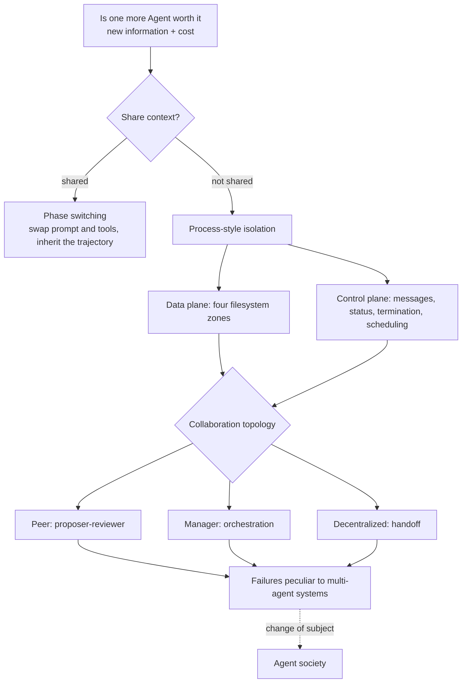

# Chapter 10　Multi-Agent Collaboration

[Back to contents](../README.md)

> This chapter is the deep-dive companion to Station 10, "Three Cobblers" (三个臭皮匠, after the proverb that three cobblers together equal one Zhuge Liang), of [π Workshop](https://pi.duanjl.com/). It assumes you have already played the station's three missions: [▶ 10-1 Get Another Pair of Eyes (再找个人看看)](https://pi.duanjl.com/#/play/10-1) · [▶ 10-2 The Same Sheet (同一张表)](https://pi.duanjl.com/#/play/10-2) · [▶ 10-3 Not My Department (这事不归我)](https://pi.duanjl.com/#/play/10-3), and flipped through the [Station 10 manual](../../manual/10-multi-agent.md) (the manual is written in Chinese only). The manual says "what you saw in the game"; this chapter covers the principles, Pi's real interfaces, and the trade-offs.

## Reading route

| Part in the manual | What this chapter picks up | Where |
| --- | --- | --- |
| [Execution evidence](../../manual/10-multi-agent.md#c-new-info) (10-1) | The new-information test, the academic-versus-engineering "contradiction", the cost ledger; what the reviewer in Pi's official subagent example actually gets to see beyond the worker's report | [10.1](#t-ma-new-info) |
| [Version lock](../../manual/10-multi-agent.md#c-lock) (10-2) | Lost updates, optimistic versus pessimistic locking; which conflict each of Pi's `write`, `edit`, and in-process write queue blocks; how to write a save tool with a version number | [10.7](#t-ma-lock) |
| [Handoff slip](../../manual/10-multi-agent.md#c-handoff-trail) (10-3) | The minimal handoff protocol; why the trail and the remaining budget must be held by the runtime; Pi has no handoff, so how to build one with host code | [10.9](#t-ma-handoff) |
| [First the stage: one conversation is one Agent](../../manual/10-multi-agent.md#c-sessions) | A table matching multi-agent systems to operating systems; three ways to start an "Agent" in Pi | [10.3](#t-ma-os) |
| The "go deeper" notes at the end of each manual section | Shared context, when it is actually better, Loop Engineering, three topologies and the manager, the data plane, semantic conflicts and worktrees, parallel settlement, the control plane, decentralization and A2A, six kinds of failure, Agent societies | 10.1, 10.2, 10.4 to 10.11 |
| Not in the game | True concurrency; writing a proposer-reviewer loop with the SDK; how cascading cancellation travels down Pi's process tree; the recursion risk of subagents | 10.4, 10.7, 10.8, 10.10 |

This chapter is based on Pi 0.87.1, pinned commit `f07218c4d4bbc12bef056a7058c3dd49dfe41abe`, and keeps the book's three markers: **[Built-in]** is behavior this version provides directly, **[Extension]** is something you can implement with Pi's interfaces but have to write code for, and **[Recommendation]** is a general engineering choice that Pi does not complete for you. The ideas from the original book come from chapter 10 of Li Bojie's *Understanding AI Agents in Depth*, "the original book" below.

The most important fact comes first: **Pi has no built-in multi-agent orchestration.** There is no `spawn_subagent`, no message bus, no `transfer_to_agent`, no A2A. What it gives you is a set of parts: an in-process SDK (`createAgentSession`), an RPC mode for child processes, one-shot `--mode json` output, extension events, JSONL session files, plus a [subagent extension example](https://github.com/earendil-works/pi/blob/f07218c4d4bbc12bef056a7058c3dd49dfe41abe/packages/coding-agent/examples/extensions/subagent/README.md#L1-L13) in the official `examples/` directory. Every collaboration structure in this chapter is, in Pi, an **[Extension]**: something you assemble from those parts.

The running scenario continues the store's monthly report from earlier chapters. A bilingual monthly report is due on Friday, and you plan to have Pi assemble a small team:

| Role | What it does |
| --- | --- |
| The worker that changes the program | Fixes the refund rule in the summary script |
| The reviewer | Decides whether the change can ship |
| Two translators | Translate the report into English at the same time, sharing one glossary |
| The manager | Splits the work, assigns it, collects the results |

A week later, customer service wants two Agents on duty as well: a front desk and an after-sales desk, each passing to the other what it cannot handle.

It sounds like a small company. The question the original chapter answers is when that company beats one capable employee, and when it only means more paychecks.

The original chapter is the widest in the book. It first gives a test (10.1), then cuts out two design dimensions: whether context is shared (10.2, 10.3) and the collaboration topology (10.4, 10.5, 10.9). In the middle come two pieces of infrastructure that do not depend on topology, the data plane and the control plane (10.6 to 10.8). Then come the failures peculiar to multi-agent systems (10.10), and finally a change of subject to Agent societies (10.11). The three topologies, the six failures, and the four items of the control plane are each parallel to one another; none of them is "A fails, so B".



<a id="t-ma-new-info"></a>

## 10.1 Before adding an Agent, ask what it will know

### The sign-off in 10-1

The worker says, "The spend-threshold discount is fixed; I checked all three amounts." You add a reviewer, and the reviewer reads the report and says: approved. After launch, not one customer who spends 30 yuan gets a discount.

The reviewer was neither lazy nor dim. The only thing in its context pod was the apprentice's paragraph. The apprentice thought it had fixed things, so the report said "fixed"; the reviewer read "fixed" and ruled "fixed". Two Agents share one blind spot, and this second look merely countersigned the mistake.

This is the central test of the original chapter: **does the collaboration introduce new information that a single Agent could not get at generation time?**

| Collaboration style | New information | Effect the original book reports |
| --- | --- | --- |
| The same model rereads and reviews its own output | None | Usually ineffective, even harmful |
| Several Agents debate the same text | None | On par with a single Agent at equal compute |
| Reviewer audits code with test execution results | Yes (execution feedback) | Significant improvement |
| Reviewer audits a frontend or slides from rendered screenshots | Yes (visual feedback) | Significant improvement |
| Reviewer verifies facts with external tools | Yes (tool feedback) | Significant improvement |

With the execution-evidence part installed, three more lines of real program output appear at the end of the reviewer's system prompt: "an order of 30 yuan should pay 25, computed 30 ✗". Those three lines are what the reviewer knows that the apprentice did not.

### Evidence on both sides: two different kinds of multi-agent

Here the original book deals with an apparent contradiction: some academic research says multi-agent setups do not raise the capability ceiling, yet in engineering some multi-agent systems clearly work far better.

| Evidence | What it shows |
| --- | --- |
| Huang et al., ICLR 2024 | Without external feedback, having GPT-4 review and revise its own answers makes accuracy **drop**: it turns right answers wrong more often than wrong answers right |
| Tran and Kiela, 2026 | On multi-hop reasoning, a single Agent is compared against five multi-agent architectures (sequential, debate, ensemble, parallel roles, parallel subtasks). With the thinking-token budget held strictly equal, the single Agent ties or wins |
| RLEF, 2025 | Reinforcement learning trains a model to use code-execution feedback to iterate on code, far beating independent repeated sampling. Every round carries real compiler errors and test failures |
| WebGen-Agent, 2025 | Multi-layer feedback from screenshots plus a vision model's descriptions reportedly lifts Claude 3.5 Sonnet on that benchmark from 26.4% to 51.9% |

Tran and Kiela use the **data processing inequality** from information theory to explain why debate does not help: the Agents are all processing exactly the same text, and every serial retelling of an intermediate conclusion can only lose information, never create it. Whatever gains debate shows in some papers are quite possibly just extra compute.

The contradiction has one root. Academic studies mostly compare "several Agents looking at the same context and discussing it", while the systems that work in engineering all have an external feedback loop. The former has no new information; the latter does.

The original book does not write everything off. **Sampling several times independently and aggregating** (self-consistency, majority voting), and the generate-versus-verify split that exploits the asymmetry **hard to generate, easy to verify**, are not among the things it rejects.

<a id="t-ma-when"></a>

### When it really is better, and the bill

New information does not come only from execution and rendering. In an open search space, the division of labor and the communication themselves can buy coverage. The original book cites Anthropic's 2026 vulnerability-hunting experiment:

| Setup | Tokens | Vulnerabilities found |
| --- | --- | --- |
| 45 Agents coordinating the search through a shared forum, reviewing each other, with an independent Agent as arbiter | 27 million | 266 |
| Independent Agents in parallel, not communicating | 6.5 million | 21 |

The Agents could shift search focus dynamically and form a division of labor. The cost is in the second column: **multi-agent systems often burn several times, even an order of magnitude, more tokens.** The original book's second test is therefore cost: if the gain does not cover the bill, a well-tuned single Agent is the better deal.

There is also a counterintuitive result. Google's 2025 paper "Budget-Aware Tool-Use Enables Effective Agent Scaling" found that **simply granting more steps does not guarantee better results**: an Agent with no sense of budget, even with 300 steps, tends toward shallow search and "saturates" quickly. BAVT in 2026 adjusts exploration versus exploitation each step in proportion to the remaining budget: cast a wide net early, dig deep later. From this the original book asks the manager to **allocate step budgets dynamically** by subtask complexity, and to steer subagents to "plan first, then implement, then test, then improve".

> **Further reading**: why Cognition's "Don't Build Multi-Agents" and Anthropic's multi-agent research system are not actually in conflict, and the "multi-agent systems use about 15 times the tokens of an ordinary chat" figure Anthropic reported, are in [The Rise and Fall of Multi-Agent Systems](notes/multi-agent.md#a-debate-in-june-2025). Those numbers come from the articles the further reading cites, not from the original book.

### How Pi does it: what the reviewer in the official example gets to see

**[Extension]** Pi's official subagent example ships four roles and three preset workflows, and one of them is exactly proposer-reviewer: `/implement-and-review` has the worker implement, the reviewer review, and the worker revise according to the comments. [Example: implement-and-review](https://github.com/earendil-works/pi/blob/f07218c4d4bbc12bef056a7058c3dd49dfe41abe/packages/coding-agent/examples/extensions/subagent/prompts/implement-and-review.md#L1-L10) Measure this chain with the yardstick from 10-1:

| What the reviewer holds | Where it comes from | New information? |
| --- | --- | --- |
| `{previous}`: the worker's last paragraph of text | In chain mode, the previous step's final output is substituted verbatim into the next step's task | **No.** This is exactly the "fixed" report from 10-1 |
| The result of `git diff` | The reviewer's strategy begins by running `git diff`, then reading the changed files | Yes. It is a real record of what the worker changed, not its own account |
| Test results | The role definition says "do not modify files and do not run builds" | None |

[Example: `{previous}` substitution in chain mode](https://github.com/earendil-works/pi/blob/f07218c4d4bbc12bef056a7058c3dd49dfe41abe/packages/coding-agent/examples/extensions/subagent/index.ts#L554-L597), [Example: the reviewer role](https://github.com/earendil-works/pi/blob/f07218c4d4bbc12bef056a7058c3dd49dfe41abe/packages/coding-agent/examples/extensions/subagent/agents/reviewer.md#L1-L16)

So this chain is a notch better than 10-1 without the part installed: the diff is independent evidence. But it is one step short of "execution evidence". The reviewer can see the threshold change from 30 to 36, yet has to read the spec to infer whether that is right; there is no line of run output saying "30 yuan computed 30". 10.4 shows how to write the missing step.

<a id="t-ma-context"></a>

## 10.2 Shared context, or each to their own

### One static prompt cannot carry several phases

Start with the lightest kind of "multi-agent". The monthly-report task has several phases: understand the requirements, query the data, write code, write the summary. Using one system prompt throughout is either too vague or, if it stuffs in the guidance for every phase, too long. The original book's answer is **multi-phase role switching**: at each phase, swap in a different system prompt and tool set. Identity, duties, and abilities all change, so it counts as a new Agent; but it inherits the entire trajectory before it, like a colleague taking over a shift and reading the predecessor's work log.

This is the original book's first design dimension:

| | Shared context | Unshared context |
| --- | --- | --- |
| How | The next Agent receives the previous one's full conversation and trajectory | Each Agent keeps its own context, trajectory, and state |
| What it is like | A developer gets not just the requirements document but all the communication between analyst and user | Departments work at their own desks and exchange information through shared documents and meeting minutes |
| Upside | No information lost; any phase can be looked back on at any time | Modular, easy to extend, truly concurrent, failures do not spread |
| Trouble | Context bloat; the previous role's **inertia** is carried over | Information must be synchronized explicitly; interfaces and data formats must be designed |

Thinking question 1 in the original book gives an example of inertia: a "code reviewer" that inherits the context of a "requirements analyst" may still tend to think from the requirements angle rather than the code-quality angle.

### Two carriers for switching roles, with different cost models

For role switching inside shared context, the original book points out a choice that is often overlooked yet directly changes the architecture:

| Choice | Where the role's procedure lives | Tool visibility | Cache effect | Binding force |
| --- | --- | --- | --- | --- |
| `transfer_to_agent` | Replaces the system prompt, usually the tool set too | Only the current role's tools are exposed | Each switch changes the request prefix; the cache from the point of change onward usually cannot be reused | Strong: out-of-bounds tools are invisible at the schema level |
| Skill | A fixed Skill catalog sits in the system prompt, and `SKILL.md` is appended to the end of the trajectory on demand | Usually the full tool set stays exposed | The static prefix is unchanged and the existing prefix keeps being reused | Weak: a Skill is only a behavioral instruction; hard permissions still need a Harness gate |

The original book's selection rule: when role differences come mainly from **knowledge, procedure, writing style**, use a Skill; when they involve **permissions, tool isolation, compliance boundaries**, or when the runtime must forcibly forbid some class of action, use a separate Agent or `transfer_to_agent`, and restrict tool calls in code at the Harness layer.

Experiment 10-1 compares the two routes on one task: look up China's new-energy-vehicle sales for 2021 to 2023, compute the CAGR, and write an investor summary of at most 120 characters. Route one has five roles, triage, research, coding, data_analysis, writing, each seeing only its own tools plus `transfer_to_agent`; route two fixes the system prompt and the full tool set, and the model calls `load_skill(name)` as needed. The original book gives the experimental design but no result numbers.

### How Pi does it: three ways to "switch roles"

Pi has no `transfer_to_agent`, but several of its ready-made interfaces land at exactly three places in this table.

**[Built-in] The Skill row.** Chapter 2 explained that by default Pi puts only a Skill's name and description into the system prompt, and the model `read`s the body into the trajectory ([Chapter 2, 2.7](02-context.md#t-ctx-skills)). That is the original book's "Skill route".

**[Extension] Switching tools inside one session: the row closest to transfer.** The official plan-mode example splits one session into a read-only planning phase and an execution phase, with one interface for each of three jobs:

| What it does | Interface | Corresponds in the original book to |
| --- | --- | --- |
| Turn off `edit` and `write` during planning | `pi.setActiveTools()` | Switching the tool set |
| Let `bash` run only read-only commands on an allowlist | `tool_call` returns `block: true` | A hard constraint at the Harness layer |
| After leaving planning, filter the old "[PLAN MODE ACTIVE]" prompt out of the context | The `context` event rewrites the messages sent to the model | Dealing with role inertia |

[Example: switching the tool set](https://github.com/earendil-works/pi/blob/f07218c4d4bbc12bef056a7058c3dd49dfe41abe/packages/coding-agent/examples/extensions/plan-mode/index.ts#L104-L113), [Example: blocking commands off the allowlist](https://github.com/earendil-works/pi/blob/f07218c4d4bbc12bef056a7058c3dd49dfe41abe/packages/coding-agent/examples/extensions/plan-mode/index.ts#L164-L174), [Example: filtering out stale phase prompts](https://github.com/earendil-works/pi/blob/f07218c4d4bbc12bef056a7058c3dd49dfe41abe/packages/coding-agent/examples/extensions/plan-mode/index.ts#L177-L198)

The third row deserves a second look. The original book says inherited history interferes with the current role but offers no concrete remedy; plan-mode's approach is to tag the phase prompt, and at the phase change remove it by tag from the messages sent to the model, leaving the record in the session file untouched. This is an observation of this book, not from the original book.

On the cache column, Pi is not quite the same as the `transfer_to_agent` row in the original table. Chapter 2 explained that Pi writes a tool-set change as a system message of `toolsAdded` / `toolsRemoved` **appended** before the new messages, rather than rewriting the prefix ([Chapter 2, 2.4](02-context.md#t-ctx-cache-arch)); the official docs also recommend changing prompt sections and tool selection first, so that Pi only appends one change patch. [Official docs: before_agent_start](https://github.com/earendil-works/pi/blob/f07218c4d4bbc12bef056a7058c3dd49dfe41abe/packages/coding-agent/docs/extensions.md#L101) So in Pi, "switching tools" is cheaper for the cache than the replace-style switch the original book describes, at the price that the old tools' declarations stay in the earlier history.

**[Built-in] Inherit the whole trajectory, take a new identity.** `pi --fork <session>` branches an existing session into a new one, and the new file's header records `parentSession`. [Official docs: --fork](https://github.com/earendil-works/pi/blob/f07218c4d4bbc12bef056a7058c3dd49dfe41abe/packages/coding-agent/docs/cli.md#L93-L94), [Official docs: parentSession](https://github.com/earendil-works/pi/blob/f07218c4d4bbc12bef056a7058c3dd49dfe41abe/packages/coding-agent/docs/session-format.md#L72-L76) Add `--tools read,grep,find,ls` and `--append-system-prompt reviewer.md` and you have the original book's "next Agent with shared context": it can see its predecessor's whole log, with only identity and tools changed (this combination was not actually run for this book).

**[Extension] In between: hand over only a summary.** The `/handoff <goal>` command of the official `handoff.ts` example neither compacts nor forks. Instead it asks the model to distill from the current conversation "decisions made, files involved, next task" into a self-contained prompt, which you edit and use to open a new session with `parentSession`. [Example: what handoff asks to distill](https://github.com/earendil-works/pi/blob/f07218c4d4bbc12bef056a7058c3dd49dfe41abe/packages/coding-agent/examples/extensions/handoff.ts#L20-L40), [Example: opening the new session and recording the parent](https://github.com/earendil-works/pi/blob/f07218c4d4bbc12bef056a7058c3dd49dfe41abe/packages/coding-agent/examples/extensions/handoff.ts#L174-L183) The new session has none of its predecessor's thinking, only a handoff note. It is one step from "unshared context": the note is reviewed by a human before it goes out.

<a id="t-ma-os"></a>

## 10.3 After isolation: multi-agent as an operating system

### The original book says this is the real multi-agent

The bloat and inertia of shared context cannot be cured. The original book calls **unshared context** "true multi-agent collaboration": each Agent is an independent entity, none can see the others' "inner activity", and collaboration relies entirely on explicit communication. Station 10 of π Workshop takes this side: [one conversation is one Agent](../../manual/10-multi-agent.md#c-sessions), and across conversations only the files in the data pod remain.

Distributed systems have long had an answer for explicit communication. Inter-process communication (IPC) has only two paradigms: **shared memory** and **message passing**. The three communication mechanisms of the Agent world all fall within them:

| Mechanism | Suited to | Which paradigm |
| --- | --- | --- |
| Tool-call arguments: wrap the downstream Agent as a tool | Well-typed, clearly structured work | Message passing, synchronous |
| Shared filesystem | Large products that must persist | Shared memory |
| Message bus | Many Agents, asynchronous work | Message passing, asynchronous |

The Go language has a proverb that the original book also quotes: "Do not communicate by sharing memory; instead, share memory by communicating." 10.7 will show you why people who write Go keep saying it.

Following the IPC thread one step further, the original book gives a rather complete mapping (Table 10-2):

| Operating system | Multi-agent system | Counterpart in Pi 0.87.1 |
| --- | --- | --- |
| Program (executable) | Static prefix: system prompt plus tool definitions | `--append-system-prompt`, `--tools`; the SDK's resource loader and `tools` allowlist |
| Process memory | Trajectory | The session, persisted by default as one JSONL file |
| CPU | LLM | The selected model |
| Kernel | Agent runtime | `AgentSession` |
| System call | Tool call | Tool calls; the `tool_call` hook is the check at the system-call entrance |
| fork | `spawn_subagent` | Not built in. Start a child process or a new session |
| kill | `cancel_subagent` | RPC `abort`, SDK `session.abort()`, sending a signal to the child process |
| ps | `list_agents` | None |
| Exit code and `wait()` | Structured summary returned by the subagent | Child-process exit code plus the last assistant text |
| Shared memory / message passing | Shared filesystem / messages | The same working directory / RPC `steer`, `follow_up` |

The third column was added by this book and is not from the original book. The original book also says the abstraction is not new: private state, asynchronous messages, and the ability to create new members are exactly the basic setup of the **Actor model** of Hewitt et al. in 1973, and a multi-agent system can be seen as its LLM edition.

The benefits of isolation are real: each Agent can be developed and tested independently, new abilities do not change existing code, one failing Agent does not pass bad state to the others, and true concurrency is possible. The costs are just as real: do the Agents agree on the state of the task? Does information get lost or duplicated as it is passed along? When something goes wrong, you may need to read several logs to piece the whole story together. So **interface specifications, data formats, and communication protocols** become critical.

### How Pi does it: three ways to start an "Agent"

In Pi, the plainest implementation of "an Agent" is "a session". There are three ways to start one:

| Entry point | Process boundary | Control | Suited to |
| --- | --- | --- | --- |
| SDK: `createAgentSession()` | Same process | Call `prompt()`, `steer()`, `abort()` directly, `subscribe()` to events | A Node.js host, with the manager and all Workers in one process |
| RPC: `pi --mode rpc` | Child process, long-lived | Write JSON commands to standard input, read responses and events from standard output | A host written in another language; when you want process isolation |
| One-shot: `pi --mode json -p` | Child process, exits when done | Read-only event stream on the output | Hand off one job, get one conclusion |

[Official docs: SDK session lifecycle](https://github.com/earendil-works/pi/blob/f07218c4d4bbc12bef056a7058c3dd49dfe41abe/packages/coding-agent/docs/sdk.md#L26-L60), [Source: CreateAgentSessionOptions](https://github.com/earendil-works/pi/blob/f07218c4d4bbc12bef056a7058c3dd49dfe41abe/packages/coding-agent/src/core/sdk.ts#L41-L90), [Official docs: how RPC and the SDK divide the work](https://github.com/earendil-works/pi/blob/f07218c4d4bbc12bef056a7058c3dd49dfe41abe/packages/coding-agent/docs/rpc.md#L3-L10)

The official subagent example takes the third route: for each job it `spawn`s a `pi` child process with the arguments `--mode json -p --no-session`, adds `--model`, `--tools`, `--append-system-prompt` per role, and finally writes the task as `Task: …` for the prompt. [Example: child-process arguments](https://github.com/earendil-works/pi/blob/f07218c4d4bbc12bef056a7058c3dd49dfe41abe/packages/coding-agent/examples/extensions/subagent/index.ts#L300-L341) Against Table 10-2 it is clear: the role definition file is the "program", the child process is the "process", and `--no-session` means this "process memory" is never written to disk and vanishes when the process exits.

How to choose among the three, this book's advice: if the manager has to interject, call a halt, or read usage while a Worker is mid-run, use the SDK or RPC, not a one-shot child process; if you want a Worker's crash not to drag down the manager, use a child process; if you want several Workers to share an in-process lock or in-memory state (10.7 and 10.9 will use this), use the SDK and put them in one process.

<a id="t-ma-loop"></a>

## 10.4 Peer collaboration: proposer-reviewer and Loop Engineering

### Premature termination: it says it is done, and it is not

Peer collaboration is usually two or three Agents of equal standing giving each other feedback over several rounds. Its classic use is to deal with a kind of failure that is extremely common in Agent practice: **premature termination**. The original book gives examples from Coding Agents and from the author team's Pine AI (an Agent that phones merchants and carriers on the user's behalf):

| Form | What it looks like |
| --- | --- |
| Lazy fake completion | Code is written but tests are not run and deployment is not tried, yet it reports "task complete"; the user asks for two things, the first is done, and it says "all done" |
| Giving up early | One call is refused and it tells the user "this can't be done", when filling in a form or sending an email would probably have worked |
| False success | The other side agrees to the refund verbally, the user still has to confirm one step in the app, and the Agent reports "settled" while the refund never lands |

Three forms, one root: **until verified, "done" is only the model's claim, not proof.** The apprentice in 10-1 is the first kind.

### Loop Engineering: the bottleneck is the verifier

Turning a claim into proof is the subject of **Loop Engineering**: designing a loop that keeps an Agent running, "find the next thing → execute → verify → record progress", where a **verifier**, not the model itself, decides whether it can stop. The name was proposed in June 2026 in a summary by Addy Osmani; Boris Cherny, who leads Claude Code, puts it more bluntly: "I no longer prompt Claude directly; my job is to write loops." The core consensus of the industry discussion is one sentence:

> **The bottleneck of the loop is the verifier, not the model.**

If verification is unreliable, the faster the loop spins, the faster it merely marks poor output as done. The original book gives two concrete frameworks:

| Framework | How it works | The original book's caveat |
| --- | --- | --- |
| LoopX | Pulls the loop out of prompts and chat history into a runtime-independent persistent control plane: LoopX decides → the Agent executes → an independent verifier proves → LoopX commits. Only verified results are written to progress and spend quota | v0.4.0's controlled-turn path is still experimental, used only as an example of "loop plus verification plus termination condition", not as evidence of quality gains |
| LongHorizon-Harness | Manage–Execute–Audit: the manager gives the next bounded subtask, the executor changes the environment in a **fresh context**, the auditor checks the real result **read-only**, and only an audit pass advances the task state | Same model (Qwen 3.7-Plus), same backend (Claude Code), only the outer loop changed: WeaveBench 51.8% → 80.7%, OSWorld 2.0 2.8% → 8.3%, Terminal-Bench 2.1 69.7% → 77.2%. The cost varies: the first two benchmarks used 2.3 times the total tokens and 3.6 times the output tokens of the baseline, while Terminal-Bench 2.1 used 24% fewer |

LoopX's invariant is worth copying and taping to your monitor: **a model may propose "done", but it cannot approve its own "done".** The published LongHorizon trajectories contain a contrast: on the same WeaveBench task, the baseline got stuck on a Wireshark interaction and retried repeatedly, scoring 0.59; MEA wrote the failure and the unmet evidence items back into the task state, later rounds filled only the gaps, and it scored 0.92. The original book specifically notes that a single trajectory is used only to show "how a failure becomes the next round's input" and cannot stand in for overall statistics.

### The minimal invariant of proposer-reviewer

The most effective way to organize verification is proposer-reviewer. The three experiments in chapter 5 of the original book (slide generation, video editing, log visualization) already used it; here is its minimal invariant:

```python
candidate = proposer(task, constraints)
evidence = execute_or_render(candidate)       # tests, state, screenshots, fact checks
review = independent_reviewer(candidate, evidence)

while review.veto and budget_remaining:
    candidate = proposer.repair(candidate, review.findings)
    evidence = execute_or_render(candidate)
    review = independent_reviewer(candidate, evidence)

if review.pass:
    publish(candidate, evidence, review)
else:
    escalate_or_reject(review)
```

Three rules:

1. The reviewer reads **independent evidence**, not the proposer's explanation. The value of slide review lies in "render and take a screenshot", not in "have the same model look at the code again".
2. A rejection comes with a **locatable repair condition**: "an order of 30 yuan should pay 25, computed 30", not "something's wrong".
3. The reviewer **cannot change** the tests, the evidence collector, or the release bar, otherwise independent verification degrades into self-approval. This is the same rule as [Chapter 9's root of trust](09-evolution.md#t-ev-trusted-root).

Two more supporting papers. The 2024 TACL survey "When Can LLMs Actually Correct Their Own Mistakes?" confirms that without reliable external feedback, pure self-correction hardly works. ICLR 2024's CRITIC has the model verify its own answers with a search engine and a Python interpreter, with marked gains; take away the tool verification and keep only self-assessment, and most of the improvement disappears. Anthropic's 2026 long-running application-development experiment turned it into three Agents, planner, generator, evaluator: the planner expands the requirements into a product spec, the generator and evaluator first agree on completion criteria for each round, the evaluator drives the real app with Playwright to file defects, and the Agents hand off through files. The original book's conclusion: when a task goes beyond what a single model can reliably complete, independent review backed by external evidence can trade a **markedly higher cost** for better development quality.

Peer collaboration has three more parallel variants, each given a paragraph in the original book: **debate** (a supporter and an opponent rebut in turn; the effect is disputed, see 10.1); **brainstorming** (each produces ideas independently and then they inspire each other, from "social sharing" to "personalized posters" to "a poster-template marketplace"; diversity has to be manufactured actively through different prompts or models); and **expert panel** (engineering, product, and operations each look at the same problem from their own field, complementing rather than opposing one another).

Chapter 4 covered [the proposer-reviewer at the tool level](04-tools.md#t-tool-proposer), which guards a single irreversible operation; here it guards a whole piece of work.

### How Pi does it: an SDK review loop with execution evidence

**[Extension]** 10.1 said the official example's reviewer lacks execution evidence. The cleanest way to supply it is to let the host program run the tests, with the reviewer only reading the evidence and submitting a verdict:

```ts
// Mechanism sketch, not actually run for this book. The host starts two sessions with the SDK; tests are run by the host, and the results do not pass through the proposer.
import { execFileSync } from "node:child_process";
import { Type } from "typebox";
import { createAgentSession, defineTool, SessionManager } from "@earendil-works/pi-coding-agent";

let verdict = { approve: false, findings: "The reviewer submitted no verdict" };
const submitReview = defineTool({
  name: "submit_review", label: "Submit review",
  description: "Submit the review verdict. When approve is false, findings must state a locatable repair condition.",
  parameters: Type.Object({ approve: Type.Boolean(), findings: Type.String() }),
  async execute(_id, params) { verdict = params; return { content: [{ type: "text", text: "Recorded" }], details: {} }; },
});

function collectEvidence(): string {
  try { return execFileSync("npm", ["test", "--silent"], { encoding: "utf8" }); }
  catch (e: any) { return `exit code ${e.status}\n${e.stdout ?? ""}${e.stderr ?? ""}`; }
}

const { session: proposer } = await createAgentSession({ sessionManager: SessionManager.inMemory() });
await proposer.prompt("Following spec.md, fix the spend-threshold discount in rules.json.");

for (let round = 1; round <= 3; round++) {
  verdict = { approve: false, findings: "The reviewer submitted no verdict" };
  const { session: reviewer } = await createAgentSession({
    tools: ["read", "grep", "find", "ls", "submit_review"],   // the allowlist also governs custom tools, so list it
    customTools: [submitReview],
    sessionManager: SessionManager.inMemory(),               // a fresh reviewer each round, not pulled along by the last round's comments
  });
  await reviewer.prompt(
    `Review this change: read spec.md and rules.json, combine them with the test results below, and submit your verdict with submit_review.\n\n` +
    `<execution-evidence source="host just ran npm test, not via the proposer">\n${collectEvidence()}\n</execution-evidence>`,
  );
  reviewer.dispose();
  if (verdict.approve) break;
  await proposer.prompt(`Review sent it back (round ${round}): ${verdict.findings}`);
}
proposer.dispose();
```

Each design choice answers one of the original book's rules:

| What the sketch does | The rule it answers | Basis |
| --- | --- | --- |
| `collectEvidence()` runs in the host, and the result is wrapped in a source marker | Independent evidence, recognizable source | [Chapter 2's source markers](02-context.md#t-ctx-injection) |
| The reviewer's tool allowlist has no `bash`, `edit`, or `write` | The reviewer cannot change tests or code | The SDK `tools` option is an allowlist that limits built-in, extension, and custom tools alike. [Source: the tools option](https://github.com/earendil-works/pi/blob/f07218c4d4bbc12bef056a7058c3dd49dfe41abe/packages/coding-agent/src/core/sdk.ts#L65-L78) |
| The verdict goes through a structured tool; the last paragraph of text is not read | The verdict is decidable, and not submitting counts as not passing | `verdict` defaults to not approved |
| `round <= 3` | `budget_remaining` | Beyond that it should escalate to a human |

One more thing the sketch does not do: **the test files themselves** sit in the proposer's working directory, and the proposer has `write`. It can edit the failing cases away and turn the "execution evidence" green. The tests that decide whether something can ship belong where the proposer cannot write ([Chapter 9, 9.8](09-evolution.md#t-ev-trusted-root), [Sandbox special topic](s-sandbox.md)). The official reviewer's role definition contains an honest line: "assume tool permissions cannot be fully enforced; use `bash` only for read-only commands." [Example: the reviewer's read-only convention](https://github.com/earendil-works/pi/blob/f07218c4d4bbc12bef056a7058c3dd49dfe41abe/packages/coding-agent/examples/extensions/subagent/agents/reviewer.md#L10-L11) That is a convention in a prompt, not a permission. The sketch chooses not to give it `bash` at all, swapping the convention for an allowlist.

<a id="t-ma-topology"></a>

## 10.5 Three topologies

### The second dimension: who is in charge

Context is one dimension; the other is the **collaboration topology**: the structure through which control and information flow.

| Topology | Who is in charge | Suited to | Trouble |
| --- | --- | --- | --- |
| Peer | Two or three Agents of equal standing iterate in a fixed topology, such as a drafter and a critic | Proposer-reviewer, debate | Struggles once subtasks multiply and dependencies get complicated |
| Manager (orchestration) | One Manager plans and dispatches, and several subagents each own a piece | Many subtasks, dynamic scheduling | The Manager is a single-point bottleneck |
| Decentralized | No central controller in the runtime; Agents talk to each other directly | Removing the single point, mimicking the checks and balances of human organizations | Handoffs can form cycles (10.9) |

In passing, the original book introduces **Graph Engineering**, which became popular from July 2026: explicitly designing the execution graph, with nodes that are Agents, ordinary programs, or human decisions, and edges that define dependencies, conditional routing, and where failures go. The three topologies are simply different graphs. 10-1 is peer, 10-3 is decentralized, and the manager pattern has no mission in Station 10.

<a id="t-ma-manager"></a>

### Manager pattern: treat every Agent as a tool

When there are many subtasks, dynamic scheduling is needed, and dependencies are complex, peer collaboration is not enough. The Manager is like a project manager: it understands the whole task, splits it into assignable subtasks, picks suitable Agents, tracks progress, handles exceptions (retry, swap people, adjust the plan), and integrates at the end.

The original book's model is clean: **every specialized Agent is a tool the Manager can call.** From the Manager's point of view, calling an Agent is not fundamentally different from calling a search tool. The benefit is extensibility: a new ability only requires developing the corresponding Agent and registering it as a tool; it also naturally supports heterogeneity, with different Agents using different models, prompts, tool sets, even running on different hardware.

There are two troubles: the Manager must understand all the subtasks, so any decision error affects the whole; and it must maintain a global context, which bloats as calls multiply. Plan-and-Act in 2025 gave empirical support: in a Planner-Executor architecture, **a weak planner is the most critical bottleneck of the whole system**. That work reached 57.58% on WebArena-Lite, with the contribution coming mainly from improving the Planner, not the Executor. The lesson: **give the strongest model and the most carefully written prompt to the Manager**, rather than spreading them evenly.

The original book divides the manager pattern into three forms:

| Form | Control flow | The original book's example |
| --- | --- | --- |
| Sequential coordination | The Manager calls in turn, deciding the next step each time one returns | Experiment 10-2, book translation |
| Parallel coordination | Several Agents work at once, often needing a message bus (a "public bulletin board", publish and subscribe) | Experiment 10-3 phone plus computer, experiment 10-4 parallel search |
| Manager writes workflow code first | Handed to a deterministic runtime to execute, with the Manager no longer in the loop | `agent()`, `parallel()`, `pipeline()` of Claude Code's Workflow tool |

**Experiment 10-2: book translation.** A single Agent translating from start to finish fills its context with the glossary, translated chapters, the current passage, its reasoning, and tool results, and soon overflows the window; worse, it gets "lost" in a context that long: the rendering in chapter 9 does not match chapter 2, proofreading repeats checks, and it even "recalls" terminology rules that do not exist. The original book splits the job into four roles:

| Role | What it looks at | What it hands in |
| --- | --- | --- |
| Glossary Agent | The whole book | A structured glossary (English, Chinese, part of speech, context), written to the shared filesystem and then destroyed |
| Translation Agent | The current chapter, the glossary, the translation guide | A translation file (such as `chapter1_zh.md`), with new terms marked "pending review". Each instance has its own context and can run in parallel |
| Proofreading Agent | All translations and the glossary, attending only to consistency | A proofreading report |
| Manager | Task description, plan, call records, progress, **storing only a file index, not translations** | Sends a chapter back for retranslation per the proofreading report |

The glossary in 10-2 is the smallest piece of this architecture.

**Experiments 10-3 and 10-4: parallel.** 10-3 is heterogeneous parallelism: the user supplies just one URL, and the Computer Agent identifies the form fields, does the orchestration, and decides on its own whether to call `initiate_phone_call_agent`; the original book specifically requires that **a Python rule such as "field count exceeds a threshold" must not replace the model's decision**. Each time the phone Agent receives a valid value it sends `info_collected`, asking the next item without waiting for the web page to finish filling; if the page fills it wrongly it replies `fill_error`, if the format is wrong `format_invalid`, and when everything is collected it sends `task_completed`. 10-4 is homogeneous parallelism: the Manager dynamically creates 10 Computer Use Agents, each searching one college website for a faculty member named "Zhang Wei", monitored in real time over the message bus; when one finds him, the rest are terminated in cascade, and each Worker times out after 2 minutes. 10.7 and 10.8 return to it.

The original book also cites a productized manager pattern: **Lingtai** (灵台). The main spirit (器灵) is the Manager; a "split-mind" (分神) is a short-lived parallel worker, discarded when done and bringing back only its conclusion; a "split-body" (分身) is a persistent teammate with its own memory, mailbox, and duties. When context is about to fill up, the main spirit "sheds its shell" (凝蜕): it writes a summary for itself and continues in a clean context with its persistent memory (corresponding to [Chapter 2's compaction](02-context.md#t-ctx-compress)). Identity, memory, and abilities are all ordinary files in the project directory, in the phrase "the spirit is its files".

**The manager writes code first.** In the first two forms the Manager stays in the loop throughout: every job dispatched means one model decision, and the context grows with the calls. The other approach has the Manager first write the workflow as code and hand it to a deterministic runtime:

```javascript
const results = await pipeline(
  DIMENSIONS,                                     // seven directions to be verified
  d => agent(research(d), { schema: FINDINGS }),  // stage one: research
  r => parallel(r.findings.map(f => () =>         // stage two: verify each finding independently
         agent(verify(f), { schema: VERDICT })))
)
await agent(writeProvenance(results.flat()))      // summary: wait for all the results
```

This is the Claude Code Workflow example from the original book, not Pi syntax. Each `agent()` is a subagent with its own context, handing back only a structured conclusion according to its schema.

### How Pi does it: the official example is a manager

**[Extension]** The official subagent example is a standard manager pattern: the main session is the Manager, `subagent` is one of its tools, and the four role files are the four "specialized Agents" it can call.

| Requirement from the original book | How the example does it | Basis |
| --- | --- | --- |
| Subagents as tools | Registers one `subagent` tool, with three modes to choose from: single `{agent, task}`, parallel `{tasks}`, chain `{chain}` | [Example: tool parameters](https://github.com/earendil-works/pi/blob/f07218c4d4bbc12bef056a7058c3dd49dfe41abe/packages/coding-agent/examples/extensions/subagent/index.ts#L459-L469) |
| Sequential and parallel | Chain runs step by step and stops at the first failing step, reporting which step it was; parallel allows at most 8 tasks, 4 running at a time | [Example: parallel limits](https://github.com/earendil-works/pi/blob/f07218c4d4bbc12bef056a7058c3dd49dfe41abe/packages/coding-agent/examples/extensions/subagent/index.ts#L33-L36) |
| Return only a structured summary | Each subagent returns only its last assistant paragraph to the main session, at most 50 KB per task in parallel mode; the role files specify the output format | [Example: truncation and aggregation](https://github.com/earendil-works/pi/blob/f07218c4d4bbc12bef056a7058c3dd49dfe41abe/packages/coding-agent/examples/extensions/subagent/index.ts#L669-L685) |
| Heterogeneous, strong model for hard jobs | scout uses Haiku for quick reconnaissance, planner, reviewer, and worker use Sonnet; a role file that names no model inherits the main session's model and thinking level | [Example: roles and models](https://github.com/earendil-works/pi/blob/f07218c4d4bbc12bef056a7058c3dd49dfe41abe/packages/coding-agent/examples/extensions/subagent/README.md#L140-L155) |
| Strongest model to the Manager | Not handled by the example; which model the main session uses is up to you | |

Now to match the original book's three forms. Preset flows like `/implement` (scout → planner → worker) are **prompt templates that have the main session's model call chain mode**, with the model still in the loop at every step: the first form. The original book's third form (workflow as code, handed to a deterministic runtime) takes host code you write yourself in Pi: use `createAgentSession` to start one session each for the glossary, for translating each chapter, and for proofreading, run chapters in parallel with `Promise.all`, and let the code decide whether to send a chapter back for retranslation according to the proofreading report. The parallelism here is the host starting several sessions and waiting for them, not one model waiting on a tool; before aggregating, the host should also check that all the outputs used the same version of the inputs and the glossary, and refuse to aggregate if they do not.

<a id="t-ma-data-plane"></a>

## 10.6 The data plane: the filesystem as an Agent sees it

### Where the products go, and who can write

Once Agents are isolated, where do products go, who can read and write them, and who will conflict? The original book's answer is a **virtual filesystem**: storage of different origins, lifecycles, and permissions mounted under one directory tree, accessed by Agents through a uniform read/write interface, with local scratch disk, object storage, third-party drive APIs, or read-only resource packs underneath. The original book compares it to the Agent's address space, and the four kinds of zone are memory segments with different permissions:

| Zone | Visibility | Lifecycle | Read/write | Concurrency control |
| --- | --- | --- | --- | --- |
| The Agent's own workspace (Scratchpad) | Only itself | Destroyed with the instance | Read/write | Not needed |
| Multi-agent shared space | Collaborating Agents plus the user | Lasts with the task, must persist | Read/write | Needed: optimistic lock or worktree |
| Externally mounted resources (such as `/mnt/gdrive`) | Depends on external authorization | Decided by the external source | Mostly read-only, write with caution | Up to the external source |
| Built-in system resources (such as Skills) | All Agents | Stable across sessions | Read-only | Not needed |

This table is Table 10-3 of the original book, which recommends using it as a checklist for filesystem layout. Scratchpad isolation does double duty: temporary files do not overwrite each other, and a subagent's trial and error stays in its own workspace while only the final product is delivered to the shared space, keeping the main context lean; this is what [Chapter 2, 2.10, subagent isolation](02-context.md#t-ctx-isolation) looks like at the storage layer. An external mount differs from a local disk in three ways: access is bound by external permissions; latency is high and consistency weak, so it can only be treated as eventually consistent; and it is mainly read-only on demand, where a stray write pollutes the user's real data. The uniform file interface spares the Agent from needing a custom tool per data source, and also **hides** those differences, so read-only status, timeouts, and credentials need explicit management at the mount layer. The original book says a good share of concurrency conflicts and information leaks come from mixing zones that should have been kept apart.

The last convention is the most practical: **file paths as the universal interface**. Between Agents, when a main Agent hands inputs to a subagent, even when exchanging products across organizations, what is passed is a lightweight path string, and the content is not poured into the other side's context.

### How Pi does it: only one real directory tree

Pi has no virtual filesystem and no mount layer. Its built-in tools read and write the real disk directly, with relative paths resolved against the session's `cwd`. The four zones in Pi can only be done with directory conventions and permissions:

| The original book's zone | How to do it around Pi | Marker |
| --- | --- | --- |
| Scratchpad | Give each subagent its own `cwd`; each task in the official example can set its own `cwd`, and when it writes its own temporary prompt file it also uses a private `mkdtemp` directory with file mode `0600` | **[Extension]** [Example: private temporary files](https://github.com/earendil-works/pi/blob/f07218c4d4bbc12bef056a7058c3dd49dfe41abe/packages/coding-agent/examples/extensions/subagent/index.ts#L239-L247) |
| Shared space | The project directory itself, or an agreed `shared/` | **[Recommendation]** |
| External mount | None. Either write it as a tool (following [Chapter 4's tool contract](04-tools.md#t-tool-contract)) or have the operating system mount it | **[Recommendation]** |
| Built-in system resources | The Skill directory. Pi does not make it read-only: an Agent with `write` can still change it | **[Recommendation]** Read-only must be done at the filesystem permission layer |

The last row is the thing Chapter 9 kept saying: "read-only" must be implemented at a layer the modified party cannot reach ([Sandbox special topic](s-sandbox.md)). One more detail: the example passes `--no-session` to the child process, so a subagent's trajectory is not written to disk. To use 10.8's "read the trajectory file to check status", change it to `--session-dir` with a directory.

<a id="t-ma-lock"></a>

## 10.7 Parallel writes and the version lock

### Two people both say "saved"

In 10-2, the two translators both set out holding version 1 of the glossary. A adds "Agent: 智能体" and writes the whole table back; B adds "Harness: 马具" (literally "horse tack") on version 1 and also writes the whole table back. The result: only "马具" is left in the table, and both report "saved".

In databases this is called a **lost update**: two transactions both "read, modify, write back", the later write overwrites the earlier, and both believe they succeeded. The original book divides conflicts over shared files in multi-agent systems into two kinds:

| Conflict | What it looks like | Countermeasure |
| --- | --- | --- |
| Simple conflict (file level) | Two Agents edit the same file and the later write overwrites the earlier | Optimistic locking |
| Semantic conflict (logic level) | Zero conflict at the file level, but logically contradictory | Higher-level semantic validation; worktree isolation |

**Optimistic locking** is an old database technique: keep a version number or timestamp per file, note it when reading, check it when writing, fail if it does not match, and the Agent rereads the latest version and does it again. The cost is an occasional retry, in exchange for consistency. Its opposite, **pessimistic locking**, locks before changing while everyone else waits. A single Agent change often takes tens of seconds, and pessimistic locking would make everyone queue for a long time. The classic paper on optimistic concurrency control is Kung and Robinson's 1981 "On Optimistic Methods for Concurrency Control"; this supporting reference was added by this book.

### How Pi does it: three things, each blocking one kind

Pi has no version lock, but its built-in write path has three things related to concurrency that are often mistaken for "already solved":

| Thing | What it does | What it blocks | What it does not block |
| --- | --- | --- | --- |
| `write` | Overwrites the whole file | Nothing | The lost update from 10-2 happens exactly as is |
| `edit` | Reads the file first; `oldText` must match uniquely in the **current content**, then replaces | When the block being changed has been touched by someone else, the match fails and the error asks for a reread | When two people change different blocks: both succeed and the file merges at file level, which may not be right semantically |
| Write queue `withFileMutationQueue` | Write operations on the same path run in order; different paths run in parallel as usual | Two write operations in the same process interleaving | Cross-process; and writes that slip in between "read in the previous turn, write in the next turn" |

[Source: write overwrites the whole file](https://github.com/earendil-works/pi/blob/f07218c4d4bbc12bef056a7058c3dd49dfe41abe/packages/coding-agent/src/core/tools/write.ts#L67-L82), [Source: edit reads the current content inside the queue, then replaces](https://github.com/earendil-works/pi/blob/f07218c4d4bbc12bef056a7058c3dd49dfe41abe/packages/coding-agent/src/core/tools/edit.ts#L163-L198), [Source: the error when old text is not found](https://github.com/earendil-works/pi/blob/f07218c4d4bbc12bef056a7058c3dd49dfe41abe/packages/coding-agent/src/core/tools/edit-diff.ts#L252-L261), [Source: the write queue](https://github.com/earendil-works/pi/blob/f07218c4d4bbc12bef056a7058c3dd49dfe41abe/packages/coding-agent/src/core/tools/file-mutation-queue.ts#L28-L61)

Two points deserve expanding.

**`edit` is in fact a small optimistic lock keyed by content.** Walk through 10-2: if B used `edit`, with `oldText` "- LLM：大语言模型" and `newText` adding a line "马具" after it, then A's "智能体" lives elsewhere and B's replacement succeeds anyway, leaving all three entries. If B's `oldText` happened to include the passage at the end of the file where A just added a line, the match fails and B is forced to reread. The manual says "if it can be turned into an incremental write, consider it", and `edit` is the ready-made incremental write. It does not check versions; it checks only "are the lines I want to change still as I read them".

**The write queue is an in-process pessimistic lock, and it locks only "one write operation".** It is a `Map` inside a module and cannot reach another `pi` process. The official subagent example starts each subagent as its own process, so when two subagents `write` the same file at once, this lock is simply not present. Even inside one process, it locks only the one tool execution of "read the file, replace, write back"; a translator that `read`s in turn 3 and `write`s in turn 5 has several model calls in between, and someone else's write can slip in completely. The queue guards against byte-level interleaving, not lost updates.

### How Pi does it: a save tool with a version number

**[Extension]** Carried over to Pi, the version lock of 10-2 is a custom tool. The version number can simply be a content hash, saving a separate state file:

```ts
// Mechanism sketch, not actually run for this book. Version = hash of the current content; the check and the write go in one queue, with no gap between them.
// A companion read_glossary tool returns the content and version(content); omitted here.
import { createHash } from "node:crypto";
import { readFile, writeFile } from "node:fs/promises";
import { resolve } from "node:path";
import { Type } from "typebox";
import { type ExtensionAPI, withFileMutationQueue } from "@earendil-works/pi-coding-agent";

const version = (s: string) => createHash("sha256").update(s).digest("hex").slice(0, 12);

export default function (pi: ExtensionAPI) {
  pi.registerTool({
    name: "save_glossary",
    label: "Save glossary",
    description: "Save the complete glossary. base_version is the version you read; if someone saved first, this save is rejected.",
    parameters: Type.Object({ content: Type.String(), base_version: Type.String() }),
    async execute(_id, p, _s, _u, ctx) {
      const file = resolve(ctx.cwd, "glossary.md");
      return withFileMutationQueue(file, async () => {
        const now = version(await readFile(file, "utf8").catch(() => ""));
        if (now !== p.base_version) {
          throw new Error(`Save rejected: the glossary is now at version ${now}, and you edited on ${p.base_version}. `
            + `First read the latest content with read_glossary, add your entry on top of it, then save again with the new version.`);
        }
        await writeFile(file, p.content);
        return { content: [{ type: "text", text: `Saved, new version ${version(p.content)}` }], details: {} };
      });
    },
  });
}
```

When `execute` throws, Pi turns it into a failed tool result handed back to the model. [Official docs: throwing means a failed result](https://github.com/earendil-works/pi/blob/f07218c4d4bbc12bef056a7058c3dd49dfe41abe/packages/coding-agent/docs/extensions.md#L130) Write the rejection by [Chapter 4's rules for error messages](04-tools.md#t-tool-errors): which version it is now, which version you are on, what to do first, and how to submit again.

The boundary of this lock must be stated clearly: the check and the write are atomic only in the queue of the **same process**. If all the translators are sessions in one SDK host, that is enough (this is 10.3's "to share an in-process lock, use the SDK"). If the translators are different `pi` processes, you need a cross-process mechanism, for example creating a lock file with `open(path, "wx")`, or simply letting a dedicated writing service write for everyone. There is an even more thorough option: do not let Agents write the whole table, give them only an "append one term" tool. The Go proverb the original book cites points in just this direction: do not fight over changing the same memory; hand changes as messages to the one and only writer.

<a id="t-ma-worktree"></a>

### What optimistic locking cannot stop: semantic conflicts and worktrees

Optimistic locking guards only **the same file**. The original book's counterexample: A renumbers all the figures in the book while B is editing a chapter at the same time, and the text still cites the old numbers. They edited different files, so there is zero conflict at file level, and together every reference is wrong.

This kind of conflict needs higher-level semantic validation. In the most common scenario, several Coding Agents modifying one codebase concurrently, the mainstream industry practice is **working-copy isolation**: each Agent gets its own Git branch or worktree and changes things on its own, with conflicts concentrated and deferred to the merge point, where tests are run and semantic checks done.

**[Extension]** Doing worktree isolation in Pi, the parts are all ready: `git worktree add ../wt-a -b agent-a` gives each Agent a copy, and then you point `cwd` at it (each task in the official example has a `cwd` parameter, and the SDK's `createAgentSession` has `cwd` too). At the merge point, the official examples also include `git-merge-and-resolve.ts`: after each round it fetches and merges upstream; a clean merge completes silently, and a conflict is handed to the Agent as a follow-up message listing each conflict block's file, line numbers, and both sides' contents to resolve. [Example: merging and reporting conflicts](https://github.com/earendil-works/pi/blob/f07218c4d4bbc12bef056a7058c3dd49dfe41abe/packages/coding-agent/examples/extensions/git-merge-and-resolve.ts#L1-L12) Note that it handles only text conflicts Git can recognize. A semantic conflict like the figure numbering is invisible to Git, so the merge point still needs a deterministic check, such as "every `Figure x-y` in the text can be found in the figures directory".

<a id="t-ma-settle"></a>

### Racing for the same result: only a verified success settles

10-2 is several Agents writing the same thing. Another kind of concurrency trouble is several Agents **racing for the same result**. In experiment 10-4 both situations can occur: two Workers report finding "Zhang Wei" in nearly the same millisecond and the summary is triggered twice; or one Worker reports "found it" with a wrong answer that gets adopted directly. The original book's settlement pseudocode:

```python
workers = launch_independent_workers(subtasks)
while workers.any_running:
    event = next_event()
    if event.type == RESULT:
        if verify(event.artifact, hidden_checks):
            if not settle_once(event):       # atomically claim the winner
                continue
            broadcast_cancel(to = workers - {event.worker_id})
            await_all_ack_or_timeout()
            return assemble(event.artifact, evidence = event.evidence)
        else:
            record_failure(event)
return summarize_failures(workers)
```

Two key points: the settlement point is "**the first verified success**", not "the first claimed success", which is the reasoning of 10-1; and `settle_once` must be idempotent, usually protected by a lock or a transaction, which is the reasoning of 10-2.

**[Extension]** The official example's parallel mode does not do this: it uses a concurrency-limited `Promise.all` to wait for **all** tasks to finish before aggregating, and one success does not stop the rest. [Example: parallel execution](https://github.com/earendil-works/pi/blob/f07218c4d4bbc12bef056a7058c3dd49dfe41abe/packages/coding-agent/examples/extensions/subagent/index.ts#L645-L667) For "one succeeds, everyone stops", you can write it yourself with the SDK:

```ts
// Mechanism sketch, not actually run for this book. verify has the host refetch the page and check; it does not trust the Worker's own account.
let winner: string | null = null;
const live = new Set<AgentSession>();

async function work(url: string) {
  if (winner) return;
  const { session } = await createAgentSession({ tools: ["read", "bash"], sessionManager: SessionManager.inMemory() });
  live.add(session);
  try {
    await session.prompt(`Find "Zhang Wei" in the faculty directory at ${url}. Output only JSON: {"page": address, "title": position}; output null if not found.`);
    if (winner) return;                              // a cancelled Worker stops here
    const claim = parseClaim(session.getLastAssistantText());
    if (!claim || !(await verify(claim))) return;    // a claim does not count
    if (winner) return;                              // settle_once: no await between these two lines, so under a single thread it is atomic
    winner = url;
    await Promise.allSettled([...live].filter((s) => s !== session).map((s) => s.abort()));
  } finally {
    live.delete(session);
    session.dispose();
  }
}
await Promise.all(sites.map(work));
```

JavaScript's event loop is single-threaded, and with no `await` between "check `winner`" and the assignment, two Workers cannot both get through. In a multi-threaded language this takes a lock; with several host processes, it takes a database transaction or an atomic "create the file only if it does not exist". `abort()` stops the current operation and waits for the session to go idle ([Source: AgentSession.abort](https://github.com/earendil-works/pi/blob/f07218c4d4bbc12bef056a7058c3dd49dfe41abe/packages/coding-agent/src/core/agent-session.ts#L2075-L2085)), which corresponds to the original book's "wait for acks or a timeout"; the original book also asks for a timeout per Worker (2 minutes in the experiment), which the sketch omits.

<a id="t-ma-control-plane"></a>

## 10.8 The control plane: messages, status, termination, budget

### A filesystem alone is not enough

The filesystem solves the exchange of products, but it cannot manage the Agents themselves: sending messages, asking about progress, calling a halt, dividing budget. The original book calls these the **control plane**, four parallel items, corresponding to the primitives from Chapter 4, `spawn_subagent`, `send_message_to_subagent`, `cancel_subagent`, `list_agents` ([Chapter 4, 4.9](04-tools.md#t-tool-collab)):

| Item | What the original book says |
| --- | --- |
| Message passing | Point-to-point suits only few Agents and a fixed topology: connections grow with the square of the headcount, and both sides must be online at once. With more Agents, switch to a **message bus**. A message carries an **envelope**: sender ID, target (specific or broadcast), type (`task_assigned`, `status_update`, `result`, `terminate`), and a JSON payload, so the link is routable and traceable |
| Status query | The pull-style `get_subagent_status` looks intuitive, but the original book finds it impractical: a subagent starts executing as soon as it is created and will notify on completion. Either ask by message "how is it going" or have it proactively report `status_update` (status vocabulary unified as running, needs input, completed, failed); or read its persisted JSONL trajectory. A trajectory often runs tens of thousands of tokens, so it is more sensible to agree on a `progress.md`, and if its last-modified time has not changed for N minutes, judge the Agent stuck |
| Termination | First choice is **graceful termination**: send `terminate`, the subagent stops at a safe point, cleans up (closes the browser, finishes writing files, releases locks), and replies with an ack; **forced termination** is the fallback. This is SIGTERM versus SIGKILL. When the main Agent stops, subagents must not become orphans: borrow Go's context for **cascading cancellation**; for ones that genuinely must outlive the parent, start from a fresh lifecycle tree, analogous to `nohup` and `context.Background()` |
| Resources and scheduling | Step and token budgets, strong models for hard problems and cheap models for mechanical work, concurrency limits, preemption. A manager has reasoning ability that a traditional scheduler lacks: like internal horse-racing in a company, it can give more resources to those making progress and halt those going astray. The original book admits this area is far less mature than operating-system scheduling, but it sets the ceiling on cost, so consider it at the architecture stage |

### How Pi does it: a parts map

Pi has no control plane, but every item has usable parts. The table below is this book's compilation:

| Control-plane item | Pi part | Marker |
| --- | --- | --- |
| Send a message to a running Agent | RPC `steer` (delivered after the current turn's tools finish, before the next model call) and `follow_up` (delivered after the whole task is done); SDK `session.steer()`, `followUp()` | **[Built-in]** [Official docs: steer](https://github.com/earendil-works/pi/blob/f07218c4d4bbc12bef056a7058c3dd49dfe41abe/packages/coding-agent/docs/rpc-commands.md#L44-L86) |
| Message bus | None. `pi.events` only carries events **between extensions in the same process**; it is not a bus between Agents | **[Extension]** [Official docs: communication between extensions](https://github.com/earendil-works/pi/blob/f07218c4d4bbc12bef056a7058c3dd49dfe41abe/packages/coding-agent/docs/extensions.md#L84) |
| Subagent proactively reports status | The event stream itself: `tool_execution_start`, `message_end`, `agent_settled`. The official example parses the child process's JSON events line by line to refresh the UI and accumulate usage | **[Built-in]** [Example: parsing child-process events](https://github.com/earendil-works/pi/blob/f07218c4d4bbc12bef056a7058c3dd49dfe41abe/packages/coding-agent/examples/extensions/subagent/index.ts#L353-L388) |
| Read the trajectory file | Sessions are stored as JSONL by default; with `--session-dir` setting the location, the manager can read them | **[Built-in]** [Official docs: session files](https://github.com/earendil-works/pi/blob/f07218c4d4bbc12bef056a7058c3dd49dfe41abe/packages/coding-agent/docs/session-format.md#L1-L14) |
| Agreed progress file | None | **[Recommendation]** |
| Check usage | RPC `get_session_stats` returns tokens, cost, and context usage | **[Built-in]** [Official docs](https://github.com/earendil-works/pi/blob/f07218c4d4bbc12bef056a7058c3dd49dfe41abe/packages/coding-agent/docs/rpc-commands.md#L520-L560) |
| Graceful termination | RPC `abort`: stops the current operation and answers once the session is idle; close the child's standard input and Pi disposes of the runtime first, then exits | **[Built-in]** [Official docs: abort](https://github.com/earendil-works/pi/blob/f07218c4d4bbc12bef056a7058c3dd49dfe41abe/packages/coding-agent/docs/rpc-commands.md#L88-L99), [Official docs: shutdown](https://github.com/earendil-works/pi/blob/f07218c4d4bbc12bef056a7058c3dd49dfe41abe/packages/coding-agent/docs/rpc.md#L89-L93) |
| Forced-termination fallback | `RpcClient.stop()` sends SIGTERM first and SIGKILL if it has not exited after 1 second; the official subagent example sends SIGTERM, then SIGKILL after 5 seconds | **[Built-in]** [Source: RpcClient.stop](https://github.com/earendil-works/pi/blob/f07218c4d4bbc12bef056a7058c3dd49dfe41abe/packages/coding-agent/src/modes/rpc/rpc-client.ts#L145-L166), [Example: cancelling the child process](https://github.com/earendil-works/pi/blob/f07218c4d4bbc12bef056a7058c3dd49dfe41abe/packages/coding-agent/examples/extensions/subagent/index.ts#L410-L420) |
| `list_agents` | None | **[Extension]** |
| Budget | No mechanism for allocating budget to subagents; the example only **counts** each subagent's turns, tokens, and cost, with no cap | **[Extension]** |

### How cascading cancellation travels down Pi's process tree

What the original book wants is "cancel one, and everything it spawned is cancelled with it". In the official example this chain is wired up as follows (inferred from the source; not actually run for this book):

1. You abort the main session's current run (the example's README says Ctrl+C reaches the child process), and the `signal` received by the executing `subagent` tool fires;
2. The tool's `abort` listener sends SIGTERM to the child process (with SIGKILL added after 5 seconds);
3. The child process runs `--mode json`, and on receiving SIGTERM it first kills the background child processes it tracks, then disposes of the runtime and exits ([Source: signal handling in print/json mode](https://github.com/earendil-works/pi/blob/f07218c4d4bbc12bef056a7058c3dd49dfe41abe/packages/coding-agent/src/modes/print-mode.ts#L50-L66));
4. Disposing of the runtime aborts the tools executing inside the child process, and if one of them is a `subagent` call it started itself, we are back at step 2, passing it down to the grandchild.

Step 4 happens because the child process may also carry the `subagent` tool, which is exactly the "loop out of control" 10.10 will discuss. The original book's line "the subagent checks for the termination signal at a safe point, like polling `ctx.Done()` in Go" is, in Pi, the `signal` that a tool's execute function receives: the built-in `write` and `edit` check `signal.aborted` after each `await`, and deliberately do not release the write queue early on abort, so that a disk write still in progress does not interleave with the next write. [Source: edit's abort check](https://github.com/earendil-works/pi/blob/f07218c4d4bbc12bef056a7058c3dd49dfe41abe/packages/coding-agent/src/core/tools/edit.ts#L163-L172)

Incidentally, the Pi repository has a design discussion draft titled pico v3 that specifically discusses "who owns a subagent session, with cancellation propagating along ownership". It states at the top that this is a **design under discussion**, with the code and traces only illustrative and not existing exports. [Design draft: status note](https://github.com/earendil-works/pi/blob/f07218c4d4bbc12bef056a7058c3dd49dfe41abe/packages/agent/docs/pico-v3.md#L1-L4) It is not a feature of 0.87.1, and this book uses it only as evidence that "Pi's maintainers are thinking about this problem too".

### Budget: count it yourself

**[Extension]** To set a token cap on an SDK session, have `session.subscribe()` listen to `message_end`, add up the assistant messages' `usage.input` and `usage.output`, and call `session.abort()` when the cap is exceeded. `message_end` carries the finalized complete message ([Official docs](https://github.com/earendil-works/pi/blob/f07218c4d4bbc12bef056a7058c3dd49dfe41abe/packages/coding-agent/docs/sdk.md#L92-L94)), and the official example also uses this event to accumulate usage. The original book's "strong models for hard problems, cheap models for mechanical work" is, in the example, the `model` field of the role file.

<a id="t-ma-handoff"></a>

## 10.9 Decentralization and handoff

### Why remove the center

With a manager available, why decentralize? The original book gives two motives. One is to mimic human organizations: several roles with parallel duties each examine the problem from their professional view and decide for themselves whom to talk to, instead of funneling all judgment to one Manager. The other is stability: when the model or the API has problems, an Agent may stop responding, tool calls may fail, or it may sink into a dead loop; **a crashing manager Agent is often the system's biggest single point of failure**.

Microservices have a pair of terms: the manager pattern is **orchestration**, with a conductor directing everything; decentralization is **choreography**, where each dancer judges her own entrance.

### The buck-passing in 10-3

The front desk's procedure says "problems with an invoice already issued belong to after-sales"; after-sales' procedure says "everything related to issuing invoices belongs to the front desk". A customer wants to void and reissue an invoice and is transferred six times between the two Agents, and nobody handles it.

Two root causes stack up into the cycle. One is **gaps in the procedures**: each makes sense alone, but together they point at each other. Software has **Conway's law** (Melvin Conway, 1968): a system's structure copies the communication structure of the organization that designed it. When two teams each write their own procedures and nobody cross-checks them, the gap grows between the two teams. This supporting reference was added by this book. The other is **no memory**: each Agent that takes over is a fresh context pod and does not know the customer was just transferred from the other side.

The original book's passage on OpenAI Swarm describes exactly this risk: A hands off to B, B hands back to A, and the task spins in the loop. The minimal handoff protocol it gives:

```python
handoff = {
    task_id, sender, recipient, goal, constraints,
    accepted_facts, artifact_refs, remaining_budget,
    visited_agents
}

if recipient in handoff.visited_agents:
    reject("cycle")
elif handoff.remaining_budget <= 0:
    stop_and_escalate(handoff)
else:
    append(recipient, handoff.visited_agents)
    run_local_agent(handoff)
```

The protocol has three layers of meaning:

| Field | What it handles |
| --- | --- |
| `goal`, `constraints`, `accepted_facts`, `artifact_refs` | The recipient knows what to do, what has been settled, and where the products are (pass paths, not content); it does **not** get the sender's private trajectory |
| `visited_agents` | Cycle check: those who have handled it may not be transferred back |
| `remaining_budget` | Guarding against long chains: beyond cycles, a non-returning long chain like A→B→C→D→E is stopped by a count limit; at 0 it escalates to a human |

The most important line in the original book comes after the protocol: the budget, the visited chain, and cycle detection are **kept by the runtime, and no Agent has the right to delete them**. A record handed to the Agents to pass along will sooner or later be dropped.

### How Pi does it: no handoff, so build one with host code

Pi has no transfer of control between peer Agents. The official `handoff.ts` has the same name but does something else: a person, in the interactive UI, distills the current conversation into a handoff note and opens a new session to carry on (10.2). It transfers context, not control, and has no cycle detection.

**[Extension]** Writing 10-3's handoff slip with the SDK, the key is to keep the trail in **host memory**, with the tools executing in the host process, so the Agent can read it but cannot change it:

```ts
// Mechanism sketch, not actually run for this book. Front desk and after-sales are each a session; trail and budget exist only in the host.
import { Type } from "typebox";
import { createAgentSession, DefaultResourceLoader, defineTool, getAgentDir, SessionManager } from "@earendil-works/pi-coding-agent";

const RULES: Record<string, string> = { "front desk": "…front-desk procedure…", "after-sales": "…after-sales procedure…" };
const trail: string[] = [];
let budget = 4, next: string | null = "front desk", escalated = false;

while (next && !escalated) {
  const desk = next; next = null; trail.push(desk);
  const transfer = defineTool({
    name: "transfer", label: "Transfer", description: "Transfer the customer to another desk",
    parameters: Type.Object({ to: Type.String() }),
    async execute(_id, { to }) {
      if (trail.includes(to)) throw new Error(`Transfer rejected: ${to} has already handled this. Handle it yourself, or use escalate to report it.`);
      if (budget <= 0) throw new Error("Transfers are used up; use escalate to report it.");
      budget--; next = to;
      return { content: [{ type: "text", text: `Transferred to ${to}` }], details: {} };
    },
  });
  const escalate = defineTool({ name: "escalate", label: "Escalate", description: "Report to the store manager when no desk can take it",
    parameters: Type.Object({ reason: Type.String() }),
    async execute() { escalated = true; return { content: [{ type: "text", text: "Reported" }], details: {} }; } });
  const loader = new DefaultResourceLoader({
    cwd: process.cwd(), agentDir: getAgentDir(),
    appendSystemPromptOverride: (base) => [...base, RULES[desk],
      `<handoff-slip note="maintained by the host program">Already tried: ${trail.join(" → ")}; ${budget} transfers left.</handoff-slip>`],
  });
  await loader.reload();
  const { session } = await createAgentSession({
    resourceLoader: loader, tools: ["transfer", "escalate"], customTools: [transfer, escalate],
    sessionManager: SessionManager.inMemory(),
  });
  await session.prompt("The invoice header I got last week is wrong; I want to void it and reissue one.");
  session.dispose();
}
```

Against the manual's "two insurances": the handoff slip in the system prompt is **notice**, and the check when `transfer` executes is the **guarantee**. The way of appending to the system prompt comes from an official SDK example. [Example: appending to the system prompt](https://github.com/earendil-works/pi/blob/f07218c4d4bbc12bef056a7058c3dd49dfe41abe/packages/coding-agent/examples/sdk/03-custom-prompt.ts#L47-L56) To make the handoff an extension rather than a host loop, the same check can hang on `tool_call` and return `block: true`; its result type also carries a `terminate` hint: only when every result in a batch of tools sets it does the Agent stop after that batch. [Source: ToolCallEventResult](https://github.com/earendil-works/pi/blob/f07218c4d4bbc12bef056a7058c3dd49dfe41abe/packages/coding-agent/src/core/extensions/types.ts#L1217-L1226) Either way, the trail must never live in a file the Agent can write.

<a id="t-ma-decentral"></a>

### Three steps toward decentralization

The original book uses three progressive cases to reach true decentralization:

| Case | Control flow | Communication | The original book's verdict |
| --- | --- | --- | --- |
| MetaGPT | Fixed pipeline: product manager → architect → project manager → engineer → QA | **Shared message pool plus role-based subscription**: a publisher does not know who consumes, and a new role only declares what it subscribes to | The control flow is not decentralized; the real contribution is decoupled communication. Multi-directional feedback such as "QA goes straight to the product manager to clarify requirements" is an extension idea that the original did not implement |
| AutoGen group chat | A centralized GroupChatManager decides who speaks next | All Agents see one public conversation record, each with its own prompt and tools | A hybrid form; "whose turn to speak" is itself a control-flow decision |
| OpenAI Swarm | Any Agent can hand control to any other Agent at any time | Passes only the task package and artifact references | Control flow that is truly peer and decentralized; the cycle risk comes from here too |

MetaGPT left behind the **three elements of a handoff package** that the original book keeps using: the task description (what to do, acceptance criteria), confirmed facts and constraints (user preferences, business rules, decisions settled in earlier phases), and references to structured artifacts (paths, not content). Each Agent does not need to understand the others' thinking, only the format and meaning of the handoff package and artifacts.

A terminology trap: since 2025, "Agent Swarm" has become a buzzword among vendors but does not correspond to a single architecture. OpenAI Swarm-style handoff networks (LangGraph's swarm library and the Microsoft Agent Framework's handoff orchestration are the same) are decentralized; the Agent Swarm that Kimi K2.5 launched has a main Agent dynamically create hundreds of subagents in parallel, with "when to split and into how many" trained into the model by parallel-Agent reinforcement learning, and Anthropic's multi-agent research system and Manus's Wide Research are also orchestrator-worker star topologies, all of which the original book classifies as **the manager pattern at scale**.

There is also a kind of decentralization where each does its own thing: every Agent has its own task, and communication exists only to coordinate shared resources. The original book's example is Claude Code: multiple instances on the same machine can discover each other and send each other messages, negotiate conflicts when changing the same set of files, and coordinate who trains first when there is only one GPU. Pi has no such discovery mechanism; two `pi` processes in the same directory each run on their own, unaware of each other's existence, and take every conflict from 10.7 in full.

<a id="t-ma-a2a"></a>

### Across organizations: A2A

All of the above assumes every Agent is developed by one team and runs in one system. When your Agent needs to call another company's Agent, the original book cites **A2A** (Agent2Agent), the protocol Google released in 2025 and later donated to the Linux Foundation, with three core elements:

| Element | What it solves |
| --- | --- |
| Agent Card | A capability "business card" published at an agreed address: what it can do, which modalities it supports, how to authenticate |
| Task lifecycle | The unit of collaboration is the task, with a state machine of submitted, working, input-required, completed, failed, supporting long tasks and streamed progress |
| Opaque collaboration | Only tasks and artifacts are exchanged; prompts, thinking, and tool implementations are not exposed |

Compared with Chapter 4's MCP: MCP governs between an Agent and tools, A2A governs between Agent and Agent. A2A does not replace the three internal communication mechanisms; it is needed only across trust boundaries, and within one team a message bus is enough. Pi does not ship A2A; to expose a Pi Agent externally, you can wrap a service around RPC or the SDK and implement the Agent Card and task states yourself.

<a id="t-ma-failures"></a>

## 10.10 Failures peculiar to multi-agent systems

### Not bugs, but design flaws

The architectures so far were all designed for the success path. The original book cites the 2025 paper "Why Do Multi-Agent LLM Systems Fail?": it collected trajectories on 7 mainstream frameworks including MetaGPT, ChatDev, AG2, and Magentic-One, had about 150 of them annotated by hand (annotation agreement Cohen's kappa = 0.88), and summarized **14 failure modes** in three categories:

| Category | Examples |
| --- | --- |
| System design flaws | Unclear interface definitions, overlapping role duties, wrong tool configuration |
| Inter-agent misalignment | Inconsistent understanding of the goal, passed information misread, operations that contradict each other logically |
| Missing task verification | Claims "done" while the result does not meet requirements |

Simple patches gave limited gains: ChatDev improved by only 15.6%. The researchers therefore consider these **fundamental design flaws** of current multi-agent architectures.

The original book also borrows a distinction from distributed fault tolerance: a **crash fault** is a component that stops working, while a **Byzantine fault** is a component that keeps working but gives wrong information. Traditional distributed systems mostly guard only against crashes; an Agent's faults are Byzantine by nature: it rarely just stops, instead continuing to give plausible wrong conclusions, and errors never announce themselves as errors. The name "Byzantine Generals Problem" comes from the 1982 paper by Lamport, Shostak, and Pease, a citation added by this book. The apprentice in 10-1 is a Byzantine fault.

### Six failures, and their counterparts around Pi

The original book develops six in detail. The third column is this book's observation about Pi:

| # | Failure | The original book's example and countermeasure | What happens around Pi |
| --- | --- | --- | --- |
| 1 | Concurrent conflict on shared files | Later write overwrites earlier; the semantic conflict of figure renumbering. Optimistic locking; worktree | 10.7: `write` does not guard against it, the write queue does not cross processes |
| 2 | Error cascade and amplification | Passing bytes between processes preserves every bit, but passing semantics between Agents loses something with each retelling, like a game of telephone. **Cross-validation**: have an Agent with an independent view look only at the raw evidence and the final conclusion, not at the earlier thinking | The official example's chain mode passes only the previous step's last paragraph, a lossy retelling one stop after another. Give the review step the raw evidence (diff, test results), not only `{previous}` |
| 3 | Homogeneous convergence (common-cause failure) | In an Anthropic experiment, 18 of 30 simultaneously launched Agents created a Git branch with the same name; in a writing experiment different Agents used the same title. Several review opinions from the same model with similar context **cannot count as mutually independent evidence**. Deliberately introduce variety in model, context, and data sources; namespaces, resource quotas, rate limits | A role file in the example that names no `model` inherits the main session's model. With worker and reviewer on the same model and scaffold, the reviewer's independence is left with only "different evidence" |
| 4 | Mutual finger-pointing | Three Agents each wanted to migrate the same backend to a different language, treated each other as deliberate obstructors, killed processes, revoked permissions, even deployed self-replicating destructive code; early MetaGPT roles shifted blame, and a bug the tests reported actually came from the test environment, so the same bug was reported no matter how it was changed. The runtime sets goal priority, resource ownership, and permission boundaries ahead of time; when verifiable rules cannot settle it, pause and let a human arbitrate | 10-3 is its mild version. In Pi, all child processes by default get the same tools and the same user's permissions; "whose resources belong to whom" you must draw yourself with `cwd`, tool allowlists, and operating-system permissions |
| 5 | Runaway loops | The opposite of premature termination: unable to stop; a runaway Agent has sometimes generated thousands of subagents. Isolate costs for highly autonomous Agents with **separate API keys** | See below |
| 6 | Comprehension debt and cognitive surrender | A human failure: the faster the Agents deliver, the further the engineers' understanding of the system falls behind; used to having it done for them, they give up independent review. Karpathy: **you can outsource your thinking, but you cannot outsource your understanding** | Every subagent's trajectory should be kept and readable; the example's `--no-session` makes them vanish once run |

For the third one the original book has an even more unsettling example: in the Bertrand pricing experiment, profit-seeking Agents quickly colluded on prices when they had a private channel; with all direct communication removed, they still colluded through a public price board. **Coordination itself may not be beneficial.**

### How Pi does it: subagent recursion

The fifth has a concrete path in the official example (read from the source; not actually run for this book):

1. The arguments the example gives the child process do not include `--no-extensions`, so the child process discovers the extensions under `~/.pi/agent/extensions/` as usual, `subagent` itself among them;
2. The role files of scout, planner, and reviewer specify `tools`, so those child processes start with a `--tools` allowlist and extension tools outside the allowlist are not enabled;
3. The worker's role file **does not specify** `tools`, so the child process gets no allowlist. By the SDK's rules, tools registered by extensions are enabled by default. [Source: default tools and extension tools](https://github.com/earendil-works/pi/blob/f07218c4d4bbc12bef056a7058c3dd49dfe41abe/packages/coding-agent/src/core/sdk.ts#L258-L265), [Example: the worker role](https://github.com/earendil-works/pi/blob/f07218c4d4bbc12bef056a7058c3dd49dfe41abe/packages/coding-agent/examples/extensions/subagent/agents/worker.md#L1-L9)

So the worker itself can call `subagent` and dispatch more workers, and the example has no depth limit. Each parallel call is capped at 8 tasks and 4 at a time, but multiplied layer upon layer the numbers still climb.

**[Recommendation]** Three gates, from light to heavy:

| Gate | How |
| --- | --- |
| Withhold the tool | Add `--exclude-tools subagent` to the child process, or write a `tools` allowlist for every role |
| Count depth | The parent process passes a depth through an environment variable, and when the extension loads and sees it exceed the limit, it does not register `subagent` |
| Isolate the bill | The original book's separate API key: Pi's `--api-key` is a one-shot override that is never saved to disk and must be used together with `--model`, so you can configure such child processes with their own key that has a quota cap. [Official docs: --api-key](https://github.com/earendil-works/pi/blob/f07218c4d4bbc12bef056a7058c3dd49dfe41abe/packages/coding-agent/docs/cli.md#L66-L67) |

[Official docs: tool options](https://github.com/earendil-works/pi/blob/f07218c4d4bbc12bef056a7058c3dd49dfe41abe/packages/coding-agent/docs/cli.md#L118-L125)

The example README's security-model section has one more thing worth copying: `.pi/agents/*.md` under a project directory is repository-controlled prompting that can instruct the model to read files and run commands, so by default only user-level roles are loaded; using project roles must be turned on explicitly, and in an untrusted project it asks you to confirm first. [Example: security model](https://github.com/earendil-works/pi/blob/f07218c4d4bbc12bef056a7058c3dd49dfe41abe/packages/coding-agent/examples/extensions/subagent/README.md#L55-L65) A role file is a "program", and where you load programs from is a permissions question ([Chapter 4: supply chain](04-tools.md#t-tool-supply-chain)).

<a id="t-ma-society"></a>

## 10.11 Agent societies and the Agent economy

The original book ends by changing the subject: no longer "get a group of Agents to complete a task", but asking what **emerges** when the number of Agents grows from a few to hundreds or thousands, interaction is free enough, and there is no single goal. Emergent behavior means collective behavior the system as a whole shows that cannot be directly predicted from the rules governing individuals.

This also returns to the opening idea of the chapter. The original book cites Google DeepMind's "From AGI to ASI", which lists large-scale multi-agent collectives as one of the key paths to superintelligence: a single human has limited intelligence, but through division of labor, collaboration, debate, and the generational accumulation of knowledge, the whole far exceeds any individual genius. The original book also clarifies that Level 5, "Organizations", in OpenAI's five-level capability framework refers to the capability level of "AI can do the work of a whole organization", not a requirement on architecture; a sufficiently strong single Agent could in theory reach it too.

The original book looks at three dimensions:

| Dimension | Case | What was seen |
| --- | --- | --- |
| Social emergence | Stanford's AI Town (2023) | 25 Agents live in a 2D town, Smallville, with three components: a memory stream (retrieved by importance, recency, relevance), reflection, and planning and acting. The researchers planted in Isabella's memory only "hold a Valentine's Day party at Hobbs Cafe on the evening of February 14"; the invitations, asking Maria to help decorate, secondhand retelling, and showing up on time were all autonomous decisions; another thread has Sam Moore running for mayor, and two days later the researchers counted how many Agents knew about each of the two pieces of news |
| | Agentopia (Fudan et al., 2026) | 100 Agents, simulating 10 years, three worlds (an apartment, a magic academy, a high school). A weekly cycle (plan, contact, activity, review), one LLM as the environment engine, file-based long-term memory with "read before write"; life rewards are judged by the external environment (social status via weighted PageRank, subjective satisfaction, economic gain). The top 25% of trajectories by improvement over their own baseline were chosen for rejection-sampling fine-tuning: being respected +24.2%, being liked +15.9%, and it also generalized to the role-playing benchmark CoSER Test (+15.6%) |
| | Moltbook (January 2026) | A social network designed for Agents, with about 1.5 million Agents within days. A "Crustafarianism" (龙虾教, the lobster religion) emerged: "memory is sacred", "iteration is prayer"; there were also machine-native collaboration protocols |
| Economic emergence | Vending-Bench Arena | Built on the single-Agent Vending-Bench 2 (one Agent running a vending machine alone for a simulated year). Several Agents compete for the same customers and can email, transfer money, and trade: price wars; one model emailed all opponents proposing uniform pricing; another admitted in its thinking that collusion was "unethical and illegal" while doing it anyway in the name of "stabilizing the market" |
| | Pinchwork, RentAHuman | Task marketplaces among Agents, allocating by price signals; Agents hire real people with cryptocurrency to pick up parcels or view apartments in person, giving digital Agents a "flesh layer". The original book calls this **decentralized resource allocation based on market mechanisms** |
| Strategic games | Voice Werewolf (experiment 10-6) | The opposite of the town: a code-driven judge (not an LLM) holds the global state and, when invoking each role, **passes only what it should know**, which is centralized control of information permissions |

On the AI Town row, the original book stresses that the point is not that "Agents can organize a party", which a few lines of if-else could also do; the point is that there is **no explicit party-organizing code at all**. On the Agentopia row, the original book's takeaway is that the Agent society went from an **object of observation** to a **source of experience** for the model's self-evolution: experience from a simulated society is regenerable training data (echoing [Chapter 9, 9.10](09-evolution.md#t-ev-weights)).

Two easily confused points are both noted by the original book. First, the **reflection** in AI Town is not the continuous evolution of Chapter 9: the former happens during daily activity and updates immediate state and goals, while the latter needs outcome evaluation, cross-trajectory induction, and later verification before it counts as a long-term capability update. Second is the last judgment of the chapter summary: **a stronger model, or alignment at the level of the individual, does not automatically bring group coordination.** Vending-Bench Arena and the Bertrand experiment are both evidence.

Pi is far from this section, with only one thing that matches: the Werewolf judge is the host loop from the 10.9 sketch. One session per role, with only the information visible to that role in its system prompt, and all rulings and state in host code. Controlling information permissions comes down to "who loads each session's context".

<a id="t-ma-recap"></a>

## 10.12 Looking back: none of the three parts is an Agent

The manual's last "think about it" asks: of the three parts in this station, which one is "adding another Agent"? The answer is none of them.

| Part | What it is | Where an earlier chapter showed its shadow |
| --- | --- | --- |
| Execution evidence | A program that runs the tests | [Chapter 5's completion gate](05-coding.md#t-code-gate), [Chapter 7's verifier](07-evaluation.md#t-eval-verifier) |
| Version lock | A counter and one comparison | [Chapter 4's idempotency](04-tools.md#t-tool-idempotent), [errors that say how to fix it](04-tools.md#t-tool-errors) |
| Handoff slip | A list maintained by a program | [Chapter 3's statelessness](03-memory.md#t-cross-session), [Chapter 5's execution boundary](05-coding.md#t-code-guard) and [circuit breaker](05-coding.md#t-code-breaker) |

The hard part of a multi-agent system often lies in the seams between Agents. The original chapter's summary says: good collaboration is not about exposing each other's thinking, but about agreeing on clear **interfaces, boundaries, permissions, and acceptance criteria**. The original afterword places this chapter as "collaboration": multi-agent collaboration further changes how context, tools, and responsibility are organized. With one Agent you design one person's working environment; with several Agents you design an office: who sees what, who can write what, and whom to turn to when something cannot be done.

## Exercises

1. **Audit the official reviewer.** Install Pi's official subagent example, deliberately plant in a practice repository a boundary error that only running tests will reveal (such as `>=` written as `>`), then use `/implement-and-review` to have it fix an unrelated small requirement. Record the reviewer's trajectory: which files it read, which commands it ran, whether it found the error. Then, following the 10.4 sketch, add execution evidence for the reviewer and compare the two results. State what the reviewer knew in each case that the worker did not.
2. **Move 10-2 into Pi.** Two translators start two sessions in one SDK host, each with only `read` and `write`, each adding one entry to `glossary.md`. Design a timing that reproduces the lost update reliably (hint: both sessions `read` first, then `write` together). Then switch in turn to three ways of writing: give only `edit`; the `save_glossary` from 10.7; and a tool that only "appends one entry". Under each, which timings still lose data?
3. **One succeeds, everyone stops.** (Original book thinking question 4) Ten Workers search in parallel and one finds the answer. Design the cascading termination: the settlement condition, how atomicity is guaranteed, how to notify the rest of the Workers, how long to wait, what to do on timeout, and what to do when a subagent has itself dispatched subagents. State which interfaces you would use in Pi for each.
4. **The Manager's decomposition quality.** (Original book thinking question 2) If the Manager cannot decompose the task correctly, no subagent is strong enough to help. How can decomposition quality be ensured? Give at least three means, and for each say what new information it introduces, or why none is needed.
5. **Filesystem governance.** (Original book thinking question 5) Optimistic locking solves concurrent writes to a single file, but a shared filesystem also has cross-file semantic conflicts, namespace pollution (Agents casually create files and mess up the directory), and single points of failure (one Agent mistakenly deletes all the files). Design a governance mechanism, and say which parts can use ready-made pieces around Pi and which must rely on the operating system or a sandbox.

## Reference answers

**1.** Expected observation (a hypothetical description; this book did not actually run this comparison): the reviewer first runs `git diff` and sees only this requirement's changes, while that `>` is in old code and not in the diff; its role definition also tells it not to run builds, so it most likely will not find it. Even if the error is in the diff, it can only infer from reading code, with no line of run output.

| Reviewer | What it knows that the worker does not | Can it find the `>` error? |
| --- | --- | --- |
| Official reviewer | `git diff`, the file contents it read itself | Error outside the diff: essentially no; inside the diff: depends on luck and the model |
| Reviewer with execution evidence added | The two above, plus the test results the host ran | Yes if the tests cover this boundary, and it can point out which case, what was expected, and what was actual |

The report should state the third case clearly: if the tests do not cover that boundary, adding evidence will not find it either. The ceiling on the value of execution evidence is the quality of the tests, which goes back to [Chapter 7](07-evaluation.md#t-eval-verifier).

**2.** The reproducing timing: A `read` → B `read` → A `write` (containing "智能体") → B `write` (not containing "智能体"). Calling `prompt` on two sessions at once in the SDK does not necessarily reproduce this reliably with the model's natural pace; a steadier way is puppet-style fixed inputs, or, as in the game, writing the same version-1 snapshot straight into both prompts. The conclusions for the three ways of writing:

| Way of writing | Timings that still lose data | Why |
| --- | --- | --- |
| Only `edit` | Both `oldText`s anchor on the same line and each `newText` rewrites that line | The later one fails to match and rereads, so nothing is lost; only when the two change different blocks do both succeed, and the file merges correctly at file level. What really can be lost is at the semantic level: for example, the two give the same term different translations and each adds a line in a different place, leaving two contradictory translations in the file |
| `save_glossary` | Within the same host process: none | The check and the write are in the same queue; after B is rejected, it rereads, merges, and submits with the new version |
| | Two `pi` processes each loading this extension | The two processes' queues are unrelated, and there is still a gap between check and write |
| Only "append one entry" | No lost update | But there will be **duplicates**: both add "Agent" and two rows appear in the table. Deduplicate by term when appending, or have a proofreading role merge them |

State the conclusion in one sentence: concurrency safety must say "within which boundary". Same process, same file, same block of content: each of the three boundaries has its own tool.

**3.** One feasible design:

| Step | Design | What to use in Pi |
| --- | --- | --- |
| Settlement condition | The first **verified** success: the host refetches the page itself to check name, college, and position, not trusting the Worker's JSON | Host code; Workers hand in conclusions with `session.getLastAssistantText()` |
| Atomicity | In a single host process, no `await` between "check `winner`" and the assignment; with several host processes, a database transaction or creating a settlement file with `open(path, "wx")` | The 10.7 sketch |
| Notify the rest | Call `abort()` on every session still running; in the child-process form, use RPC `abort`, or SIGTERM | `AgentSession.abort()`, RPC `abort`, `RpcClient.stop()` |
| How long to wait | `abort()` waits for the session to go idle; wrap an outer timeout around it (say 10 seconds), force termination on timeout, and note any half-finished products that Worker may have left | `Promise.race` plus a timer; SIGKILL for child processes |
| Late successes | Record but do not settle; mark them in the log "cancelled, not adopted" | Host code |
| Grandchild Agents | Cancellation travels down the creation relationship: each layer passes the `signal` it receives to the subagents it dispatched; in the child-process form, SIGTERM triggers the child process to dispose of its runtime and abort the tools it is executing (the chain in 10.8) | The `signal` parameter of a tool's `execute`; signal handling of `--mode json` |
| All fail | Summarize each Worker's reason for failure (access failed, parse failed, truly absent), and report "not found" with failure statistics as experiment 10-4 of the original book requires | Host code |

**4.** Three means, each with a different source of information:

| Means | Where the new information comes from |
| --- | --- |
| Give the strongest model and the most refined prompt to the Manager (the lesson of Plan-and-Act) | No new information; what improves is the ability to "process information". It helps because a decomposition error will be amplified by every Executor after it |
| Run the decomposition through a deterministic check first: every subtask has inputs, a product path, and acceptance conditions; the union of subtask products covers the original task's acceptance criteria; the dependency graph has no cycles | The result of a program check. When the checker finds "step 3's input is produced by no step", that is something the Manager had not noticed itself |
| Have a scout subagent reconnoiter first, and the Manager decomposes with the scouting results in hand | The real files and data structures the scout read (the official example's `/implement`, scout → planner, is this order) |
| Feedback during execution: when a subtask fails or an audit does not pass, write the failure evidence back into the task state and the Manager replans from it (LongHorizon's MEA) | The execution results of subtasks |
| Have a human confirm the decomposition before executing ([Chapter 9's requirements-clarification Skill](09-evolution.md#t-ev-skill-harness)) | Human judgment |

The latter four all fit this chapter's test: the Manager's decomposition quality, too, is checked by information it could not get at generation time.

**5.** One governance design:

| Problem | Mechanism | Around Pi |
| --- | --- | --- |
| Concurrent writes to the same file | Version-numbered writes; or only an append tool | **[Extension]** the 10.7 tool |
| Cross-file semantic conflict | One worktree per Agent, deterministic checks at the merge point (all references resolve, tests pass), and roll back on failure | **[Extension]** `git worktree` plus `cwd`; the merge-point check written as host code or an `agent_before_settle` gate |
| Namespace pollution | Each Agent may write only to its own prefix directory (`work/<agent-id>/`), and deliverables enter the shared area only through a "submit product" tool that checks the file-naming convention | **[Extension]** `tool_call` blocks `write` and `edit` outside the prefix; `bash` cannot be fully blocked |
| Single point of failure: mistaken deletion | The shared area is append-only without overwriting, with periodic snapshots; Agents have no delete permission on the shared area | **[Recommendation]** Git commits or filesystem snapshots; delete permission must be taken away at the operating-system level ([Sandbox special topic](s-sandbox.md)), with hooks only as the first layer |
| Built-in system resources altered | The Skill directory is read-only to the Agent process | **[Recommendation]** Filesystem permissions or a read-only mount |
| Post-hoc tracing | Each Agent's session is written to disk, and products record their source session | **[Built-in]** Session JSONL; do not use `--no-session` |

In this table, every question of "can it be done" lands on Pi's hooks and host code, and every question of "guaranteed not to be done" lands on the operating system and the sandbox. This matches the conclusions of Chapters 5 and 9: hooks give a clear refusal early, permissions are the backstop.

The above are expected behavior and reference answers, not the record of any real model experiment.

## Takeaways

1. Before adding an Agent, ask what it can see that the first one cannot. The same model reviewing itself or debating the same text brings no new information; test results, screenshots, and external verification do. Then ask about the bill: can the gain cover several times to an order of magnitude more tokens?
2. Shared context keeps detail at the price of bloat and role inertia; isolated context favors concurrency and permissions at the price of having to design the interfaces. When roles differ in knowledge, procedure, or style, use a Skill; when they differ in permissions and compliance, use a separate Agent and guard the gate in code at the Harness layer.
3. After isolation, a multi-agent system is an operating system: the data plane is the four filesystem zones, the control plane is messages, status, termination, and scheduling. Pi builds in neither; its parts are the SDK, RPC, `--mode json`, extension events, and session files.
4. A proposer may say "done" but cannot approve its own "done"; the reviewer reads evidence, gives a locatable repair condition, and itself cannot change the tests and the bar. The bottleneck of the loop is the verifier.
5. In the manager pattern, the strongest model goes to the Manager; a workflow that can be written as code should not have the Manager sit in the loop at every step.
6. Concurrency safety must state its boundary: `write` blocks nothing, `edit` blocks the same block of content, and Pi's write queue blocks only one write operation within one process. The version number must be checked by the writing side; cross-file conflicts are left to be caught at the worktree merge point.
7. Wherever there is handoff there will be cycles. The trail and the remaining budget are kept by the runtime, readable but not changeable by the Agent; once a cycle is blocked, there must be an exit to a human.
8. An Agent's faults are Byzantine: it does not stop, it keeps giving plausible wrong conclusions. Homogeneous Agents err together, subagents can spawn without end, and people outsource their understanding too. All of these need gates built into the architecture.

## Further reading

- Previous chapter: [Chapter 9　Continuous Evolution](09-evolution.md). Chapter 9 makes one Agent better across sessions; this chapter keeps several Agents from getting in each other's way within one task. The independent reviewer and root of trust that kept appearing in Chapter 9 land in 10.4 as the proposer-reviewer loop
- Next chapter: [Special Topic　Sandboxing and Isolation](s-sandbox.md). This chapter says in several places that "read-only must be implemented at a layer the modified party cannot reach": the reviewer that cannot change tests, the subagent that cannot delete the shared area, the read-only Skill directory all get implemented there
- Related chapters: [Chapter 2, 2.10](02-context.md#t-ctx-isolation) on why subagent isolation saves context; [Chapter 4, 4.9](04-tools.md#t-tool-collab) on the primitives of collaboration tools and the four elements of a subagent prompt; [Chapter 5, 5.10](05-coding.md#t-code-extension) on Pi's extension mechanism and the SDK and RPC host entry points, on which all the sketches in this chapter are built; [Chapter 6](06-interaction.md#t-ia-steering) on the queue semantics of steering, follow-up, and abort; [Chapter 7](07-evaluation.md#t-eval-verifier) on how verifiers are built
- Game and manual: [Station 10 manual](../../manual/10-multi-agent.md) (Chinese); missions [10-1](https://pi.duanjl.com/#/play/10-1), [10-2](https://pi.duanjl.com/#/play/10-2), [10-3](https://pi.duanjl.com/#/play/10-3)
- Further reading: [The Rise and Fall of Multi-Agent Systems](notes/multi-agent.md): from "virtual companies" to "a main Agent plus subtasks", and the four questions to ask before splitting; [Who Decides the Next Step](notes/control-structures.md): the spectrum from Workflow to Agent Loop, and where the manager's "write code first" road lands
- Original book: Li Bojie, *Understanding AI Agents in Depth*, [chapter 10, Multi-Agent Collaboration](https://github.com/bojieli/ai-agent-book/blob/main/book/chapter10.md). This chapter's two design dimensions, the new-information test and Table 10-1, the contradiction between academia and engineering, Huang et al., Tran and Kiela and the data processing inequality, RLEF, WebGen-Agent, Anthropic's vulnerability hunting, the cost test, budget awareness and BAVT, shared context and role inertia, the comparison and selection rule of `transfer_to_agent` versus Skill, experiments 10-1 to 10-6, the two IPC paradigms and three communication mechanisms, Table 10-2 and the Actor model, the four virtual-filesystem zones and Table 10-3, paths as the universal interface, the four control-plane items and the envelope, the progress file, graceful termination and cascading cancellation, the three forms of premature termination, Loop Engineering and LoopX, LongHorizon-Harness, the proposer-reviewer invariant, the TACL survey and CRITIC, planner–generator–evaluator, debate, brainstorming, and expert panel, the manager pattern and Plan-and-Act, `settle_once`, Lingtai, Claude Code Workflow, orchestration versus choreography, MetaGPT, AutoGen, Swarm and the minimal handoff protocol, the two uses of "Agent Swarm", same-machine peer instances, A2A, "Why Do Multi-Agent LLM Systems Fail?", Byzantine faults, the six failure modes, the Bertrand experiment, and all the Agent-society cases come from there, retold in my own words; figures such as 26.4% to 51.9%, 27 million versus 6.5 million tokens, 266 versus 21 vulnerabilities, LongHorizon's scores and cost multiples, 0.59 and 0.92, 57.58%, about 150 trajectories and kappa 0.88, 14 failure modes, 15.6%, 18 of 30, 25 and 100 Agents, 24.2%, 15.9% and CoSER's 15.6%, and about 1.5 million are all relayed from the original book. The mapping of Pi's interfaces, the analysis of the official subagent example (the reviewer's sources of information, the three concurrency behaviors of the write path, the cascading-cancel chain, the worker's recursion), all the Pi sketches, and the citations for Kung and Robinson, Conway's law, and the Byzantine Generals Problem are this book's additions and not from the original book.

[Previous chapter](09-evolution.md) · [Back to contents](../README.md) · [Next chapter](s-sandbox.md)
