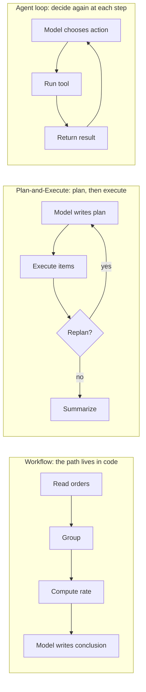

# Who Decides the Next Step: Workflows, Plan-and-Execute, and the Agent Loop

[简体中文](../../../book/notes/control-structures.md) | **English**

[Back to further reading](README.md) · [Back to contents](../../README.md)

> **Branches from**: [Chapter 2, 2.4 What the loop does](../02-runtime.md#24-what-the-loop-does-and-when-it-ends) · [Chapter 6, 6.5 Recovery](../06-extensibility.md#65-recovery-requires-more-than-an-in-memory-variable)
> **Prerequisites**: tool calls and turns (Chapter 2)
> **Continue with**: [The Rise and Fall of Multi-Agent Systems](multi-agent.md) · [How Tool Calling Got Here](tool-calling.md) · [From Prompt Engineering to Harness Engineering](prompt-context-harness.md) · [Chapter 8, Experience needs retirement too](../08-evolution.md#experience-needs-retirement-too) · [Chapter 8, 8.4 Save experience in the right artifact](../08-evolution.md#84-save-experience-in-the-right-artifact)
> **Sources checked**: 2026-11-09

In Chapter 2's loop, the model decides the next step each time it sees a tool result: read another file, edit code, or answer. Most coding agents work this way today, but it is not the only way to make an LLM do work. Two or three years ago, many teams had the model write a complete plan first and then execute it item by item, or wrote every step into code and let the model fill in the blanks.

Those approaches are rarer now, but they have not disappeared, and the reasons they faded are worth understanding. They show something more durable than Pi's source code: **many harness parts compensate for the weaknesses of one model generation; when the model changes, those parts need to be re-evaluated.**

## One investigation, three control structures

Return to the refund investigation. The manager asks, “Did refunds rise after the new checkout page launched?” Below, three structures do the same job. They differ only in **who decides the next step, and when**.

| Structure | Who decides the next step | When | In the refund investigation |
| --- | --- | --- | --- |
| Workflow | Code written by a developer | When the program is written | Code reads orders, groups them by page version, computes refund rates, and hands the numbers to the model to write a conclusion |
| Plan-and-Execute | The model, as planner | At the start, plus replanning if needed | The model lists “1. read orders 2. read support tickets 3. compare versions…”; an executor completes each item |
| Agent loop (ReAct) | The model | After every result | The model reads the orders, notices that “refund” means different things in support tickets, and stops to ask about the definition |

The three are not mutually exclusive. One workflow step can be delegated to an agent, and an agent can call a fixed workflow as a tool. The real design question is which parts of the task can be fixed before starting, and which can only be decided after seeing the material.

## Workflows: write the path into code

In late 2024, Anthropic's “Building effective agents” drew a widely cited distinction: workflows are systems where “LLMs and tools are orchestrated through predefined code paths,” while agents let the LLM dynamically direct its own process and tool use. The post lists five workflow patterns (prompt chaining, routing, parallelization, orchestrator-workers, and evaluator-optimizer) and recommends starting with the simplest solution, adding complexity only when needed. [Anthropic: Building effective agents](https://www.anthropic.com/engineering/building-effective-agents)

Workflows were popular because models of that time struggled to get several steps right in a row. Fixing the path moved “what next” into code, leaving the model only the single-step language tasks it did well. This also had engineering benefits: predictable behavior, easy testing, and easy cost estimates.

The weakness shows clearly in the refund investigation. The coded path assumes “refund” has one meaning. When support tickets reveal that some refunds are really exchanges, the program does not stop to ask. It produces a number that looks reasonable but mixes definitions. **A workflow handles only the branches its developer anticipated.**

So workflows remain the right answer in many settings: stable steps, repeatable results, audits, or high-frequency runs, such as a fixed-format nightly report. In these tasks, fixing steps in code does not compensate for the model; the task itself demands determinism. Chapter 8 also covers the reverse direction: once an agent discovers a stable method in the loop, it can be [turned into a program](../08-evolution.md#84-save-experience-in-the-right-artifact). In that case the agent produces the workflow.

## Plan-and-Execute: list the plan, then work through it

Around 2023, “plan first, then execute” was one of the most common agent structures. Plan-and-Solve prompting had the model decompose a problem before solving it step by step. Projects like BabyAGI drove execution from a task list. LangChain summarized the pattern as Plan-and-Execute agents in May 2023. ReWOO separated reasoning from observations by generating a complete plan with placeholders in one pass, cutting repeated token use. LLMCompiler represented the plan as a dependency graph so independent steps could run in parallel. [Plan-and-Solve](https://arxiv.org/abs/2305.04091) · [LangChain: Plan-and-Execute Agents](https://blog.langchain.dev/plan-and-execute-agents/) · [ReWOO](https://arxiv.org/abs/2305.18323) · [LLMCompiler](https://arxiv.org/abs/2312.04511)

At the time it had three practical benefits:

1. **External working memory for the model.** Early models tended to repeat, drift, or forget what remained in long loops. A written plan reminded them of the goal at each step.
2. **Lower cost and latency.** A strong model planned once; a cheaper model executed. The strong model did not need the full history at every step.
3. **Human review.** Users could check the plan before anything happened and correct a wrong direction early.

The problem is that the plan is written before the material is seen. In investigations, the next step often depends on the previous finding: before reading support tickets, nobody knows the refund definition needs confirming first. Plan-and-Execute added replanning to cope, but the more uncertain the task, the more often replanning happens. If every step triggers a replan, the structure has effectively become an agent loop with an extra module.

## Why the agent loop became the default

ReAct proposed interleaving reasoning and acting in 2022: the model thinks, calls a tool, reads the observation, and thinks again. [ReAct](https://arxiv.org/abs/2210.03629) The idea predates the peak of Plan-and-Execute, but it only works reliably when the model judges each step reliably. Later model generations filled that gap with native structured tool calling, longer context, and extensive training on multi-step tasks. Once step-by-step judgment became reliable enough, “decide again at every step” went from the most expensive option to the simplest.

The plan did not disappear; it moved. It went from being a control structure to being text in the context: the model can write its own plan and revise it inside the loop, and the host does not need to understand it.

Pi is a clear example. Its core loop does not distinguish a planning phase from an execution phase; see [Chapter 2, 2.4](../02-runtime.md#24-what-the-loop-does-and-when-it-ends). Plan mode ships as an official extension example, which the extension list calls “Claude Code-style plan mode”: during planning it disables `edit` and `write` and allows only read-only shell commands; the model writes numbered steps under a `Plan:` header and marks completion with `[DONE:n]` during execution. [Source: extension example list](https://github.com/earendil-works/pi/blob/f07218c4d4bbc12bef056a7058c3dd49dfe41abe/packages/coding-agent/examples/extensions/README.md#L51), [Source: switching to read-only tools](https://github.com/earendil-works/pi/blob/f07218c4d4bbc12bef056a7058c3dd49dfe41abe/packages/coding-agent/examples/extensions/plan-mode/index.ts#L108), [Source: parsing the plan and completion markers](https://github.com/earendil-works/pi/blob/f07218c4d4bbc12bef056a7058c3dd49dfe41abe/packages/coding-agent/examples/extensions/plan-mode/utils.ts#L131-L154)

Here the plan is just reply text parsed by a regular expression; the loop is unchanged. In Pi, Plan-and-Execute is no longer a runtime structure but an optional interaction pattern on top of the loop. It keeps the value of human review before action and drops the constraint that execution must follow the plan.

## The rise and fall of the todo tool: scaffolding has a shelf life

Claude Code's todo tool went through nearly the whole life of a harness part, from necessary to redundant. The timeline below comes from the official Claude Code changelog; dates are the npm publish dates of each version. [Claude Code CHANGELOG](https://raw.githubusercontent.com/anthropics/claude-code/0ed94698aa0aeee471465fc9c867c2e8434c4d68/CHANGELOG.md)

| Version (published) | Change recorded in the changelog |
| --- | --- |
| 0.2.93 (2025-04-30) | Claude gains a Todo list that “helps it stay on track and be more organized” |
| 2.1.16 (2026-01-22) | A new task management system, including dependency tracking |
| 2.1.233 (2026-08-14) | Todo/task-tracking tools (TaskCreate/Get/Update/List, TodoWrite) are no longer available on Opus 4.8, Sonnet 5, Fable 5, Mythos 5, and newer models; `CLAUDE_CODE_ENABLE_TODO_TOOLS=1` brings them back |
| 2.1.268 (2026-09-10) | The tools are offered only on Claude 3.x, Opus 4.0–4.7, Sonnet 4.0–4.6, and Haiku 4.5; other models need the environment variable |

When the task system launched in January 2026, a Claude Code team member explained publicly that, compared with earlier models, Opus 4.5 could run autonomously for longer and track its own state better, so TodoWrite was no longer necessary for smaller tasks. [Republished announcement](https://youmind.com/landing/x-viral-articles/claude-code-tasks-update)

Three points stand out in this history:

- **The tool addressed a specific failure.** A todo list compensated for “forgetting what remains during a long task.” Each update rewrote the remaining goals into the context, acting as a periodic reminder. Once the model tracked its own state reliably, the reminder was only cost: an extra tool call, more context, and more usage rules in the system prompt.
- **The trade-off is made per model, not once.** The same product keeps the tool for older models, disables it by default for newer ones, and leaves a switch. Harness configuration effectively varies with the model version.
- **Removal has downstream costs.** Some third-party skills still instruct the model to use the todo tools, and those instructions cannot be followed on newer models. [superpowers issue #2177](https://github.com/obra/superpowers/issues/2177) This is the same problem as [Chapter 8's experience retirement](../08-evolution.md#experience-needs-retirement-too): the condition a rule depended on has gone, but the rule remains in the system.

This leads to an actionable practice: **record which failure each harness part compensates for, and re-verify that the failure still exists when you change models.** “Add a todo tool” gives nobody a basis for removing it later. “Compensates for missed subgoals in tasks longer than 20 steps, verified by this regression set” lets the same tasks decide whether it stays after a model change. Pi ships its todo as an [extension example that restores state from session branches](../06-extensibility.md#65-recovery-requires-more-than-an-in-memory-variable) rather than as a core feature, which also makes such parts easier to load or remove on demand.

## Will models “eat” the harness?

Since plans and todos are being absorbed by models, a common view holds that models will eventually eat the harness, leaving an empty loop. The idea traces back to Rich Sutton's 2019 “The Bitter Lesson”: in the long run, general methods that leverage computation beat hand-encoded domain knowledge. [The Bitter Lesson](http://www.incompleteideas.net/IncIdeas/BitterLesson.html) Plan-and-Execute yielding to the loop and the todo tool being disabled by default both fit that pattern.

But treating all harness parts alike is inaccurate. It is more useful to split them into two kinds:

| Kind | What it does | Examples | As models improve |
| --- | --- | --- | --- |
| Compensating | Covers what the current model cannot do, or cannot do reliably | Forced plans, todo reminders, elaborate prompt chains, repeatedly emphasized rules | Often shrinks or becomes optional |
| Boundary | Defines the model's environment and responsibilities | Permissions and sandboxes, real tool execution, session persistence, [refusing truncated calls](../02-runtime.md#25-confirm-complete-input-before-acting), independent acceptance, cost limits | Does not disappear; only changes form |

Boundary parts are not eaten because they do not answer questions about model capability. However strong the model, it cannot authorize itself to delete a production database, and its claim that an investigation is complete cannot replace [independent acceptance](../01-first-agent.md). Where sessions are stored and who can see them is also an application decision, unrelated to how smart the model is.

A more accurate statement is: **the weight of the harness is shifting, from thinking for the model to providing the model with an environment and boundaries.** Pi keeps only the loop and a few tools in its core and hands compensating capabilities to extensions, a bet on exactly this direction. As you read this book, keep the question in mind: for each mechanism, which kind is it, and will it likely still be here in five years?

## Choosing a control structure for a task

- **Steps are known in advance and results must be repeatable**: use a workflow. You can let an agent explore in the loop first, then turn the stable method into a program.
- **A human must approve the direction before action**: add plan approval on top of the loop, such as Pi's plan-mode extension. Use the plan for review; it need not constrain execution.
- **The next step depends on mid-task findings**: use the agent loop, and give it an exit to stop and ask; see Chapter 2's [distinction between finishing a reply and finishing an investigation](../02-runtime.md#24-what-the-loop-does-and-when-it-ends).
- **You suspect a part is redundant**: do not remove it on instinct. Build regression tasks from the failure it was introduced for and compare it on and off with the new model, as in [Chapter 8, 8.6](../08-evolution.md#86-evaluate-improvement-and-regression).

## References

- Yao et al. [ReAct: Synergizing Reasoning and Acting in Language Models](https://arxiv.org/abs/2210.03629). 2022.
- Wang et al. [Plan-and-Solve Prompting](https://arxiv.org/abs/2305.04091). 2023.
- Xu et al. [ReWOO: Decoupling Reasoning from Observations](https://arxiv.org/abs/2305.18323). 2023.
- Kim et al. [An LLM Compiler for Parallel Function Calling](https://arxiv.org/abs/2312.04511). 2023.
- LangChain. [Plan-and-Execute Agents](https://blog.langchain.dev/plan-and-execute-agents/). 2023.
- Anthropic. [Building effective agents](https://www.anthropic.com/engineering/building-effective-agents). 2024.
- Rich Sutton. [The Bitter Lesson](http://www.incompleteideas.net/IncIdeas/BitterLesson.html). 2019.
- Anthropic. [Claude Code CHANGELOG](https://raw.githubusercontent.com/anthropics/claude-code/0ed94698aa0aeee471465fc9c867c2e8434c4d68/CHANGELOG.md) (pinned to the 2026-11-06 commit).
