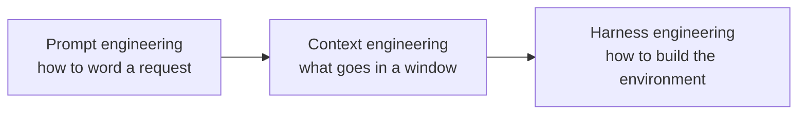

# From Prompt Engineering to Harness Engineering: New Names, a Shifting Focus

[简体中文](../../../book/notes/prompt-context-harness.md) | **English**

[Back to further reading](README.md) · [Back to contents](../../README.md)

> **Branches from**: [Chapter 1, 1.1 Know what you are using](../01-first-agent.md#11-know-what-you-are-using) · [Chapter 8, 8.1 Ask where the change happened](../08-evolution.md#81-ask-where-the-change-happened)
> **Prerequisites**: agent, harness, context (Chapter 1)
> **Continue with**: [Who Decides the Next Step](control-structures.md) · [When the Model Cannot See Everything](context-strategies.md) · [The Shapes of Memory](memory-shapes.md)
> **Sources checked**: 2026-11-09

Chapter 1 broke an agent into model, context, and tools, plus the harness that organizes them. A few years ago this vocabulary was uncommon. People talked about “prompt engineering”: how to write a prompt that gets a better answer. The popular term later became “context engineering,” and after that “harness engineering” appeared.

The changing names are not just marketing refreshes. Each reflects where people thought the bottleneck was: first how to word a single request, then what to put in one window, then how to build the whole environment the model works in.

## Three names

| Name | Popular | Focus | Typical techniques | In this book |
| --- | --- | --- | --- | --- |
| Prompt engineering | 2020–2024 | The text of one request | Role prompts, few-shot examples, “think step by step” | Chapter 3, 3.2 system prompts |
| Context engineering | From 2025 | Everything the model sees each turn | Retrieval, compaction, on-demand loading, trimming tool results | Chapters 3 and 4 |
| Harness engineering | From 2026 | The model's whole runtime environment | Project rules, check scripts, permissions, feedback loops, evaluation | Chapters 5 through 8 |

These stages have no strict boundaries, and each did not replace the previous one. Writing a system prompt today still takes prompt-engineering skill; it is simply a smaller share of the overall work.

## Prompt engineering: how to write one request

The 2020 GPT-3 paper demonstrated in-context learning: without retraining, a few examples in the prompt let a model perform a new task. [Language Models are Few-Shot Learners](https://arxiv.org/abs/2005.14165) The 2022 chain-of-thought paper found that prompting the model to write out reasoning steps first markedly improved accuracy on complex reasoning problems. [Chain-of-Thought Prompting](https://arxiv.org/abs/2201.11903)

The bottleneck then was that models were sensitive to wording: the same question phrased differently could produce very different results. Many techniques followed: assigning roles, providing examples, asking for step-by-step thinking, wrapping input in particular formats.

Later models, trained with instruction tuning and for reasoning, became less sensitive to wording, and many techniques lost effect, much like the todo tool in [Who Decides the Next Step](control-structures.md). But the most valuable part of prompt engineering remained: state the task clearly, give the background, and define acceptance criteria. Chapter 1's insistence on acceptance criteria is exactly this skill.

## Context engineering: what goes in one window

In June 2025, Shopify CEO Tobi Lütke said he preferred the term “context engineering” because it better describes the core skill: providing all the context for a task to be plausibly solvable by the LLM. Andrej Karpathy agreed, describing it as the delicate art and science of filling the context window with just the right information for the next step. [Simon Willison: Context engineering](https://simonwillison.net/2025/Jun/27/context-engineering/)

In September, Anthropic published “Effective context engineering for AI agents,” calling context engineering the natural progression of prompt engineering and defining it as the set of strategies for curating and maintaining the optimal set of tokens during inference, including information beyond the prompt. [Anthropic: Effective context engineering](https://www.anthropic.com/engineering/effective-context-engineering-for-ai-agents)

The name changed because the object of the work changed. An agent no longer answers one question; it runs dozens of turns in a loop. Each turn the model sees not only the prompt but tool definitions, files it has read, past messages, and compaction summaries. What determines results is often no longer how clever the prompt is, but whether these contents were chosen well. Chapter 3 is devoted to this; for how the techniques evolved, see [When the Model Cannot See Everything](context-strategies.md).

## Harness engineering: the environment the model works in

In February 2026, Mitchell Hashimoto's “My AI Adoption Journey” called one of his steps “engineer the harness”: whenever an agent makes a mistake, take the time to engineer a solution so it never makes that mistake again. He described two forms: add rules to `AGENTS.md`, or write a script that lets the agent quickly and automatically learn when it is wrong. He also said he was unsure whether the industry had an accepted term for this. [Mitchell Hashimoto: My AI Adoption Journey](https://mitchellh.com/writing/my-ai-adoption-journey) The same month, OpenAI published an engineering article titled “Harness engineering,” describing its team's experience building a product with Codex. [OpenAI: Harness engineering](https://openai.com/index/harness-engineering/)

This time, the focus widened from what the model sees to the environment in which it acts:

- **Feedback loops.** The agent does not just read rules; it runs tests and checkers and gets clear information from failures. Chapter 5's [make failures actionable](../05-tools.md#make-failures-actionable) belongs to this layer.
- **Boundaries.** Permissions, sandboxes, and completeness checks before execution determine what the agent can and cannot do.
- **Continuous improvement.** Each failure can become a rule, a skill, or a program; Chapter 8 is devoted to this.

Hashimoto's two forms correspond to two kinds of change in Chapter 8.1's table: writing to `AGENTS.md` changes external knowledge or procedure, and writing a check script changes an executable program.

## The shift behind the names

Seen together, the three names show the focus moving steadily outward:

This matches the conclusion of [Who Decides the Next Step](control-structures.md): as models improve, compensating parts (wording tricks, forced plans, todo reminders) gradually become optional, while boundary parts (tool contracts, permissions, acceptance, evaluation) grow more important. The weight of the work shifts from thinking for the model to preparing its environment.

This also suggests a way to read this book. Chapters 1 and 2 introduce what a harness is, Chapters 3 and 4 are context engineering, and Chapters 5 through 8 move ever closer to harness engineering. For each mechanism you meet, ask: does it help the model phrase things correctly, help it see the right things, or set its environment and boundaries? The first two may change as models advance; the third will last.

## References

- Brown et al. [Language Models are Few-Shot Learners](https://arxiv.org/abs/2005.14165). 2020.
- Wei et al. [Chain-of-Thought Prompting Elicits Reasoning in Large Language Models](https://arxiv.org/abs/2201.11903). 2022.
- Simon Willison. [Context engineering](https://simonwillison.net/2025/Jun/27/context-engineering/). 2025-06-27.
- Anthropic. [Effective context engineering for AI agents](https://www.anthropic.com/engineering/effective-context-engineering-for-ai-agents). 2025-09-29.
- Mitchell Hashimoto. [My AI Adoption Journey](https://mitchellh.com/writing/my-ai-adoption-journey). 2026-02-05.
- OpenAI. [Harness engineering: leveraging Codex in an agent-first world](https://openai.com/index/harness-engineering/). 2026-02.
